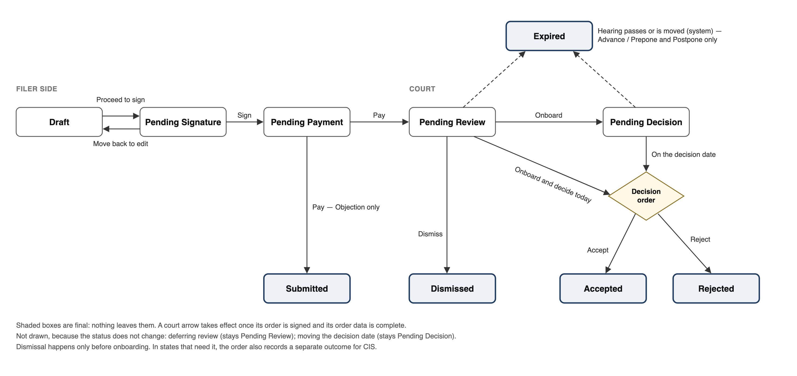

# Application Lifecycle

**Status:** v38 — 2026-11-10; reviewed end to end. **Numbers:** one application number from submission; per state it may be replaced after onboarding, the earlier one kept and searchable (`ALC-02`); Number formats by state is now set out per state and marked provisional (`Q-5`). **No visibility gate:** a submitted application is visible to both sides and is part of the case history; the other side is notified only when an order asks it to respond (`ALC-17`, `ALC-12`). **Onboarding** is the court's decision to consider an application and decide it on a set date; it is now 2a under Review, and the steps are five (`ALC-04`). Every court act goes through the **order item linked to the application** (was "Application item"), pre-added from the application's task and removable (`ALC-32`); its questions are in new `ALC-38`. An onboarded application ends only as **Accepted or Rejected**; dismissal happens only before onboarding (`ALC-36`). The CIS outcome is per-state order data, not mapped to Accepted or Rejected and not kept on the application; Punjab & Haryana records one, Kerala does not, Gujarat is open (`Q-15`). Accepting triggers the type's workflow, with no separate question (`ALC-16`). **Objections:** invited only when the decision date is after today (`ALC-11`); Objection can be chosen as a type, against an application of the other side not yet decided (`ALC-37`); one per application in this version; a missed deadline changes nothing by itself (`ALC-13`); the File objection task closes on submission, decision or dismissal (`ALC-12`); the decision date may be moved earlier than an open objection's deadline, re-dating the task (`ALC-15`). A type with no fee skips Pending Payment (`ALC-01`). An application can be deleted before submission (`ALC-39`). Only a submitted Advance / Prepone or Postpone application expires, when its hearing passes or is moved, and its open tasks close (`ALC-30`). Review application and Decide application go to the Application onboarder, Order drafter and Order signer (`ALC-03`, `ALC-21`). `ALC-18` and 2a(iii) say why a different order can be passed. `ALC-33` reworded; `ALC-35` withdrawn to dropped-ideas.md. Attributes: Signed Application and Form Data added; Temporary Identifier, Template, CIS Outcome, Linked Order and the two objection links merged or removed. Prose before each requirements table cut to a short orientation; state diagram redrawn; "A note on onboarding" and "What looks missing" removed; new Enhancements section. `Q-8`, `Q-11`, `Q-12`, `Q-14` closed. v37 — 2026-11-03; brought in line with the build on main. **Every court act on an application is an order** — onboarding, deferring review, listing, moving the date, dismissing and deciding; there are no system actions left. The court's answers are order data, in the order's **Application item** (`ALC-32`), and the application moves only once that order is signed and its order data complete (`ALC-33`). **Review gains Defer review** again (`ALC-34`), reversing v30. A decision is recorded as Allowed, Partly allowed, Disallowed, Disallowed with cost or Disposed (`ALC-36`); the order also records whether the type's workflow was triggered (`ALC-16`). An application taken up today can still be listed for a date. The objection is always shown once onboarded, with where it stands if none is filed (`ALC-23`). No bulk acts (`ALC-35`). Bail's surety ID proof and proof of solvency take several files. New `Q-15`. v36 — 2026-10-28; **Other details becomes Application details**, a mandatory rich-text field on every type, and the type's own reason box is removed from Bail, Edit Litigant Details, Case Settlement, Case Transfer, Case Withdrawal, Delay Condonation, Generic (Details), PoA Change, Production of Documents, Absent Application, Reopen Evidence and Objection, so no type asks for its reasons twice. v35 — 2026-10-19; references to `APL-02`–`APL-11` of order-generation.md removed, including from `ALC-02` and `Q-5` (that section now only lists pending applications and points here); links point at the e-filing handover, after the e-filing, scrutiny and registration handover was split in two. v34 — 2026-10-18; **court-side permissions are named by role**
([`court-roles.md`](court-roles.md)): onboarding and setting or moving the decision date
need the **Application onboarder** role; orders are drafted by an **Order drafter** and
signed by an **Order signer** (`ALC-22`). "Users and actions" lists roles, not staff titles.
v33 — 2026-10-12; **Every application** gains Other details, an optional text field on every type. v32 — 2026-10-11; payment simplified: anyone on the same side of the case as the application may pay for it (`ALC-29`). Removed the placeholder rows for the withdrawn `ALC-05`, `ALC-06` and `ALC-20`; those numbers are not reused. Added **Decision Date** as an application attribute. Added **Number formats by state** (temporary identifier and application number, per state; Kerala filled from DRISTI 1.0's code, the rest unknown) and `Q-13`. **Linked records** now also shows live views of the Notifications and Events master tables; pending tasks, notifications and events live only in those master tables, not in this file. Added `Q-14`. Punjab & Haryana's formats added: `CRM/[sequence]/[year]` and `CRM-[sequence]-[year]`. Reopen Evidence is available always. v31 — 2026-10-11; closed `Q-9`: an application in Pending Signature can be moved back to Draft and edited there, by anyone who could have created and edited the draft (`ALC-31`, new). Closed `Q-10`: the signer may use any signing mode enabled for the deployment. `ALC-28` tightened: only the person selected in Raised by signs, not any advocate or PiP on the case. v30 — 2026-10-11; **no setting a date before onboarding.** Review (step 2) now offers only Onboard or Dismiss; a date is set only after onboarding (3b). `ALC-05`, `ALC-06` and `ALC-20` are withdrawn, and the "set a date once, then dismiss promoted" rule goes with them, along with the note on deriving whether it had been used. v29 — 2026-10-11; rewrote the workflow as six linear steps — **Filing, Review, Onboarding, Objections, Decision, After the decision** — each with its own prose and its own requirements. "The workflow" now opens with the step list and a one-row-per-step table; "The decision points" is gone, its content moved into the steps; the full status table moves to the end as **Every status change**. Filing is written out in full: who drafts, signs and pays, how the status moves, and steps 1.1–1.8. New requirements `ALC-26`–`ALC-30` (types offered, resumable drafts, who signs, who pays, and expiry — only Advance / Prepone and Postpone expire, when their hearing passes; an unsubmitted application never does); every existing `ALC-` ID is kept. New open questions `Q-8`–`Q-12`. v28 — 2026-10-11; **Fields by application type**: every application can now carry optional, named supporting documents. Case Settlement gets a reason for settlement. Case Transfer's requested court and Case Withdrawal's reason for withdrawal are now text, not dropdowns. Advance / Postpone loses Prayer. PoA Change: Prayer is replaced by a reason for change; litigants appointing the applicant are a multi-select, and an existing PoA is a property of the litigant, not a field; the PoA instruments become one authorization document per litigant. Absent Application gets a reason for absence, Reopen Evidence a reason for reopening and Objection a reason for objection, all text. Bail's supporting documents are replaced by a proof of solvency, one per surety; other documents are optional, under Supporting documents. Edit Litigant Details: Complainant type / Accused type is now Litigant type; CIN or PAN is optional with no format validation; an accused institution's representatives are no longer edited with the institution, but as individual accused; an individual accused's name allows special characters, and the individual accused gains an optional Designation. v27 — 2026-10-09; rebuilt **Fields by application type** from the
application print templates — each type now lists its template, its fields,
who fills each (filer or system) and its field type. Updated **Application types**: renamed
"Bail — Bail Bond" to Bail (the bail bond workflow on acceptance stays); Certified Copy removed; Warrant by
Hand, Absent Application and Reopen Evidence have no workflow attached, and Warrant by Hand
and Absent Application are open to anyone. Added **Every application** (Raised by and
Litigant, with their preselection rules) and Bail's type of bail — cash or surety, a bail
amount for both, and for surety the number of sureties and each surety's details. Each
field table carries an Associated logic column. Bail's surety details are name,
father's / mother's name, phone (mandatory), email (optional), address and ID proof.
**Edit Litigant Details** now lists only the editable fields — the e-filing litigant
fields for complainant or accused, individual or institution, each prefilled with the
litigant's current details. Edit Litigant Details is one application for editing any
litigant's details, with a control on the workflow setting who can raise it and whose
details they can edit. Addition of Witness uses the e-filing witness fields. Warrant by
Hand has the accused and the delivery address, prefilled from the case file. Edit
Litigant Details can change a litigant between individual and institution. v26 — 2026-09-24; v25's image was the raw Mermaid SVG, which renders blank
in Superhuman — Mermaid draws labels with `<foreignObject>` HTML, and a browser refuses
to paint `foreignObject` content when an SVG is shown as a plain ``, so only the
boxes and lines survived. Re-rendered as a flat PNG (`html2canvas` against the live,
on-screen Mermaid DOM, where `foreignObject` renders fine) and swapped the image again;
updated the embedded URL to match. v25 — 2026-09-24; Superhuman doesn't render Mermaid —
it showed v24's diagram as plain code text. Rendered it once (headless Mermaid, Chrome)
and swapped the fenced diagram for the rendered image, hosted at Superhuman's own
permanent blob URL; pulling that back into this file so the local source matches the
synced page instead of drifting from it. v24 — 2026-09-24; the v23 diagram rendered as a crossing mess in Superhuman —
dropped the shared end-marker every terminal status pointed at (five long lines
converging on one dot) and turned the two self-loops (`ALC-05`, `ALC-15`) into notes on
their own state instead of arrows that double back, since neither changes the status
anyway. v23 — 2026-09-24; added a state diagram to **The workflow** — the same
statuses and transitions as the table below it, drawn out, so the shape of the flow reads
at a glance; the table stays the place for exact actor lists and `ALC-`/`Q-` references.
v22 — 2026-09-24; **the decision points** opened straight into the
magistrate's Review application task, with no step for how the application came to
exist — added a new **step 1, Raising the application** (Draft → Sign → Pay, pointing
back at "The workflow"), and renumbered the rest (steps 2–7, sub-letters 3a–c/4a–c)
accordingly. v21 — 2026-09-24; added an orienting paragraph to the top of **The decision
points** — the two gates (onboard-or-not, then accept-or-reject) an application passes
through, stated before the step-by-step detail — and glossed **onboarding** in plain
language at its first real use (now 3a). Both were missing context for a reader new to
the flow. v20 — 2026-09-23; added a **Linked records** section with live views of the
Pending Tasks master tables, filtered to this document — **Review application** and
**Decide application** (Court Side), **File objection** (Citizen-Side), tagged
`application-lifecycle` there. v19 — 2026-09-23; turned **Fields by application type** into one table per
type — field, field type, validations, notes — instead of a bullet list. Flagged two
things that look like spec errors while doing it: Case Transfer's "Select Requested Court"
is marked system-filled when it reads like filer input, and Production of Documents'
"Reason for submission of document" carries file-upload validations that look copied from
the field above it. v18 — 2026-09-23; added **Fields by application type**, pulled from the
functional specs, with fields common to every type (court name, case name, CNR/filing
number, statute/section, who raised it, comments) filtered out — those live once in
"Application attributes," not repeated per type. Added **Template** as an application
attribute — one per type, full spec to come in a separate, not-yet-written templates
document. v17 — 2026-09-23; moved **Users and actions** up, right after "The workflow"
— it's foundational context, not an appendix. Turned its table into a bulleted list per
user; the dot-separated single-line cells were hard to scan. Confirmed `Q-6`: Objection
goes through the same Draft → Sign → Pay steps as every other type — it only diverges
*after* payment, ending at `Submitted` instead of entering `Pending Review`. Closed `Q-6`.
v16 — 2026-09-23; moved the status table to the front and renamed it **"The workflow"** —
it's the fastest way to see the whole shape of the thing. Renamed what was "The workflow"
to **"The decision points"** and restructured it as a numbered sequence (1 → 6, with
sub-choices lettered under the step that offers them), since the old two-table layout read
as flat and parallel when it wasn't. Removed comparisons to the retired source documents
throughout — this file now stands on its own. Dropped a stale bullet from "What looks
missing" (no "Objection" application type) — resolved back in v13. v15 — 2026-09-23; added
a Users and actions section — court-side actions split along `ALC-22` (system action vs.
order); made explicit that `ALC-17`'s visibility gate is for the other party only, not
court staff, who can always see a submitted application. v14 — 2026-09-23; added a new
terminal status, **Submitted**, specific to Objection — it's never separately accepted or
rejected, so it ends there rather than entering `Pending Review` like every other type.
v13 — 2026-09-23; added the application types table, with **Objection** added as a new,
seventeenth type — raised only off another application's File objection task, never
freestanding. Answers half of `Q-6` (it's a type now); narrowed the rest to whether it
carries the usual Draft → Sign → Pay lifecycle. v12 — 2026-09-23; closed `Q-7` without
adding anything — whether "set a date" has been used once is derived by comparing the
Review application task's due date to its default (`ALC-03`), not stored. v11 —
2026-09-23; added an application attributes table — two new statuses (`Pending Decision`,
`Dismissed`), a second number (temporary identifier vs. application number), a widened
`Linked Order`, and `Objections Invited`. Surfaced a gap in doing so: no "Objection"
application type exists despite `Objection (Linked Application)` implying one (`Q-6`).
v10 — 2026-09-23; resolved five open questions: silence on an objection has no
consequence, and the deadline is exactly midnight the day before the decision date
(`ALC-13`, was `Q-1`/`Q-2`); "the other party" is the opposing side, one objection only
(`ALC-24`, was `Q-3`); per-type decide-now-vs-must-object configuration is deferred, with
every type defaulting to "on a date" + notify checked in the meantime (`ALC-25`, was
`Q-4`); system actions (onboard, set/re-date) are magistrate-only, but any order —
including dismissal — may be drafted by the bench clerk or typist, magistrate signs only
(`ALC-22`, was `Q-6`). Added: the magistrate sees filing date and objection status (plus
the objection itself, if any) whenever they open an application (`ALC-23`); the Decide
application task is visible to the bench clerk/typist too, once onboarded (`ALC-21`).
Reworded `Q-5` in plainer terms — the previous phrasing wasn't landing. v9 — 2026-09-23;
collapsed the "first time round" / "rescheduled" split back into a single
**Pending Review** status — offering "set a date" once and then promoting "dismiss" is a
UI/task-history rule, not a second application status (`ALC-05`, `ALC-19`, `ALC-20`).
v8 — 2026-09-23; added an end-to-end status table covering the whole flow, filer through
magistrate — surfaced one gap, what the escape hatch (`ALC-18`) resolves to (`Q-7`).
v7 — 2026-09-23; reverted a mis-sequencing from v6 — **onboarding is the usual,
first-time-round path**, not something gated behind a reschedule; the secondary path
("set a date") is for when the magistrate expects to dismiss but not immediately,
typically waiting for the hearing; a hidden "dismiss right there" sits alongside both from
the start (`ALC-04`, `ALC-05`, `ALC-19`). Once "set a date" has run its course, the
returning task's choices become **onboard or dismiss**, with dismiss now promoted out of
hiding, and no further deferral offered (`ALC-20`, resolves `Q-7`). Softened the "one
action" framing from v5: onboarding and deciding what happens next are still answered
together, but the order itself doesn't have to be signed in the same breath — a
**Decide application** pending task backs up both "deal with it now" and "deal with it on
a date," closing only once an order is actually signed, so an abandoned draft doesn't
quietly lose the application (`ALC-21`). Added a pointer to where application types and
their per-type behaviour live — not yet folded into this file (see "Application types,"
below). v6 — 2026-09-23; the Review application task's choices now change once it's been
rescheduled — first time round the expected path is **set a date**, with a hidden,
rarely-used **dismiss right there**; only after that reschedule does **onboard** appear,
paired with **dismiss** (`ALC-05`, `ALC-19`, `ALC-20`) — this resolves `Q-5` (dismissal was
missing from the flow). Rewrote the date-suggestion rule and the escape hatch in plain
terms, since both read unclearly in v5. v5 — 2026-09-23; onboarding and deciding what
happens next are **one action**, not two — an application is never left onboarded with
nothing decided (`ALC-04`, `ALC-07`); dropped "regardless of filing time" from the
Review-application due date, since nothing here establishes why time of filing would
matter — noted instead as a possible future tightening to same-day (`ALC-03`). v4 —
2026-09-23; the temporary identifier is shown to the user after all — only the "never
cited in an order" restriction stands (`ALC-02`); the workflow diagram is redrawn as two
stages instead of one nested tree, since the branching in v3's version wasn't readable.
v3 — 2026-09-23; the pre-onboarding second action re-dates the **Review application** task
instead of committing to a future dismissal, leaving the fate of an outright dismiss
action open (`ALC-05`, `Q-5`); onboarding and setting the later decision date are
magistrate-only (`ALC-04`, `ALC-09`, `Q-7`); the Review-application due date is always the
next working day, regardless of filing time (`ALC-03`); visibility resolved — invisible to
the other party pre-onboarding, visible after regardless of the objections choice
(`ALC-17`); the no-next-hearing-date case resolved — no default, set manually (`ALC-10`);
the objection window now closes **before** the decision date, not on it (`ALC-13`); the
two numbers swap names — **temporary identifier** at filing, **application number** at
onboarding — pending propagation to `order-generation.md` and `case-numbers.md` (`Q-6`).
v2 — 2026-09-18; compressed to the workflow only, with a note on the value of the
take-on-file step. v1 — 2026-09-18; first cut.

The life of an application from submission to disposal. Order drafting and signing are
owned by [`order-generation.md`](order-generation.md), pending task attributes by
[`pending-tasks.md`](pending-tasks.md), dates by
[`scheduling-product.md`](../scheduling/scheduling-product.md), and number formats by
[`case-numbers.md`](case-numbers.md).

---

## The workflow

Every application moves through the same steps, in the same order:

1. **Filing** — the filer side drafts, signs and pays for the application.
2. **Review** — the court decides whether to consider it: now, later, or not at all. Deciding
   to consider it is **onboarding**, and sets the date the court will decide it.
3. **Objections** — if invited, the other party may file one objection.
4. **Decision** — the court accepts or rejects it, by order.
5. **After the decision** — on acceptance, the application type's own workflow runs.

An application can leave the flow early in two ways only: at review, the court can
**dismiss** it (step 2); and an Advance / Prepone or Postpone application **expires** if
its hearing passes before the application is dealt with ("Expiry", below). Step 3
happens only when the court chooses to deal with the application on a date and
invites objections.

Every court act from step 2 on is an **order** (`ALC-22`), and the court's answers are that
order's data (`ALC-32`). Nothing moves until the order is signed and its order data is
complete (`ALC-33`).

| Step | What happens | Who acts | Status when the step ends |
|---|---|---|---|
| 1. Filing | Choose the type, fill in the form, sign, pay. | Advocate/PiP; a clerk or junior advocate may draft; anyone on the filer's side may pay | Pending Review (Objection: Submitted) |
| 2. Review | Onboard (decide today or set a date), defer review, or dismiss — each by order. | Application onboarder chooses to onboard or defer; Order drafter drafts; Order signer signs | Pending Decision once onboarded; Pending Review if deferred; or Dismissed |
| 3. Objections | The other party may file one objection, by the respond-by date the order sets. | The other party | Pending Decision (unchanged) |
| 4. Decision | An order accepting or rejecting the application is signed. | Order drafter drafts; Order signer signs | Accepted or Rejected |
| 5. After the decision | On acceptance, the type's workflow runs. On rejection, nothing does. | System, or the court where the workflow needs a choice | Accepted or Rejected (unchanged) |



Accepted, Rejected, Dismissed, Submitted and Expired have no arrow leaving them — that's what makes them
terminal. Deferring review (`ALC-34`) and moving the decision date (`ALC-15`) don't
change status, so they are shown as a note rather than a loop.

The steps are set out one at a time below. Every status change is listed in one table at
the end, under "Every status change".

---

## Users and actions

- **Advocate/PiP**
  - Create a draft
  - Sign own drafts and drafts by associated clerks/junior advocates
  - Pay for any application raised by their side of the case
  - View own and associated drafts
  - View all submitted applications on the case (`ALC-17`)
  - File an objection, if invited (`ALC-12`)
- **Clerk and Junior Advocate**
  - Create drafts
  - View own drafts and drafts created by associated advocates
  - Pay for any application raised by their side of the case
  - View all submitted applications on the case (`ALC-17`)
- **Litigant**
  - Pay for any application raised by their side of the case
  - View all submitted applications on the case (`ALC-17`)
- **PoA-Holder**
  - Pay for any application raised by their side of the case
  - View all submitted applications on the case (`ALC-17`)
- **Court staff** — court-side actions need a role from [`court-roles.md`](court-roles.md);
  a staff account may hold several.
  - Any staff account in the courtroom: view all submitted applications (`ALC-17`); key
    metadata and any objection are shown when opening an application (`ALC-23`)
  - **Application onboarder**: choose to onboard an application (`ALC-04`), defer its
    review (`ALC-34`), or set or move the decision date (`ALC-09`, `ALC-15`) — each starts
    an order
  - **Order drafter**: draft any order on an application — onboarding, deferral, moving
    the date, dismissal, or accept/reject (`ALC-22`)
  - **Order data filler**: answer the order item linked to the application (`ALC-32`)
  - **Order signer**: sign it (`ALC-22`)

The **objection-filing** action on Advocate/PiP is signed and paid for like any other
application type.

| ID | Requirement |
|---|---|
| `ALC-22` | **General rule on who may do what:** every court act on an application is an **order** — onboarding (`ALC-04`), deferring review (`ALC-34`), setting or moving the decision date (`ALC-09`, `ALC-15`), dismissing (`ALC-19`), accepting or rejecting (`ALC-08`). Choosing to onboard, defer or set or move a date needs the **Application onboarder** role. Every such order is **drafted** by an **Order drafter** and **signed** by an **Order signer**, per [`order-generation.md`](order-generation.md); what the order does to the application is order data (`ALC-32`). Roles are owned by [`court-roles.md`](court-roles.md). |
| `ALC-32` | **The order item linked to the application.** An order changes an application only through an **order item linked to the application**: an order item that names the application it acts on ([`order-generation.md`](order-generation.md) `ORD-01`). When an order is opened from the application's Review application or Decide application task, this item is already added. Like any order item, it can be removed, or added to any other order (order-generation `ORD-10a`). An order without it does nothing to the application, and the application's task stays open. Its questions are in `ALC-38`. |
| `ALC-38` | The order item linked to the application asks the questions below. Each is mandatory when it is asked (order-generation `VAR-05`, `CMP-02`). |
| `ALC-33` | An order changes the application only once it is **signed and its order data is complete** (order-generation `CMP-04`). When it takes effect, it is added to the application's **Orders** (see "Application attributes"); each later order on the application is added in turn. An order that both onboards and decides the application (2a(i)) onboards it first, so it ends as Accepted or Rejected, never Dismissed (`ALC-36`). |
| `ALC-24` | **"The other party"**, throughout this file, means the opposing **side** — anyone on the complainant side, if the application was raised by anyone on the accused side, or vice versa — not a specific named individual. In this version, only **one** objection may be raised against a given application, on behalf of that side. |

**Questions on the order item linked to the application** (`ALC-38`):

| # | Question | Answer | Asked when | What it does |
|---|---|---|---|---|
| 1 | Onboard the application? | Yes or No; Yes by default | Until the application is onboarded; then fixed at Yes | Yes onboards it (`ALC-04`) |
| 2 | Does this order decide the application? | Yes or No | Always | — |
| 3 | Decision | Accepted or Rejected | 1 is Yes and 2 is Yes | Sets the status (`ALC-36`) |
| 4 | CIS outcome | A value from the state's list | 2 is Yes, in states that record one | Recorded for CIS only (`ALC-36`); for a dismissal, see `ALC-19` and `Q-15` |
| 5 | Date to bring it back | A date, suggested as in `ALC-10` | 2 is No | Not onboarded: the review date (`ALC-34`). Onboarded: the decision date (`ALC-09`, `ALC-15`) |
| 6 | Does the other party need to respond? | Yes or No; Yes by default | 2 is No, the application is onboarded `[DERIVED]`, and the date is after today | Yes raises a File objection task (`ALC-11`, `ALC-12`) |
| 7 | Respond by | A date; by default the day before the decision date | 6 is Yes | The objection deadline (`ALC-13`) |

1 No with 2 Yes dismisses the application (`ALC-19`).

---

## Step 1 — Filing

Filing is everything the filer side does before the court sees the application: choose the
type, fill in the form, send it for signature, sign and pay. It ends when the application
is signed and paid for (`ALC-01`). The form's fields are in "Fields by application type",
and each status change in "Every status change".

| ID | Requirement |
|---|---|
| `ALC-01` | Submitting an application requires the signature of a filer entitled to sign and, where the type carries a fee, payment. A type with no fee skips Pending Payment: signing submits it, and no Complete payment task is raised. |
| `ALC-26` | The filer is offered only the application types whose "Available when" rule (see "Application types") is met for them and the case. |
| `ALC-27` | A draft saves with everything filled in, and reopens that way. Draft is a resumable status, not a discarded one. A draft is visible to the person who created it and to their associated advocates, clerks and junior advocates. |
| `ALC-28` | An application is signed only by the person selected in **Raised by** (for PoA Change, the incoming PoA holder) — not by any other advocate or PiP on the case. A clerk or junior advocate may draft and send for signature, but cannot sign. The signer may use any signing mode enabled for the deployment. |
| `ALC-29` | Anyone on the same side of the case as the application may pay for it — any advocate/PiP, clerk, junior advocate, litigant or PoA-holder on that side. When payment is left for later, a pay task is raised that links back to the application. |
| `ALC-31` | An application in Pending Signature can be moved back to Draft, and edited there, by anyone who could have created and edited that draft. It is edited only in Draft; once edited, it goes through Proceed to sign again. |
| `ALC-39` | An application can be **deleted** before it is submitted — in Draft, Pending Signature or Pending Payment — by anyone who could have created and edited the draft (`ALC-31`). It is then gone, and any task raised for it (Sign application, Complete payment) closes with it. Once submitted, it cannot be deleted. |
| `ALC-02` | Every application has an **application number**, unique, from submission. In some states a new number replaces it once the application is onboarded: from then on the new number is the one shown, but the earlier one is never discarded, and the application can still be found by it. Per state ("Number formats by state"): whether the number is replaced after onboarding, the format of each, and whether it comes from CIS. These are not yet known (`Q-5`). |
| `ALC-17` | A submitted application is **visible to everyone on the case**, on both sides, and to court staff, from submission (`ALC-01`). It is part of the case history from then on. The other party is **not notified** of it before it is asked to respond (`ALC-12`). *Why: hiding an application from some parties but not others adds a stage where only some users can see it, and makes its filing hard to show in the case history, which should be the same for everyone. The other party is still not notified at filing, because the court has not yet looked at the application or found it worth considering; they are notified only when an order asks them to respond. So the application is hidden from no one, but the other party is not told about it until the court acts on it.* |
| `ALC-03` | On submission the system raises a **Review application** task for the courtroom's **Application onboarder**, **Order drafter** and **Order signer** roles (`ALC-22`), due the next working day. Filing time is not a factor in this version; a later version may bring the due date forward to the same day when the application is filed during working hours on a working day. |

---

## Step 2 — Review: the first gate

The first gate: whether the court will consider the application at all. The **Review
application** task raised at submission (`ALC-03`) offers three choices, each by order:

- **2a. Onboard** — the usual choice; below.
- **2b. Defer review** (`ALC-34`).
- **2c. Dismiss** (`ALC-19`).

| ID | Requirement |
|---|---|
| `ALC-34` | **Deferring review** is an order whose order item linked to the application answers Onboard: No, Decision passed: No, and gives the date the application is brought forward. On signature the **Review application** task is re-dated to that date and the status stays **Pending Review**. The date is pre-filled as in `ALC-10`. It may be deferred again; the court is shown that it has been deferred before. |
| `ALC-19` | **Dismissing an application** is an order item, effective on signature: *Dismiss application*, #26 of [`order-template-catalogue.md`](order-template-catalogue.md). An Order drafter drafts it; an Order signer signs (an order, `ALC-22`). It answers Onboard: No, Decision passed: Yes, decided: Disposed `[DERIVED]`. It's available on the **Review application** task the whole time it's open, alongside onboarding and deferral. |

### 2a. Onboarding

Onboarding is the court's decision to consider the application, and to decide it on a set
date (`ALC-04`). In the same order the court chooses:

- **2a(i). Decide it today** (`ALC-08`).
- **2a(ii). Deal with it on a date**, and whether the other party is to respond (`ALC-09`,
  `ALC-11`).
- **2a(iii). Pass a different order** (`ALC-18`).

| ID | Requirement |
|---|---|
| `ALC-04` | **Onboarding** is the court's decision to consider an application, and to decide it on a specific date (`ALC-09`), which may be the same day (`ALC-08`). Until then the court may dismiss it (`ALC-19`); once onboarded, it can only be accepted or rejected (`ALC-36`). It is done by an order whose order item linked to the application answers Yes to *Onboard the application?* (`ALC-32`). An **Application onboarder** chooses to onboard; the order is then drafted and signed like any other (`ALC-22`). Onboarding can be chosen at any time while the **Review application** task is open, and is the usual choice; the alternatives are deferring (`ALC-34`) and dismissing (`ALC-19`). Until the order is signed and its order data complete, the application stays **Pending Review**. After that, Date Onboarded is recorded. |
| `ALC-07` | The onboarding order also answers: **decide it today, or deal with it on a date?** (or pass a different order, `ALC-18`). Signing the order doesn't require the decision to be made at once (`ALC-21`). |
| `ALC-08` | **Today** — the onboarding order also carries the decision: its order item linked to the application answers Onboard: Yes and Decision passed: Yes (`ALC-32`). An **Order drafter** drafts it and an **Order signer** signs it (`ALC-22`). |
| `ALC-09` | **On a date** — the order item linked to the application answers Decision passed: No and gives the date the application is brought forward, and the system raises a **Decide application** task due on that date. Choosing the date needs the **Application onboarder** role (`ALC-22`). |
| `ALC-18` | The **order generation screen** may be opened directly instead of answering "decide it today" or "on a date" — for anything the court wants to do that this workflow does not provide for, such as moving a hearing at the same time. The order starts with no order item linked to the application, so it leaves the application's status and pending task untouched. If someone adds an order item linked to the application to it (for example, *Dismiss application*), that item takes effect on the application once the order is signed and its order data is complete (`ALC-33`). |
| `ALC-21` | Choosing "decide it today" (`ALC-08`) or "deal with it on a date" (`ALC-09`) both raise a **Decide application** task — due immediately for the former, due on the set date for the latter — closing only once an order deciding the application is signed. This covers the gap between the choice and actually drafting the order. The task is raised for the courtroom's **Application onboarder**, **Order drafter** and **Order signer** roles (`ALC-22`). |
| `ALC-25` | Until application types carry their own configuration for this (see "Application types"), every type is treated the same: assumed to go through "deal with it on a date" (`ALC-09`) with the other party asked to respond (`ALC-11`) by default. The Application onboarder can still answer No or choose "decide it today" (`ALC-08`) by hand — this is a placeholder default, not a restriction. |

---

## Step 3 — Objections

Step 3 happens when the order set a decision date after today and asked the other party to
respond (`ALC-11`, `ALC-12`).

| ID | Requirement |
|---|---|
| `ALC-11` | With the date, the order answers one more question: **does the other party need to respond?** — Yes by default. Asked only when the decision date is **after today**; a decision set for today invites no objection. This keeps the default respond-by date (`ALC-13`) from falling in the past. Until application types carry their own configuration, this defaults to Yes for every type (`ALC-25`). |
| `ALC-12` | **Yes** — the other party is told plainly that it must file an objection and by when, and a **File objection** task is raised on it once the order is signed. The task closes when the objection is submitted, or when the application is decided or dismissed before an objection comes in. This is the first notification the other party receives about the application (`ALC-17`). **No** — no task is raised. Either way the other party can see the application, as everyone on the case can from submission (`ALC-17`). |
| `ALC-37` | An **Objection** is filed against one application raised by the other side (`ALC-24`) that has not yet been decided — Pending Review or Pending Decision `[DERIVED]`. It may be started from a File objection task or chosen as a type like any other, with the application it answers selected; how it is offered is up to the UI. Only one objection per application (`ALC-24`). It is filed through step 1 like any application and ends at **Submitted**: it is never reviewed, onboarded, accepted or rejected on its own. |
| `ALC-13` | The objection is due by the order's **respond by** date, which defaults to **the day before** the date the court has said it will deal with the application — e.g. a decision set for the 21st puts the objection deadline at the end of the 20th. The task is raised when the order setting the date is signed. If no objection is filed by then, the system does nothing on its own: the decision stays on the date set. The court sees that none was received (`ALC-23`) and may decide on the date or move the decision to another date (`ALC-15`). |

---

## Step 4 — Decision: the second gate

The second gate: the court accepts or rejects the application — at once after onboarding
(2a(i)), or on the decision date (2a(ii)). Until it decides, it can move the date.

| ID | Requirement |
|---|---|
| `ALC-14` | On the date, the court accepts or rejects the application, reading the application, its documents and any objection filed against it from the same screen. |
| `ALC-15` | An **Application onboarder** may instead **move the decision to another date**, by an order whose order item linked to the application answers Decision passed: No and gives the new date. This applies also when the date set was today. The new date replaces the old one; both the court's task and the objection task (if raised) are re-dated to it, the objection task staying due before the new date (`ALC-13`). The date may be moved earlier than an open objection's respond-by date; the File objection task is then re-dated with it. |
| `ALC-23` | **Whenever court staff open the application**, key metadata is shown alongside it: when it was filed, and whether an objection has been filed. Once the application is onboarded, the objection is always shown: the objection itself if one has been filed, otherwise where it stands — not called for, due by a date, or none received. The previous order on the application is shown alongside, if there is one. |
| `ALC-36` | Once an application is onboarded, the decision is **Accepted** or **Rejected**, and nothing else; an onboarded application is never Dismissed. Dismissal happens only before onboarding (`ALC-19`). Some states also need a separate **outcome** for CIS, recorded as order data. Whether a state records one, and its list of values (master data), are set per state. Punjab & Haryana records one; Kerala does not; Gujarat is open (`Q-15`). The values written here so far are Allowed, Partly allowed, Disallowed and Disallowed with cost; whether they are Punjab & Haryana's list is open (`Q-15`). What happens to the application follows from Accepted or Rejected alone. |

---

## Step 5 — After the decision

What happens once the court has accepted or rejected the application.

| ID | Requirement |
|---|---|
| `ALC-16` | On signature of an order **accepting** the application, the workflow that belongs to that **application type** is triggered. There is no separate choice about it: acceptance triggers it. Each type's workflow is listed under "Workflow attached" in "Application types"; a type with none ends at acceptance. **Rejecting** it does not trigger that workflow. Accepting an Advance / Prepone or Postpone asks for the new hearing date in the order. |

---

## Expiry (Advance / Prepone and Postpone only)

When an application expires on its own, without a decision.

| ID | Requirement |
|---|---|
| `ALC-30` | A submitted **Advance / Prepone** or **Postpone** application — Pending Review or Pending Decision — that has not been accepted or rejected by the time its hearing passes, or is moved to another date, is set to **Expired** by the system. An application not yet submitted does not expire. No other application type expires. Expired is final. *Why: each of these is about one particular hearing; once that hearing has passed, there is nothing left to advance or postpone.* On expiry, its open tasks (Review application, Decide application, File objection) close. |

---

## Suggesting a date

Used wherever an order sets a date on an application: deferring review (2b), the decision
date at onboarding (2a(ii)), and moving the decision date.

| ID | Requirement |
|---|---|
| `ALC-10` | The system **suggests** a date by pre-filling the case's next hearing date, if it has one on record; if it doesn't, there is nothing to pre-fill and the Application onboarder sets the date manually. Later, when application work runs in dedicated asynchronous slots, the suggestion becomes the next such slot. |

---

## Every status change

| Initial status | Action | Actor | New status | Step | Ref |
|---|---|---|---|---|---|
| *(none)* | Create | Advocate/PiP (or a clerk/junior advocate drafting on their behalf) | Draft | 1 | `ALC-27` |
| Draft | Proceed to sign | Advocate/PiP, or a clerk/junior advocate | Pending Signature | 1 | |
| Draft, Pending Signature or Pending Payment | Delete | Anyone who could have created and edited the draft | *(deleted; its tasks close)* | 1 | `ALC-39` |
| Pending Signature | Move back to draft, to edit | Anyone who could have created and edited the draft | Draft | 1 | `ALC-31` |
| Pending Signature | Sign | The person selected in Raised by (PoA Change: the incoming PoA holder) | Pending Payment | 1 | `ALC-28` |
| Pending Payment | Pay | Anyone on the filer's side of the case | Pending Review | 1 | `ALC-02`, `ALC-29` |
| Pending Signature — **type with no fee** | Sign | The person selected in Raised by | Pending Review | 1 | `ALC-01` |
| Pending Payment — **Objection only** | Pay | Anyone on the objecting side of the case | **Submitted** — terminal; no `Pending Review` | 1, 3 | `ALC-24` |
| Pending Review or Pending Decision — **Advance / Prepone and Postpone only** | Its hearing passes, or is moved | System | Expired | Expiry | `ALC-30` |
| Pending Review | Onboard application (order) | Application onboarder chooses; Order drafter drafts; Order signer signs | Pending Decision | 2 | `ALC-04` |
| Pending Review | Onboard and decide today (one order) | Application onboarder chooses; Order drafter drafts; Order signer signs | Accepted or Rejected | 2, 4 | `ALC-08`, `ALC-36` |
| Pending Review | Defer review (order) | Application onboarder chooses; Order drafter drafts; Order signer signs | Pending Review *(unchanged; review re-dated)* | 2 | `ALC-34` |
| Pending Review | Dismiss application (order) | Order drafter drafts; Order signer signs | Dismissed | 2 | `ALC-19` |
| Pending Decision | Accept (order) | Order drafter drafts; Order signer signs | Accepted — the type's workflow runs | 4, 5 | `ALC-16`, `ALC-36` |
| Pending Decision | Reject (order) | Order drafter drafts; Order signer signs | Rejected — no workflow | 4 | `ALC-16`, `ALC-36` |
| Pending Decision | Move the decision to another date (order) | Application onboarder chooses; Order drafter drafts; Order signer signs | Pending Decision *(unchanged)* | 4 | `ALC-15` |

Every court row above takes effect when its order is signed and its order data is complete
(`ALC-33`).

Left out on purpose: the **File objection** task the other party gets in step 3
(`ALC-12`) isn't a status of *this* application — it's a task on a different person
entirely, so it doesn't belong in this application's own status column.

---

## Application attributes

| Attribute | Description |
|---|---|
| Application Number | The number in use, with any earlier one kept (`ALC-02`). |
| Application Type | The type of application. |
| Form Data | Every field entered on the form, as listed in "Fields by application type", including supporting documents. Kept as data on the application for as long as the application exists; generating the PDF does not replace it. |
| Signed Application | The PDF generated for this application and signed (`ALC-28`). The template it is generated from belongs to the application type, not to each application; each type's template is named in "Fields by application type". |
| Date Created | The date the draft was originally created. |
| Date Submitted | The date the application was formally submitted (signed and paid). |
| Date Onboarded | The date the order onboarding the application was signed (`ALC-04`). |
| Decision Date | The date the court will decide the application. Set at onboarding: the date chosen under "deal with it on a date" (`ALC-09`), or the onboarding date itself under "decide it today" (`ALC-08`). Updated whenever the decision is moved (`ALC-15`). The Decide application task is due on this date, and the objection deadline is midnight the day before it (`ALC-13`). Empty until onboarding, and for a dismissed application. |
| Application Raised By | The advocate/PiP who signed the application. |
| Application Raised On Behalf Of | The litigant on whose behalf the application was raised. |
| Status | **Draft · Pending Signature · Pending Payment · Pending Review · Pending Decision · Accepted · Rejected · Dismissed · Submitted · Expired.** `Pending Decision` sits between onboarding and the accept/reject order; `Dismissed` is a disposal distinct from `Rejected`; `Submitted` is Objection's own terminal status — never separately accepted or rejected — see "The workflow". |
| Objections Invited | Whether the order setting the decision date asked the other party to respond (`ALC-11`). Yes/no. |
| Decision | Accepted or Rejected (`ALC-36`). Empty until decided. |
| Orders | Every order passed on the application, oldest first — onboarding, deferral, moving the date, decision — each with what it did to the application (`ALC-33`). The order that decided the application — accepting, rejecting or dismissing it — is marked as the **deciding order**. |
| Linked Applications | Read with Application Type. For an **Objection**, the application it was raised against. For any other type, the objections raised against it — in this version at most **one** (`ALC-24`). |

---

## Number formats by state

These values are provisional and are expected to change. `[SUGGESTED]` is a proposal, not yet decided. `?` is not known.

| Setting | Kerala | Gujarat | Punjab & Haryana |
|---|---|---|---|
| Number at submission | `[filing number]-AP[n]`, e.g. `KL-000123-2024-AP1` | `APP/[sequence]/[year]`, e.g. `APP/124/2026` `[SUGGESTED]` | `CRM/[sequence]/[year]`, e.g. `CRM/11289/2025` |
| From CIS? | No | No | ? |
| Replaced after onboarding? | Yes | No | ? |
| Replacement number | `CMP/[n]/[YYYY]`, e.g. `CMP/2/2024` | — | `CRM-[sequence]-[year]`, e.g. `CRM-1953-2025` |
| Replacement from CIS? | No | — | ? |

Punjab & Haryana's settings are not yet known (`Q-5`). Whether each sequence runs per case or per court is open (`Q-13`).

---

## Application types

Each type's own fields are in "Fields by application type," below.

| Type | Available when | Workflow attached | One-line description |
|---|---|---|---|
| Bail | Only for the accused | On acceptance, the court can request a bail bond — a draft is created from the application. | Request bail for an accused, with supporting details and documents. |
| Edit Litigant Details | Set by a control on the workflow: who can raise it, and whose details each of them can edit | On acceptance, the requested litigant details are updated. | Request corrections to any litigant's details in the case. |
| Case Settlement | Always | — | Request court recognition of a settlement between the parties. |
| Case Transfer | Always | — | Request transfer of the case to another court. |
| Case Withdrawal | Always | — | Request withdrawal of the case. |
| Delay Condonation | Only for the complainant | — | Request condonation of a delay in filing or complying. |
| Generic | Always | — | Submit a general application where no dedicated type applies. |
| Advance / Prepone | Only when a hearing is scheduled in the case | On acceptance, a Next hearing setter selects a new hearing date and the hearing is rescheduled. | Request an earlier date for a scheduled hearing. |
| Postpone | Only when a hearing is scheduled in the case | On acceptance, a Next hearing setter selects a new hearing date and the hearing is rescheduled. | Request a later date for a scheduled hearing. |
| PoA Change | Always | On acceptance, the PoA holder's rights transfer to the person named in the application. | Request an update to the appointed power-of-attorney holder. |
| Production of Documents | Always | On acceptance, the attached documents are added to the case file. | Submit documents for the court to consider in the case. |
| Addition of Witness | Always | On acceptance, the witness is added to the case. | Request the addition of a witness to the case. |
| Warrant by Hand | Always | — The decision screen directs the court to issue a warrant with the channel set to **By hand**; nothing runs automatically. | Request that a warrant be issued for delivery by hand. |
| Absent Application | Always | — | Notify the court of a party's absence and seek related directions. |
| Reopen Evidence | Always | — | Request that evidence be reopened for further examination or submission. |
| **Objection** | Against an application of the other side that has not yet been decided (`ALC-37`) | No accept/reject of its own: ends at `Submitted`, not `Pending Review` — read alongside the original application when the court decides it (`ALC-14`, `ALC-23`), and appears in both applications' `Linked Applications` (`ALC-24`) | State an objection to another party's application. |

Hearing-linked types (Advance / Prepone, Postpone) expire if their hearing passes before
the application is dealt with (`ALC-30`); whether a hearing that is moved counts as well is
open (`Q-8`). Until real per-type configuration of
"decide now vs. must offer objection" exists, `ALC-25` is the placeholder: every type
behaves the same.

Objection goes through the same Draft → Sign → Pay steps as every other type. It only diverges after payment: `Submitted`, not `Pending Review`.

---

## Fields by application type

Each type's own fields, taken from its print template, with the field type from the
functional spec where the spec gives one.

Four fields are on every application, whatever its type, and are listed once under "Every
application" below. Everything else every application carries is left out, because it is
the same for every type and filled from the case, the filer's profile or those two fields:
court complex, case number, filing number, case name, date, the parties table (each
complainant and accused with their advocates), offence, application title, petitioner
name, party name and party type, advocate name, bar registration number, signature, the
"Dated this" line, and the closing additional comments box.

**Filled by:** *Filer* — typed or chosen by the person raising the application. *System* —
taken from the case record; shown, not editable.

### Every application

| Field | Filled by | Field type | Associated logic |
|---|---|---|---|
| Raised by | Filer | Dropdown, single select | Options: everyone with advocate access on the case. Preselected: the user's own name for an advocate with vakalatnama access or a party-in-person; for a clerk, or a junior advocate without vakalatnama access, the advocate they work for — left empty if they work for more than one. Saved as Application Raised By. |
| Litigant | Filer | Dropdown, single select | Options: the litigants represented by the person selected in Raised by; they refresh when Raised by changes. Preselected when there is only one. Saved as Application Raised On Behalf Of. |
| Application details | Filer | Rich text: bold, italic, underline, bulleted and numbered lists, alignment | Mandatory. The application in the filer's own words, and the only free-text box on the form: a type has no reason box of its own. Printed as the body of the application. |
| Supporting documents | Filer | Document name, file upload | Optional. Add as many; one entry per document. The filer names each document. |

### Bail

Template: `application-bail-bond`. The surety fields follow the bail bond form (Form No. 37).

| Field | Filled by | Field type | Associated logic |
|---|---|---|---|
| Type of bail | Filer | Dropdown, single select: Cash, Surety | Surety shows Number of sureties and the surety details. |
| Bail amount | Filer | Amount (Rs.) | Shown for both Cash and Surety. |
| Number of sureties | Filer | Number | Shown when Type of bail is Surety. Sets how many sets of surety details follow. |
| Surety name | Filer | Text | Shown when Type of bail is Surety; once per surety. |
| Father's / mother's name | Filer | Text | Shown when Type of bail is Surety; once per surety. |
| Surety phone number | Filer | Phone | Shown when Type of bail is Surety; once per surety. Mandatory. |
| Surety email ID | Filer | Email | Shown when Type of bail is Surety; once per surety. Optional. |
| Surety address | Filer | Address | Shown when Type of bail is Surety; once per surety. |
| Surety ID proof | Filer | File upload, one or more files | Shown when Type of bail is Surety; once per surety. |
| Proof of solvency | Filer | File upload, one or more files | Shown when Type of bail is Surety; once per surety. Any other documents go in the optional Supporting documents on every application. |

### Edit Litigant Details

One application for editing any litigant's details — complainant or accused, individual or
institution. A control on the workflow decides who can raise it and whose details they can
edit. Template: `application-profile-edit`. Where the template prints a litigant's current
details, it takes them from the case record.

| Field | Filled by | Field type | Associated logic |
|---|---|---|---|
| Litigant to edit | Filer | Dropdown, single select | Options: the litigants whose details the person raising the application is allowed to edit, per the control. Prefills the fields below. |
| Litigant type (`LIT-2` / `ACC-1`) | Filer | Radio: Individual, Institution | Prefilled with the litigant's current type; editable. Together with whether the litigant is a complainant or an accused, decides which of the tables below is shown. Changing it shows the other type's table; those fields start empty. |

The fields below are the litigant fields from e-filing ([e-filing handover](efiling.md)
§6 and §8; IDs in brackets), with the same field types and validations. Every field is
prefilled with the selected litigant's current details, and the filer edits only what has
changed. Addresses use the e-filing address composite (§5).

**Complainant — individual**

| Field | Filled by | Field type | Associated logic |
|---|---|---|---|
| Phone number (`LIT-3`) | Filer | Phone | Must not match any other complainant, accused, advocate or PoA holder in the case. |
| Full name (`LIT-4`) | Filer | Text | Alphabetic. |
| Age (`LIT-5`) | Filer | Number | Positive integer. |
| Gender (`LIT-5a`) | Filer | Dropdown, single select: Male, Female, Other | Optional. |
| Differently abled? (`LIT-5b`) | Filer | Radio: Yes, No | Optional. |
| Email ID (`LIT-6`) | Filer | Email | Optional. |
| Permanent address (`LIT-7`) | Filer | Address | |
| Is the current address the same as the permanent address? (`LIT-8`) | Filer | Radio: Yes, No | No shows Current address. |
| Current address (`LIT-9`) | Filer | Address | Shown when the answer above is No. |

**Complainant — institution**

| Field | Filled by | Field type | Associated logic |
|---|---|---|---|
| Type of institution (`LIT-17`) | Filer | Dropdown, single select | Options from MDMS. |
| Institution name (`LIT-18`) | Filer | Text | |
| CIN or PAN (`LIT-18a`) | Filer | Text, stored upper-case | Optional. No format validation. |
| Phone number (`LIT-19`) | Filer | Phone | Optional. |
| Email ID (`LIT-20`) | Filer | Email | Optional. |
| Institution address (`LIT-21`) | Filer | Address | |
| Authorised representative phone number (`LIT-22`) | Filer | Phone | |
| Authorised representative full name (`LIT-23`) | Filer | Text | |
| Authorised representative age (`LIT-24`) | Filer | Number | |
| Authorised representative gender (`LIT-24a`) | Filer | Dropdown, single select: Male, Female, Other | Optional. |
| Authorised representative differently abled? (`LIT-24b`) | Filer | Radio: Yes, No | Optional. |
| Authorised representative email ID (`LIT-25`) | Filer | Email | Optional. |
| Authorised representative designation (`LIT-25a`) | Filer | Text | |
| Authorised representative address (`LIT-26`) | Filer | Address | |

**Accused — individual**

| Field | Filled by | Field type | Associated logic |
|---|---|---|---|
| Full name (`ACC-2`) | Filer | Text | Alphabetic; special characters allowed. |
| Age (`ACC-3`) | Filer | Number | Integer, 1 or more. Optional. |
| Designation (`ACC-15`) | Filer | Text | Optional. Prefilled for a person responsible for an institution, from the designation entered at e-filing. |
| Mobile number (`ACC-6`) | Filer | Phone | |
| Email ID (`ACC-7`) | Filer | Email | |
| Addresses (`ACC-8…12`) | Filer | Address | Add as many. |
| Police station (`ACC-13`) | Filer | Dropdown, single select | One per address. Mandatory. |

**Accused — institution**

| Field | Filled by | Field type | Associated logic |
|---|---|---|---|
| Type of institution (`ACC-4`) | Filer | Dropdown, single select | Options from MDMS. |
| Institution name (`ACC-5`) | Filer | Text | |
| Mobile number (`ACC-6`) | Filer | Phone | |
| Email ID (`ACC-7`) | Filer | Email | |
| Addresses (`ACC-8…12`) | Filer | Address | Add as many. |
| Police station (`ACC-13`) | Filer | Dropdown, single select | One per address. Mandatory. |

The institution's persons responsible (`ACC-14…23`) are not edited here. Each became a separate individual accused at e-filing ([e-filing handover](efiling.md) §8), and is edited as one, under **Accused — individual**.

### Case Settlement

Template: `application-case-settlement`

No fields of its own; the reason goes in Application details.

### Case Transfer

Template: `application-case-transfer`

| Field | Filled by | Field type | Associated logic |
|---|---|---|---|
| Current court | System | — | The court the case is in. |
| Requested court | Filer | Text | |

### Case Withdrawal

Template: `application-case-withdrawal`

No fields of its own; the reason goes in Application details.

### Delay Condonation

Template: `application-delay-condonation`

No fields of its own; the reason goes in Application details.

### Generic

Template: `application-generic`

| Field | Filled by | Field type | Associated logic |
|---|---|---|---|
| Application title | Filer | Text | Used as the application's heading. |

### Advance (Prepone) / Postpone

Three templates carry these: `application-reschedule-hearing` (advancement or rescheduling),
`application-reschedule-request` (rescheduling) and `application-for-checkout-request`
(checkout of the hearing date). The fields below cover all three.

| Field | Filled by | Field type | Associated logic |
|---|---|---|---|
| Initial hearing date | System | — | From the hearing scheduled in the case. |
| Purpose of hearing | System | — | From the hearing scheduled in the case. |
| Reason for rescheduling | Filer | Dropdown, single select | |
| Proposed hearing date | Filer | Date picker | The date from which the party is available. |

### PoA Change

Template: `application-poa-change`. Raised and signed by the incoming PoA holder,
not by an advocate.

| Field | Filled by | Field type | Associated logic |
|---|---|---|---|
| Litigants appointing the applicant | Filer | Multi-select | Options: the case's litigants. Whether a litigant already has a PoA holder is a property of that litigant on the case record, not a field here. |
| Authorization document | Filer | File upload | One per litigant selected above. |

### Production of Documents

Template: `application-production-of-documents`

| Field | Filled by | Field type | Associated logic |
|---|---|---|---|
| Documents | Filer | Document type, file upload | Add as many; one entry per document. PDF or JPEG, within the file size limit. |

### Addition of Witness

Template: `application-witness-deposition`. The witness fields from e-filing
([e-filing handover](efiling.md) §13; IDs in brackets), with
the same field types and validations. One set per witness; add as many.

| Field | Filled by | Field type | Associated logic |
|---|---|---|---|
| Full name (`WIT-1`) | Filer | Text | Optional if Designation is entered. |
| Age (`WIT-2`) | Filer | Number | Integer, 1 or more. Optional. |
| What will the witness prove (`WIT-3`) | Filer | Text | Optional. |
| Designation (`WIT-4`) | Filer | Text | Optional if Full name is entered. |
| Mobile number (`WIT-5`) | Filer | Phone | Optional. |
| Email ID (`WIT-6`) | Filer | Email | Optional. |
| Addresses (`WIT-7`) | Filer | Address | Mandatory. Add as many. Uses the e-filing address composite (§5). |

### Warrant by Hand

No template of its own.

| Field | Filled by | Field type | Associated logic |
|---|---|---|---|
| Accused | Filer | Dropdown, single select | Options: the case's accused. |
| Address for delivery | Filer | Address | Prefilled with the selected accused's address from the case file; editable. Where the accused has more than one address, the filer picks which one to prefill from. |

### Absent Application

No template.

No fields of its own; the reason goes in Application details.

### Reopen Evidence

No template.

No fields of its own; the reason goes in Application details.

### Objection

No template yet.

| Field | Filled by | Field type | Associated logic |
|---|---|---|---|
| Application objected to | Filer | Dropdown | The other side's applications not yet decided (`ALC-37`). Already set when the objection is started from a File objection task. |

The reason goes in Application details.


---

## Enhancements

- In a later version, an application may be raised on behalf of more than one litigant. In
  this version it is raised on behalf of exactly one.
- In a later version, more than one objection may be filed against an application. In this
  version only one may be (`ALC-24`).
- In a later version, the system may set the decision date itself, on the same logic it uses
  to suggest one (`ALC-10`), and the application type may decide whether the other party has
  to respond (`ALC-25`). The onboarding step would then go away entirely.

---

## Linked records

Live views of the master tables, filtered to this document. Each master table is the
single source of truth and the place to edit its rows; anything tagged
`application-lifecycle` there appears here automatically. A section showing nothing
means nothing is tagged for it yet. A downloaded copy of this document is a snapshot.

### Pending tasks (Court Side)

```superhuman-view
name: Pending tasks (Court Side) — Application Lifecycle
tableUri: superhuman://docs/KtL_rwN6Qw/pages/section-PQWgeMeH-g/tables/grid-KztrhvteSD
filter: PRDs.Contains("application-lifecycle")
```

### Pending tasks (Citizen-Side)

```superhuman-view
name: Pending tasks (Citizen-Side) — Application Lifecycle
tableUri: superhuman://docs/KtL_rwN6Qw/pages/section-PQWgeMeH-g/tables/grid-FICRZ0qIR4
filter: PRDs.Contains("application-lifecycle")
```

### Notifications

```superhuman-view
name: Notifications — Application Lifecycle
tableUri: superhuman://docs/KtL_rwN6Qw/pages/section-xnftvTkudd/tables/grid-3FTjQhdfYv
filter: PRDs.Contains("application-lifecycle")
```

### Events

```superhuman-view
name: Events — Application Lifecycle
tableUri: superhuman://docs/KtL_rwN6Qw/pages/section-2x28DoUtbn/tables/grid-GPg4dKS-s9
filter: PRDs.Contains("application-lifecycle")
```

---

## Open questions

| # | Question | Blocking? |
|---|---|---|
| `Q-5` | For Punjab & Haryana (`ALC-02`): is the application number replaced by a new one once the application is onboarded; and does each number come from CIS? For Gujarat, confirm the suggested format. `case-numbers.md` rows 6–7 then need to match. | No |
| `Q-13` | Is the counter in each application number kept **per case** (as DRISTI 1.0 does: `AP1`, `AP2` within a case; `CMP/[n]/[YYYY]` restarting per case each year) or **per court/courtroom** (as `case-numbers.md` rows 6–7 describe)? This decides whether either number is unique on its own. | No |
| `Q-15` | CIS outcome (`ALC-36`): does Gujarat record one? What is Punjab & Haryana's list of values — are Allowed, Partly allowed, Disallowed and Disallowed with cost its list? Separately, `ALC-19` records a dismissal at review as Disposed for CIS — confirm, and for which states. | No |
