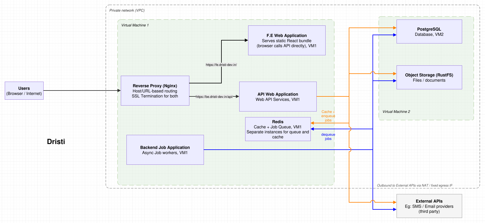
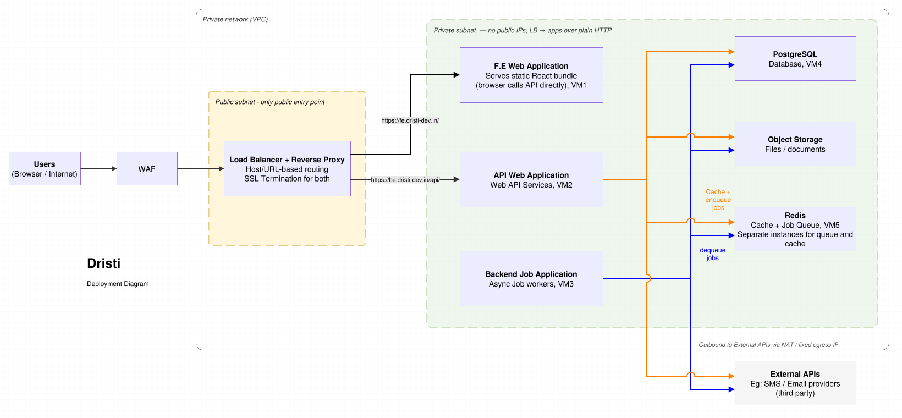
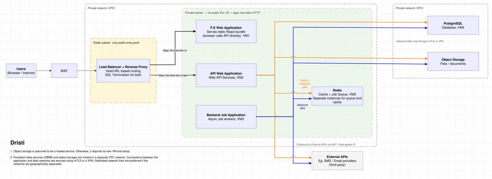

# Deployment Architectures

## Local - For Development

It is [Docker Compose](development.md) based.

## Test - For Testing

It is [Docker Compose](development.md) based.

## Stage - Staging

It's simple two VM based deployment.

## Production: Standard Deployment Architecture

## Production:  Deployment Architecture with separate data VPC

