# Dristi Backend — Entity-Relationship Diagram

Version: 0.1
Last updated on 2026-11-26

Mermaid `erDiagram` sources for the whole schema, one diagram per domain. GitHub
renders these in place; locally use any Mermaid-capable Markdown viewer or
`mmdc -i er-diagram.md`.

## Conventions

- Every entity inherits `apps.core.models.BaseModel` unless noted:
  `id UUID PK`, `created_at`, `updated_at`, and audit FKs
  `created_by` / `updated_by` → `users_user`. These audit columns are **omitted**
  from all diagrams to keep them readable.
- Auditable entities (`BaseAuditableModel`) each get a shadow `*_historical*`
  table from django-simple-history (full row copy + `history_id`,
  `history_date`, `history_type`, `history_user`). Also omitted.
- Soft-delete flag `is_active` is shown only where it drives business rules or
  conditional unique constraints.
- Some models reference other data by **plain id column** (no database FK) by
  design — shown with dashed lines and a `(logical)` label.
- Table names follow Django's default: `<app>_<model>` (e.g. `CASE` →
  `cases_case`, `CASE_PARTICIPANT` → `cases_caseparticipant`).
- Bare boxes (no attributes) are entities defined in another section, included
  to show the relationship.

## Domain map

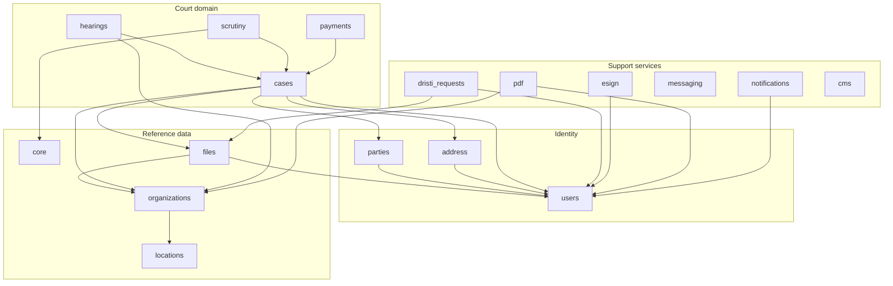

---

## 1. Identity — `users` (spec 0005)

One account (`User`, login by mobile number) with exactly one profile row for
its role. `Person` (section 2) is the human being; `User` is the login. A
person claims an account when they register.

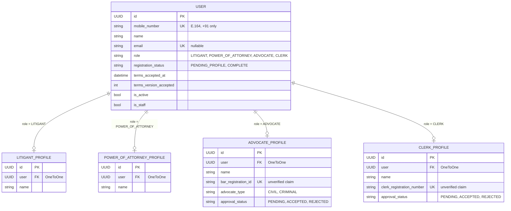

## 2. Parties & addresses — `parties`, `address` (spec 0020 §2-3, §7)

`Person` and `Institution` hold *current* data and are shared across filings;
each case freezes its own snapshot in `CaseParticipant`. `Address` rows are
immutable and deduplicated by content hash: an edit creates a new row and the
caller repoints its FK (`Address.revise()`).

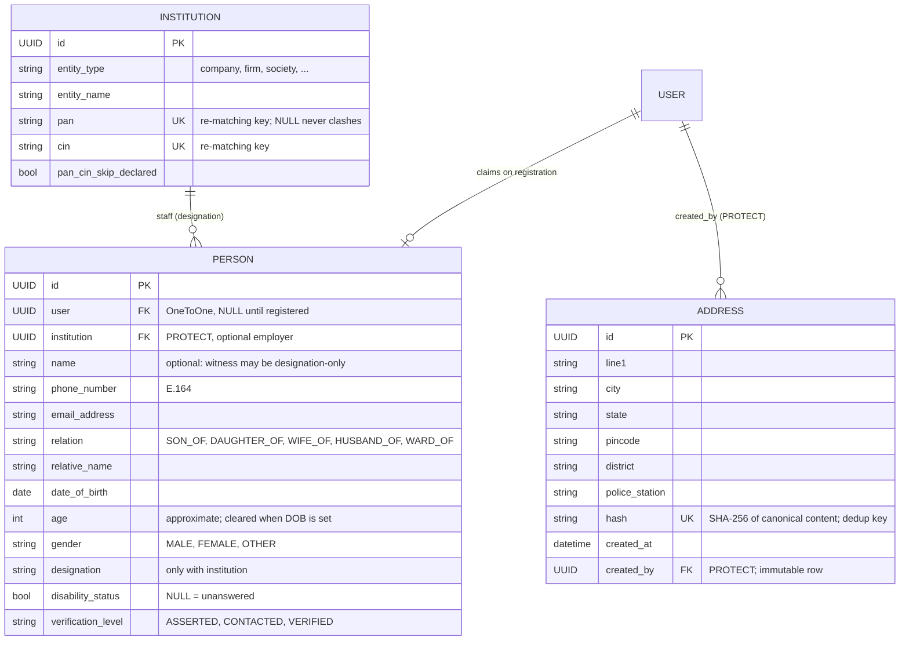

## 3. Reference data — `organizations`, `locations`, `files`, `core`

```mermaid
erDiagram
    ORGANIZATION ||--o{ ORGANIZATION : "parent (court hierarchy)"
    ORGANIZATION }o--o{ LOCATION : "jurisdictions (M2M)"
    LOCATION ||--o{ LOCATION : "parent (administrative hierarchy)"
    ORGANIZATION ||--o{ FILE : "owns"
    USER ||--o{ FILE : "uploads"
    FILE }o--o{ FILE_TAG : "tags (M2M)"
    DJANGO_CONTENT_TYPE ||--o{ ADDITIONAL_ATTRIBUTE : "extends a model"

    ORGANIZATION {
        UUID id PK
        string code UK "upper snake, e.g. KL_HIGH_COURT"
        string organization_type "supreme_court ... magistrate_court"
        string name
        string short_name
        string description
        UUID parent FK "PROTECT, self; NULL = root"
        bool is_active
        json additional_attributes "typed, via AdditionalAttribute"
    }
    LOCATION {
        UUID id PK
        string code UK "e.g. IN_KL, IFSC for banks"
        string name
        string short_name
        string location_type "country, state, district, pincode, bank, police_station"
        UUID parent FK "PROTECT, self"
        bool is_active
        json additional_attributes
    }
    FILE {
        UUID id PK
        UUID organization FK "PROTECT, optional"
        UUID user FK "PROTECT, uploader"
        string file_type "pdf, document, image, signature, digitally_signed"
        string file_name
        string content_type
        bigint file_size
        string storage_path UK "object-storage key"
        bool is_active
    }
    FILE_TAG {
        UUID id PK
        string name UK "slugified"
    }
    LANGUAGE {
        UUID id PK
        string code UK "BCP 47, e.g. en, ml"
        string name
        string native_name
        bool is_default "exactly one row"
        int sort_order
        json supports "ui, translation, ocr"
        bool is_active
    }
    CONFIGURATION {
        UUID id PK
        string config_set "UK with config_key"
        string config_key "UK with config_set"
        string config_value
        string description
        bool is_active
    }
    PUBLIC_CONFIGURATION {
        UUID id PK
        string config_set "UK with config_key"
        string config_key "UK with config_set"
        string config_value "served to internet clients"
        string value_type "string, integer, boolean, json"
        string description
        bool is_active
    }
    BUSINESS_RULE {
        UUID id PK
        string code UK "upper snake; referenced by code, never FK"
        string name
        string description
        string engine "rule_engine, gorules"
        string rule_expression
        json rule_input_schema
        json rule_output_schema
        bool is_active
    }
    ADDITIONAL_ATTRIBUTE {
        UUID id PK
        int content_type FK "django_content_type"
        string name "UK with content_type"
        string data_type
        bool is_nullable
        json default_value
    }
    API_VERSION_CHANGE_LOG {
        UUID id PK
        string version
        string change_log
        bool is_active
    }
```

## 4. Cases — `cases` (spec 0020)

The central aggregate. `Case` holds only what every dispute type shares;
per-type details live in 1:1 extension rows (`ChequeBounceCase`, shared primary
key). Participants, contacts, documents and evidence are soft-deleted
(`is_active = False`), never hard-deleted.

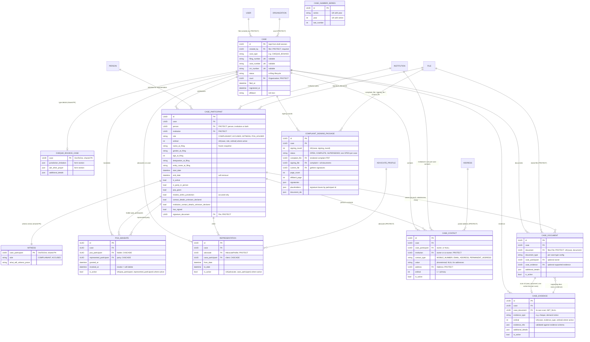

## 5. Hearings — `hearings` (spec 0023)

`Hearing` rows are moved in place and never deleted; every end is a status and
`HearingDateChange` is the append-only adjournment log.

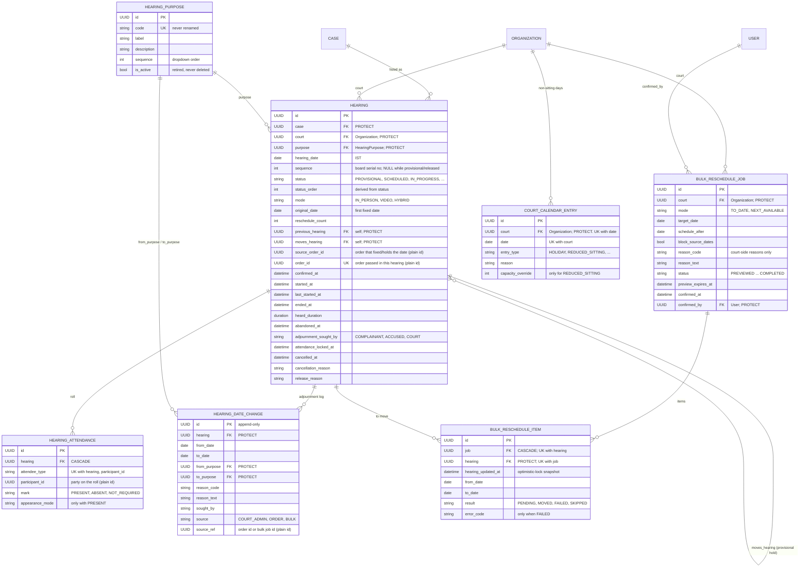

## 6. Payments — `payments` (spec 0017, 0032)

The shape that matters: `Payment → PaymentDemandItem → DemandItem`. Money rows
are immutable once written; balances are rewritten only by the balance service.
`Demand.case` is the only FK into a domain app; everything else is a plain id.

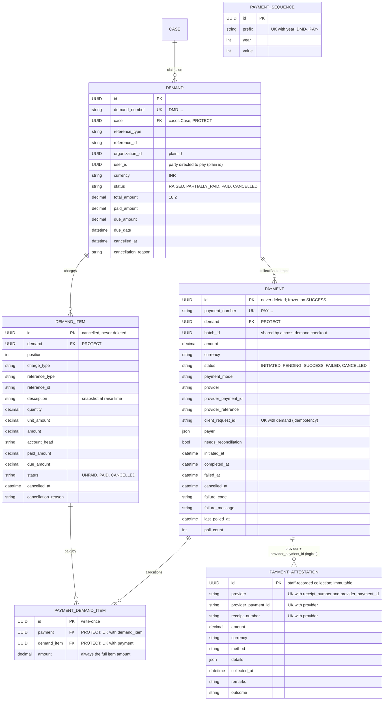

## 7. Scrutiny — `scrutiny` (spec 0024)

A case enters a scrutiny or registration **round**; officers raise **flags**
(defects) on it; the filer answers with **responses**. Unresolved flags carry
over to the next round.

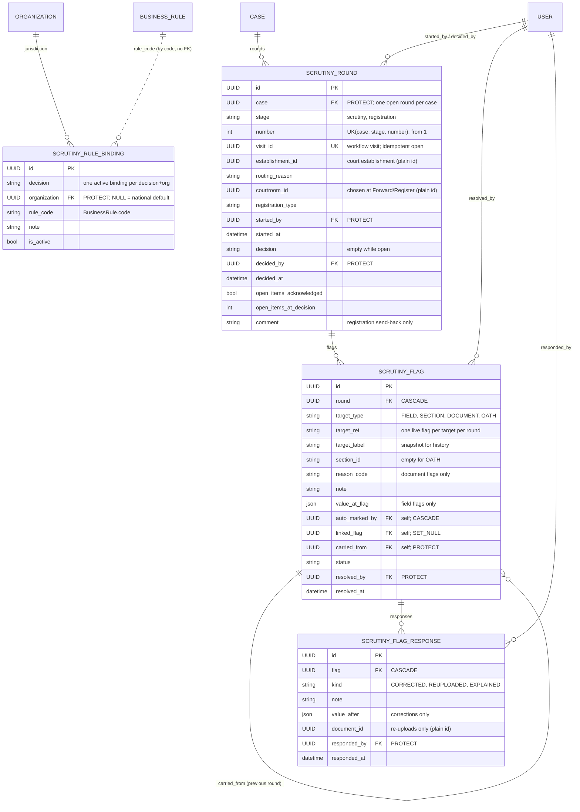

## 8. Requests & approvals — `dristi_requests` (spec 0010)

Domain-agnostic approval workflow: any request type, configurable steps, side
effects applied by post-approval hooks in the consuming app.

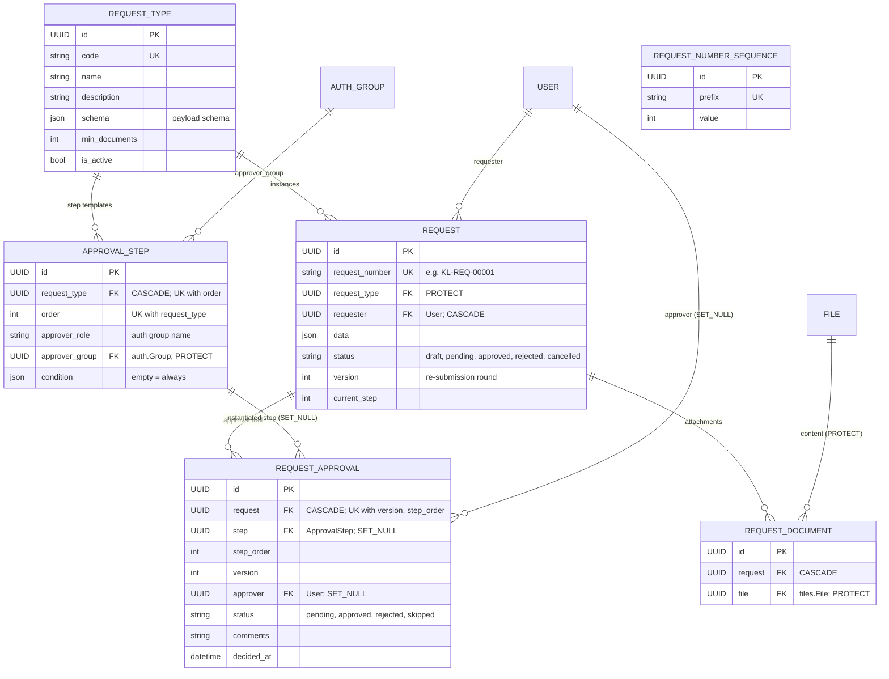

## 9. eSign — `esign` (spec 0015)

One row per signing attempt; a retry is a new row linked by `retry_of`, never
a mutation. File references are plain ids owned by `apps.files`.

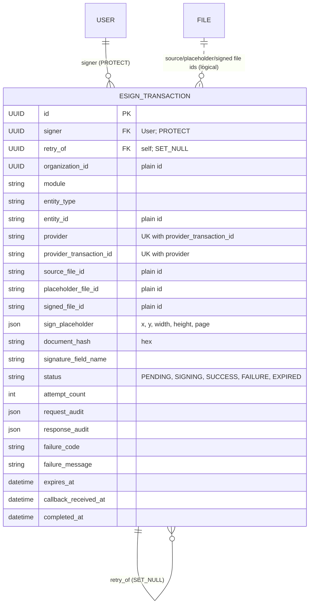

## 10. PDF generation — `pdf` (spec 0016)

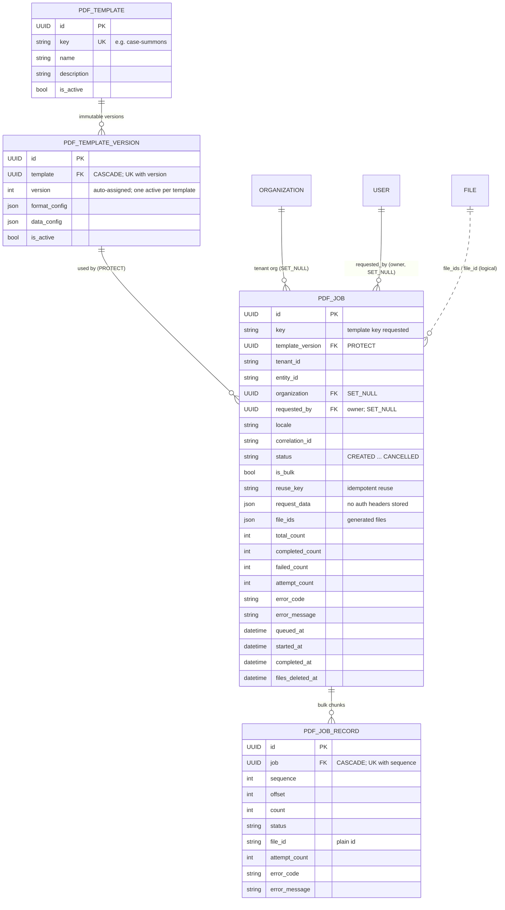

## 11. Messaging, notifications & CMS — `messaging`, `notifications`, `cms`

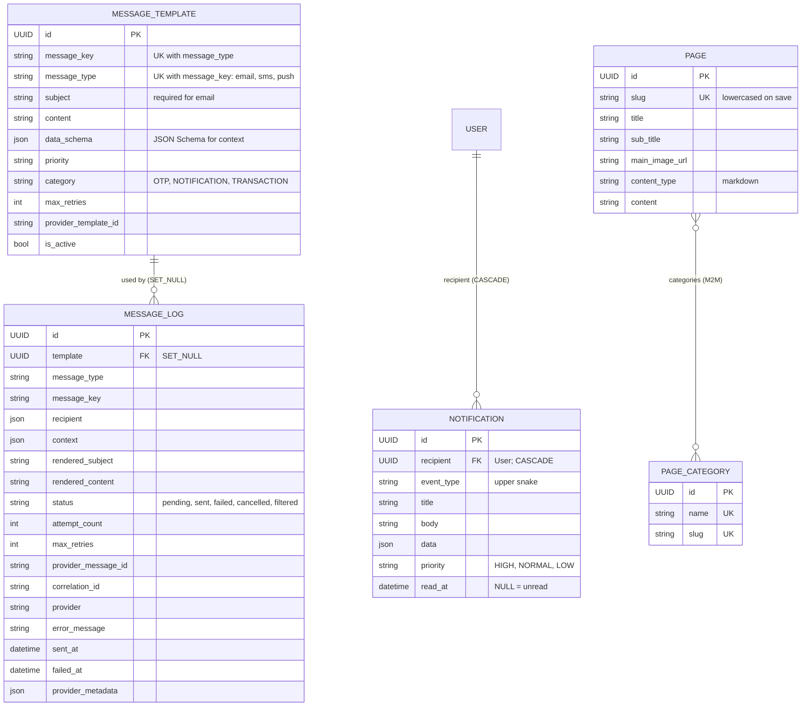

## Entity index

| App | Entities |
|---|---|
| `users` | User, LitigantProfile, PowerOfAttorneyProfile, AdvocateProfile, ClerkProfile |
| `parties` | Person, Institution |
| `address` | Address |
| `organizations` | Organization |
| `locations` | Location |
| `files` | File, FileTag |
| `core` | Language, Configuration, PublicConfiguration, BusinessRule, AdditionalAttribute, ApiVersionChangeLog |
| `cases` | Case, CaseParticipant, Witness, PoaMandate, Representation, CaseContact, CaseDocument, CaseEvidence, ChequeBounceCase, ComplaintSigningPackage, CaseNumberSeries |
| `hearings` | HearingPurpose, Hearing, HearingAttendance, HearingDateChange, BulkRescheduleJob, BulkRescheduleItem, CourtCalendarEntry |
| `payments` | Demand, DemandItem, Payment, PaymentDemandItem, PaymentAttestation, PaymentSequence |
| `scrutiny` | ScrutinyRound, ScrutinyFlag, ScrutinyFlagResponse, ScrutinyRuleBinding |
| `dristi_requests` | RequestType, ApprovalStep, Request, RequestDocument, RequestApproval, RequestNumberSequence |
| `esign` | ESignTransaction |
| `pdf` | PDFTemplate, PDFTemplateVersion, PDFJob, PDFJobRecord |
| `messaging` | MessageTemplate, MessageLog |
| `notifications` | Notification |
| `cms` | Page, PageCategory |
