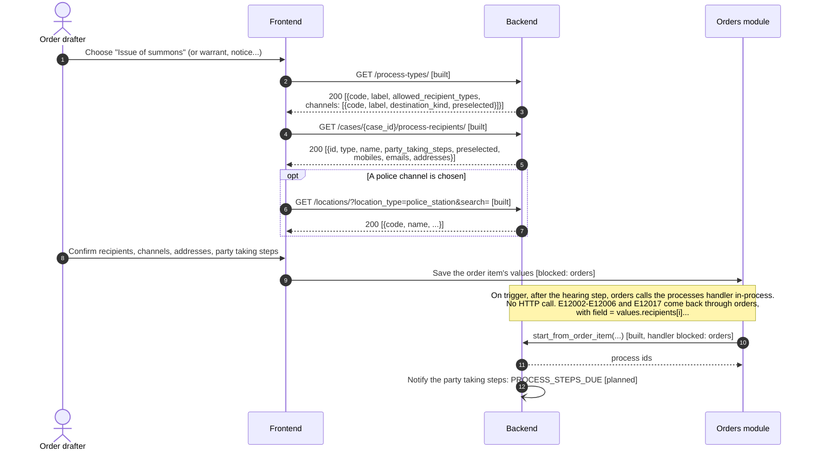
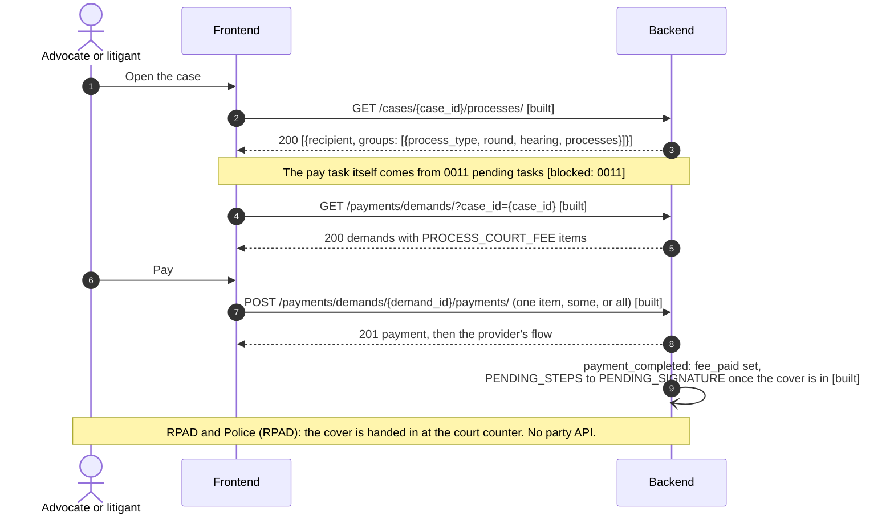
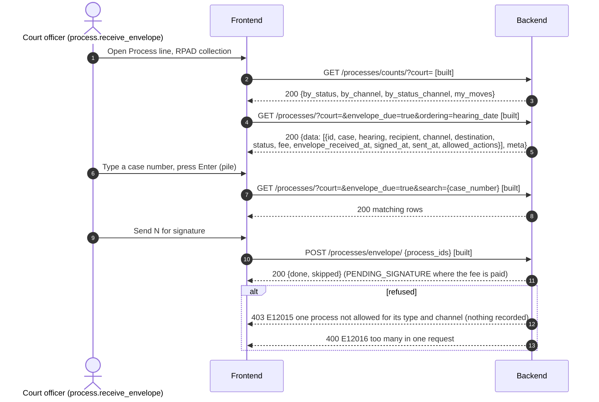
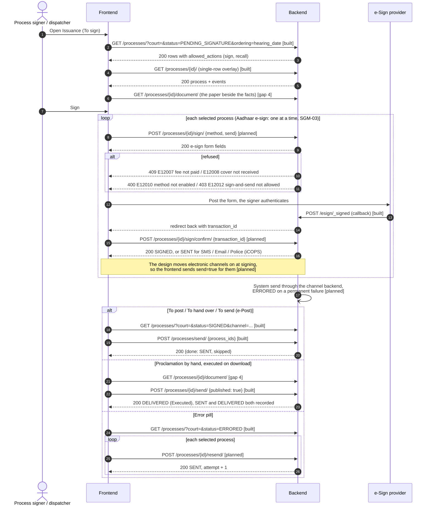
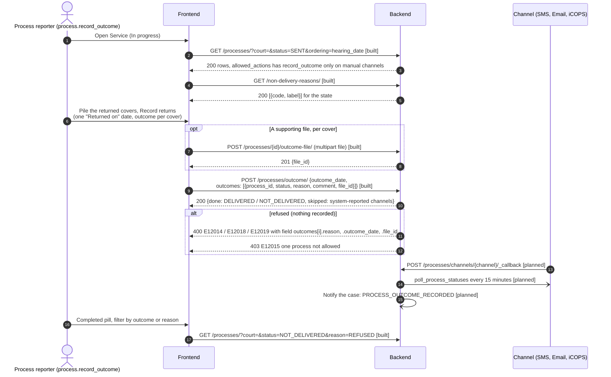
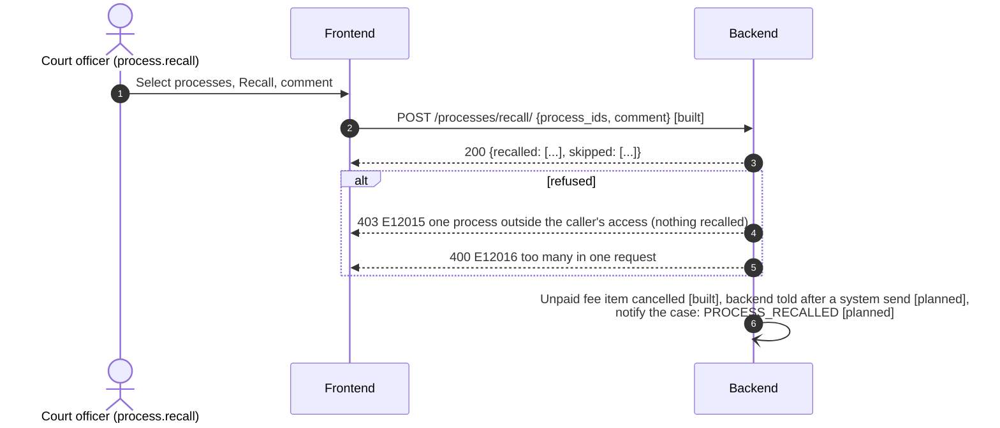
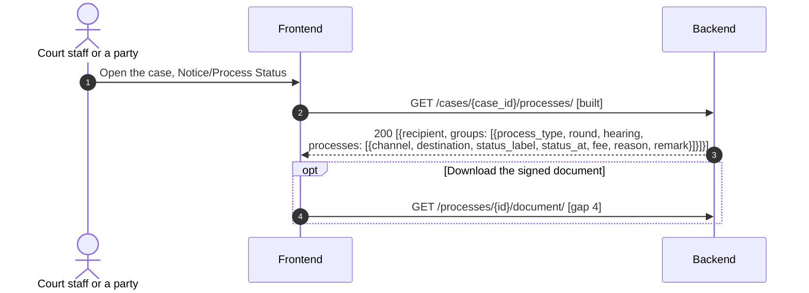

# Summons, warrants and other processes: API sequences (spec 0028)

The API calls each process screen in the frontend design (`dristi-fe-design`) needs,
screen by screen. The screens are:

- the order screen's delivery-channel dialog (`order-variable-dialog.tsx`,
  `docs/design/features/order-delivery-channels.md`);
- the court's process line, `/employee/sign-process`, with its three tabs
  RPAD collection, Issuance and Service (`sign-process.ts`,
  `docs/design/features/sign-process-line.md`);
- the case's Notice/Process Status register (`case-process-status.tsx`);
- the party's steps (paying the process fee, handing in the cover).

Every call is marked:

- **[built]**: on `feature/summons_and_warrants` today;
- **[planned]**: in the signing, channel backends and notifications issue;
- **[blocked]**: waits on the orders module, 0029 or 0011;
- **[gap]**: needed by the design but in neither the code nor spec 0028 (see the last section).

All paths are under `/api/v1/`. List responses are `{data, meta}`, errors
`{errors: [{code, message, field}], meta}`.

## How the design's tabs and pills map to the backend

| Tab | Pill | Backend filter on `GET /processes/` |
|---|---|---|
| RPAD collection | Awaiting cover | `envelope_due=true` (add `fee_paid=true` if unpaid rows stay off this tab, design question A4) |
| Issuance | To sign | `status=PENDING_SIGNATURE` |
| Issuance | To post | `status=SIGNED&channel=RPAD&channel=POLICE_RPAD` |
| Issuance | To hand over | `status=SIGNED&channel=BY_HAND` |
| Issuance | To send (e-Post) | `status=SIGNED&channel=EPOST` |
| Issuance | Error | `status=ERRORED` |
| Service | In progress | `status=SENT` |
| Service | Completed | `status=DELIVERED&status=NOT_DELIVERED`, with `reason=` for the reason filter |

Sorts: *Soonest hearing first* is `ordering=hearing_date`, *Latest hearing first*
`ordering=-hearing_date`, and *Recently updated first* `ordering=-status_at`. The search box is
`search=` (case number, title or recipient name).

## 1. Ordering a process (order screen)

## 2. The party's steps (pay the fee, hand in the cover)

## 3. RPAD collection tab (court: covers arriving)

## 4. Issuance tab (court: sign, post, hand over, send, resend)

## 5. Service tab (court: record returns)

## 6. Recall (from Issuance or Service)

## 7. The case's Notice/Process Status register

## Gaps between the design and the backend

| # | What the design does | What the backend has | Proposal |
|---|---|---|---|
| 1 | Signing a selection in one action | Signing is not built yet; with Aadhaar e-sign each document needs its own authentication (`SGM-03`) | Bulk signing needs DSC or batch e-sign (spec open question 3). Every other act on a selection has a bulk endpoint. |
| 4 | Download the signed paper, and show it in the single-row overlay | No endpoint serves a process's document (`signing_file_id` / `signed_file_id`) | Add `GET /processes/{id}/document/`, covered by the same read permissions as the detail. |
| 5 | Proclamation by hand is recorded Sent and Executed **when its signed copy is downloaded** | `POST /processes/{id}/send/ {"published": true}` | Frontend calls send with `published` on download. No backend change. |
| 6 | The order dialog pre-fills the police station, and after the accused joins pre-selects the unexamined witness | The recipients endpoint does neither | `AUT-04` needs spec open question 2; `AUT-06` needs examination to be recorded. |
| 8 | Non-delivery reasons: Address not found, Door locked, Person not present, Delivery refused, Other | Kerala seed: Addressee not available, Refused, Address incomplete, Left without instructions, Unclaimed, Lost in transit, Other | Agree on one list for Kerala (state master, `DSP-09`). |
| 10 | The Post officer sees only e-Post rows, and nothing before signing | The placeholder access ignores scope | Comes with 0029's scoped grants **[blocked: 0029]**. |
| 11 | e-Post, Email and Police (NSTEP) flows are drawn | Seeded unavailable in Kerala | Deployment choice. The flows work once a channel is made available. |
| 12 | Open in the design: India Post article number when posting | No field | Decide, then add to `send` for postal channels. |
