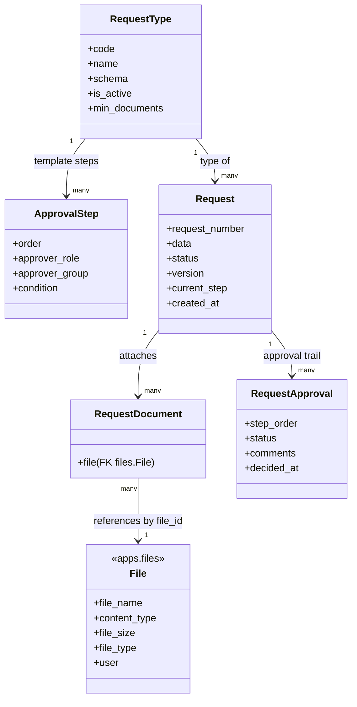
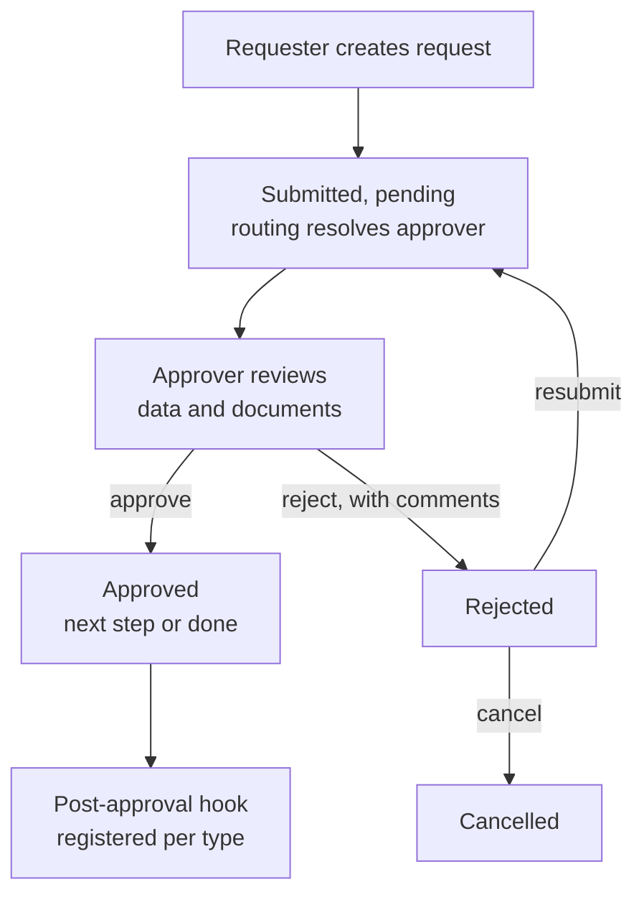
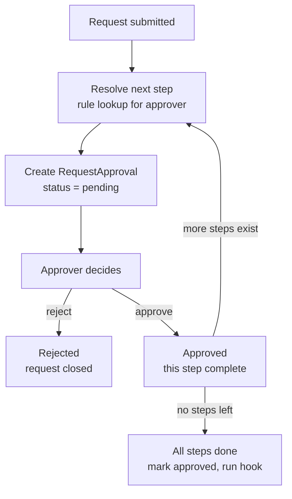
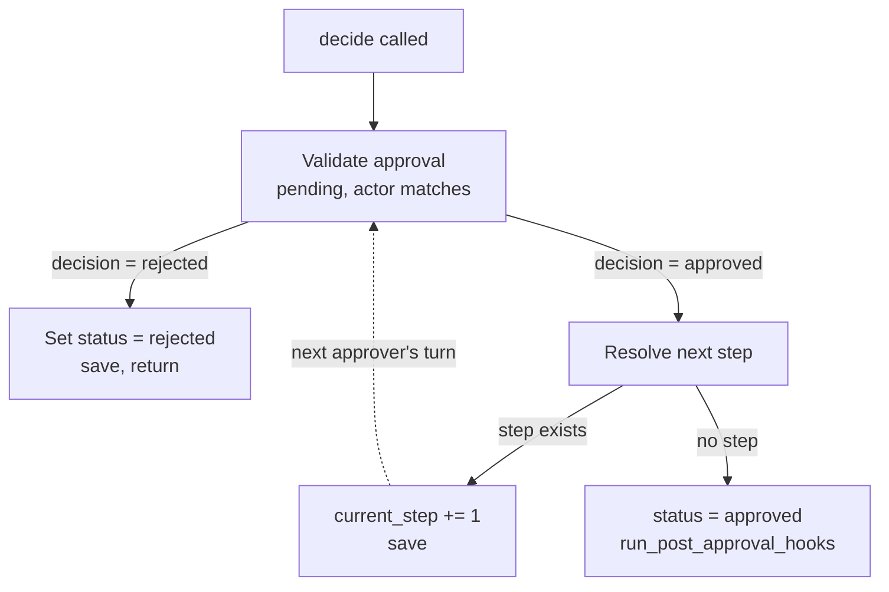
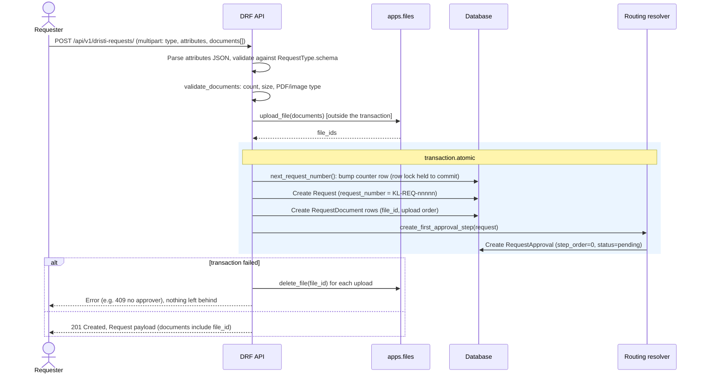
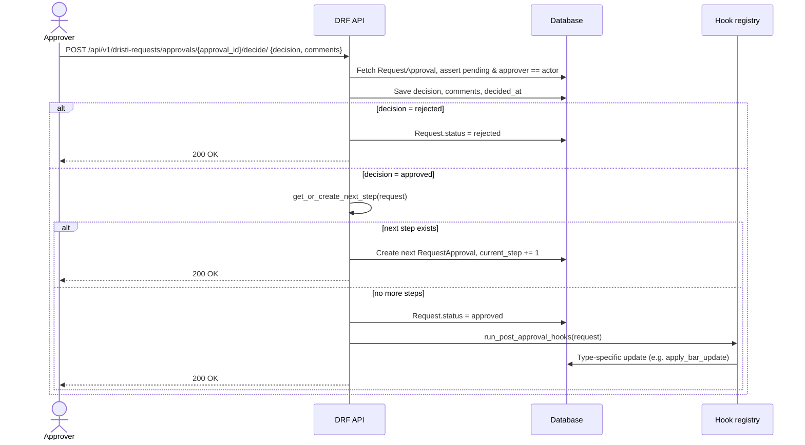
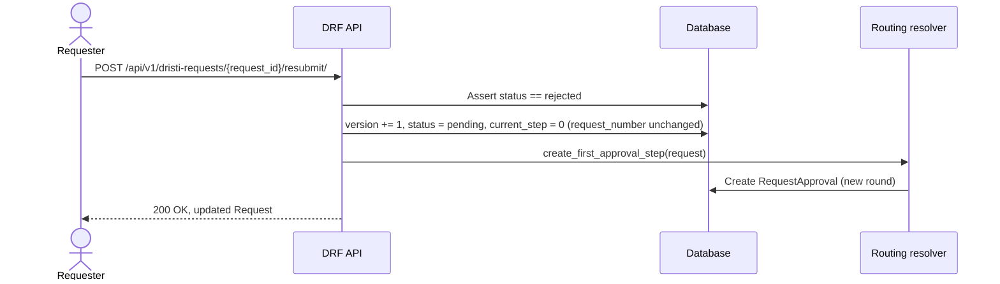
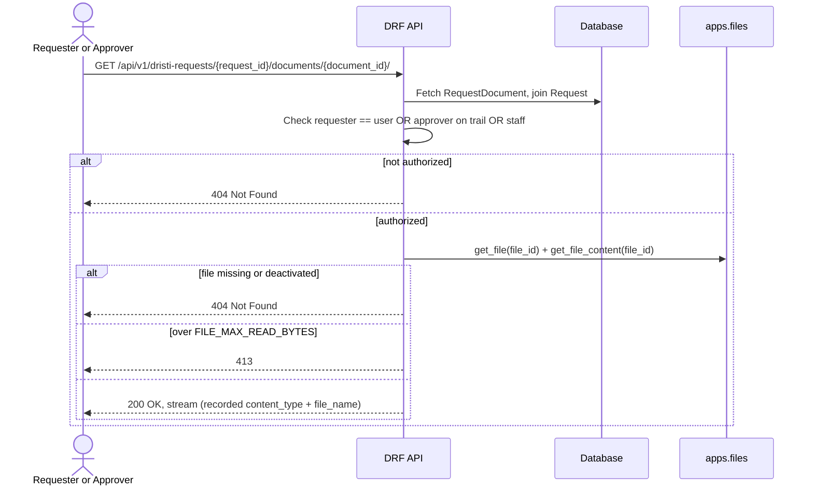

# 0010 — Generic Request & Approval Workflow

## Status

Proposed

## References

- [0014 — File Storage Service](0014-file-storage-service.md) — `apps.files`,
  owns document content and metadata; request documents reference it by
  `file_id`.

## Context

Multiple parts of the system need a way for a user to raise a request with
supporting data and documents, have it routed to the right approver based on
rules, and trigger a follow-up action once approved. Rather than building a
bespoke request/approval flow per feature (leave requests, expense claims,
lawyer bar updates, etc.), this module provides one generic engine: a single
`Request` model with type-specific data in a JSON field, lazy per-step
approval routing, and a pluggable hook registered per request type.

The first request type built on this module is `LAWYER_BAR_UPDATE`.

## Goals

- One generic model + API surface that serves every request type, so adding
  a new type is configuration (a `RequestType` row, a schema, a hook) rather
  than new tables, serializers, or endpoints.
- Multi-step approval routing where the approver at each step can depend on
  the request's own data (amount, department, requester), not just a fixed
  chain of roles.
- A clear, auditable trail per request: who approved or rejected, when, and
  with what comments.
- A short, human-readable, unique number per request (`KL-REQ-00001`) that
  users and support staff can quote instead of the UUID (§1.1).
- Documents as first-class, access-controlled attachments on a request.
- Support for the full lifecycle a request can go through: draft, submit,
  approve/reject per step, resubmit after rejection, cancel.

## Non-goals

- Building a general-purpose BPM/workflow engine — no arbitrary DAGs,
  parallel branching approval steps, or a visual workflow designer; routing
  is linear, one pending approver at a time, resolved by rule per step.
- Validating document *content* — §8.1 checks document count against
  `min_documents`; verifying a document is the right kind, legible, or
  authentic is a manual reviewer task, not this module.
- Delegation / out-of-office routing in this iteration.
- A notification/reminder system for pending approvals.

## Proposed changes

### 1. Data model

Location: `apps.dristi_requests.models`



Document content and metadata are owned by the file storage service
([0014](0014-file-storage-service.md), `apps.files`). `RequestDocument` only
records which request a file supports, and references the file by `file_id`
with `on_delete=PROTECT`, so `files.delete_file` cannot remove a document a
request still relies on. The uploader and upload time are `File.user` and
`File.created_at`; they are not duplicated here. Consuming modules persist the
`file_id`, never the `RequestDocument` row.

`ApprovalStep` is the **template** — the rules used to resolve who approves
each step. `RequestApproval` is the **instance** — the actual per-request
record of who was asked, and what they decided. Keeping these separate is
what allows routing to depend on the specific request's data.

`RequestType.min_documents` is the minimum number of `RequestDocument`
attachments a submission must include, enforced at submit time (see §8.1).

`Request.status`: one of `draft`, `pending`, `approved`, `rejected`,
`cancelled`.

`RequestApproval.status`: one of `pending`, `approved`, `rejected`,
`skipped`.

#### 1.1 Request number

Every `Request` gets a human-readable number alongside its UUID primary key
(issue #141). The UUID stays the identifier in URLs and foreign keys; the
number is what a user sees, quotes on the phone, and what staff search by.

**Format:** `{STATE_CODE}-REQ-{seq:05d}`, e.g. `KL-REQ-00001`.

| Part | Source | Notes |
|---|---|---|
| `STATE_CODE` | configuration store, `config_set = "tenant"`, `config_key = "state_code"` (see below) | Upper-case, 2–3 letters (`^[A-Z]{2,3}$`). One deployment serves one state. |
| `REQ` | constant `REQUEST_NUMBER_KIND` in `apps.dristi_requests.numbering` | Marks the number as a request, as opposed to a case or payment. |
| `seq` | counter row (below) | Starts at 1, zero-padded to 5 digits. Not padding-limited: after `99999` it continues as `100000`. Never resets (no year or type component). |

One sequence covers all request types: the type is already a column, and a
per-type sequence would make two different requests share a number.

**Where the state code lives:** the backend-only configuration store
(`apps.core.models.Configuration`, [0018](0018-configuration-store.md)), not
`PublicConfiguration` ([0034](0034-public-configuration-store.md)) and not an
environment variable.

- *Not an environment variable:* the state is reference data about the
  deployment, and it can be set or corrected in admin without a redeploy, like
  the other operational values in the store.
- *Not `PublicConfiguration`:* only the backend uses it, to build the number.
  Clients get the finished `request_number` and never need the code on its
  own. A `(config_set, config_key)` pair may live in only one of the two
  stores (0034 §1.3). If the frontend needs the state code later, the row
  moves to `PublicConfiguration` and the read below switches to
  `get_public`. Nothing else changes.
- *A generic set, `tenant`:* the code describes the deployment, not requests,
  so other numbers (cases' `filing_number`, say) can read the same row.
  `apps.dristi_requests` owns the read but not the key.

Read at the point of use, never at import time, so an admin edit takes effect
for the next request (0018):

```python
# apps/dristi_requests/numbering.py
from apps.core import services as config

STATE_CODE_SET = "tenant"
STATE_CODE_KEY = "state_code"
STATE_CODE_PATTERN = re.compile(r"^[A-Z]{2,3}$")


def state_code() -> str:
    try:
        value = config.get(STATE_CODE_SET, STATE_CODE_KEY).strip().upper()
    except config.ConfigurationNotFound:
        raise BusinessError(errors.REQUEST_NUMBERING_NOT_CONFIGURED)
    if not STATE_CODE_PATTERN.match(value):
        raise BusinessError(errors.REQUEST_NUMBERING_NOT_CONFIGURED)
    return value
```

- There is **no code default.** A wrong state code would put permanent,
  wrong numbers on requests, so a missing, inactive or malformed row fails
  the creation with `E02008` (503, "Request numbering is not configured.").
  The transaction rolls back and the uploaded documents are discarded (§7.2).
  The value is upper-cased and trimmed before it is checked, so `kl` is
  accepted as `KL`.
- Every environment gets the row from seed data, in
  `data/seed/core/configurations.toml` (the reference data every environment
  needs, `data/seed/README.md`):

  ```toml
  [seed]
  model = "core.Configuration"

  [[rows]]
  config_set = "tenant"
  config_key = "state_code"
  config_value = "KL"
  description = "Two- or three-letter state code that prefixes human-readable numbers, e.g. KL-REQ-00001."
  ```

- Tests that create requests set the row in a shared fixture.
- **Changing the value** in admin starts a new series under the new prefix
  (below). Existing numbers keep the old code. This is the intended behaviour
  for correcting a mis-seeded value, not something to do routinely, so the
  `description` says so.

**Column:** `Request.request_number = CharField(max_length=32, unique=True,
editable=False)`. Not nullable once the backfill (below) has run. The unique
constraint is the backstop; generation never relies on it.

**Generation:** a counter row, the same pattern as `DMD-`/`PAY-` numbers
(spec 0017 §11), never `max(...) + 1` and never `count() + 1`:

```python
class RequestNumberSequence(BaseModel):
    """The last number handed out for one prefix (e.g. ``KL-REQ``)."""

    prefix = models.CharField(max_length=16, unique=True)
    value = models.PositiveIntegerField(default=0)


def next_request_number() -> str:
    """Allocate the next number. Call inside the creating transaction."""
    prefix = f"{state_code()}-{REQUEST_NUMBER_KIND}"
    rows = RequestNumberSequence.objects.filter(prefix=prefix)
    with transaction.atomic():
        if not rows.update(value=F("value") + 1, updated_at=timezone.now()):
            try:
                with transaction.atomic():
                    RequestNumberSequence.objects.create(prefix=prefix, value=1)
            except IntegrityError:
                # Another transaction created the row first.
                rows.update(value=F("value") + 1, updated_at=timezone.now())
        value = rows.values_list("value", flat=True).get()
    return f"{prefix}-{value:05d}"
```

- The `UPDATE ... SET value = value + 1` takes the row lock and holds it
  until the creating transaction commits, so two concurrent creations wait
  for each other instead of drawing the same number.
- Because the counter is bumped inside `_create_request`'s transaction, a
  creation that rolls back (no approver, invalid data) gives its number
  back: there are no gaps from failed submissions. Gaps can still appear if
  a request row is ever hard-deleted; numbers are never reused.
- The counter is keyed by the full prefix, so a changed state code starts a
  new sequence at `00001` under the new prefix without colliding with
  existing numbers.

**When it is assigned:** once, in `_create_request`, before the `Request`
row is inserted, for drafts as well as submitted requests. It never changes
afterwards: resubmitting (§9.3) bumps `version` but keeps the number, and
cancelled/rejected requests keep theirs.

**Existing rows:** the migration adds the column nullable, backfills
existing requests in `(created_at, id)` order as `{STATE_CODE}-REQ-00001`,
`-00002`, …, sets the counter row to the number of rows backfilled, then
makes the column non-null and unique. The reverse migration drops the
column and the counter table.

The backfill reads the state code from the historical `core.Configuration`
model (`apps.get_model`), with the same normalization and pattern check. It
does not use `apps.core.services`, because a migration must not import live
service code. Migrations usually run before seeding, so the row may not exist
yet. In that case the backfill uses `KL`, the only state deployed today, and
prints a warning. A fresh database has no requests to backfill, so it never
needs the fallback. The fallback is for the migration only; it is never used
at runtime.

**Exposure:**

- Read-only `request_number` on every request representation: the request
  list/detail serializers and the request nested in approval responses. It
  is never accepted as input; a client sending it is ignored like any other
  read-only field.
- `GET /api/v1/dristi-requests/?request_number=KL-REQ-00001` and
  `GET /api/v1/dristi-requests/approvals/?request_number=...` filter by exact,
  case-insensitive match, still scoped to the caller's own requests /
  approvals.
- Admin: shown first in `RequestAdmin.list_display`, read-only on the form,
  and in `search_fields` of `RequestAdmin` and `RequestApprovalAdmin`.
- `Request.__str__` returns the number.

One new error code, in `apps/dristi_requests/errors.py`:

| Code | Status | Message | When |
|---|---|---|---|
| `E02008` | 503 | Request numbering is not configured. | `tenant.state_code` is missing, inactive or malformed when a request is created. |

It is declared on `POST /api/v1/dristi-requests/` with `error_responses`.
A request number is never supplied by a client, so there is no validation
error for it, and a filter that matches nothing returns an empty page.

### 2. Request lifecycle



### 3. Approval step resolution (lazy, per-step)



Routing rules (`ApprovalStep.approver_role` / `approver_group` /
`condition`) are evaluated against the request's `data`, `request_type`, and
`requester` at the moment each step is needed — not all at submission time.

### 4. `decide()` control flow

Location: `apps.dristi_requests.services`



```python
def decide(approval: RequestApproval, decision: str, actor, comments=""):
    assert approval.status == "pending"
    assert approval.approver == actor

    approval.status = decision
    approval.comments = comments
    approval.decided_at = timezone.now()
    approval.save()

    request = approval.request
    if decision == "rejected":
        request.status = Request.Status.REJECTED
        request.save()
        return

    next_approval = get_or_create_next_step(request)
    if next_approval is None:
        request.status = Request.Status.APPROVED
        request.save()
        run_post_approval_hooks(request)
    else:
        request.current_step += 1
        request.save()
```

### 5. Post-approval hooks (registry pattern)

Location: `apps.dristi_requests.hooks`

```python
POST_APPROVAL_HOOKS = {}


def register_hook(request_type_code):
    def decorator(fn):
        POST_APPROVAL_HOOKS[request_type_code] = fn
        return fn

    return decorator


def run_post_approval_hooks(request: Request):
    hook = POST_APPROVAL_HOOKS.get(request.request_type.code)
    if hook:
        hook(request)
```

Each request type registers independently — adding a new type never
requires editing the core approval engine.

### 6. First request type: `LAWYER_BAR_UPDATE`

**Schema** (validated against `Request.data`):

```json
{
  "type": "object",
  "required": ["name", "bar_number"],
  "properties": {
    "name": { "type": "string", "minLength": 1 },
    "bar_number": { "type": "string", "minLength": 1 }
  }
}
```

**Fields:** `name` (text), `bar_number` (text) — both in `data`.
**Documents:** one bar registration document, via `RequestDocument`
(`min_documents = 1` on the `RequestType` row).

**Hook:**

```python
@register_hook("LAWYER_BAR_UPDATE")
def apply_bar_update(request: Request):
    person = resolve_person_for_requester(request.requester)
    person.name = request.data["name"]
    person.bar_number = request.data["bar_number"]
    person.save(update_fields=["name", "bar_number"])
    doc = request.documents.first()
    LawyerBarDocument.objects.create(person=person, request_document=doc)
```

`LAWYER_BAR_UPDATE` requires no dedicated endpoint — it's created purely
through configuration (a `RequestType` row + schema + hook registration) and
submitted through the generic create endpoint below.

### 7. API — Submitter side

Location: `apps.dristi_requests.views`, `apps.dristi_requests.serializers`

| Method & path | Purpose |
|---|---|
| `POST /api/v1/dristi-requests/` | Create a request. Generic across types — `request_type` + `attributes` (JSON string) + `documents[]`, multipart. |
| `GET /api/v1/dristi-requests/` | List the caller's own requests. |
| `GET /api/v1/dristi-requests/{request_id}/` | Retrieve one request. |
| `GET /api/v1/dristi-requests/{request_id}/approvals/` | View the approval trail for a request. |
| `POST /api/v1/dristi-requests/{request_id}/resubmit/` | Resubmit a rejected request (bumps `version`, restarts routing). |
| `POST /api/v1/dristi-requests/{request_id}/cancel/` | Cancel a pending or rejected request. |
| `GET /api/v1/dristi-requests/request-types/` | List available types + schemas, for dynamic form rendering. |
| `GET /api/v1/dristi-requests/request-types/{request_type_id}/` | Retrieve one request type. |
| `GET /api/v1/dristi-requests/{request_id}/documents/{document_id}/` | Download a specific attached document (explicit, authorization-checked). |

Request shape:

```
Content-Type: multipart/form-data

request_type: LAWYER_BAR_UPDATE
attributes:   {"name": "Jane Doe", "bar_number": "KAR/1234/2019"}
documents:    <file1>
documents:    <file2>
```

#### 7.1 Document validation

Documents are validated in the generic create serializer's `validate()`,
after `attributes` has been parsed and schema-checked but before `create()`
runs, so an invalid submission never reaches storage or the database. The
checks live in `apps.dristi_requests.documents.validate_documents`:

| Check | Limit | Error |
|---|---|---|
| Minimum count | `RequestType.min_documents` | 400 on `documents` |
| Maximum count | `settings.FILE_MAX_COUNT_PER_UPLOAD` | 400 on `documents` |
| Size per file | `settings.FILE_MAX_SIZE_BYTES` | 400 on `documents` |
| Content type | PDF or image (see below) | 400 on `documents` |

Accepted content types and the `FileType` each is stored as:

| Content type | `FileType` |
|---|---|
| `application/pdf` | `pdf` |
| `image/jpeg`, `image/png` | `image` |

`apps.files` enforces the same size and count limits, but reports them as
Django `ValidationError`, which DRF renders as a 500. Checking them here first
keeps them a 400 on the `documents` field; anything `apps.files` still rejects
is translated the same way.

The original count-only check, for reference:

```python
class GenericRequestCreateSerializer(serializers.Serializer):
    request_type = serializers.SlugRelatedField(
        slug_field="code", queryset=RequestType.objects.filter(is_active=True)
    )
    attributes = serializers.CharField()
    documents = serializers.ListField(
        child=serializers.FileField(),
        required=False,
        allow_empty=True,
    )

    def validate_attributes(self, value):
        try:
            parsed = json.loads(value)
        except (json.JSONDecodeError, TypeError):
            raise serializers.ValidationError("attributes must be a valid JSON object.")
        if not isinstance(parsed, dict):
            raise serializers.ValidationError("attributes must be a JSON object.")
        return parsed

    def validate(self, attrs):
        request_type = attrs["request_type"]
        validate_against_schema(request_type.schema, attrs["attributes"])

        doc_count = len(attrs.get("documents", []))
        if doc_count < request_type.min_documents:
            raise serializers.ValidationError(
                {
                    "documents": f"{request_type.name} requires at least "
                    f"{request_type.min_documents} document(s), got {doc_count}."
                }
            )
        return attrs
```

The content-type check is on the declared type only; it does not inspect the
bytes. Whether a bar certificate is actually a bar certificate, rather than
any PDF, is either a manual check (the approver looks at it during review) or
a separate, stricter mechanism (see Future TODO: `required_document_types`).

#### 7.2 Storing documents

Storage writes are not transactional, so the order of operations is what
guarantees a failed submission leaves nothing behind:

1. **Upload first, outside the request's transaction.** All documents go to
   `files.upload_file` in a single call, so they are stored all-or-nothing.
   Each is tagged `dristi-requests` and the request type code, and attributed
   to the requester (`user_id`).
2. **Then create the request atomically:** the `Request`, one
   `RequestDocument` per `file_id` (in upload order), and the first approval.
3. **If step 2 fails** (e.g. no approver can be resolved), call
   `files.delete_file` for each uploaded `file_id` and re-raise. Cleanup
   failures are logged, never raised, so they cannot mask the original error.

The committed `File` rows from step 1 are what make step 3 possible: if the
upload ran inside the request's transaction, a rollback would erase the rows
but not the stored objects, leaving them orphaned.

Cancelling, rejecting and resubmitting a request never delete its documents;
they are part of the audit trail. Replacing a document would create a new
`file_id` (0014 §6.3), never modify a stored one.

### 8. API — Approver side

| Method & path | Purpose |
|---|---|
| `GET /api/v1/dristi-requests/approvals/` | List pending approvals assigned to the caller. |
| `GET /api/v1/dristi-requests/approvals/?status=approved&status=rejected` | History of the caller's past decisions. |
| `GET /api/v1/dristi-requests/approvals/{approval_id}/` | Retrieve one approval, with the nested request (data + documents). |
| `POST /api/v1/dristi-requests/approvals/{approval_id}/decide/` | `{"decision": "approved"\|"rejected", "comments": "..."}` |
| `GET /api/v1/dristi-requests/{request_id}/documents/{document_id}/` | Same document-download endpoint as submitter side — authorized to any approver on the trail. |

### 9. Sequence diagrams

#### 9.1 Submit a request



#### 9.2 Approver decides



#### 9.3 Resubmit after rejection



#### 9.4 Document download



Access is decided by this module before `apps.files` is asked for anything.
`apps.files` has no access model of its own (0014 Future TODO), so a document
is never served by `file_id` alone.

## Affected files

- `src/apps/dristi_requests/__init__.py`
- `src/apps/dristi_requests/apps.py`
- `src/apps/dristi_requests/models.py`
- `src/apps/dristi_requests/serializers.py`
- `src/apps/dristi_requests/views.py`
- `src/apps/dristi_requests/urls.py`
- `src/apps/dristi_requests/services.py`
- `src/apps/dristi_requests/documents.py` — the only module that calls `apps.files`
- `src/apps/dristi_requests/migrations/0003_request_document_uses_files.py`
- `src/apps/dristi_requests/numbering.py` — `next_request_number()` (§1.1)
- `src/apps/dristi_requests/errors.py` — `E02008`
- `src/apps/dristi_requests/migrations/0004_request_number.py` — counter table,
  column, backfill
- `data/seed/core/configurations.toml` — `tenant.state_code` row
- `data/seed/README.md` — list the new core seed file
- `src/apps/dristi_requests/tests/test_numbering.py`
- `src/apps/dristi_requests/hooks.py`
- `src/apps/dristi_requests/admin.py`
- `src/apps/dristi_requests/tests/__init__.py`
- `src/apps/dristi_requests/tests/test_models.py`
- `src/apps/dristi_requests/tests/test_services.py`
- `src/apps/dristi_requests/tests/test_views.py`
- `src/apps/dristi_requests/tests/test_hooks.py`
- `src/apps/dristi_requests/tests/test_documents.py`

## Open questions

1. Should `RequestType` support `required_document_types` (specific document
   categories, not just a count) for types that need more than "any N
   files"?
2. Should a requester's `GET /api/v1/dristi-requests/{request_id}/` response expose *who* is
   currently sitting on the approval, or only aggregate status + comments?
3. If approvers can delegate (e.g. out-of-office), how should `GET
   /api/v1/dristi-requests/approvals/` and `decide()`'s actor check account for delegated-to-me
   items?
4. Document storage: stream through Django (simple, loads the app server) or
   issue short-lived signed URLs from S3/GCS (scales better, but splits
   authorization and byte-serving across two systems)?

   Partly answered: documents are stored by `apps.files`, which streams
   content (0014 §6.1) and defers signed URLs to its own open question 1.
   Downloads stream through Django until that lands.
5. Should every status transition (submit, each decision, resubmit, cancel,
   hook outcome) be logged in a dedicated `RequestAuditLog`, since
   `RequestApproval` rows alone don't capture cancellations or resubmission
   history?
6. Issue #141 suggests formatting the number through business rules
   ([0019](0019-business-rules.md)). This spec uses a fixed format instead:
   a rule cannot allocate the sequence (rules do no I/O, 0019 §4.1), so it
   could only format a number already drawn, and the format is not policy
   that changes between releases. Revisit if states need different formats.
7. The state code is the `tenant.state_code` row in `Configuration`. It is
   admin-editable, and editing it starts a new number series (§1.1). Should
   admin warn about, or restrict, editing it once any number has been
   issued? And when the frontend needs the code (to show the state, say),
   should the row move to `PublicConfiguration`?

## Out of scope

- Parallel or branching (DAG) approval routing — steps are strictly linear.
- Validating document *content* or authenticity — count only.
- Delegation / out-of-office approval routing.
- Notifications or reminders for pending approvals.
- Bulk request creation.

## Future TODO

- Add `required_document_types` to `RequestType` for types needing specific
  document categories, not just a minimum count.
- Support approver delegation.
- Add `RequestAuditLog` for a full transition history independent of
  `RequestApproval`.
- Decide and implement approver-identity visibility on the requester-facing
  API.
- Evaluate signed-URL document storage for scale.
- Notification/reminder system for pending approvals.
- Consolidate the per-app counters (`PaymentSequence`, `CaseNumberSeries`,
  `RequestNumberSequence`) into one generic number generator in `apps.core`.