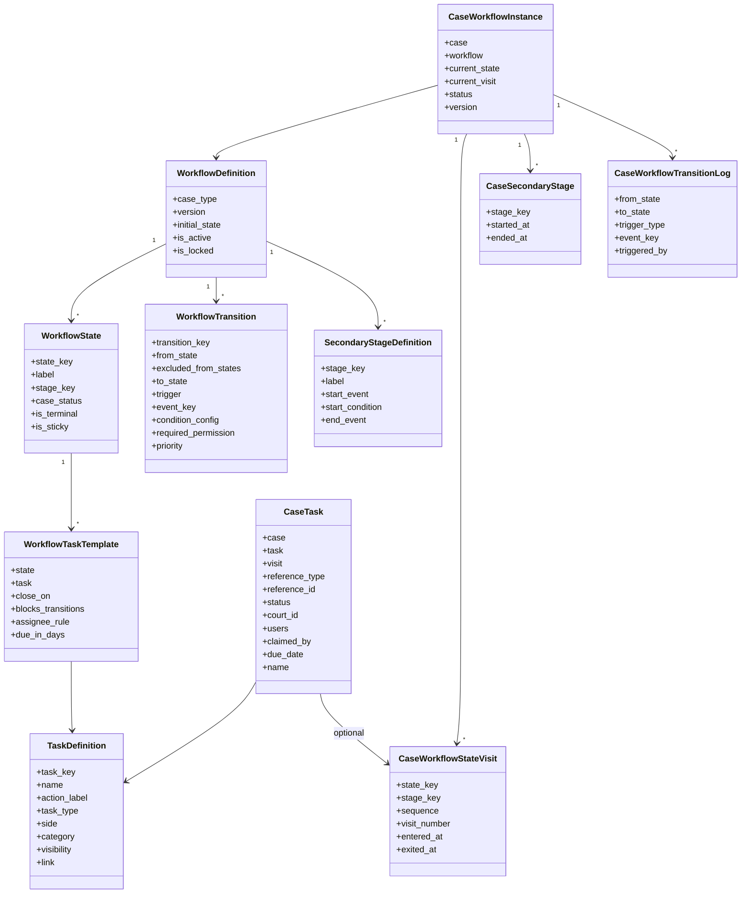
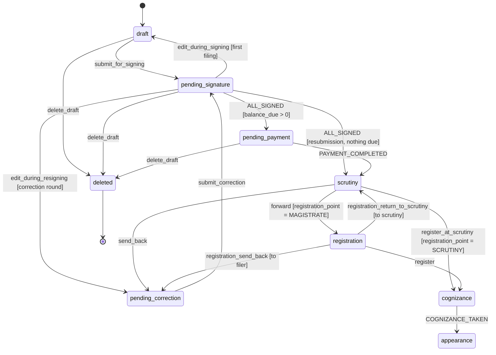

# 0011 — Case Workflows (`apps.workflows`)

## Status

Proposed

Revised 2026-10-19 against the case-lifecycle, e-filing/scrutiny/registration,
pending-tasks, cognizance and application PRDs and the court-side screens:

* Tasks hang off states and are re-opened on every visit, so a case can pass through the same state any number of times (scrutiny rounds);
* Modules move a case by **event**, without knowing transition keys;
* The workflow holds the case-lifecycle **primary stages**, the **secondary stages** that run alongside them, and the history of both;
* The engine holds every **pending task** — the ones a workflow state opens, and the ones other modules open against a case;
* `Case.status` is kept as a projection written only by the engine;
* case-type plugins live in the app that owns the case type;
* The generic "trigger a transition" endpoint is withdrawn.

## References

- PRDs: `case-lifecycle-handover.md` (primary and secondary stages, tracking), `efiling-scrutiny-registration-handover.md` (§4 `LIFE-`, §18 `SIG-07`, §19.4, §20 `SCR-09`–`SCR-12`), `pending-tasks-handover.md` (task attributes and statuses), `cognizance-cheat-sheet.md` (§3), `application-lifecycle.md` (`ALC-03`, `ALC-09`, `ALC-12`, `ALC-15`, `ALC-21`), `process-handover.md` (`FEE-06`, `STP-01`, `SGN-02`), `order-template-catalogue.md` (stage changes are listeners, not workflows)

> **Scope note.** `apps.workflows` is case-type agnostic. It knows states,
> transitions, events, stages and tasks; it does not know what a cheque, a
> scrutiny flag or an application is. The rules of a case type live in a
> plugin registered by the app that owns the case type. Domain modules
> (scrutiny, applications, processes, orders) move a case only through
> `CaseWorkflowService` and open their tasks only through `TaskService`.

## Context

A case on Dristi moves through mutually exclusive **primary stages** — Filing,
Scrutiny, Defect Correction, Registration, Cognizance, Appearance, Bail &
Recording of Plea, Complainant Evidence, Examination of Accused, Defence
Evidence, Arguments, Mediation, Judgement, Post-Judgement, Post-Disposal, Long
Pending Register. At any moment it is in exactly one. Each starts on a trigger
and replaces the stage before it (case lifecycle §3).

Alongside the primary stage, **secondary stages** start and end on their own —
Delay Condonation, Notice, Summons, Warrant, Proclamation, Attachment — and
several can be active at once (case lifecycle §4).

The court must be able to see, for every case, every stage it entered, when it
started and when it was replaced, and how long it stayed (case lifecycle §6).

Before registration the stages are the e-filing lifecycle, which loops:

```text
Draft ─> Pending Signature ─> Pending Payment ─> Scrutiny ─> Registration ─> Cognizance
              ▲                    ▲                │  ▲          │
              │     (balance due)  │                │  │          │
              └── Pending Correction <──────────────┘  └──────────┘ (registration_point)
```

The same states are entered again on every correction round (`LIFE-11`).

Work is driven by **pending tasks**, never by separate queues. A case is on the
scrutiny officer's list exactly while its *Scrutinise case* task is open
(`SCR-09`, `SCR-10`); it is on the magistrate's *Take cognizance* list while its
*Take Cognizance* task is open — and **not** by stage, because a case can move
to a later stage before cognizance is taken (cognizance cheat sheet §3). Other
modules raise tasks that have nothing to do with a state change: *Review
application* and *Decide application* for the magistrate, *File objection* and
*Pay* for a party, *Hand in envelope* for a process (`ALC-03`, `ALC-21`,
`ALC-12`, `FEE-06`, `STP-01`).

Every task has the same attributes — name, due date, users, category, link,
status, case, visibility, creation date, action label — and the same four
statuses: Open, Completed, Expired, Archived (pending tasks §2, §3).

The engine as first specified could not run this. It allowed a task only once
per transition, so a second scrutiny round was impossible; it had no event
entry point; it had no stages, no secondary stages, no assignees and no
non-workflow tasks; its plugins lived inside the engine; and its example
workflow did not match the case lifecycle.

## Goals

* One generic, data-driven engine; one active, locked definition per case type.
* Start a case's workflow when the case row is created; move it only through the engine.
* Fire transitions manually, by **event** from other modules, or automatically when a condition passes.
* Allow a state to be entered any number of times, recording every visit.
* Map states to primary stages, and track secondary stages started and ended by events.
* Keep a full stage history with start and end dates.
* Hold every pending task of a case — state-bound or opened by a module — with the pending-tasks attributes, statuses and visibility.
* Resolve task users from court designations or case sides, and serve the court-side and citizen-side lists from one query.
* Choose between transitions by per-court configuration.
* Keep `Case.status` correct as a projection.
* Expose REST APIs following [`0000`](0000-api-coding-spec.md), with registered error codes.

## Non-goals

* A graphical workflow designer, BPMN, parallel gateways, timers.
* Domain screens and payloads — scrutiny, registration, cognizance, applications, processes. Each owns its endpoints.
* Notification copy and the events catalogue (case-update timeline). Modules raise those; the engine only sends signals.
* Court-side process work, which is a list of processes by status, not a pending task (`SGN-02`).
* Case outcome (Dismissed, Withdrawn, Convicted …), which is a case field (case lifecycle §5).
* Case types other than §138 in this iteration.

---

## Proposed changes

### 1. App layout and boundaries

```text
apps/workflows/
├── apps.py                 # name = "apps.workflows"
├── models.py               # definitions, instances, visits, secondary stages, tasks, logs
├── enums.py
├── errors.py               # E05xxx (#9.5)
├── exceptions.py
├── signals.py              # state_entered, state_exited, stage_started, stage_ended, task_opened, task_closed
├── engine.py               # WorkflowEngine
├── services.py             # CaseWorkflowService, TaskService
├── conditions.py           # condition_config evaluator (#5)
├── assignees.py            # user rules (#7.3)
├── plugins.py              # BaseCaseTypePlugin, registry (#6)
├── selectors.py            # current state, stage history, task lists
├── tasks.py                # Dramatiq actors (#7.6, #7.7)
├── serializers.py · views.py · urls.py · permissions.py · admin.py
└── tests/

apps/cases/workflow/        # owned by the case type
├── plugin.py               # ChequeBounceCasePlugin
├── handlers.py             # automatic task handlers
└── fixtures/cheque_bounce_v1.json   # the definition of #10, loaded by a data migration
```

Dependency rules:

```text
apps.cases, apps.scrutiny, apps.hearings, apps.orders, apps.applications, apps.processes
        ── import ──> apps.workflows.services / selectors / plugins
apps.workflows ── never imports ──> any of them   (FK to "cases.Case" by string only)
```

Rules:

* The engine reaches case-type behaviour only through the plugin registry.
* Modules learn about state and stage changes from `apps.workflows.signals`, sent on commit.
* A case-stage change is never an order workflow. A module that sees a stage-relevant event — an order signed, a hearing scheduled, the accused side joining — dispatches the event; the definition decides what it means (`order-template-catalogue.md`, *Case stage changes are not workflows*).
* An isolation test asserts that nothing under `apps.workflows` imports another domain app.

### 2. Data model



All models inherit `apps.core.models.BaseModel`. Definition models also inherit
`BaseAuditableModel`. Every bounded enum is a `TextChoices` in
`apps/workflows/enums.py`.

#### 2.1 `WorkflowDefinition`

A named, versioned workflow that belongs to a single `case_type`.

| Field | Type | Notes |
| --- | --- | --- |
| `case_type` | `CharField(32, db_index=True)` | a `cases.CaseType` value, e.g. `CHEQUE_BOUNCE` |
| `version` | `PositiveIntegerField` | monotonic per case type, e.g. `1`, `2` |
| `name` | `CharField(255)` | human-readable name, e.g. "Cheque Bounce — v1" |
| `description` | `TextField(blank=True)` | optional documentation, e.g. what changed from the previous version |
| `initial_state` | `CharField(64)` | state key where new cases start, e.g. `draft` |
| `is_active` | `BooleanField(default=False)` | the definition new cases start on |
| `is_locked` | `BooleanField(default=False)` | set when the first instance is created; states, transitions, secondary stages and task templates become read-only |

Constraints:

- `UniqueConstraint(case_type, version)`.
- `UniqueConstraint(case_type, condition=Q(is_active=True))` — at most one active definition per case type.

Validation:

- `initial_state` must match a `WorkflowState.state_key` of this definition.
- `case_type` must be a registered plugin's `case_type` (#6).

A locked definition is the snapshot a running case follows. A change is a new
version: clone, edit, activate. Running cases stay on their version (question 3).

#### 2.2 `WorkflowState`

A state in a workflow.

| Field | Type | Notes |
| --- | --- | --- |
| `workflow` | `FK(WorkflowDefinition, on_delete=CASCADE)` | |
| `state_key` | `CharField(64)` | stable machine identifier, e.g. `draft`, `scrutiny`, `pending_correction`, `registration`, `cognizance` |
| `label` | `CharField(255)` | human-readable label, e.g. "Pending correction" |
| `stage_key` | `CharField(64)` | the primary stage this state belongs to (#3.1), e.g. `filing` for `draft`, `pending_signature` and `pending_payment` |
| `case_status` | `CharField(32, blank=True)` | the `Case.status` this state projects to (#3.3), e.g. `UNDER_SCRUTINY` for `scrutiny`; empty leaves it unchanged |
| `is_terminal` | `BooleanField(default=False)` | `True` for final states, e.g. `deleted` |
| `is_sticky` | `BooleanField(default=False)` | wildcard transitions never leave a sticky state (#4.3), e.g. `post_judgement`, `post_disposal`, `long_pending_register` |
| `sequence` | `PositiveSmallIntegerField(default=0)` | display order; not enforced by the engine |

Constraints:

- `UniqueConstraint(workflow, state_key)`.

Validation:

- `state_key` must be lowercase snake_case: `^[a-z][a-z0-9_]*$`.
- `stage_key` must be lowercase snake_case.
- `case_status`, when set, must be a `cases.CaseStatus` value.
- A terminal state cannot be sticky.

#### 2.3 `WorkflowTransition`

A permissible move from one state to another.

| Field | Type | Notes |
| --- | --- | --- |
| `workflow` | `FK(WorkflowDefinition, on_delete=CASCADE)` | |
| `transition_key` | `CharField(64)` | stable identifier, unique per workflow, e.g. `send_back`, `forward`, `signed_pay` |
| `label` | `CharField(255)` | the action label, e.g. "Send back", "Forward to magistrate" |
| `from_state` | `CharField(64)` | a state key, e.g. `scrutiny`; or `*` for any non-terminal, non-sticky state (#4.3) |
| `excluded_from_states` | `JSONField(default=list)` | with `*` only, e.g. `["draft", "scrutiny"]` |
| `to_state` | `CharField(64)` | a state key, e.g. `pending_correction` |
| `trigger` | `CharField(16, choices=TransitionTrigger)` | `MANUAL` (a user action), `EVENT` (dispatched by a module), `AUTOMATIC` (fires when its condition passes) |
| `event_key` | `CharField(64, blank=True)` | required when `trigger = EVENT`, e.g. `PAYMENT_COMPLETED`, `ALL_SIGNED`, `HEARING_SCHEDULED` |
| `condition_config` | `JSONField(default=dict, blank=True)` | data-driven conditions (#5), e.g. `{"field": "case.balance_due", "op": "gt", "value": 0}` |
| `required_permission` | `CharField(100, blank=True)` | `MANUAL` only; a Django permission checked together with the plugin's object check (#9.4) |
| `priority` | `PositiveSmallIntegerField(default=100)` | among candidates for one event or key, the lowest priority whose condition passes fires, e.g. `signed_pay` 10 before `signed_resubmit` 20 |

Constraints:

- `UniqueConstraint(workflow, transition_key)`.
- `CheckConstraint`: `trigger != EVENT OR event_key != ''`.

Validation:

- `from_state` (unless `*`), `to_state` and every entry of `excluded_from_states` must exist on the same workflow.
- `excluded_from_states` must be empty unless `from_state = *`.
- `from_state != to_state`.
- `transition_key` must be lowercase snake_case; `event_key` must be upper snake case.
- Every field in `condition_config` must resolve (#5).

Several transitions may share `from_state` and `to_state`, and several may share
an `event_key`; they differ by condition. Two transitions out of `scrutiny` to
`registration` and `cognizance` are distinguished by `event.registration_point`, not
by states.

#### 2.4 `SecondaryStageDefinition`

A secondary stage that runs alongside the primary stage, started and ended by
events (case lifecycle §4).

| Field | Type | Notes |
| --- | --- | --- |
| `workflow` | `FK(WorkflowDefinition, on_delete=CASCADE)` | |
| `stage_key` | `CharField(64)` | e.g. `delay_condonation`, `summons`, `warrant` |
| `label` | `CharField(255)` | human-readable label, e.g. "Summons" |
| `start_event` | `CharField(64)` | e.g. `SUMMONS_TRIGGERED` |
| `start_condition` | `JSONField(default=dict, blank=True)` | #5; e.g. Delay Condonation starts on `CASE_REGISTERED` only when `case.delay_applicable` |
| `end_event` | `CharField(64)` | e.g. `ALL_SUMMONS_TERMINAL` |

Constraints:

- `UniqueConstraint(workflow, stage_key)`.

Validation:

- `stage_key` must be lowercase snake_case and must not equal any primary `stage_key` of the workflow.
- `start_event` and `end_event` must differ.

#### 2.5 `TaskDefinition`

The pending-tasks attributes that do not change per case.

| Field | Type | Notes |
| --- | --- | --- |
| `task_key` | `CharField(64, unique=True)` | stable identifier, e.g. `scrutinise_case`, `register_case`, `take_cognizance`, `review_application`, `pay_fee` |
| `name` | `CharField(255)` | template with `{variables}`, e.g. `Pay ₹{amount} — {fee_head}`, `Scrutinise {case_title}` (pending tasks attribute 1) |
| `description` | `TextField(blank=True)` | what the task is for |
| `action_label` | `CharField(64)` | button text, e.g. "Make Payment", "Scrutinise" (attribute 12) |
| `task_type` | `CharField(16, choices=TaskType)` | `HUMAN` (a person acts), `AUTOMATIC` (a handler runs) |
| `handler_path` | `CharField(255, blank=True)` | dotted path to a `BaseTaskHandler` (#7.7), e.g. `apps.scrutiny.handlers.AllocateCourtroomHandler`; required for `AUTOMATIC` |
| `side` | `CharField(16, choices=TaskSide)` | `COURT`, `CITIZEN`, `SYSTEM` |
| `category` | `CharField(16, choices=TaskCategory, blank=True)` | citizen side only: `PAY`, `SIGN`, `FILE_SUBMIT`, `OTHERS` (attribute 6) |
| `visibility` | `CharField(16, choices=TaskVisibility)` | `USERS_ONLY`, `SAME_SIDE`, `COURTROOM` (attribute 10) |
| `link` | `CharField(255)` | client route template, e.g. `/employee/scrutiny/{filing_number}` (attribute 7) |
| `config_schema` | `JSONField(default=dict, blank=True)` | JSON Schema for `WorkflowTaskTemplate.config` and the `context` a module passes at open |

Creation and closure triggers (attributes 3 and 4) are documentation; they
live in the PRD's master table and in the code that opens and closes the task.

Validation:

- `task_key` must be lowercase snake_case.
- `handler_path` is required when `task_type = AUTOMATIC` and must import a `BaseTaskHandler` subclass; it must be empty for `HUMAN`.
- `category` is required when `side = CITIZEN` and must be empty otherwise.
- Every `{variable}` in `name` and `link` must be declared in `config_schema`.

#### 2.6 `WorkflowTaskTemplate`

A task the engine opens **when the case enters a state**.

| Field | Type | Notes |
| --- | --- | --- |
| `state` | `FK(WorkflowState, on_delete=CASCADE)` | the state whose entry opens the task, e.g. `scrutiny` |
| `task` | `FK(TaskDefinition, on_delete=PROTECT)` | e.g. `scrutinise_case` |
| `close_on` | `CharField(16, choices=CloseOn)` | `STATE_EXIT` — closes when the case leaves the state; `EXPLICIT` — stays open across stage changes until a module completes it (#7.2), e.g. `take_cognizance` |
| `blocks_transitions` | `JSONField(default=list)` | transition keys that cannot fire while it is open, e.g. `["forward"]` |
| `assignee_rule` | `JSONField` | who the task is for (#7.3), e.g. `{"type": "court_designation", "designations": ["MAGISTRATE"]}` |
| `due_in_days` | `PositiveSmallIntegerField(default=0)` | due date = entry date + days; `0` is due the same day (`SCR-09`) |
| `first_visit_only` | `BooleanField(default=False)` | open only on the first entry, e.g. `allocate_courtroom` |
| `execution_order` | `PositiveSmallIntegerField(default=0)` | order in which automatic tasks run |
| `config` | `JSONField(default=dict, blank=True)` | template-specific configuration, e.g. `{"max_retries": 3}` |

Constraints:

- `UniqueConstraint(state, task)`.

Validation:

- `config` must validate against `task.config_schema`.
- Every key in `blocks_transitions` must be a transition of the same workflow whose `from_state` is this state (or `*`).
- `assignee_rule` must be a known rule type (#7.3); `{"type": "none"}` only for `AUTOMATIC` tasks.
- `close_on = EXPLICIT` only for `HUMAN` tasks.

#### 2.7 `CaseWorkflowInstance`

Runtime snapshot of a workflow for a specific case.

| Field | Type | Notes |
| --- | --- | --- |
| `case` | `OneToOneField("cases.Case", on_delete=PROTECT, related_name="workflow")` | the case whose workflow is tracked |
| `workflow` | `FK(WorkflowDefinition, on_delete=PROTECT)` | the locked version followed |
| `current_state` | `CharField(64)` | current `WorkflowState.state_key`, e.g. `scrutiny` |
| `current_visit` | `FK("CaseWorkflowStateVisit", null=True, on_delete=PROTECT)` | the open visit of `current_state` |
| `status` | `CharField(16, choices=InstanceStatus)` | `ACTIVE`, `PAUSED` (no transition fires except an admin force), `COMPLETED` (terminal state reached) |
| `version` | `PositiveIntegerField(default=0)` | +1 on every transition; the concurrency token (#9.4) |
| `completed_at` | `DateTimeField(null=True, blank=True)` | set when entering a terminal state |

Properties / behaviour:

- On creation, `current_state` is copied from `workflow.initial_state` and the first visit is opened.
- `is_terminal`: `True` if the current state is terminal.
- `is_active`: `True` if `status == ACTIVE` and not terminal.
- `current_state`, `current_visit`, `status` and `version` are written only by the engine (#4.2).

#### 2.8 `CaseWorkflowStateVisit`

One row each time the case enters a state. Append-only.

| Field | Type | Notes |
| --- | --- | --- |
| `instance` | `FK(CaseWorkflowInstance, on_delete=CASCADE, related_name="visits")` | |
| `state_key` / `stage_key` | `CharField(64)` | copied at entry, e.g. `scrutiny` / `scrutiny` |
| `sequence` | `PositiveIntegerField` | 1, 2, 3 … per instance, in the order the states were entered |
| `visit_number` | `PositiveIntegerField` | how many times this state has been entered, including this one, e.g. `3` on the third entry into `scrutiny` — the scrutiny round number |
| `entered_at` | `DateTimeField` | |
| `exited_at` | `DateTimeField(null=True, blank=True)` | empty while the case is in this state |
| `entered_by_log` | `FK(CaseWorkflowTransitionLog, null=True, on_delete=PROTECT)` | the transition that entered it; `NULL` only for the initial state |

Constraints:

- `UniqueConstraint(instance, sequence)`.
- `UniqueConstraint(instance, condition=Q(exited_at__isnull=True))` — one open visit per case.
- `CheckConstraint`: `exited_at IS NULL OR exited_at >= entered_at`.

#### 2.9 `CaseSecondaryStage`

One row each time a secondary stage starts on a case. Append-only except for
`ended_at` and `end_event`.

| Field | Type | Notes |
| --- | --- | --- |
| `instance` | `FK(CaseWorkflowInstance, on_delete=CASCADE, related_name="secondary_stages")` | |
| `stage_key` | `CharField(64)` | a `SecondaryStageDefinition.stage_key`, e.g. `summons` |
| `started_at` | `DateTimeField` | |
| `ended_at` | `DateTimeField(null=True, blank=True)` | empty while the stage is active |
| `start_event` | `CharField(64)` | the event that started it, e.g. `SUMMONS_TRIGGERED` |
| `end_event` | `CharField(64, blank=True)` | the event that ended it, e.g. `ALL_SUMMONS_TERMINAL` |

`UniqueConstraint(instance, stage_key, condition=Q(ended_at__isnull=True))` —
a secondary stage is either active or not; a second start while active is a
no-op.

#### 2.10 `CaseTask`

Every pending task of a case. One table, one list query.

| Field | Type | Notes |
| --- | --- | --- |
| `case` | `FK("cases.Case", on_delete=CASCADE, related_name="tasks")` | every task links to exactly one case (pending tasks §1) |
| `task` | `FK(TaskDefinition, on_delete=PROTECT)` | the kind of task, e.g. `scrutinise_case`, `pay_fee` |
| `visit` | `FK(CaseWorkflowStateVisit, null=True, on_delete=CASCADE)` | set for state-bound tasks; empty for module-opened tasks |
| `template` | `FK(WorkflowTaskTemplate, null=True, on_delete=PROTECT)` | the template that opened it; empty for module-opened tasks |
| `reference_type` | `CharField(32, blank=True)` | what the task is about when not the case itself: `APPLICATION`, `PROCESS`, `ORDER`, `DEMAND`, `HEARING` |
| `reference_id` | `UUIDField(null=True, blank=True)` | id of that thing, e.g. the application id for *Decide application* |
| `name` | `CharField(255)` | rendered from the definition's template at open, e.g. "Pay ₹707.50 — Case filing fee" |
| `link` | `CharField(255)` | rendered from the definition's template, e.g. `/employee/scrutiny/F%2FAHM%2F2026%2F00341` |
| `status` | `CharField(16, choices=TaskStatus)` | `OPEN`, `COMPLETED`, `EXPIRED`, `ARCHIVED`, `FAILED` (automatic tasks only) |
| `court_id` | `UUIDField(null=True, db_index=True)` | court-side tasks: the courtroom whose staff may act |
| `side` | `CharField(16, blank=True)` | citizen-side tasks: `COMPLAINANT`, `ACCUSED` |
| `users` | `ArrayField(UUIDField, default=list)` | users who can act (attribute 5), resolved at open (#7.3) |
| `claimed_by` | `FK(User, null=True, on_delete=SET_NULL)` | court-side only (#7.4), e.g. the scrutiny officer working the file |
| `claimed_at` | `DateTimeField(null=True, blank=True)` | |
| `due_date` | `DateField(null=True, blank=True)` | attribute 2, e.g. entry date + `due_in_days`, or the decision date for *Decide application* |
| `completed_by` | `FK(User, null=True, on_delete=SET_NULL)` | `NULL` when completed by the system |
| `completed_at` | `DateTimeField(null=True, blank=True)` | |
| `closed_reason` | `CharField(32, blank=True)` | why an `EXPIRED` task closed: `STATE_EXITED`, `WINDOW_CLOSED`, `NO_LONGER_RELEVANT`, `SUPERSEDED` |
| `archived_by` | `FK(User, null=True, on_delete=SET_NULL)` | |
| `archived_at` | `DateTimeField(null=True, blank=True)` | |
| `context` | `JSONField(default=dict, blank=True)` | values used to render `name` and `link`, e.g. `{"amount": "707.50", "fee_head": "Case filing fee"}` |
| `result_payload` | `JSONField(default=dict, blank=True)` | output of an automatic task, or what the module recorded on completion |
| `attempt_count` | `PositiveSmallIntegerField(default=0)` | automatic tasks |
| `error_message` | `TextField(blank=True)` | last error of a failed automatic task |

Constraints: `UniqueConstraint(visit, template, condition=Q(visit__isnull=False))`;
`UniqueConstraint(task, reference_type, reference_id, condition=Q(status=OPEN) & Q(reference_id__isnull=False))`
— one open task of a kind per referenced thing. Indexes:
`(court_id, status, task)`, GIN on `users`, `(case, status)`.

**Overdue is not a status.** It is `status = OPEN and due_date < today`,
computed at read (pending tasks §3). Moving a due date is an update, never a
transition.

Validation:

- `visit` and `template` are set together or not at all.
- `reference_type` and `reference_id` are set together or not at all.
- `court_id` is required when the definition's `side = COURT`; `side` is required when it is `CITIZEN`.
- `claimed_by` must be in `users`.
- `context` must validate against `task.config_schema`.

#### 2.11 `CaseWorkflowTransitionLog`

Audit trail of every state change.

| Field | Type | Notes |
| --- | --- | --- |
| `instance` | `FK(CaseWorkflowInstance, on_delete=CASCADE, related_name="logs")` | |
| `transition` | `FK(WorkflowTransition, null=True, on_delete=PROTECT)` | `NULL` for an admin force |
| `from_state` | `CharField(64)` | e.g. `scrutiny` |
| `to_state` | `CharField(64)` | e.g. `pending_correction` |
| `trigger_type` | `CharField(16, choices=TriggerType)` | `MANUAL`, `EVENT`, `AUTOMATIC`, `ADMIN` |
| `event_key` | `CharField(64, blank=True)` | for `EVENT`, e.g. `PAYMENT_COMPLETED` |
| `triggered_by` | `FK(User, null=True, on_delete=PROTECT)` | `NULL` for system and automatic transitions |
| `reason` | `TextField(blank=True)` | optional comment; required for `ADMIN` |
| `metadata` | `JSONField(default=dict, blank=True)` | caller context and condition snapshot, e.g. `{"round_id": "…", "item_count": 3}` |

Append-only: `save()` refuses an existing row; admin is read-only.

### 3. Stages and status

#### 3.1 Primary stages

`WorkflowState.stage_key` maps states to the case-lifecycle primary stages.
Several states may share a stage (Draft, Pending Signature and Pending Payment
are all *Filing*). The stage shown everywhere — the "Stage" column, the case
header, the *Under scrutiny* label — is the current state's stage label, or a
finer label a domain module derives from the state.

A stage **starts** when the case enters a state of that stage from a state of a
different stage, and **ends** when it leaves to a different stage. Re-entering
the same stage from a state of the same stage is not a new start.

`stage_started` and `stage_ended` signals are sent on commit.

#### 3.2 Secondary stages

`CaseWorkflowService.dispatch(case, event_key, context)` also checks the
secondary-stage definitions:

* an event equal to a `start_event`, whose `start_condition` passes, starts that stage if it is not active;
* an event equal to an `end_event` ends that stage if it is active.

Secondary stages never change the primary stage, and the primary stage never
ends a secondary stage. "No secondary stage" is simply no active row (case
lifecycle §4, row 7).

The module that owns the thing decides when its end event is due. The process
module dispatches `ALL_SUMMONS_TERMINAL` when every active summons of the case
is served, expired or status-updated; the engine does not count summonses.

#### 3.3 `Case.status` projection

`Case.status` already exists and is filtered on by the filing APIs. It stays,
written only by the engine, in the same transaction as the transition, from
`WorkflowState.case_status`. An empty `case_status` leaves it unchanged.

| `Case.status` | States |
| --- | --- |
| `DRAFT_IN_PROGRESS` | `draft` |
| `PENDING_SIGN` | `pending_signature` |
| `PENDING_PAYMENT` | `pending_payment` |
| `UNDER_SCRUTINY` | `scrutiny` |
| `PENDING_CORRECTION` *(new)* | `pending_correction` |
| `PENDING_REGISTRATION` *(new)* | `registration` |
| `REGISTERED` | `cognizance` and every later state |
| `DELETED` *(new)* | `deleted` |

Rules:

* No code outside the engine assigns `Case.status`; a test scans for writes.
* The new values are added to `cases.CaseStatus` by migration. `NOT_JOINABLE_STATUSES` gains `PENDING_CORRECTION`, `PENDING_REGISTRATION` and `DELETED`.
* The [`0021`](0021-case-filing-api.md) §7 endpoints become thin wrappers over `move_case` and `dispatch` — that section's option (b). Option (a) is withdrawn.

#### 3.4 Stage history

`selectors.stage_history(case_id)` returns every primary and secondary stage
the case entered, with start, end and duration, oldest first:

```json
{
  "primary": [
    { "stage": "filing", "label": "Filing", "started_at": "2026-07-01T…", "ended_at": "2026-07-04T…", "days": 3 },
    { "stage": "scrutiny", "label": "Scrutiny", "started_at": "2026-07-04T…", "ended_at": "2026-07-07T…", "days": 3 },
    { "stage": "defect_correction", "label": "Defect Correction", "started_at": "2026-07-07T…", "ended_at": "2026-07-13T…", "days": 6 }
  ],
  "secondary": [
    { "stage": "summons", "label": "Summons", "started_at": "…", "ended_at": null, "days": 12 }
  ]
}
```

Built from visits grouped by consecutive `stage_key`, and from
`CaseSecondaryStage`. This is the data the stage-wise ageing views and the
pendency dashboards need; nothing else has to be stored.

### 4. Engine behaviour

#### 4.1 Triggers

| `trigger` | Fired by | Example |
| --- | --- | --- |
| `MANUAL` | a domain endpoint, through `move_case(case, transition_key, actor)` | officer sends back; magistrate registers |
| `EVENT` | a module, through `dispatch(case, event_key, context)` | `ALL_SIGNED`, `PAYMENT_COMPLETED`, `HEARING_SCHEDULED` |
| `AUTOMATIC` | the engine, after any state entry or task completion, when the condition passes | — |

Events keep modules apart. Payments never knows that a paid filing goes to
scrutiny: the filing handler of `notify_payment_completed`
([`0017`](0017-orders-management.md) #14) dispatches `PAYMENT_COMPLETED`, and
the definition decides what that means for the current state.

#### 4.2 `move_case` and `dispatch`

```text
CaseWorkflowService.start_case_workflow(case) -> CaseWorkflowInstance
CaseWorkflowService.move_case(case, transition_key, *, actor, reason="", context=None,
                              expected_version=None) -> CaseWorkflowTransitionLog
CaseWorkflowService.dispatch(case, event_key, *, context=None, actor=None)
                              -> CaseWorkflowTransitionLog | None
CaseWorkflowService.available_transitions(case, actor) -> list[WorkflowTransition]
CaseWorkflowService.force(case, to_state, *, actor, reason) -> CaseWorkflowTransitionLog
```

`start_case_workflow` is called by `apps.cases` in the transaction that creates
the case row ([`0021`](0021-case-filing-api.md) lazy creation), so no case
exists without a workflow.

`move_case` and `dispatch`, in one `transaction.atomic()`:

1. `select_for_update()` the instance. `expected_version` given and different → `E05005`.
2. Candidates: the transition with that key, or every `EVENT` transition for that event, ordered by `priority`.
3. The first candidate that passes all checks fires: `from_state` matches (or `*`, #4.3); no open task lists it in `blocks_transitions`; `condition_config` passes; plugin `check_transition_condition` passes. With none, `move_case` raises the first failure (`E05001`–`E05003`); `dispatch` handles secondary stages (#3.2), then returns `None`. An event with no effect is normal.
4. Plugin `before_transition`.
5. Close the current visit; close its `STATE_EXIT` tasks still `OPEN` as `EXPIRED` with `STATE_EXITED`.
6. Write the log; open the new visit; set `current_state`, `current_visit`, `version += 1`; write the status projection.
7. Open the new state's templates (#7.1); run inline automatic handlers; enqueue the rest.
8. Terminal state → `status = COMPLETED`, `completed_at`.
9. Plugin `after_transition`.
10. On commit: `state_exited`, `state_entered`, `stage_ended`, `stage_started`, `task_opened`, `task_closed`; then `attempt_automatic_transitions` once. Automatic chains are capped at 10 hops (`E05008`).

#### 4.3 Wildcard transitions and sticky states

`from_state = "*"` matches any state that is not terminal, not sticky, not in
`excluded_from_states`, and not the transition's own `to_state`.

This carries the case-lifecycle rule "*a hearing is scheduled with purpose =
Arguments, and the case is not in Post-Judgement, Post-Disposal or Long Pending
Register*" as one row. A sticky state is left only by a transition that names
it as `from_state` explicitly — for example, the exit from the Long Pending
Register.

#### 4.4 Rules

1. A transition fires only from its `from_state` (or `*` as above).
2. An open task that lists a transition in `blocks_transitions` blocks it.
3. Nothing fires on a `PAUSED` or `COMPLETED` instance except an admin force.
4. Every transition writes one log, one visit and the projection, or nothing.
5. Signals are sent after commit only.

### 5. Conditions

`condition_config` is a declarative tree. It performs no I/O; the engine and
the plugin assemble its context first.

```json
{
  "all": [
    { "field": "event.registration_point", "op": "equals", "value": "SCRUTINY" },
    { "field": "case.balance_due", "op": "lte", "value": 0 }
  ]
}
```

Combinators `all`, `any`, `not`. Operators `equals`, `not_equals`, `in`,
`not_in`, `is_null`, `is_not_null`, `gt`, `gte`, `lt`, `lte`.

| Prefix | Source |
| --- | --- |
| `case.<name>` | `plugin.case_context(case)` — a flat dict; the engine never reads case columns itself |
| `event.<name>` | the `context` passed to `dispatch` or `move_case` |
| `court_config.<key>` | configuration store, `config_set = "court.<COURT_CODE>"`, else `"court.default"` ([`0018`](0018-configuration-store.md)) |
| `workflow.current_state`, `workflow.visits.<state_key>` | the instance; `visits.<state_key>` = how many times that state was entered |
| `task.<task_key>.status` | the newest task of that key on the case |

An unknown prefix or field is a validation error when the transition is saved,
never a runtime `False`.

### 6. Case-type plugins

```python
class BaseCaseTypePlugin(ABC):
    case_type: ClassVar[str]

    def case_context(self, case) -> dict: ...                         # "case." fields
    def check_transition_condition(self, case, transition, context) -> bool: return True
    def can_act(self, user, case, transition) -> bool: return True     # object-level check
    def before_transition(self, case, transition, context) -> None: ...
    def after_transition(self, case, transition, log, context) -> None: ...
```

Registered by the owning app from its `AppConfig.ready()`:

```python
class CasesConfig(AppConfig):
    name = "apps.cases"

    def ready(self):
        from apps.workflows.plugins import registry
        from .workflow.plugin import ChequeBounceCasePlugin

        registry.register(ChequeBounceCasePlugin)
```

`ChequeBounceCasePlugin.case_context` supplies:

| Key | Meaning |
| --- | --- |
| `case.balance_due` | filing bill recalculated now, minus filing fees already paid ([`0017`](0017-orders-management.md) #6.5) (`LIFE-12`) |
| `case.all_signed` | every required signatory has signed in the current round (`SIG-03`) |
| `case.delay_applicable` | complaint filed (or refiled) more than one calendar month after the date of cause of action, evaluated against today (`JUR-11`, `REF-04`) |
| `case.court_id` | the allocated courtroom |
| `case.accused_side_joined` | at least one user on the accused side has joined |

`can_act` enforces the e-filing scope predicates server-side (`ROLE-01`–`ROLE-08`),
for example that a clerk cannot sign and that only the creator deletes a draft
(`LIFE-14`).

### 7. Tasks

#### 7.1 State-bound tasks

Entering a state opens one `CaseTask` per template on that state (skipping
`first_visit_only` templates after the first visit), with `visit`, `template`,
rendered `name` and `link`, `users` from the assignee rule (#7.3), and
`due_date` = today + `due_in_days`.

* `close_on = STATE_EXIT` — leaving the state expires it, if still open.
* `close_on = EXPLICIT` — it stays open across stage changes until a module completes or expires it. *Take Cognizance* is explicit: the case can move to a later stage before cognizance is taken, and the task — not the stage — keeps it on the magistrate's list (cognizance cheat sheet §3).

#### 7.2 Module-opened tasks

```text
TaskService.open(*, case, task_key, users_rule, reference=None, due_date=None,
                 context=None, court_id=None, side=None) -> CaseTask
TaskService.complete(task, *, actor, payload=None) -> CaseTask
TaskService.complete_for(*, task_key, reference, actor) -> CaseTask | None
TaskService.expire(task, *, reason) -> CaseTask
TaskService.expire_for(*, case=None, reference=None, reason) -> list[CaseTask]
TaskService.reschedule(task, *, due_date) -> CaseTask
TaskService.archive(task, *, actor) / restore(task, *, actor)
```

Modules open the tasks that are not a state change:

| Module | Tasks | Closed by |
| --- | --- | --- |
| Applications | *Review application* (magistrate, due next working day), *Decide application* (due on the decision date), *File objection* (other party, due midnight before), *Pay* | onboarding or dismissal; the signed order; filing the objection; payment (`ALC-03`, `ALC-21`, `ALC-12`, `ALC-29`) |
| Processes | *Pay process fee*, *Hand in envelope* (party directed to take steps) | payment; court staff recording receipt (`FEE-06`, `STP-01`, `STP-02`) |
| Orders | *Mandatory submission*, *Pay cost*, *Witness batta* | submission; payment; party confirmation |
| Join a case | *Pay vakalatnama fee* | payment |

Rules:

* `open` is idempotent per `(task_key, reference)` while one is open (#2.10).
* A module completes its own tasks. A user never completes a task directly through the engine API; they act in the module, and the module completes the task in the same transaction (`STP-02`: the party cannot close the envelope task).
* Moving a decision date re-dates the task with `reschedule` (`ALC-15`); it is the same task.
* A module expires its tasks when the thing they are about goes away: an application expiring (`ALC-30`), a process expiring (`EXP-02`).
* Court-side process work is a list of processes by status, not a task (`SGN-02`); no task is opened for it.

#### 7.3 Users rules

Resolved when the task opens:

| Rule | Resolves to |
| --- | --- |
| `{"type": "court_designation", "designations": ["SCRUTINY_OFFICER"]}` | active members of the case's court with those designations; sets `court_id` |
| `{"type": "case_side", "side": "COMPLAINANT", "roles": ["ADVOCATE", "CLERK", "LITIGANT", "POA_HOLDER"]}` | users with those active roles on that side ([`0003`](0003-case-relationships.md)); sets `side` |
| `{"type": "users", "user_ids": [...]}` | given users, e.g. the party directed to take steps |
| `{"type": "case_creator"}` | `Case.created_by` |
| `{"type": "resolver", "name": "scrutiny.scrutinise_case"}` | a resolver a domain module registers with `assignees.register(name, fn)`; used where who may act is a jurisdiction-bound decision ([`0024`](0024-scrutiny.md) #2.10) |
| `{"type": "none"}` | system tasks |

Court membership is the `CourtMember(user, organization, designation)` of
[`0023`](0023-hearings.md) #1.2, with `SCRUTINY_OFFICER` added to its
designations. One scrutiny officer may be a member of several courtrooms
(e-filing §20.1).

`users` is a snapshot. When court staff or case relationships change,
`refresh_users(court_id=…)` / `refresh_users(case=…)` re-resolves open tasks.
Someone removed from a case loses its tasks at once (e-filing §3).

#### 7.4 Claiming

A court-side task may be claimed by one of its users (`POST
/tasks/{id}/claim/`). Claiming someone else's needs `take_over = true` and is
logged. A claim is informational — it drives "with Biju B" and the *me /
unassigned* filter — and never stops another user from acting.

#### 7.5 Lists and visibility

`GET /api/v1/tasks/` serves both sides from one query:

| Visibility | Who sees it |
| --- | --- |
| `USERS_ONLY` | the task's `users` |
| `SAME_SIDE` | every user with an active relationship on the task's `side` of the case |
| `COURTROOM` | every `CourtMember` of the task's `court_id` |

Filters: `task` (repeatable key), `court`, `case`, `side`, `category`, `status`
(default `OPEN`), `claimed` (`me`, `unassigned`, `anyone`), `overdue`,
`due_before`, `reference_type`, `reference_id`; ordering `due_date`,
`created_at`. The response carries `name`, `action_label`, `link`, `due_date`,
`overdue`, `category`, `case` (summary from `apps.cases.selectors`, batched),
`claimed_by`, `created_at`.

`GET /api/v1/tasks/counts/?court=` returns open counts per `task_key` — the
sidebar badges of the court screens (*Scrutinise submitted cases 6*, *Register
cases 35*, *Take cognizance 24*, *Delay condonation 35* …).

Domain lists with richer columns (the scrutiny list, the cognizance tabs) are
served by their own modules on top of `selectors.open_tasks(...)`, so list
membership still comes from tasks only.

#### 7.6 Archive

A user may archive an open task they can see and restore it later
(`OPEN ↔ ARCHIVED`, pending tasks §3). Archive is the user putting it away; it
does not complete the work. When the module later completes or expires an
archived task, its status becomes `COMPLETED` or `EXPIRED` as usual.

#### 7.7 Automatic tasks

```python
class BaseTaskHandler(ABC):
    inline: ClassVar[bool] = False

    @abstractmethod
    def execute(self, task: CaseTask, context: dict) -> TaskResult: ...


@dataclass(frozen=True)
class TaskResult:
    status: Literal["COMPLETED", "FAILED"]
    payload: dict = field(default_factory=dict)
    error_message: str = ""
```

Inline handlers run inside the transition's transaction. Others run in
`tasks.execute_case_task(task_id)` (Dramatiq), enqueued on commit, idempotent
(a task no longer `OPEN` returns at once), retried up to the template's
`max_retries` (default 3) with backoff; then `attempt_automatic_transitions`.

### 8. Signals

`apps.workflows.signals`, all sent on commit, with `case_id` and identifiers only:

| Signal | Payload | Typical receiver |
| --- | --- | --- |
| `state_entered` / `state_exited` | `state_key`, `visit_id`, `visit_number`, `log_id` | scrutiny opens a round on entering `scrutiny` or `registration` ([`0024`](0024-scrutiny.md)) |
| `stage_started` / `stage_ended` | `stage_key`, primary or secondary | case-update events, notifications |
| `task_opened` / `task_closed` | `task_id`, `task_key`, `status` | notifications |

Receivers read current facts back through selectors; they never trust a payload
alone.

### 9. APIs

Mounted under `/api/v1/`, tag `workflows`, `meta` envelope, standard error
shape.

#### 9.1 Definitions

| Method | Path | Purpose |
| --- | --- | --- |
| GET / POST | `/workflows/` | list (`case_type`, `is_active`), create a draft definition |
| GET / PATCH | `/workflows/{id}/` | retrieve with states, transitions, secondary stages, task templates; edit while unlocked |
| POST | `/workflows/{id}/clone/` | new unlocked version |
| POST | `/workflows/{id}/activate/` | validate the graph, then activate |
| GET / POST / PATCH / DELETE | `/workflows/{id}/states/` · `/transitions/` · `/secondary-stages/` · `/task-templates/` | children; refused when locked (`E05007`) |
| GET / POST / PATCH | `/task-definitions/` | `TaskDefinition` catalogue |

Activation validates: the initial state exists; every state is reachable; every
non-terminal state has a way out; every `blocks_transitions` key exists; every
condition field resolves; every event used by a transition or secondary stage
is in the plugin's `known_events()`. Failures are `400 E05009` with the list.

Definitions are seeded by data migration from the case type's fixture and
changed only by a system administrator with `workflows.change_workflowdefinition`.

#### 9.2 Case workflow

| Method | Path | Purpose |
| --- | --- | --- |
| GET | `/cases/{case_id}/workflow/` | state, stage, active secondary stages, manual transitions open to the caller, open tasks, `version` |
| GET | `/cases/{case_id}/workflow/history/` | logs and visits, newest first |
| GET | `/cases/{case_id}/workflow/stages/` | stage history (#3.4) |
| POST | `/cases/{case_id}/workflow/force/` | admin move with `to_state` and `reason`; `workflows.force_caseworkflowinstance` |
| POST | `/cases/{case_id}/workflow/re-evaluate/` | re-run automatic transitions; admin |

There is **no generic endpoint to fire a transition.** Every manual move goes
through the domain endpoint that owns it — filing, scrutiny, registration —
because each needs its own payload and checks. The first draft's `POST
/cases/{case_id}/workflow/transitions/{transition_key}/` and the task
`complete` / `start` / `reset` endpoints are withdrawn.

```json
GET /api/v1/cases/{case_id}/workflow/
{
  "current_state": "scrutiny",
  "stage": { "key": "scrutiny", "label": "Scrutiny" },
  "secondary_stages": [],
  "status": "ACTIVE",
  "visit_number": 3,
  "entered_at": "2026-08-03T10:12:00+05:30",
  "available_transitions": [
    { "transition_key": "send_back", "label": "Send back" },
    { "transition_key": "forward", "label": "Forward to magistrate" }
  ],
  "open_tasks": [
    { "id": "…", "task_key": "scrutinise_case", "name": "Scrutinise Prateek Agrawal v. Deepak Choudhary",
      "due_date": "2026-08-03", "overdue": false, "claimed_by": { "id": "…", "name": "Biju B" } }
  ],
  "version": 9,
  "meta": { "...": "standard envelope" }
}
```

`available_transitions` lists only manual transitions the caller could fire
now: state, blocking tasks, condition, permission and `can_act` all pass.

#### 9.3 Tasks

| Method | Path | Purpose |
| --- | --- | --- |
| GET | `/tasks/` | #7.5 |
| GET | `/tasks/counts/` | #7.5 |
| POST | `/tasks/{id}/claim/` | #7.4 |
| POST | `/tasks/{id}/archive/` · `/restore/` | #7.6 |
| POST | `/tasks/{id}/retry/` | retry a `FAILED` automatic task; admin |

#### 9.4 Concurrency and permissions

* `move_case` and `dispatch` lock the instance. Domain endpoints that move a case accept `If-Match: <version>`; a mismatch is `412 E05005`, so two officers deciding the same file cannot both succeed.
* Definitions: model permissions, system administrators.
* Case workflow and stage reads: anyone who can see the case — filing parties per the e-filing scope predicates, court staff of the case's court.
* A manual transition needs `required_permission` and the plugin's `can_act`.
* A case or task the caller cannot see is `404 E00105`.

#### 9.5 Error codes

Domain prefix `05` in `apps.api.errors.DOMAINS`, recorded in
[`0000`](0000-api-coding-spec.md) #9.2 when allocated.

| Code | Name | Status | Raised when |
| --- | --- | --- | --- |
| `E05001` | `TRANSITION_NOT_AVAILABLE` | 409 | not from the current state; carries `current_state` |
| `E05002` | `TRANSITION_BLOCKED` | 409 | an open task blocks it; carries `blocked_by` |
| `E05003` | `CONDITION_NOT_MET` | 409 | condition or plugin check failed; carries the failing field |
| `E05004` | `WORKFLOW_NOT_ACTIVE` | 409 | instance paused or completed |
| `E05005` | `WORKFLOW_STALE` | 412 | `If-Match` mismatch |
| `E05006` | `NO_ACTIVE_DEFINITION` | 500 | a case type has no active definition (also a system check) |
| `E05007` | `DEFINITION_LOCKED` | 409 | editing a locked definition |
| `E05008` | `AUTOMATIC_CHAIN_TOO_LONG` | 500 | more than 10 automatic hops |
| `E05009` | `DEFINITION_INVALID` | 400 | activation validation failed |
| `E05010` | `NOT_TASK_USER` | 403 | claiming a task the caller is not a user of |
| `E05011` | `TASK_NOT_OPEN` | 409 | claiming, archiving or completing a task that is not open (restore: not archived) |

### 10. The §138 workflow

`apps/cases/workflow/fixtures/cheque_bounce_v1.json`, `case_type =
CHEQUE_BOUNCE`, version 1, `initial_state = draft`.

#### 10.1 States

| `state_key` | Stage | `case_status` | Sticky | Tasks opened on entry |
| --- | --- | --- | --- | --- |
| `draft` | Filing | `DRAFT_IN_PROGRESS` | | — |
| `pending_signature` | Filing | `PENDING_SIGN` | | `sign_case` (citizen, `SIGN`) — one task whose `users` are the required signatories who have not yet signed; `apps.cases` removes a signatory from `users` when they sign, and the task completes when the last one does |
| `pending_payment` | Filing | `PENDING_PAYMENT` | | `pay_filing_fee` (citizen, `PAY`, filer's side) |
| `scrutiny` | Scrutiny | `UNDER_SCRUTINY` | | `allocate_courtroom` (automatic, inline, first visit; handler owned by [`0024`](0024-scrutiny.md)), `scrutinise_case` (court, users from the `scrutiny.scrutinise_case` resolver — the jurisdiction's `ROLES` rule, +0) |
| `pending_correction` | Defect Correction | `PENDING_CORRECTION` | | `correct_defects` (citizen, `FILE_SUBMIT`, filer's side) |
| `registration` | Registration | `PENDING_REGISTRATION` | | `register_case` (court, `MAGISTRATE`, +0) |
| `cognizance` | Cognizance | `REGISTERED` | | `take_cognizance` (court, `MAGISTRATE`, **explicit**) |
| `appearance` | Appearance | `REGISTERED` | | — |
| `bail_and_plea` | Bail & Recording of Plea | `REGISTERED` | | — |
| `complainant_evidence` | Complainant Evidence | `REGISTERED` | | — |
| `examination_of_accused` | Examination of Accused | `REGISTERED` | | — |
| `defence_evidence` | Defence Evidence | `REGISTERED` | | — |
| `arguments` | Arguments | `REGISTERED` | | — |
| `mediation` | Mediation | `REGISTERED` | | — |
| `judgement` | Judgement | `REGISTERED` | | — |
| `post_judgement` | Post-Judgement | `REGISTERED` | yes | — |
| `post_disposal` | Post-Disposal | `REGISTERED` | yes | — |
| `long_pending_register` | Long Pending Register | `REGISTERED` | yes | — |
| `deleted` | Filing | `DELETED` | terminal | — |

#### 10.2 Transitions up to cognizance

| `transition_key` | From → To | Trigger | Condition / notes |
| --- | --- | --- | --- |
| `submit_for_signing` | `draft` → `pending_signature` | manual (filer) | filing validation passes ([`0021`](0021-case-filing-api.md) §6.3) |
| `edit_during_signing` | `pending_signature` → `draft` | manual (filer) | `workflow.visits.scrutiny = 0`; invalidates every signature (`LIFE-13`) |
| `edit_during_resigning` | `pending_signature` → `pending_correction` | manual (filer) | `workflow.visits.scrutiny > 0` — going back to edit during a correction round returns to correction, never to draft, and keeps the correction scope |
| `signed_pay` | `pending_signature` → `pending_payment` | event `ALL_SIGNED`, priority 10 | `case.balance_due > 0` |
| `signed_resubmit` | `pending_signature` → `scrutiny` | event `ALL_SIGNED`, priority 20 | `case.balance_due <= 0` and `workflow.visits.scrutiny > 0` (`LIFE-12`) |
| `paid` | `pending_payment` → `scrutiny` | event `PAYMENT_COMPLETED` | |
| `delete_draft_*` | `draft`, `pending_signature`, `pending_payment` → `deleted` | manual | creator only; `workflow.visits.scrutiny = 0` (`LIFE-14`) |
| `send_back` | `scrutiny` → `pending_correction` | manual | [`0024`](0024-scrutiny.md) |
| `forward` | `scrutiny` → `registration` | manual | `event.registration_point = MAGISTRATE` |
| `register_at_scrutiny` | `scrutiny` → `cognizance` | manual | `event.registration_point = SCRUTINY` |
| `submit_correction` | `pending_correction` → `pending_signature` | manual (filer) | [`0024`](0024-scrutiny.md) |
| `registration_send_back` | `registration` → `pending_correction` | manual (magistrate) | `event.registration_send_back_to = FILER` |
| `registration_return_to_scrutiny` | `registration` → `scrutiny` | manual (magistrate) | `event.registration_send_back_to = SCRUTINY` |
| `register` | `registration` → `cognizance` | manual (magistrate) | |

A first filing always has `balance_due > 0`, so it always passes through
payment. A resubmission after correction goes through payment only for the
balance.

`registration_point` and `registration_send_back_to` differ by jurisdiction.
They are decided by the scrutiny module's `PIPELINE` business rule, snapshotted
on the round ([`0024`](0024-scrutiny.md) #2), and passed in the `context` of
`move_case`. The workflow enforces them as conditions; it never decides them
and never reads them from configuration. A manual move without the key in
`context` fails its condition (`E05003`).

#### 10.3 Transitions after cognizance

All `EVENT` unless stated. In this table `*` is a wildcard whose
`excluded_from_states` lists every state before `cognizance` (`draft`,
`pending_signature`, `pending_payment`, `scrutiny`, `pending_correction`,
`registration`) and the sticky states are skipped by #4.3. A stage-moving event
therefore never touches a case that is not yet registered.

| Event | From → To | Dispatched by |
| --- | --- | --- |
| `COGNIZANCE_TAKEN` | `cognizance` → `appearance` | orders: *Cognizance* order item signed |
| `ACCUSED_SIDE_JOINED` | `appearance` → `bail_and_plea` | join a case: the first user on the accused side joins |
| *(automatic)* `case.accused_side_joined` | `appearance` → `bail_and_plea` | engine, on entering `appearance` — covers an accused who joined before cognizance was taken |
| `HEARING_SCHEDULED`, `event.purpose_code = EVIDENCE_OF_COMPLAINANT` | `*` → `complainant_evidence` | hearings ([`0023`](0023-hearings.md) #7.5, through `apps.cases`) |
| `HEARING_SCHEDULED`, `EXAMINATION_OF_ACCUSED` | `*` → `examination_of_accused` | hearings |
| `HEARING_SCHEDULED`, `EVIDENCE_OF_ACCUSED` | `*` → `defence_evidence` | hearings |
| `HEARING_SCHEDULED`, `ARGUMENTS` | `*` → `arguments` | hearings |
| `HEARING_SCHEDULED`, `JUDGEMENT` | `*` → `judgement` | hearings |
| `MEDIATION_ORDERED` | `*` → `mediation` | orders: *Referral of case to ADR* signed |
| `JUDGEMENT_PASSED` | `*` → `post_judgement` | orders: *Judgement* signed |
| `CASE_DISPOSED` | `*` → `post_disposal` | orders: dismissal, withdrawal, settlement, transfer, abatement signed |
| `MOVED_TO_LPR` | `*` → `long_pending_register` | orders: *Moving case to long pending register* signed |
| `CASE_DISPOSED` | `post_judgement` → `post_disposal` | explicit row; sticky states are left only by name |
| `CASE_DISPOSED` | `long_pending_register` → `post_disposal` | explicit row; a case on the LPR can still be disposed of |
| `MOVED_OUT_OF_LPR` | `long_pending_register` → *open* | orders; target stage unresolved (case lifecycle `OQ-1`) |

The cognizance screen's *Dismiss case* goes through an order like every other
disposal.

`take_cognizance` is completed by the orders module when an order carrying
*Cognizance* or *Dismiss case* is signed (cognizance cheat sheet §6). *Issue
notice* leaves it open.

#### 10.4 Secondary stages

| `stage_key` | Start event (condition) | End event | Dispatched by |
| --- | --- | --- | --- |
| `delay_condonation` | `CASE_REGISTERED` (`case.delay_applicable`) | `DCA_DECIDED` | cases on registration; applications on accept or reject |
| `notice` | `NOTICE_TRIGGERED` | `ALL_NOTICES_TERMINAL` | processes |
| `summons` | `SUMMONS_TRIGGERED` | `ALL_SUMMONS_TERMINAL` | processes |
| `warrant` | `WARRANT_TRIGGERED` | `ALL_WARRANTS_TERMINAL` | processes |
| `proclamation` | `PROCLAMATION_TRIGGERED` | `ALL_PROCLAMATIONS_TERMINAL` | processes |
| `attachment` | `ATTACHMENT_TRIGGERED` | `ALL_ATTACHMENTS_TERMINAL` | processes |

`CASE_REGISTERED` is dispatched by `apps.cases.services.register_case` when it
assigns the case number. A DCA that is never decided leaves the case in Delay
Condonation indefinitely; that is accepted (case lifecycle §4, row 1).

#### 10.5 Diagram up to cognizance



### 11. Cross-cutting

#### 11.1 Configuration and jurisdiction differences

The §138 definition reads no configuration-store keys. Steps that differ by
state or court are decided by the domain module that owns them, through
business rules ([`0019`](0019-business-rules.md)) bound to a jurisdiction, and
reach the workflow as `event.*` context — for scrutiny and registration, the
`PIPELINE` and `ROLES` rules of [`0024`](0024-scrutiny.md) #2. One definition
therefore serves every state; the workflow stays the enforcer, not the
policy.

The `court_config.` condition prefix (#5) remains available for a future
setting that is truly a plain value, not a decision.

#### 11.2 Audit

* Logs, visits and secondary-stage rows are append-only.
* Definitions carry `BaseAuditableModel` history.
* `CaseTask` changes are recorded through `BaseAuditableModel`, so who claimed, archived or re-dated a task is kept.

#### 11.3 Caching

Definition tables are added to `CACHALOT_ONLY_CACHABLE_TABLES`
([`0012`](0012-redis-caching.md)); they change only on activation. Instances,
visits, secondary stages, tasks and logs are not cached.

### 12. Testing

* **Engine:** start in the case-creation transaction; manual, event and automatic triggers; event priority; wildcard with exclusions, sticky states and never to itself; blocking task (`E05002`); condition failure names the field (`E05003`); paused instance (`E05004`); `If-Match` (`E05005`); automatic chain cap (`E05008`).
* **Visits:** three scrutiny rounds give three visits with `visit_number` 1–3; every transition writes one log, one visit and the projection, or nothing on rollback.
* **Stages:** primary stage starts and ends only across stage boundaries; secondary stages start on event and condition, end on event, never duplicate, never touch the primary stage; stage history and durations.
* **Projection:** `Case.status` after every transition; no other writer.
* **Definitions:** locked after first instance; clone, edit, activate; activation validation; one active per case type.
* **Tasks:** state-bound open on entry and expire on exit; explicit tasks survive stage changes; module tasks idempotent per reference; complete, expire, reschedule; archive and restore; overdue derived, never stored; users from each rule, refreshed on staff and relationship changes; removed users lose tasks; claim and take over; visibility per value; counts per key; batched case summaries.
* **§138 definition:** first filing passes payment; resubmission with a higher bill pays, with an equal or lower bill skips; `PAYMENT_COMPLETED` outside `pending_payment` does nothing; deletion only before first scrutiny and only by the creator; `event.registration_point` both ways and missing (`E05003`); both send-back values; hearing-purpose stage moves skip sticky states; `take_cognizance` stays open when the case moves on before cognizance.
* **Isolation:** `apps.workflows` imports no domain app.
* **API:** success paths, permissions (`404 E00105`), `meta` envelope, pagination, filters, every code in #9.5 asserted by `code`, never message ([`0000`](0000-api-coding-spec.md) #13).

Quality checks before committing:

```bash
cd src && DJANGO_SETTINGS_MODULE=config.settings.test pytest
cd src && ruff check . && ruff format .
cd src && python manage.py check
```

---

## Design decisions

| # | Decision | Options | Direction |
| --- | --- | --- | --- |
| 1 | Where tasks hang | transitions / states | States, re-opened on every visit |
| 2 | Re-entering a state | one task per transition / visits | Visits — unlimited rounds (`LIFE-11`) and stage durations |
| 3 | How modules move a case | call transition keys / dispatch events | Events |
| 4 | Stage changes after registration | order workflows / events from listeners | Events (`order-template-catalogue.md`) |
| 5 | Secondary stages | out of scope / second instance / rows on the instance | Rows on the instance, started and ended by events |
| 6 | Sticky stages | per-transition exclusions / state flag | `is_sticky` on the state; wildcards never leave it |
| 7 | Pending tasks | engine tasks only / one store for all case tasks | One store — every task links to one case and one list query serves both sides |
| 8 | Task closure | always on state exit / per template | Per template — *Take Cognizance* is explicit (cognizance cheat sheet §3) |
| 9 | Plugins | inside the engine / registered by the owning app | Owning app |
| 10 | `Case.status` | drop / projection | Projection written only by the engine |
| 11 | Per-jurisdiction variants | separate definitions / conditions on configuration / domain rules passed as context | Domain modules evaluate jurisdiction-bound business rules and pass the result as `event.*`; one definition for every state |
| 12 | Definition changes | edit in place / locked versions | Locked after first use; clone to change |
| 13 | Generic transition endpoint | keep / remove | Remove; domain endpoints own their moves |

---

## Open questions

1. Are archived tasks per user (one user's archive hides it only for them) or per task, as the pending-tasks status lifecycle reads?
2. When the case leaves the Long Pending Register, which primary stage does it return to (case lifecycle `OQ-1`)?
3. When a new definition version is activated, do running cases migrate, and who maps their states?
4. Should a task's due date skip non-working days (the court calendar of [`0023`](0023-hearings.md)) — "due the next working day" (`ALC-03`) suggests yes?
5. Is the full list of case outcomes confirmed (case lifecycle `OQ-2`), and does any outcome need its own terminal state rather than Post-Disposal?

---

## Out of scope

* Graphical workflow builder, BPMN, parallel gateways, timers and escalations.
* Scrutiny, registration, cognizance, application, process and order screens and payloads.
* Notification copy and the case-update events catalogue.
* Court-side process lists.
* Case outcome.
* Migrating running cases between definition versions.
