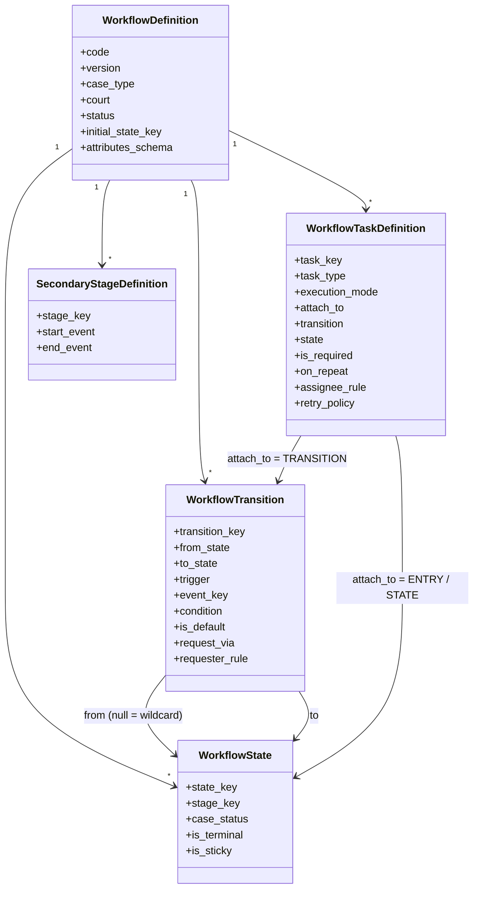
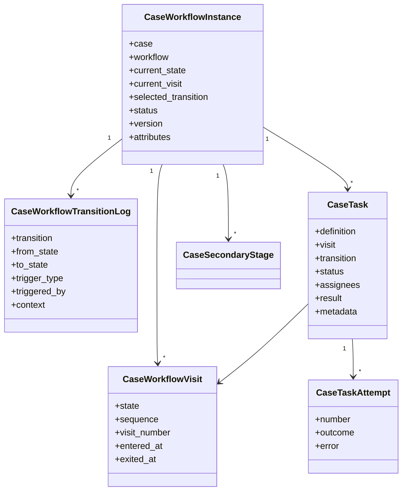

# 0011 — Case Workflows (`apps.workflows`)

## Status

Proposed

Revised 2026-11-03: configurable workflow engine.

* A definition is chosen by **court + case type**, with a fallback up the court hierarchy and then to a court-agnostic default.
* Definitions have three statuses: **draft, active, retired**. They are immutable once active. A changed workflow is a new version, and cases already running stay on the version they started with.
* Definitions are managed **only through Django admin and seed files**. There are no definition CRUD APIs.
* **Task definitions** are attached to a transition (A → B), to the entry of a target state (B), or to a state. Each task has a pluggable **task type**, an **execution mode** (manual / auto) and an **assignee rule**.
* Tasks are created **only for the path chosen**. When the case comes back to a state on a later visit, the engine creates **new** task instances, except for task definitions that are marked reusable.
* **Auto tasks** run as Dramatiq jobs, or inline for fast local types. They have failure conditions and automatic or manual retry. A case never moves past a failed task.
* Frontend APIs are keyed only by case ID: get the workflow status, request a transition, list the tasks, complete a task, and retry a task.
* The 2026-10-19 revision is withdrawn where it conflicts with these points: state-only task templates, `blocks_transitions`, the global `TaskDefinition` catalogue, definition CRUD APIs, and "no generic transition endpoint". Visits, events, primary and secondary stages, the `Case.status` projection, case-type plugins and the shared pending-task store are kept.

## References

- PRDs: `case-lifecycle-handover.md` (primary and secondary stages), `efiling-handover.md` (§4 `LIFE-11`–`LIFE-14`, §18 `SIG-07`), `scrutiny-registration-handover.md` (`SCR-07`–`SCR-16`), `court-roles.md` (`RLE-`), `pending-tasks-handover.md` (task attributes and statuses), `cognizance-cheat-sheet.md` (§3), `application-lifecycle.md`, `process-handover.md` (`STP-02`)
- Specs: [`0000`](0000-api-coding-spec.md) (API, errors), [`0017`](0017-orders-management.md) (payments), [`0019`](0019-business-rules.md) (business rules), [`0020`](0020-person-case-filing-schema.md) §8.3, [`0021`](0021-case-filing-api.md) §7–8, [`0024`](0024-scrutiny.md), [`0025`](0025-data-seeding-command.md), [`0026`](0026-dramatiq-crontab.md)

> **Scope note.** `apps.workflows` does not depend on any case type. It knows
> definitions, states, transitions, tasks and task types. It does not know
> what a cheque, a scrutiny flag or a payment demand is. Case-type rules live
> in a **plugin**, and task behaviour lives in a **task type**. Both are
> registered by the app that owns them. Domain modules move a case only
> through `CaseWorkflowService` and complete tasks only through `TaskService`.

## Context

### What exists today

| Area | Current code | Gap |
| --- | --- | --- |
| Case | `apps.cases.models.Case` has `case_type`, `court` (an `organizations.Organization`, nullable while drafting) and `status` (`CaseStatus`, documented as "illustrative until 0011") | There is no workflow instance, and `status` is not a projection. |
| Lifecycle | `apps/cases/services/filing.py` moves a case `DRAFT_IN_PROGRESS → PENDING_SIGN → PENDING_PAYMENT → UNDER_SCRUTINY` by writing `Case.status` in `_transition()` (0021 §7, option a). | Each step is hard-coded, the path only goes forward, and nothing can loop back for correction. |
| Signing | `_check_signature()` compares the e-sign time with the **first** `PENDING_SIGN` history row. | This breaks when a case is signed again after correction (`LIFE-13`). |
| Payment | `submit_for_scrutiny` has no precondition ("no payment service yet"). | There is no gate. |
| Courts | `Organization` has a `parent` hierarchy. | Nothing chooses behaviour by court. There is no court-role model yet (`court-roles.md`). |
| Joinability | `JOINABLE_STATUSES = (REGISTERED,)` is an allow-list. | The previous revision of this spec referred to a `NOT_JOINABLE_STATUSES` list that does not exist. |
| Workflows | There is no `apps.workflows`. Error domain `08` is reserved in 0000 §9.2. | Everything below is new. |

### What the engine must do

When a case is e-filed, a workflow is assigned to it. The workflow is the
definition that matches the case's **court and case type**. A cheque-bounce
case in Court X can follow a different workflow from one in Court Y.

A definition is a graph of **states** and **transitions**, and cycles are
allowed. A case can go back to correction any number of times (`LIFE-11`).
**Tasks** decide whether a case may move. A transition A → B succeeds only
when every required task gating it is complete: payment, signature,
case-number assignment, scrutiny completion and so on. Some tasks are done by
people and some by the system.

Tasks are also the **work lists**. A case is on the scrutiny officer's list
exactly while its *Scrutinise case* task is pending (`SCR-09`). It is on the
*Take cognizance* list while that task is pending, even if the case has
already moved to a later stage (cognizance cheat sheet §3).

## Goals

* One generic engine driven by data, with versioned definitions chosen by court + case type.
* Definitions managed in Django admin and loaded from seed files, with natural keys throughout.
* A per-case instance that records the current state, every visit, every transition (who, when, manual/auto/event, from → to) and the attributes gathered along the way.
* Tasks attached to transitions, target states or states, with extensible types, manual or auto execution, assignee rules, and status and completion data.
* Transition semantics: check the transition is allowed, check its gates, move and record history, then open the tasks for the next path.
* Auto tasks with failure conditions and automatic or manual retry. Transitions that fire on their own once their gates are complete.
* Safe under concurrency: one transition per case at a time.
* Running cases are unaffected when a definition changes.
* Frontend APIs keyed by case ID, following [`0000`](0000-api-coding-spec.md).

## Non-goals

* A graphical designer, BPMN, parallel branches inside one case, or timers or escalations beyond task due dates.
* CRUD APIs for definitions.
* Migrating running cases onto a newer definition version.
* Domain screens and their payloads (scrutiny flags, payment demands, e-sign). Each module owns its own.
* Notification copy and the case-update events catalogue.
* Case types other than §138 in this iteration.

---

## Proposed changes

### 1. App layout and boundaries

```text
apps/workflows/
├── apps.py                  # name = "apps.workflows"
├── models/
│   ├── definitions.py       # WorkflowDefinition, WorkflowState, WorkflowTransition, WorkflowTaskDefinition, SecondaryStageDefinition
│   └── runtime.py           # CaseWorkflowInstance, CaseWorkflowVisit, CaseWorkflowTransitionLog, CaseTask, CaseTaskAttempt, CaseSecondaryStage
├── enums.py
├── errors.py                # E08xxx (#10.6)
├── engine.py                # Engine: start, request, dispatch, advance, force
├── services.py              # CaseWorkflowService, TaskService (public API for other apps)
├── resolution.py            # definition lookup by court + case type (#3)
├── paths.py                 # path selection and task creation (#5)
├── gates.py                 # gate evaluation (#5.4)
├── conditions.py            # condition evaluator (#7)
├── assignees.py             # assignee rules (#6.4)
├── task_types/
│   ├── base.py              # BaseTaskType, TaskResult, registry
│   └── builtin.py           # GENERIC, ACKNOWLEDGEMENT, CONDITION_CHECK
├── plugins.py               # BaseCaseTypePlugin, registry (#8)
├── validation.py            # definition graph validation (#2.7)
├── seeding.py               # document <-> definition (#11)
├── management/commands/load_workflow.py · export_workflow.py
├── selectors.py             # status view, task lists, history
├── signals.py
├── tasks.py                 # Dramatiq actors and crons (#6.6)
├── serializers.py · views.py · urls.py · permissions.py · admin.py
└── tests/
```

Dependency rules:

```text
apps.cases, apps.payments, apps.scrutiny, apps.esign, …
        ── import ──> apps.workflows.services / selectors / plugins / task_types / signals
apps.workflows ── imports only ──> apps.core, apps.api, apps.organizations (court hierarchy, role holders)
apps.workflows ── never imports ──> apps.cases or any other domain app   ("cases.Case" by string FK only)
```

* The engine uses case-type behaviour only through the plugin registry (#8), and task behaviour only through the task-type registry (#6.1).
* Plugins and task types are registered from the owning app's `AppConfig.ready()`.
* An isolation test asserts these import rules.

### 2. Definition model



All definition models inherit `BaseModel` and `BaseAuditableModel`. Every
child has a **natural key** of `(workflow, <x>_key)`, so seeds and exports
never depend on UUIDs. Bounded enums are `TextChoices` in `enums.py`.

#### 2.1 `WorkflowDefinition`

| Field | Type | Notes |
| --- | --- | --- |
| `code` | `CharField(64)` | Stable family identifier in upper snake case, e.g. `CHEQUE_BOUNCE_DEFAULT`, `CHEQUE_BOUNCE_KL_ERN`. All versions of one family share it. |
| `version` | `PositiveIntegerField` | Increases by one within a `code`. |
| `name` / `description` | `CharField(255)` / `TextField(blank=True)` | e.g. "Cheque bounce — default — v2", plus what changed. |
| `case_type` | `CharField(32)` | A `cases.CaseType` value. It must have a registered plugin (#8). |
| `court` | `FK("organizations.Organization", null=True, on_delete=PROTECT)` | The court the definition applies to, including every court below it in the hierarchy. `NULL` is the court-agnostic default for the case type. |
| `status` | `CharField(16, choices=DefinitionStatus)` | `DRAFT` (editable, never used), `ACTIVE` (chosen for new cases), `RETIRED` (no new cases, still runs existing ones). |
| `initial_state_key` | `CharField(64)` | The state an e-filed case enters, e.g. `e_filing`. |
| `attributes_schema` | `JSONField(default=dict)` | JSON Schema for `CaseWorkflowInstance.attributes` (#4.1). |
| `metadata` | `JSONField(default=dict, blank=True)` | Free-form workflow attributes, e.g. `{"owner": "Registry, Ernakulam", "circular": "…"}`. The engine does not read them. |
| `activated_at` / `activated_by` / `retired_at` / `retired_by` | | Set by the activate and retire actions. |

Constraints:

- `UniqueConstraint(code, version)`.
- `UniqueConstraint(court, case_type, condition=Q(status="ACTIVE", court__isnull=False))` and `UniqueConstraint(case_type, condition=Q(status="ACTIVE", court__isnull=True))`. Together these allow at most one active definition per court + case type, and one active default per case type. Two partial constraints are used rather than `nulls_distinct`, so SQLite in tests enforces them too.

Rules:

- Only a `DRAFT` definition, and only its children, can be changed. `clean()` refuses edits to `ACTIVE` or `RETIRED` rows and their children, and the admin shows them read-only.
- Activation (#2.7) validates the graph, sets `ACTIVE`, and in the same transaction **retires** the definition previously active for the same `(court, case_type)`.
- A definition is never deleted once an instance references it (`PROTECT`).

#### 2.2 `WorkflowState`

| Field | Type | Notes |
| --- | --- | --- |
| `workflow` | `FK(WorkflowDefinition, CASCADE, related_name="states")` | |
| `state_key` | `CharField(64)` | snake_case, e.g. `e_filing`, `scrutiny`, `pending_correction` |
| `label` | `CharField(255)` | e.g. "Under scrutiny" |
| `stage_key` / `stage_label` | `CharField(64)` / `CharField(255)` | The case-lifecycle primary stage (#9.1), e.g. `filing` / "Filing". Several states may share a stage. |
| `case_status` | `CharField(32, blank=True)` | The `cases.CaseStatus` this state projects to (#9.3). Empty leaves the status unchanged. |
| `is_terminal` | `BooleanField(default=False)` | Entering it completes the instance. |
| `is_sticky` | `BooleanField(default=False)` | Wildcard transitions never leave it (#4.4). |
| `sequence` | `PositiveSmallIntegerField(default=0)` | Display order only. |
| `metadata` | `JSONField(default=dict, blank=True)` | Free-form, for clients. |

Constraints: `UniqueConstraint(workflow, state_key)`. A terminal state cannot be sticky.

#### 2.3 `WorkflowTransition`

| Field | Type | Notes |
| --- | --- | --- |
| `workflow` | `FK(WorkflowDefinition, CASCADE, related_name="transitions")` | |
| `transition_key` | `CharField(64)` | snake_case, unique within the workflow, e.g. `submit_to_scrutiny`, `send_back` |
| `label` | `CharField(255)` | The action label, e.g. "Send back" |
| `from_state` | `FK(WorkflowState, null=True, PROTECT)` | `NULL` is a **wildcard** (`*` in seed files): any state that is not terminal and not sticky (#4.4). |
| `excluded_from_states` | `JSONField(default=list)` | State keys. Allowed only on wildcards. |
| `to_state` | `FK(WorkflowState, PROTECT)` | |
| `trigger` | `CharField(16, choices=TransitionTrigger)` | `MANUAL`: fires only when requested and every gate is complete. `AUTO`: fires as soon as it is the selected path and every gate is complete. `EVENT`: selected by a dispatched event, then behaves like `AUTO`. |
| `event_key` | `CharField(64, blank=True)` | Required when `trigger = EVENT`. Upper snake case, e.g. `COGNIZANCE_TAKEN`. |
| `condition` | `JSONField(default=dict, blank=True)` | A condition tree (#7). The path can be selected and fired only while the condition passes. |
| `is_default` | `BooleanField(default=False)` | Breaks a tie in automatic path selection (#5.2). |
| `priority` | `PositiveSmallIntegerField(default=100)` | Order among several candidates for one event; the lowest wins. |
| `request_via` | `CharField(16, choices=RequestVia, default=ANY)` | `ANY`: the frontend transition API may request it. `SERVICE`: only a domain service may, because it needs a domain payload (e.g. scrutiny's send back). |
| `requester_rule` | `JSONField(default=dict, blank=True)` | Who may request it. Uses the same rule language as assignees (#6.4), e.g. `{"type": "case_creator"}`. Empty means anyone who can see the case and holds `required_permission`. |
| `required_permission` | `CharField(100, blank=True)` | A Django permission checked as well as `requester_rule`. |
| `metadata` | `JSONField(default=dict, blank=True)` | e.g. button style and confirmation copy for clients |

Constraints: `UniqueConstraint(workflow, transition_key)`;
`CheckConstraint(trigger != EVENT OR event_key != '')`.
Several transitions may share `from_state → to_state`; conditions tell them apart.

#### 2.4 `WorkflowTaskDefinition`

A task that a case may have to complete, and where it is attached.

| Field | Type | Notes |
| --- | --- | --- |
| `workflow` | `FK(WorkflowDefinition, CASCADE, related_name="task_definitions")` | |
| `task_key` | `CharField(64)` | snake_case and unique within the workflow. It is **stable across versions and courts**, so lists and counts can group by it, e.g. `sign_filing`, `pay_filing_fee`, `scrutinise_case`. |
| `task_type` | `CharField(64)` | A registered task type (#6.1), e.g. `SIGNATURE`, `PAYMENT`, `CASE_NUMBER_ASSIGNMENT`, `SCRUTINY_COMPLETION`. |
| `execution_mode` | `CharField(8, choices=ExecutionMode)` | `MANUAL` (a person or a module completes it) or `AUTO` (the task type's executor completes it). It must be one of the modes the type allows. |
| `attach_to` | `CharField(16, choices=AttachTo)` | `TRANSITION`, `ENTRY`, `STATE` or `STANDALONE` (#5.1) |
| `transition` | `FK(WorkflowTransition, null=True, CASCADE)` | Set if and only if `attach_to = TRANSITION`. |
| `state` | `FK(WorkflowState, null=True, CASCADE)` | Set if and only if `attach_to` is `ENTRY` or `STATE`. |
| `is_required` | `BooleanField(default=True)` | Whether it gates. A non-required task is created and tracked but blocks nothing, e.g. advisory automated checks. |
| `cancel_on_exit` | `BooleanField(default=True)` | `STATE` tasks only. `False` keeps the task pending after the case leaves the state, e.g. `take_cognizance`. |
| `depends_on` | `JSONField(default=list)` | Keys of tasks in the same gate set. The task is created only once those are complete, e.g. `pay_filing_fee` after `sign_filing`. |
| `on_repeat` | `CharField(16, choices=OnRepeat, default=NEW)` | What happens on a later visit (#5.5): `NEW`, `REUSE_COMPLETED` or `TYPE_DECIDES`. |
| `assignee_rule` | `JSONField` | Who is responsible (#6.4), e.g. `{"type": "court_role", "role": "SCRUTINY_OFFICER", "level": "ESTABLISHMENT"}`. Use `{"type": "system"}` for `AUTO` tasks. |
| `name` | `CharField(255)` | A template, e.g. `Pay ₹{amount} — {fee_head}` |
| `description` | `TextField(blank=True)` | |
| `action_label` | `CharField(64)` | e.g. "Make Payment" |
| `side` | `CharField(16, choices=TaskSide)` | `COURT`, `CITIZEN` or `SYSTEM` |
| `category` | `CharField(16, choices=TaskCategory, blank=True)` | For the citizen side only: `PAY`, `SIGN`, `FILE_SUBMIT` or `OTHERS` |
| `visibility` | `CharField(16, choices=TaskVisibility)` | `USERS_ONLY`, `SAME_SIDE` or `COURTROOM` (pending tasks attribute 10) |
| `link` | `CharField(255, blank=True)` | A client route template, e.g. `/employee/scrutiny/{filing_number}` |
| `due_in_days` | `PositiveSmallIntegerField(null=True)` | Due date = creation date + days. `NULL` means no due date. |
| `config` | `JSONField(default=dict, blank=True)` | Type-specific settings, validated against the task type's `config_schema`, e.g. `{"fee_head": "CASE_FILING"}` |
| `completion_schema` | `JSONField(default=dict, blank=True)` | Extra JSON Schema for the metadata sent when a person completes the task. It is combined with the type's own schema. |
| `capture` | `JSONField(default=dict, blank=True)` | Copies values from the result into instance attributes on completion, e.g. `{"case_number": "result.case_number"}` (#4.1) |
| `failure_condition` | `JSONField(default=dict, blank=True)` | `AUTO` only. A condition over `result.*` that turns a completed run into a failure, e.g. `{"field": "result.blocking_defects", "op": "gt", "value": 0}` |
| `retry_policy` | `JSONField(default=dict, blank=True)` | `AUTO` only (#6.6), e.g. `{"max_attempts": 3, "backoff_seconds": [60, 300, 900], "auto": true, "manual": true}` |
| `timeout_seconds` | `PositiveIntegerField(default=600)` | `AUTO` only. A run that takes longer is treated as a failure (#6.6). |
| `case_status_while_pending` | `CharField(32, blank=True)` | Overrides the state's `case_status` while this task is pending (#9.3), e.g. `PENDING_PAYMENT` |
| `sequence` | `PositiveSmallIntegerField(default=0)` | Display and creation order |

Constraints: `UniqueConstraint(workflow, task_key)`; a `CheckConstraint`
that `transition` and `state` match `attach_to`.

#### 2.5 `SecondaryStageDefinition`

These are kept unchanged from the previous revision. Each has a `stage_key`,
`label`, `start_event`, `start_condition` and `end_event`, with
`UniqueConstraint(workflow, stage_key)`. Its rules are in #9.2.

#### 2.6 Validation (`clean()`, on save)

- Keys follow their format: snake_case for states, transitions and tasks; upper snake case for codes and events.
- Every key referenced in `initial_state_key`, `excluded_from_states` and `depends_on` exists in the same workflow.
- `from_state != to_state`. `excluded_from_states` is allowed only on a wildcard.
- `task_type` is registered. `execution_mode` is one the type allows. `config` validates against the type's `config_schema`.
- `depends_on` names only tasks with the same attachment, or tasks that gate the same transition, and has no cycles.
- `assignee_rule` and `requester_rule` are known rule types. `{"type": "system"}` is allowed only for `AUTO`.
- `failure_condition`, `retry_policy` and `timeout_seconds` are set only for `AUTO`.
- `case_status` and `case_status_while_pending` are `cases.CaseStatus` values. The engine gets this list from the plugin (#8), not by importing `apps.cases`.
- Every field used in a condition resolves (#7). An unknown field is a save error, never a silent `False` at runtime.

#### 2.7 Activation validation (whole graph)

On activation, and with `load_workflow --check`:

1. `initial_state_key` exists and is not terminal.
2. Every state can be reached from the initial state. Wildcards count as reaching their target.
3. Every non-terminal state has at least one way out.
4. Every `event_key` used by a transition or secondary stage is in the plugin's `known_events()`.
5. No `AUTO` transition loops back to itself through other `AUTO` transitions that have no gating tasks. Such a loop would hit the chain cap (#4.3).
6. Every task's assignee rule can be resolved for the case type (`plugin.supported_assignee_rules()`).

Failures are reported together as a `ValidationError` listing each problem by
key. The admin shows them, and `load_workflow` exits with status 1.

### 3. Choosing a definition

`resolution.resolve_definition(case_type, court)`:

1. Walk from `court` up through its ancestors (`Organization.parent`), nearest first. Return the first `ACTIVE` definition for `(that court, case_type)`.
2. Otherwise return the `ACTIVE` default for the case type (`court IS NULL`).
3. Otherwise raise `E08001 NO_ACTIVE_DEFINITION`.

So one default serves every court. A state or district overrides it by
activating a definition for its own organisation, and a single court can
override it again.

The definition is **pinned** to the instance when the instance starts. Later
changes do not re-select it. These include the Scrutiny officer choosing a
courtroom (`SCR-16`), which changes `Case.court`, and a new version being
activated.

A system check (`workflows.W001`) warns for every `cases.CaseType` that has
no active default.

### 4. Runtime model



#### 4.1 `CaseWorkflowInstance`

| Field | Type | Notes |
| --- | --- | --- |
| `case` | `OneToOneField("cases.Case", PROTECT, related_name="workflow")` | |
| `workflow` | `FK(WorkflowDefinition, PROTECT)` | The pinned version |
| `current_state` | `FK(WorkflowState, PROTECT)` | |
| `current_visit` | `FK("CaseWorkflowVisit", null=True, PROTECT)` | The open visit |
| `selected_transition` | `FK(WorkflowTransition, null=True, PROTECT)` | The path chosen out of the current state (#5.2). Cleared on every transition. |
| `selected_by` / `selected_at` / `selection_context` | `FK(User, null)` / `DateTimeField(null)` / `JSONField` | Who chose the path (`NULL` for the engine), when, and the context passed with the request. Executors see this context. |
| `status` | `CharField(16, choices=InstanceStatus)` | `ACTIVE`, `SUSPENDED` (nothing fires except an admin force) or `COMPLETED` (a terminal state was reached) |
| `version` | `PositiveIntegerField(default=0)` | Incremented on every transition, path selection and task status change. It is the concurrency token (#10.5). |
| `attributes` | `JSONField(default=dict)` | Data gathered along the way through task `capture` and transition context, e.g. `{"case_number": "ST/123/2026", "registration_type": "ECC"}`. Validated against `workflow.attributes_schema`. Conditions can read it as `workflow.attributes.*`. |
| `started_at` / `completed_at` | `DateTimeField` | |

Only the engine writes these fields. `attributes` is merged key by key, never
replaced. Each write appears in the instance's `BaseAuditableModel` history.

#### 4.2 `CaseWorkflowVisit`

There is one append-only row each time the case enters a state. The fields
are `instance`, `state`, `sequence` (1, 2, 3 … per instance), `visit_number`
(how many times this state has been entered, so the third entry into
`scrutiny` is scrutiny round 3), `entered_at`, `exited_at` and
`entered_by_log` (`NULL` only for the initial state). The constraints are
`UniqueConstraint(instance, sequence)` and
`UniqueConstraint(instance, condition=Q(exited_at__isnull=True))`, which
allows one open visit per case.

#### 4.3 `CaseWorkflowTransitionLog`

This is the append-only history of every state change. `save()` refuses to
update an existing row, and the admin shows it read-only.

| Field | Notes |
| --- | --- |
| `instance` | |
| `transition` | `NULL` for an admin force |
| `from_state` / `to_state` | FKs to `WorkflowState` |
| `from_visit` / `to_visit` | The visits closed and opened |
| `trigger_type` | `MANUAL` (requested by a user), `AUTO` (fired by the engine), `EVENT` (`event_key` set) or `ADMIN` (force) |
| `event_key` | For `EVENT` |
| `triggered_by` | The requesting user. `NULL` for system and auto transitions. For an `AUTO` transition that fired after a user completed the last gate, it is still `NULL`, and `context.caused_by_task` names that task. |
| `reason` | Required for `ADMIN` |
| `context` | The request context and a snapshot of the evaluated condition |
| `satisfied_tasks` | `JSONField` listing `{task_id, task_key, completed_at, reused}` for every gate that passed |
| `created_at` | When the transition happened |

#### 4.4 Wildcards and sticky states

A wildcard (`from_state = NULL`) matches any current state that is not
terminal, not sticky, not in `excluded_from_states`, and not the wildcard's own
`to_state`. A sticky state is left only by a transition that names it as
`from_state` explicitly. This is how the lifecycle rule "*hearing scheduled
for Arguments, unless the case is in Post-Judgement, Post-Disposal or Long
Pending Register*" fits in one row.

#### 4.5 `CaseTask`

Every task of a case lives in one table and is listed with one query.

| Field | Type | Notes |
| --- | --- | --- |
| `case` | `FK("cases.Case", CASCADE, related_name="tasks")` | |
| `instance` | `FK(CaseWorkflowInstance, CASCADE, related_name="tasks")` | |
| `definition` | `FK(WorkflowTaskDefinition, PROTECT)` | Copied fields: `task_key`, `task_type`, `execution_mode` (stored too, for filtering and indexes) |
| `visit` | `FK(CaseWorkflowVisit, null=True, CASCADE)` | The visit of the **source** state during which the task was created. `NULL` only for `STANDALONE` tasks. |
| `transition` | `FK(WorkflowTransition, null=True, PROTECT)` | The path the task belongs to, for `TRANSITION` and `ENTRY` tasks |
| `status` | `CharField(16, choices=TaskStatus)` | See below |
| `name` / `link` | `CharField(255)` | Rendered from the definition's templates and `context` when the task is created |
| `context` | `JSONField(default=dict)` | Template variables and input for the task type, e.g. `{"amount": "707.50", "demand_id": "…"}` |
| `court_id` / `side` / `assignees` | `UUIDField(null)` / `CharField(16, blank)` / `ArrayField(UUIDField)` | Resolved from `assignee_rule` (#6.4). In SQLite tests `assignees` is a `JSONField`. |
| `assignee_type` | `CharField(16)` | The kind of rule: `COURT_ROLE`, `CASE_SIDE`, `CASE_CREATOR`, `USERS` or `SYSTEM` |
| `due_date` | `DateField(null)` | |
| `completed_by` / `completed_at` / `completion_mode` | `FK(User, null)` / `DateTimeField(null)` / `CharField` | `completion_mode` is `MANUAL` (via API or module, by a user), `AUTO` (executor) or `SYSTEM` (the type completed it on creation, e.g. nothing to pay) |
| `metadata` | `JSONField(default=dict)` | Supplied with a manual completion, e.g. `{"remarks": "Verified original cheque"}` |
| `result` | `JSONField(default=dict)` | Executor output, or the payload a module recorded |
| `attempt_count` / `next_retry_at` | `PositiveSmallIntegerField` / `DateTimeField(null)` | `AUTO` only |
| `last_error_code` / `last_error_message` | `CharField(64)` / `TextField` | The last failure |
| `closed_reason` | `CharField(32, blank)` | For `CANCELLED`: `STATE_EXITED`, `PATH_CHANGED`, `NO_LONGER_RELEVANT` or `ADMIN` |
| `reference_type` / `reference_id` | `CharField(32)` / `UUIDField(null)` | For `STANDALONE` tasks, the thing the task is about (application, process …) |
| `claimed_by` / `claimed_at` | | For court-side tasks, an informational claim (#10.4) |
| `archived_by` / `archived_at` | | A user has put the task away. This is not a status (#6.3). |

**Task statuses**

| Status | Meaning | Pending-tasks PRD status |
| --- | --- | --- |
| `PENDING` | Waiting for a person, or queued for the executor | Open |
| `IN_PROGRESS` | An executor attempt is running | Open |
| `FAILED` | The last auto attempt failed. If `next_retry_at` is set, a retry is scheduled; otherwise it waits for a manual retry, or retries are exhausted. | Open |
| `COMPLETED` | Done. It counts towards gates. | Completed |
| `CANCELLED` | No longer needed: the path changed or the state was exited. It never counts towards gates. | Expired |

`PENDING`, `IN_PROGRESS` and `FAILED` are **live**. Overdue is not a status:
it is computed when read as `live and due_date < today`. Allowed changes:
`PENDING → IN_PROGRESS → COMPLETED | FAILED`, `FAILED → IN_PROGRESS` (retry),
`PENDING → COMPLETED` (manual), and any live status `→ CANCELLED`.
`COMPLETED` and `CANCELLED` are final.

Constraints:

- `UniqueConstraint(visit, definition, condition=Q(status__in=LIVE))`: at most one live instance of a task definition per visit.
- `UniqueConstraint(definition, reference_type, reference_id, condition=Q(status__in=LIVE) & Q(reference_id__isnull=False))` for standalone tasks.

Indexes: `(case, status)`, `(court_id, status, task_key)`, GIN on `assignees`,
`(status, next_retry_at)`.

#### 4.6 `CaseTaskAttempt`

There is one append-only row per executor run, holding `task`, `number`,
`started_at`, `finished_at`, `outcome` (`COMPLETED`, `FAILED`, `TIMED_OUT` or
`DISCARDED`), `error_code`, `error_message`, `result` and `triggered_by` (the
user who asked for a manual retry). This is the failure audit trail.

#### 4.7 `CaseSecondaryStage`

This is unchanged from the previous revision: `instance`, `stage_key`,
`started_at`, `ended_at`, `start_event` and `end_event`, with at most one
active row per `(instance, stage_key)`.

### 5. Tasks and paths

#### 5.1 Where tasks attach

The **gate** of a transition A → B is the set of **required** tasks that must
be `COMPLETED` before it fires:

```text
gate(A → B) = STATE tasks of A  ∪  TRANSITION tasks of (A → B)  ∪  ENTRY tasks of B
```

| `attach_to` | Meaning | Created | Example |
| --- | --- | --- | --- |
| `TRANSITION` | Needed for **this path** A → B only | When the path is selected | `sign_filing` and `pay_filing_fee` on `e_filing → scrutiny` |
| `ENTRY` | Needed to enter B **by any path** | When any path into B is selected | `assign_case_number` on `cognizance`, needed whether the case is registered at scrutiny or at registration |
| `STATE` | The work of state A. Required ones gate **every** exit from A. | When A is entered | `scrutinise_case` on `scrutiny` |
| `STANDALONE` | Opened by a module with `TaskService.open()`. Gates nothing. | When the module calls it | *Review application*, *Hand in envelope* |

This is **design decision 1**: tasks attach to the transition, the target
state, or the state. The reasons:

* **Branching:** a transition task belongs to one path. Scrutiny → registration and scrutiny → cognizance can need different work.
* **Merging:** an entry task is defined once even though many paths lead into B. Cognizance needs a case number however the case got there.
* **Cycles:** tasks belong to a visit, not to a state, so every pass through a cycle gets its own tasks (#5.5). The definition never has to describe a round number.
* **Work lists:** state tasks exist as soon as the case arrives, which is what puts a case on the scrutiny officer's list before any path is chosen (`SCR-09`). They are needed on every way out, so creating them on entry is still "only the work the case will need".

#### 5.2 Path selection

Tasks are created **only for the selected path** (design decision 2). The
instance has at most one `selected_transition` at a time.

A path is selected in one of these ways:

1. **On entry** to A, the engine looks at the outgoing `MANUAL` and `AUTO` transitions whose condition passes. If there is exactly one, it is selected. If there are several and exactly one is `is_default`, that one is selected. Otherwise nothing is selected and the case waits for a choice.
2. **By request:** a transition request (#10.2, or `CaseWorkflowService.request`) selects that path, if it is allowed from A, its condition passes and the caller may request it.
3. **By event:** `dispatch(event_key)` selects the highest-priority `EVENT` transition from A whose condition passes.
4. **On re-evaluation:** if nothing is selected, `advance()` repeats rule 1, because a condition may have started to pass.

When a path is selected, the engine creates the path's `TRANSITION` and
`ENTRY` tasks that do not already exist live, or completed in this visit.
Tasks with `depends_on` are created only when their dependencies complete.

Selecting a **different** path cancels the live tasks that belonged only to
the old path, with `closed_reason = PATH_CHANGED`. Tasks shared by both
paths, such as `ENTRY` tasks when the target is the same, are kept. Completed
tasks stay completed. If the case later returns to the old path **in the same
visit**, a task completed in that visit still counts, and only the cancelled
ones are created again.

Selecting a path is recorded on the instance (`selected_*`), increments
`version`, and sends `path_selected`. It is **committed even if the request
that caused it is then rejected** for incomplete tasks, because the point of
the rejection is to hand the caller the tasks it now has to do (#5.3).

#### 5.3 Requesting a transition (A → B)

`Engine.request(case, *, to_state=None, transition_key=None, actor, trigger_type, context, expected_version)`
runs these steps:

1. **Lock** the case row, then the instance (#10.5). If `expected_version` is given and does not match, raise `E08006`.
2. **Check the instance is active.** If it is `SUSPENDED` or `COMPLETED`, raise `E08005`.
3. **Resolve the transition.** Find the transitions from the current state (or wildcards) to `to_state`, or the one named by `transition_key`. With none, raise `E08002 TRANSITION_NOT_ALLOWED`, which names the current state and the allowed targets. If several match and no key was given, keep those whose condition passes. If more than one is still left, raise `E08007 AMBIGUOUS_TRANSITION` on `transition_key`.
4. **Check the caller.** For an API request, a transition with `request_via = SERVICE` raises `E08008`. A caller who fails `requester_rule`, `required_permission` or the plugin's `can_request` gets `E08009`.
5. **Check the condition** and the plugin's `check_transition`. If either fails, raise `E08004 CONDITION_NOT_MET`, naming the failing field.
6. **Select the path** (#5.2) if it is not already selected, creating its tasks. Inline auto tasks run now (#6.6).
7. **Evaluate the gate** (#5.4). If any required task is not complete, commit the selection and the new tasks, then raise `E08003 TASKS_INCOMPLETE` with **one error item per incomplete task** (#10.6).
8. **Fire:**
   1. Call the plugin's `before_transition`.
   2. Close the current visit.
   3. Cancel the live `STATE` tasks of A that have `cancel_on_exit`, and any live tasks of paths not taken, with `STATE_EXITED`.
   4. Write the log with `satisfied_tasks`.
   5. Open the new visit.
   6. Set `current_state` and `current_visit`, clear the selection, increment `version`, and write the `Case.status` projection (#9.3).
   7. Merge the request `context` keys declared in `attributes_schema` into `attributes`.
   8. If B is terminal, set `COMPLETED`.
   9. Call the plugin's `after_transition`.
9. **Prepare the next step:** create the `STATE` tasks of B, using the **new task rule** (#5.5). Then auto-select a path out of B (#5.2, rule 1) and create its tasks. This is step 3 of the transition semantics: after entering B, the engine works out the possible next states and creates the tasks needed to move on.
10. **On commit:** enqueue background auto tasks. Send `state_exited`, `state_entered`, `stage_*`, `path_selected` and `task_*`. Then run `advance()` once.

`move_case(case, transition_key, …)` is the service-side form of `request`
and accepts `SERVICE` transitions. `dispatch(case, event_key, context)`
performs steps 1, 2, 5 and 6 for the best `EVENT` candidate and fires it if
the gate is complete. If no candidate matches, it applies secondary stages
(#9.2) and returns `None`. An event with no effect is normal and is not an
error.

#### 5.4 Gates and automatic firing

A gated task is **satisfied** when:

* it has a `COMPLETED` instance in the current visit, for that path where the task belongs to a path; or
* its definition has `on_repeat = REUSE_COMPLETED` and the case has a `COMPLETED` instance of the same `task_key` from any earlier visit of this instance; or
* its definition has `on_repeat = TYPE_DECIDES` and the type's `is_reusable(previous_task, case)` returns `True` for the latest completed instance.

A required task with `depends_on` that has not been created yet is **not
satisfied**. It is reported with status `NOT_STARTED`.

`Engine.advance(case)` runs after every task completion, path selection,
transition and event, always in its own transaction with the locks:

1. If nothing is selected, try automatic selection (#5.2, rule 1).
2. Create any tasks whose dependencies are now complete.
3. If the selected path is `AUTO`, or is an `EVENT` path already selected by its event, and its condition passes and its gate is satisfied, fire it (#5.3 step 8) with `trigger_type = AUTO` or `EVENT`.
4. Repeat from step 1 for the new state, up to **10 hops**. After that, raise `E08015` and log an error. The cap is a safety net, and graph validation (#2.7) should prevent reaching it.

A `MANUAL` path never fires on its own. When its gate becomes complete, the
`task_completed` signal and the status view (`ready: true`) tell the client it
can now request the transition.

#### 5.5 Cycles: new tasks or reuse

Each entry into a state is a new visit, and **new task instances are created
for it, as if the work were happening for the first time** (design decision
3). Earlier instances stay, linked to their own visits, as history.
`on_repeat` marks the exceptions:

| `on_repeat` | Behaviour on a later visit | Use for |
| --- | --- | --- |
| `NEW` (default) | Create a new instance. | Signature (`LIFE-13`: everyone signs again), scrutiny, correction |
| `REUSE_COMPLETED` | If an earlier visit completed this `task_key`, create nothing; the gate is satisfied and the status view shows `reused_from` that task. | `assign_case_number`: a case is never numbered twice |
| `TYPE_DECIDES` | The task type's `is_reusable()` decides from the earlier instance and the case. | Types whose validity depends on data, e.g. a document check that holds while the document has not changed |

A task type may declare a default `on_repeat`, and the definition may
override it.

`PAYMENT` stays `NEW`. Each resubmission creates a new payment task, and the
type completes it at once with `completion_mode = SYSTEM` when nothing more is
due. That is how `LIFE-12` ("pay only the increase") works without separate
states or priorities.

### 6. Task types, execution and assignment

#### 6.1 Task type contract

```python
class BaseTaskType(ABC):
    key: ClassVar[str]                                     # "PAYMENT"
    label: ClassVar[str]
    execution_modes: ClassVar[frozenset[str]]              # {"MANUAL"}, {"AUTO"}, or both
    api_completable: ClassVar[bool] = False                # may a user complete it via #10.3?
    inline: ClassVar[bool] = False                         # AUTO: run inside the transition (#6.6)
    default_on_repeat: ClassVar[str] = "NEW"
    config_schema: ClassVar[dict] = {}                     # validates WorkflowTaskDefinition.config
    completion_schema: ClassVar[dict] = {}                 # validates manual completion metadata

    def on_open(self, task, ctx) -> TaskResult | None: ...       # e.g. raise a demand; may complete at once
    def execute(self, task, ctx) -> TaskResult: ...              # AUTO only; no DB locks held
    def validate_completion(self, task, actor, metadata) -> None: ...  # raise BusinessError to refuse
    def on_cancel(self, task, ctx) -> None: ...                  # e.g. cancel the demand
    def is_reusable(self, previous, case) -> bool: return False  # on_repeat = TYPE_DECIDES


@dataclass(frozen=True)
class TaskResult:
    status: Literal["COMPLETED", "FAILED"]
    result: dict = field(default_factory=dict)
    error_code: str = ""          # machine-readable, e.g. "GATEWAY_TIMEOUT", "DEFECTS_FOUND"
    error_message: str = ""
    retryable: bool = True        # False: do not auto-retry (manual retry still allowed if policy says so)
```

Types are registered with `task_types.registry.register(cls)` from the owning
app's `ready()`. A new type therefore needs no migration: `task_type` is a
string checked against the registry, like a plugin's `case_type`. A system
check (`workflows.E002`) fails if any active definition uses a type that is
not registered.

#### 6.2 Initial task types

| Key | Owner | Modes | API-completable | Behaviour |
| --- | --- | --- | --- | --- |
| `GENERIC` | `apps.workflows` | MANUAL | yes | A person marks it done, with metadata validated by `completion_schema`. |
| `ACKNOWLEDGEMENT` | `apps.workflows` | MANUAL | yes | Confirm-only. Metadata is an optional `remarks`. |
| `CONDITION_CHECK` | `apps.workflows` | AUTO (inline) | no | Completes when `config.condition` (#7) passes, and is re-evaluated on `advance()`. It never fails; it stays pending. |
| `SIGNATURE` | `apps.cases` (with `apps.esign`) | MANUAL | no | `assignees` = signatories still to sign. `record_signature` removes each signer and completes the task when the last one signs (0021 §8). |
| `PAYMENT` | `apps.payments` (0017). Until it lands, a placeholder in `apps.cases`. | MANUAL | no (placeholder: yes, for staff) | `on_open` raises the demand for the balance due and completes at once if nothing is due. The payment confirmation completes the task. |
| `CASE_NUMBER_ASSIGNMENT` | `apps.cases` | AUTO (inline) | no | Calls `register_case()` with `registration_type` from the selection context. The result is `{case_number, registered_at}`. Its default `on_repeat` is `REUSE_COMPLETED`. |
| `SCRUTINY_COMPLETION` | `apps.scrutiny` (0024) | MANUAL | no | Completed by the scrutiny decision services in the same transaction as their `move_case`. |
| `CORRECTION` | `apps.scrutiny` | MANUAL | no | Completed by corrections submit (0024 §5.3). |
| `AUTOMATED_SCRUTINY` | `apps.scrutiny` | AUTO | no | Runs the `CHECKS` business rule (0024 §2.4, [`0019`](0019-business-rules.md)). `failure_condition` can turn blocking findings into a failure. |

`api_completable = False` keeps the rule that a party cannot close work done
in another module. For example, the party cannot close the envelope task
(`STP-02`). That module completes the task through `TaskService.complete()`.

#### 6.3 Manual completion

`TaskService.complete(task, *, actor, metadata=None, result=None, via_api=False)`:

1. Lock the case, the instance and the task.
2. The task must be `PENDING` (`E08010`) and `MANUAL` (`E08011`). Through the API, the type must also be `api_completable` (`E08011`).
3. The actor must be one of the task's assignees, or hold `workflows.complete_any_casetask` (`E08012`). Modules completing their own tasks may pass the system actor.
4. Validate `metadata` against the type's schema and the definition's `completion_schema`, reporting errors on `metadata.<path>` (`E08013`). Then call `validate_completion`.
5. Set `COMPLETED`, `completed_by`, `completed_at`, `completion_mode = MANUAL`, `metadata` and `result`. Apply `capture` to the instance attributes. Increment `version`.
6. On commit, send `task_completed` and run `advance()` (#5.4).

Archiving (`archived_at`) is a per-task flag that hides the task from list
defaults, and it can be undone. It does not complete the task, and an
archived task still gates.

#### 6.4 Assignee rules

These are resolved when the task is created. `assignees` is a snapshot.

| Rule | Resolves to | `assignee_type` |
| --- | --- | --- |
| `{"type": "court_role", "role": "SCRUTINY_OFFICER", "level": "ESTABLISHMENT" \| "COURTROOM"}` | Holders of the role at the case's establishment or courtroom ([`court-roles.md`](../PRDs/court-roles.md) `RLE-02a`, `RLE-02c`). Also sets `court_id`. | `COURT_ROLE` |
| `{"type": "case_side", "side": "COMPLAINANT", "roles": ["ADVOCATE", "CLERK", "LITIGANT", "POA_HOLDER"]}` | Users with those active roles on that side, from `plugin.side_users()`. Also sets `side`. | `CASE_SIDE` |
| `{"type": "signatories"}` | Signatories who have not yet signed, from `plugin.pending_signatories()` | `CASE_SIDE` |
| `{"type": "case_creator"}` | `Case.created_by` | `CASE_CREATOR` |
| `{"type": "users", "from": "context.user_ids"}` | Users named in the task context | `USERS` |
| `{"type": "system"}` | Nobody. `AUTO` tasks only. | `SYSTEM` |

The type of user responsible therefore depends on the definition, which is
chosen by court + case type, so it can differ by court and by case type.
`TaskService.refresh_assignees(case=… | court_id=…)` resolves live tasks again
when roles or case relationships change. A user removed from a case loses its
tasks immediately.

Court-role holders are read through
`apps.organizations.selectors.role_holders(org_id, role)`. **That selector
does not exist yet** (`court-roles.md`). Until it does, the selector returns
`[]`. `court_id` is still set, so the task is visible to the court by
`COURTROOM` visibility, and acting on it is checked by permission rather than
by membership in `assignees`.

#### 6.5 Requester rules

`WorkflowTransition.requester_rule` uses the same rule language. A caller may
request the transition if they would be an assignee under the rule. The
plugin's `can_request(user, case, transition)` adds object-level checks such as
`LIFE-14` (only the creator deletes).

#### 6.6 Auto task execution and failure

**Design decision 4:** a task type runs either inline or as a background
job. Signals are used only for notification. In both cases **the case does
not move until the task is `COMPLETED`**.

* **Inline types** (`inline = True`) run inside the transaction that created the task. They must be local and fast, such as case-number assignment or a condition check. If an inline task fails, the task is recorded as `FAILED`, the transition is rejected with that task listed, and the failure is committed together with the path selection.
* **Background types** are enqueued on commit to the Dramatiq actor `workflows.tasks.execute_case_task(task_id)`, with `max_retries=0`, because the engine owns retries:
  1. In a short transaction, lock the task. If it is not `PENDING`, or not `FAILED` with a retry due, return; this makes the actor idempotent. Set `IN_PROGRESS`, increment `attempt_count`, and open a `CaseTaskAttempt`.
  2. Run `execute()` with **no database locks held**. It may call external systems.
  3. In a new transaction, lock the case, the instance and the task. If the task is no longer `IN_PROGRESS` (cancelled, or the path changed), close the attempt as `DISCARDED` and stop. Otherwise apply the result. A `COMPLETED` result is still a failure if `failure_condition` passes against `result.*`.
  4. On success: `COMPLETED`, `completion_mode = AUTO`, `capture` applied, then on commit `advance()`.
  5. On failure: `FAILED`, with `last_error_*` set and the attempt closed. If `retryable`, `retry_policy.auto` and `attempt_count < max_attempts`, set `next_retry_at` from `backoff_seconds` and enqueue `send_with_options(delay=…)` on commit ([`0026`](0026-dramatiq-crontab.md) §5). Otherwise leave it `FAILED` with no `next_retry_at`.
* **Manual retry:** `POST /cases/{case_id}/tasks/{task_id}/retry/` (#10.3) when `retry_policy.manual` is true, the task is `FAILED`, and the caller holds `workflows.retry_casetask` or is allowed by `retry_policy.retry_by` (a requester rule). It resets `next_retry_at` and enqueues immediately. Manual retries do not count against `max_attempts`.
* **Timeouts and lost messages:** a cron, `@cron("*/5 * * * *") sweep_case_tasks` (no arguments, idempotent, `max_retries=0`, added to `apps/core/tests/test_schedules.py`), marks `IN_PROGRESS` tasks older than `timeout_seconds` as `FAILED` with `TIMED_OUT`, then applies the retry policy. It also re-enqueues `FAILED` tasks whose `next_retry_at` has passed. It runs on **at most 500 tasks per run**.
* **Defaults:** `retry_policy = {"max_attempts": 3, "backoff_seconds": [60, 300, 900], "auto": true, "manual": true}`.

A failed **required** auto task blocks its path. The case can still take
another path whose conditions allow it, such as a send back, which cancels the
failed task with `PATH_CHANGED`. An admin can also force the case (#10.7).

### 7. Conditions

Conditions are declarative trees that perform no I/O. The format is the same
as `apps.dristi_requests.conditions`, which is moved to
`apps.core.conditions` and shared by both:

```json
{ "all": [
    { "field": "context.registers_at_scrutiny", "op": "eq", "value": true },
    { "field": "workflow.visits.scrutiny", "op": "gt", "value": 0 }
] }
```

The combinators are `all`, `any` and `not`. The operators are `eq`, `ne`,
`gt`, `gte`, `lt`, `lte`, `in`, `not_in`, `contains` and `exists`.

| Prefix | Source |
| --- | --- |
| `case.<name>` | `plugin.case_context(case)`, a flat dict. The engine never reads case columns itself. |
| `context.<name>` | The context passed with the request, event or selection |
| `workflow.current_state`, `workflow.visits.<state_key>`, `workflow.attributes.<name>` | The instance |
| `task.<task_key>.status`, `task.<task_key>.result.<path>` | The latest instance of that task on the case |
| `result.<path>` | `failure_condition` only: the executor's result |
| `court_config.<key>` | The configuration store, `court.<COURT_CODE>` falling back to `court.default` ([`0018`](0018-configuration-store.md)) |

A decision that needs real logic, such as fee slabs, belongs in a
[`0019`](0019-business-rules.md) rule that the plugin or a task type
evaluates. It should not be built up from conditions.

### 8. Case-type plugins

```python
class BaseCaseTypePlugin(ABC):
    case_type: ClassVar[str]

    def case_statuses(self) -> set[str]: ...                       # valid Case.status values
    def known_events(self) -> set[str]: ...
    def supported_assignee_rules(self) -> set[str]: ...
    def case_context(self, case) -> dict: ...                      # "case." fields
    def can_view(self, user, case) -> bool: ...                    # access to the case-scoped APIs
    def can_request(self, user, case, transition) -> bool: return True
    def check_transition(self, case, transition, context) -> str | None: return None  # failing field
    def side_users(self, case, side, roles) -> list[UUID]: ...
    def pending_signatories(self, case) -> list[UUID]: ...
    def set_case_status(self, case, status) -> None: ...           # the only writer of Case.status
    def before_transition(self, case, transition, context) -> None: ...
    def after_transition(self, case, transition, log, context) -> None: ...
```

`apps.cases` registers `ChequeBounceCasePlugin` in `CasesConfig.ready()`.
`can_view` reuses `filing.get_viewable_case()` and adds court staff of the
case's court. `after_transition` sets `filed_at` when the case first enters
`scrutiny`, as `submit_for_scrutiny` does today.

### 9. Stages and status

#### 9.1 Primary stages

`WorkflowState.stage_key` maps states to the case-lifecycle primary stages.
A stage starts when the case enters a state of that stage from a state of a
different stage, and ends when the case leaves for a different stage. The
engine sends `stage_started` and `stage_ended` on commit.
`selectors.stage_history(case)` returns the stages from the visits, grouped
by consecutive `stage_key`, with start, end and days spent.

#### 9.2 Secondary stages

These are unchanged from the previous revision. `dispatch()` starts a
secondary stage whose `start_event` matches and whose `start_condition`
passes, if it is not already active. It ends an active one whose `end_event`
matches. Secondary stages never affect the primary stage.

#### 9.3 `Case.status` projection

`Case.status` stays because the filing APIs filter on it, but only the engine
writes it, through `plugin.set_case_status()`, in the transaction that changes
the state or the task status. The value is:

1. the `case_status_while_pending` of the first live task, in `sequence` order, of the current visit that has one; otherwise
2. the current state's `case_status`; otherwise
3. unchanged.

`cases.CaseStatus` gains three values: `PENDING_CORRECTION`,
`PENDING_REGISTRATION` and `DELETED`. `JOINABLE_STATUSES` stays an allow-list
(`REGISTERED`), so the new statuses are not joinable without any further
change. A test checks that nothing outside `set_case_status` assigns
`Case.status`, apart from the initial `DRAFT_IN_PROGRESS` default.

### 10. APIs

These are mounted under `/api/v1/`, tagged `workflows`, use the `meta`
envelope and the standard error shape ([`0000`](0000-api-coding-spec.md)).
They are **keyed only by case ID**. The court, the case type and the
definition all come from the case's instance.

There are **no definition endpoints**. Definitions are managed in the admin
(#11.1) and seed files (#11.2).

Access: a case the caller cannot see (`plugin.can_view`) returns
`404 E00105`. A case with no instance yet, such as a draft, returns
`404 E00105` on the workflow endpoints and an empty list on the task list.

#### 10.1 Get workflow status

`GET /cases/{case_id}/workflow/`

```json
{
  "workflow": { "code": "CHEQUE_BOUNCE_DEFAULT", "version": 1, "name": "Cheque bounce — default — v1", "status": "ACTIVE" },
  "status": "ACTIVE",
  "version": 14,
  "current_state": {
    "key": "e_filing", "label": "E-filing", "stage": { "key": "filing", "label": "Filing" },
    "visit_number": 2, "entered_at": "2026-11-02T10:12:00+05:30"
  },
  "case_status": "PENDING_PAYMENT",
  "attributes": {},
  "state_tasks": [],
  "transitions": [
    {
      "transition_key": "submit_to_scrutiny", "label": "Submit to scrutiny",
      "to_state": { "key": "scrutiny", "label": "Under scrutiny" },
      "trigger": "AUTO", "selected": true, "can_request": false, "ready": false,
      "tasks": [
        { "id": "7b1…", "task_key": "sign_filing", "name": "Sign the complaint", "task_type": "SIGNATURE",
          "execution_mode": "MANUAL", "required": true, "attach_to": "TRANSITION", "status": "COMPLETED",
          "assignee_type": "CASE_SIDE", "completed_at": "2026-11-02T11:40:00+05:30", "reused_from": null },
        { "id": "9c4…", "task_key": "pay_filing_fee", "name": "Pay ₹120.00 — Case filing fee", "task_type": "PAYMENT",
          "execution_mode": "MANUAL", "required": true, "attach_to": "TRANSITION", "status": "PENDING",
          "assignee_type": "CASE_SIDE", "due_date": "2026-11-09", "overdue": false, "action_label": "Make Payment",
          "link": "/citizen/payments/…" }
      ]
    },
    {
      "transition_key": "edit_correction", "label": "Edit filing",
      "to_state": { "key": "pending_correction", "label": "Pending correction" },
      "trigger": "MANUAL", "selected": false, "can_request": true, "ready": null,
      "tasks": [
        { "id": null, "task_key": "…", "status": "NOT_STARTED", "required": true, "…": "…" }
      ]
    }
  ],
  "history": [
    { "id": "…", "from_state": "pending_correction", "to_state": "e_filing", "transition_key": "resubmit",
      "trigger_type": "MANUAL", "triggered_by": { "id": "…", "name": "Adv. R. Menon" },
      "at": "2026-11-02T10:12:00+05:30", "reason": "" }
  ],
  "secondary_stages": [],
  "meta": { "…": "standard envelope" }
}
```

* `transitions` lists the transitions allowed from the current state whose condition currently passes. Each one shows the **complete and incomplete tasks** of its gate (#5.1). A task on a path that has not been selected appears as `NOT_STARTED` with `id: null`, as a preview from the definition.
* `can_request` means the caller passes `request_via`, the requester rule, the permission and `can_request`. `ready` means the gate is complete (`null` while the path is not selected).
* `history` holds the 20 most recent transitions, newest first. The full list is paginated at `GET /cases/{case_id}/workflow/history/`, which includes visits.
* `GET /cases/{case_id}/workflow/stages/` returns the stage history (#9.1).

#### 10.2 Request a transition

`POST /cases/{case_id}/workflow/transitions/`, with an optional `If-Match: <version>` header

```json
{ "to_state": "pending_correction", "transition_key": null, "context": {}, "reason": "" }
```

* `to_state` is required. `transition_key` is needed only to choose between several transitions A → B (`E08007`). `context` is validated against the plugin's `request_context_schema(transition)`.
* **200** returns the new status, in the same body as #10.1. If `advance()` moved the case on further, the body shows the final state.
* **409 `E08003`**: the transition is not ready. The path is now selected and its tasks exist. There is one error item per incomplete required task:

```json
{
  "errors": [
    { "code": "E08003", "message": "Sign the complaint is pending (complainant side).", "field": "tasks.sign_filing" },
    { "code": "E08003", "message": "Pay case filing fee has not started; it follows Sign the complaint.", "field": "tasks.pay_filing_fee" }
  ],
  "meta": { "…": "…" }
}
```

  `field` is `tasks.<task_key>`. Task keys are unique within a workflow, so this identifies the gate entry, including tasks with no instance yet. The client gets the task IDs from #10.1. *This uses `field` to name an entity related to the request rather than a body field. [`0000`](0000-api-coding-spec.md) §9.1 gains a sentence allowing this for `E08003`, in the same PR.*
* Other errors: `E08002`, `E08004`, `E08005`, `E08006` (412), `E08007`, `E08008`, `E08009`.
* The automated form of a transition is the service call (`move_case`, `dispatch`) or an `AUTO` trigger. The API always records `trigger_type = MANUAL` and `triggered_by` = the caller.

#### 10.3 Tasks for a case

| Method | Path | Purpose |
| --- | --- | --- |
| GET | `/cases/{case_id}/tasks/` | List the case's tasks |
| GET | `/cases/{case_id}/tasks/{task_id}/` | One task, with its attempts |
| POST | `/cases/{case_id}/tasks/{task_id}/complete/` | Complete a manual task: `{"metadata": {…}}`, optional `If-Match`. Returns the task and the updated `workflow_version`. |
| POST | `/cases/{case_id}/tasks/{task_id}/retry/` | Retry a failed auto task (#6.6) |

List filters:

* `status` (repeatable): `PENDING`, `IN_PROGRESS`, `FAILED`, `COMPLETED`, `CANCELLED`
* the shorthands `state=open` (live tasks; the default), `state=closed` and `state=all`
* `task_key` (repeatable), `task_type`, `execution_mode`, `assignee_type`
* `assigned_to_me=true`, `overdue=true`, `required=true`
* `visit=current|all` (default `all`), `transition`, `include_archived` (default `false`)

Ordering is by `created_at` (default), `due_date` or `sequence`. The list is
paginated.

Complete errors: `E08010`, `E08011`, `E08012`, `E08013`, and `E08006` (412).
Retry errors: `E08010` (not `FAILED`), `E08014`.

#### 10.4 Cross-case task inbox

This is kept from the previous revision so the court and citizen work lists
use the same store. `GET /tasks/` returns live tasks visible to the caller by
`visibility`, with filters `task_key`, `court`, `side`, `category`,
`claimed=me|unassigned|anyone`, `overdue` and `due_before`.
`GET /tasks/counts/?court=` returns live counts per `task_key`.
`POST /tasks/{id}/claim/` (with `take_over` to take a task claimed by someone
else) and `POST /tasks/{id}/archive/` / `restore/` are also available. A claim
is informational and never stops another assignee from acting.

#### 10.5 Concurrency

* Every write — request, dispatch, advance, complete, retry, executor result, admin force — runs in `transaction.atomic()`. It locks rows **in a fixed order: case row → instance → task rows**. The case row is locked first because the engine writes `Case.status`, and because `apps.cases` already locks the case (`lock_case`) before calling in. Any other order could deadlock against it.
* Two simultaneous requests on one case are therefore serialised. The second one sees the new state and fails `E08002`, or succeeds if it is still valid. Clients that must not act on stale data send `If-Match: <version>` and get `412 E08006`.
* Executors never hold locks while they run (#6.6). Their results are applied under the locks, after checking that the task is still `IN_PROGRESS`.
* The partial unique constraints on `CaseTask` and `CaseWorkflowVisit` are a database-level backstop against duplicate tasks or two open visits.

#### 10.6 Error codes

Domain `08` is already allocated in [`0000`](0000-api-coding-spec.md) §9.2.
None of these codes has been released, so this list replaces the one in the
previous revision.

| Code | Name | Status | Raised when |
| --- | --- | --- | --- |
| `E08001` | `NO_ACTIVE_DEFINITION` | 409 | E-filing a case whose court + case type has no active definition |
| `E08002` | `TRANSITION_NOT_ALLOWED` | 409 | No transition leads from the current state to the target. The message names the current state and the allowed targets. |
| `E08003` | `TASKS_INCOMPLETE` | 409 | The gate is incomplete. One item per task, `field = tasks.<task_key>`. |
| `E08004` | `CONDITION_NOT_MET` | 409 | The condition or the plugin check failed. The failing field is named. |
| `E08005` | `WORKFLOW_NOT_ACTIVE` | 409 | The instance is suspended or completed |
| `E08006` | `WORKFLOW_STALE` | 412 | `If-Match` does not match `version` |
| `E08007` | `AMBIGUOUS_TRANSITION` | 400 | Several transitions lead to the target. `field = transition_key`. |
| `E08008` | `TRANSITION_NOT_REQUESTABLE` | 409 | A `request_via = SERVICE` transition requested through the API |
| `E08009` | `NOT_ALLOWED_TO_REQUEST` | 403 | The caller fails the requester rule, permission or plugin check |
| `E08010` | `TASK_NOT_PENDING` | 409 | Completing a task that is not `PENDING`, or retrying one that is not `FAILED` |
| `E08011` | `TASK_NOT_COMPLETABLE` | 409 | Completing an auto task, or a type completed only by its module |
| `E08012` | `NOT_TASK_ASSIGNEE` | 403 | The caller is not an assignee and lacks the override permission |
| `E08013` | `TASK_METADATA_INVALID` | 400 | The metadata fails its schema. `field = metadata.<path>`. |
| `E08014` | `TASK_NOT_RETRYABLE` | 409 | Manual retry is not allowed by the policy |
| `E08015` | `AUTOMATIC_CHAIN_TOO_LONG` | 500 | More than 10 automatic hops |
| `E08016` | `WORKFLOW_ALREADY_STARTED` | 409 | Starting a workflow for a case that already has one |

Endpoints declare these codes with `error_responses(...)`. Tests assert the
`code` and `field`, never the message.

#### 10.7 Admin operations on instances

Admin only, with model permissions:

* `force` (`workflows.force_caseworkflowinstance`): move to any state, with a reason. It writes an `ADMIN` log, cancels live tasks with `ADMIN`, and opens the target's tasks as for a normal entry.
* `suspend` / `resume`
* `re-evaluate`: runs `advance()`
* `retry task`

There are no frontend APIs for these.

### 11. Managing definitions

#### 11.1 Django admin

* `WorkflowDefinition` admin has inlines for states, transitions, task definitions and secondary stages. They are editable while the definition is `DRAFT` and read-only otherwise.
* Admin actions are guarded by permissions:
  * **Validate** runs #2.7 and shows every problem.
  * **Activate** (`workflows.activate_workflowdefinition`) validates and then activates, retiring the previous version for the same court + case type.
  * **Retire** stops new cases from using a definition. Running cases are unaffected. Retiring the only active default needs confirmation, because e-filing for that case type will be refused (`E08001`).
  * **Clone as new version** copies every child into a `DRAFT` with `version + 1`, or into a new `code` for another court.
  * **Export** downloads the seed document (#11.2).
* The admin for instances, visits, logs, tasks and attempts is read-only, apart from the #10.7 actions.
* The definition tables go into `CACHALOT_ONLY_CACHABLE_TABLES` ([`0012`](0012-redis-caching.md)), because they change only through these actions. Runtime tables are not cached.

#### 11.2 Seed format

There is one TOML (or JSON) document per definition version. It uses natural
keys only, so it can be reviewed, diffed and kept in the external data
repository with the other seeds ([`0025`](0025-data-seeding-command.md)).

```toml
[workflow]
code = "CHEQUE_BOUNCE_DEFAULT"
version = 1
name = "Cheque bounce — default — v1"
case_type = "CHEQUE_BOUNCE"
court = ""                      # Organization.code; empty = default for all courts
initial_state = "e_filing"
activate = true

[[states]]
key = "e_filing"
label = "E-filing"
stage = "filing"
stage_label = "Filing"
case_status = "PENDING_SIGN"

[[states]]
key = "scrutiny"
label = "Under scrutiny"
stage = "scrutiny"
stage_label = "Scrutiny"
case_status = "UNDER_SCRUTINY"

[[transitions]]
key = "submit_to_scrutiny"
label = "Submit to scrutiny"
from = "e_filing"
to = "scrutiny"
trigger = "AUTO"
is_default = true

[[tasks]]
key = "sign_filing"
type = "SIGNATURE"
mode = "MANUAL"
attach_to = "TRANSITION"
transition = "submit_to_scrutiny"
assignee = { type = "signatories" }
name = "Sign the complaint"
action_label = "Sign"
side = "CITIZEN"
category = "SIGN"
visibility = "SAME_SIDE"
case_status_while_pending = "PENDING_SIGN"

[[tasks]]
key = "pay_filing_fee"
type = "PAYMENT"
mode = "MANUAL"
attach_to = "TRANSITION"
transition = "submit_to_scrutiny"
depends_on = ["sign_filing"]
assignee = { type = "case_side", side = "COMPLAINANT", roles = ["ADVOCATE", "CLERK", "LITIGANT", "POA_HOLDER"] }
config = { fee_head = "CASE_FILING" }
name = "Pay ₹{amount} — Case filing fee"
action_label = "Make Payment"
side = "CITIZEN"
category = "PAY"
visibility = "SAME_SIDE"
due_in_days = 7
case_status_while_pending = "PENDING_PAYMENT"
```

Commands:

```bash
python manage.py load_workflow path/to/cheque_bounce_default_v1.toml [--check] [--dry-run] [--activate]
python manage.py export_workflow CHEQUE_BOUNCE_DEFAULT --version 1 > out.toml
```

* **Insert-only**, as in 0025: if `code + version` already exists with identical content, it is skipped; with different content, it is an error. A change is always a new version.
* The whole document loads in one transaction, through `full_clean()` on every row, followed by #2.7 when activating. `--dry-run` rolls back at the end.
* `court` is resolved by `Organization.code`. An unknown code is an error.
* `export_workflow` followed by `load_workflow` reproduces the same definition. A test checks this round trip.
* The §138 default (#12) ships in `apps/cases/workflow/seeds/cheque_bounce_default_v1.toml` and is loaded by a data migration, so every environment, including tests, has an active default.

### 12. The §138 default workflow (`CHEQUE_BOUNCE_DEFAULT` v1)

#### 12.1 E-filing

The workflow starts when the case is **e-filed**. That is when the filer
submits a complete draft: the existing
`POST /cases/{case_id}/submit-for-signing` (0021 §7). `apps.cases` then:

1. runs the completeness check, which now also requires `court` (new rule `court_id` → `E00002`);
2. calls `CaseWorkflowService.start(case, actor)`. This resolves the definition (#3), creates the instance and the first visit in `initial_state`, creates its state tasks, and auto-selects a path;

all in one transaction. Drafts before e-filing have no instance.
`DRAFT_IN_PROGRESS` and draft deletion stay with `apps.cases`.

#### 12.2 States

| State | Stage | `case_status` | Notes |
| --- | --- | --- | --- |
| `draft` | Filing | `DRAFT_IN_PROGRESS` | Re-editing after e-filing, first filing only (`LIFE-13`) |
| `e_filing` | Filing | `PENDING_SIGN` | Tasks override the status: `PENDING_SIGN` while signing, then `PENDING_PAYMENT` |
| `scrutiny` | Scrutiny | `UNDER_SCRUTINY` | |
| `pending_correction` | Defect Correction | `PENDING_CORRECTION` | |
| `registration` | Registration | `PENDING_REGISTRATION` | |
| `cognizance` | Cognizance | `REGISTERED` | |
| `appearance` … `judgement` | as in case lifecycle §3 | `REGISTERED` | `appearance`, `bail_and_plea`, `complainant_evidence`, `examination_of_accused`, `defence_evidence`, `arguments`, `mediation`, `judgement` |
| `post_judgement`, `post_disposal`, `long_pending_register` | | `REGISTERED` | sticky |
| `deleted` | Filing | `DELETED` | terminal |

#### 12.3 Transitions and tasks up to cognizance

| Transition | From → To | Trigger / via | Condition | Gate (✱ = required) |
| --- | --- | --- | --- | --- |
| `submit_to_scrutiny` | `e_filing → scrutiny` | AUTO, default | | TRANSITION: ✱`sign_filing` (SIGNATURE, signatories), ✱`pay_filing_fee` (PAYMENT, complainant side, `depends_on: sign_filing`) |
| `edit_filing` | `e_filing → draft` | MANUAL, ANY, `case_side` filing side | `workflow.visits.scrutiny = 0` | — |
| `edit_correction` | `e_filing → pending_correction` | MANUAL, ANY, filing side | `workflow.visits.scrutiny > 0` | — |
| `refile` | `draft → e_filing` | MANUAL, SERVICE (cases submit, after the completeness check) | | — |
| `delete_filing`, `delete_draft` | `e_filing`, `draft → deleted` | MANUAL, ANY, `case_creator` | `workflow.visits.scrutiny = 0` (`LIFE-14`) | — |
| `send_back` | `scrutiny → pending_correction` | MANUAL, SERVICE (0024 §4.3) | | STATE of `scrutiny`: ✱`scrutinise_case` (SCRUTINY_COMPLETION, `court_role SCRUTINY_OFFICER @ESTABLISHMENT`, due +0); `run_automated_checks` (AUTOMATED_SCRUTINY, AUTO, not required) |
| `forward` | `scrutiny → registration` | MANUAL, SERVICE (0024 §4.4) | `context.registers_at_scrutiny = false` | STATE of `scrutiny` |
| `register_at_scrutiny` | `scrutiny → cognizance` | MANUAL, SERVICE | `context.registers_at_scrutiny = true` | STATE of `scrutiny` + ENTRY of `cognizance` |
| `resubmit` | `pending_correction → e_filing` | MANUAL, SERVICE (0024 §5.3) | | STATE of `pending_correction`: ✱`correct_defects` (CORRECTION, complainant side) |
| `register` | `registration → cognizance` | MANUAL, SERVICE (0024 §6.1) | | STATE of `registration`: ✱`register_case` (SCRUTINY_COMPLETION, `court_role CASE_REGISTERER @ESTABLISHMENT`) + ENTRY of `cognizance` |
| `registration_send_back` | `registration → pending_correction` | MANUAL, SERVICE (0024 §6.2) | | STATE of `registration` |

ENTRY tasks of `cognizance`: ✱`assign_case_number` (CASE_NUMBER_ASSIGNMENT,
AUTO inline, system, `on_repeat = REUSE_COMPLETED`, captures `case_number`).

STATE tasks of `cognizance`: `take_cognizance` (GENERIC, courtroom role, **not
required**, `cancel_on_exit = false`). The case can move on before cognizance
is taken, and this task keeps it on the *Take cognizance* list (cognizance
cheat sheet §3). The orders module completes it.

How this covers the lifecycle:

* **First filing:** the case is e-filed into `e_filing`. `submit_to_scrutiny` is the default path, so `sign_filing` is created. When the last signatory signs, `pay_filing_fee` is created. Payment completes it, and the AUTO transition moves the case to `scrutiny`, which creates `scrutinise_case`.
* **Correction round:** `send_back` → `pending_correction` (new `correct_defects`) → `resubmit` → `e_filing` (visit 2). This creates a **new** `sign_filing`, because everyone signs again (`LIFE-13`), and a new `pay_filing_fee`, which completes at once with `SYSTEM` if nothing more is due (`LIFE-12`). Then the case returns to `scrutiny` (visit 2, round 2).
* **Registration:** Forward → `registration` → `register`, or Register at scrutiny. Either path selects the `cognizance` entry gate. `assign_case_number` runs inline, so the request succeeds in one call. A later `registration_send_back` → … → `register` reuses the completed case number instead of assigning another.
* **Roles decide, the workflow enforces:** scrutiny passes `registers_at_scrutiny` from the roles the actor holds (0024 §4.4). A missing key fails the condition (`E08004`).

#### 12.4 After cognizance and secondary stages

These are unchanged from the previous revision (old §10.3, §10.4). `EVENT`
transitions are dispatched by the orders, hearings, join-a-case and processes
modules:

* `COGNIZANCE_TAKEN`, `ACCUSED_SIDE_JOINED`;
* `HEARING_SCHEDULED` by purpose, as wildcards that exclude every state before `cognizance`;
* `MEDIATION_ORDERED`, `JUDGEMENT_PASSED`, `CASE_DISPOSED`, `MOVED_TO_LPR`;
* explicit rows out of the sticky states.

The `appearance → bail_and_plea` auto move becomes an AUTO transition gated
by a required `accused_joined` task (CONDITION_CHECK,
`case.accused_side_joined = true`). Secondary stages (`delay_condonation`,
`notice`, `summons`, `warrant`, `proclamation`, `attachment`) start and end
on their events, as before.

### 13. Changes to existing code

| Where | Change |
| --- | --- |
| `apps/cases/models.py` | Add `PENDING_CORRECTION`, `PENDING_REGISTRATION` and `DELETED` to `CaseStatus`, and remove its "illustrative" note. |
| `apps/cases/services/filing.py` | `submit_for_signing` validates (now including `court`) and calls `CaseWorkflowService.start()`, or `move_case("refile")` from `draft`. `submit_for_payment` and `submit_for_scrutiny` and their endpoints are withdrawn, because completing the signature and payment tasks now moves the case. `_transition()` is removed. |
| `record_signature` / `_check_signature` | Check that the case is in `e_filing` with a live `sign_filing` task. Compare the e-sign time with **that task's `created_at`**, not the first `PENDING_SIGN` history row. Remove the signer from the task's assignees and complete the task when the last one signs. |
| `apps/cases` receiver | On `state_entered(e_filing)` with `visit_number > 1`, reset `has_signed` and `signature_document` for the filing side (`LIFE-13`). |
| `apps/cases/workflow/` | `plugin.py` (ChequeBounceCasePlugin), `task_types.py` (SIGNATURE, CASE_NUMBER_ASSIGNMENT, placeholder PAYMENT) and `seeds/cheque_bounce_default_v1.toml`, plus the data migration that loads it |
| `apps/dristi_requests/conditions.py` | Move to `apps/core/conditions.py` and re-export, so behaviour is unchanged |
| `apps/api/errors.py` | Add `"08": "workflows"` to `DOMAINS`. It is already reserved in 0000 §9.2. |
| `config/settings/base.py` | Add `apps.workflows` to `INSTALLED_APPS`, and the definition tables to `CACHALOT_ONLY_CACHABLE_TABLES` |
| Specs | 0021 §7: record option (b) and the withdrawn endpoints. 0020 §8.3: point to #9.3. 0000 §9.1: one sentence on `field` for `E08003`. 0024: replace "task opened on entry" with STATE tasks, and name the transitions from #12.3. |
| Existing data | `manage.py start_workflows --backfill` creates instances for cases past draft. It maps `PENDING_SIGN`/`PENDING_PAYMENT` → `e_filing` (creating the outstanding tasks) and `UNDER_SCRUTINY` → `scrutiny`, and writes an `ADMIN` log with reason "backfill". |

### 14. Testing

* **Resolution:** an exact court, an ancestor, the default, and none (`E08001`). The definition stays pinned when the court changes or a new version is activated.
* **Definitions:** only `DRAFT` can be edited. Activating retires the previous version. Only one active per court + case type and one default (both constraints). Each graph validation failure is reported. Clone. The seed round trip: export then load.
* **Paths:** auto-selection with one candidate, with a default, and with none. Selection by request and by event. Changing path cancels only that path's live tasks. Returning to a path in the same visit reuses tasks completed in that visit. A `depends_on` task is created only after its dependency.
* **Gates:** a STATE, TRANSITION or ENTRY task each blocks. Non-required tasks never block. `E08003` lists every incomplete task, including `NOT_STARTED` ones, and the selection is committed even though the request is rejected.
* **Cycles:** three scrutiny rounds create three visits and three `scrutinise_case` tasks. `REUSE_COMPLETED` does not create the task again. `TYPE_DECIDES` calls the hook.
* **Auto tasks:** inline success and failure. Background success. A failure followed by a scheduled retry with backoff, then exhaustion, then a manual retry. `failure_condition`. A timeout handled by the sweeper. A result arriving after cancellation is `DISCARDED`. The case never moves while a required task is not `COMPLETED`.
* **AUTO transitions:** fire when the last gate completes, whether by API, module or executor. Chains stop at the cap (`E08015`).
* **Concurrency:** two threads requesting transitions on one case serialise (PostgreSQL CI job, `select_for_update`). `If-Match` (`E08006`). Completing a task at the same time as a transition request.
* **Projection:** `Case.status` after every transition and task change, and no other writer.
* **API:** status, transition, list with each filter, complete, retry. Permissions (`404 E00105`, `E08009`, `E08012`). Every code in #10.6 asserted by `code` and `field`.
* **§138:** first filing, a correction round with a higher, equal or lower bill, forward and register, register at scrutiny, a case number reused after a registration send back, delete only before the first scrutiny and only by the creator, `take_cognizance` surviving the stage change.
* **Isolation:** `apps.workflows` imports no domain app.
* **Schedules:** `sweep_case_tasks` is in the schedule inventory.

Run before committing:

```bash
cd src && DJANGO_SETTINGS_MODULE=config.settings.test pytest
cd src && ruff check . && ruff format .
cd src && python manage.py check
```

### 15. Rollout

1. `apps.workflows` models, admin, seeding commands and validation, with no callers yet.
2. Engine, task types, conditions, the plugin, the §138 seed and the data migration.
3. Switch `apps.cases` filing to the engine (#13), and backfill.
4. Frontend APIs (#10.1–#10.3), then the inbox (#10.4).
5. The scrutiny (0024) and payments (0017) task types replace the placeholders as those modules land.

---

## Design decisions

| # | Question | Decision | Why |
| --- | --- | --- | --- |
| 1 | Do tasks attach to the transition (A → B) or the target state (B)? | **Both, plus the state.** TRANSITION for a single path, ENTRY for any path into B, STATE for the work of a state. | Branches get path-specific work, merges define shared work once, and work lists exist on arrival. |
| 2 | With several ways out, are tasks created up front? | **Only for the selected path.** STATE tasks are needed on every exit, so they are created on entry. | Avoids orphan tasks on paths not taken. The default and condition rules select the obvious path without user input. |
| 3 | Cycling back | **New task instances on each visit.** `on_repeat` (`REUSE_COMPLETED`, `TYPE_DECIDES`) marks the exceptions. | Every pass is auditable. One-time facts such as the case number are never repeated. |
| 4 | Concurrency | **Row locks in the fixed order case → instance → task**, plus a `version` token and `If-Match`, plus partial unique constraints. | Serialises transitions per case without deadlocking against `apps.cases`. |
| 5 | Auto task execution and failure | **Dramatiq background job by default, inline for fast local types.** A failure leaves the task `FAILED` and the case stays where it is. There is a failure condition, a retry policy with automatic backoff and manual retry, and a timeout sweeper. | External calls never hold locks, and failures are visible, retryable and audited per attempt. |
| 6 | Versioning | **Immutable once active. A change is a new version. Activating retires the previous version, and retired versions keep serving their running cases.** | Running cases never see the graph change underneath them. |
| 7 | Choosing a definition | **Court + case type, walking up the court hierarchy, then a default** | One default serves everywhere, and a state, district or court overrides it only where it differs. |
| 8 | Definition management | **Admin and seed files only, with no APIs** | As required. Natural keys make seeds reviewable. |
| 9 | Generic transition endpoint | **Yes, keyed by case.** Transitions that need a domain payload are marked `request_via = SERVICE`. | The frontend needs one API, and the domain modules keep ownership of their own decisions. |
| 10 | Who may complete a task via the API | **Only types marked `api_completable`.** Module-owned types are completed by their module. | A party cannot close work that another module owns (`STP-02`). |
| 11 | Signing and payment | **Tasks on `e_filing → scrutiny`, not separate states.** `Case.status` is kept accurate by `case_status_while_pending`. | This matches "tasks gate a state change", and removes the priority-split transitions of the previous revision. |
| 12 | Reporting incomplete tasks | **One `E08003` item per task, with `field = tasks.<task_key>`** | Keeps the 0000 error shape and covers tasks that have not been created yet. |

## Open questions

1. Should one case ever have **parallel** selected paths? This version allows one path at a time.
2. Should a case leaving the Long Pending Register return to a fixed stage (case lifecycle `OQ-1`)?
3. Should due dates skip non-working days ("next working day", `ALC-03`)?
4. Is archiving per task, as specified here, or per user?
5. Until the court-role model exists (#6.4), is "visible to the court, acted on by permission" acceptable for court-side tasks?
6. In the backfill, should cases in `PENDING_PAYMENT` be treated as already signed? That is, should their `sign_filing` task be created as completed, with `completion_mode = SYSTEM`?

## Out of scope

* Definition CRUD APIs, a graphical builder and BPMN.
* Migrating running cases between definition versions.
* Domain screens and payloads: scrutiny, payments, e-sign, orders and hearings.
* Notification copy and the events catalogue.
* Case types other than §138.
