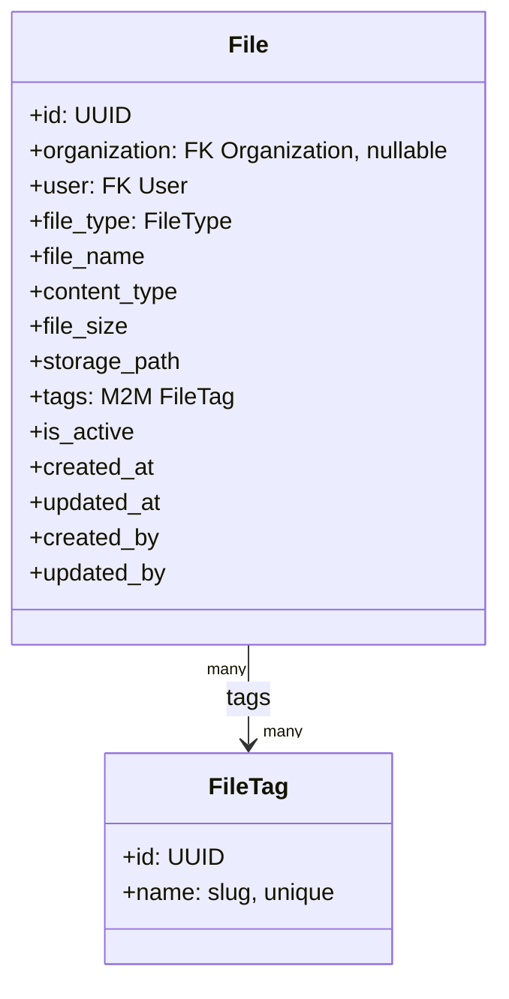
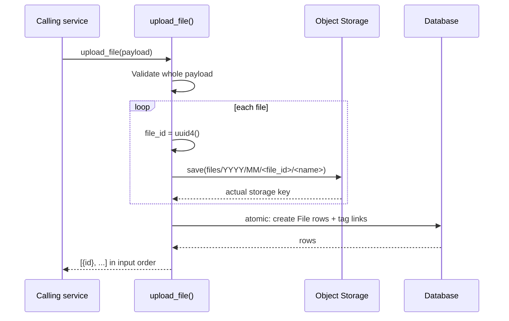

# 0014 — File Storage Service

## Status

Proposed — implemented in `apps.files`. This document describes the module as
built; §12 lists what is still open.

## References

- [0000 — API Coding Spec](0000-api-coding-spec.md) — model/style constraints
- [0006 — Active Flag Model](0006-active-flag-model.md) — `is_active` / `active()` used by `File`
- [0016 — PDF Service](0016-pdf-services.md) — consumer: stores generated documents, reads image files, deletes cancelled bulk chunks
- [0015 — eSign Module and CDAC eSign Addon](0015-cdac-esign.md) — consumer: stores prepared and signed PDFs, reads content in-process, cleans up placeholders
- [0010 — Generic Request & Approval Workflow](0010-simple-requests-flow.md) — consumer: stores request supporting documents (`pdf` / `image`), streams them on download, deletes them only to undo a failed submission
- [0005 — Registration and Login](0005-registration-and-login.md) — consumer: stores the advocate's bar council ID document

## Context

Multiple parts of the system need to upload and access files as part of their business flows. Rather than implementing file upload, storage, and retrieval separately in each module, this module provides a generic file storage service.

The service owns the file metadata and the physical file stored in Object Storage. Other services can reference a file using the `file_id` returned by this service.

The service should remain independent of the business context in which a file is used. For example, an application service may use a file as an address proof, while another service may use a file as an invoice.

**This iteration does not expose any REST API.** The module is consumed **in-process** by other Django apps through service-level functions only. REST endpoints, if needed later, will be added as a thin layer on top of these functions.

## Goals

* Provide service-level functions for uploading one or multiple files.
* Store file metadata in a `File` model.
* Store the actual file in Object Storage.
* Return a unique `file_id` that other services can use to reference the file.
* Support an optional `organization_id`.
* Track the user or system that uploaded the file through `user_id`.
* Support a controlled `file_type` ENUM.
* Support multiple arbitrary tags for filtering and search.
* Provide a function to retrieve a single file's metadata.
* Provide a function to read a stored file's content in-process.
* Provide a function to delete a file and its stored object.
* Provide a function to search/list files.
* Provide one shared place that decides which user-supplied document formats are accepted (§3.1).

## Non-goals

* REST/HTTP APIs, DRF serializers, viewsets, or URL routing in this iteration.
* Validating the business meaning of a file.
* OCR or extracting information from files.
* File conversion or preview generation.
* Virus/malware scanning in this iteration.
* Direct client-to-Object-Storage upload using signed URLs.
* Asynchronous file processing.
* File versioning.
* File sharing or permission management.
* Full-text search inside file contents.

---

## Proposed changes

### 1. Data model

Location: `apps.files.models`

Proposed model structure:



`File` stores the metadata required to identify and access a stored file.

`FileTag` stores reusable tags that can be associated with multiple files.

Per [`0000`](0000-api-coding-spec.md) #3, both models inherit `apps.core.models.BaseModel`. That gives them a UUID primary key, `created_at` (indexed), `updated_at`, the audit FKs `created_by` / `updated_by`, and `-created_at` ordering. `File` also inherits `BaseActivatableModel` ([`0006`](0006-active-flag-model.md)), which adds `is_active` (default `True`) and the `File.objects.active()` queryset (§6.4). Bounded enums use `TextChoices`.

### 1.1 File fields

| Field | Type | Description |
| --- | --- | --- |
| `id` | UUID, pk | The `file_id`. Generated before the content is stored, so the storage key can embed it (§4). |
| `organization` | FK `organizations.Organization`, nullable, `on_delete=PROTECT` | Organization associated with the file |
| `user` | FK `users.User`, required, `on_delete=PROTECT` | User or system account that uploaded the file |
| `file_type` | `CharField(50)`, `FileType` choices, indexed | Controlled type of the file (§1.2) |
| `file_name` | `CharField(255)` | Original file name as supplied by the uploader |
| `content_type` | `CharField(255)` | MIME type (§3) |
| `file_size` | `PositiveBigIntegerField` | Size in bytes |
| `storage_path` | `CharField(1024)`, unique | Object Storage key; never returned to callers |
| `tags` | M2M `FileTag`, `related_name="files"` | Tags for filtering (§1.3) |
| `is_active` | bool, default `True` | Soft visibility flag (§6.4) |
| `created_at` / `updated_at` | datetime | `BaseModel` timestamps |
| `created_by` / `updated_by` | FK `User`, nullable | `BaseModel` audit fields. Set by the admin mixin, not by the service functions. |

Indexes: `file_type` (field index) and the composite `(organization, file_type)`.

`organization` is nullable because not every file needs to belong to an organization.

`user` identifies the actor that uploaded the file. It is never null: uploads by a background process are attributed to a system account (§10).

Both FKs use `PROTECT`, so an organization or user that still has files cannot be deleted. Consumers that reference a `File` also use `PROTECT`. For example, `dristi_requests.RequestDocument.file` stops a file that a request depends on from being deleted (see §6.2 for how this interacts with `delete_file`).

### 1.2 File type

`file_type` is a `TextChoices` ENUM, `apps.files.models.FileType`.

> **Pass the value, not the member name.** The stored value is **lower-case**.
> `FileType.PDF` is `"pdf"`, and the string `"PDF"` is only the member name, which
> `upload_file` rejects (§8). Code that imports `FileType` should pass the member
> (`FileType.PDF`). Code that deliberately avoids importing the model, such as
> `apps.esign`, must pass the lower-case value string and guard it with a system
> check ([`0015`](0015-cdac-esign.md), `esign.E007`).

| Member | Stored value | Label | Typical formats |
| --- | --- | --- | --- |
| `FileType.PDF` | `pdf` | PDF | PDF |
| `FileType.DOCUMENT` | `document` | Document | PDF, DOC, DOCX, ODT |
| `FileType.IMAGE` | `image` | Image | JPG, JPEG, PNG |
| `FileType.SIGNATURE` | `signature` | Signature | PNG, JPEG |
| `FileType.DIGITALLY_SIGNED` | `digitally_signed` | Digitally signed | PDF, XML |

The type describes the **role** a file plays for the consuming module, not its media type.

Values currently used by consumers:

| Consumer | How it passes the type | Value stored |
| --- | --- | --- |
| [`0016`](0016-pdf-services.md) generated documents (`apps.pdf.services.documents.store_document`) | `FileType.PDF` | `pdf` |
| [`0015`](0015-cdac-esign.md) prepared (placeholder) PDF | `apps.esign.constants.FILE_TYPE_PDF` | `pdf` |
| [`0015`](0015-cdac-esign.md) eSigned output | `apps.esign.constants.FILE_TYPE_SIGNED_PDF` | `digitally_signed` |
| [`0010`](0010-simple-requests-flow.md) request documents, [`0005`](0005-registration-and-login.md) bar council ID | derived from the content type by `apps.files.documents` (§3.1) | `pdf` or `image` |

`DOCUMENT` and `SIGNATURE` are defined but not used by any consumer yet.

`DIGITALLY_SIGNED` is kept distinct from `PDF` so that digitally signed artefacts can be filtered, retained, and audited separately from ordinary documents.

Adding a value needs a migration (the choices are part of `0001_initial`). **Never** rename an existing stored value: rows already hold it, and consumers that pass plain strings break silently at runtime rather than at import.

### 1.3 Tags

A file can have multiple tags.

```text
File
 |
 +-- verification
 +-- identity
 +-- onboarding
```

Tags are intended for filtering/search and should not replace `file_type`.

Tags are **global** (not scoped to an organization) and stored as **slugs** (`FileTag.clean()` calls `django.utils.text.slugify`). So:

```text
identity, Identity, IDENTITY, " identity "  -> identity
Address Proof                               -> address-proof
```

all resolve to a single row. `FileTag.name` is unique (max 100 characters) and `FileTag.save()` runs `full_clean()`, so the rule also holds for tags created directly (for example from the admin).

Rejected names, reported as `ValidationError`:

* non-ASCII names (slugify would drop or transliterate characters and store a tag the caller never asked for);
* names with no alphanumeric character (they slugify to an empty string);
* names longer than 100 characters.

Tags are created on first use (`get_or_create`). Deleting a file removes its tag links but leaves the `FileTag` rows in place, because other files may still carry them.

---

### 2. Service interface

Location: `apps.files.services`

The module exposes five public functions and one exception:

```text
upload_file(payload)
get_file(file_id)
get_file_content(file_id)
search_file(filters=None, page=1, page_size=20)
delete_file(file_id)

FileNotFound            # raised for unknown, malformed or deactivated ids
```

The user-supplied document helpers in `apps.files.documents` (§3.1) are built on top of these functions.

* Business logic lives in the service module and models, not in views or serializers.
* The functions are plain Python callables. They take and return plain Python data structures (dicts, lists, UUIDs) and never return model instances, querysets, or DRF `Response` objects.
* The service does not depend on request/response objects, DRF, or HTTP status codes.
* Errors are raised as Django/Python exceptions (§8), not translated into HTTP responses. Consumers translate them for their own callers (see §8.1).

---

### 3. Upload files

```text
upload_file(payload) -> {"files": [{"id": UUID}, ...]}
```

The function accepts one or multiple files in a single call. `organization_id` and `user_id` are common to the call; `file_type` and `tags` are per file.

Input:

```python
{
    "organization_id": "<organization uuid>" | None,
    "user_id": "<user uuid>",
    "files": [
        {"file": <UploadedFile>, "file_type": FileType.PDF, "tags": ["invoice", "2026"]},
        {"file": <UploadedFile>, "file_type": FileType.IMAGE, "tags": ["profile"]},
    ],
}
```

Input rules (checked in this order, all before anything is written):

* `payload` must be a `dict`.
* `user_id` is required and must be the primary key of an existing `User`. Malformed values are reported the same way as unknown ones.
* `organization_id` is optional and may be `null`. If given, it must be the primary key of an existing `Organization`.
* `files` is required and must be a non-empty `list` or `tuple` with at most `FILE_MAX_COUNT_PER_UPLOAD` entries.
* For each entry, `files[i]`:
  * `file` is required. It is a Django `UploadedFile` or any file-like object exposing `name` and `read()`. `size` and `content_type` are optional (see below).
  * `file_type` is required and must be one of `FileType.values` (the lower-case stored values, §1.2).
  * The file name must be non-blank and at most 255 characters.
  * The content type must be at most 255 characters.
  * The size must be at most `FILE_MAX_SIZE_BYTES`.
  * `tags` is optional. If given, it must be a `list` or `tuple` of strings, and each one must normalize (§1.3). A bare string is rejected; it is not split into one tag per character.

The checks against the column limits run before the content is stored, so an invalid entry never costs a storage write. `full_clean()` runs again when each row is created, as a backstop against races (for example a user deleted between the check and the insert).

Derived metadata:

* `content_type` is `file.content_type` if present. Otherwise it is guessed from the file name (`mimetypes.guess_type`), falling back to `application/octet-stream`. The declared content type is a client hint and `upload_file` does not verify it. Content verification for user-supplied documents lives in §3.1.
* `file_size` is `file.size` if present. Otherwise the stream is measured by seeking to the end, and the original position is restored.
* `file_name` is the name as supplied. Only the storage key uses a sanitized copy (§4).

Each entry in `files` results in a separate `File` record and a separate `file_id`:

```text
upload_file(files=[application.pdf, identity.pdf])
    application.pdf -> file_id = A
    identity.pdf    -> file_id = B
```

Output:

```python
{"files": [{"id": UUID("A...")}, {"id": UUID("B...")}]}
```

The ids are `uuid.UUID` objects. Callers that persist or compare them as strings convert them with `str(...)`. The returned order matches the input order of `files`, so callers can map results back to the file they submitted.

The `file_id` is the only identifier that consuming services need to persist.

A multi-file call is **all-or-nothing** (§9).

### 3.1 User-supplied documents (`apps.files.documents`)

Modules that accept files from end users (request documents in [`0010`](0010-simple-requests-flow.md), the bar council ID in [`0005`](0005-registration-and-login.md)) do not call `upload_file` directly. They go through `apps.files.documents`, which is the single place that decides which formats are accepted:

| Content type | Stored as | Allowed extensions | Content must start with |
| --- | --- | --- | --- |
| `application/pdf` | `FileType.PDF` | `.pdf` | `%PDF-` |
| `image/jpeg` | `FileType.IMAGE` | `.jpg`, `.jpeg` | `FF D8 FF` |
| `image/png` | `FileType.IMAGE` | `.png` | `89 50 4E 47 0D 0A 1A 0A` |

Functions:

* `document_error(upload) -> str | None` returns why an upload is refused, or `None` if it is acceptable. The checks are: content type in the table (parameters stripped, case-insensitive), then extension matching the type, then size ≤ `FILE_MAX_SIZE_BYTES`, then the leading bytes matching the type. The declared type and the name are client hints, and the leading bytes decide. The upload is left rewound.
* `file_type_for(upload) -> FileType | None` returns the `FileType` for the upload's content type.
* `store_documents(uploads, *, user_id, tags) -> list[file_id]` stores already-checked uploads in **one** `upload_file` call (so all-or-nothing), using `file_type_for` and the same tags for every file. It raises Django `ValidationError` if `apps.files` refuses the set.
* `discard_documents(file_ids)` deletes stored documents to undo `store_documents` when the work that follows fails. Errors are logged and swallowed so they do not mask the original failure.

Callers run `document_error` themselves first, so they can report a refusal as a 400 on their own field before anything is written.

---

### 4. File storage

The actual file content is stored in Object Storage. The database stores only the metadata and the Object Storage key.



Location: `apps.files.storage`

The storage provider is reached only through this small internal interface:

```text
STORAGE_ALIAS = "files"
get_file_storage()             -> storages["files"]
build_storage_path(file_id, file_name) -> key
save(path, file)               -> actual key written
open_file(storage_path)        -> file-like object
delete(storage_path)
```

Storage key format:

```text
files/<YYYY>/<MM>/<file_id>/<sanitized file name>
```

The key embeds the `file_id`, which is generated before the write, so it is unique without a database lookup. The file name is passed through `django.utils.text.get_valid_filename` because it comes from the uploader. Backends may adjust the key to avoid a collision, so the key returned by `save` is what gets persisted, not the requested path.

Backend: the `files` alias in `settings.STORAGES` follows the `default` alias (§10):

* **Development / CI:** `django.core.files.storage.FileSystemStorage` under `MEDIA_ROOT`. Tests swap in `InMemoryStorage`.
* **When `S3_API_ENDPOINT`, `S3_BUCKET`, `S3_ACCESS_KEY` and `S3_SECRET_KEY` are all set:** `storages.backends.s3boto3.S3Boto3Storage` (django-storages) against the S3-compatible endpoint (RustFS in the compose stack), with `location="media"`, `default_acl="private"`, `signature_version="s3v4"` and query-string auth.

`storage_path` is never returned to callers.

---

### 5. File ID

The `File.id` generated by this service is the reference used by other services.

```text
Application
    |
    +-- file_id = <file-id>
```

Consumers store either the bare id or a Django FK to `files.File` (for example `RequestDocument.file`). They must not store or depend on:

```text
Object Storage bucket
Object Storage key
physical file path
storage provider
```

This keeps the storage implementation internal to the File Storage module.

---

### 6. Get file

```text
get_file(file_id) -> dict
```

Returns the metadata of a single **active** file:

```python
{
    "id": UUID("..."),
    "organization_id": UUID("...") | None,
    "user_id": UUID("..."),
    "file_type": "pdf",
    "file_name": "address-proof.pdf",
    "content_type": "application/pdf",
    "file_size": 245678,
    "tags": ["address-proof", "verification"],   # sorted
    "created_at": datetime(...),
}
```

`storage_path`, `is_active`, `updated_at` and the audit FKs are not included. `file_type` is the stored lower-case value.

If the file does not exist, the id is malformed (not a UUID), or the file is deactivated, `get_file` raises `FileNotFound`. It never returns `None`.

Content access is provided separately so that metadata reads stay cheap.

### 6.1 Get file content

```text
get_file_content(file_id) -> file-like object
```

Returns the readable file-like object opened by the storage backend (`storage.open`). A stream, not a signed URL, is the contract for this iteration because the in-process consumers need the bytes themselves:

* [`0016`](0016-pdf-services.md) streams them through the download endpoint and reads image files for templates;
* [`0015`](0015-cdac-esign.md) feeds them to the PDF Service for hashing and signature embedding;
* [`0010`](0010-simple-requests-flow.md) streams request documents on download.

Signed URLs remain a future addition for browser-direct download, not a replacement.

Rules:

* Unknown, malformed or deactivated `file_id` raises `FileNotFound`, the same as `get_file`.
* The read limit is checked **before** the object is opened. It compares the recorded `file_size` with `FILE_MAX_READ_BYTES` and raises `ValidationError` if the file is larger, so an oversized file costs one metadata read rather than a transfer. The check trusts the size recorded at upload.
* The caller owns the returned object and must close it.
* Consumers that only need metadata must use `get_file`.

### 6.2 Delete file

```text
delete_file(file_id) -> None
```

Permanently deletes the stored object and then the `File` row. Django's deletion collector removes the tag links in the same operation; the `FileTag` rows survive.

Rules:

* The lookup uses `File.objects` (not `active()`), so **deactivated files can be deleted**. Cleanup is the one operation that has to reach them.
* The stored object is deleted first, and that call is not guarded. If the backend cannot confirm the deletion, the error propagates and the `File` row stays, so a row never points at an object that is already gone because of a storage failure.
* Deleting an unknown or malformed `file_id` raises `FileNotFound`. Deletion is not silently idempotent, so a caller that deletes the same id twice finds out. Callers that want idempotent cleanup catch it (`apps.pdf` does).
* Deletion is permanent. It is intended for cleanup of module-owned intermediate artefacts (eSign placeholder PDFs, cancelled PDF bulk chunks, documents of a submission that failed), not as a general user-facing operation.
* This module does **not** track which business entity references a `file_id`, so the calling module is responsible for only deleting files it owns.

> **Known gap — protected references.** When another model references the file
> with `on_delete=PROTECT` (for example `RequestDocument.file`), the row delete
> raises `django.db.models.ProtectedError`. That is the intended guard, but it
> happens **after** the stored object has been deleted. The row survives and
> now points at a missing object, so later `get_file_content` calls fail at the
> backend. Until this is fixed (§12, question 9), callers must not call
> `delete_file` on a file that something else may still reference.

### 6.3 Immutability

Stored content is never modified in place, and the module has no update function. A file that must change produces a new `File` record with a new `file_id`. Consumers such as [`0015`](0015-cdac-esign.md) rely on this: the source document of a signing transaction must be byte-identical after signing, and the prepared and signed PDFs are separate records.

### 6.4 Deactivated files

`File.is_active` ([`0006`](0006-active-flag-model.md)) hides a file without deleting it. Every read path (`get_file`, `get_file_content`, `search_file`) uses `File.objects.active()`, and a deactivated file is reported as `FileNotFound` rather than as a separate state. Callers have no way to reactivate a file, so the difference is not actionable for them. The row and its stored content are kept, and setting `is_active` back to `True` makes the file visible again.

There is no service function to deactivate or reactivate a file. It is done through the Django admin (§11), which queries the model directly and sees every row.

---

### 7. Search files

```text
search_file(filters=None, page=1, page_size=20) -> dict
```

Searches **active** files by metadata. Supported filters, ANDed:

| Filter | Applied when | Match |
| --- | --- | --- |
| `organization_id` | the value is not `None` | equality |
| `user_id` | the value is not `None` | equality |
| `file_type` | the value is truthy | equality with the stored value |
| `tags` | a non-empty list/tuple of strings | the file must carry **all** the tags; each name is normalized as in §1.3 |

Unknown filter keys are ignored.

> `file_type` is **not** validated against `FileType`. A wrong value, such as the
> member name `"PDF"` instead of `"pdf"`, returns an empty result rather than an
> error. Pass `FileType` members.

Examples:

```python
search_file({"organization_id": org_id})
search_file({"user_id": user_id})
search_file({"file_type": FileType.PDF})
search_file({"tags": ["verification"]})
search_file({"organization_id": org_id, "file_type": FileType.PDF, "tags": ["verification"]})
```

Output:

```python
{
    "results": [<get_file() dict>, ...],
    "count": 1,
    "page": 1,
    "page_size": 20,
    "num_pages": 1,
}
```

Each result has the same shape as `get_file()`. Tags are prefetched, so the query count does not grow with the page size.

Results use the `BaseModel` ordering, `-created_at`, so pagination is stable.

Pagination uses Django's `Paginator.get_page`:

* `page` and `page_size` must be positive integers (`bool` is rejected), otherwise `ValidationError`. Without this check, `get_page` would silently turn `page=0` into the last page, and `page_size=0` would divide by zero.
* A `page` past the end returns the last page (`get_page` behaviour). The returned `page` reports the page actually served.
* The default `page_size` (20) matches `REST_FRAMEWORK["PAGE_SIZE"]`, so a future REST layer can map onto DRF page-number pagination directly.

---

### 8. Validation and error handling

Validation is performed in the service layer, since there are no serializers. Errors are `django.core.exceptions.ValidationError` and, where they concern one input, are keyed by the path in the payload the caller sent, so the caller can map the message back:

| Condition | Error |
| --- | --- |
| `payload` not a dict | `ValidationError("payload must be a dict.")` |
| missing `user_id` | `{"user_id": "user_id is required."}` |
| unknown or malformed `user_id` / `organization_id` | `{"user_id": "No user with id …"}` / `{"organization_id": "No organization with id …"}` |
| empty, non-list, or too many `files` | `{"files": …}` |
| missing `file`, blank or over-long name, over-long content type, too large | `{"files[i].file": …}` |
| unknown `file_type` (including upper-case member names) | `{"files[i].file_type": "file_type must be one of ['pdf', 'document', 'image', 'signature', 'digitally_signed']."}` |
| bad `tags` | `{"files[i].tags": …}`, or `{"tags": …}` in `search_file` |
| bad `page` / `page_size` | `{"page": …}` / `{"page_size": …}` |
| file larger than `FILE_MAX_READ_BYTES` in `get_file_content` | `ValidationError` (not keyed) |
| unknown, malformed or deactivated id in `get_file`, `get_file_content`, `delete_file` | `FileNotFound` |
| storage backend failure | the backend's own exception, propagated |
| file still referenced through a `PROTECT` FK, in `delete_file` | `ProtectedError` (see §6.2) |

### 8.1 How consumers translate errors

`ValidationError` means the **caller built a bad payload**. It is not an outage, and consumers must not report it as one:

* [`0010`](0010-simple-requests-flow.md) `dristi_requests` and [`0005`](0005-registration-and-login.md) registration check documents with `apps.files.documents` first, and report any remaining `ValidationError` as a 400 on their `documents` field.
* [`0016`](0016-pdf-services.md) reports a `ValidationError` from `upload_file` as `PDFConfigurationError` (not retried), and any other exception as a transient `PDFStorageError`.
* [`0015`](0015-cdac-esign.md) reports a `ValidationError` as `ESIGN_FILE_STORAGE_REJECTED` / `E03027`, carrying the field-level message, and any other exception as `ESIGN_FILE_STORAGE_UNAVAILABLE` / `E03007`.

Consumers that bypass the `FileType` import (§1.2) should also add a system check, as `apps.esign` does.

---

### 9. Upload failure handling

A file never has a database record if its Object Storage upload failed, and a failed call leaves no rows and (best effort) no objects.

```text
Validate the whole payload          -- nothing written on failure
      |
      v
Store each object in Object Storage -- in input order
      |
      v
transaction.atomic():
    create every File row (full_clean + save)
    set each file's tags
      |
      v
Return ids in input order
```

* If any storage write or any database step fails, every object already written by the call is deleted and the original exception is re-raised. The whole call is **all-or-nothing**.
* Cleanup errors during that rollback are swallowed so they cannot mask the original error. The worst case is an orphaned object, never a row without an object.
* Because `upload_file` writes to storage before its transaction, a caller must **not** wrap `upload_file` in its own outer transaction and expect a rollback to undo it. Rolling back the outer transaction would leave the objects behind. Callers upload first, outside their transaction, and call `delete_file` / `discard_documents` if their later work fails (as `apps.users` registration and `dristi_requests` do).

---

### 10. Configuration

Settings are read in `config.settings.base`, documented in `.env.example`, `.env.prod.example` and `README.md`:

| Setting | Default | Purpose |
| --- | --- | --- |
| `STORAGES["files"]` | follows `STORAGES["default"]` | Backend for file content (§4). Not an env var. |
| `S3_API_ENDPOINT`, `S3_BUCKET`, `S3_ACCESS_KEY`, `S3_SECRET_KEY` | unset | When all four are set, `default` (and so `files`) becomes the S3-compatible backend. |
| `FILE_MAX_SIZE_BYTES` | `10485760` (10 MiB) | Largest single file `upload_file` accepts. Also used by `apps.files.documents`. |
| `FILE_MAX_COUNT_PER_UPLOAD` | `10` | Most entries in one `upload_file` call |
| `FILE_MAX_READ_BYTES` | `FILE_MAX_SIZE_BYTES` | Largest file `get_file_content()` will open. Keep it ≥ `FILE_MAX_SIZE_BYTES`, or files this module accepted become unreadable. |
| `FILE_SYSTEM_USER_ID` | `""` (`.env.example`: `system@dristi.internal`) | System account for uploads with no interactive user |

There are no separate `FILE_STORAGE_BACKEND` / `FILE_STORAGE_BUCKET` settings. The backend is the `files` storage alias, and the bucket comes from `S3_BUCKET`.

`FILE_SYSTEM_USER_ID` exists because some uploads have no interactive user: a PDF generated by a Dramatiq worker ([`0016`](0016-pdf-services.md)) and the signed PDF produced while handling an unauthenticated ESP callback ([`0015`](0015-cdac-esign.md)). `upload_file` itself does not read this setting. It always requires a real `user_id`, and `File.user` stays non-null. The **caller** resolves the fallback:

* `apps.pdf.services.documents.resolve_system_user_id()` accepts an email (containing `@`, matched case-insensitively), a mobile number (starting with `+`), or a primary key, so the same value works in every environment. It raises `PDFConfigurationError` if the setting is empty or matches no user.
* `apps.esign` attributes the signed PDF to the signer captured at initiation.

No migration creates the system account. Each environment must create the user that `FILE_SYSTEM_USER_ID` names (§12).

---

### 11. Affected files

Implemented:

```text
apps/files/__init__.py
apps/files/apps.py             # name = "apps.files"
apps/files/models.py           # FileType, FileTag, File
apps/files/services.py         # the five service functions + FileNotFound
apps/files/storage.py          # storage alias wrapper (§4)
apps/files/documents.py        # accepted user-document formats (§3.1)
apps/files/admin.py
apps/files/migrations/0001_initial.py
apps/files/tests/factories.py
apps/files/tests/test_file.py
apps/files/tests/test_services.py
apps/files/tests/test_documents.py
apps/files/tests/test_file_admin.py
```

and updated:

```text
config/settings/base.py        # INSTALLED_APPS += ["apps.files"], STORAGES["files"], FILE_* settings
.env.example, .env.prod.example
README.md
```

No `serializers.py`, `views.py`, or `urls.py`.

Admin (`apps/files/admin.py`):

* `FileAdmin` lists `file_name`, `file_type`, `organization`, `user`, `file_size`, `is_active` and `created_at`, filters by `file_type` and `is_active`, and searches `file_name`, `storage_path` and `user__email`. Adding is disabled, because a row created there would point at a storage key with no object. `storage_path`, `content_type`, `file_size` and the ids/timestamps are read-only. `is_active` and the tags can be edited.
* `FileTagAdmin` allows adding and editing tags. Names are slugified on save (§1.3).
* Both use `AuditUserAdminMixin` to record `created_by` / `updated_by`.

Test coverage:

* `upload_file` with a single file and with multiple files of different `file_type`, keeping input order.
* Every validation failure in §8, each checked to run before any storage write.
* Tag normalization, reuse across files, rejection of string/non-string/non-ASCII/empty tags.
* `get_file` success, unknown and malformed ids.
* `get_file_content` returns the bytes. The read limit is enforced from metadata without opening storage, and not-found takes precedence over the size error.
* `delete_file` removes the object then the record. Tag links go but tags survive. Unknown ids raise. A storage failure leaves the record intact. Deactivated files can be deleted.
* `search_file` for each filter, combined filters, all-tags matching, newest-first ordering, pagination and constant query count.
* Deactivated files are hidden from every read path and reappear on reactivation.
* Storage failure creates no record. A later storage failure discards earlier objects. A database failure discards the uploaded objects.
* `apps.files.documents` accepted formats, extension and content checks, size limit, rewind, all-or-nothing storage, and logged cleanup failures.
* `PROTECT` on organization and user.

Quality checks before committing:

```bash
cd src && DJANGO_SETTINGS_MODULE=config.settings.test pytest
cd src && ruff check . && ruff format .
cd src && python manage.py check
```

---

## 12. Open questions

1. Signed-URL content access is deferred (#6.1 commits to a stream). Which consumer needs signed URLs first, and for which file sizes?
2. Which additional `FileType` values are needed, and do `DOCUMENT` and `SIGNATURE` (unused today) stay?
3. **Provisioning the system account (#10).** `FILE_SYSTEM_USER_ID` must name an existing `User`. `User` inherits `BaseModel`, so its primary key is a **UUID** that differs per environment, which is why the setting accepts an email or mobile number. Nothing creates that user yet: each environment must create it manually, and background PDF uploads fail with `PDFConfigurationError` until it does. Options:
   a. a data migration that creates `system@dristi.internal` (no manual bootstrap);
   b. a management command run at deploy time;
   c. keep the manual step and add a system check that the configured user exists.
4. Should `search_file` validate `file_type` against `FileType` (and raise `ValidationError`) instead of returning an empty result for an unknown value (#7)?
5. Should there be a service function to deactivate/reactivate a file (#6.4), or does that stay admin-only?
6. Should the size recorded at upload be re-verified against the stored object (the read guard in #6.1 trusts it)?
7. Should `upload_file` set `created_by` from `user_id`, so the audit fields are filled for service-created rows as well as admin edits?
8. Orphaned objects. A failed rollback cleanup (#9) can leave an object without a row. Is a periodic reconciliation needed?
9. **`delete_file` and protected references (#6.2).** Should `delete_file` check for `PROTECT` references (or delete the row first, inside a transaction, and remove the object on commit) so a refused delete leaves the object intact?

---

## 13. Out of scope

* REST APIs, serializers, viewsets, routing, and Swagger annotations.
* Direct client-to-Object-Storage upload using signed URLs.
* Asynchronous upload/processing.
* Content authenticity verification beyond the leading-byte check of §3.1.
* OCR.
* File conversion.
* Thumbnail generation.
* File versioning.
* File sharing.
* Retention policies and reconciliation of orphaned storage objects.
* Reference counting of `file_id` usage by consuming modules.
* Access-control/permission management.
* Full-text search inside file contents.
* Notifications related to file upload.
