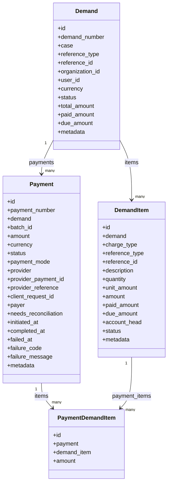

# 0017 — Payments Module (`apps.payments`)

## Status

Proposed

## Context

Several Dristi flows charge money:

* **Case filing** — one bill per complaint: Court Fee, Legal Benefit Fee, Advocate
  Welfare Fund, Stipend Stamp, Advocate Clerk Welfare Fund, Complaint Fee (slab on the
  sum of cheque amounts), Delay Condonation Application Fee, plus upfront process fees
  per accused — summons, warrant and notice rounds, charged per selected address, and
  the e-Post fee.
* **Resubmission after correction** — when the recalculated bill is higher, only the
  balance is collected; when it is not, the payment step is skipped.
* **Process issue** — after an order, a flat court fee per process (summons, notice,
  warrant, proclamation, attachment), net of court fee already held for the case.
* **Applications** — the fee for an application type that carries one.
* **Join a case** — the vakalatnama fee; the advocate gets case access only after it
  is paid.
* **Costs** ordered by the court.

Each flow moves forward only when its money is in: a filing leaves *Pending Payment*
for Scrutiny, an application leaves *Pending Payment* for review, a process moves to
signing. Today each of those flows would have to invent its own amount tracking, its
own "is it paid" flag and its own gateway integration.

This spec introduces one generic, domain-neutral module, `apps.payments`, that
owns the financial lifecycle of any payable charge raised by any other Dristi
module.

| Concept here | Meaning |
| --- | --- |
| `Demand` | A raised, payable claim — one or more charges grouped together |
| `DemandItem` | One independently payable charge (a line item) |
| `Payment` | One collection attempt against a demand |
| `PaymentDemandItem` | Which demand items a payment pays, and the amount for each |

### What the module does and does not decide

`apps.payments` knows amounts, currency, state and collection. It does **not**
know what a court fee is, how it is calculated, whether it is waived, or what
should happen in a case once it is paid. The raising module computes the amounts
from the court's fee master, nets off anything already paid, and creates the
demand; it is notified when collection succeeds. Where nothing is due, the raising
module raises no demand and skips its payment step.

Payment *providers* (gateways, bank/treasury integrations, counter collection)
are **out of this module** and ship separately as `addon.<provider>_payment_gateway`,
exactly as the SMS gateway does in [`0013`](0013-addon-cdac-sms-gateway.md) and the
eSign provider in [`0015`](0015-cdac-esign.md). This module owns the provider
**contract** and everything around it that is not specific to one gateway — the
callback endpoint, verification before credit, status polling and routing each
payment back to the provider that started it (#9). A provider is therefore a
settings change, and a deployment can replace one with another at any point.

The first concrete provider is e-GRAS, specified in
[`0022`](0022-addon-egras-payment-gateway.md). Local and test environments use
a built-in mock provider.

## Goals

* Create a demand with one or more line items in a single atomic operation.
* Keep an independent amount/paid/due/status balance per line item.
* Collect payment **line item wise**: pay exactly one item and leave the rest due.
* Collect payment **combined**: pay any chosen subset, or all payable items, in one payment.
* Collect payment **across demands** in one gateway transaction (several applications, or a batch of filed cases), while each demand keeps its own payment record.
* Carry the rate × factors behind every line (rate × addresses × rounds) so the payer sees how each amount was reached.
* Let a raising module read what has already been paid against a case, so it can collect only the balance.
* Record, for every payment, exactly which line items it paid and by how much.
* Tie every demand to its case, and let anyone involved in that case see and pay it; no one outside the case can see or act on it.
* Derive demand status from its line items; never let an API client set balances.
* Make payment creation idempotent and safe under concurrent requests.
* Make payment confirmation idempotent, so a replayed callback never credits twice.
* Define a provider contract that an addon implements, with no gateway code in this module.
* Replace the provider at any point by configuration, without stranding payments still pending at the old one.
* Never credit a payment on an unverified provider callback, and never fail one the provider may still complete.
* Expose demand and payment REST APIs following [`0000`](0000-api-coding-spec.md), including the standard error shape and registered error codes.
* Notify the raising module when a demand or line item becomes fully paid.

## Non-goals

* Any concrete payment gateway, its SDK, credentials, wire format or signature scheme — those live in the provider addon.
* Fee calculation, fee schedules (the court's fee master), exemptions, waivers and remission rules.
* Netting against fees already paid and recalculation on resubmission — the raising module computes the balance and raises a demand for it.
* Deciding whether a charge is payable, by whom, or by when.
* Refunds, reversals, settlement, reconciliation with bank statements, and receipts.
* Offline/cash counter collection in this iteration.
* Accounting ledgers, chart of accounts, heads of account and treasury posting.
* Multi-currency conversion. A demand is single-currency, defaulting to `INR`.
* Partial payment of a single demand item. Each item is paid in full by one payment.

---

## Proposed changes

### 1. App layout

Location: `apps.payments` (registered as `"apps.payments"` in `INSTALLED_APPS`).

```text
apps/payments/
├── __init__.py
├── apps.py                 # name = "apps.payments"
├── models.py               # Demand, DemandItem, Payment, PaymentDemandItem
├── enums.py                # TextChoices: statuses, charge types, reference types
├── serializers.py
├── views.py
├── urls.py
├── admin.py
├── errors.py               # registered API error codes (#12.5)
├── exceptions.py           # in-process exceptions that never reach a view
├── checks.py               # provider configuration system checks (#9.3)
├── selectors.py            # read-only queries
├── tasks.py                # Dramatiq actors
├── services/
│   ├── __init__.py
│   ├── demands.py          # DemandService
│   ├── payments.py         # PaymentService, apply_provider_status (#9.5)
│   └── balances.py         # balance application + demand recalculation
├── providers/
│   ├── __init__.py
│   ├── base.py             # PaymentProvider contract, dataclasses, exceptions (#9.1)
│   ├── registry.py         # settings-driven lookup and routing (#9.3)
│   └── mock.py             # MockPaymentProvider, local/test default (#9.8)
├── management/commands/
│   ├── payments_verify_balances.py
│   └── payments_provider_usage.py
├── migrations/
└── tests/
```

Rules:

* Views validate input, call a service, and serialize the result. No balance arithmetic in views or serializers.
* Only `services/balances.py` mutates `paid_amount`, `due_amount` and status. Every other module and every provider goes through `PaymentService`.
* Only `PaymentService.apply_provider_status` acts on a provider's reported outcome.
* `providers/` contains the contract, the registry and the mock only — never a real gateway implementation.
* API failures are raised as `BusinessError(errors.X)` from views and services, or `errors.X.validation_error()` inside serializers ([`0000`](0000-api-coding-spec.md) #9.4). No view builds an error `Response` by hand. `exceptions.py` holds only exceptions caught in-process (e.g. `PaymentNotConfirmable`).

### 2. Data model



All four models inherit `apps.core.models.BaseModel` (UUID pk, `created_at`, `updated_at`, `created_by`, `updated_by`, explicit `Meta.ordering`). 
Every bounded enum is a `TextChoices` in `apps/payments/enums.py`.

The shape that matters is `Payment → PaymentDemandItem → DemandItem`. A payment
is a *collection transaction*; its `PaymentDemandItem` rows say which demand
items that transaction pays. This single relationship is what makes
line-item-wise payment and combined payment the same code path instead of two
flows.

#### 2.1 `Demand`

| Field | Type | Notes |
| --- | --- | --- |
| `demand_number` | `CharField(32, unique=True)` | human-readable, e.g. `DMD-2026-000123` (#11) |
| `case` | `FK("cases.Case", on_delete=PROTECT, related_name="demands")` | the case the money is owed on; required. Decides who can see and pay the demand (#13) |
| `reference_type` | `CharField(32, choices=ReferenceType)` | what within the case the demand is raised against (#3), e.g. `CASE_FILING`, `APPLICATION` |
| `reference_id` | `CharField(64, db_index=True)` | id of that entity, e.g. the application id |
| `organization_id` | `UUIDField(null=True, blank=True, db_index=True)` | plain identifier, not an FK — mirrors [`0014`](0014-file-storage-service.md) #1.1 |
| `user_id` | `UUIDField(null=True, blank=True, db_index=True)` | the party directed to pay, e.g. the party directed to take steps on a process; used to raise their pay task. Informational — it does not restrict who may pay (#13). Plain identifier, not an FK; nullable when no single party is named |
| `currency` | `CharField(3, default="INR")` | ISO 4217 |
| `status` | `CharField(16, choices=DemandStatus)` | derived, never client-set (#4) |
| `total_amount` | `DecimalField(18, 2)` | sum of non-cancelled item amounts |
| `paid_amount` | `DecimalField(18, 2)` | sum of item `paid_amount` |
| `due_amount` | `DecimalField(18, 2)` | `total_amount - paid_amount` |
| `due_date` | `DateTimeField(null=True, blank=True)` | informational; expiry is out of scope |
| `metadata` | `JSONField(default=dict, blank=True)` | caller context (court id, filing number, …) |

Indexes: `(case, status)`, `(reference_type, reference_id)`, `(user_id, status)`.

#### 2.2 `DemandItem`

| Field | Type | Notes |
| --- | --- | --- |
| `demand` | `FK(Demand, on_delete=PROTECT, related_name="items")` | parent |
| `charge_type` | `CharField(32, choices=ChargeType)` | kind of fee (#3) |
| `reference_type` | `CharField(32, choices=ReferenceType)` | what this specific charge is for — the summons, not the case (#3) |
| `reference_id` | `CharField(64, db_index=True)` | id of that entity, e.g. the summons id |
| `description` | `CharField(255)` | shown to the payer, e.g. `Summons — Accused 1` |
| `quantity` | `DecimalField(10, 2, default=1)` | `> 0`; the product of the factors in `metadata.quantity_breakdown` |
| `unit_amount` | `DecimalField(18, 2)` | `> 0`; the rate, e.g. `12.50` |
| `amount` | `DecimalField(18, 2)` | `quantity * unit_amount`, computed server side |
| `account_head` | `CharField(64, blank=True)` | remittance head of account from the fee master, snapshotted; a provider may use it to route the money (#9.1), but posting to it is out of scope |
| `paid_amount` / `due_amount` | `DecimalField(18, 2)` | maintained only by `services/balances.py` |
| `status` | `CharField(16, choices=DemandItemStatus)` | #4 |
| `metadata` | `JSONField(default=dict, blank=True)` | |

`metadata.quantity_breakdown` holds the factors behind `quantity`, so every line
can be shown as rate × factors even where a factor is 1:

```json
{ "quantity_breakdown": { "addresses": 2, "rounds": 3 }, "accused_id": "accused-1" }
```

shown as `12.50 × 2 addresses × 3 rounds = 75.00`. The module validates that the
factors multiply to `quantity`; it does not interpret their names.

`description`, `quantity`, `unit_amount`, `amount` and `account_head` are a
**snapshot** taken when the demand is raised. A later change to the originating entity or to a fee
schedule must never silently change an existing demand; the raising module
cancels the item and raises a new one.

#### 2.3 `Payment`

| Field | Type | Notes |
| --- | --- | --- |
| `payment_number` | `CharField(32, unique=True)` | e.g. `PAY-2026-000456` |
| `demand` | `FK(Demand, on_delete=PROTECT, related_name="payments")` | a payment never spans two demands |
| `batch_id` | `UUIDField(null=True, blank=True, db_index=True)` | shared by the payments of one cross-demand checkout (#5); empty for a single-demand payment |
| `amount` | `DecimalField(18, 2)` | `> 0`; equals the sum of its `PaymentDemandItem` amounts |
| `currency` | `CharField(3)` | copied from the demand, must match |
| `status` | `CharField(16, choices=PaymentStatus)` | #4 |
| `payment_mode` | `CharField(32, blank=True)` | `ONLINE`, `COUNTER`, … as reported |
| `provider` | `CharField(32, blank=True)` | provider name (`PaymentProvider.name`), empty until a provider is engaged; every later callback, poll and cancel is routed by it (#9.3) |
| `provider_payment_id` | `CharField(128, blank=True)` | correlation id sent to and echoed by the provider; shared by every payment in a batch, unique per `(provider, demand)` when non-empty |
| `provider_reference` | `CharField(128, blank=True, db_index=True)` | receipt/transaction number the provider issues on success, e.g. a treasury receipt number |
| `client_request_id` | `CharField(128)` | caller-supplied id for this collection attempt; unique per demand, so a retried request returns the same payment instead of a second one (#7) |
| `initiated_at` / `completed_at` / `failed_at` | `DateTimeField` | lifecycle |
| `failure_code` | `CharField(64, blank=True)` | internal code, not a gateway code |
| `failure_message` | `TextField(blank=True)` | safe, user-presentable |
| `metadata` | `JSONField(default=dict, blank=True)` | non-sensitive context; provider data under `metadata["provider"]` |
| `payer` | `JSONField(default=dict, blank=True)` | snapshot of the payer details sent to the provider (#12.2); needed to replay initiation and to print receipts |
| `needs_reconciliation` | `BooleanField(default=False, db_index=True)` | set when the provider's outcome cannot be applied safely (#9.5, #9.7); cleared only by an operator |
| `last_polled_at` / `poll_count` | `DateTimeField(null=True)` / `PositiveIntegerField(default=0)` | status-poll backoff (#9.7) |

The user who made the payment is `created_by` (from `BaseModel`); it may be
anyone involved in the case, not only `Demand.user_id`.

No gateway credential, signed request, raw callback body or card/VPA detail is
ever stored on this model.

#### 2.4 `PaymentDemandItem`

| Field | Type | Notes |
| --- | --- | --- |
| `payment` | `FK(Payment, on_delete=PROTECT, related_name="items")` | |
| `demand_item` | `FK(DemandItem, on_delete=PROTECT, related_name="payment_items")` | |
| `amount` | `DecimalField(18, 2)` | `> 0`; always equal to the demand item's `amount` — items are paid in full |

Unique on `(payment, demand_item)`. Rows are written once, when the payment is
created, and are immutable thereafter (#10).

### 3. Reference types and charge types

Two bounded enums keep reporting possible without coupling this module to every
domain app.

`ReferenceType` — aligned with `EntityType` in [`0015`](0015-cdac-esign.md) #5:

```text
CASE
CASE_FILING
APPLICATION
SUMMONS
NOTICE
WARRANT
PROCLAMATION
ATTACHMENT
HEARING
ORDER            # judicial order, e.g. a cost ordered by the court
VAKALATNAMA
TASK
OTHER
```

`ChargeType` — the fee heads the raising modules use:

| Value | Raised by | Typical amount |
| --- | --- | --- |
| `COURT_FEE` | filing; join a case | 12.50 when the case has ≥ 1 advocate |
| `LEGAL_BENEFIT_FEE` | filing; join a case | 12.50 when the case has ≥ 1 advocate |
| `ADVOCATE_WELFARE_FUND` | filing; join a case | 100 per advocate, capped at 300 per complainant |
| `STIPEND_STAMP` | filing; join a case | 25 per advocate, capped at 75 per complainant |
| `ADVOCATE_CLERK_WELFARE_FUND` | filing; join a case | 20 |
| `COMPLAINT_FEE` | filing | slab on the sum of cheque amounts, 250 … 10,000 |
| `DELAY_CONDONATION_FEE` | filing | 20 when delay condonation applies |
| `PROCESS_COURT_FEE` | filing (upfront); process issue | 12.50 per process, per round (summons also per address) |
| `EPOST_FEE` | filing (upfront); process issue | per address, per round, from the e-Post fee service |
| `VAKALATNAMA_FEE` | join a case | from the fee master |
| `APPLICATION_FEE` | applications | per application type, where it carries one |
| `COST` | order | amount fixed by the court |
| `OTHER_FEE` | any | — |

Amounts are illustrative; the raising module always takes them from the fee master.

Rules:

* `Demand.case` is the only foreign key into a domain app (`apps.cases`). Every other `reference_id` is a plain indexed `CharField`, so `apps.payments` depends on no other domain app.
* New values are added to the enum with a migration. `OTHER`/`OTHER_FEE` exist so an early consumer is never blocked, not as a permanent home.
* The module attaches no behaviour to a `charge_type`. It is a label for reporting and for the raising module.
* A process fee item points at the process it pays for (`reference_type = SUMMONS`, `reference_id` = that summons); its demand points at the case. One process, one item — so each process can be paid, and move to signing, on its own.

### 4. Status lifecycles

`DemandItemStatus` — the authoritative state:

```text
UNPAID ──payment confirmed──> PAID
   │
   └──── cancelled ────> CANCELLED
```

* There is no partially paid item: an item moves from `UNPAID` to `PAID` in one confirmed payment.
* `CANCELLED` is reachable from `UNPAID` only. A `PAID` item cannot be cancelled — that is a refund, which is out of scope.
* A `CANCELLED` or `PAID` item can never appear in a new payment request.

`DemandStatus` — **derived** from the items, recomputed inside the same
transaction that confirms a payment:

| Item population | Demand status |
| --- | --- |
| No item is `PAID` | `RAISED` |
| Some items `PAID`, at least one non-cancelled item still `UNPAID` | `PARTIALLY_PAID` |
| Every non-cancelled item is `PAID` | `PAID` |
| Every item is `CANCELLED`, or the demand was cancelled explicitly | `CANCELLED` |

`PaymentStatus`:

```text
INITIATED ──sent to provider──> PENDING ──confirmed──> SUCCESS
    │                              │
    │                              ├──> FAILED
    └──────────────────────────────┴──> CANCELLED
```

* `INITIATED` — payment and its `PaymentDemandItem` rows exist; nothing has been collected.
* `PENDING` — handed to a provider, outcome awaited.
* `SUCCESS` — **the only state that increases any `paid_amount`**. Terminal. Reached only on a verified provider outcome (#9.5) or an in-process confirmation.
* `FAILED` / `CANCELLED` — terminal; balances are untouched and the items become payable again. `INITIATED → FAILED` also covers a provider refusing to start the payment (#9.4).
* A terminal payment is never reused. A fresh attempt creates a new `Payment`, preserving the attempt history.
* A provider reporting success on a `FAILED` or `CANCELLED` payment never reopens it; the payment is flagged `needs_reconciliation` instead (#9.5).

### 5. Collection modes

The first three modes are the same API call with a different list of demand items.

An order issues summons to Accused 1 at two addresses and a warrant against
Accused 2. Each process is its own item, and nothing is yet held for the case.
Demand `DMD-2026-000123` (case `case-123`, `ORDER` order-77):

| Item | Charge type | Reference | Line | Amount |
| --- | --- | --- | --- | --- |
| `item-1` | `PROCESS_COURT_FEE` | `SUMMONS` summons-1 | Summons — Accused 1, address 1: 12.50 × 1 round | ₹12.50 |
| `item-2` | `PROCESS_COURT_FEE` | `SUMMONS` summons-2 | Summons — Accused 1, address 2: 12.50 × 1 round | ₹12.50 |
| `item-3` | `PROCESS_COURT_FEE` | `WARRANT` warrant-1 | Warrant — Accused 2: 12.50 × 1 round | ₹12.50 |

**Line item wise** — one payment per item; each process moves to signing as soon as
its own item is paid:

```text
Payment P1  ₹12.50   items: item-1 → ₹12.50   demand → PARTIALLY_PAID
Payment P2  ₹12.50   items: item-2 → ₹12.50   demand → PARTIALLY_PAID
Payment P3  ₹12.50   items: item-3 → ₹12.50   demand → PAID
```

**Combined, selected subset** — pay both summons, leave the warrant for later:

```text
Payment P4  ₹25.00   items: item-1 → ₹12.50, item-2 → ₹12.50
                     item-3 stays UNPAID, demand → PARTIALLY_PAID
```

**Combined, everything payable** ("pay all"):

```text
Payment P5  ₹37.50   items: item-1 → ₹12.50, item-2 → ₹12.50, item-3 → ₹12.50
                     demand → PAID
```

"Pay all" needs no special endpoint or flag — it is a payment whose items
cover every currently payable item. The demand reaches `PAID` identically in all
three modes; it does not record, and does not care, how many payments it took.

**Combined across demands** (batch) — an advocate pays for three applications on
a case at once, or a bulk filer pays for a whole batch of filed cases:

```text
batch_id B1, one gateway transaction of ₹(sum)
  Payment P6  demand DMD-2026-000201 (APPLICATION app-1)   all payable items
  Payment P7  demand DMD-2026-000202 (APPLICATION app-2)   all payable items
  Payment P8  demand DMD-2026-000203 (APPLICATION app-3)   all payable items
```

Each demand gets its own `Payment` (and so its own payment number and, later, its
own receipt). The payments share a `batch_id` and one `provider_payment_id`, and
succeed or fail together — a batch is never part-paid. Each payment in a batch
follows the same rules as a single-demand payment, so it may cover all items of
its demand or only a selection.

In every mode each selected item is paid in full; the client chooses *which*
items to pay, never *how much* of an item.

### 6. Services

#### 6.1 `DemandService`

```text
DemandService.raise_demand(*, case, reference_type, reference_id, items, user_id=None,
                           organization_id=None, currency="INR",
                           metadata=None) -> Demand
DemandService.cancel_demand(demand, *, reason) -> Demand
DemandService.cancel_item(demand_item, *, reason) -> DemandItem
```

`raise_demand` runs in one `transaction.atomic()`:

1. Validate the items (at least one; `quantity > 0`; `unit_amount > 0`; known `charge_type`/`reference_type`).
2. Compute `amount = quantity * unit_amount` per item, and `total_amount` for the demand.
3. Allocate `demand_number` (#11).
4. Create the `Demand` and all `DemandItem` rows.
5. Set `paid_amount = 0`, `due_amount = total_amount`, `status = RAISED`.
6. Validate that `metadata.quantity_breakdown`, where given, multiplies to `quantity`, and that `total_amount > 0`. A demand for nothing is rejected; the raising module skips its payment step instead.

Any invalid item fails the whole call; a partially created demand is never
visible. `paid_amount`, `due_amount` and `status` are never accepted from the
caller, in the service or in the serializer.

Cancellation refuses to touch a `PAID` item, recomputes the demand totals over
the remaining items, and fails if a payment for that item is currently
`INITIATED` or `PENDING`. Raising modules cancel when the thing being paid for goes
away unpaid: a draft case deleted in Pending Payment, a process that expires
unpaid, an application that expires before payment.

#### 6.2 `PaymentService`

```text
PaymentService.create_payment(*, demand, demand_item_ids, client_request_id,
                              payer=None, provider_options=None,
                              payment_mode="", actor) -> Payment
PaymentService.create_batch(*, selections, client_request_id,
                            payer=None, provider_options=None,
                            payment_mode="", actor) -> list[Payment]
PaymentService.mark_pending(payments, *, provider, provider_payment_id, metadata)
PaymentService.confirm_payment(payment, *, provider_reference="", metadata=None)
PaymentService.fail_payment(payment, *, failure_code, failure_message)
PaymentService.cancel_payment(payment, *, reason)
PaymentService.apply_provider_status(payments, status)            # #9.5
```

`create_payment` runs in one `transaction.atomic()`:

1. Return the existing payment unchanged if `(demand, client_request_id)` already exists (#7).
2. `select_for_update()` the demand and every referenced `DemandItem` (#8).
3. Validate each demand item against #6.3.
4. Sum the items' `amount` into `Payment.amount`, copy `currency` from the demand.
5. Create the `Payment` (`INITIATED`, `initiated_at = now()`, `payer` snapshot) and one `PaymentDemandItem` per item with `amount = demand_item.amount`.
6. After commit, initiate with the default provider synchronously (#9.4) when one is configured.

`create_batch` takes `selections = [{demand, demand_item_ids}, ...]` and, in one
transaction, runs the same steps for every selection, giving each resulting
`Payment` the same new `batch_id`. Every demand must pass #6.3, and the caller
must be involved in every demand's case (#13); the demands may be on different
cases, as in a bulk filing. One failing selection fails the whole batch, and no
payment is created.
The batch is initiated with the provider once, for the sum.

#### 6.3 Payment creation rules

1. At least one demand item; no duplicate `demand_item` in the list.
2. Every item belongs to the given demand.
3. The demand is `RAISED` or `PARTIALLY_PAID` — never `PAID` or `CANCELLED`.
4. Every item is `UNPAID` — never `PAID` or `CANCELLED`.
5. Each item is paid in full: the server sets `PaymentDemandItem.amount = demand_item.amount`. Amounts are never accepted from the client.
6. `Payment.amount == sum(PaymentDemandItem.amount)`, and `amount > 0`.
7. An item with an in-flight `INITIATED`/`PENDING` payment is rejected (#8).

Each violation raises `BusinessError` with a registered code from
`apps/payments/errors.py` (#12.5) — `DEMAND_NOT_PAYABLE`, `ITEM_NOT_PAYABLE`,
`DUPLICATE_DEMAND_ITEM`, `PAYMENT_IN_FLIGHT`, … — carrying `field` where the
problem is one request field (for example `demand_item_ids[1]`), per
[`0000`](0000-api-coding-spec.md) #9. The service raises them under the lock;
the view adds nothing.

#### 6.4 Confirmation — crediting demand items

`confirm_payment` is the **only** place where money is credited. It is
idempotent and fully transactional:

```text
BEGIN
  payments = [payment] or every payment sharing payment.batch_id
  select_for_update(payments)
  if all are SUCCESS: return payments                    # replayed callback
  if any is not in (INITIATED, PENDING): raise PaymentNotConfirmable

  for payment in payments:
      payment.status = SUCCESS; payment.completed_at = now()

      for payment_item in payment.items:
          select_for_update(payment_item.demand_item)
          item.paid_amount = payment_item.amount
          item.due_amount  = 0
          item.status      = PAID

      recompute demand.paid_amount / due_amount / status from its items   (#4)
COMMIT

transaction.on_commit -> notify_payment_completed(payment_id)  per payment   (#14)
```

A batch is confirmed or failed as a whole: `fail_payment` and `cancel_payment` on
any payment of a batch apply to every payment in it.

A duplicate confirmation returns the already-successful payment without a second
credit. `fail_payment` and `cancel_payment` only move the payment to a terminal
state and touch no balance, so the items stay payable by a new payment.

#### 6.5 Paid totals for a case

```text
selectors.paid_total(*, case, charge_types) -> Decimal
```

Returns the sum of `PAID` demand items of the given charge types across every
demand on a case — for example all `PROCESS_COURT_FEE` paid on case-123, whether
at filing or in earlier process rounds. The raising
module uses it to work out the balance and raise a demand for that balance only:

```text
round court fee 37.50 − already paid 25.00 = 12.50 → raise a demand for 12.50
round court fee 25.00 − already paid 37.50 ≤ 0     → no demand, payment step skipped
```

The same applies on resubmission: a higher recalculated bill becomes a new demand
for the difference. Netting, and what happens to an excess, are the raising
module's rules; this module only reports what was paid. It is an in-process
selector and is not exposed over REST.

### 7. Idempotency

* Clients send `client_request_id` in the create-payment body — a stable id they generate for one collection attempt. It is the idempotency key under a name that says who supplies it; the conventional `Idempotency-Key` header is also accepted and mapped onto the same field.
* `UniqueConstraint(fields=["demand", "client_request_id"])` enforces it in the database; the service catches `IntegrityError` and returns the existing payment with `200 OK` instead of `201 Created`. Application-level checking alone is not sufficient.
* Replaying a key with a *different* set of demand items is `409 E06009`, not a silent new payment.
* Replaying a key whose payment is `PENDING` returns the same `provider_action`, rebuilt deterministically (#9.4); nothing provider-side is stored to make that possible.
* A batch is one collection attempt: `client_request_id` is shared by every payment in it, and replaying it returns the whole batch.
* Provider callbacks and polls are idempotent through `apply_provider_status` (#9.5) and the `SUCCESS` short-circuit in #6.4, plus `UniqueConstraint(fields=["provider", "provider_payment_id", "demand"])` for non-empty values.

### 8. Concurrency

Two clients paying the same ₹500 item at once must not both succeed:

```text
Request A: select_for_update(item) → due 500 → creates payment  → commit
Request B: blocks on the lock → re-reads item → in-flight or PAID → rejected
```

Rules:

* `create_payment` locks the demand and the referenced items with `select_for_update()` before reading any status, so the state it validates against cannot change under it.
* `confirm_payment` locks the payment first, then each item, in a stable order (by `demand_item_id`) to avoid deadlocks.
* An item with an `INITIATED` or `PENDING` payment is not re-payable; the client cancels or lets the in-flight payment fail first. This keeps the model honest without a separate "reserved amount" column.
* SQLite (`config.settings.test`) ignores `select_for_update()`; concurrency tests therefore assert the database constraints and the re-read checks, which hold on both backends.

### 9. Provider boundary

This module owns the provider **contract** and everything around it that is not
specific to one gateway. An addon implements the contract and nothing else, so
a provider can be added, replaced or removed by configuration alone. The first
concrete provider is e-GRAS ([`0022`](0022-addon-egras-payment-gateway.md)).

```text
addon.<provider>_payment_gateway  ── imports ──>        apps.payments.providers.base
apps.payments                     ── never imports ──>  addon.*
config.settings.base              ── references ──>     "addon.<x>.provider.XProvider"
```

#### 9.1 Contract (`apps.payments.providers.base`)

The only surface an addon may import. Nothing in it names a gateway.

```python
class ProviderOutcome(StrEnum):
    SUCCESS = "SUCCESS"          # money collected and confirmed by the provider
    FAILED = "FAILED"            # provider says final failure
    PENDING = "PENDING"          # outcome not yet known
    NOT_FOUND = "NOT_FOUND"      # provider has no record of this transaction


class ActionKind(StrEnum):
    REDIRECT_FORM = "REDIRECT_FORM"   # browser posts form_fields to url
    NONE = "NONE"                     # nothing for the client to do


@dataclass(frozen=True)
class Payer:
    name: str
    email: str = ""
    phone: str = ""
    address: str = ""
    city: str = ""
    pincode: str = ""


@dataclass(frozen=True)
class ChargeLine:
    payment_id: UUID
    demand_number: str
    demand_item_id: UUID
    charge_type: str             # ChargeType value, as a plain string
    account_head: str            # DemandItem.account_head snapshot, may be ""
    description: str
    amount: Decimal


@dataclass(frozen=True)
class InitiationRequest:
    reference: UUID              # batch_id, or the payment id for a single payment
    payment_numbers: tuple[str, ...]
    demand_numbers: tuple[str, ...]
    lines: tuple[ChargeLine, ...]
    amount: Decimal              # sum of lines; equals sum of Payment.amount
    currency: str
    payer: Payer
    initiated_at: datetime       # Payment.initiated_at, never now()
    options: Mapping[str, str]   # opaque provider_options from the client (#12.2)


@dataclass(frozen=True)
class ProviderAction:
    kind: ActionKind
    url: str = ""
    method: str = "POST"
    form_fields: Mapping[str, str] = field(default_factory=dict)


@dataclass(frozen=True)
class ProviderInitiation:
    provider_payment_id: str     # correlation id the provider echoes back
    action: ProviderAction
    metadata: dict               # non-sensitive, stored under Payment.metadata["provider"]


@dataclass(frozen=True)
class ProviderStatus:
    provider_payment_id: str
    outcome: ProviderOutcome
    amount: Decimal | None       # amount the provider says it collected
    provider_reference: str      # provider-issued receipt/transaction number
    paid_at: datetime | None
    failure_code: str            # provider's internal code, e.g. "EGRAS_PAYMENT_FAILED"
    failure_message: str         # safe, user-presentable
    metadata: dict               # non-sensitive


@dataclass(frozen=True)
class ProviderCallback:
    status: ProviderStatus
    trusted: bool                # True only when the provider verified authenticity


@dataclass(frozen=True)
class PaymentOption:
    code: str                    # opaque, sent back in provider_options
    label: str
    group: str                   # e.g. "NET_BANKING", "UPI"; display only


class PaymentProvider(ABC):
    name: ClassVar[str]                       # stored in Payment.provider
    pending_horizon: ClassVar[timedelta]      # provider's own final-outcome window
    not_found_grace: ClassVar[timedelta]      # NOT_FOUND is final only after this

    @abstractmethod
    def list_options(self) -> list[PaymentOption]: ...

    @abstractmethod
    def initiate(self, request: InitiationRequest) -> ProviderInitiation: ...

    @abstractmethod
    def fetch_status(self, *, provider_payment_id: str) -> ProviderStatus: ...

    @abstractmethod
    def parse_callback(self, payload: Mapping[str, str]) -> ProviderCallback: ...
```

Exceptions, in the same module. They are in-process signals between a provider
and this module, not API errors; this module maps them to registered codes
(#12.5).

```text
ProviderError(code, message, field=None)
                                      base; code is the provider's internal failure code,
                                      field names a provider_options key when one is at fault
├── ProviderPermanentError            retrying cannot help (bad config, unmappable charge)
├── ProviderTransientError            timeout, connection, 5xx, malformed provider reply
└── ProviderCallbackMalformed         payload cannot be parsed or correlated
ProviderNotConfigured                 unknown name, unimportable path
```

#### 9.2 Rules every provider honours

1. **Dataclasses in, dataclasses out.** A provider never touches the ORM, never receives a model, and never calls `PaymentService`. It therefore cannot write a balance, even by accident.
2. **`initiate` is deterministic.** The same `InitiationRequest` always yields the same `provider_payment_id` and the same action, so an idempotent replay (#7) can rebuild the action without persisting form bodies. A provider whose gateway issues the id remotely makes that call idempotent on `reference`.
3. **`parse_callback` never claims trust it cannot prove.** `trusted=True` only when authenticity was verified cryptographically. Otherwise this module calls `fetch_status` before acting.
4. **`fetch_status` is authoritative and side-effect free.** It may be called any number of times.
5. **Outcomes are normalised.** Provider vocabulary never leaves the addon. Anything the provider does not understand is `PENDING`, never `FAILED`.
6. **`pending_horizon` is honest.** At least as long as the gateway's own window for a final outcome; this module never fails a payment on age before it.
7. **No money arithmetic beyond validation.** A provider may group and sum, and may refuse an amount it cannot carry; it never rounds, discounts or re-splits an amount.
8. **Nothing secret or personal in `metadata`.** It is persisted and shown in admin.
9. **No models, migrations, URLs, admin or API error codes.** An addon has no `errors.py`; every API error is this module's (#12.5).

#### 9.3 Resolution and routing

* `PAYMENT_PROVIDERS` maps a name to a dotted path, resolved lazily by `import_string` and cached, exactly like `MESSAGING_BACKENDS` in [`0013`](0013-addon-cdac-sms-gateway.md).
* `registry.get_default()` resolves `PAYMENT_DEFAULT_PROVIDER` and is used **only** to initiate a new payment.
* `registry.get(name)` is used for every callback, poll and cancel, with `name = payment.provider`. Changing the default never re-routes a payment that is already in flight.
* An unknown name or unimportable path raises `ProviderNotConfigured`.
* With no default configured, a payment stays `INITIATED`, the response carries no `provider_action`, and an operator or an internal service confirms it through `PaymentService`.
* `checks.py` registers system checks: the default is a key of `PAYMENT_PROVIDERS`; every path imports and subclasses `PaymentProvider`; in production the mock is not registered and `PAYMENT_UI_REDIRECT_URL` is an `https://` URL.

#### 9.4 Initiation

Initiation runs inside the create-payment request, after the payment rows are
committed, because the browser needs the provider's action in the response:

```text
create_payment / create_batch
   +-- transaction.atomic(): validate, create Payment(s) INITIATED       (#6.2)
   +-- after commit: provider = registry.get_default()
   +-- provider.initiate(InitiationRequest built from the payments)
   |      ProviderPermanentError -> fail_payment(code)                    -> 422 E06014
   |      ProviderTransientError -> fail_payment(code)                    -> 503 E06015
   +-- mark_pending(payments, provider=name, provider_payment_id=..., metadata=...)
   v
201 { ..., provider_action }
```

* A failed initiation leaves an auditable `FAILED` payment; its items are immediately payable again and the client retries with a new `client_request_id`.
* An idempotent replay of a `PENDING` payment re-runs `initiate` on the stored snapshot (`payer`, `initiated_at`, items) and returns the same action (#9.2 rule 2). A provider that returns a different `provider_payment_id` on replay is logged as an error and answered with `409 E06016`.

#### 9.5 Applying a provider outcome

`PaymentService.apply_provider_status(payments, status)` is the only consumer of
a `ProviderStatus`. Callback, poll and cancel all go through it, under
`select_for_update()` on every payment sharing the `provider_payment_id`:

| Local status | Provider outcome | Action |
| --- | --- | --- |
| `INITIATED`/`PENDING` | `SUCCESS`, amount equal | `confirm_payment`; store `provider_reference`; merge `metadata` |
| `INITIATED`/`PENDING` | `SUCCESS`, amount differs | no credit; `needs_reconciliation = True`; `PAYMENT_AMOUNT_MISMATCH` logged at error |
| `INITIATED`/`PENDING` | `FAILED` | `fail_payment(status.failure_code)` |
| `INITIATED`/`PENDING` | `PENDING` | no change |
| `INITIATED`/`PENDING` | `NOT_FOUND`, younger than `not_found_grace` | no change |
| `INITIATED`/`PENDING` | `NOT_FOUND`, older than `not_found_grace` | `fail_payment(PAYMENT_NOT_FOUND_AT_PROVIDER)` |
| `SUCCESS` | `SUCCESS` | no-op (replay) |
| `FAILED`/`CANCELLED` | `SUCCESS` | no credit; `needs_reconciliation = True`; `PAYMENT_LATE_SUCCESS` logged at error |
| any terminal | anything else | no-op |

* "Amount" is the sum of `Payment.amount` across every payment sharing the `provider_payment_id`, i.e. the whole batch.
* A late success or a mismatch means money may have moved without a credit. It is never silently dropped and never auto-credited; an operator resolves it through an admin action that calls `PaymentService`.

#### 9.6 Callback endpoint

`POST /api/v1/payments/providers/{provider}/_callback`

* Lives here, not in an addon, because addons contribute no URLs. One endpoint for every provider keeps CSRF exemption, throttling, locking and the redirect in one place.
* `AllowAny`, `@csrf_exempt`, authentication classes emptied: trust comes from verification, not from the caller. Accepts `application/x-www-form-urlencoded`.
* Unknown `{provider}` → `404` in the standard error shape (`E00105`).
* `ProviderCallbackMalformed`, or no payment matching `(provider, provider_payment_id)` → redirect with `status=UNKNOWN`; nothing is written.
* `trusted=False` → `fetch_status` first, then `apply_provider_status`. A `ProviderTransientError` while verifying leaves the payment `PENDING` and redirects with `status=PENDING`; the poller finishes the job (#9.7).
* The response is a `302` to `PAYMENT_UI_REDIRECT_URL` with `payment_id` (or `batch_id`) and the local `status`. The URL is server-side configuration, never taken from the request. No `meta` envelope: the caller is a browser mid-navigation, as with the eSign callback in [`0015`](0015-cdac-esign.md) #6.3. This is documented in the Swagger annotation.
* Throttled per IP (`PAYMENT_CALLBACK_THROTTLE_RATE`) and body-size limited.

#### 9.7 Polling and the pending horizon

`poll_pending_payments` (#14) resolves every payment whose callback never came
(tab closed, bank slow, provider down):

* Selects `PENDING` payments, one per `provider_payment_id`, whose next poll is due; the interval starts at `PAYMENT_STATUS_POLL_INTERVAL_SECONDS` and doubles up to `PAYMENT_STATUS_POLL_MAX_INTERVAL_SECONDS`. At most `PAYMENT_STATUS_POLL_BATCH_SIZE` per run.
* Calls `registry.get(payment.provider).fetch_status(...)`, then `apply_provider_status`. A transient error is logged and retried on the next run.
* **Never fails a payment on age alone.** Past the provider's `pending_horizon` the payment is flagged `needs_reconciliation` and `PAYMENT_STUCK` is logged; it stays `PENDING`.

#### 9.8 Cancellation, replacement and the mock

* **Cancelling a `PENDING` payment** first calls `fetch_status`. `NOT_FOUND` or `FAILED` → cancel proceeds. `PENDING` → `409 E06012` (the bank may still debit). `SUCCESS` → the payment is confirmed instead and `409 E06013` is returned. This closes the commonest late-success path.
* **Replacing a provider** needs no code: register the new one in `PAYMENT_PROVIDERS`, point `PAYMENT_DEFAULT_PROVIDER` at it, wait until `manage.py payments_provider_usage <old>` reports no `PENDING` payments (at most the old provider's `pending_horizon`), then remove the old entry and its addon. Historic payments keep their `provider` and `provider_reference` forever.
* **`MockPaymentProvider`** is the local/test default. It returns a `REDIRECT_FORM` that posts straight to the callback endpoint with the outcome taken from `provider_options["outcome"]` (`SUCCESS`, `FAILED`, `PENDING`, `NOT_FOUND`) and `trusted=True`, so the full browser flow runs without any gateway. A system check rejects it in production.

### 10. Immutability

Once a payment is `SUCCESS`:

* Its `amount`, its `PaymentDemandItem` rows and the `amount` of every paid `DemandItem` are frozen. The model's `save()`/`clean()` rejects such changes, and the admin exposes them read-only.
* Correction is a new business operation (refund, fresh demand) — never an edit of history. Refunds are out of scope here.
* State changes on `Demand`, `DemandItem` and `Payment` are recorded through the project's existing history mechanism ([`0004`](0004-simple-audit-history.md)); this module adds no parallel event table.

### 11. Numbering

`demand_number` and `payment_number` are human-readable, unique and
monotonic per year: `DMD-{YYYY}-{seq:06d}`, `PAY-{YYYY}-{seq:06d}`.

Generation uses a database sequence/counter row inside the creating transaction
(not `max(...) + 1`), so concurrent creation cannot collide; the `unique=True`
constraint is the backstop.

### 12. APIs

Mounted under `/api/v1/payments/` per [`0000`](0000-api-coding-spec.md) #7, with
`drf-spectacular` annotations, the `payments` tag, the standard `meta` envelope
on every JSON response, and the standard error shape on every error (#12.5).
The callback is the one exception: it redirects a browser (#9.6).

| Method | Path | Purpose |
| --- | --- | --- |
| POST | `/api/v1/payments/demands/` | Raise a demand with its line items |
| GET | `/api/v1/payments/demands/` | List demands on the cases the caller is involved in; filters `case_id`, `reference_type`, `reference_id`, `status`, `organization_id` |
| GET | `/api/v1/payments/demands/{id}/` | Retrieve a demand with items and payment summary |
| POST | `/api/v1/payments/demands/{id}/cancel/` | Cancel a demand |
| POST | `/api/v1/payments/demands/{id}/items/{item_id}/cancel/` | Cancel one line item |
| POST | `/api/v1/payments/demands/{id}/payments/` | Create a payment for selected items |
| GET | `/api/v1/payments/demands/{id}/payments/` | Payment history for a demand |
| GET | `/api/v1/payments/payments/{id}/` | Retrieve a payment with the demand items it pays |
| POST | `/api/v1/payments/payments/{id}/cancel/` | Cancel a non-terminal payment (the whole batch, if it is in one) |
| POST | `/api/v1/payments/batches/` | Pay across several demands in one transaction |
| GET | `/api/v1/payments/batches/{batch_id}/` | Retrieve the payments of one batch |
| GET | `/api/v1/payments/providers/options/` | Payment options of the default provider (#12.4) |
| POST | `/api/v1/payments/providers/{provider}/_callback` | Provider return/callback; public, redirects (#9.6) |

List endpoints use the project default page-number pagination and `-created_at`
ordering. There is no endpoint that sets a status or a balance directly. Every
endpoint except the options and callback endpoints is case-scoped (#13).

#### 12.1 Raise a demand

A cheque-dishonour complaint with one advocate and one complainant, one cheque
of ₹1,50,000, and Accused 1 with two addresses — summons prepaid for one round at
both, plus the default warrant round:

```json
POST /api/v1/payments/demands/
{
  "case_id": "case-123",
  "reference_type": "CASE_FILING",
  "reference_id": "filing-456",
  "currency": "INR",
  "items": [
    { "charge_type": "COURT_FEE", "reference_type": "CASE_FILING", "reference_id": "filing-456",
      "description": "Court Fee", "quantity": 1, "unit_amount": "12.50" },
    { "charge_type": "LEGAL_BENEFIT_FEE", "reference_type": "CASE_FILING", "reference_id": "filing-456",
      "description": "Legal Benefit Fee", "quantity": 1, "unit_amount": "12.50" },
    { "charge_type": "ADVOCATE_WELFARE_FUND", "reference_type": "CASE_FILING", "reference_id": "filing-456",
      "description": "Advocate Welfare Fund — 1 advocate", "quantity": 1, "unit_amount": "100.00",
      "account_head": "8031-00-102-94-07-00-00-N-V" },
    { "charge_type": "STIPEND_STAMP", "reference_type": "CASE_FILING", "reference_id": "filing-456",
      "description": "Stipend Stamp — 1 advocate", "quantity": 1, "unit_amount": "25.00",
      "account_head": "8031-00-102-94-07-00-00-N-V" },
    { "charge_type": "ADVOCATE_CLERK_WELFARE_FUND", "reference_type": "CASE_FILING", "reference_id": "filing-456",
      "description": "Advocate Clerk Welfare Fund", "quantity": 1, "unit_amount": "20.00" },
    { "charge_type": "COMPLAINT_FEE", "reference_type": "CASE_FILING", "reference_id": "filing-456",
      "description": "Complaint Fee — cheques totalling ₹1,50,000", "quantity": 1, "unit_amount": "500.00" },
    { "charge_type": "PROCESS_COURT_FEE", "reference_type": "CASE_FILING", "reference_id": "filing-456",
      "description": "Summons — Accused 1", "quantity": 2, "unit_amount": "12.50",
      "metadata": { "accused_id": "accused-1", "quantity_breakdown": { "addresses": 2, "rounds": 1 } } },
    { "charge_type": "PROCESS_COURT_FEE", "reference_type": "CASE_FILING", "reference_id": "filing-456",
      "description": "Warrant — Accused 1", "quantity": 1, "unit_amount": "12.50",
      "metadata": { "accused_id": "accused-1", "quantity_breakdown": { "rounds": 1 } } }
  ],
  "metadata": { "court_id": "court-kl-ekm-01" }
}
```

`201 Created` returns the demand with server-computed `demand_number`,
`total_amount` (`707.50`), `due_amount`, `status` and the created items. Upfront
process fees reference the filing because no process exists yet; when the judge
later triggers a prepaid process, no new demand is raised for it.

#### 12.2 Create a payment

```json
POST /api/v1/payments/demands/{id}/payments/
{
  "client_request_id": "case-123-summons-fee-attempt-1",
  "payment_mode": "ONLINE",
  "demand_item_ids": ["item-1", "item-2"],
  "payer": {
    "name": "Anjali Menon", "email": "anjali@example.com", "phone": "9876543210",
    "address": "12 MG Road", "city": "Kochi", "pincode": "682001"
  },
  "provider_options": { "bank": "BANK-01" }
}
```

* `payer` is optional; missing fields default from the caller's profile. It is snapshotted on the payment. The serializer checks shape only; provider-specific formatting is the provider's job.
* `provider_options` is an opaque string map, passed to the provider unchanged. Its valid keys and values come from the options endpoint (#12.4).

`201 Created`:

```json
{
  "id": "payment-uuid",
  "payment_number": "PAY-2026-000456",
  "demand_id": "demand-uuid",
  "amount": "25.00",
  "currency": "INR",
  "status": "PENDING",
  "provider": "egras",
  "provider_payment_id": "DR0F9D3A6C1B2E4F5A7B",
  "provider_reference": "",
  "items": [
    { "demand_item_id": "item-1", "amount": "12.50" },
    { "demand_item_id": "item-2", "amount": "12.50" }
  ],
  "provider_action": {
    "kind": "REDIRECT_FORM",
    "url": "https://gateway.example/pay",
    "method": "POST",
    "form_fields": { "...": "opaque, posted as-is" }
  },
  "meta": { "...": "standard envelope" }
}
```

A single-element `demand_item_ids` list is line-item-wise collection; a list
covering every payable item is "pay all". Item amounts in the response are
computed by the server from the demand items.

The client renders `provider_action` without interpreting it: for
`REDIRECT_FORM` it builds a hidden form from `form_fields` and submits it to
`url`; for `NONE` (or when it is absent, with no provider configured) it does
nothing. After the browser returns from the provider, the client polls
`GET /api/v1/payments/payments/{id}/` — the only source of truth for the
outcome.

A failure uses the standard error shape ([`0000`](0000-api-coding-spec.md) #9.1):

```json
{
  "errors": [
    { "code": "E06002", "message": "This demand item is already paid or cancelled.",
      "field": "demand_item_ids[1]" }
  ],
  "meta": { "...": "standard envelope" }
}
```

#### 12.3 Pay across demands

```json
POST /api/v1/payments/batches/
{
  "client_request_id": "case-123-applications-attempt-1",
  "payment_mode": "ONLINE",
  "selections": [
    { "demand_id": "demand-201", "demand_item_ids": ["item-a"] },
    { "demand_id": "demand-202", "demand_item_ids": ["item-b"] }
  ]
}
```

`201 Created` returns `batch_id`, the total `amount`, one `provider_action`, and
the list of created payments in the #12.2 shape. `payer` and `provider_options`
are accepted as in #12.2 and apply to the whole batch. A demand may appear only
once per batch, and the number of selections is capped by
`PAYMENT_BATCH_MAX_DEMANDS`.

#### 12.4 Provider options

```json
GET /api/v1/payments/providers/options/
{
  "provider": "egras",
  "options": [
    { "code": "BANK-01", "label": "State Bank aggregator", "group": "NET_BANKING" },
    { "code": "UPI-01", "label": "UPI", "group": "UPI" }
  ],
  "meta": { "...": "standard envelope" }
}
```

Returns `list_options()` of the default provider, so the client can render a
bank/UPI picker without knowing which provider is behind it; the chosen `code`
goes back in `provider_options`. Empty `options` means the provider needs no
choice. `IsAuthenticatedAndRegistered`; cacheable per
[`0012`](0012-redis-caching.md).

#### 12.5 Error codes

Every error response uses the standard shape of
[`0000`](0000-api-coding-spec.md) #9.1. Validation, authentication, not-found
and throttling use the common `E00…` codes. Business rules use this module's
codes, defined in `apps/payments/errors.py` with `apps.api.errors.define()`
under domain prefix `06`, allocated in `apps.api.errors.DOMAINS` and recorded
in [`0000`](0000-api-coding-spec.md) #9.2 (`03` belongs to `apps.esign`).

| Code | Name | Status | Raised when |
| --- | --- | --- | --- |
| `E06001` | `DEMAND_NOT_PAYABLE` | 409 | demand is `PAID` or `CANCELLED` (#6.3 rule 3) |
| `E06002` | `ITEM_NOT_PAYABLE` | 409 | item is `PAID` or `CANCELLED` (#6.3 rule 4); `field` = `demand_item_ids[i]` |
| `E06003` | `ITEM_NOT_IN_DEMAND` | 400 | item belongs to another demand (#6.3 rule 2); `field` = `demand_item_ids[i]` |
| `E06004` | `DUPLICATE_DEMAND_ITEM` | 400 | same item twice in one request (#6.3 rule 1) |
| `E06005` | `PAYMENT_IN_FLIGHT` | 409 | item already has an `INITIATED`/`PENDING` payment (#6.3 rule 7, #8) |
| `E06006` | `CURRENCY_MISMATCH` | 400 | mixed currencies in a demand or batch (#16) |
| `E06007` | `QUANTITY_BREAKDOWN_MISMATCH` | 400 | `quantity_breakdown` does not multiply to `quantity`; `field` = `items[i].metadata` |
| `E06008` | `DEMAND_TOTAL_ZERO` | 400 | demand totals zero (#6.1) |
| `E06009` | `CLIENT_REQUEST_ID_REUSED` | 409 | key replayed with different items (#7) |
| `E06010` | `ITEM_NOT_CANCELLABLE` | 409 | cancelling a `PAID` item, or one with an in-flight payment (#6.1) |
| `E06011` | `PAYMENT_NOT_CANCELLABLE` | 409 | cancelling a terminal payment |
| `E06012` | `PAYMENT_OUTCOME_PENDING` | 409 | cancelling while the provider may still complete it (#9.8) |
| `E06013` | `PAYMENT_ALREADY_COMPLETED` | 409 | cancel found the provider had already succeeded; the payment is now `SUCCESS` (#9.8) |
| `E06014` | `PROVIDER_REJECTED` | 422 | provider refused to start the payment (`ProviderPermanentError`, #9.4) |
| `E06015` | `PROVIDER_UNAVAILABLE` | 503 | provider unreachable while starting the payment (`ProviderTransientError`, #9.4) |
| `E06016` | `PROVIDER_REPLAY_MISMATCH` | 409 | idempotent replay produced a different `provider_payment_id` (#9.4) |
| `E06017` | `NOT_PAYMENT_CREATOR` | 403 | cancelling someone else's payment (#13) |
| `E06018` | `BATCH_TOO_LARGE` | 400 | more selections than `PAYMENT_BATCH_MAX_DEMANDS` (#12.3) |
| `E06019` | `DEMAND_REPEATED_IN_BATCH` | 400 | same demand twice in one batch (#12.3) |
| `E06020` | `PROVIDER_OPTION_INVALID` | 400 | provider rejected a `provider_options` value; `field` = `provider_options.<key>` |

Rules:

* Released codes never change meaning and are never reused.
* Every endpoint declares the codes it can return with `error_responses(...)` ([`0000`](0000-api-coding-spec.md) #10.1), using `.example(field=...)` where the error is tied to a field.
* A record on a case the caller is not involved in is the common not-found code (`E00105`), never a payments code (#13).
* Provider exceptions are mapped here, never in the addon: `ProviderPermanentError` carrying a `field` → `E06020` on that field; any other `ProviderPermanentError` → `E06014`; `ProviderTransientError` → `E06015`. The provider's own code goes to `Payment.failure_code` and the log line, not into the response, so a provider swap never changes the API's codes.
* `Payment.failure_code` (for example `PAYMENT_NOT_FOUND_AT_PROVIDER`, or a provider code such as `EGRAS_PAYMENT_FAILED`) is a **stored reason** on the payment, not an API error code. It is shown on the payment resource, not in an `errors` array.
* The provider callback (#9.6) never returns an error body: it always redirects.

#### 12.6 Serializer responsibilities

Serializers validate payload shape only: required fields, UUID formats, decimal
format and scale, known enum values, a non-empty and duplicate-free
`demand_item_ids` list, currency format, `payer` shape and `provider_options`
as a string map. Built-in DRF validation maps to the common codes automatically;
the shape-level business rules (`E06004`, `E06007`, `E06018`, `E06019`) are
raised with `errors.X.validation_error()` so they attach to the right field.
Case access, payability and balances are checked in the service under a lock
(#6.3), because a serializer cannot hold a row lock. `paid_amount`,
`due_amount`, `status`, `*_number`, `provider*`, `needs_reconciliation` and all
timestamps are `read_only_fields`.

### 13. Permissions

* Baseline from [`0000`](0000-api-coding-spec.md) #6: `IsAuthenticatedAndRegistered`. There is no anonymous demand or payment endpoint.
* **Case scoped.** Access follows `Demand.case`. Anyone involved in the case — a user with an active `CasePersonRelationship` on it ([`0003`](0003-case-relationships.md)): advocate, clerk, litigant, PoA holder, party in person — can list, retrieve and pay its demands, and see their items and payments. Anyone else cannot, including users of the same organization.
* "Active" uses `CasePersonRelationship.objects.active()`. Someone removed from the case loses access immediately, including to payments they made.
* Every queryset is filtered to the cases the caller is involved in, in `selectors.py`, before any lookup. A caller asking for a demand, item or payment on a case they are not involved in gets `404` with the common not-found code `E00105`, not `403`, so the API does not reveal that the record exists.
* `Demand.user_id` does not limit who pays. Any involved user may pay any demand on the case, and several of them may pay different items of the same demand.
* A demand raised over REST requires `case_id`, and the caller must be involved in that case; `user_id` defaults to the caller. Demands for another party (for example a process fee on the party directed to take steps) are raised in-process through `DemandService.raise_demand(case=..., user_id=...)`.
* The caller must be involved in the case of every demand in a batch; one demand on another case rejects the whole batch with `404 E00105`.
* In-process service calls from other Dristi modules are not subject to the REST case-access filter; those modules are responsible for their own access checks.
* A payment can be cancelled only by its creator; anyone else on the case gets `403 E06017`.
* The provider callback (#9.6) is the only anonymous endpoint. It authenticates nothing; it only selects a payment, and trust comes from provider verification. The options endpoint is not case-scoped because it carries no case data.

### 14. Background processing

Dramatiq actors in `apps/payments/tasks.py`, Redis broker
([`0012`](0012-redis-caching.md)):

```text
poll_pending_payments()                 # periodic; fetch_status + apply_provider_status (#9.7)
notify_payment_completed(payment_id)    # inform the raising module / messaging
```

There is no `initiate_payment` actor: initiation runs in the request (#9.4).

What raising modules do on completion, for orientation (owned by them, not here):

| Raising module | On item / demand `PAID` |
| --- | --- |
| Case filing | Case moves from Pending Payment to Scrutiny; the pay task closes |
| Applications | Application moves from Pending Payment to Pending Review (Objection: Submitted) |
| Process | That process moves to Pending signature |
| Join a case | The advocate gets access to the case |
| Order (cost) | The cost task closes |

Rules:

* Enqueued with `transaction.on_commit(...)` so a worker never sees a missing row.
* Actors take identifiers only; payloads stay in the database.
* Actors are idempotent: they re-read the payment and return immediately if it is already terminal.
* The poller never retries inside one run; a `ProviderTransientError` leaves the payment for the next run with backoff. It never fails a payment on age (#9.7).
* Raising modules act only on `SUCCESS`, delivered by `notify_payment_completed`. `PENDING` is never treated as paid.
* `notify_payment_completed` must not re-apply balances; it only publishes the outcome.

### 15. Data integrity

Database constraints:

| Model | Constraint |
| --- | --- |
| `Demand` | `demand_number` unique |
| `Demand` | `total_amount >= 0`, `paid_amount >= 0`, `due_amount >= 0`, `paid_amount <= total_amount` |
| `DemandItem` | `quantity > 0`, `unit_amount > 0`, `amount > 0`, `paid_amount >= 0`, `due_amount >= 0`, `paid_amount <= amount` |
| `Payment` | `payment_number` unique; `amount > 0` |
| `Payment` | unique `(demand, client_request_id)` |
| `Payment` | unique `(provider, provider_payment_id, demand)` where both are non-empty |
| `PaymentDemandItem` | unique `(payment, demand_item)`; `amount > 0` |

Enforced in the service layer (not expressible as a single-row check):

```text
sum(payment_item.amount for a payment)     == payment.amount
payment_item.amount                        == payment_item.demand_item.amount
sum(SUCCESS payment_items for a demand item) == item.paid_amount
item.due_amount                        == item.amount - item.paid_amount
demand.total/paid/due                  == aggregates over non-cancelled items
all payments sharing a batch_id         have the same status, provider_payment_id and client_request_id
```

A management command `payments_verify_balances` recomputes these aggregates and
reports drift; it is read-only.

### 16. Money handling

* Every monetary field is `DecimalField(max_digits=18, decimal_places=2)`. `FloatField` is prohibited for money, in models, serializers and tests.
* Amounts cross the API as **strings**, never JSON numbers, to avoid float coercion by clients.
* Arithmetic uses `Decimal` with `ROUND_HALF_UP` quantization to two places; rounding happens once, when an item amount is computed, never when a payment is created.
* `currency` is stored explicitly on both `Demand` and `Payment` and must match. Mixed-currency demands are rejected.

### 17. Settings

Read in `config.settings.base` from environment variables, documented in
`.env.example`, `.env.prod.example` and `README.md`:

| Setting | Default | Notes |
| --- | --- | --- |
| `PAYMENT_PROVIDERS` | `{"mock": "apps.payments.providers.mock.MockPaymentProvider"}` | name → dotted path (#9.3) |
| `PAYMENT_DEFAULT_PROVIDER` | `mock` local/test, `""` otherwise | provider for **new** payments only |
| `PAYMENT_DEFAULT_CURRENCY` | `INR` | |
| `PAYMENT_UI_REDIRECT_URL` | `""` | where the callback sends the browser; `https://` required in production |
| `PAYMENT_CALLBACK_THROTTLE_RATE` | `60/min` | per IP |
| `PAYMENT_STATUS_POLL_INTERVAL_SECONDS` | `300` | first poll interval |
| `PAYMENT_STATUS_POLL_MAX_INTERVAL_SECONDS` | `21600` | backoff cap |
| `PAYMENT_STATUS_POLL_BATCH_SIZE` | `200` | payments per poller run |
| `PAYMENT_BATCH_MAX_DEMANDS` | `50` | cap on demands in one batch (#12.3) |

Provider timeouts, retries and pending windows are provider attributes and live
in the addon's own settings block, not here.

### 18. Testing

* **Demand:** single item; multiple items; empty item list rejected; `quantity <= 0` and zero or negative `unit_amount` rejected; zero-total demand rejected; `quantity_breakdown` that does not multiply to `quantity` rejected; `account_head` snapshotted; `amount`/`total_amount` computed correctly; client-supplied `status`/`paid_amount` ignored; item and demand cancellation; cancellation of a `PAID` item rejected.
* **Line item wise collection:** pay one item, assert that item is `PAID`, the others `UNPAID`, and the demand `PARTIALLY_PAID`; pay the remaining items one by one until the demand is `PAID`.
* **Combined collection:** pay a chosen subset in one payment; pay all payable items in one payment and assert the demand becomes `PAID` with exactly one payment row.
* **Equivalence:** a demand paid item-wise and an identical demand paid combined end in the same balances and status.
* **Batch:** payments across three demands share one `batch_id` and `provider_payment_id`; confirm credits all three demands in one transaction; failure leaves all three unpaid; one invalid or foreign demand rejects the batch; replayed `client_request_id` returns the batch.
* **Paid totals:** `paid_total` sums only `PAID` items of the given charge types across all demands on a case; cancelled and unpaid items are excluded.
* **Validation:** item from another demand; duplicate item in one request; cancelled or already-paid item; empty `demand_item_ids` list; client-supplied amounts ignored; `amount <= 0`; mismatched currency; payment against a `PAID`/`CANCELLED` demand.
* **Idempotency:** same key returns the same payment with `200` and creates no second row; same key with different demand items is a conflict; duplicate `confirm_payment` credits exactly once.
* **Concurrency:** two creations over the same item leave at most one payable; a second payment over an in-flight item is rejected.
* **State:** `SUCCESS` updates item and demand balances; `FAILED`/`CANCELLED` leave balances untouched and the item re-payable; confirming a terminal payment raises.
* **Provider contract:** a fake provider drives initiate → `PENDING` → callback → verify → `SUCCESS`, and initiate → permanent error → `FAILED` + `422 E06014`, and transient error → `FAILED` + `503 E06015`; replay returns the same `provider_action`; unknown provider name raises `ProviderNotConfigured`.
* **Outcome application:** every row of #9.5, including batch amounts, replayed success crediting once, amount mismatch and late success flagged and never credited.
* **Callback:** `AllowAny` and CSRF-exempt; an untrusted callback is verified before any write; a forged success with no provider record leaves the payment `PENDING`; transient verification redirects with `PENDING`; unknown provider `404 E00105`; malformed payload redirects with `UNKNOWN`; the redirect target cannot be influenced by the request; throttling.
* **Routing and replacement:** a payment started with provider A is polled and called back through A after the default changes to B; `payments_provider_usage` counts correctly.
* **Poller:** backoff, `NOT_FOUND` grace, never fails on age, past-horizon flags `needs_reconciliation`.
* **Cancel:** `NOT_FOUND`/`FAILED` at the provider allows it; `PENDING` → `409 E06012`; `SUCCESS` → confirmed + `409 E06013`; non-creator → `403 E06017`.
* **Isolation:** no module under `apps.payments` imports `addon.*`.
* **Case access:** any active participant of the case (advocate, clerk, litigant, PoA holder) can list, retrieve and pay its demands, whatever `user_id` is; two participants pay different items of one demand; a user not on the case gets `404` on retrieve, pay and cancel; a user whose relationship has ended loses access; only the payment's creator can cancel it; REST create without `case_id`, or on a case the caller is not involved in, is rejected; a batch with one demand on a foreign case is rejected.
* **API:** success paths, permissions, `meta` envelope, pagination, filters, read-only field enforcement. Error tests assert the `code` (and `field`), never the message ([`0000`](0000-api-coding-spec.md) #13); every code in #12.5 is covered and declared in the endpoint's schema.

---

## Design decisions

| # | Decision | Options | Direction |
| --- | --- | --- | --- |
| 1 | Naming | `Order`/`OrderItem` / `Demand`/`DemandItem` | `Demand` — `Order` means a judicial order in eCourt |
| 2 | Payment ↔ item link | Payment per item / payment per demand / join table | `PaymentDemandItem` join table — one path for item-wise and combined collection |
| 3 | Domain coupling | FKs to case/summons apps / `reference_type` + `reference_id` | FK to `Case` only; everything else enum type + plain id, like [`0015`](0015-cdac-esign.md) |
| 4 | Demand status | Stored and set by callers / derived from items | Derived, recomputed in the crediting transaction |
| 5 | Partial payment | Always / never / per item flag | Never — each demand item is paid in full by one payment |
| 6 | Gateway code | In this module / separate addon | Addon (`addon.<x>_payment_gateway`); e-GRAS first ([`0022`](0022-addon-egras-payment-gateway.md)), mock for local/test |
| 7 | Idempotency | Application check / database constraint | Unique `(demand, client_request_id)` constraint |
| 8 | Concurrency | Optimistic version / row locks | `select_for_update()` on demand and items |
| 9 | In-flight items | Reserved-amount column / reject second payment | Reject while a payment is `INITIATED`/`PENDING` |
| 10 | Money type | `FloatField` / `DecimalField` | `DecimalField(18, 2)`, strings on the wire |
| 11 | Audit of state changes | New `PaymentEvent` table / project history | Project history ([`0004`](0004-simple-audit-history.md)) |
| 12 | App split | `apps.orders` + `apps.payments` / one app | One app — the two models share every transaction |
| 13 | Background jobs | Celery / Dramatiq | Dramatiq, Redis broker (project standard) |
| 14 | Corrections | Edit successful payments / new operation | Successful payments are immutable |
| 15 | Visibility | Owner only / anyone involved in the case | Anyone with an active relationship on `Demand.case`; others get `404` |
| 16 | Paying across demands | One payment spanning demands / per-demand payments sharing a `batch_id` | Per-demand payments in a batch — each demand keeps its own payment record and receipt; one gateway transaction |
| 17 | Partial batch | Allowed / all or nothing | All or nothing |
| 18 | Nothing due | Zero-amount demand / no demand | No demand; the raising module skips its payment step |
| 19 | Fees already paid | Credit/pool inside this module / raising module nets via `paid_total` | Raising module nets; this module only reports paid totals per case |
| 20 | Line breakup | Free-text description / structured factors | `quantity_breakdown` in item metadata, validated against `quantity` |
| 21 | Provider contract | Models passed to providers / frozen dataclasses | Dataclasses only — a provider cannot write a balance and needs no knowledge of this schema |
| 22 | Provider for an existing payment | Current default / the one recorded on the payment | Recorded on the payment — the default can change at any time without stranding pending money |
| 23 | Callback endpoint | Per-addon URL / one generic endpoint here | Generic endpoint — addons have no URLs, and CSRF, throttling, locking and redirect live in one place |
| 24 | Trusting a callback | Trust it / verify with the provider unless cryptographically proven | Verify; an unsigned callback only selects which payment to check |
| 25 | Initiation | Background actor / in the request | In the request — the browser needs the action now; an actor only adds a polling round-trip |
| 26 | Stale `PENDING` | Fail after a global timeout / provider-declared horizon, never fail on age | Provider horizon; flag for reconciliation — a local timeout shorter than the gateway's creates paid-but-failed payments |
| 27 | Late success / amount mismatch | Auto-credit / flag for an operator | Flag; terminal payments never reopen |
| 28 | API errors | Typed exceptions mapped in views / registered codes ([`0000`](0000-api-coding-spec.md) #9) | Registered `E06…` codes raised from services; provider codes never appear in API responses |

---

## Open questions

1. Who is the first consumer — the case filing bill, or process fees?
2. Should access be narrowed to one side of the case (e.g. only the filer's side pays for an application), or to citizen-side roles only, excluding the judge and witnesses?
3. Is `organization_id` sufficient scoping, or does a demand need an explicit court/establishment identifier of its own?
4. Should demands expire — a `due_date` that auto-cancels unpaid items — or is expiry owned by the raising module?
5. A payment receipt is needed per case, even when a batch is paid in one transaction. Is generating it (via [`0016`](0016-pdf-services.md)) part of this module's completion flow or the raising module's?
6. How are counter/offline collections recorded: a `COUNTER` payment mode confirmed by a cashier role, or a separate addon?
7. Should `notify_payment_completed` publish a generic signal/event, or call a registered per-`reference_type` handler?
8. Do any charges need tax or component breakup (base + cess) inside a single line item, or is one item per component sufficient?
9. What is the retention policy for terminal failed payments?
10. Is a cost ordered to be paid to a party collected through this module, or closed by the party confirming they have paid, as witness batta is?
11. Which account heads apply to fee heads other than the Advocate Welfare Fund and Stipend Stamp?
12. Are the process court fee and the e-Post fee for a round paid together or separately? Both work here (two items); the raising module decides whether to raise them on one demand.
13. Who resolves a payment flagged `needs_reconciliation` — which role, and may they credit a late success when every item is still unpaid, or must it always become a refund?
14. Whose name goes on the payer snapshot when an advocate pays for a litigant — the payer's or the party's?

---

## Out of scope

* Any concrete payment gateway, bank, UPI or treasury integration — those are addons, e.g. [`0022`](0022-addon-egras-payment-gateway.md).
* Refunds, refund notes on a lower recalculated bill, reversals, chargebacks and settlement/reconciliation with bank statements.
* Witness batta and other amounts paid between parties outside the system.
* Fee schedules, calculation, exemption, waiver and remission.
* Receipts, challans and accounting/ledger posting.
* Offline/cash counter collection in this iteration.
* Multi-currency demands and currency conversion.
* Partial payment of a single demand item.
* Payment reminders, dunning and auto-expiry of demands.
* Provider failover and multi-provider routing policy beyond one default provider.
