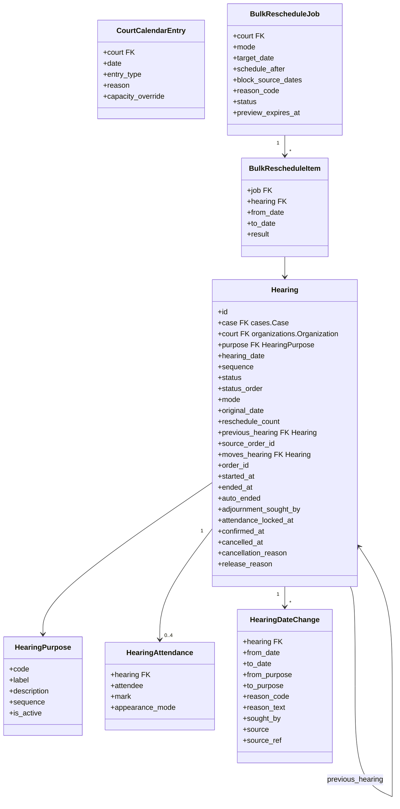
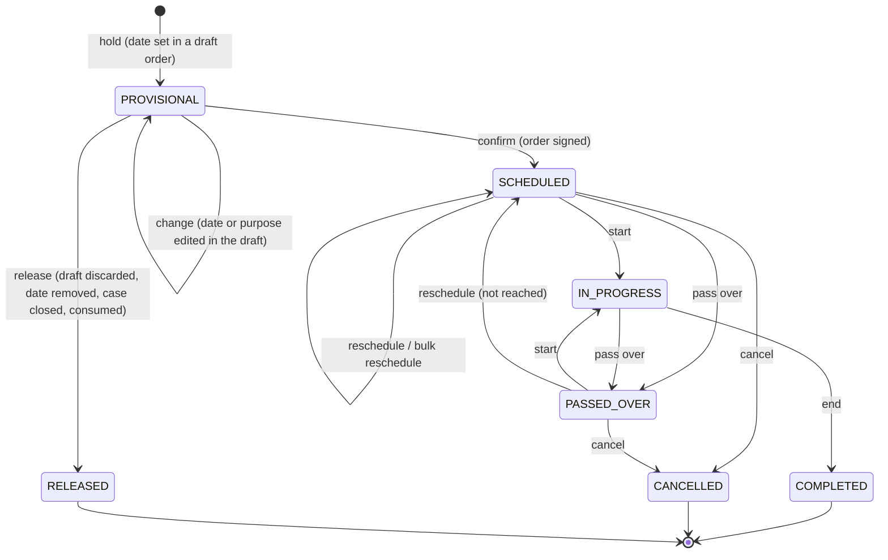
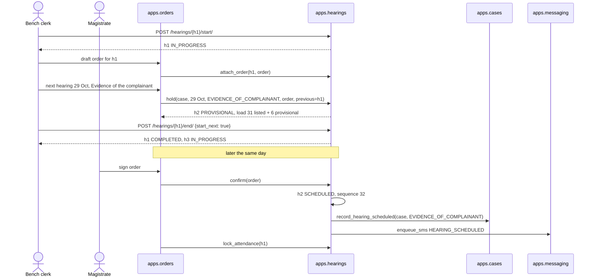

# 0023 — Hearings (`apps.hearings`)

## Status

Proposed

> **Scope note.** A hearing is always a hearing **of one case**. This module
> sits on top of `apps.cases`: it never exists without a case, it reads the
> case through a published contract, and it never writes case tables. The
> order that a hearing produces, and the applications that ask for a hearing
> to move, are owned by their own modules and call into this one.

## Context

Once the case is registered, every step
the court takes is taken at a listing: cognizance, appearance of the accused,
bail and plea, the complainant's evidence, the examination of the accused,
defence evidence, arguments, judgement. Between two hearings the case waits for
a date, and nearly every date is fixed by an order.

| Hearing purpose | What happens at it | Case stage it starts |
| --- | --- | --- |
| Cognizance / Admission | Magistrate takes cognizance, or dismisses; summons issued | Cognizance → Appearance |
| Appearance | Service of summons checked; accused appears or warrant follows | Appearance |
| Bail | Accused released on bail | Bail & Recording of Plea |
| Plea | Substance of accusation stated, plea recorded (§274 BNSS) | Bail & Recording of Plea |
| Evidence of the complainant | Affidavit evidence (§145 NI Act), cross-examination | Complainant Evidence |
| Examination of the accused | Statement under §351 BNSS | Examination of Accused |
| Evidence of the accused | Defence witnesses | Defence Evidence |
| Arguments | Both sides heard | Arguments |
| Judgement | Judgement pronounced | Judgement |

The law shapes what a hearing record must hold:

| Rule | Consequence for this module |
| --- | --- |
| §143 NI Act — §138 cases are tried summarily, as expeditiously as possible, with an endeavour to conclude within six months of filing | Every listing shows the case's age against a configurable target (#11.2) |
| §346 BNSS — once trial begins it runs day to day; any adjournment needs recorded reasons; a party gets no more than two adjournments for circumstances beyond its control | Every date change carries a reason and who sought it (#2.4); adjournments are counted per side (#11.3) |
| §279 BNSS — the complainant's absence at a hearing can end the case | Attendance is recorded as data, not only as words in the order (#2.3) |
| §355 BNSS, §530 BNSS — personal attendance may be dispensed with; proceedings may be held in electronic mode | A hearing has a mode, and each appearance records whether it was in person or by video (#2.1, #2.3) |
| §147 NI Act — the offence is compoundable at any stage | Any hearing may end the case; open hearings are cancelled when it does (#7.6) |

The PRDs fix how hearings and orders meet:

* The order screen is opened **on a hearing** the court has called. That
  order belongs to the hearing (`ORD-05`), and the hearing's summary is that
  order's text (`HRG-11`).
* The next date is set **in the order**. It is held provisionally from the
  moment it is typed, counted in every day's load, and becomes a scheduled
  hearing only when the magistrate signs (`NXT-10`–`NXT-15`, `PUB-07`).
* One control ends the current hearing and starts the next listing on the
  board (`NXT-04`).
* A party asks for a hearing to move by filing an **Advance / Prepone** or
  **Postpone** application. Accepting it is an order whose workflow
  reschedules the hearing; the application expires if its hearing passes
  first (`ALC-30`).
* A hearing's case stage effect is the case lifecycle's rule: "a hearing is
  scheduled with purpose = Complainant Evidence" moves the case to
  Complainant Evidence.

Today Dristi has none of this. This spec introduces `apps.hearings`, which owns
hearings, hearing purposes, the court calendar and bulk rescheduling.

### What the module does and does not decide

`apps.hearings` knows **when** a case is listed, **for what**, **in which
court**, **in which position on the day's board**, **what happened to the
listing** (heard, passed over, moved, cancelled) and **who was present**. It
does not know what the court decided: that is the order. It does not decide
whether a date is judicially appropriate: the magistrate does, in the order.
It does not move a case's stage: it tells the case module that a hearing was
scheduled, and the case module decides.

## Goals

* Tie every hearing to exactly one case, through one foreign key, and never write case tables.
* Hold a date provisionally from the moment it is set in a draft order, count it in the day's load, and make it a scheduled hearing on signature.
* Serve the day's board (cause list) for a court, in serial order, with live status.
* Run the courtroom: start a hearing, pass it over, end it and start the next in one action.
* Record attendance as structured marks: four fixed roles in this version.
* Move a hearing to another date for court-side reasons (presiding officer on leave, holiday, not reached), singly or in bulk, without an order.
* Move a hearing to another date for party or judicial reasons only through a signed order.
* Keep the hearing's id stable when its date moves, so processes and applications that point at it stay valid.
* Record every date change with its reason, its source and who sought it.
* Maintain a court calendar of non-sitting days and daily capacity.
* Give cases, applications and processes the hearing facts they need through selectors and signals, without importing them.
* Notify parties when a hearing is scheduled, moved or cancelled, and never before signature.
* Expose REST APIs following [`0000`](0000-api-coding-spec.md), including the standard error shape and registered error codes.

## Non-goals

* Drafting, signing or publishing orders. Owned by the orders module (`order-generation.md`).
* Applications, including Advance / Prepone and Postpone, their expiry and their objections. Owned by the applications module.
* Case stages and case outcomes. Owned by `apps.cases` (`case-lifecycle-handover.md`).
* Evidence recording, plea recording, depositions, witness examination screens (the ⚙ section workflows).
* The A-Diary register.
* Processes (summons, warrant, notice) and their delivery.
* Time slots within a day; a hearing is listed on a date (#12, question 1).
* Hearing more than one case in one listing (#12, question 3).
* A cause-list PDF, public cause-list publishing and VC provider integration.
* Real-time push to browsers.

---

## Proposed changes

### 1. App layout and boundaries

Location: `apps.hearings` (registered as `"apps.hearings"` in `INSTALLED_APPS`).

```text
apps/hearings/
├── __init__.py
├── apps.py                 # name = "apps.hearings"
├── models.py               # Hearing, HearingPurpose, HearingAttendance, HearingDateChange,
│                           # CourtCalendarEntry, BulkRescheduleJob, BulkRescheduleItem
├── enums.py                # TextChoices: statuses, reasons, modes, attendee roles
├── errors.py               # registered API error codes (#10.6)
├── exceptions.py           # in-process exceptions for calling modules (#7.7)
├── signals.py              # hearing_scheduled, hearing_rescheduled, hearing_ended, hearing_cancelled
├── services/
│   ├── __init__.py
│   ├── listing.py          # hold / change / release / confirm, cancel_open_hearings (#7)
│   ├── courtroom.py        # start, pass_over, end, end_and_start_next, attendance (#6)
│   ├── reschedule.py       # single and bulk reschedule (#8)
│   └── calendar.py         # sitting days, capacity, business date (#9)
├── selectors.py            # read-only queries; the contract other modules use
├── permissions.py          # court staff and case visibility (#10.5)
├── serializers.py
├── views.py
├── urls.py
├── tasks.py                # Dramatiq actors (#11.4)
├── admin.py
├── migrations/             # includes HearingPurpose seed rows
└── tests/
```

Dependency rules:

```text
apps.orders, apps.applications ── import ──> apps.hearings.services / selectors
apps.hearings                  ── import ──> apps.cases.selectors / apps.cases.services
apps.cases                     ── never imports ──> apps.hearings
apps.hearings                  ── never imports ──> apps.orders, apps.applications
```

Rules:

* `Hearing.case → cases.Case` with `on_delete=PROTECT` is the **only** foreign key into `apps.cases`. Hearings never query `Case`, participants, representations or evidence tables directly; they call `apps.cases.selectors` (#1.1).
* A hearing never changes case state itself. When a hearing is scheduled it calls `apps.cases.services.record_hearing_scheduled()`, and the case module applies its own stage rules (#7.5).
* Orders and applications are referenced by plain `UUIDField` ids (`order_id`, `source_order_id`), never by foreign key, so hearings depend on neither.
* Modules that must react to a hearing — application expiry, process QR codes — subscribe to `apps.hearings.signals`. `apps.cases` never subscribes; hearings calls it directly.
* An isolation test asserts that nothing under `apps.cases` imports `apps.hearings`, and that nothing under `apps.hearings` imports `apps.orders` or `apps.applications`.
* Views validate input, call a service, and serialize the result. Status, sequence, dates and counts are written only by `services/`.

#### 1.1 Contract `apps.cases` must expose

Hearings depend on these functions and nothing else in `apps.cases`. Return
values are frozen dataclasses, so no hearing serializer touches a case model
instance.

| Function | Returns | Used by |
| --- | --- | --- |
| `get_case_summaries(case_ids) -> dict[UUID, CaseSummary]` | `id`, `display_number` (case number, else filing number), `title` ("A v. B"), `case_type`, `court_id`, `stage` (key, label), `filed_at`, `registered_at` | every hearing list and detail |
| `get_case_advocates(case_ids) -> dict[UUID, list[AdvocateRef]]` | active advocates with `name` and `side` (`COMPLAINANT`/`ACCUSED`) | Advocates column |
| `get_case_contacts(case_id) -> list[Contact]` | parties and advocates with phone and email, and their side | notifications (#11.1) |
| `get_listability(case_id) -> Listability` | `listable: bool`, `reason` (`NOT_REGISTERED`, `DISPOSED`, `LONG_PENDING_REGISTER`, `TRANSFERRED`), `court_id` | every date-fixing service (#7) |
| `cases_awaiting_hearing(court_id) -> QuerySet[UUID]` | registered, live cases of that court | scheduling queue (#10.4.8) |
| `case_ids_visible_to(user) -> QuerySet[UUID]` | cases where the user has an active relationship ([`0003`](0003-case-relationships.md)) | party-side visibility (#10.5) |
| `search_case_ids(text, court_id) -> QuerySet[UUID]` | ids matching case number, title, party or advocate name | `search` filter |
| `services.record_hearing_scheduled(case_id, purpose_code, hearing_date)` | — | case stage trigger (#7.5) |

None of these exist yet on `feat/cases_api`. They are the first piece of work
this spec needs from the cases module.

#### 1.2 Court staff

A hearing is acted on by the court that lists it. Three users work a court
(`order-generation.md` §3): the **magistrate**, the **bench clerk** and the
**typist**. `users.Role` has no court-side roles today, so this module needs a
court membership:

```text
apps.organizations.CourtMember(user, organization, designation, is_active)
designation ∈ {MAGISTRATE, BENCH_CLERK, TYPIST, SCRUTINY_OFFICER}
```

Hearings read it through `apps.organizations.selectors.court_designation(user, court_id)`.
Where it lives is open (#12, question 4); hearings only depend on that selector.

### 2. Data model



All models inherit `apps.core.models.BaseModel` (UUID pk, `created_at`,
`updated_at`, `created_by`, `updated_by`) with explicit `Meta.ordering`. Every
bounded enum is a `TextChoices` in `apps/hearings/enums.py`.

#### 2.1 `Hearing` — `BaseModel`, `BaseAuditableModel`

| Field | Type | Notes |
| --- | --- | --- |
| `case` | `FK("cases.Case", on_delete=PROTECT, related_name="hearings")` | the only cross-module FK (#1) |
| `court` | `FK("organizations.Organization", on_delete=PROTECT, related_name="hearings")` | the case's court when the date was fixed; kept on the row so board queries never join cases |
| `purpose` | `FK(HearingPurpose, on_delete=PROTECT)` | what the matter is listed for |
| `hearing_date` | `DateField` | the court date, in IST |
| `sequence` | `PositiveIntegerField(null=True)` | serial number on that day's board; `NULL` while `PROVISIONAL` or `RELEASED` (#5) |
| `status` | `CharField(16, choices=HearingStatus)` | #3 |
| `status_order` | `PositiveSmallIntegerField` | derived from `status` so the board sorts by `status_order, sequence` (#3) |
| `mode` | `CharField(16, choices=HearingMode, default=IN_PERSON)` | `IN_PERSON`, `VIDEO`, `HYBRID` |
| `original_date` | `DateField` | the date first fixed; never changed by a reschedule |
| `reschedule_count` | `PositiveSmallIntegerField(default=0)` | incremented by every move (#8) |
| `previous_hearing` | `FK("self", on_delete=PROTECT, null=True, related_name="next_hearings")` | the hearing whose order fixed this date; the chain gives "next hearing" on a hearing's detail (`HRG-09`, `HRG-10`) |
| `source_order_id` | `UUIDField(null=True, db_index=True)` | the order that fixed or holds this date |
| `moves_hearing` | `FK("self", on_delete=PROTECT, null=True, related_name="held_moves")` | set only on a `PROVISIONAL` row held by a *Rescheduling of hearing date* order item (#7.3) |
| `order_id` | `UUIDField(null=True, unique=True)` | the order passed **in** this hearing (`ORD-05`, `HRG-12`); set by the orders module |
| `started_at` / `ended_at` | `DateTimeField(null=True)` | `HRG-06`, `HRG-07` |
| `auto_ended` | `BooleanField(default=False)` | ended by the end-of-day sweep, not by a user (#11.4) |
| `adjournment_sought_by` | `CharField(16, choices=Side, blank=True)` | on end: `COMPLAINANT`, `ACCUSED`, `COURT`, or empty when business was done (#11.3) |
| `attendance_locked_at` | `DateTimeField(null=True)` | set when the hearing's order is signed; attendance is read-only after (#6.5) |
| `confirmed_at` | `DateTimeField(null=True)` | when it became `SCHEDULED` |
| `cancelled_at` / `cancellation_reason` | `DateTimeField(null=True)` / `CharField(32, choices=CancellationReason, blank=True)` | #7.6 |
| `release_reason` | `CharField(32, choices=ReleaseReason, blank=True)` | #7.4 |

Constraints:

| Name | Constraint | Why |
| --- | --- | --- |
| `hearings_one_scheduled_per_case` | `UniqueConstraint(case, condition=Q(status=SCHEDULED))` | a case has at most one upcoming date |
| `hearings_one_in_progress_per_court` | `UniqueConstraint(court, condition=Q(status=IN_PROGRESS))` | one matter is heard at a time in a courtroom |
| `hearings_one_in_progress_per_case` | `UniqueConstraint(case, condition=Q(status=IN_PROGRESS))` | |
| `hearings_board_sequence` | `UniqueConstraint(court, hearing_date, sequence, condition=Q(status__in=BOARD_STATUSES))` | serial numbers are unique on a day's board |
| `hearings_one_hold_per_order` | `UniqueConstraint(source_order_id, condition=Q(status=PROVISIONAL))` | one draft order holds one date (`order-template-catalogue.md`, combination rule 3) |
| `hearings_sequence_iff_on_board` | `CheckConstraint`: `sequence IS NULL` exactly when `status IN (PROVISIONAL, RELEASED)` | |
| `hearings_hold_has_order` | `CheckConstraint`: `status != PROVISIONAL OR source_order_id IS NOT NULL` | a hold always belongs to a draft |
| `hearings_started_before_ended` | `CheckConstraint`: `ended_at IS NULL OR started_at <= ended_at` | |

`BOARD_STATUSES = (SCHEDULED, IN_PROGRESS, PASSED_OVER, COMPLETED)`.

Indexes: `(court, hearing_date, status_order, sequence)` for the board;
`(case, hearing_date)` for case history; `(court, hearing_date, status)` for
load counts; `(status, hearing_date)` for the sweeps.

`Meta.ordering = ("hearing_date", "status_order", "sequence")`.

Rows are never deleted. Every terminal state (`COMPLETED`, `CANCELLED`,
`RELEASED`) is a status, and `HistoricalHearing` keeps every prior version
with the responsible user.

#### 2.2 `HearingPurpose` — `BaseModel`, `BaseActivatableModel`, `BaseAuditableModel`

Reference table, edited in admin.

| Field | Type | Notes |
| --- | --- | --- |
| `code` | `CharField(50, unique=True)` | upper snake case, `^[A-Z0-9_]+$`, validated in `clean()` like `Location.code` |
| `label` | `CharField(128)` | shown on the board and in the order |
| `description` | `TextField(blank=True)` | |
| `sequence` | `PositiveSmallIntegerField` | display order in dropdowns |

Seeded from the hearing purposes in `order-template-catalogue.md`:

| `code` | `label` |
| --- | --- |
| `CONDONATION_OF_DELAY` | Condonation of delay |
| `ADMISSION` | Admission |
| `DELAY_CONDONATION_AND_ADMISSION` | Delay condonation and admission |
| `COGNIZANCE` | Cognizance |
| `APPEARANCE` | Appearance |
| `BAIL` | Bail |
| `PLEA` | Plea |
| `EVIDENCE_OF_COMPLAINANT` | Evidence of the complainant |
| `EXAMINATION_OF_ACCUSED` | Examination of the accused under S. 351 BNSS |
| `EVIDENCE_OF_ACCUSED` | Evidence of the accused |
| `ARGUMENTS` | Arguments |
| `JUDGEMENT` | Judgement |
| `FOR_REPORTS` | For reports |
| `ADR` | ADR |
| `MEDIATION` | Mediation |
| `WARRANT` | Warrant |
| `EXECUTION` | Execution |
| `REVIEW_APPLICATION` | Review application |
| `TO_ISSUE_ORDER` | To issue order |

Rules:

* `REVIEW_APPLICATION` appears twice in the catalogue; it is seeded once.
* A purpose is retired with `is_active = False`, never deleted. A retired purpose stays on existing hearings and cannot be chosen for a new date (`E04014`).
* `code` is the identifier other modules pass and store. It SHOULD NOT be renamed; the case lifecycle keys its stage rules on it (#7.5).
* This is a model, not configuration-store rows: [`0018`](0018-configuration-store.md) stores opaque strings, and purposes are referenced by foreign key.
* Which order items are likely at a purpose, and who is required to attend it, are order configuration and stay in the orders module.

#### 2.3 `HearingAttendance` — `BaseModel`

One row per marked attendee. The roll is a **fixed list of four** in this version
(`ATT-01`): nothing is checked against who is actually on the case.

| Field | Type | Notes |
| --- | --- | --- |
| `hearing` | `FK(Hearing, on_delete=CASCADE, related_name="attendance")` | |
| `attendee` | `CharField(32, choices=Attendee)` | `COMPLAINANT`, `COMPLAINANT_ADVOCATE`, `ACCUSED`, `ACCUSED_ADVOCATE` |
| `mark` | `CharField(8, choices=AttendanceMark)` | `PRESENT`, `ABSENT` |
| `appearance_mode` | `CharField(16, choices=AppearanceMode, blank=True)` | `IN_PERSON`, `VIDEO`; only with `PRESENT` |

`UniqueConstraint(hearing, attendee)`. An unmarked attendee has **no row**:
no answer is a real state and is never stored as `ABSENT` (`ATT-02`).

Attendance is kept as data, rather than only as the Present/Absent lines the
order writes (`ATT-03`), because other rules read it: a complainant absent at
an appearance date (§279 BNSS), an accused absent after service (warrant), and
the view-case attendance line (`HRG-08`), which is rendered from these rows.

#### 2.4 `HearingDateChange` — `BaseModel`

Append-only log of every move of a hearing that has not been heard. Written in
the same transaction as the move; never updated or deleted.

| Field | Type | Notes |
| --- | --- | --- |
| `hearing` | `FK(Hearing, on_delete=PROTECT, related_name="date_changes")` | |
| `from_date` / `to_date` | `DateField` | |
| `from_purpose` / `to_purpose` | `FK(HearingPurpose, on_delete=PROTECT)` | equal when only the date moves |
| `reason_code` | `CharField(32, choices=RescheduleReason)` | #8.1 |
| `reason_text` | `TextField(blank=True)` | |
| `sought_by` | `CharField(16, choices=Side)` | `COMPLAINANT`, `ACCUSED`, `COURT` |
| `source` | `CharField(16, choices=ChangeSource)` | `ORDER`, `COURT_ADMIN`, `BULK` |
| `source_ref` | `UUIDField(null=True)` | the order id or bulk job id |

History in `HistoricalHearing` already records every change; this table exists
because "how many times, why, and at whose request was this case adjourned" is
a query the court runs, and the history table is not built to be queried
(#11.3).

#### 2.5 `CourtCalendarEntry` — `BaseModel`, `BaseAuditableModel`

A day the court does not sit, or sits with a different capacity.

| Field | Type | Notes |
| --- | --- | --- |
| `court` | `FK("organizations.Organization", on_delete=PROTECT)` | |
| `date` | `DateField` | |
| `entry_type` | `CharField(32, choices=CalendarEntryType)` | `HOLIDAY`, `PRESIDING_OFFICER_LEAVE`, `NON_SITTING`, `REDUCED_SITTING` |
| `reason` | `CharField(255)` | shown in the date picker, e.g. "Onam" |
| `capacity_override` | `PositiveSmallIntegerField(null=True)` | only for `REDUCED_SITTING`; `CheckConstraint` ties the two |

`UniqueConstraint(court, date)`. `REDUCED_SITTING` is a sitting day; every
other type is not.

#### 2.6 `BulkRescheduleJob` and `BulkRescheduleItem` — `BaseModel`

Job: `court`, `mode` (`TO_DATE`, `NEXT_AVAILABLE`), `target_date` (null),
`schedule_after` (null), `block_source_dates` (bool), `reason_code`,
`reason_text`, `status` (`PREVIEWED`, `QUEUED`, `RUNNING`, `COMPLETED`,
`PARTIALLY_FAILED`, `EXPIRED`), `preview_expires_at`, `confirmed_at`,
`confirmed_by`.

Item: `job`, `hearing`, `hearing_updated_at` (snapshot at preview), `from_date`,
`to_date`, `result` (`PENDING`, `MOVED`, `SKIPPED_STARTED`, `SKIPPED_CHANGED`,
`FAILED`), `error_code`. `UniqueConstraint(job, hearing)`.

### 3. Hearing lifecycle



| Status | Meaning | On the board | Seen by parties | `status_order` |
| --- | --- | --- | --- | --- |
| `PROVISIONAL` | A date set in a draft order; nothing is final (`NXT-10`) | no | **no** | — |
| `SCHEDULED` | Listed; waiting to be called | yes | yes | 20 |
| `IN_PROGRESS` | Called and being heard | yes | yes | 10 |
| `PASSED_OVER` | Called, kept back, to be called again | yes | yes | 30 |
| `COMPLETED` | Heard. The order passed in it is the record | yes | yes | 40 |
| `CANCELLED` | Will not be heard (case closed, transferred, listed in error) | no | yes | — |
| `RELEASED` | A provisional date that never became a hearing | no | **no** | — |

| Action | From → To | Who | Where |
| --- | --- | --- | --- |
| hold | — → `PROVISIONAL` | orders module, in-process | #7.1 |
| change | `PROVISIONAL` → `PROVISIONAL` | orders module, in-process | #7.2 |
| confirm | `PROVISIONAL` → `SCHEDULED` | orders module, on signature | #7.3 |
| release | `PROVISIONAL` → `RELEASED` | orders module; case closure | #7.4 |
| start | `SCHEDULED`, `PASSED_OVER` → `IN_PROGRESS` | court staff | #6.1 |
| pass over | `SCHEDULED`, `IN_PROGRESS` → `PASSED_OVER` | court staff | #6.2 |
| end | `IN_PROGRESS` → `COMPLETED` | court staff | #6.3 |
| reschedule | `SCHEDULED`, `PASSED_OVER` → `SCHEDULED` | court staff (court-side reasons) or a signed order | #8 |
| cancel | `SCHEDULED`, `PASSED_OVER` → `CANCELLED` | a signed case-closing order; court staff for `LISTED_IN_ERROR` only | #7.6 |

Rules:

* Every transition is a row in a transition table in `services/`, checked under `select_for_update()` on the hearing. Anything else is `409 E04001` with `allowed_actions` in the error.
* `COMPLETED`, `CANCELLED` and `RELEASED` are terminal. A heard hearing is never moved: the next date is a new row.
* A hearing that has been heard is never "adjourned" by editing it. Adjournment is how a hearing *ends*: it is `COMPLETED`, its order fixes the next date, and `adjournment_sought_by` records at whose request (#11.3).
* This lifecycle is not a [`0011`](0011-case-workflows.md) workflow. 0011 models one workflow per case; a case has many hearings, and this state machine is small and fixed.

### 4. Business date and sitting days

The court's "today" is the **business date**: the current date in
`Asia/Kolkata`. Every rule that says "today", "past" or "future" uses it,
never the server's UTC date.

A date is a **sitting day** for a court when:

1. its weekday is not in config `hearings.non_sitting_weekdays` (default `SUN`), and
2. it has no `CourtCalendarEntry`, or its entry is `REDUCED_SITTING`.

The **capacity** of a sitting day is the entry's `capacity_override`, else
config `hearings.max_hearings_per_day`.

The **load** of a day is two numbers, always reported separately (`NXT-12`):

```text
listed      = count(status IN (SCHEDULED, IN_PROGRESS, PASSED_OVER, COMPLETED))
provisional = count(status = PROVISIONAL)
```

A date is **valid for a new or moved hearing** when it is a sitting day, is
not before the business date, and is not more than config
`hearings.max_days_ahead` days after it. When `previous_hearing` is given, it
must also be after that hearing's date.

Capacity never silently refuses a date. With config `hearings.capacity_mode =
warn` (default), a full day is returned as a warning in the response
(`warnings: [{ "code": "COURT_DAY_FULL", ... }]`) and the date is accepted;
with `block`, it is `409 E04009`. Whether a date is judicially right is the
magistrate's call (`NXT-09`).

Non-production environments MAY pin the business date with config
`hearings.business_date_override` (`YYYY-MM-DD`). A system check refuses it in
production, as for other test-only settings.

### 5. The day's board

The board (cause list) for a court and date is every hearing on it with a
`BOARD_STATUS`, ordered by `status_order, sequence`: the hearing being heard
first, then those waiting, then those passed over, then those heard.

Rules:

* `sequence` is assigned when a hearing **joins** a board — on confirm (#7.3) or on being moved to that date (#8) — as `max(sequence) + 1` for that court and date, under the court lock (#11.5). It is the serial number shown to the court ("S. no.") and printed on the board.
* A hearing that leaves the board (moved away or cancelled) leaves a gap. Gaps are never closed automatically; serial numbers announced to the bar do not change under them.
* Court staff may **reorder** the waiting part of a board (`SCHEDULED` hearings) for a date, with `POST /api/v1/hearings/board/reorder/`. The request lists every `SCHEDULED` hearing of that court and date exactly once in the new order; anything else is `400 E04019`. Sequences are rewritten in one transaction; `IN_PROGRESS`, `PASSED_OVER` and `COMPLETED` rows keep theirs.
* The **next listing** is the `SCHEDULED` hearing with the lowest `sequence` on the court's board for the business date; if there is none, the `PASSED_OVER` hearing with the lowest `sequence`; if there is none, there is no next listing (`NXT-08`).
* A hearing still `SCHEDULED` or `PASSED_OVER` after its date has passed was **not reached**. It is not changed by the system: no date is ever invented for it. It is listed by `?not_reached=true` (#10.4.1) until court staff move it (#8).

### 6. Running the courtroom

All courtroom actions are taken by court staff of the hearing's court (#10.5)
and accept `If-Unmodified-Since` against `Hearing.updated_at`; a stale write
is `412 E04002`.

#### 6.1 Start

`SCHEDULED` or `PASSED_OVER` → `IN_PROGRESS`. Sets `started_at = now()`.

* The hearing's date must be the business date (`409 E04010`).
* No other hearing of the same court may be `IN_PROGRESS` (`409 E04011`, naming it). The partial unique constraint is the backstop.

#### 6.2 Pass over

`SCHEDULED` or `IN_PROGRESS` → `PASSED_OVER`. The matter is called again later
the same day. `started_at` is kept if set; a passed-over hearing that is
started again keeps its first `started_at`.

#### 6.3 End

`IN_PROGRESS` → `COMPLETED`. Sets `ended_at = now()`.

```json
POST /api/v1/hearings/{id}/end/
{ "start_next": true, "adjournment_sought_by": "ACCUSED" }
```

* Ending does **not** require the hearing's order to exist, be complete or be signed (`NXT-07`). The draft stays on the hearing.
* `adjournment_sought_by` is optional; empty means business was done.
* With `start_next = true`, the next listing (#5) is started in the **same transaction**, under the court lock. The response carries both:

```json
{
  "ended": { "id": "6f1c…", "status": "COMPLETED", "...": "..." },
  "started": { "id": "7a22…", "status": "IN_PROGRESS", "sequence": 5, "...": "..." },
  "meta": { "...": "standard envelope" }
}
```

  With no next listing, `started` is `null` and the client returns to the board.

* This is the one hearing control of `NXT-04`. Which users are offered it first is `primary_action` (#10.5), not a permission.

#### 6.4 Current hearing

`GET /api/v1/hearings/current/?court=` returns the court's `IN_PROGRESS`
hearing, or `{"hearing": null}`. The typist's control is enabled and named
from it (`NXT-05`, `NXT-06`).

The response carries an `ETag` derived from the court's board state for the
business date. Clients poll with `If-None-Match`; an unchanged board returns
`304` with no body. Push is out of scope; polling every few seconds on one
indexed query is cheap at one court's scale.

#### 6.5 Attendance

```json
PUT /api/v1/hearings/{id}/attendance/
{
  "marks": [
    { "attendee": "COMPLAINANT", "mark": "PRESENT", "appearance_mode": "IN_PERSON" },
    { "attendee": "COMPLAINANT_ADVOCATE", "mark": "PRESENT", "appearance_mode": "VIDEO" },
    { "attendee": "ACCUSED", "mark": "ABSENT" }
  ]
}
```

* Replaces the whole roll. An attendee absent from `marks` is unmarked; its row is deleted (`ATT-02`).
* Allowed while the hearing is `IN_PROGRESS`, `PASSED_OVER` or `COMPLETED`, and `attendance_locked_at` is empty. Otherwise `409 E04022`.
* `appearance_mode` is only accepted with `PRESENT`.
* The orders module calls `services.courtroom.lock_attendance(hearing_id)` when the hearing's order is signed, so the roll and the signed order cannot disagree afterwards.
* The order screen writes the Present / Absent lines into the order text from the same marks (`ATT-03`); this module does not render order text.

### 7. Fixing a date: the orders contract

Every hearing date is fixed by an order, except court-side moves (#8). There
is **no REST endpoint that schedules a hearing directly.** The orders module
calls these services in-process. They raise the exceptions of #7.7, which the
orders module maps to its own API errors.

```text
listing.hold(*, case_id, hearing_date, purpose_code, order_id,
             previous_hearing_id=None, moves_hearing_id=None, actor) -> HoldResult
listing.change(*, order_id, hearing_date=None, purpose_code=None, actor) -> HoldResult
listing.release(*, order_id, reason, actor) -> None
listing.validate(*, order_id) -> list[Problem]
listing.confirm(*, order_id, actor) -> Hearing
listing.attach_order(*, hearing_id, order_id, actor) -> None
listing.cancel_open_hearings(*, case_id, reason, order_id=None, actor) -> list[Hearing]
```

`HoldResult` is `(hearing, warnings)`, where `warnings` lists soft problems such
as a full day or a case that already has a scheduled hearing.

#### 7.1 Hold — a date typed into a draft

Called when the *Next hearing* region of an in-hearing draft gets both a date
and a purpose (`NXT-02`), or when a *Scheduling of hearing date* or
*Rescheduling of hearing date* order item is answered outside a hearing.

1. `get_listability(case_id)`; not listable → `CaseNotListable(reason)`.
2. Validate the date (#4) and the purpose (active).
3. Lock the court (#11.5).
4. Create a `PROVISIONAL` hearing: `court` from the case, `sequence = NULL`, `source_order_id = order_id`, `original_date = hearing_date`, and `previous_hearing` or `moves_hearing` when given.
5. Return the load of the date, including this hold, so the picker shows it at once (`NXT-11`).

Nothing is announced: no notification, no signal, no case stage call, and the
row is invisible to parties.

`hold` for an `order_id` that already holds a date behaves as `change`.

#### 7.2 Change — the date or purpose edited in the draft

Moves the `PROVISIONAL` row in place (`NXT-13`) after re-running #7.1 steps
2–3. No `HearingDateChange` row: nothing that was ever announced has moved.

#### 7.3 Confirm — the order is signed

Called on signature, **first** among the order's workflows
(`order-template-catalogue.md`, workflow trigger order rule 1), so every other
workflow in the same order sees the new date.

Inside one `transaction.atomic()`, under the court lock:

1. Load the `PROVISIONAL` row for `order_id`. Already confirmed by this order → return it unchanged (a retried signature is idempotent). Released → `HoldReleased`.
2. Re-check listability, sitting day and business date. The order may be signed days after the date was typed; the date may have passed or become a holiday. Any failure → `HoldInvalid(problems)`. Capacity is **not** re-checked: the hold was counted in the load all along.
3. **A new date** (`moves_hearing` empty): the case must have no `SCHEDULED` hearing (`CaseAlreadyScheduled`). Set `status = SCHEDULED`, assign `sequence` (#5), `confirmed_at = now()`.
4. **A moved date** (`moves_hearing` set): move the original hearing in place exactly as #8.2 does, with `source = ORDER`, `source_ref = order_id`, and the `reason_code` and `sought_by` the order item carries. Mark the provisional row `RELEASED` with `release_reason = CONSUMED`. The original hearing keeps its id, so processes and applications pointing at it stay valid (`PIA-02`).
5. `transaction.on_commit`: call `apps.cases.services.record_hearing_scheduled` (#7.5), send `hearing_scheduled` or `hearing_rescheduled` (#11.6), and enqueue notifications (#11.1).

`validate(order_id)` runs steps 1–3 without writing, so the orders module can
refuse *Add to signing list* (`SGN-04`) before the magistrate signs an order
whose date can no longer be confirmed.

#### 7.4 Release

`PROVISIONAL` → `RELEASED`, with `release_reason`:

| Reason | When |
| --- | --- |
| `DRAFT_DISCARDED` | the draft order is discarded (`DFT-06`) |
| `DATE_REMOVED` | the next date is removed from the draft, or *List it again* is unticked (`NXT-01`) |
| `CONSUMED` | a held move was applied to the original hearing (#7.3) |
| `CASE_CLOSED` | the case was closed while the draft was open (#7.6) |

A hold never expires on its own; it lives and dies with the draft that holds it
(`NXT-15`). The stale-holds report (#11.4) shows holds older than config
`hearings.stale_hold_days`.

#### 7.5 Case stage

On confirm, and on any move that changes the purpose, hearings call:

```python
apps.cases.services.record_hearing_scheduled(
    case_id=hearing.case_id,
    purpose_code=hearing.purpose.code,
    hearing_date=hearing.hearing_date,
)
```

The case module decides whether the purpose starts a stage, and ignores it when
the case is in Post-Judgement, Post-Disposal or the Long Pending Register
(`case-lifecycle-handover.md` §3). Hearings carry no stage mapping: the purpose
code is the only thing passed.

The call is made after commit. A failure in the case module is logged at
error and does not undo the scheduled hearing; the case module's own
reconciliation re-reads hearings through the selectors.

#### 7.6 Cancel — the case leaves the court's list

When a signed order closes the case or takes it off this court's list —
judgement, dismissal, withdrawal, settlement or compounding, abatement,
transfer, referral that ends the case, moving to the Long Pending Register —
its workflow calls `cancel_open_hearings(case_id, reason, order_id)`, **last**
among the order's workflows (workflow trigger order rule 3):

* every `SCHEDULED` or `PASSED_OVER` hearing of the case → `CANCELLED`, with `cancellation_reason` and `cancelled_at`;
* every `PROVISIONAL` hearing of the case → `RELEASED` with `CASE_CLOSED`, except one held by the very order being signed;
* the case's `IN_PROGRESS` hearing, if any, is left alone: the order was passed in it, and court staff end it normally.

`CancellationReason`: `CASE_DISPOSED`, `CASE_TRANSFERRED`,
`LONG_PENDING_REGISTER`, `LISTED_IN_ERROR`.

Court staff may cancel a single hearing directly only with `LISTED_IN_ERROR`
(`POST /api/v1/hearings/{id}/cancel/`). Every other cancellation comes from an
order.

Parties are notified of each cancelled hearing (#11.1).

#### 7.7 In-process exceptions

Raised to calling modules, never to a view. All derive from `HearingError` and
carry a `code` matching the registered API code of the same meaning, so a
caller can surface it unchanged.

```text
HearingError(code, message)
├── CaseNotListable(reason)            E04003
├── CaseAlreadyScheduled(hearing_id)   E04004
├── InvalidHearingDate(problem)        E04005–E04008
├── CourtDayFull                       E04009   (block mode only)
├── HoldNotFound                       E04020
├── HoldReleased(release_reason)       E04021
└── HoldInvalid(problems)              E04023
```

#### 7.8 Sequence: in a hearing, through signature



### 8. Moving a hearing that has not been heard

#### 8.1 Who may move a hearing, and why

A move is a change of `hearing_date` (and optionally `purpose`) on a
`SCHEDULED` or `PASSED_OVER` hearing. The reason decides the path.

| `RescheduleReason` | Path | Typical case |
| --- | --- | --- |
| `PRESIDING_OFFICER_ON_LEAVE` | court staff, no order | magistrate on leave |
| `COURT_HOLIDAY` | court staff, no order | holiday declared after listing |
| `COURT_NOT_SITTING` | court staff, no order | court did not sit |
| `NOT_REACHED` | court staff, no order | the board was not finished |
| `LISTED_IN_ERROR` | court staff, no order | wrong date entered |
| `PARTY_APPLICATION` | **order only** | Advance / Prepone or Postpone application accepted |
| `JUDICIAL_DIRECTION` | **order only** | the court moves it on its own motion |

Court-side reasons are administrative: the bench did not sit or did not reach
the matter, and nothing was decided. Party and judicial reasons are decisions,
and decisions are orders. `POST /reschedule/` with an order-only reason is
`400 E04013`.

For court-side reasons, `sought_by = COURT`. An order-driven move carries
`sought_by` from the order item (the side whose application was accepted, or
`COURT`).

#### 8.2 Single move

```json
POST /api/v1/hearings/{id}/reschedule/
If-Unmodified-Since: Thu, 08 Oct 2026 05:40:00 GMT
{
  "hearing_date": "2026-11-03",
  "purpose": "APPEARANCE",
  "reason_code": "PRESIDING_OFFICER_ON_LEAVE",
  "reason_text": "PO on leave 3 Nov"
}
```

In one transaction, under the court lock of **both** dates' court (the same
court; one lock):

1. Validate the transition (#3) and the new date (#4). Same date and same purpose → `400 E04012`.
2. Write a `HearingDateChange` row.
3. Set `hearing_date`, `purpose`, `status = SCHEDULED`, `reschedule_count += 1`, a new `sequence` on the new date (#5), and the change reason on the history row (`update_change_reason`).
4. `on_commit`: `record_hearing_scheduled` if the purpose changed, signal `hearing_rescheduled`, notify parties.

`original_date` and `id` never change.

#### 8.3 Bulk move

Used when a magistrate goes on leave or a holiday is declared after dates were
given, and for the not-reached matters at the end of a day.

**Preview** — `POST /api/v1/hearings/bulk-reschedule/preview/`

```json
{
  "court": "c0f2…",
  "hearing_ids": ["6f1c…", "7a22…"],
  "mode": "NEXT_AVAILABLE",
  "schedule_after": "2026-10-26",
  "block_source_dates": true,
  "reason_code": "PRESIDING_OFFICER_ON_LEAVE",
  "reason_text": "PO on leave 20–24 Oct"
}
```

* `mode = TO_DATE` takes `target_date` and moves every hearing to it.
* `mode = NEXT_AVAILABLE` takes `schedule_after` and fills sitting days after it in order, up to each day's free capacity (capacity minus listed minus provisional), keeping the hearings' relative order.
* Only court-side reasons are accepted (`E04013`).
* Every hearing must be on the given court and `SCHEDULED` or `PASSED_OVER`. At most config `hearings.bulk_max_hearings` per job (`E04024`).

The response is `200` with `job_id`, `preview_expires_at` (config
`hearings.bulk_preview_minutes`, default 10), one line per hearing `{hearing_id,
from_date, to_date}`, and each target day's load before and after. A
`BulkRescheduleJob` is stored as `PREVIEWED` with its items. Nothing else
changes.

**Confirm** — `POST /api/v1/hearings/bulk-reschedule/{job_id}/confirm/` →
`202 Accepted` with `{ "job_id": "…", "status": "QUEUED" }`. An expired preview
is `409 E04015`; a job already confirmed is `409 E04016`.

`tasks.run_bulk_reschedule(job_id)`:

* moves each item in its own transaction through the #8.2 service, with `source = BULK`, `source_ref = job_id`;
* skips a hearing that started (`SKIPPED_STARTED`) or whose `updated_at` differs from the preview snapshot (`SKIPPED_CHANGED`), so a preview never overwrites a change made after it;
* records `FAILED` with `error_code` for anything else, without stopping the job;
* with `block_source_dates`, creates `PRESIDING_OFFICER_LEAVE` (or `NON_SITTING`) calendar entries on the source dates after the moves, so no new date can be given there;
* ends `COMPLETED` or `PARTIALLY_FAILED`;
* notifies once per affected case, after each item commits.

It is idempotent: it processes only items still `PENDING`, so a redelivered
message finishes the job instead of repeating it.

**Status** — `GET /api/v1/hearings/bulk-reschedule/{job_id}/` returns the job and
its items. The client polls it.

### 9. Court calendar

#### 9.1 Calendar

```json
GET /api/v1/courts/{court_id}/calendar/?from=2026-10-12&to=2026-11-30
{
  "data": [
    { "date": "2026-10-12", "sitting": true, "capacity": 40, "listed": 31, "provisional": 6, "entry": null },
    { "date": "2026-10-20", "sitting": false, "capacity": 0, "listed": 0, "provisional": 0,
      "entry": { "id": "…", "entry_type": "HOLIDAY", "reason": "Ayudha Puja" } }
  ],
  "meta": { "...": "standard envelope" }
}
```

The range is capped at 92 days. This is the date picker's source for the order
screen and the reschedule screens (`NXT-11`, `NXT-12`).

#### 9.2 Entries

`POST /api/v1/courts/{court_id}/calendar/entries/` and
`DELETE /api/v1/courts/{court_id}/calendar/entries/{entry_id}/`.

* Creating a non-sitting entry on a date that has `SCHEDULED`, `PASSED_OVER` or `PROVISIONAL` hearings is `409 E04017`, with the counts. The client moves them with a bulk move that has `block_source_dates = true` (#8.3). A holiday never strands a listed hearing silently.
* Entries in the past cannot be created or deleted (`E04005`).
* Deleting an entry makes the day a sitting day again; nothing moves back.

#### 9.3 Business date

`GET /api/v1/courts/{court_id}/business-date/` →
`{ "business_date": "2026-10-08", "timezone": "Asia/Kolkata", "sitting": true, "sitting_time": "11:00" }`.

`sitting_time` comes from config `hearings.sitting_time.<COURT_CODE>`, else
`hearings.default_sitting_time`. It is what parties are told to report at:
a summons and the case page show a date and a time (join-a-case "Next hearing
date — date, day, time"), while the board stays date-only.

### 10. APIs

Mounted under `/api/v1/` per [`0000`](0000-api-coding-spec.md) #7, owned by
`apps/hearings/urls.py` — including `/cases/{case_id}/hearings/`, so `apps.cases`
stays unaware of hearings — with `drf-spectacular` annotations, the `hearings`
tag, the `meta` envelope and the standard error shape. Enum overrides are added
to `SPECTACULAR_SETTINGS["ENUM_NAME_OVERRIDES"]` (`HearingStatusEnum`,
`RescheduleReasonEnum`, `BulkRescheduleStatusEnum`).

#### 10.1 Summary

| Method | Path | Purpose | Who |
| --- | --- | --- | --- |
| GET | `/api/v1/hearings/` | Board and search | court staff |
| GET | `/api/v1/hearings/{id}/` | Hearing detail | court staff; parties of the case |
| POST | `/api/v1/hearings/{id}/start/` | #6.1 | court staff |
| POST | `/api/v1/hearings/{id}/pass-over/` | #6.2 | court staff |
| POST | `/api/v1/hearings/{id}/end/` | #6.3, optionally starting the next | court staff |
| POST | `/api/v1/hearings/{id}/reschedule/` | #8.2, court-side reasons | court staff |
| POST | `/api/v1/hearings/{id}/cancel/` | `LISTED_IN_ERROR` only (#7.6) | court staff |
| PUT | `/api/v1/hearings/{id}/attendance/` | #6.5 | court staff |
| GET | `/api/v1/hearings/current/?court=` | #6.4 | court staff |
| POST | `/api/v1/hearings/board/reorder/` | #5 | court staff |
| GET | `/api/v1/hearings/scheduling-queue/?court=` | Cases waiting for a date | court staff |
| GET | `/api/v1/hearings/counts/?court=` | Badge counts | court staff |
| POST | `/api/v1/hearings/bulk-reschedule/preview/` | #8.3 | court staff |
| POST | `/api/v1/hearings/bulk-reschedule/{job_id}/confirm/` | #8.3, `202` | court staff |
| GET | `/api/v1/hearings/bulk-reschedule/{job_id}/` | Job status | court staff |
| GET | `/api/v1/hearing-purposes/` | Active purposes | any registered user |
| GET | `/api/v1/courts/{court_id}/calendar/` | #9.1 | court staff |
| POST / DELETE | `/api/v1/courts/{court_id}/calendar/entries/` · `…/{entry_id}/` | #9.2 | magistrate, bench clerk |
| GET | `/api/v1/courts/{court_id}/business-date/` | #9.3 | any registered user |
| GET | `/api/v1/cases/{case_id}/hearings/` | Hearings of one case, newest first (`HRG-01`, `HRG-02`) | court staff; parties of the case |
| GET | `/api/v1/cases/{case_id}/hearings/next/` | The next hearing tile (`OVW-01`–`OVW-04`) | court staff; parties of the case |

There is no create, update or delete endpoint on `Hearing`. Dates come from
orders (#7) and court-side moves (#8); nothing else writes a hearing.

#### 10.2 Hearing representation

```json
{
  "id": "6f1c…",
  "hearing_date": "2026-10-08",
  "sequence": 4,
  "status": "SCHEDULED",
  "mode": "IN_PERSON",
  "purpose": { "code": "EVIDENCE_OF_COMPLAINANT", "label": "Evidence of the complainant" },
  "case": {
    "id": "a91e…",
    "display_number": "ST/241/2026",
    "title": "Sunil Varghese v. Anand Traders",
    "stage": { "key": "COMPLAINANT_EVIDENCE", "label": "Complainant Evidence" },
    "days_since_filing": 212,
    "beyond_trial_target": true
  },
  "advocates": [
    { "name": "Adv. Suresh Menon", "side": "COMPLAINANT" },
    { "name": "Adv. Rekha Pillai", "side": "ACCUSED" }
  ],
  "original_date": "2026-09-24",
  "reschedule_count": 1,
  "adjournments": { "COMPLAINANT": 0, "ACCUSED": 3, "COURT": 1 },
  "started_at": null,
  "ended_at": null,
  "order_id": null,
  "allowed_actions": ["start", "pass_over", "reschedule"],
  "primary_action": "start",
  "updated_at": "2026-10-07T18:02:11+05:30"
}
```

* `case` and `advocates` are built from **one** batched call each to `get_case_summaries` and `get_case_advocates` for the page's case ids. No per-row call crosses the module boundary.
* `allowed_actions` is computed from status, date and the caller's court membership, so clients never duplicate the transition table. `primary_action` is the action the caller is offered first (#10.5).
* `adjournments` counts the case's adjournments by side (#11.3); `beyond_trial_target` compares `days_since_filing` with config `hearings.trial_target_days` (§143(3) NI Act; default 180).
* The detail endpoint adds `attendance` (the marks, and the rendered line for `HRG-08`), `date_changes`, `previous_hearing` and `next_hearing` (`{id, hearing_date, purpose, status}` of the confirmed hearing whose `previous_hearing` is this one, for `HRG-09`, `HRG-10`). The hearing summary is the text of `order_id`, read from the orders module by the client (`HRG-11`).
* Party-side callers never receive `PROVISIONAL` or `RELEASED` rows, `allowed_actions` or `primary_action`.

#### 10.3 `GET /api/v1/hearings/`

| Query param | Notes |
| --- | --- |
| `court` | UUID; required for court staff lists |
| `date` | repeatable; defaults to the business date when `court` is given |
| `date_from`, `date_to` | range, capped at 92 days |
| `status` | repeatable `HearingStatus`; default `BOARD_STATUSES` |
| `purpose` | repeatable purpose code |
| `stage` | repeatable stage key, resolved through the cases selector |
| `case` | UUID |
| `search` | case number, title, party or advocate name (`search_case_ids`) |
| `not_reached` | `true`: `SCHEDULED`/`PASSED_OVER` hearings dated before the business date (#5) |
| `changed_since` | timestamp; hearings moved or confirmed since, for the "Recently scheduled" tab |
| `ordering` | default `status_order,sequence`; also `sequence`, `hearing_date`, `case_number`, `purpose` |
| `page`, `page_size` | `HearingPagination(PageNumberPagination)`, `page_size_query_param`, max 100 |

#### 10.4 Other read endpoints

1. **Board and search** — above.
2. **`/cases/{case_id}/hearings/`** — same representation, newest first, all statuses visible to the caller.
3. **`/cases/{case_id}/hearings/next/`** — the case's `IN_PROGRESS` hearing, else its `SCHEDULED` one, else `{"hearing": null}` ("No hearing scheduled", `OVW-04`). The client shows "Today" when `hearing_date` is the business date.
4. **`/hearings/counts/?court=`** — `{ "today": 23, "in_progress": 1, "passed_over": 2, "not_reached": 4, "scheduling_queue": 17, "stale_holds": 3 }`. Only hearing-owned counts.
5. **`/hearing-purposes/`** — active purposes ordered by `sequence`; cacheable.
6. **`/hearings/current/`** — #6.4.
7. **`/courts/{court_id}/calendar/`** and **`/business-date/`** — #9.
8. **`/hearings/scheduling-queue/?court=`** — cases of the court that are listable and have **no** `SCHEDULED`, `IN_PROGRESS`, `PASSED_OVER` or `PROVISIONAL` hearing. Computed by query (`cases_awaiting_hearing` minus case ids with a live hearing), never stored, so it cannot drift. Each item has the case summary, advocates, `waiting_since` (the last hearing's `ended_at` or `cancelled_at`, else the registration date) and `reason` (`NEWLY_REGISTERED`, `NO_NEXT_DATE`, `HEARING_CANCELLED`). The court acts on it by drafting an order with a *Scheduling of hearing date* item.

#### 10.5 Permissions

Baseline from [`0000`](0000-api-coding-spec.md) #6: `IsAuthenticated`,
`IsAuthenticatedAndRegistered`. On top of that, in `permissions.py`:

* **Court staff** — a user with an active `CourtMember` row for the hearing's court, as magistrate, bench clerk or typist. They see every hearing of their court in every status, and may take every courtroom and reschedule action on it.
* **Parties** — a user whose `case_ids_visible_to(user)` includes the hearing's case. Read-only. They never see `PROVISIONAL` or `RELEASED` rows: a date is not announced before signature (`PUB-07`).
* **Everyone else** — a hearing on a case or court they are not involved in is `404 E00105`, never `403`, so the API does not reveal that it exists.
* Court staff acting on another court's hearing get `404 E00105` for the same reason; a court-staff-only endpoint called by a non-staff user is `403 E04018`.
* Calendar entries are created and deleted by the magistrate and the bench clerk only.

Apart from calendar entries, no hearing action is restricted between the
magistrate, the bench clerk and the typist (`ROL-06`). What differs is
`primary_action`:

| Designation | `primary_action` on the in-progress hearing | on a waiting hearing |
| --- | --- | --- |
| Magistrate, bench clerk | `end_and_start_next` | `start` |
| Typist | `go_to_current` — `null` until the next hearing has been started (`NXT-05`) | `null` |

Signing is not a hearing action and is not granted here.

#### 10.6 Error codes

Codes are defined in `apps/hearings/errors.py` with `apps.api.errors.define()`
under the next free domain prefix in `apps.api.errors.DOMAINS` — `04` at the
time of writing — recorded in [`0000`](0000-api-coding-spec.md) #9.2 when
allocated.

| Code | Name | Status | Raised when |
| --- | --- | --- | --- |
| `E04001` | `INVALID_TRANSITION` | 409 | action not allowed from the current status; error carries `allowed_actions` |
| `E04002` | `HEARING_STALE` | 412 | `If-Unmodified-Since` older than `updated_at` |
| `E04003` | `CASE_NOT_LISTABLE` | 409 | case not registered, disposed, in LPR or transferred |
| `E04004` | `CASE_ALREADY_SCHEDULED` | 409 | the case already has a `SCHEDULED` hearing |
| `E04005` | `DATE_IN_PAST` | 400 | date before the business date; `field = hearing_date` |
| `E04006` | `DATE_NOT_SITTING` | 400 | not a sitting day; `field = hearing_date` |
| `E04007` | `DATE_BEYOND_HORIZON` | 400 | more than `max_days_ahead` ahead |
| `E04008` | `DATE_NOT_AFTER_PREVIOUS` | 400 | not after the previous hearing's date |
| `E04009` | `COURT_DAY_FULL` | 409 | capacity reached, `capacity_mode = block` |
| `E04010` | `HEARING_NOT_TODAY` | 409 | starting a hearing not dated on the business date |
| `E04011` | `COURT_HEARING_IN_PROGRESS` | 409 | another hearing of the court is in progress |
| `E04012` | `NOTHING_TO_CHANGE` | 400 | reschedule to the same date and purpose |
| `E04013` | `REASON_NEEDS_ORDER` | 400 | party or judicial reason on a court-side move; `field = reason_code` |
| `E04014` | `PURPOSE_INACTIVE` | 400 | retired or unknown purpose; `field = purpose` |
| `E04015` | `PREVIEW_EXPIRED` | 409 | bulk preview past `preview_expires_at` |
| `E04016` | `PREVIEW_ALREADY_CONFIRMED` | 409 | bulk job confirmed twice |
| `E04017` | `DATE_HAS_HEARINGS` | 409 | non-sitting entry on a date with live or held hearings |
| `E04018` | `NOT_COURT_STAFF` | 403 | court-staff endpoint called by anyone else |
| `E04019` | `BOARD_MISMATCH` | 400 | reorder list is not exactly the day's `SCHEDULED` hearings |
| `E04020` | `HOLD_NOT_FOUND` | 404 | in-process: no hold for the order |
| `E04021` | `HOLD_RELEASED` | 409 | in-process: confirming a released hold |
| `E04022` | `ATTENDANCE_LOCKED` | 409 | attendance on a hearing not in a markable status, or after its order was signed |
| `E04023` | `HOLD_INVALID` | 409 | in-process: held date no longer valid at signature |
| `E04024` | `BULK_TOO_LARGE` | 400 | more hearings than `bulk_max_hearings` |

Rules:

* Released codes never change meaning and are never reused.
* Every endpoint declares its codes with `error_responses(...)` ([`0000`](0000-api-coding-spec.md) #10.1).
* Codes `E04020`, `E04021`, `E04023` are raised in-process (#7.7); the orders module surfaces them on its own endpoints.
* A hearing the caller may not see is `404 E00105`, never a hearings code.
* Soft problems (a full day in `warn` mode, a case with a hold on another draft) are returned in a `warnings` array with the same code names, never as errors.

#### 10.7 Serializer responsibilities

Serializers check shape only: UUIDs, dates, enum values, `marks` with no
duplicate `attendee` and `appearance_mode` only with `PRESENT`, a non-empty
duplicate-free `hearing_ids` list, a reorder list without duplicates.
Transitions, dates, capacity and permissions are checked in the services under
a lock, because a serializer cannot hold one. `status`, `sequence`,
`status_order`, `original_date`, `reschedule_count`, `order_id`, every
timestamp and every `*_reason` are `read_only_fields`.

### 11. Cross-cutting

#### 11.1 Notifications

Sent through `apps.messaging` (`enqueue_sms`, `enqueue_email`) inside
`transaction.on_commit`, so a rolled-back change notifies no one. Recipients
are every party and advocate from `get_case_contacts`.

| Message key | Trigger | Context |
| --- | --- | --- |
| `HEARING_SCHEDULED` | confirm (#7.3) | case number, title, date, sitting time, purpose, court, mode |
| `HEARING_RESCHEDULED` | any move (#7.3, #8) | old date, new date, purpose, reason |
| `HEARING_CANCELLED` | cancel (#7.6) | date, case number |

Rules:

* Nothing is sent for `PROVISIONAL`, `change` or `release`: the date was never announced (`NXT-10`).
* A bulk move sends one message per case, not per hearing.
* Templates are `MessageTemplate` rows seeded by migration, with uppercase keys ([`0009`](0009-messaging.md)); SMS templates need DLT template ids for the SMS gateway addon.
* A messaging failure never fails the hearing change.

#### 11.2 Trial target

§143(3) NI Act asks that a summary trial be concluded within six months of the
complaint. The module does not block anything on it; it makes it visible:
`days_since_filing` and `beyond_trial_target` on every hearing, and the
`beyond_trial_target` flag usable as a board filter. The target is config
`hearings.trial_target_days`, because case types other than §138 will need
their own.

#### 11.3 Adjournments

An adjournment is counted when:

* a hearing is **ended** with `adjournment_sought_by` set; or
* a hearing is **moved** with `sought_by` = `COMPLAINANT` or `ACCUSED` (a party application).

Court-side moves count against `COURT`. `selectors.adjournment_counts(case_id)`
returns `{COMPLAINANT, ACCUSED, COURT}`. When a side's count reaches config
`hearings.adjournment_warning_threshold` (default 2, §346 BNSS), the hold and
the move return a `warnings` entry `ADJOURNMENT_LIMIT_REACHED` naming the side.
It never blocks: granting a further adjournment for recorded reasons is the
court's power, exercised in the order.

These counts and `HearingDateChange` are the data a pendency dashboard needs —
adjournments per case, time between hearings, stage-wise ageing — without
re-reading history tables.

#### 11.4 Background processing

Dramatiq actors in `apps/hearings/tasks.py`, enqueued with
`transaction.on_commit`, taking identifiers only, idempotent:

```text
run_bulk_reschedule(job_id)          # #8.3
expire_bulk_previews()               # periodic; PREVIEWED past expiry -> EXPIRED
end_day(court_id, business_date)     # periodic, after court hours
```

`end_day`, run after config `hearings.end_of_day_time` (default `20:00` IST) for
every court:

* ends any `IN_PROGRESS` hearing: `COMPLETED`, `ended_at = now()`, `auto_ended = True`, logged at warning. A hearing left running overnight would otherwise block the court's next day (`E04011`);
* leaves `SCHEDULED` and `PASSED_OVER` hearings untouched: they become not reached (#5) and wait for court staff;
* reports holds older than `hearings.stale_hold_days` in `counts.stale_holds`.

Dramatiq has no scheduler of its own; periodic actors are triggered by a
management command run from cron, or a scheduler such as `periodiq` (#12,
question 6).

#### 11.5 Concurrency

Two clerks giving the last free slot on a day, or starting two hearings at
once, must not both succeed.

* Every service that assigns a `sequence`, counts capacity or starts a hearing first takes `select_for_update()` on the court's `Organization` row. All board writes for a court are serialised; at one court's volume this costs nothing measurable.
* The hearing row is then locked and its status re-read before the transition is checked.
* Locks are always taken in the order court → hearing(s) by id, so concurrent bulk items and single moves cannot deadlock.
* The partial unique constraints of #2.1 are the backstop when application logic is wrong.
* SQLite (`config.settings.test`) ignores `select_for_update()`; concurrency tests assert the constraints and the re-read checks, which hold on both backends.

#### 11.6 Signals

`apps.hearings.signals`, each sent on commit with `hearing_id` and `case_id`:

| Signal | When | Typical subscriber |
| --- | --- | --- |
| `hearing_scheduled` | confirm of a new date | — |
| `hearing_rescheduled` | any move; carries `from_date`, `to_date` | applications: an Advance / Prepone or Postpone application on the hearing may need to expire (`ALC-30`, `Q-8`) |
| `hearing_ended` | end, including `auto_ended` | applications: expiry when the hearing passes (`ALC-30`) |
| `hearing_cancelled` | cancel | applications, processes |

A subscriber reads hearing facts back through `apps.hearings.selectors`, never
from the signal's payload alone. Processes keep the `hearing_id` and read the
current date live, which is why a moved warrant needs no replacement
(`PRC-06`, `PIA-02`).

#### 11.7 Selectors for other modules

```text
selectors.get_hearing(hearing_id) -> HearingRef
selectors.next_hearing(case_id) -> HearingRef | None          # IN_PROGRESS, else SCHEDULED
selectors.has_scheduled_hearing(case_id) -> bool              # Advance / Postpone "Available when"
selectors.hearings_of_case(case_id) -> list[HearingRef]
selectors.adjournment_counts(case_id) -> dict[str, int]
selectors.day_load(court_id, date) -> DayLoad
```

`HearingRef` is a frozen dataclass: `id`, `case_id`, `court_id`,
`hearing_date`, `purpose_code`, `purpose_label`, `status`, `sequence`, `mode`.
`next_hearing` is also what the application module pre-fills as the suggested
decision date (`ALC-10`).

#### 11.8 Caching

* `hearings_hearingpurpose` is added to `CACHALOT_ONLY_CACHABLE_TABLES` ([`0012`](0012-redis-caching.md)).
* `hearings_hearing`, `hearings_hearingattendance` and `hearings_courtcalendarentry` are **not** cached by cachalot. The board changes every few minutes during court hours; invalidation churn would cost more than the queries. The `ETag` on `/current/` (#6.4) does the work instead.
* Target p95: board of 200 hearings under 300 ms with selector batching; `/current/` and `/counts/` under 100 ms.

#### 11.9 Configuration

Read from the configuration store, `config_set = "hearings"`, coerced at the
read boundary ([`0018`](0018-configuration-store.md)):

| `config_key` | Default | Notes |
| --- | --- | --- |
| `max_hearings_per_day` | `40` | default daily capacity (#4) |
| `capacity_mode` | `warn` | `warn` or `block` |
| `non_sitting_weekdays` | `SUN` | comma-separated weekday codes |
| `max_days_ahead` | `365` | date horizon |
| `default_sitting_time` | `11:00` | #9.3 |
| `sitting_time.<COURT_CODE>` | — | per-court override |
| `trial_target_days` | `180` | §143(3) NI Act (#11.2) |
| `adjournment_warning_threshold` | `2` | §346 BNSS (#11.3) |
| `stale_hold_days` | `7` | #7.4 |
| `end_of_day_time` | `20:00` | #11.4 |
| `bulk_max_hearings` | `500` | #8.3 |
| `bulk_preview_minutes` | `10` | #8.3 |
| `business_date_override` | — | non-production only; system check (#4) |

No new environment variables. Nothing here is a secret.

#### 11.10 Admin

* `HearingPurpose`, `CourtCalendarEntry`: editable, `AuditUserAdminMixin`, `SimpleHistoryAdmin`.
* `Hearing`, `HearingDateChange`, `BulkRescheduleJob`: **read-only**. Admin never moves, starts or cancels a hearing; every change goes through the services so locks, logs, signals and notifications cannot be skipped.

### 12. Testing

* **Lifecycle:** every allowed transition; every disallowed one returns `409 E04001` with `allowed_actions`; terminal states accept nothing.
* **Hold → confirm:** hold creates an invisible `PROVISIONAL` row with no notification; it is counted as `provisional` in the day's load; change moves it with no `HearingDateChange`; release by each reason; confirm assigns the next `sequence`, notifies and calls `record_hearing_scheduled` once; a second confirm by the same order returns the same hearing.
* **Confirm failures:** date passed between hold and signature; date became a holiday; case disposed; case already has a `SCHEDULED` hearing; hold released. `validate()` reports each without writing.
* **Held move:** a *Rescheduling* hold leaves the original on its old date until signature; confirm moves the original in place, keeps its id, writes `HearingDateChange` with `source = ORDER`, and releases the hold as `CONSUMED`.
* **Courtroom:** start only on the business date; one `IN_PROGRESS` per court; pass over and restart keeps the first `started_at`; end without an order; `end` with `start_next` starts the lowest-sequence `SCHEDULED`, then the lowest `PASSED_OVER`, then nothing.
* **Attendance:** full replace; unmarked roles have no row; `appearance_mode` only with `PRESENT`; locked after `lock_attendance`.
* **Board:** ordering by `status_order, sequence`; gaps kept after a move; reorder rewrites only `SCHEDULED` sequences and rejects a partial or foreign list; not-reached filter.
* **Moves:** court-side reasons accepted, party and judicial reasons rejected with `E04013`; same date and purpose rejected; `reschedule_count`, `original_date`, `HearingDateChange` and history reason written.
* **Bulk:** preview changes nothing; `NEXT_AVAILABLE` respects free capacity including holds and keeps relative order; expired and double confirm rejected; started and changed hearings skipped; source dates blocked; redelivery finishes rather than repeats; one notification per case.
* **Calendar:** sitting-day rule with weekday config and each entry type; a non-sitting entry on a date with hearings or holds rejected with counts; past entries rejected.
* **Cancel:** case closure cancels `SCHEDULED`/`PASSED_OVER`, releases other drafts' holds, leaves the `IN_PROGRESS` hearing and the signing order's own hold; `LISTED_IN_ERROR` is the only direct cancel.
* **Business date:** IST boundary around midnight UTC; override honoured outside production and refused by the system check in production.
* **Adjournments and trial target:** counts by side from ends and moves; warning at the threshold, never a block; `beyond_trial_target` flips at `trial_target_days`.
* **Visibility:** court staff see their court only; parties see their cases only and never `PROVISIONAL`/`RELEASED`; others get `404 E00105`; court-staff endpoints return `403 E04018` to parties.
* **Primary action:** per designation, and the typist's `null` until the next hearing is started.
* **Concurrency:** two holds racing for a day's last place in `block` mode leave one; two starts in one court leave one; constraints asserted directly.
* **End of day:** auto-ends a stuck hearing with `auto_ended`; leaves waiting hearings untouched.
* **Selectors and signals:** batched case calls (assert query and call counts for a page of 50); every signal sent once, on commit, never on rollback.
* **Isolation:** `apps.cases` does not import `apps.hearings`; `apps.hearings` does not import `apps.orders` or `apps.applications`.
* **API:** success paths, permissions, `meta` envelope, pagination, filters, read-only fields, `ETag`/`304` on `/current/`. Error tests assert `code` and `field`, never the message ([`0000`](0000-api-coding-spec.md) #13); every code in #10.6 is covered and declared in the schema.

Quality checks before committing:

```bash
cd src && DJANGO_SETTINGS_MODULE=config.settings.test pytest
cd src && ruff check . && ruff format .
cd src && python manage.py check
```

---

## Design decisions

| # | Decision | Options | Direction |
| --- | --- | --- | --- |
| 1 | Coupling to cases | Copy case fields / FK + selectors | One `PROTECT` FK; everything else through `apps.cases.selectors` |
| 2 | Who fixes a date | Direct scheduling endpoint / orders only | Orders only (`ORD-`, `NXT-`, `PUB-07`); court-side moves are the one exception |
| 3 | Dates before signature | Not stored / stored on the order / `PROVISIONAL` hearing | `PROVISIONAL` hearing — the load counts it and confirm is a status change (`NXT-10`–`NXT-14`) |
| 4 | Rescheduling | New row / edit in place | In place, with `HearingDateChange` — the id stays stable for processes and applications |
| 5 | A held move | Edit the original at once / separate provisional row | Separate row; the original stays on its date until signature, then moves in place |
| 6 | Adjournment at a hearing | A status / how a hearing ends | `COMPLETED` + next date + `adjournment_sought_by` |
| 7 | Reschedule requests from parties | Request engine / applications | Applications (Advance / Prepone, Postpone), accepted by an order |
| 8 | Court-side moves | Need an order / staff action with a reason | Staff action, limited to administrative reasons |
| 9 | Hearing summary | Text on the hearing / the order's text | The order's text (`HRG-11`); the hearing stores `order_id` |
| 10 | Attendance | Only in the order text / structured marks | Structured marks, four fixed roles; the order renders the lines |
| 11 | Ending a hearing and calling the next | Automatic on end / explicit flag | Explicit `start_next` on end — one control (`NXT-04`), never a side effect |
| 12 | Not-reached matters | Auto-adjourn / leave for staff | Leave for staff; the system never invents a date |
| 13 | Hearing terminal for a closed case | `ABATED` / `CANCELLED` with a reason | `CANCELLED` — abatement is a case outcome, not a hearing status |
| 14 | Case stage | Hearings move the stage / tell cases | Tell cases; the case lifecycle owns its rules |
| 15 | Capacity | Always block / configurable | `warn` by default; `block` per deployment |
| 16 | Board ordering | Recompute serials / stable with gaps | Stable with gaps, explicit reorder |
| 17 | Locking | Row locks on hearings / court row lock | Court row lock — serialises sequence and capacity per court |
| 18 | Hearing state machine | 0011 workflow engine / service transition table | Service transition table — one workflow per case in 0011, many hearings per case here |
| 19 | Live typist control | WebSocket / polling with `ETag` | Polling with `ETag`; push later |
| 20 | Time of hearing | Slot per hearing / court sitting time | Court sitting time for parties; date-only board |

---

## Open questions

1. Is a session (forenoon / afternoon) or a time slot needed on a hearing, or is the court's sitting time enough?
2. Must a confirm fail when the case already has a scheduled hearing (current behaviour), or should a second scheduling order replace it as a move?
3. Can one hearing cover several connected cases of the same accused (the §138 practice of trying cheques of one transaction together)? This spec assumes one case per hearing.
4. Where does court membership live — `apps.organizations` (proposed) or `apps.users` — and is a court-staff user ever a member of more than one court at once?
5. Should a court-side bulk move above some size need the magistrate's confirmation, or is a bench clerk action with audit enough?
6. Which scheduler triggers periodic actors in production: cron calling a management command, or `periodiq`?
7. What does a warrant's QR code open, and can it show the hearing's current date without a login (`process-handover.md` `Q-14`)? If so, this module needs a public, signed read of one hearing's date.
8. When a hearing is held by video (§530 BNSS), which VC provider issues links, and per hearing or per court?
9. Should the end-of-day sweep's auto-ended hearings be reported to the magistrate the next morning?
10. Do other case types need a different trial target, adjournment threshold or set of purposes, and should those then be keyed by case type?

---

## Out of scope

* Orders: drafting, signing, numbering, publishing, and the order text that is a hearing's summary.
* Applications, including Advance / Prepone and Postpone, their objections and expiry rules.
* Case stages, case outcomes and the Long Pending Register workflow.
* Evidence, plea and examination recording screens, depositions and witness numbering.
* Processes and their delivery, beyond pointing at a hearing id.
* The A-Diary.
* Cause-list PDF generation and public cause-list publishing.
* VC session links and provider integration.
* Time slots within a day.
* Multi-case hearings.
* Real-time push to clients.
* Judge allocation, roster and transfer between courts.
