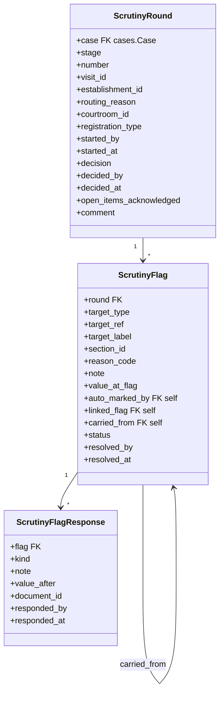
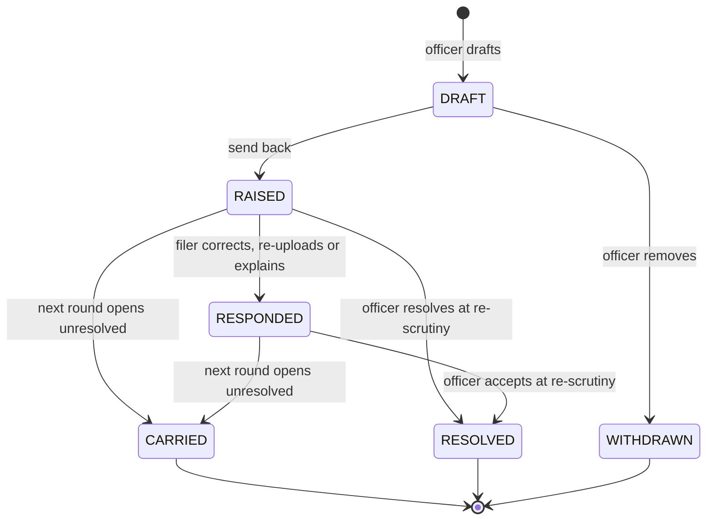

# 0024 — Scrutiny and Registration (`apps.scrutiny`)

## Status

Proposed

## References

- PRDs: `scrutiny-registration-handover.md` (`SCR-`, `REF-`, `LIFE-11`), `court-roles.md` (`RLE-`), `efiling-handover.md` (§3 `ROLE-`, §4 `LIFE-`, §9 `CHQ-11`, §10 `LDN-2`, §11 `JUR-`, §14 `DCM-`, §16 `DOC-`, §18 `SIG-07`, `SIG-10`, §18.2 `OTH-`, §19.4, `VAL-01/02`), `account-creation-handover.md` (`REG-31`, `REG-35`–`REG-37`), `case-numbers.md`, `cognizance-cheat-sheet.md`, `pending-tasks-handover.md`, `case-lifecycle-handover.md`

> **Scope note.** This module owns the court's review of a filed complaint:
> rounds, flags, the filer's responses, and the three decisions — send back,
> forward, register — at the scrutiny and registration stages. It moves the
> case only through [`0011`](0011-case-workflows.md) and opens tasks only
> through its `TaskService`. Field values, documents, correction scope,
> signatures and case numbers stay in `apps.cases`.

## Context

A §138 complaint reaches the court when the filer has signed and paid. From
then it is checked for defects before it is registered and goes to the
court for cognizance:

```text
paid ─> Scrutiny ──send back (flags)──> Pending Correction ─correct, re-sign, pay balance─┐
          │  ▲                                                                            │
          │  └────────────────────────── next round ─────────────────────────────────────┘
          │
          ├─ Scrutiny officer only ─ forward ─> Registration ─ register ─> Cognizance
          │                                        └─ send back (one comment)
          └─ Scrutiny officer + Case registerer ─ register ──────────> Cognizance
```

The court screens make the work concrete.

**Scrutinise submitted cases** — the scrutiny officer's list.

| Element | What it shows |
| --- | --- |
| Tabs | **With registry** (waiting on the court), **With advocate** (sent back), **Closed** (forwarded, registered, withdrawn), each with a count |
| Columns | Parties · Filing no. · Stage (*Awaiting scrutiny*, *Under scrutiny*, *Awaiting re-scrutiny*, *Sent back*, *Registered*) · Case type · Advocate · With (the officer working it) · Waiting (days) |
| Filters | search; *me / unassigned / anyone* |
| Reason line | why it is here: *Filer skipped a warning*, *Low read confidence*, *Random check*, *1 item open*, *All items answered* |

**Scrutiny detail** — one filing.

| Element | What it shows |
| --- | --- |
| Header | filing number, submitted date, parties, *Edit case title* |
| Fields tab | the filed values by section — Party Details, Case Details, Evidence — each with the document it was read from ("Read from Doc 4, Cheque (front) — MICR band") and, where available, a reading note ("Document shows a different value", "Couldn't read this in the document", "Not in any document", "No postal receipt uploaded") |
| Bundle tab | the numbered case bundle: generated synopsis, generated complaint, affidavit, cheque, return memo, demand notice, ID card, with a *Poor scan* badge where the upload was flagged |
| Documents tab | the document index |
| *What to check* | names match across cheque, ID and notice · cheque details match the instrument · notice within 30 days of return memo · filing within limitation or condonation prayed · jurisdiction consistent with addresses · signatures on complaint and affidavit · all documents legible and the right ones |
| Flag composer | a field or section flag with a *Note for the advocate*; a *Document issue* with *What's wrong* (*Blurry / unreadable*, *Page missing*, *Wrong document*) and a note; *Save both* links a field flag to its document's issue; *Flag the entire document instead* |
| Raised with | the flags in this round, split into *Flags — advocate fixes* and *Document issues — advocate re-uploads* |
| Case history · round N | *Filed → Routed to scrutiny → Scrutiny started · Biju B → Sent back with 3 items → Resubmitted · 2 of 3 items answered → Returned to scrutiny · 1 item contested → Scrutiny started …*, each item with what it was and what became of it ("corrected 13 Jul", "re-uploaded 30 Jul, still poor") |
| Actions | **Send back** — *Goes to the advocate as recorded. Each item unlocks what you marked.* **Register case** / forward — *N open items travel with it — registering does not clear them*, with *I have seen the open flags and choose to register* |

**Register cases** — the Case registerer's list and detail.

| Element | What it shows |
| --- | --- |
| List | Case name · Filing number · Advocates · Days since submitted; sorted by waiting |
| Detail summary | parties; cheque (amount, number, drawn on); dishonour (presented at, return reason); demand notice (mode, tracking number, reply); cause of action (jurisdiction under S.142(2), other complaints between the parties); prayer (compensation, interim compensation under S.143A) |
| Scrutiny block | cleared by · rounds · took N days · *Show rounds* |
| Timeline | cheque dated → presented (*within 3 months of the cheque date*, or *beyond 3 months of the cheque date* in warning ink, `SCR-08a`) → returned unpaid → notice sent (*within 30 days of the return*) → notice served → cause of action → complaint filed (*beyond 1 month of the cause of action*) → scrutiny → *waiting to be registered · N days since scrutiny cleared it* |
| Actions | **Register**, **Send back to scrutiny** |

The PRD fixes the rules:

* A case is on a list exactly while its pending task is open; tasks open and close only as side effects of lifecycle transitions (`SCR-09`, `SCR-10`).
* The officer may mark any field or section with a comment, and flag any document for re-upload (`SCR-02`, `SCR-03`).
* Marking a date in the chain marks every date downstream of it (`SCR-04`, `REF-03`). Delay that has arisen since filing is flagged to the officer (`SCR-05`, `REF-04`).
* Send back opens only what was marked (`REF-01`); a send back at Registration is one overall comment and opens everything except the oath (`REF-02`, `OTH-5`). Send-backs repeat without limit (`LIFE-11`).
* Any edit invalidates all signatures; the corrected case is signed again as at filing (`LIFE-13`, `SIG-07`). The bill is recalculated: higher collects the balance, otherwise payment is skipped (`LIFE-12`).
* Every court action needs a role: Scrutiny officer for scrutiny, Case registerer for registration, both held per court establishment (`court-roles.md` `RLE-02c`).
* Whether a case is registered at Scrutiny follows from roles, not a setting: a person holding both roles registers at Scrutiny and is not offered Forward; anyone else forwards (`SCR-06`, `SCR-11`, `SCR-12`). There is no outright rejection before registration.
* A paid case goes to the court establishment with no courtroom; the Scrutiny officer chooses the courtroom at Forward or Register (`SCR-16`). There is no automatic allocation in this version.
* A state may register a case as one of several types, each with its own number series: chosen at Forward, editable and final at Register (`SCR-13`).
* Where the state requires an oath, each oath video is reviewed and flagged on its own (`SCR-14`); a paper upload shows its reason (`SCR-15`).
* A cheque presented after its validity is a warning under the presentation date, never a flag by itself (`SCR-05a`, `SCR-08a`).
* Registration assigns the case number and moves the case to Cognizance (`SCR-08`).

### What this module does and does not decide

`apps.scrutiny` knows **who looked at a filing, what they raised, what the filer
answered, and what was decided**. It does not hold field values or files —
those are the case's. It does not decide what is editable during correction —
it hands the scope to `apps.cases`. It does not number cases — `apps.cases`
does, in the registration transaction.

## Goals

* Send every paid filing to its court establishment and open the *Scrutinise case* task for the establishment's Scrutiny officers.
* Gate every action on the court role it needs (`court-roles.md`), held at the establishment, enforced server-side; derive Register at Scrutiny from the roles a person holds.
* Let the Scrutiny officer choose the courtroom and, where the state has several, the registration type.
* Carry the advisory checks as a business rule bound to a jurisdiction, evaluated by [`0019`](0019-business-rules.md), with a hard line between what rules decide and what code does.
* Hold scrutiny as numbered rounds, one per entry into the scrutiny or registration state.
* Let the officer draft flags on fields, sections, documents and oath videos, compose them across a session, and raise them all at once on send back.
* Auto-mark the dependent dates of the date chain, and alert the officer to newly applicable delay.
* Hand the exact correction scope to `apps.cases`, and record the filer's answer to every flag.
* Carry unresolved flags into the next round, and let them travel with the case when it is forwarded or registered by acknowledgement.
* Assign the case number and move the case to cognizance in one transaction.
* Serve the scrutiny list, scrutiny detail, registration list, registration detail, round history and the filer's correction view.
* Expose REST APIs following [`0000`](0000-api-coding-spec.md), with registered error codes.

## Non-goals

* Machine reading of uploads, read-confidence scores and AI consistency checks. Readings are shown when another module supplies them (#7.2) and are never required.
* Field editing during correction, signing and payment — `apps.cases`, `apps.esign`, `apps.payments`.
* Case number formats (`case-numbers.md`) — this module only asks for one.
* Automatic courtroom allocation or suggestion (a later version, `SCR-16`); moving a registered case to another courtroom.
* Cognizance and the order screen.
* Notification copy (the PRD's master table).

---

## Proposed changes

### 1. App layout and boundaries

```text
apps/scrutiny/
├── apps.py                 # name = "apps.scrutiny"
├── models.py               # ScrutinyRound, ScrutinyFlag, ScrutinyFlagResponse
├── enums.py
├── errors.py               # E09xxx (#8.5)
├── receivers.py            # 0011 state_entered -> open round; cases field/document changed -> response
├── services/
│   ├── rounds.py           # open_round, start, decide (send back, forward, register)
│   ├── flags.py            # draft, edit, withdraw, resolve, auto-mark
│   └── responses.py        # record from case changes, explain
├── checks/
│   ├── models.py           # ScrutinyRuleBinding (imported into apps.scrutiny.models)
│   ├── contracts.py        # CHECKS input/output JSON Schemas (#2.4)
│   ├── resolver.py         # binding resolution along the court hierarchy (#2.4)
│   └── service.py          # evaluate, dry-run (#2.4)
├── management/commands/scrutiny_check_policies.py
├── selectors.py            # list rows, detail assembly, history
├── permissions.py          # role checks at the establishment (#2.2)
├── serializers.py · views.py · urls.py · admin.py
└── tests/
```

Dependency rules:

```text
apps.scrutiny ── imports ──> apps.workflows.services / selectors / signals
apps.scrutiny ── imports ──> apps.cases.selectors / services
apps.scrutiny ── imports ──> apps.core.rules.services (BusinessRuleService only)
apps.scrutiny ── imports ──> apps.organizations.selectors (court hierarchy, role holders)
apps.cases    ── never imports ──> apps.scrutiny
apps.workflows ── never imports ──> apps.scrutiny
```

Rules:

* Scrutiny learns that a case entered `scrutiny` or `registration` from [`0011`](0011-case-workflows.md) `state_entered`. It never polls.
* Scrutiny learns that the filer changed a field or replaced a document from the `case_field_changed` and `case_document_replaced` signals that `apps.cases` sends. Cases never calls scrutiny.
* Correction scope is stored on the case by `apps.cases.services.open_for_correction()`; the filing endpoints of [`0021`](0021-case-filing-api.md) check it there.
* The case number is assigned by `apps.cases.services.register_case()`; scrutiny calls it.
* An isolation test asserts the import rules.

#### 1.1 Contract `apps.cases` must expose

| Function | Used for |
| --- | --- |
| `selectors.get_case_summaries(case_ids)` | list rows: parties, filing number, case type, advocates, submitted date |
| `selectors.get_filing_view(case_id)` | the detail's sections, fields, values and source documents (#7.2) |
| `selectors.get_bundle(case_id)` | numbered bundle: generated synopsis and complaint, active documents, poor-scan marks |
| `selectors.get_registration_summary(case_id)` | the registration detail summary and timeline (#7.4) |
| `plugin.field_ids()`, `plugin.section_ids()` | validating flag targets (#3.2) |
| `plugin.date_chain()` | the dependency graph for auto-marking (#3.3) |
| `plugin.case_context(case)["delay_applicable"]` | delay alert (#3.4) |
| `plugin.checklist()` | *What to check* items |
| `plugin.check_facts(case)` | the `CHECKS` rule input (#2.4): dates, amounts, proof flags, complainant type — computed in code |
| `selectors.establishment(case_id)` | the court establishment the case was filed in |
| `selectors.registration_types(establishment_id)` | the state's registration types (`SCR-13`) |
| `selectors.oath_required(case_id)`, `selectors.oaths(case_id)` | whether the state requires an oath; each oath with complainant, recorded by, recorded at, and the round it was recorded in (`SCR-14`, `OTH-2`) |
| `selectors.paper_upload_reason(case_id)` | the reason given for not e-signing and when (`SCR-15`, `SIG-10`) |
| `services.open_for_correction(case_id, scope, round_id)` / `close_correction(case_id)` | correction scope (#5) |
| `services.register_case(case_id, registration_type, actor)` | records the final registration type, assigns the case number from that type's series and `registered_at`; dispatches `CASE_REGISTERED` |
| `services.set_case_title(case_id, complainant, accused, actor)` | *Edit case title* |
| `services.set_court(case_id, courtroom_id, actor)` | the courtroom the Scrutiny officer chose (`SCR-16`); cases stores, scrutiny decides |
| signals `case_field_changed`, `case_document_replaced` | filer responses (#5.2) |

### 2. Court roles and jurisdiction differences

Scrutiny differs by state. The PRDs settle most of the difference as **who holds
which role** at the court establishment, a little of it as per-state
configuration, and the advisory checks as rules:

| Step | Kerala | Gujarat | Punjab & Haryana | Decided by | Source |
| --- | --- | --- | --- | --- | --- |
| Who scrutinises | holders of the Scrutiny officer role (staff title Scrutiny officer) | same; one person across five courtrooms today | same | role assignment | `court-roles.md` §3, `RLE-02c` |
| Who registers | holders of the Case registerer role (Magistrate) | holders of the Case registerer role (Magistrate in `court-roles.md` §3.2; the scrutiny PRD says the scrutiny officer and registrar are the same person — question 8) | holders of the Case registerer role (Magistrate) | role assignment | `SCR-08`, `SCR-11`, `SCR-13` |
| Register at Scrutiny | when one person holds both roles | same | same | roles held | `SCR-11`, `SCR-12` |
| Courtroom | chosen by the Scrutiny officer at Forward or Register; none shown when the establishment has one courtroom | same | same | the officer | `SCR-16` |
| Registration types | one: criminal complaint | three: eCC Criminal Case · eCR EN Criminal Inquiry Case · eCR MA Criminal Miscellaneous Application | one: NACT | per-state configuration | `SCR-13`, `case-numbers.md` |
| Oath review | when the state requires an oath | same | same | per-state configuration (`oathRequired`) | `SCR-14`, e-filing `OTH-2` |
| Advisory checks | common set | common set | common set | business rule `CHECKS` | `SCR-05`, `SCR-05a`, e-filing `LDN-2` |

There is no setting for where a case is registered (scrutiny PRD batch 10) and
no automatic courtroom allocation in this version (batch 14).

#### 2.1 Boundary: what decides, what enforces

| Concern | Decided by | Enforced by | Never |
| --- | --- | --- | --- |
| Which actions a person gets at Scrutiny and Registration | the roles they hold at the court establishment (`SCR-06`, `SCR-08`, `SCR-11`) | `permissions.py`, server-side (`RLE-04`) | a rule, a configuration value, or a staff title (`RLE-08`) |
| Whether the case passes through Registration | follows from those roles: a person holding both registers at Scrutiny (`SCR-11`, `SCR-12`) | `services.rounds` choosing the workflow transition | a setting |
| Which courtroom gets the case | the Scrutiny officer, at Forward or Register (`SCR-16`) | `apps.cases.services.set_court()` | automatic allocation in this version; the filer |
| Registration type | the Scrutiny officer at Forward; the Case registerer at Register, final there (`SCR-13`) | `apps.cases.services.register_case()` | a pre-selected type at Forward |
| Which registration types exist; whether the oath is required | per-state configuration owned by `apps.cases` (#2.3) | read through selectors | scrutiny |
| Which advisory checks the officer sees | business rule `CHECKS`, bound to a jurisdiction (#2.4) | `selectors` attaching warnings to fields | a check blocking an action (`SCR-05a`: information, not a flag) |
| What is opened for correction | code, from the flags (`REF-01`–`REF-06`) | `apps.cases.services.open_for_correction()` | a rule widening or narrowing the scope |
| Legal facts (dates, delay, validity) | code — the case-type plugin (`date_chain`, `delay_applicable`) | passed to the `CHECKS` rule as input | a rule recomputing the law |
| Case number | `apps.cases` (`case-numbers.md`), from the registration type's series | `register_case()` | scrutiny |

Some things nothing can change:

* Only holders of the establishment's Scrutiny officer role act at Scrutiny; only holders of its Case registerer role register or send back at Registration.
* Forward for registration is never offered to someone who also holds Case registerer: they would only forward the case to themselves (`SCR-11`).
* A send back at Scrutiny opens only what was flagged; a send back at Registration opens everything except the oath (`REF-01`, `REF-02`, `OTH-5`).
* There is no rejection before registration (scrutiny PRD §6).
* Unresolved flags travel with the case when it is forwarded or registered.

#### 2.2 Roles

The court roles of [`court-roles.md`](court-roles.md) used here are
`SCRUTINY_OFFICER` and `CASE_REGISTERER`. Both are held **per court
establishment**, not per courtroom (`RLE-02c`); one account may hold both
(`RLE-02`); any holder can act (`RLE-05`). Who holds them is assigned with the
account (`REG-31`, `REG-35`) and read through
`apps.organizations.selectors.role_holders(organization_id, role)` and
`holds_role(user, role, organization_id)`.

| Action | Needs, at the case's establishment |
| --- | --- |
| Start, draft and withdraw flags, resolve, edit case title | `SCRUTINY_OFFICER` |
| Send back at Scrutiny | `SCRUTINY_OFFICER` |
| Forward for registration | `SCRUTINY_OFFICER` and **not** `CASE_REGISTERER` |
| Register at Scrutiny | `SCRUTINY_OFFICER` **and** `CASE_REGISTERER` |
| Start, register and send back at Registration | `CASE_REGISTERER` |

Roles are checked when the action is taken. A role change is a backend
operation that applies at once (`RLE-03`), so nothing is snapshotted. Reading
is not a role: a case with no courtroom yet is seen by holders of the
establishment's roles (`RLE-06`). What differs between two people on the same
screen is their first action, not what they may reach (`RLE-07`).

#### 2.3 Per-state configuration

Owned by `apps.cases`, read here; nothing in it is a decision:

| Item | Read through | Used for |
| --- | --- | --- |
| Registration types of the establishment, each with its own number series | `apps.cases.selectors.registration_types(establishment_id)` | the type choice at Forward and Register (#4.4, #6.1) |
| `oathRequired` | `apps.cases.selectors.oath_required(case_id)` | the oath list and oath flags (#3.2) |

#### 2.4 Advisory checks as a business rule

The warnings the officer sees beside the case fields are evaluated by the
business rules module of [`0019`](0019-business-rules.md), so a state can add,
remove or re-grade a check without a release.

**Binding.** [`0019`](0019-business-rules.md) stores one rule per `code` and
deliberately has no per-organization variants, so this module owns the binding.

`ScrutinyRuleBinding` — `BaseModel`, `BaseActivatableModel`, `BaseAuditableModel`

| Field | Type | Notes |
| --- | --- | --- |
| `decision` | `CharField(16, choices=Decision)` | `CHECKS` in this version |
| `organization` | `FK("organizations.Organization", null=True, on_delete=PROTECT)` | the establishment or High Court the binding applies to; `NULL` is the national default |
| `rule_code` | `CharField(50)` | a `BusinessRule.code`, e.g. `SCRUTINY_CHECKS_DEFAULT` |
| `note` | `CharField(255, blank=True)` | why this jurisdiction differs |

`UniqueConstraint(decision, organization, condition=Q(is_active=True))`;
`UniqueConstraint(decision, condition=Q(organization__isnull=True, is_active=True))`.

For a case at establishment *E*, the binding is the first active one on *E*,
then on each ancestor of *E* (`Organization.get_ancestors()`), then the
national default. A state's checks are bound once, on its High Court. Every
deployment ships a national default.

**Contract.** The input is facts computed by the case-type plugin, never by
the rule; the output is a list of warnings. Both are validated against the
rule's schemas by 0019 and again by this module.

```json
// input
{
  "case_type": "CHEQUE_BOUNCE",
  "today": "2026-08-03",
  "cheques": [
    { "index": 0, "cheque_date": "2019-04-05", "presented_on": "2016-04-04", "valid_until": "2019-07-04",
      "returned_on": "2016-04-04", "amount": 5205000, "return_reason": "FUNDS_INSUFFICIENT" }
  ],
  "notice": { "dispatched_on": "2016-04-12", "served_on": "2016-04-14", "delivered": true,
              "postal_receipt_uploaded": false, "delivery_proof_uploaded": false },
  "cause_of_action_on": "2016-04-28",
  "filed_on": "2026-07-04",
  "delay_applicable": true,
  "delay_prayer_present": true,
  "complainant_is_institution": true,
  "complainant_cin_or_pan_present": false
}
// output
{
  "alerts": [
    { "code": "PRESENTED_BEFORE_CHEQUE_DATE", "severity": "WARNING", "field_refs": ["CHQ-1[0]", "CHQ-8[0]"],
      "message": "Presented before the date on the cheque." },
    { "code": "NO_POSTAL_RECEIPT", "severity": "INFO", "field_refs": ["LDN-3"],
      "message": "No postal receipt uploaded." }
  ]
}
```

`severity` ∈ `INFO`, `WARNING`. An alert is shown as a warning line under its
field and in the *What to check* panel; the officer decides whether to mark the
field (`SCR-02`, `SCR-05a`). No alert blocks an action.

The checks the national default ships with:

| Code | Rule | Source |
| --- | --- | --- |
| `PRESENTED_AFTER_VALIDITY` | presented after the cheque's validity; message *"Presented after validity — valid until [last valid day]"* under `CHQ-8[i]` | `SCR-05a`, e-filing `CHQ-11` |
| `PRESENTED_BEFORE_CHEQUE_DATE` | presented before the date on the cheque | e-filing `VAL-01/02` |
| `NOTICE_AFTER_30_DAYS` | notice dispatched more than 30 days after the cheque's return | e-filing `LDN-2` |
| `DELAY_WITHOUT_PRAYER` | `delay_applicable` and no condonation prayer | `SCR-05` |
| `NON_FUNDS_RETURN_REASON` | return reason other than insufficiency of funds — check S.138 applies | e-filing §22 |
| `NO_POSTAL_RECEIPT`, `NO_DELIVERY_PROOF` | proof of dispatch or service not uploaded | screens |
| `INSTITUTION_WITHOUT_CIN_OR_PAN` | institutional complainant filed without CIN or PAN | e-filing `LIT-18a` |

**Engine.** `SCRUTINY_CHECKS_DEFAULT` is a `gorules` decision table with a
collect hit policy: one row per check, so adding a check is adding a row.

**Failures.** The checks are evaluated on every detail read, because they
depend on today's date. A missing binding, a missing or inactive rule, or an
output that breaks the contract never blocks the screen: the detail returns the
fields without alerts and one alert `CHECKS_UNAVAILABLE`, and the failure is
logged at error (`E09014`, `E09015` in the log line).

**Validation.** Saving a binding in admin dry-runs the rule through
`BusinessRuleService.dry_run()` with a sample input and checks the output
against the contract. `manage.py scrutiny_check_policies` reports
establishments with no binding, bindings to inactive rules and dry-run
failures; CI runs it against the seeded fixtures. Rules and the default binding
are seeded by data migration.

A later version will **suggest** a courtroom that the Scrutiny officer can
change — for example from Gujarat's mapping of financial institutions to
courtrooms (`SCR-16`). That suggestion would be a second decision under the
same binding; it is not part of this version.

#### 2.5 Establishment and courtroom

Each state deployment has one court establishment in this version
(`RLE-00`). When a filed, signed and paid case first enters `scrutiny`, it
belongs to that establishment and has **no courtroom**. Its *Scrutinise case*
task goes to the establishment's `SCRUTINY_OFFICER` holders, due `+0`,
visible to Only Users (`SCR-09`).

The Scrutiny officer chooses the courtroom, from the establishment's
courtrooms, as part of **Forward for registration** or **Register at Scrutiny**
(`SCR-16`, #4.4). Nothing is pre-selected. Where the establishment has one
courtroom no choice is shown and the case goes to it. Send back chooses no
courtroom. From Cognizance onward the case's work goes to the role holders of
that courtroom. Moving a registered case to another courtroom is outside this
module.


### 3. Data model



All models inherit `apps.core.models.BaseModel` and `BaseAuditableModel`.
Every bounded enum is a `TextChoices` in `apps/scrutiny/enums.py`.

#### 3.1 `ScrutinyRound`

One per entry of the case into `scrutiny` or `registration`.

| Field | Type | Notes |
| --- | --- | --- |
| `case` | `FK("cases.Case", on_delete=PROTECT, related_name="scrutiny_rounds")` | |
| `stage` | `CharField(16, choices=RoundStage)` | `SCRUTINY`, `REGISTRATION` |
| `number` | `PositiveSmallIntegerField` | the [`0011`](0011-case-workflows.md) visit number of that state — round 1, 2, 3 |
| `visit_id` | `UUIDField(unique=True)` | the workflow visit |
| `establishment_id` | `UUIDField(db_index=True)` | the court establishment the round is at; scrutiny and registration happen here (`RLE-02c`) |
| `routing_reason` | `CharField(32, choices=RoutingReason, blank=True)` | `FILER_SKIPPED_WARNING`, `LOW_READ_CONFIDENCE`, `NOT_MACHINE_READ`, `RANDOM_CHECK`, `RESUBMITTED`; display only (question 1) |
| `courtroom_id` | `UUIDField(null=True)` | the courtroom chosen at Forward or Register (`SCR-16`); empty until then |
| `registration_type` | `CharField(32, blank=True)` | the type chosen at Forward (shown pre-selected at Registration) or at Register, where it is final (`SCR-13`); empty when the state has one type |
| `started_by` / `started_at` | `FK(User, null=True)` / `DateTimeField(null=True)` | first *start* |
| `decision` | `CharField(16, choices=RoundDecision, blank=True)` | `SENT_BACK`, `FORWARDED`, `REGISTERED`; empty while open |
| `decided_by` / `decided_at` | | |
| `open_items_acknowledged` | `BooleanField(default=False)` | forwarded or registered with unresolved flags |
| `open_items_at_decision` | `PositiveSmallIntegerField(default=0)` | how many |
| `comment` | `TextField(blank=True)` | the Case registerer's overall comment on a registration send back (`REF-02`) |

Constraints: `UniqueConstraint(case, stage, number)`;
`UniqueConstraint(case, condition=Q(decision=""))` — one open round per case.

#### 3.2 `ScrutinyFlag`

| Field | Type | Notes |
| --- | --- | --- |
| `round` | `FK(ScrutinyRound, on_delete=CASCADE, related_name="flags")` | |
| `target_type` | `CharField(16, choices=FlagTarget)` | `FIELD`, `SECTION`, `DOCUMENT`, `OATH` |
| `target_ref` | `CharField(128)` | `FIELD`: PRD field id with record index, e.g. `CHQ-9[0]` (cheque 1's return date), `ACC-1[1]` (accused 2's name); `SECTION`: section code, e.g. `LDN`, `JUR`; `DOCUMENT`: `case_document_id`; `OATH`: the oath id, one per complainant (`SCR-14`) |
| `target_label` | `CharField(255)` | snapshot for history, e.g. "Cheque amount" |
| `section_id` | `CharField(16, blank=True)` | the section the target sits in, for grouping; empty for `OATH` |
| `reason_code` | `CharField(32, choices=DocumentIssue, blank=True)` | documents only: `BLURRY_UNREADABLE`, `PAGE_MISSING`, `WRONG_DOCUMENT`, `OTHER` |
| `note` | `TextField(blank=True)` | the note for the advocate |
| `value_at_flag` | `JSONField(null=True)` | the field's value when flagged, so history shows "₹52,05,000 → ₹50,25,000" |
| `auto_marked_by` | `FK("self", null=True, on_delete=CASCADE)` | dates marked by the chain (#3.3) |
| `linked_flag` | `FK("self", null=True, on_delete=SET_NULL)` | a field flag and its document issue saved together |
| `carried_from` | `FK("self", null=True, on_delete=PROTECT)` | the same item, still unresolved, in the previous round |
| `status` | `CharField(16, choices=FlagStatus)` | #3.5 |
| `resolved_by` / `resolved_at` | | |

`UniqueConstraint(round, target_type, target_ref, condition=~Q(status=WITHDRAWN))`
— one live flag per target per round.

Target validation, at draft time:

* `FIELD` — the id is one the case type defines (`plugin.field_ids()`) and the record index exists on the case (there is a cheque 2, an accused 3). Section ids follow the filing form: `LIT`, `ADV`, `ACC`, `CHQ`, `LDN`, `JUR`, `PRY`, `WIT`, `DCM`.
* `SECTION` — the id is one of those sections.
* `DOCUMENT` — an active `CaseDocument` of the case. Generated documents (synopsis, complaint) cannot be flagged; the fields that render into them are flagged instead (`DOC-01`).
* `OATH` — an oath of the case, only where the state requires one (`oathRequired`, `OTH-2`); each oath is flagged on its own (`SCR-14`). The oath is not a section of the form, so `OTH` is not a section id.
* `FIELD`, `SECTION` and `OATH` need a `note`; `DOCUMENT` needs a `reason_code` or a `note`. The screen's warning — *No note — the advocate won't know what to fix* — is a rule here (`E09004`).

#### 3.3 Date chain

The plugin publishes the chain as a dependency graph (`VAL-01/02`):

```text
CHQ-1 date on cheque
 └─ CHQ-8 presentation
     └─ CHQ-9 return
         └─ LDN-2 dispatch of demand notice (warn > 30 days after return)
             ├─ LDN-6 delivery        (delivered = Yes)
             └─ LDN-7 return          (delivered = No)
                 └─ JUR-9 cause of action (service + 15 days)
                     └─ JUR-10 filing date
                         └─ JUR-11 delay
```

Drafting a `FIELD` flag on a node drafts flags on every transitive downstream
node that applies to the case (`LDN-6` or `LDN-7`, not both), with
`auto_marked_by` set and the note "Marked because {source label} was flagged".
Cheque dates follow their own cheque: flagging `CHQ-8[1]` marks `CHQ-9[1]`, then
the notice dates that cheque's notice covers.

Withdrawing the source withdraws its auto-marked children, except any the
officer edited (gave its own note). Auto-marked flags exist so that the filer
can edit the dependent dates without failing the ordering validations
(`REF-03`); they count as one item in the send-back message.

#### 3.4 Delay alert

On every detail read, `delay_applicable` is computed by the case-type plugin
against **today**, never cached (`REF-04`), and passed to the `CHECKS` rule.
When it is true and the filing carries no delay condonation prayer (`JUR-12`
empty), the default checks rule returns `DELAY_WITHOUT_PRAYER` (#2.4). The rule only
reports the fact; whether delay applies is the law, and stays in code.

On send back the `JUR` delay fields are added to the scope as required
(`REF-05`, `REF-06`), whether or not the officer flagged them. The added DCA fee
is collected on resubmission through `case.balance_due` (`LIFE-12`).

#### 3.5 Flag lifecycle



* `DRAFT` — visible to court staff only; freely edited or withdrawn. Nothing reaches the filer piecemeal.
* `RAISED` — sent to the filer. Never edited or deleted after.
* `RESPONDED` — the filer acted on it (#5.2).
* `RESOLVED` — the officer is satisfied.
* `CARRIED` — closed in this round because a new round opened with a copy (`carried_from`) as `DRAFT`. The chain of copies is the item's history across rounds.
* `WITHDRAWN` — a draft removed.

Removing a field flag never removes its linked document issue (*"Flag removed.
The document issue … stays."*), and vice versa.

#### 3.6 `ScrutinyFlagResponse`

| Field | Type | Notes |
| --- | --- | --- |
| `flag` | `FK(ScrutinyFlag, on_delete=CASCADE, related_name="responses")` | |
| `kind` | `CharField(16, choices=ResponseKind)` | `CORRECTED` (value changed), `REUPLOADED` (document replaced), `EXPLAINED` (no change, with a note) |
| `note` | `TextField(blank=True)` | required for `EXPLAINED` |
| `value_after` | `JSONField(null=True)` | `CORRECTED` |
| `document_id` | `UUIDField(null=True)` | `REUPLOADED`: the new `CaseDocument` |
| `responded_by` / `responded_at` | | |

A flag may get several responses within one correction (edited twice); history
shows the last. An `EXPLAINED` flag is shown to the court as **contested**.

### 4. Rounds and decisions

All decisions go through `apps.scrutiny.services.rounds`. Each takes
`select_for_update()` on the open round, checks the actor (#8.4), completes the
stage's task through `TaskService`, and calls `CaseWorkflowService.move_case`
with the round in `context`, in one transaction. Endpoints accept
`If-Match: <workflow version>`; a stale version is `412 E08005`.

#### 4.1 Opening a round

On `state_entered` for `scrutiny` or `registration`:

1. Create the round with `stage`, `number = visit_number`, `visit_id`, `establishment_id`, and `routing_reason` — the filing's own reason on round 1, `RESUBMITTED` when the case came back from correction. A registration round copies `courtroom_id` and `registration_type` from the round that forwarded it.
2. Copy forward every flag of the previous round of either stage that is `RAISED` or `RESPONDED`: the old flag becomes `CARRIED`; the new one is `DRAFT` with `carried_from`, the same target, note and reason, and the old responses visible through the chain.
3. Close correction scope on the case (`close_correction`).

The receiver is idempotent on `visit_id`.

#### 4.2 Start

`POST /scrutiny/{case_id}/start/` — sets `started_by`, `started_at` on the first
call and claims the stage's task ([`0011`](0011-case-workflows.md) #7.4). The
list then shows *Under scrutiny · with {name}*. Repeat calls by the same user do
nothing; another user may start too, which claims with `take_over`.

#### 4.3 Send back (scrutiny stage)

```json
POST /api/v1/scrutiny/{case_id}/send-back/
If-Match: 9
{}
```

1. At least one live `DRAFT` flag (`400 E09005`).
2. Every `DRAFT` flag becomes `RAISED`.
3. **Scope** = the targets of the raised flags (fields, sections, documents), their auto-marked dates, and the delay section when the alert is on (#3.4) (`REF-01`, `REF-03`–`REF-06`).
4. `apps.cases.services.open_for_correction(case_id, scope, round_id)`.
5. Complete *Scrutinise case*; `move_case(case, "send_back", context={"round_id", "item_count"})` → `pending_correction`; `decision = SENT_BACK`.
6. The engine opens *Correct defects* for the filer's side; on commit the filer side is notified with the item count.

#### 4.4 Forward and register (scrutiny stage)

```json
POST /api/v1/scrutiny/{case_id}/forward/      (Scrutiny officer, not Case registerer)
POST /api/v1/scrutiny/{case_id}/register/     (Scrutiny officer and Case registerer)
{ "courtroom_id": "…", "registration_type": "ECC", "acknowledge_open_items": true }
```

1. The action must match the roles the actor holds at the establishment (#2.2): Forward needs `SCRUTINY_OFFICER` without `CASE_REGISTERER`; Register needs both (`SCR-11`). Otherwise `403 E09008`, or `409 E09007` when the actor holds the roles for the other action. The service passes `context={"registers_at_scrutiny": true|false}` to `move_case`, and the workflow's transition conditions check it ([`0011`](0011-case-workflows.md) #10.2): roles decide, the workflow enforces.
2. **Courtroom** (`SCR-16`): `courtroom_id` is required and must be one of the establishment's courtrooms; nothing is pre-selected (`E09017`). Where the establishment has one courtroom it may be omitted and that courtroom is used. `apps.cases.services.set_court()` stores it.
3. **Registration type** (`SCR-13`): where the state has more than one type, `registration_type` is required and must be one of them; nothing is pre-selected (`E09018`). At Register it is final. Where the state has one type it is omitted and that type is used.
4. Unresolved flags — carried drafts and anything `RAISED`/`RESPONDED` — need `acknowledge_open_items = true` (`409 E09006` with the count). They are not cleared: they **travel with the case**, recorded in `open_items_at_decision`, and appear on the registration round and the cognizance screen.
5. Other remaining `DRAFT` flags (never sent) are withdrawn.
6. Forward: complete the task; `move_case(case, "forward")` → `registration`; `decision = FORWARDED`. The engine opens *Register case* for the establishment's `CASE_REGISTERER` holders, and a registration-stage round opens (`SCR-07`).
7. Register: complete the task; `apps.cases.services.register_case(case_id, registration_type, actor)` assigns the case number from that type's series (`case-numbers.md`) and `registered_at`; `move_case(case, "register_at_scrutiny")` → `cognizance`; `decision = REGISTERED` (`SCR-12`). The case never reaches Registration, so it has no registration send back. From Cognizance its work goes to the chosen courtroom's role holders.

There is no reject action (scrutiny PRD §6). A complaint that should not proceed
is registered and dismissed by order at cognizance.

#### 4.5 Re-scrutiny

When the corrected case returns, round *N+1* opens (#4.1). For each carried
item the detail shows what was raised and every response. An oath that was not
recorded again says so, with the date it was recorded, so the officer can tell
it carried over (`SCR-14`). The officer:

* **resolves** it — `POST /scrutiny/{case_id}/flags/{flag_id}/resolve/` on the carried draft marks it and its whole `carried_from` chain `RESOLVED`; or
* **keeps** it — leaves it as a draft, editing the note if needed, so it is raised again on the next send back.

A carried item counts as unresolved until resolved. The list shows *Awaiting
re-scrutiny* with "All items answered" or "N items contested" until the round
is started.

#### 4.6 Edit case title

`PATCH /scrutiny/{case_id}/title/` with `complainant` and `accused` display
names calls `apps.cases.services.set_case_title`. Recorded in the round's
history. Needs `SCRUTINY_OFFICER` at a scrutiny round, `CASE_REGISTERER` at a
registration round.

### 5. Correction

#### 5.1 Scope

`open_for_correction(case_id, scope, round_id)` stores on the case:

```json
{
  "round_id": "…",
  "mode": "MARKED",
  "fields": ["CHQ-8[0]", "CHQ-9[0]", "LDN-2[0]", "LDN-6[0]", "JUR-9", "JUR-10", "JUR-11"],
  "sections": ["LDN"],
  "documents": ["8c1e…"],
  "required": ["JUR-12"]
}
```

`scope` also carries `oaths`: the complainants whose oath was flagged, who
record it again at re-signing (`OTH-5`). `mode = ALL` for a send back at
Registration opens everything except the oath (`REF-02`, `OTH-5`). While the
case is in `pending_correction`, the filing endpoints accept writes only inside
the scope and refuse the rest with the cases module's own
`FIELD_NOT_OPEN_FOR_CORRECTION` error. A flagged document may be replaced; an
unflagged one may not.

#### 5.2 Responses

* Each write by the filer to an open field sends `case_field_changed(case_id, field_ref, old, new, actor)`. The receiver records a `CORRECTED` response on the matching raised flag (or the section flag that contains it) and moves the flag to `RESPONDED`.
* Replacing a flagged document sends `case_document_replaced(case_id, old_document_id, new_document_id, actor)` → `REUPLOADED`.
* The filer may answer a flag without changing anything: `POST /cases/{case_id}/corrections/{flag_id}/explain/` with a `note` → `EXPLAINED`.

#### 5.3 Resubmission

`POST /cases/{case_id}/corrections/submit/` (owned here, because the gate is
about flags):

1. The case is in `pending_correction` and its latest round was sent back at Scrutiny or at Registration.
2. At least one flag has a response, or, for `mode = ALL`, at least one change (`409 E09012`). Unanswered flags may remain; they travel to re-scrutiny as unanswered.
3. Complete *Correct defects*; `move_case(case, "submit_correction")` → `pending_signature`.

What follows is the engine's ([`0011`](0011-case-workflows.md) #10.2): every
signatory signs again as at filing (`LIFE-13`, `SIG-07`), then `ALL_SIGNED`
sends the case to `pending_payment` if the recalculated bill is higher, else
straight to `scrutiny` (`LIFE-12`).

### 6. Registration stage

Applies only to a case forwarded from Scrutiny (`SCR-07`, `SCR-08`). A case
registered at Scrutiny never reaches it. Every action in this stage needs the
`CASE_REGISTERER` role at the establishment (#2.2).

#### 6.1 Register

```json
POST /api/v1/registration/{case_id}/register/
{ "registration_type": "ECC", "acknowledge_open_items": true }
```

The type chosen at Forward is shown pre-selected and may be changed; it is
final here (`SCR-13`). The courtroom chosen at Forward is kept (question 10).
Same open-item rule as #4.4. `register_case`, then `move_case(case,
"register")` → `cognizance`; the round's `decision = REGISTERED`.

The *Register case* timeline states the statutory limit under each step it
governs. Under the cheque's presentation it reads *within 3 months of the
cheque date*, or *beyond 3 months of the cheque date* in warning ink where the
cheque was presented after its validity (`SCR-08a`). Only a step outside its
window takes the warning ink, and the warning stops neither action.

#### 6.2 Send back

```json
POST /api/v1/registration/{case_id}/send-back/
{ "comment": "Affidavit is for a different cheque. Re-check the whole complaint." }
```

One overall comment, required; no field marking (`REF-02`, `E09010`). The case
goes to the filer: `open_for_correction(mode = ALL)` opens everything except
the oath (`OTH-5`); `move_case(case, "registration_send_back")` →
`pending_correction`; `decision = SENT_BACK` (`SCR-08`).

### 7. Read models

#### 7.1 Scrutiny list

`GET /api/v1/scrutiny/?establishment=&tab=registry&claimed=anyone&search=&page=`

| Tab | Rows |
| --- | --- |
| `registry` | open *Scrutinise case* tasks of the establishment |
| `advocate` | cases of the establishment whose latest round was sent back and that have not re-entered scrutiny — in correction, re-signing or paying the balance |
| `closed` | rounds of the establishment decided `FORWARDED` or `REGISTERED`, and cases withdrawn after scrutiny, in the last `scrutiny.closed_tab_days` days |

```json
{
  "count": 6,
  "counts": { "registry": 6, "advocate": 3, "closed": 2 },
  "results": [
    {
      "case_id": "a91e…",
      "filing_number": "F/AHM/2026/00341",
      "parties": "Prateek Agrawal v. Deepak Choudhary",
      "case_type": { "key": "CHEQUE_BOUNCE", "label": "S.138 NI Act" },
      "stage": "UNDER_SCRUTINY",
      "stage_label": "Under scrutiny",
      "reason": "1 item open",
      "advocate": "Adv. Bijini Rejen",
      "with": { "id": "…", "name": "Biju B" },
      "waiting_days": 2,
      "round": 3,
      "task_id": "…"
    }
  ],
  "meta": { "...": "standard envelope" }
}
```

| `stage` | When |
| --- | --- |
| `AWAITING_SCRUTINY` | round 1, not started |
| `UNDER_SCRUTINY` | started |
| `AWAITING_RESCRUTINY` | round > 1, not started |
| `SENT_BACK` | advocate tab |
| `FORWARDED`, `REGISTERED`, `WITHDRAWN` | closed tab |

`reason`: the routing reason on an unstarted round 1; "N items open" when
carried items exist; "All items answered" / "N items contested" on an unstarted
re-scrutiny; the case number on a registered row. `waiting_days` counts from the
task's creation (registry), the send back (advocate) or the decision (closed).
`claimed` is `me`, `unassigned` or `anyone`. Default order: longest waiting,
then filing number. Case columns come from one batched
`get_case_summaries` call.

#### 7.2 Scrutiny detail

`GET /api/v1/scrutiny/{case_id}/`

```json
{
  "case": { "id": "…", "filing_number": "F/AHM/2026/00341", "parties": "Prateek Agrawal v. Deepak Choudhary",
            "submitted_at": "2026-07-04", "advocate": "Adv. Bijini Rejen" },
  "round": { "id": "…", "stage": "SCRUTINY", "number": 3, "started_by": { "name": "Biju B" },
             "summary": "3 rounds · 1 item open since 7 Jul" },
  "sections": [
    { "id": "CHQ", "title": "Cheque Details", "groups": [
      { "title": "Cheque 1", "fields": [
        { "ref": "CHQ-3[0]", "label": "Amount", "value": "₹ 52,05,000",
          "source_document_id": "…", "source_note": "Cheque (front)",
          "reading": { "status": "MISMATCH", "value": "₹ 50,25,000" },
          "flag_id": null }
      ] }
    ] }
  ],
  "bundle": [
    { "no": 1, "kind": "GENERATED", "name": "Synopsis", "document_id": "…" },
    { "no": 3, "kind": "SCAN", "name": "Affidavit (scanned & signed)", "document_id": "…", "poor_scan": true, "flag_id": "…" }
  ],
  "oaths": [
    { "id": "…", "complainant": "Prateek Agrawal", "recorded_by": { "name": "Prateek Agrawal", "capacity": "COMPLAINANT" },
      "recorded_at": "2026-07-04T11:02:00+05:30", "carried_over": false, "flag_id": null }
  ],
  "paper_upload": { "reason": "Complainant has no Aadhaar-linked mobile number", "given_at": "2026-07-03T18:40:00+05:30" },
  "checklist": ["Names match across cheque, ID and notice", "…"],
  "alerts": [
    { "code": "PRESENTED_AFTER_VALIDITY", "severity": "WARNING", "field_refs": ["CHQ-8[0]"],
      "message": "Presented after validity — valid until 04/07/2019" }
  ],
  "courtrooms": [ { "id": "…", "name": "Courtroom 1" }, { "id": "…", "name": "Courtroom 2" } ],
  "registration_types": [ { "code": "ECC", "label": "eCC Criminal Case" } ],
  "flags": { "draft": [ ], "carried": [ ], "raised_last_round": [ ] },
  "allowed_actions": ["start", "flag", "send_back", "forward"],
  "workflow_version": 9,
  "meta": { "...": "standard envelope" }
}
```

* `sections` follow the filing form; values are what the filer entered, as printed in the complaint (`DOC-01`).
* `reading` is present only when a reading module has supplied one: `MATCH`, `MISMATCH`, `UNREADABLE`, `NOT_IN_DOCUMENT`. It is advisory and never gates an action.
* Notes for missing proof (*No postal receipt uploaded*, *No delivery proof uploaded*) come from the plugin, from the filing's own data.
* `bundle` is numbered in bundle order, generated documents first; `poor_scan` is the upload step's mark.
* `checklist` is display only; nothing is stored against it.
* `oaths` is present only where the state requires an oath: one per complainant, with who recorded it and when; `carried_over` is true when it was not recorded again in a later round (`SCR-14`). Selecting one plays the video in the centre panel.
* `paper_upload` is present only when the case was signed by uploading a physically signed copy (`SCR-15`).
* `alerts` are the `CHECKS` rule's output for today (#2.4), shown as a warning line under each field in `field_refs`; advisory only (`SCR-05a`).
* `courtrooms` lists the establishment's courtrooms for the Forward / Register choice; a single courtroom means no choice is shown (`SCR-16`). `registration_types` lists the state's types; one type means no choice is shown (`SCR-13`).
* `allowed_actions` combine the workflow's available transitions and the roles the caller holds at the establishment: *Forward* for a Scrutiny officer only, *Register* for one who also holds Case registerer (`SCR-11`).

#### 7.3 Registration list

`GET /api/v1/registration/?establishment=&search=&ordering=-waiting_days&page=` — open
*Register case* tasks of the establishment:

| Field | Source |
| --- | --- |
| `case_name`, `filing_number`, `advocates` | case summary |
| `days_since_submitted` | days since the case was filed (the screen's *Days since submitted*) |
| `days_since_cleared` | days since forwarded |
| `open_items` | carried from scrutiny |
| `courtroom`, `registration_type` | chosen at Forward |

#### 7.4 Registration detail

`GET /api/v1/registration/{case_id}/` returns:

* `summary` — from `apps.cases.selectors.get_registration_summary`: parties; cheque amount, number, drawee bank and branch; dishonour bank, branch and return reason; demand notice mode, tracking number and reply; jurisdiction under S.142(2); other complaints between the parties; prayer — compensation and interim compensation under S.143A;
* `scrutiny` — cleared by, rounds (count of scrutiny-stage rounds), days taken from first entry into scrutiny to forward, and `rounds` for *Show rounds* (#7.5);
* `timeline` — cheque dated, presented, returned, notice sent, notice served, cause of action, complaint filed, scrutiny, waiting, each with its date and a qualifier computed by the plugin: *within 3 months of the cheque date* (or *beyond 3 months of the cheque date* with `warning: true`, `SCR-08a`), *within 30 days of the return*, *beyond 1 month of the cause of action*. Multiple cheques give one line per cheque;
* `courtroom`, `registration_type` (pre-selected, editable) and `registration_types`;
* `open_items` — carried flags with their responses;
* `allowed_actions` — `register`, `send_back`;
* `workflow_version`.

#### 7.5 History

`GET /api/v1/scrutiny/{case_id}/history/` builds the round timeline from
[`0011`](0011-case-workflows.md) logs, rounds, flags and responses:

| Entry | Source |
| --- | --- |
| Filed · {filer} | first `submit_for_signing` log |
| Routed to scrutiny · {routing reason} | round 1 created |
| Scrutiny started · {officer} | `started_at` |
| Sent back with N items · round R | decision; each item with `target_label`, what was wrong (`note` or `value_at_flag`) and its latest state |
| Resubmitted · {filer} · M of N items answered | `submit_correction` log; response counts |
| Returned to scrutiny · K items contested | next round created; `EXPLAINED` count |
| Forwarded · {courtroom} · Registered · {case number} · Sent back at registration | decisions |

Item states read "corrected 13 Jul", "answered 13 Jul", "re-uploaded 30 Jul,
still open", "resolved 3 Aug". The header summary is
`"{rounds} rounds · {open} items open since {date}"`. Filing parties see the
same timeline without draft flags and without court-only notes.

#### 7.6 Filer correction view

`GET /api/v1/cases/{case_id}/corrections/` — the raised flags of the latest
send back, grouped as the screen groups them (*Flags — advocate fixes*,
*Document issues — advocate re-uploads*), each with note, reason, response
state, and whether its field or document is open; or, for `mode = ALL`, the
Case registerer's comment. Visible to the filing side (`ROLE-01`–`ROLE-05`).

### 8. APIs

Mounted under `/api/v1/`, tags `scrutiny` and `registration`, owned by
`apps.scrutiny`, `meta` envelope, standard error shape.

#### 8.1 Scrutiny

| Method | Path | Purpose |
| --- | --- | --- |
| GET | `/scrutiny/` | #7.1 |
| GET | `/scrutiny/{case_id}/` | #7.2 |
| GET | `/scrutiny/{case_id}/history/` | #7.5 |
| POST | `/scrutiny/{case_id}/start/` | #4.2 |
| POST | `/scrutiny/{case_id}/flags/` | draft a flag (#3.2) |
| PATCH / DELETE | `/scrutiny/{case_id}/flags/{flag_id}/` | edit / withdraw a draft |
| POST | `/scrutiny/{case_id}/flags/{flag_id}/resolve/` | #4.5 |
| POST | `/scrutiny/{case_id}/send-back/` | #4.3 |
| POST | `/scrutiny/{case_id}/forward/` | #4.4 |
| POST | `/scrutiny/{case_id}/register/` | #4.4 |
| PATCH | `/scrutiny/{case_id}/title/` | #4.6 |

```json
POST /api/v1/scrutiny/{case_id}/flags/
{
  "target_type": "FIELD",
  "target_ref": "CHQ-3[0]",
  "note": "Amount on the cheque reads ₹50,25,000. Correct the figure or explain.",
  "document_issue": { "document_id": "…", "reason_code": "BLURRY_UNREADABLE", "note": "" }
}
```

`document_issue` is optional; when given, a linked `DOCUMENT` flag is drafted
too (*Save both*). The response lists every flag created, including
auto-marked dates.

#### 8.2 Registration

| Method | Path | Purpose |
| --- | --- | --- |
| GET | `/registration/` | #7.3 |
| GET | `/registration/{case_id}/` | #7.4 |
| POST | `/registration/{case_id}/start/` | as #4.2, for the Case registerer |
| POST | `/registration/{case_id}/register/` | #6.1 |
| POST | `/registration/{case_id}/send-back/` | #6.2 |

#### 8.3 Filer side

| Method | Path | Purpose |
| --- | --- | --- |
| GET | `/cases/{case_id}/corrections/` | #7.6 |
| POST | `/cases/{case_id}/corrections/{flag_id}/explain/` | #5.2 |
| POST | `/cases/{case_id}/corrections/submit/` | #5.3 |
| GET | `/cases/{case_id}/scrutiny-history/` | #7.5, filer view |

#### 8.4 Permissions

* **Court roles.** Every action needs a role held at the case's court establishment (#2.2, `RLE-02c`): `SCRUTINY_OFFICER` for scrutiny actions; `CASE_REGISTERER` for registration; both for Register at Scrutiny; Forward for a `SCRUTINY_OFFICER` who does not hold `CASE_REGISTERER` (`SCR-06`, `SCR-08`, `SCR-11`). Checked server-side on every request (`RLE-04`); never by staff title (`RLE-08`).
* **Reading.** Holders of the establishment's roles see its cases before a courtroom is chosen (`RLE-06`).
* **Filing side** — the e-filing scope predicates (`ROLE-01`–`ROLE-05`): corrections, explain, submit, history. A clerk may do all of these (`ROLE-08` restricts only signing).
* Anyone else: `404 E00105`. Staff of another establishment: `404 E00105`. Missing role: `403 E09008`.

#### 8.5 Error codes

Domain prefix `09` in `apps.api.errors.DOMAINS`, recorded in
[`0000`](0000-api-coding-spec.md) #9.2 (reserved).

| Code | Name | Status | Raised when |
| --- | --- | --- | --- |
| `E09001` | `ROUND_NOT_OPEN` | 409 | no open round of the right stage |
| `E09002` | `FLAG_NOT_DRAFT` | 409 | editing or withdrawing a raised flag |
| `E09003` | `FLAG_TARGET_UNKNOWN` | 400 | field id, record index, section or document not on the case; `field = target_ref` |
| `E09004` | `FLAG_NOTE_REQUIRED` | 400 | field or section flag without a note; document flag without reason or note |
| `E09005` | `NOTHING_TO_SEND_BACK` | 400 | scrutiny send back with no draft flags |
| `E09006` | `OPEN_ITEMS_NOT_ACKNOWLEDGED` | 409 | forward or register with unresolved flags; carries the count |
| `E09007` | `ACTION_NOT_FOR_ROLES` | 409 | Forward by someone who holds both roles, or Register at Scrutiny by someone who holds only Scrutiny officer (`SCR-11`) |
| `E09008` | `ROLE_REQUIRED` | 403 | the actor does not hold the role the action needs at the establishment |
| `E09009` | `FLAG_DUPLICATE` | 409 | a live flag already on the target |
| `E09010` | `SEND_BACK_COMMENT_REQUIRED` | 400 | registration send back without a comment, or with flags |
| `E09011` | `EXPLANATION_REQUIRED` | 400 | `EXPLAINED` without a note |
| `E09012` | `NOTHING_TO_RESUBMIT` | 409 | resubmission with no response and no change |
| `E09013` | `GENERATED_DOCUMENT_NOT_FLAGGABLE` | 400 | flagging the synopsis or complaint PDF |
| `E09014` | `CHECKS_NOT_BOUND` | 500 | logged, never returned: no binding resolves for `CHECKS`, or the bound rule is missing or inactive (#2.4) |
| `E09015` | `CHECKS_EVALUATION_FAILED` | 500 | logged, never returned: the checks rule failed or broke its contract (#2.4) |
| `E09016` | `OATH_NOT_REQUIRED` | 400 | flagging an oath where the state requires none (`OTH-2`) |
| `E09017` | `COURTROOM_REQUIRED` | 400 | Forward or Register without a courtroom, or with one not in the establishment (`SCR-16`); `field = courtroom_id` |
| `E09018` | `REGISTRATION_TYPE_REQUIRED` | 400 | Forward or Register without a registration type where the state has several, or with an unknown one (`SCR-13`); `field = registration_type` |

Workflow errors (`E08xxx`) from [`0011`](0011-case-workflows.md) pass through
unchanged — a stale version is `412 E08005`.

### 9. Cross-cutting

#### 9.1 Notifications

Through `apps.messaging` on commit. Copy is owned by the PRD's master
notifications table; this module supplies triggers and context.

| Trigger | Recipients | Context |
| --- | --- | --- |
| round 1 opened | filing side | filed, under scrutiny, filing number |
| scrutiny send back | filing side | item count, round |
| registration send back | filing side | Case registerer's comment |
| resubmitted (round > 1 opened) | filing side | — |
| registered | filing side | case number |

Court users are not notified by message; their lists and badge counts are the
notification.

#### 9.2 Configuration

| `config_set` | `config_key` | Default | Notes |
| --- | --- | --- | --- |
| `scrutiny` | `closed_tab_days` | `30` | #7.1 |

That is the only configuration-store value here. Who may act is role
assignment (#2.2); registration types and `oathRequired` are per-state
configuration owned by `apps.cases` (#2.3). Only the advisory checks are a
business rule, bound through `ScrutinyRuleBinding` (#2.4):

| Decision | National default | Kerala HC | Gujarat HC | Punjab & Haryana HC |
| --- | --- | --- | --- | --- |
| `CHECKS` | `SCRUTINY_CHECKS_DEFAULT` | inherits | inherits | inherits |

A state gets its own checks by adding one rule and one binding, with no code
change.

#### 9.3 Audit

* Rounds and flags carry `BaseAuditableModel` history: every draft edit and status change, with the user.
* Raised flags and responses are never deleted.
* Decisions are also in the workflow's append-only transition log, with `round_id` in `metadata`.

#### 9.4 Concurrency

* Every decision locks the round, then the workflow instance (through `move_case`).
* Flag drafting locks the round, so two officers drafting on the same target produce one flag (`E09009`) rather than two.
* `If-Match` on decisions: two officers deciding the same file — one succeeds, the other gets `412 E08005`.

### 10. Testing

* **Routing:** a paid case goes to the establishment with no courtroom; *Scrutinise case* opens for every `SCRUTINY_OFFICER` holder there; Forward and Register require a courtroom of the establishment with none pre-selected, and need none when it has one courtroom; Send back sets no courtroom.
* **Rounds:** opened on entry to scrutiny and registration, numbered by visit, idempotent on `visit_id`; one open round per case; carried flags copied as drafts with `carried_from`, originals `CARRIED`.
* **Flags:** validation per target type, record index range, generated documents refused; note rules; date-chain auto-marking per cheque and per delivered/undelivered branch; withdrawal of the source removes unedited children; linked field and document flags saved together and removed independently.
* **Delay alert:** evaluated against today; absent when a condonation prayer exists; adds the delay fields to the scope on send back.
* **Roles:** Scrutiny officer only → Forward and Send back, no Register; Scrutiny officer and Case registerer → Register and Send back, no Forward; Case registerer only → Registration actions only; no role → `403 E09008`; the wrong one of Forward / Register → `409 E09007`; a role change applies at once.
* **Registration type:** one type → no choice, that type used; several → required at Forward with none pre-selected, shown pre-selected and changeable at Register, final there; Register at Scrutiny chooses it once; the case number comes from the chosen type's series.
* **Oath:** absent where `oathRequired` is off (`E09016` on flagging); one entry per complainant with who recorded it and when; flagged one at a time; only flagged oaths are in the correction scope; a Registration send back does not reopen the oath; an unflagged oath shows as carried over in the next round.
* **Paper upload reason:** shown only for a case signed by upload.
* **Checks rule:** binding on the establishment beats the High Court, which beats the national default; each seeded check fires on its fixture, including *Presented after validity — valid until …* under the presentation date; output validated twice; failure degrades to `CHECKS_UNAVAILABLE` without blocking the screen; admin refuses a binding whose rule fails the dry run; `scrutiny_check_policies` reports unbound establishments.
* **Boundaries:** no rule or setting can grant an action, change where a case is registered, widen the correction scope, or make an alert block.
* **Send back:** raises every draft; scope contains exactly the targets, chain dates and delay fields; case moves to `pending_correction`; *Correct defects* opens; draft flags never visible to the filer before it.
* **Responses:** field change → `CORRECTED`; document replacement → `REUPLOADED`; explain → `EXPLAINED` shown as contested; multiple edits keep the last.
* **Resubmission:** refused without any response or change; moves to `pending_signature`; the engine then routes through payment or straight to scrutiny by balance.
* **Re-scrutiny:** resolve marks the whole chain; kept items raised again on the next send back; list stage and reason.
* **Forward and register:** matching the actor's roles only; open items need acknowledgement and remain unresolved afterwards; remaining drafts withdrawn; register assigns the case number in the same transaction as the move; a failure in numbering rolls back the move.
* **Registration stage:** register with the type pre-selected and editable; send back needs a comment, refuses flags, and opens everything except the oath; the timeline shows *beyond 3 months of the cheque date* in warning ink for a cheque presented after validity and blocks nothing.
* **Read models:** tab membership from tasks and rounds; counts; `claimed` filter; batched case summaries (query count for a page of 50); `reading` absent without a reading module; registration timeline qualifiers; the three-round example of the screen reproduced exactly from data.
* **Permissions:** role per action at the establishment; other establishments and outsiders `404 E00105`; filer sees no draft flags or court-only notes.
* **Isolation:** `apps.cases` and `apps.workflows` do not import `apps.scrutiny`.
* **API:** success paths, `meta` envelope, pagination, every code in #8.5 asserted by `code` and `field`, never message ([`0000`](0000-api-coding-spec.md) #13).

Quality checks before committing:

```bash
cd src && DJANGO_SETTINGS_MODULE=config.settings.test pytest
cd src && ruff check . && ruff format .
cd src && python manage.py check
```

---

## Design decisions

| # | Decision | Options | Direction |
| --- | --- | --- | --- |
| 1 | Where scrutiny lives | inside `apps.cases` / inside the engine / own app | Own app — court-side models and endpoints, one-way dependency on cases and workflows |
| 2 | Lists | own queues / pending tasks | Pending tasks (`SCR-09`, `SCR-10`) |
| 3 | Rounds | one review per case / a round per visit | A round per visit of `scrutiny` or `registration` — unlimited (`LIFE-11`) |
| 4 | Flags before send back | raised as created / drafts until sent | Drafts — the officer composes the whole round |
| 5 | Unresolved items in a new round | re-raise automatically / carry as drafts | Carry as drafts; the officer resolves or keeps each |
| 6 | Open items at forward or register | block / acknowledge and carry | Acknowledge and carry, as the screen does |
| 7 | Correction scope | scrutiny answers "is it editable" / cases stores it | Cases stores it; cases never imports scrutiny |
| 8 | Recording responses | filer marks each item / derived from case changes | Derived from case changes, plus an explicit *explain* |
| 9 | Date chain | officer marks each date / auto-mark downstream | Auto-mark (`SCR-04`) |
| 10 | Send back at Registration | to filer / to scrutiny | To the filer, everything open except the oath (`SCR-08`, `OTH-5`) |
| 11 | Machine readings | required / advisory pass-through | Advisory; never gate an action |
| 12 | Rejection before registration | allowed / not | Not (scrutiny PRD §6) |
| 13 | Who may act | designations per state / court roles | Court roles held at the establishment (`court-roles.md`); each state assigns them to its own staff titles |
| 14 | Where a case is registered | setting / follows from roles | Follows from roles (`SCR-11`); the `registrationPoint` setting is removed (PRD batch 10) |
| 15 | Courtroom | automatic allocation / officer chooses | The Scrutiny officer chooses at Forward or Register (`SCR-16`); a suggestion comes later |
| 16 | State differences | code branches / configuration / business rules | Roles for who acts; per-state configuration for registration types and the oath; a business rule ([`0019`](0019-business-rules.md)) only for the advisory checks |
| 17 | Which checks rule applies where | per-organization rows in 0019 / bindings owned here | Bindings owned here, resolved up the court hierarchy — 0019 stays domain-free |
| 18 | Advisory checks | hard-coded / rule-driven | Rule-driven, never blocking (`SCR-05a`) |

---

## Open questions

1. The screens show routing reasons — *Filer skipped a warning*, *Low read confidence*, *Random check*, *Not machine-read* — which suggest only some filings are routed to scrutiny. The PRD sends every paid filing there. Is routing selective, and who sets the reason?
2. The screens label the registration send back *Send back to scrutiny*; the PRD sends the case to the filer with everything open (`SCR-08`). Which is right?
3. The *Closed* tab shows a *Withdrawn* filing. Deletion is not allowed after payment (`LIFE-14`). Can a filer withdraw a filing in scrutiny or correction, and what does it become?
4. Should a raised flag carry its own deadline, or does the *Correct defects* task carry one due date for everything?
5. When a resubmission adds the DCA fee (`REF-04`), is the filer told before signing, or only at the payment step?
6. The PRD keeps the ID card court-only (`DCM-9`, `DCM-10`). Should the scrutiny bundle mark it as such, and must the filer-side correction view hide a flag on it from the accused side?
7. Which checks does each state want in the *What to check* panel, and at which severity?
8. Gujarat: the scrutiny PRD says the scrutiny officer and the registrar are the same person, so cases are registered at Scrutiny (`SCR-13`); `court-roles.md` §3.2 gives Case registerer to the Magistrate and not to the Scrutiny officer. Which assignment is intended?
9. After a send back, is the courtroom chosen earlier kept or pre-selected, or does the Scrutiny officer choose afresh (scrutiny PRD `Q-1`)?
10. At Registration, can the Case registerer change the courtroom the Scrutiny officer chose (scrutiny PRD `Q-2`)?
11. Which states require the oath (e-filing `Q-6`)?

---

## Out of scope

* Machine reading, read confidence and AI consistency checks.
* Field editing, signing and payment during correction.
* Case number formats.
* Automatic courtroom allocation and suggestion; moving a registered case to another courtroom.
* Cognizance, notice and dismissal at cognizance.
* Refund notes on a lower recalculated bill.
* Notification copy.
