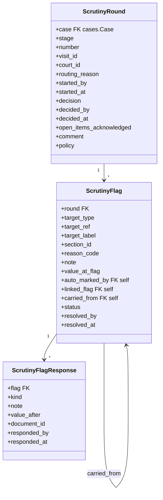
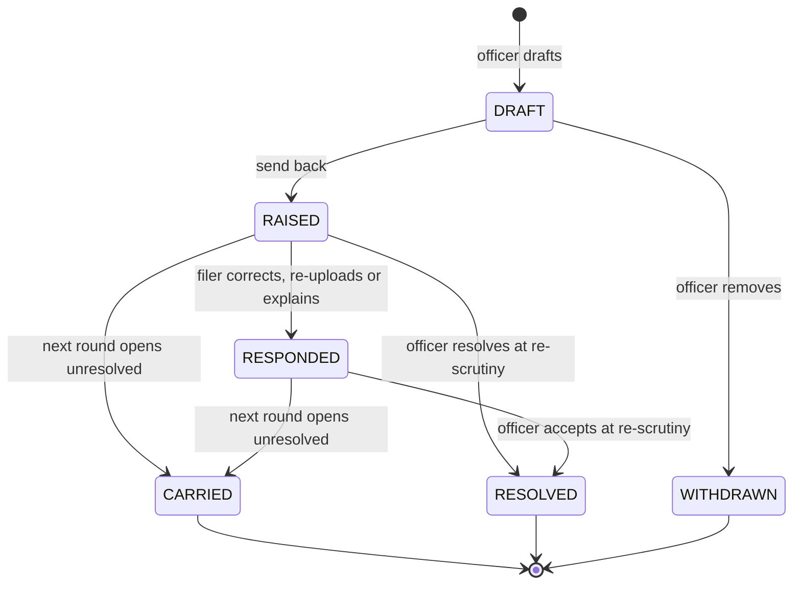

# 0024 — Scrutiny and Registration (`apps.scrutiny`)

## Status

Proposed

## References

- PRDs: `efiling-scrutiny-registration-handover.md` (§3 `ROLE-`, §4 `LIFE-`, §11 `JUR-`, §14 `DCM-`, §16 `DOC-`, §18 `SIG-07`, §19.4, §20 `SCR-`, `REF-`, `VAL-01/02`), `case-numbers.md`, `cognizance-cheat-sheet.md`, `pending-tasks-handover.md`, `case-lifecycle-handover.md`

> **Scope note.** This module owns the court's review of a filed complaint:
> rounds, flags, the filer's responses, and the three decisions — send back,
> forward, register — at the scrutiny and registration stages. It moves the
> case only through [`0011`](0011-case-workflows.md) and opens tasks only
> through its `TaskService`. Field values, documents, correction scope,
> signatures and case numbers stay in `apps.cases`.

## Context

A §138 complaint reaches the court when the filer has signed and paid. From
then it is checked for defects before it is registered and goes to the
magistrate for cognizance:

```text
paid ─> Scrutiny ──send back (flags)──> Pending Correction ─correct, re-sign, pay balance─┐
          │  ▲                                                                            │
          │  └────────────────────────── next round ─────────────────────────────────────┘
          │
          ├─ PIPELINE: MAGISTRATE ─ forward ─> Registration ─ register ─> Cognizance
          │                                       └─ send back (one comment)
          └─ PIPELINE: SCRUTINY ─── register ──────────────────────────> Cognizance
```

The court screens make the work concrete.

**Scrutinise submitted cases** — the scrutiny officer's list.

| Element | What it shows |
| --- | --- |
| Tabs | **With registry** (waiting on the court), **With advocate** (sent back), **Closed** (forwarded, registered, withdrawn), each with a count |
| Columns | Parties · Filing no. · Stage (*Awaiting scrutiny*, *Under scrutiny*, *Awaiting re-scrutiny*, *Sent back*, *Registered*) · Case type · Advocate · With (the officer working it) · Waiting (days) |
| Filters | search; *me / unassigned / anyone* |
| Reason line | why it is here: *Filer skipped a warning*, *Low read confidence*, *Random check*, *1 item open*, *All items answered* |

**Scrutiny detail** — one filing.

| Element | What it shows |
| --- | --- |
| Header | filing number, submitted date, parties, *Edit case title* |
| Fields tab | the filed values by section — Party Details, Case Details, Evidence — each with the document it was read from ("Read from Doc 4, Cheque (front) — MICR band") and, where available, a reading note ("Document shows a different value", "Couldn't read this in the document", "Not in any document", "No postal receipt uploaded") |
| Bundle tab | the numbered case bundle: generated synopsis, generated complaint, affidavit, cheque, return memo, demand notice, ID card, with a *Poor scan* badge where the upload was flagged |
| Documents tab | the document index |
| *What to check* | names match across cheque, ID and notice · cheque details match the instrument · notice within 30 days of return memo · filing within limitation or condonation prayed · jurisdiction consistent with addresses · signatures on complaint and affidavit · all documents legible and the right ones |
| Flag composer | a field or section flag with a *Note for the advocate*; a *Document issue* with *What's wrong* (*Blurry / unreadable*, *Page missing*, *Wrong document*) and a note; *Save both* links a field flag to its document's issue; *Flag the entire document instead* |
| Raised with | the flags in this round, split into *Flags — advocate fixes* and *Document issues — advocate re-uploads* |
| Case history · round N | *Filed → Routed to scrutiny → Scrutiny started · Biju B → Sent back with 3 items → Resubmitted · 2 of 3 items answered → Returned to scrutiny · 1 item contested → Scrutiny started …*, each item with what it was and what became of it ("corrected 13 Jul", "re-uploaded 30 Jul, still poor") |
| Actions | **Send back** — *Goes to the advocate as recorded. Each item unlocks what you marked.* **Register case** / forward — *N open items travel with it — registering does not clear them*, with *I have seen the open flags and choose to register* |

**Register cases** — the magistrate's list and detail.

| Element | What it shows |
| --- | --- |
| List | Case name · Filing number · Advocates · Days since submitted; sorted by waiting |
| Detail summary | parties; cheque (amount, number, drawn on); dishonour (presented at, return reason); demand notice (mode, tracking number, reply); cause of action (jurisdiction under S.142(2), other complaints between the parties); prayer (compensation, interim compensation under S.143A) |
| Scrutiny block | cleared by · rounds · took N days · *Show rounds* |
| Timeline | cheque dated → presented (*within 3 months of the cheque date*) → returned unpaid → notice sent (*within 30 days of the return*) → notice served → cause of action → complaint filed (*beyond 1 month of the cause of action*) → scrutiny → *waiting to be registered · N days since scrutiny cleared it* |
| Actions | **Register**, **Send back to scrutiny** |

The PRD fixes the rules:

* A case is on a list exactly while its pending task is open; tasks open and close only as side effects of lifecycle transitions (`SCR-09`, `SCR-10`).
* The officer may mark any field or section with a comment, and flag any document for re-upload (`SCR-02`, `SCR-03`).
* Marking a date in the chain marks every date downstream of it (`SCR-04`, `REF-03`). Delay that has arisen since filing is flagged to the officer (`SCR-05`, `REF-04`).
* Send back opens only what was marked (`REF-01`); a magistrate's send back is one overall comment and opens everything (`REF-02`). Send-backs repeat without limit (`LIFE-11`).
* Any edit invalidates all signatures; the corrected case is signed again as at filing (`LIFE-13`, `SIG-07`). The bill is recalculated: higher collects the balance, otherwise payment is skipped (`LIFE-12`).
* The officer's second action is *Forward* or *Register* by the court's `registration_point` (`SCR-06`, `SCR-11`, `SCR-12`). There is no outright rejection before registration (§20.3).
* Allocation is configurable per court establishment: a single courtroom in Kerala and Punjab, an institution-to-courtroom mapping with a fallback in Gujarat (§20.1).
* Practice differs by state — Kerala, Gujarat, Punjab & Haryana — in who scrutinises, where the case goes, and which numbers and checks apply (`case-numbers.md`, e-filing §20.1, process handover §13). This spec carries those differences as jurisdiction-bound business rules (#2).
* Registration assigns the case number and moves the case to Cognizance (`SCR-08`).
* After payment, the case is routed to a courtroom by a per-establishment rule (§20.1).

### What this module does and does not decide

`apps.scrutiny` knows **who looked at a filing, what they raised, what the filer
answered, and what was decided**. It does not hold field values or files —
those are the case's. It does not decide what is editable during correction —
it hands the scope to `apps.cases`. It does not number cases — `apps.cases`
does, in the registration transaction.

## Goals

* Route every paid filing to its courtroom and open the scrutiny officer's task.
* Carry every step that differs between Kerala, Gujarat and Punjab & Haryana — allocation, pipeline, who may act, advisory checks — as a business rule bound to a jurisdiction, evaluated by [`0019`](0019-business-rules.md), with a hard line between what rules decide and what code does.
* Record, on every round, which rules decided its steps and roles.
* Hold scrutiny as numbered rounds, one per entry into the scrutiny or registration state.
* Let the officer draft flags on fields, sections and documents, compose them across a session, and raise them all at once on send back.
* Auto-mark the dependent dates of the date chain, and alert the officer to newly applicable delay.
* Hand the exact correction scope to `apps.cases`, and record the filer's answer to every flag.
* Carry unresolved flags into the next round, and let them travel with the case when it is forwarded or registered by acknowledgement.
* Support both registration points and both magistrate send-backs per court.
* Assign the case number and move the case to cognizance in one transaction.
* Serve the scrutiny list, scrutiny detail, registration list, registration detail, round history and the filer's correction view.
* Expose REST APIs following [`0000`](0000-api-coding-spec.md), with registered error codes.

## Non-goals

* Machine reading of uploads, read-confidence scores and AI consistency checks. Readings are shown when another module supplies them (#7.2) and are never required.
* Field editing during correction, signing and payment — `apps.cases`, `apps.esign`, `apps.payments`.
* Case number formats (`case-numbers.md`) — this module only asks for one.
* Courtroom transfer between magistrates.
* Cognizance and the order screen.
* Notification copy (the PRD's master table).

---

## Proposed changes

### 1. App layout and boundaries

```text
apps/scrutiny/
├── apps.py                 # name = "apps.scrutiny"
├── models.py               # ScrutinyRound, ScrutinyFlag, ScrutinyFlagResponse
├── enums.py
├── errors.py               # E06xxx (#8.5)
├── receivers.py            # 0011 state_entered -> open round; cases field/document changed -> response
├── services/
│   ├── rounds.py           # open_round, start, decide (send back, forward, register)
│   ├── flags.py            # draft, edit, withdraw, resolve, auto-mark
│   └── responses.py        # record from case changes, explain
├── policy/
│   ├── models.py           # ScrutinyRuleBinding (imported into apps.scrutiny.models)
│   ├── contracts.py        # input/output JSON Schemas for the four decisions (#2.4)
│   ├── resolver.py         # binding resolution along the court hierarchy (#2.3)
│   ├── payloads.py         # builds each decision's input from case facts
│   └── service.py          # PolicyService: evaluate, snapshot, dry-run (#2.6, #2.8)
├── handlers.py             # AllocateCourtroomHandler (0011 automatic task)
├── assignees.py            # task-user resolvers registered with 0011 (#2.10)
├── management/commands/scrutiny_check_policies.py
├── selectors.py            # list rows, detail assembly, history
├── serializers.py · views.py · urls.py · permissions.py · admin.py
└── tests/
```

Dependency rules:

```text
apps.scrutiny ── imports ──> apps.workflows.services / selectors / signals
apps.scrutiny ── imports ──> apps.cases.selectors / services
apps.scrutiny ── imports ──> apps.core.rules.services (BusinessRuleService only)
apps.scrutiny ── imports ──> apps.organizations.selectors (court hierarchy, CourtMember)
apps.cases    ── never imports ──> apps.scrutiny
apps.workflows ── never imports ──> apps.scrutiny
```

Rules:

* Scrutiny learns that a case entered `scrutiny` or `registration` from [`0011`](0011-case-workflows.md) `state_entered`. It never polls.
* Scrutiny learns that the filer changed a field or replaced a document from the `case_field_changed` and `case_document_replaced` signals that `apps.cases` sends. Cases never calls scrutiny.
* Correction scope is stored on the case by `apps.cases.services.open_for_correction()`; the filing endpoints of [`0021`](0021-case-filing-api.md) check it there.
* The case number is assigned by `apps.cases.services.register_case()`; scrutiny calls it.
* An isolation test asserts the import rules.

#### 1.1 Contract `apps.cases` must expose

| Function | Used for |
| --- | --- |
| `selectors.get_case_summaries(case_ids)` | list rows: parties, filing number, case type, advocates, submitted date |
| `selectors.get_filing_view(case_id)` | the detail's sections, fields, values and source documents (#7.2) |
| `selectors.get_bundle(case_id)` | numbered bundle: generated synopsis and complaint, active documents, poor-scan marks |
| `selectors.get_registration_summary(case_id)` | the registration detail summary and timeline (#7.4) |
| `plugin.field_ids()`, `plugin.section_ids()` | validating flag targets (#3.2) |
| `plugin.date_chain()` | the dependency graph for auto-marking (#3.3) |
| `plugin.case_context(case)["delay_applicable"]` | delay alert (#3.4) |
| `plugin.checklist()` | *What to check* items |
| `plugin.check_facts(case)` | the `CHECKS` rule input (#2.4): dates, amounts, proof flags, complainant type — computed in code |
| `selectors.filing_establishment(case_id)` | the establishment the filer chose; `ALLOCATION` input |
| `services.open_for_correction(case_id, scope, round_id)` / `close_correction(case_id)` | correction scope (#5) |
| `services.register_case(case_id, actor)` | assigns the case number and `registered_at`; dispatches `CASE_REGISTERED` |
| `services.set_case_title(case_id, complainant, accused, actor)` | *Edit case title* |
| `services.set_court(case_id, courtroom_id, reason)` | courtroom routing (#2.9); cases stores, scrutiny decides |
| signals `case_field_changed`, `case_document_replaced` | filer responses (#5.2) |

### 2. Jurisdiction policy

Scrutiny is not the same in every state. Some steps exist in one state and not
in another, some are done by different people, and some are decided by
different criteria:

| Step | Kerala (Kollam) | Gujarat | Punjab & Haryana (Panchkula) | Source |
| --- | --- | --- | --- | --- |
| Courtroom allocation | single courtroom | institution → courtroom mapping, default fallback | single courtroom | e-filing §20.1 |
| Who scrutinises | scrutiny officer | scrutiny officer, one across five courtrooms; the Ahmedabad screens show a bench clerk | scrutiny officer | e-filing §20.1, screens |
| Who registers | magistrate (today's behaviour) | to confirm | to confirm | `SCR-11` |
| Case and filing numbers | `KL-…` filing, `CMP/n/YYYY` at registration | to confirm | NACT number at filing; CNR at the filing counter | `case-numbers.md` — owned by `apps.cases`, not a scrutiny rule |
| Magistrate's send back goes to | filer (PRD) | to confirm (screen: *Send back to scrutiny*) | to confirm | `SCR-08`, screens |
| Advisory checks shown | common set | common set | common set | `SCR-05`, `LIT-18a`; per-state additions to confirm |

The table will grow and change as each state's practice is confirmed. Baking it
into code, or into string settings, would mean a release, or an untyped value,
for every change. So every step that varies is a **decision point**, and every
decision point is a **business rule** evaluated by the business rules module of
[`0019`](0019-business-rules.md). A rule is bound to a jurisdiction, so Kerala,
Gujarat and Punjab & Haryana each get their own rule for the same decision.

#### 2.1 Boundary: rules decide, code acts

| Concern | Decided by | Done by | Never |
| --- | --- | --- | --- |
| Which steps a case goes through (`registration_point`, send-back target) | rule `PIPELINE` | `services.rounds` choosing the workflow transition | a rule moving a case, or the workflow guessing the step |
| Who may take each action (role selection) | rule `ROLES` — designations per action | `permissions.py` checking `CourtMember` of the case's court | a rule naming a user, or granting a court-side action to the filing side |
| Which courtroom gets the case | rule `ALLOCATION` | `apps.cases.services.set_court()` | a rule querying the database (the mapping is the rule's own decision table); the filer choosing |
| Which advisory checks the officer sees | rule `CHECKS` | `selectors` attaching alerts to fields | a check blocking an action |
| What is opened for correction | code, from the flags (`REF-01`–`REF-06`) | `apps.cases.services.open_for_correction()` | a rule widening or narrowing the scope |
| Legal facts (dates, delay, limitation) | code — the case-type plugin (`date_chain`, `delay_applicable`) | passed to rules as input | a rule recomputing the law |
| Case number format | `apps.cases` (`case-numbers.md`) | `register_case()` | scrutiny |

Rules are pure: plain data in, plain data out, no I/O ([`0019`](0019-business-rules.md)
#4.1). Everything a rule needs is assembled by the caller and declared in the
rule's input schema. Everything a rule returns is validated against its output
schema before this module acts on it. A rule that fails, or returns the wrong
shape, stops the action with an error; it never silently falls back to a
default (#2.7).

Some things are **not** policy and no rule can change them:

* Only court staff of the case's court act on scrutiny. Rules choose among court designations, never filing-side roles.
* Only a `MAGISTRATE` acts at the registration stage, if the pipeline has one.
* A send back by scrutiny opens only what was flagged; a magistrate's send back opens everything (`REF-01`, `REF-02`).
* There is no rejection before registration (§20.3).
* Unresolved flags travel with the case when it is forwarded or registered.

#### 2.2 Decision points

| Decision | When evaluated | Output used for |
| --- | --- | --- |
| `ALLOCATION` | first entry into `scrutiny` | the courtroom |
| `PIPELINE` | every round opening | forward or register; where a magistrate's send back goes |
| `ROLES` | every round opening | who may start, flag, send back, forward, register, edit the title; who gets the stage's task |
| `CHECKS` | every detail read (it depends on today's date) | alerts on the detail screen |

`ALLOCATION`, `PIPELINE` and `ROLES` are evaluated once per round and frozen on
the round as its **policy snapshot** (#2.6). `CHECKS` is evaluated per read and
not stored.

#### 2.3 Binding a rule to a jurisdiction

[`0019`](0019-business-rules.md) stores one rule per `code` and deliberately
has no per-organization variants. Choosing which code applies where is the
consumer's job, so this module owns the binding.

`ScrutinyRuleBinding` — `BaseModel`, `BaseActivatableModel`, `BaseAuditableModel`

| Field | Type | Notes |
| --- | --- | --- |
| `decision` | `CharField(16, choices=Decision)` | `ALLOCATION`, `PIPELINE`, `ROLES`, `CHECKS` |
| `organization` | `FK("organizations.Organization", null=True, on_delete=PROTECT)` | the court, district court or High Court the binding applies to; `NULL` is the national default |
| `rule_code` | `CharField(50)` | a `BusinessRule.code` |
| `note` | `CharField(255, blank=True)` | why this jurisdiction differs |

`UniqueConstraint(decision, organization, condition=Q(is_active=True))`;
`UniqueConstraint(decision, condition=Q(organization__isnull=True, is_active=True))`.

**Resolution.** For a case in court *C*, the binding for a decision is the
first active one found on *C*, then on each ancestor of *C* from nearest to
farthest (`Organization.get_ancestors()`), then the national default. The
organization tree already carries the hierarchy: courtroom → establishment
(district court) → High Court. A state's practice is therefore bound once, on
its High Court, and an establishment or a single courtroom can override it.
Punjab and Haryana share one High Court, which is why the PRDs record them
together; if they diverge, each is bound on its own establishments.

Before allocation the case has no courtroom. `ALLOCATION` is resolved from the
**filing establishment** the filer chose (`JUR` section), so it can be bound on
that establishment or its High Court.

No binding at all for a decision is `500 E06014` and a failing system check
(#2.8). Every deployment ships a national default for each decision.

#### 2.4 Rule contracts

Each decision has a fixed input and output contract, declared here and
enforced twice: the bound rule's `rule_input_schema` and `rule_output_schema`
must accept it (#2.8), and this module validates the output again before using
it. All four rule codes start with `SCRUTINY_`; the suffix names the
jurisdiction, for example `SCRUTINY_PIPELINE_DEFAULT`, `SCRUTINY_ALLOCATION_GJ_HC`.

**`ALLOCATION`**

```json
// input
{
  "establishment_code": "AHM_CITY_CIVIL_SESSIONS",
  "courtroom_codes": ["AHM_CR_01", "AHM_CR_02", "AHM_CR_03", "AHM_CR_04", "AHM_CR_05"],
  "case_type": "CHEQUE_BOUNCE",
  "complainant_type": "INSTITUTION",
  "complainant_institution_code": "HDFC_BANK",
  "complainant_institution_name": "HDFC Bank Ltd"
}
// output
{ "courtroom_code": "AHM_CR_03", "reason": "INSTITUTION_MAPPING" }
```

`courtroom_code` must be one of `courtroom_codes`. `reason` is one of
`SINGLE_COURTROOM`, `INSTITUTION_MAPPING`, `DEFAULT_FALLBACK` and is recorded on
the round.

**`PIPELINE`**

```json
// input
{ "case_type": "CHEQUE_BOUNCE", "court_code": "KLKM_24X7_ON", "round_number": 2, "stage": "SCRUTINY" }
// output
{ "registration_point": "MAGISTRATE", "registration_send_back_to": "FILER" }
```

`registration_point` ∈ `MAGISTRATE`, `SCRUTINY` (`SCR-11`).
`registration_send_back_to` ∈ `FILER`, `SCRUTINY` (#6.3).

**`ROLES`**

```json
// input
{ "case_type": "CHEQUE_BOUNCE", "court_code": "AHM_CR_03", "stage": "SCRUTINY" }
// output
{
  "scrutinise":  ["SCRUTINY_OFFICER", "BENCH_CLERK"],
  "send_back":   ["SCRUTINY_OFFICER", "BENCH_CLERK"],
  "decide":      ["SCRUTINY_OFFICER"],
  "edit_title":  ["SCRUTINY_OFFICER", "BENCH_CLERK"]
}
```

* `scrutinise` — start, draft and withdraw flags, resolve; also who receives the *Scrutinise case* task.
* `send_back` — send back at the scrutiny stage.
* `decide` — forward, or register when `registration_point = SCRUTINY`.
* `edit_title` — *Edit case title*.

Every list is non-empty and holds only `CourtMember` designations
(`SCRUTINY_OFFICER`, `BENCH_CLERK`, `TYPIST`, `MAGISTRATE`); the output schema
pins the enum. `ROLES` applies to the scrutiny stage only; the registration
stage is always `MAGISTRATE` (#2.1).

**`CHECKS`**

```json
// input — facts computed by the case-type plugin, never by the rule
{
  "case_type": "CHEQUE_BOUNCE",
  "today": "2026-08-03",
  "cheques": [
    { "index": 0, "cheque_date": "2019-04-05", "presented_on": "2016-04-04", "returned_on": "2016-04-04",
      "amount": 5205000, "return_reason": "FUNDS_INSUFFICIENT" }
  ],
  "notice": { "dispatched_on": "2016-04-12", "served_on": "2016-04-14", "delivered": true,
              "postal_receipt_uploaded": false, "delivery_proof_uploaded": false },
  "cause_of_action_on": "2016-04-28",
  "filed_on": "2026-07-04",
  "delay_applicable": true,
  "delay_prayer_present": true,
  "complainant_is_institution": true,
  "complainant_cin_or_pan_present": false,
  "accused_resides_within_jurisdiction": null
}
// output
{
  "alerts": [
    { "code": "PRESENTED_BEFORE_CHEQUE_DATE", "severity": "WARNING", "field_refs": ["CHQ-1[0]", "CHQ-8[0]"],
      "message": "Presented before the date on the cheque." },
    { "code": "NO_POSTAL_RECEIPT", "severity": "INFO", "field_refs": ["LDN-3"],
      "message": "No postal receipt uploaded." }
  ]
}
```

`severity` ∈ `INFO`, `WARNING`. Alerts are advisory: they are shown next to
their fields and in the *What to check* panel, and the officer may draft a
flag from one, but no alert ever blocks an action. This keeps the PRD's posture
that validations warn and never block, and that facts such as residence within
jurisdiction are information for the court's judgment (`ACC-24`).

The common checks every default ships with:

| Code | Rule |
| --- | --- |
| `PRESENTED_BEFORE_CHEQUE_DATE` | presented before the date on the cheque |
| `PRESENTED_AFTER_VALIDITY` | presented more than 3 months after the date on the cheque |
| `NOTICE_AFTER_30_DAYS` | notice dispatched more than 30 days after the return memo |
| `DELAY_WITHOUT_PRAYER` | `delay_applicable` and no condonation prayer (`SCR-05`) |
| `NON_FUNDS_RETURN_REASON` | return reason other than insufficiency of funds — check S.138 applies |
| `NO_POSTAL_RECEIPT`, `NO_DELIVERY_PROOF` | proof of dispatch or service not uploaded |
| `INSTITUTION_WITHOUT_CIN_OR_PAN` | institutional complainant filed without CIN or PAN (`LIT-18a`) |

A state adds, removes or re-grades checks by binding its own `CHECKS` rule.

#### 2.5 Engines

| Decision | Default engine | Why |
| --- | --- | --- |
| `ALLOCATION` | `gorules` decision table | the institution → courtroom mapping is a table that court administrators maintain; one row per institution, a fallback row last |
| `PIPELINE` | `rule_engine` expression | a constant, or a small condition, per jurisdiction |
| `ROLES` | `rule_engine` expression | a constant mapping per jurisdiction |
| `CHECKS` | `gorules` decision table, collect hit policy | each row is one check; adding a check is adding a row |

The Gujarat allocation table replaces the separate allocation model this spec
proposed earlier: the mapping is the decision, so it lives in the rule and is
edited, versioned and audited with it ([`0019`](0019-business-rules.md) #3,
#9).

Examples of bound rules:

| Code | Bound on | Engine | Expression / table |
| --- | --- | --- | --- |
| `SCRUTINY_PIPELINE_DEFAULT` | national default | `rule_engine` | `{"registration_point": "MAGISTRATE", "registration_send_back_to": "FILER"}` |
| `SCRUTINY_ROLES_DEFAULT` | national default | `rule_engine` | every action → `["SCRUTINY_OFFICER"]` |
| `SCRUTINY_ALLOCATION_SINGLE` | Kerala HC; P&H HC | `rule_engine` | `{"courtroom_code": courtroom_codes[0], "reason": "SINGLE_COURTROOM"}` |
| `SCRUTINY_ALLOCATION_GJ_HC` | Gujarat HC | `gorules` | `complainant_institution_code` → `courtroom_code`; last row: default courtroom, `DEFAULT_FALLBACK` |
| `SCRUTINY_CHECKS_DEFAULT` | national default | `gorules` | the common checks |

`SCRUTINY_ALLOCATION_SINGLE` refuses an establishment with more than one
courtroom by returning an output that fails its schema (`minItems`/`maxItems`
on `courtroom_codes` in its input schema), so a misbinding is caught at once.

#### 2.6 Policy snapshot

When a round opens (#4.1), the module resolves and evaluates `PIPELINE` and
`ROLES` (and `ALLOCATION` on the first round) and stores the result on the
round:

```json
"policy": {
  "pipeline":   { "registration_point": "MAGISTRATE", "registration_send_back_to": "FILER" },
  "roles":      { "scrutinise": ["SCRUTINY_OFFICER"], "send_back": ["SCRUTINY_OFFICER"],
                  "decide": ["SCRUTINY_OFFICER"], "edit_title": ["SCRUTINY_OFFICER"] },
  "allocation": { "courtroom_code": "KLKM_24X7_ON", "reason": "SINGLE_COURTROOM" },
  "rules": [
    { "decision": "PIPELINE", "code": "SCRUTINY_PIPELINE_DEFAULT", "binding_id": "…", "history_id": 41 },
    { "decision": "ROLES", "code": "SCRUTINY_ROLES_DEFAULT", "binding_id": "…", "history_id": 12 }
  ]
}
```

Every decision and permission check in the round reads the snapshot, never
re-evaluates. So:

* a rule edited mid-round does not change what the officer is allowed to do in that round; it applies from the next round;
* the round records which rule, and which version of it (`history_id` from the rule's history table), decided its steps and roles — [`0019`](0019-business-rules.md) #3 asks callers to keep the decision because rules have no version column.

#### 2.7 Failures

| Failure | Result |
| --- | --- |
| no binding resolves | `500 E06014`; round not opened, logged at error |
| `RuleNotFound` (bound code missing or inactive) | `500 E06014` |
| `RuleInputError` | `500 E06015` — the caller assembled a bad payload; a bug |
| `RuleEvaluationError`, `RuleOutputError` | `500 E06015` |
| output passes the rule's schema but not this module's contract (unknown designation, courtroom not in the list) | `500 E06015` |

Round opening runs on `state_entered`, after the case has already moved. A
failure there leaves the case in `scrutiny` with no open round; the detail
returns `409 E06016` and the admin action *Re-open round* retries once the
rule is fixed. `CHECKS` failures do not block the screen: the detail returns
the fields without alerts and an alert `CHECKS_UNAVAILABLE`.

#### 2.8 Validating bindings

* Saving a binding in admin dry-runs the rule through `BusinessRuleService.dry_run()` with the decision's sample input and validates the output against this module's contract. A rule whose contract does not fit cannot be bound.
* `manage.py scrutiny_check_policies` resolves every decision for every active court and reports courts with no binding, bindings to inactive rules, and dry-run failures. It reads the database, so it is a command, not a Django system check ([`0019`](0019-business-rules.md) #4.6: nothing in `ready()` touches the database). CI runs it against the seeded fixtures.
* Rules and default bindings are seeded by data migration.

#### 2.9 Routing

When the case first enters `scrutiny`, the inline automatic task
`allocate_courtroom` ([`0011`](0011-case-workflows.md) #10.1, handler
`apps.scrutiny.handlers.AllocateCourtroomHandler`, `execution_order = 0`):

1. resolves and evaluates `ALLOCATION` for the filing establishment;
2. calls `apps.cases.services.set_court(case_id, courtroom_id, reason)`;
3. returns the result, which the round stores in its policy snapshot.

The *Scrutinise case* task opens after it in the same transaction. Its users
come from the `scrutiny.scrutinise_case` users resolver (#2.10). The filer
never chooses a courtroom, and later rounds keep the court. One officer may
serve several courtrooms; they pick the courtroom they are working in after
login and see its tasks (account creation `REG-35`–`REG-37`).

#### 2.10 Task users from the policy

The stage tasks must reach the people the policy names, not a fixed
designation. [`0011`](0011-case-workflows.md) #7.3 resolves task users from a
template's rule; this module registers two resolvers with it:

| Resolver | Resolves to |
| --- | --- |
| `scrutiny.scrutinise_case` | active `CourtMember`s of the case's court whose designation is in `ROLES.scrutinise` |
| `scrutiny.register_case` | active `MAGISTRATE` `CourtMember`s of the case's court |

`scrutiny.scrutinise_case` evaluates `ROLES` itself when the round has not yet
been opened (the task opens in the transition's transaction, the round on
commit); the round then snapshots the same result.


### 3. Data model



All models inherit `apps.core.models.BaseModel` and `BaseAuditableModel`.
Every bounded enum is a `TextChoices` in `apps/scrutiny/enums.py`.

#### 3.1 `ScrutinyRound`

One per entry of the case into `scrutiny` or `registration`.

| Field | Type | Notes |
| --- | --- | --- |
| `case` | `FK("cases.Case", on_delete=PROTECT, related_name="scrutiny_rounds")` | |
| `stage` | `CharField(16, choices=RoundStage)` | `SCRUTINY`, `REGISTRATION` |
| `number` | `PositiveSmallIntegerField` | the [`0011`](0011-case-workflows.md) visit number of that state — round 1, 2, 3 |
| `visit_id` | `UUIDField(unique=True)` | the workflow visit |
| `court_id` | `UUIDField(db_index=True)` | |
| `routing_reason` | `CharField(32, choices=RoutingReason, blank=True)` | `FILER_SKIPPED_WARNING`, `LOW_READ_CONFIDENCE`, `NOT_MACHINE_READ`, `RANDOM_CHECK`, `RESUBMITTED`, `RETURNED_BY_MAGISTRATE`; display only (question 1) |
| `started_by` / `started_at` | `FK(User, null=True)` / `DateTimeField(null=True)` | first *start* |
| `decision` | `CharField(16, choices=RoundDecision, blank=True)` | `SENT_BACK`, `FORWARDED`, `REGISTERED`, `RETURNED_TO_SCRUTINY`; empty while open |
| `decided_by` / `decided_at` | | |
| `open_items_acknowledged` | `BooleanField(default=False)` | forwarded or registered with unresolved flags |
| `open_items_at_decision` | `PositiveSmallIntegerField(default=0)` | how many |
| `comment` | `TextField(blank=True)` | the magistrate's overall comment on a registration send back (`REF-02`) |
| `policy` | `JSONField` | the policy snapshot (#2.6): pipeline, roles, allocation, and the rule codes and history ids that produced them; immutable once the round is open |

Constraints: `UniqueConstraint(case, stage, number)`;
`UniqueConstraint(case, condition=Q(decision=""))` — one open round per case.

#### 3.2 `ScrutinyFlag`

| Field | Type | Notes |
| --- | --- | --- |
| `round` | `FK(ScrutinyRound, on_delete=CASCADE, related_name="flags")` | |
| `target_type` | `CharField(16, choices=FlagTarget)` | `FIELD`, `SECTION`, `DOCUMENT` |
| `target_ref` | `CharField(128)` | `FIELD`: PRD field id with record index, e.g. `CHQ-9[0]` (cheque 1's return date), `ACC-1[1]` (accused 2's name); `SECTION`: section code, e.g. `LDN`, `JUR`; `DOCUMENT`: `case_document_id` |
| `target_label` | `CharField(255)` | snapshot for history, e.g. "Cheque amount" |
| `section_id` | `CharField(16)` | the section the target sits in, for grouping |
| `reason_code` | `CharField(32, choices=DocumentIssue, blank=True)` | documents only: `BLURRY_UNREADABLE`, `PAGE_MISSING`, `WRONG_DOCUMENT`, `OTHER` |
| `note` | `TextField(blank=True)` | the note for the advocate |
| `value_at_flag` | `JSONField(null=True)` | the field's value when flagged, so history shows "₹52,05,000 → ₹50,25,000" |
| `auto_marked_by` | `FK("self", null=True, on_delete=CASCADE)` | dates marked by the chain (#3.3) |
| `linked_flag` | `FK("self", null=True, on_delete=SET_NULL)` | a field flag and its document issue saved together |
| `carried_from` | `FK("self", null=True, on_delete=PROTECT)` | the same item, still unresolved, in the previous round |
| `status` | `CharField(16, choices=FlagStatus)` | #3.5 |
| `resolved_by` / `resolved_at` | | |

`UniqueConstraint(round, target_type, target_ref, condition=~Q(status=WITHDRAWN))`
— one live flag per target per round.

Target validation, at draft time:

* `FIELD` — the id is one the case type defines (`plugin.field_ids()`) and the record index exists on the case (there is a cheque 2, an accused 3). Section ids follow the filing form: `LIT`, `ADV`, `ACC`, `CHQ`, `LDN`, `JUR`, `PRY`, `WIT`, `DCM`, `OTH`.
* `SECTION` — the id is one of those sections.
* `DOCUMENT` — an active `CaseDocument` of the case. Generated documents (synopsis, complaint) cannot be flagged; the fields that render into them are flagged instead (`DOC-01`).
* `FIELD` and `SECTION` need a `note`; `DOCUMENT` needs a `reason_code` or a `note`. The screen's warning — *No note — the advocate won't know what to fix* — is a rule here (`E06004`).

#### 3.3 Date chain

The plugin publishes the chain as a dependency graph (`VAL-01/02`):

```text
CHQ-1 date on cheque
 └─ CHQ-8 presentation
     └─ CHQ-9 return
         └─ LDN-2 dispatch of demand notice
             ├─ LDN-6 delivery        (delivered = Yes)
             └─ LDN-7 return          (delivered = No)
                 └─ JUR-9 cause of action (service + 15 days)
                     └─ JUR-10 filing date
                         └─ JUR-11 delay
```

Drafting a `FIELD` flag on a node drafts flags on every transitive downstream
node that applies to the case (`LDN-6` or `LDN-7`, not both), with
`auto_marked_by` set and the note "Marked because {source label} was flagged".
Cheque dates follow their own cheque: flagging `CHQ-8[1]` marks `CHQ-9[1]`, then
the notice dates that cheque's notice covers.

Withdrawing the source withdraws its auto-marked children, except any the
officer edited (gave its own note). Auto-marked flags exist so that the filer
can edit the dependent dates without failing the ordering validations
(`REF-03`); they count as one item in the send-back message.

#### 3.4 Delay alert

On every detail read, `delay_applicable` is computed by the case-type plugin
against **today**, never cached (`REF-04`), and passed to the `CHECKS` rule.
When it is true and the filing carries no delay condonation prayer (`JUR-12`
empty), the default rule returns `DELAY_WITHOUT_PRAYER` (#2.4). The rule only
reports the fact; whether delay applies is the law, and stays in code.

On send back the `JUR` delay fields are added to the scope as required
(`REF-05`, `REF-06`), whether or not the officer flagged them. The added DCA fee
is collected on resubmission through `case.balance_due` (`LIFE-12`).

#### 3.5 Flag lifecycle



* `DRAFT` — visible to court staff only; freely edited or withdrawn. Nothing reaches the filer piecemeal.
* `RAISED` — sent to the filer. Never edited or deleted after.
* `RESPONDED` — the filer acted on it (#5.2).
* `RESOLVED` — the officer is satisfied.
* `CARRIED` — closed in this round because a new round opened with a copy (`carried_from`) as `DRAFT`. The chain of copies is the item's history across rounds.
* `WITHDRAWN` — a draft removed.

Removing a field flag never removes its linked document issue (*"Flag removed.
The document issue … stays."*), and vice versa.

#### 3.6 `ScrutinyFlagResponse`

| Field | Type | Notes |
| --- | --- | --- |
| `flag` | `FK(ScrutinyFlag, on_delete=CASCADE, related_name="responses")` | |
| `kind` | `CharField(16, choices=ResponseKind)` | `CORRECTED` (value changed), `REUPLOADED` (document replaced), `EXPLAINED` (no change, with a note) |
| `note` | `TextField(blank=True)` | required for `EXPLAINED` |
| `value_after` | `JSONField(null=True)` | `CORRECTED` |
| `document_id` | `UUIDField(null=True)` | `REUPLOADED`: the new `CaseDocument` |
| `responded_by` / `responded_at` | | |

A flag may get several responses within one correction (edited twice); history
shows the last. An `EXPLAINED` flag is shown to the court as **contested**.

### 4. Rounds and decisions

All decisions go through `apps.scrutiny.services.rounds`. Each takes
`select_for_update()` on the open round, checks the actor (#8.4), completes the
stage's task through `TaskService`, and calls `CaseWorkflowService.move_case`
with the round in `context`, in one transaction. Endpoints accept
`If-Match: <workflow version>`; a stale version is `412 E05005`.

#### 4.1 Opening a round

On `state_entered` for `scrutiny` or `registration`:

1. Create the round with `stage`, `number = visit_number`, `visit_id`, `court_id`, and `routing_reason` — the filing's own reason on round 1, `RESUBMITTED` when the case came back from correction, `RETURNED_BY_MAGISTRATE` when the magistrate sent it back to scrutiny.
2. Evaluate the policy and store the snapshot (#2.6): `PIPELINE` and `ROLES` for a scrutiny round; `PIPELINE` only for a registration round, whose roles are always `MAGISTRATE`. Round 1 also stores the `ALLOCATION` result from the routing handler. A failure follows #2.7.
3. Copy forward every flag of the previous round of either stage that is `RAISED` or `RESPONDED`: the old flag becomes `CARRIED`; the new one is `DRAFT` with `carried_from`, the same target, note and reason, and the old responses visible through the chain.
4. Close correction scope on the case (`close_correction`).

The receiver is idempotent on `visit_id`.

#### 4.2 Start

`POST /scrutiny/{case_id}/start/` — sets `started_by`, `started_at` on the first
call and claims the stage's task ([`0011`](0011-case-workflows.md) #7.4). The
list then shows *Under scrutiny · with {name}*. Repeat calls by the same user do
nothing; another user may start too, which claims with `take_over`.

#### 4.3 Send back (scrutiny stage)

```json
POST /api/v1/scrutiny/{case_id}/send-back/
If-Match: 9
{}
```

1. At least one live `DRAFT` flag (`400 E06005`).
2. Every `DRAFT` flag becomes `RAISED`.
3. **Scope** = the targets of the raised flags (fields, sections, documents), their auto-marked dates, and the delay section when the alert is on (#3.4) (`REF-01`, `REF-03`–`REF-06`).
4. `apps.cases.services.open_for_correction(case_id, scope, round_id)`.
5. Complete *Scrutinise case*; `move_case(case, "send_back", context={"round_id", "item_count"})` → `pending_correction`; `decision = SENT_BACK`.
6. The engine opens *Correct defects* for the filer's side; on commit the filer side is notified with the item count.

#### 4.4 Forward and register (scrutiny stage)

```json
POST /api/v1/scrutiny/{case_id}/forward/      (policy.pipeline.registration_point = MAGISTRATE)
POST /api/v1/scrutiny/{case_id}/register/     (policy.pipeline.registration_point = SCRUTINY)
{ "acknowledge_open_items": true }
```

1. The action must match the round's `policy.pipeline.registration_point` (`409 E06007`), and the actor's designation must be in `policy.roles.decide` (`403 E06008`). The service passes `context={"registration_point": …}` to `move_case`, and the workflow's transition conditions check it ([`0011`](0011-case-workflows.md) #10.2): the policy decides, the workflow enforces.
2. Unresolved flags — carried drafts and anything `RAISED`/`RESPONDED` — need `acknowledge_open_items = true` (`409 E06006` with the count). They are not cleared: they **travel with the case**, recorded in `open_items_at_decision`, and appear on the registration round and the cognizance screen.
3. Other remaining `DRAFT` flags (never sent) are withdrawn.
4. Forward: complete the task; `move_case(case, "forward")` → `registration`; `decision = FORWARDED`. A registration-stage round opens for the magistrate (`SCR-07`).
5. Register: complete the task; `apps.cases.services.register_case(case_id, actor)` assigns the case number (`case-numbers.md`, today `CMP/[n]/[YYYY]` per courtroom in Kerala) and `registered_at`; `move_case(case, "register_at_scrutiny")` → `cognizance`; `decision = REGISTERED` (`SCR-12`). The engine opens the magistrate's *Take Cognizance* task.

There is no reject action (§20.3). A complaint that should not proceed is
registered and dismissed by order at cognizance.

#### 4.5 Re-scrutiny

When the corrected case returns, round *N+1* opens (#4.1). For each carried
item the detail shows what was raised and every response. The officer:

* **resolves** it — `POST /scrutiny/{case_id}/flags/{flag_id}/resolve/` on the carried draft marks it and its whole `carried_from` chain `RESOLVED`; or
* **keeps** it — leaves it as a draft, editing the note if needed, so it is raised again on the next send back.

A carried item counts as unresolved until resolved. The list shows *Awaiting
re-scrutiny* with "All items answered" or "N items contested" until the round
is started.

#### 4.6 Edit case title

`PATCH /scrutiny/{case_id}/title/` with `complainant` and `accused` display
names calls `apps.cases.services.set_case_title`. Recorded in the round's
history. Allowed to scrutiny staff in an open round of either stage.

### 5. Correction

#### 5.1 Scope

`open_for_correction(case_id, scope, round_id)` stores on the case:

```json
{
  "round_id": "…",
  "mode": "MARKED",
  "fields": ["CHQ-8[0]", "CHQ-9[0]", "LDN-2[0]", "LDN-6[0]", "JUR-9", "JUR-10", "JUR-11"],
  "sections": ["LDN"],
  "documents": ["8c1e…"],
  "required": ["JUR-12"]
}
```

`mode = ALL` for a magistrate send back opens everything (`REF-02`). While the
case is in `pending_correction`, the filing endpoints accept writes only inside
the scope and refuse the rest with the cases module's own
`FIELD_NOT_OPEN_FOR_CORRECTION` error. A flagged document may be replaced; an
unflagged one may not.

#### 5.2 Responses

* Each write by the filer to an open field sends `case_field_changed(case_id, field_ref, old, new, actor)`. The receiver records a `CORRECTED` response on the matching raised flag (or the section flag that contains it) and moves the flag to `RESPONDED`.
* Replacing a flagged document sends `case_document_replaced(case_id, old_document_id, new_document_id, actor)` → `REUPLOADED`.
* The filer may answer a flag without changing anything: `POST /cases/{case_id}/corrections/{flag_id}/explain/` with a `note` → `EXPLAINED`.

#### 5.3 Resubmission

`POST /cases/{case_id}/corrections/submit/` (owned here, because the gate is
about flags):

1. The case is in `pending_correction` and its latest round was sent back by scrutiny or the magistrate.
2. At least one flag has a response, or, for `mode = ALL`, at least one change (`409 E06012`). Unanswered flags may remain; they travel to re-scrutiny as unanswered.
3. Complete *Correct defects*; `move_case(case, "submit_correction")` → `pending_signature`.

What follows is the engine's ([`0011`](0011-case-workflows.md) #10.2): every
signatory signs again as at filing (`LIFE-13`, `SIG-07`), then `ALL_SIGNED`
sends the case to `pending_payment` if the recalculated bill is higher, else
straight to `scrutiny` (`LIFE-12`).

### 6. Registration stage

Applies when the pipeline's `registration_point = MAGISTRATE` (`SCR-07`,
`SCR-08`). Under `SCRUTINY` it never occurs. Every action in this stage needs
`MAGISTRATE`; no rule changes that (#2.1).

#### 6.1 Register

```json
POST /api/v1/registration/{case_id}/register/
{ "acknowledge_open_items": true }
```

Same open-item rule as #4.4. `register_case`, then `move_case(case,
"register")` → `cognizance`; the round's `decision = REGISTERED`.

#### 6.2 Send back

```json
POST /api/v1/registration/{case_id}/send-back/
{ "comment": "Affidavit is for a different cheque. Re-check the whole complaint." }
```

One overall comment, required; no field marking (`REF-02`, `E06010`).

#### 6.3 Where the send back goes

The PRD says the magistrate sends the case back to the filer with everything
open (`SCR-08`). The *Register cases* screen labels the action **Send back to
scrutiny**. Both are supported, chosen by the round's
`policy.pipeline.registration_send_back_to` (#2.4), which the service passes to
`move_case` in `context`:

| Value | Effect |
| --- | --- |
| `FILER` (default rule, PRD) | `open_for_correction(mode = ALL)`; `move_case(case, "registration_send_back")` → `pending_correction`; `decision = SENT_BACK` |
| `SCRUTINY` (screen) | `move_case(case, "registration_return_to_scrutiny")` → `scrutiny`; `decision = RETURNED_TO_SCRUTINY`; the comment is shown on the new scrutiny round, which opens with `routing_reason = RETURNED_BY_MAGISTRATE` |

Question 3 asks which is right.

### 7. Read models

#### 7.1 Scrutiny list

`GET /api/v1/scrutiny/?court=&tab=registry&claimed=anyone&search=&page=`

| Tab | Rows |
| --- | --- |
| `registry` | open *Scrutinise case* tasks of the court |
| `advocate` | cases of the court whose latest round was sent back and that have not re-entered scrutiny — in correction, re-signing or paying the balance |
| `closed` | rounds of the court decided `FORWARDED` or `REGISTERED`, and cases withdrawn after scrutiny, in the last `scrutiny.closed_tab_days` days |

```json
{
  "count": 6,
  "counts": { "registry": 6, "advocate": 3, "closed": 2 },
  "results": [
    {
      "case_id": "a91e…",
      "filing_number": "F/AHM/2026/00341",
      "parties": "Prateek Agrawal v. Deepak Choudhary",
      "case_type": { "key": "CHEQUE_BOUNCE", "label": "S.138 NI Act" },
      "stage": "UNDER_SCRUTINY",
      "stage_label": "Under scrutiny",
      "reason": "1 item open",
      "advocate": "Adv. Bijini Rejen",
      "with": { "id": "…", "name": "Biju B" },
      "waiting_days": 2,
      "round": 3,
      "task_id": "…"
    }
  ],
  "meta": { "...": "standard envelope" }
}
```

| `stage` | When |
| --- | --- |
| `AWAITING_SCRUTINY` | round 1, not started |
| `UNDER_SCRUTINY` | started |
| `AWAITING_RESCRUTINY` | round > 1, not started |
| `SENT_BACK` | advocate tab |
| `FORWARDED`, `REGISTERED`, `WITHDRAWN` | closed tab |

`reason`: the routing reason on an unstarted round 1; "N items open" when
carried items exist; "All items answered" / "N items contested" on an unstarted
re-scrutiny; the case number on a registered row. `waiting_days` counts from the
task's creation (registry), the send back (advocate) or the decision (closed).
`claimed` is `me`, `unassigned` or `anyone`. Default order: longest waiting,
then filing number. Case columns come from one batched
`get_case_summaries` call.

#### 7.2 Scrutiny detail

`GET /api/v1/scrutiny/{case_id}/`

```json
{
  "case": { "id": "…", "filing_number": "F/AHM/2026/00341", "parties": "Prateek Agrawal v. Deepak Choudhary",
            "submitted_at": "2026-07-04", "advocate": "Adv. Bijini Rejen" },
  "round": { "id": "…", "stage": "SCRUTINY", "number": 3, "started_by": { "name": "Biju B" },
             "summary": "3 rounds · 1 item open since 7 Jul" },
  "sections": [
    { "id": "CHQ", "title": "Cheque Details", "groups": [
      { "title": "Cheque 1", "fields": [
        { "ref": "CHQ-3[0]", "label": "Amount", "value": "₹ 52,05,000",
          "source_document_id": "…", "source_note": "Cheque (front)",
          "reading": { "status": "MISMATCH", "value": "₹ 50,25,000" },
          "flag_id": null }
      ] }
    ] }
  ],
  "bundle": [
    { "no": 1, "kind": "GENERATED", "name": "Synopsis", "document_id": "…" },
    { "no": 3, "kind": "SCAN", "name": "Affidavit (scanned & signed)", "document_id": "…", "poor_scan": true, "flag_id": "…" }
  ],
  "checklist": ["Names match across cheque, ID and notice", "…"],
  "alerts": [
    { "code": "PRESENTED_BEFORE_CHEQUE_DATE", "severity": "WARNING", "field_refs": ["CHQ-1[0]", "CHQ-8[0]"],
      "message": "Presented before the date on the cheque." }
  ],
  "policy": { "registration_point": "MAGISTRATE", "my_actions": ["scrutinise", "send_back", "decide"] },
  "flags": { "draft": [ ], "carried": [ ], "raised_last_round": [ ] },
  "allowed_actions": ["start", "flag", "send_back", "forward"],
  "workflow_version": 9,
  "meta": { "...": "standard envelope" }
}
```

* `sections` follow the filing form; values are what the filer entered, as printed in the complaint (`DOC-01`).
* `reading` is present only when a reading module has supplied one: `MATCH`, `MISMATCH`, `UNREADABLE`, `NOT_IN_DOCUMENT`. It is advisory and never gates an action.
* Notes for missing proof (*No postal receipt uploaded*, *No delivery proof uploaded*) come from the plugin, from the filing's own data.
* `bundle` is numbered in bundle order, generated documents first; `poor_scan` is the upload step's mark.
* `checklist` is display only; nothing is stored against it.
* `alerts` are the `CHECKS` rule's output for today (#2.4), attached to fields by `field_refs`; advisory only.
* `policy` shows the round's pipeline and which of the snapshot's actions the caller holds, so the client renders *Forward* or *Register case* without knowing the jurisdiction.
* `allowed_actions` combine the workflow's available transitions and the caller's designation.

#### 7.3 Registration list

`GET /api/v1/registration/?court=&search=&ordering=-waiting_days&page=` — open
*Register case* tasks of the court:

| Field | Source |
| --- | --- |
| `case_name`, `filing_number`, `advocates` | case summary |
| `days_since_submitted` | days since the case was filed (the screen's *Days since submitted*) |
| `days_since_cleared` | days since forwarded |
| `open_items` | carried from scrutiny |

#### 7.4 Registration detail

`GET /api/v1/registration/{case_id}/` returns:

* `summary` — from `apps.cases.selectors.get_registration_summary`: parties; cheque amount, number, drawee bank and branch; dishonour bank, branch and return reason; demand notice mode, tracking number and reply; jurisdiction under S.142(2); other complaints between the parties; prayer — compensation and interim compensation under S.143A;
* `scrutiny` — cleared by, rounds (count of scrutiny-stage rounds), days taken from first entry into scrutiny to forward, and `rounds` for *Show rounds* (#7.5);
* `timeline` — cheque dated, presented, returned, notice sent, notice served, cause of action, complaint filed, scrutiny, waiting, each with its date and a qualifier computed by the plugin: *within 3 months of the cheque date*, *within 30 days of the return*, *beyond 1 month of the cause of action*. Multiple cheques give one line per cheque;
* `open_items` — carried flags with their responses;
* `allowed_actions` — `register`, `send_back`;
* `workflow_version`.

#### 7.5 History

`GET /api/v1/scrutiny/{case_id}/history/` builds the round timeline from
[`0011`](0011-case-workflows.md) logs, rounds, flags and responses:

| Entry | Source |
| --- | --- |
| Filed · {filer} | first `submit_for_signing` log |
| Routed to scrutiny · {routing reason} | round 1 created |
| Scrutiny started · {officer} | `started_at` |
| Sent back with N items · round R | decision; each item with `target_label`, what was wrong (`note` or `value_at_flag`) and its latest state |
| Resubmitted · {filer} · M of N items answered | `submit_correction` log; response counts |
| Returned to scrutiny · K items contested | next round created; `EXPLAINED` count |
| Forwarded · Registered · {case number} · Returned by magistrate | decisions |

Item states read "corrected 13 Jul", "answered 13 Jul", "re-uploaded 30 Jul,
still open", "resolved 3 Aug". The header summary is
`"{rounds} rounds · {open} items open since {date}"`. Filing parties see the
same timeline without draft flags and without court-only notes.

#### 7.6 Filer correction view

`GET /api/v1/cases/{case_id}/corrections/` — the raised flags of the latest
send back, grouped as the screen groups them (*Flags — advocate fixes*,
*Document issues — advocate re-uploads*), each with note, reason, response
state, and whether its field or document is open; or, for `mode = ALL`, the
magistrate's comment. Visible to the filing side (`ROLE-01`–`ROLE-05`).

### 8. APIs

Mounted under `/api/v1/`, tags `scrutiny` and `registration`, owned by
`apps.scrutiny`, `meta` envelope, standard error shape.

#### 8.1 Scrutiny

| Method | Path | Purpose |
| --- | --- | --- |
| GET | `/scrutiny/` | #7.1 |
| GET | `/scrutiny/{case_id}/` | #7.2 |
| GET | `/scrutiny/{case_id}/history/` | #7.5 |
| POST | `/scrutiny/{case_id}/start/` | #4.2 |
| POST | `/scrutiny/{case_id}/flags/` | draft a flag (#3.2) |
| PATCH / DELETE | `/scrutiny/{case_id}/flags/{flag_id}/` | edit / withdraw a draft |
| POST | `/scrutiny/{case_id}/flags/{flag_id}/resolve/` | #4.5 |
| POST | `/scrutiny/{case_id}/send-back/` | #4.3 |
| POST | `/scrutiny/{case_id}/forward/` | #4.4 |
| POST | `/scrutiny/{case_id}/register/` | #4.4 |
| PATCH | `/scrutiny/{case_id}/title/` | #4.6 |

```json
POST /api/v1/scrutiny/{case_id}/flags/
{
  "target_type": "FIELD",
  "target_ref": "CHQ-3[0]",
  "note": "Amount on the cheque reads ₹50,25,000. Correct the figure or explain.",
  "document_issue": { "document_id": "…", "reason_code": "BLURRY_UNREADABLE", "note": "" }
}
```

`document_issue` is optional; when given, a linked `DOCUMENT` flag is drafted
too (*Save both*). The response lists every flag created, including
auto-marked dates.

#### 8.2 Registration

| Method | Path | Purpose |
| --- | --- | --- |
| GET | `/registration/` | #7.3 |
| GET | `/registration/{case_id}/` | #7.4 |
| POST | `/registration/{case_id}/start/` | as #4.2, for the magistrate |
| POST | `/registration/{case_id}/register/` | #6.1 |
| POST | `/registration/{case_id}/send-back/` | #6.2 |

#### 8.3 Filer side

| Method | Path | Purpose |
| --- | --- | --- |
| GET | `/cases/{case_id}/corrections/` | #7.6 |
| POST | `/cases/{case_id}/corrections/{flag_id}/explain/` | #5.2 |
| POST | `/cases/{case_id}/corrections/submit/` | #5.3 |
| GET | `/cases/{case_id}/scrutiny-history/` | #7.5, filer view |

#### 8.4 Permissions

* **Court staff** are `CourtMember`s of the case's court ([`0023`](0023-hearings.md) #1.2).
* **Role selection is policy; enforcement is code.** At the scrutiny stage the designations allowed for each action come from the round's `policy.roles` (#2.4, #2.6): `scrutinise` (start, draft, withdraw, resolve), `send_back`, `decide` (forward, or register under `SCRUTINY`), `edit_title`. `permissions.py` checks the caller's active `CourtMember` designation on the case's court against the snapshot. The default rule allows `SCRUTINY_OFFICER` only; a jurisdiction where a bench clerk scrutinises binds its own `ROLES` rule (question 2).
* Before a round is open (the rare window in #2.7), no scrutiny action is allowed.
* Registration stage — start, register, send back: `MAGISTRATE`.
* **Filing side** — the e-filing scope predicates (`ROLE-01`–`ROLE-05`): corrections, explain, submit, history. A clerk may do all of these (`ROLE-08` restricts only signing).
* Anyone else: `404 E00105`. Court staff of another court: `404 E00105`. Wrong designation: `403 E06008`.

#### 8.5 Error codes

Domain prefix `06` in `apps.api.errors.DOMAINS`, recorded in
[`0000`](0000-api-coding-spec.md) #9.2 when allocated.

| Code | Name | Status | Raised when |
| --- | --- | --- | --- |
| `E06001` | `ROUND_NOT_OPEN` | 409 | no open round of the right stage |
| `E06002` | `FLAG_NOT_DRAFT` | 409 | editing or withdrawing a raised flag |
| `E06003` | `FLAG_TARGET_UNKNOWN` | 400 | field id, record index, section or document not on the case; `field = target_ref` |
| `E06004` | `FLAG_NOTE_REQUIRED` | 400 | field or section flag without a note; document flag without reason or note |
| `E06005` | `NOTHING_TO_SEND_BACK` | 400 | scrutiny send back with no draft flags |
| `E06006` | `OPEN_ITEMS_NOT_ACKNOWLEDGED` | 409 | forward or register with unresolved flags; carries the count |
| `E06007` | `ACTION_NOT_FOR_REGISTRATION_POINT` | 409 | forward under `scrutiny`, or scrutiny-stage register under `magistrate` |
| `E06008` | `NOT_SCRUTINY_STAFF` | 403 | wrong designation for the action |
| `E06009` | `FLAG_DUPLICATE` | 409 | a live flag already on the target |
| `E06010` | `SEND_BACK_COMMENT_REQUIRED` | 400 | registration send back without a comment, or with flags |
| `E06011` | `EXPLANATION_REQUIRED` | 400 | `EXPLAINED` without a note |
| `E06012` | `NOTHING_TO_RESUBMIT` | 409 | resubmission with no response and no change |
| `E06013` | `GENERATED_DOCUMENT_NOT_FLAGGABLE` | 400 | flagging the synopsis or complaint PDF |
| `E06014` | `POLICY_NOT_BOUND` | 500 | no binding resolves for a decision, or the bound rule is missing or inactive (#2.7) |
| `E06015` | `POLICY_EVALUATION_FAILED` | 500 | the rule failed, or its output broke the decision's contract (#2.7) |
| `E06016` | `ROUND_NOT_OPENED` | 409 | the case is in scrutiny but its round could not be opened; an admin must re-open it (#2.7) |

Workflow errors (`E05xxx`) from [`0011`](0011-case-workflows.md) pass through
unchanged — a stale version is `412 E05005`.

### 9. Cross-cutting

#### 9.1 Notifications

Through `apps.messaging` on commit. Copy is owned by the PRD's master
notifications table; this module supplies triggers and context.

| Trigger | Recipients | Context |
| --- | --- | --- |
| round 1 opened | filing side | filed, under scrutiny, filing number |
| scrutiny send back | filing side | item count, round |
| registration send back | filing side | magistrate's comment |
| resubmitted (round > 1 opened) | filing side | — |
| registered | filing side | case number |

Court users are not notified by message; their lists and badge counts are the
notification.

#### 9.2 Configuration

| `config_set` | `config_key` | Default | Notes |
| --- | --- | --- | --- |
| `scrutiny` | `closed_tab_days` | `30` | #7.1 |

That is the only configuration-store value. Everything that differs by
jurisdiction — allocation, pipeline, roles, checks — is a business rule bound
through `ScrutinyRuleBinding` (#2), not a configuration string: a value that
decides who may act and where a case goes needs an input contract, an output
contract, a dry run on save and an audit trail, which [`0018`](0018-configuration-store.md)
deliberately does not give ([`0019`](0019-business-rules.md), *Configuration vs
Business Rules*).

Seeded rules and bindings:

| Decision | National default | Kerala HC | Gujarat HC | Punjab & Haryana HC |
| --- | --- | --- | --- | --- |
| `ALLOCATION` | `SCRUTINY_ALLOCATION_SINGLE` | inherits | `SCRUTINY_ALLOCATION_GJ_HC` | inherits |
| `PIPELINE` | `SCRUTINY_PIPELINE_DEFAULT` (`MAGISTRATE`, `FILER`) | inherits | inherits until confirmed | inherits until confirmed |
| `ROLES` | `SCRUTINY_ROLES_DEFAULT` (`SCRUTINY_OFFICER`) | inherits | inherits until confirmed | inherits until confirmed |
| `CHECKS` | `SCRUTINY_CHECKS_DEFAULT` | inherits | inherits | inherits |

"Inherits until confirmed" is deliberate: a state gets its own rule when its
practice is confirmed, by adding one rule and one binding, with no code change.

#### 9.3 Audit

* Rounds and flags carry `BaseAuditableModel` history: every draft edit and status change, with the user.
* Raised flags and responses are never deleted.
* Decisions are also in the workflow's append-only transition log, with `round_id` in `metadata`.

#### 9.4 Concurrency

* Every decision locks the round, then the workflow instance (through `move_case`).
* Flag drafting locks the round, so two officers drafting on the same target produce one flag (`E06009`) rather than two.
* `If-Match` on decisions: two officers deciding the same file — one succeeds, the other gets `412 E05005`.

### 10. Testing

* **Routing:** single courtroom; institution mapping hit and fallback; kept on later rounds; *Scrutinise case* opened for every officer of the courtroom and visible to an officer serving several.
* **Rounds:** opened on entry to scrutiny and registration, numbered by visit, idempotent on `visit_id`; one open round per case; carried flags copied as drafts with `carried_from`, originals `CARRIED`.
* **Flags:** validation per target type, record index range, generated documents refused; note rules; date-chain auto-marking per cheque and per delivered/undelivered branch; withdrawal of the source removes unedited children; linked field and document flags saved together and removed independently.
* **Delay alert:** evaluated against today; absent when a condonation prayer exists; adds the delay fields to the scope on send back.
* **Policy resolution:** binding on the courtroom beats the establishment, which beats the High Court, which beats the national default; inactive bindings skipped; no binding → `E06014`.
* **Policy contracts:** each decision's output validated twice; an unknown designation, a courtroom outside the list, an unknown pipeline value → `E06015`; the rule engine is the real one, not mocked, for the seeded rules.
* **Per-state behaviour (seeded rules):** Kerala and Punjab single-courtroom allocation; Gujarat institution mapping hit and fallback; a jurisdiction bound to `ROLES` with `BENCH_CLERK` lets a bench clerk scrutinise and send back but not decide; a jurisdiction bound to `PIPELINE` `SCRUTINY` shows *Register case* and never opens a registration round; `registration_send_back_to = SCRUTINY` returns the case to scrutiny.
* **Snapshot:** editing a rule mid-round does not change that round's permissions or pipeline; the next round uses the new rule; the round stores rule codes and history ids.
* **Boundaries:** no rule can grant a scrutiny action to a filing-side role, change the registration stage's `MAGISTRATE` requirement, widen the correction scope, or block on an alert; `CHECKS` failure degrades to `CHECKS_UNAVAILABLE` without blocking the screen.
* **Binding validation:** admin refuses a binding whose rule fails the dry run; `scrutiny_check_policies` reports unbound courts and failing rules.
* **Send back:** raises every draft; scope contains exactly the targets, chain dates and delay fields; case moves to `pending_correction`; *Correct defects* opens; draft flags never visible to the filer before it.
* **Responses:** field change → `CORRECTED`; document replacement → `REUPLOADED`; explain → `EXPLAINED` shown as contested; multiple edits keep the last.
* **Resubmission:** refused without any response or change; moves to `pending_signature`; the engine then routes through payment or straight to scrutiny by balance.
* **Re-scrutiny:** resolve marks the whole chain; kept items raised again on the next send back; list stage and reason.
* **Forward and register:** matching the snapshot's `registration_point` only; open items need acknowledgement and remain unresolved afterwards; remaining drafts withdrawn; register assigns the case number in the same transaction as the move; a failure in numbering rolls back the move.
* **Registration stage:** register; send back needs a comment and refuses flags; `registration_send_back_to = FILER` opens everything; `= SCRUTINY` opens a scrutiny round with `RETURNED_BY_MAGISTRATE` and the comment.
* **Read models:** tab membership from tasks and rounds; counts; `claimed` filter; batched case summaries (query count for a page of 50); `reading` absent without a reading module; registration timeline qualifiers; the three-round example of the screen reproduced exactly from data.
* **Permissions:** designation per action; other courts and outsiders `404 E00105`; filer sees no draft flags or court-only notes.
* **Isolation:** `apps.cases` and `apps.workflows` do not import `apps.scrutiny`.
* **API:** success paths, `meta` envelope, pagination, every code in #8.5 asserted by `code` and `field`, never message ([`0000`](0000-api-coding-spec.md) #13).

Quality checks before committing:

```bash
cd src && DJANGO_SETTINGS_MODULE=config.settings.test pytest
cd src && ruff check . && ruff format .
cd src && python manage.py check
```

---

## Design decisions

| # | Decision | Options | Direction |
| --- | --- | --- | --- |
| 1 | Where scrutiny lives | inside `apps.cases` / inside the engine / own app | Own app — court-side models and endpoints, one-way dependency on cases and workflows |
| 2 | Lists | own queues / pending tasks | Pending tasks (`SCR-09`, `SCR-10`) |
| 3 | Rounds | one review per case / a round per visit | A round per visit of `scrutiny` or `registration` — unlimited (`LIFE-11`) |
| 4 | Flags before send back | raised as created / drafts until sent | Drafts — the officer composes the whole round |
| 5 | Unresolved items in a new round | re-raise automatically / carry as drafts | Carry as drafts; the officer resolves or keeps each |
| 6 | Open items at forward or register | block / acknowledge and carry | Acknowledge and carry, as the screen does |
| 7 | Correction scope | scrutiny answers "is it editable" / cases stores it | Cases stores it; cases never imports scrutiny |
| 8 | Recording responses | filer marks each item / derived from case changes | Derived from case changes, plus an explicit *explain* |
| 9 | Date chain | officer marks each date / auto-mark downstream | Auto-mark (`SCR-04`) |
| 10 | Magistrate send back | to filer / to scrutiny | Both, by the `PIPELINE` rule; filer in the default (PRD) |
| 11 | Machine readings | required / advisory pass-through | Advisory; never gate an action |
| 12 | Rejection before registration | allowed / not | Not (§20.3) |
| 13 | State differences | code branches / configuration strings / business rules | Business rules ([`0019`](0019-business-rules.md)) — typed contracts, dry run on save, audit, no release per change |
| 14 | Which rule applies where | per-organization rows in 0019 / bindings owned here | Bindings owned here, resolved up the court hierarchy — 0019 stays domain-free, as it requires |
| 15 | When rules are evaluated | on every action / once per round | Once per round, snapshotted — a round's permissions cannot change under the officer, and the round records what decided it |
| 16 | What rules may decide | anything / four named decisions with contracts | Four decisions; law, correction scope, the registration stage's magistrate and the court-side-only rule stay in code |
| 17 | Advisory checks | hard-coded / rule-driven | Rule-driven, never blocking |

---

## Open questions

1. The screens show routing reasons — *Filer skipped a warning*, *Low read confidence*, *Random check*, *Not machine-read* — which suggest only some filings are routed to scrutiny. The PRD sends every paid filing there. Is routing selective, and who sets the reason?
2. The screens show a bench clerk scrutinising. Which states let a bench clerk scrutinise, and may a bench clerk also forward or register? Each answer becomes that state's `ROLES` rule.
3. When the magistrate sends a case back from registration, does it go to the filer with everything open (PRD `SCR-08`) or back to the scrutiny officer (the screen's *Send back to scrutiny*)? Per state, this is the `PIPELINE` rule.
4. The *Closed* tab shows a *Withdrawn* filing. Deletion is not allowed after payment (`LIFE-14`). Can a filer withdraw a filing in scrutiny or correction, and what does it become?
5. Should a raised flag carry its own deadline, or does the *Correct defects* task carry one due date for everything?
6. When a resubmission adds the DCA fee (`REF-04`), is the filer told before signing, or only at the payment step?
7. The PRD keeps the ID card court-only (`DCM-9`, `DCM-10`). Should the scrutiny bundle mark it as such, and must the filer-side correction view hide a flag on it from the accused side?
8. For Gujarat and Punjab & Haryana: who registers (`SCR-11`), and where does a magistrate's send back go? Until confirmed, both inherit the national default.
9. Punjab and Haryana share a High Court. Do their scrutiny practices differ, so that bindings must sit on establishments rather than the High Court?
10. Which checks does each state want in the *What to check* panel, and at which severity?
11. Can the institution-to-courtroom mapping in Gujarat be maintained by court administrators directly as a decision table, or must it go through a release?

---

## Out of scope

* Machine reading, read confidence and AI consistency checks.
* Field editing, signing and payment during correction.
* Case number formats.
* Courtroom transfer.
* Cognizance, notice and dismissal at cognizance.
* Refund notes on a lower recalculated bill.
* Notification copy.
