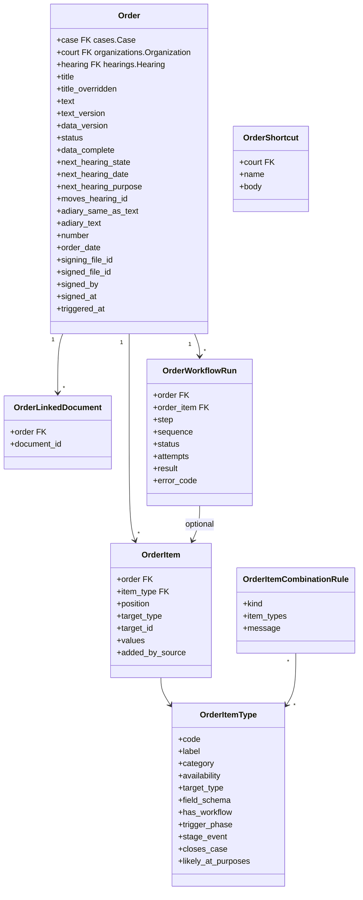
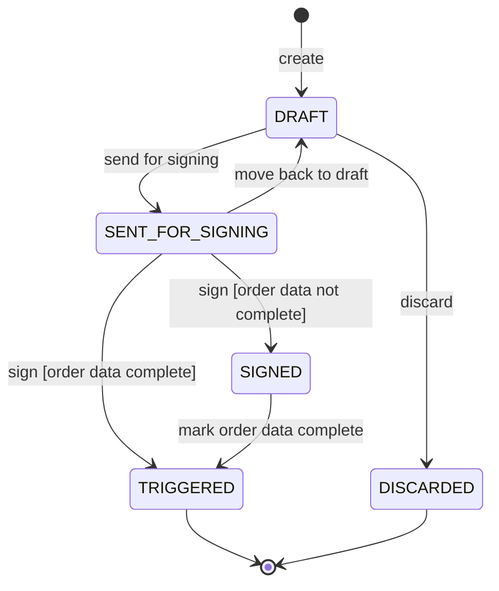

# 0025 — Court Orders (`apps.orders`)

## Status

Proposed

## References

- PRDs: `order-generation.md` (`ORD-`, `ROL-`, `TXT-`, `SHC-`, `TIT-`, `ITM-`, `VAR-`, `APL-`, `DFT-`, `SND-`, `PLC-`, `ATT-`, `NXT-`, `CLS-10`, `CLS-12`, `PND-`, `SGN-`, `CMP-`, `PUB-`, §15), `order-template-catalogue.md` (order items, variables, combination restrictions, workflow trigger order, hearing purposes), `court-roles.md` (`RLE-`), `a-diary.md` (`ADY-05`, `ADY-09`), `signing-methods.md` (`SGM-`), `cognizance-cheat-sheet.md` (§6), `case-lifecycle-handover.md` (§3, §5), `application-lifecycle.md` (`ALC-16`, `ALC-19`, `ALC-21`, `ALC-22`), `process-handover.md` (`PRC-01`–`PRC-03`, `AUT-`), `pending-task-drafts.md` (§1–§3), `view-case-handover.md` (§8), `pending-tasks-handover.md`

> **Scope note.** An order is always an order **of one case**, and, when it is
> passed in a hearing, of that hearing. This module owns the order: its text,
> its order data, its signature and the moment it is triggered. It fixes dates
> only through [`0023`](0023-hearings.md), moves the case only through
> [`0011`](0011-case-workflows.md) events, and signs only through
> [`0015`](0015-cdac-esign.md). What each order item's workflow does once
> triggered — a summons, an accepted application, a cost — belongs to the
> module that owns that thing and is reached through a registered handler.

## Context

From cognizance to judgement, every decision the court takes is an order: taking
cognizance, issuing summons, granting bail, accepting an application, fixing the
next date, dismissing, convicting. An order has two parts, worked separately by
people holding different roles (`order-generation.md` §1):

| Part | What it is | Who works it | What reads it |
| --- | --- | --- | --- |
| **Order text** | The words of the order, typed as one rich-text document. What is signed | Order drafter | Parties, the A-Diary, the case file |
| **Order data** | Order items and their fields, decisions on applications, attendance, the next hearing, the A-Diary text | Order data filler; Next hearing setter | The workflows the order triggers |

Nothing in the order data is written into the order text, and nothing compares
them (`TXT-05`, `TXT-06`). The order's workflows go out only once the order is
**signed** and its order data is **complete**, in either order (`CMP-04`).

```text
                                  ┌─▶ Awaiting signature ── Sign ─────────────┐
Drafting ── Send for signing ─────┤     (order signer)                         ├─▶ Triggered
(order        (text, next         └─▶ Order data to fill ── Mark complete ─────┘   (workflows go out;
 drafter)      hearing and              (order data filler)                          next hearing
  │   ▲        attendance                                                             announced)
  │   │        settled)
  │   └──── Move back to draft — any time before signing
  └──── Discard ──▶ removed; nothing recorded on the case
```

The court screens make the work concrete.

**Order screen** — one order, in a hearing or outside one (`ORD-11`–`ORD-20`).

| Element | What it shows |
| --- | --- |
| Header | cause title, case number, case stage; in a hearing, the item number on the day's board and the purpose; *Next case* (owned by [`0023`](0023-hearings.md) #6.4) |
| **Order** view | one page as it will print: court heading, attendance lines, the typed text, the next hearing line, the signature block (*Magistrate · Not signed*) |
| Editor | paragraphs, numbered and lettered lists, emphasis, tables; `/` + name + Tab inserts a shortcut; *Shortcuts* dialog |
| Side panel | *Case file* (with *Link* on each document), *Case history* (last order highlighted, filter to orders), *Data flags* |
| **Order data** view | the order items (*Likely at this hearing*, search, categories), each with its fields; pending applications; the A-Diary text with *The A-Diary text and order text are the same*; the order text read only beside it |
| Footer | *Saved*; **Send for signing** |
| After sending | both views read only; where the shortcuts sat, the order's **signature** and **order data** status |

**Pending orders** — every order not yet triggered, for everyone on the court side (`PND-01`–`PND-08`).

| Element | What it shows |
| --- | --- |
| Tabs | **Drafting**, **Awaiting signature**, **Order data to fill**, **Triggered**, each with a count |
| Row | title · case · *Signature* (Not sent / Awaiting / Signed) · *Order data* (Not complete / Complete) · the viewer's move (*Continue drafting*, *Sign*, *Fill order data*) |
| Bulk | *Sign selected* (DSC only, `SGN-06`); *Add order items* to several hearing orders (`ITM-10`) |
| Opened order | text read only on one side, order data on the other, signature then order data above both, and a line saying whose move it is |

The PRDs fix the rules:

* One draft order per hearing, shared by everyone working it; outside a hearing, several drafts may stand open on a case (`DFT-01`, `DFT-03`). A draft is not an order: nothing is numbered, published, notified or triggered from it (`DFT-07`), and a draft does not expire (`NXT-15`).
* Only the order drafter writes the order text. Order items, decisions, attendance and the next hearing never change the words (`TXT-05`).
* Order items come from a configured catalogue. An order item the case cannot take is listed with its reason, not hidden (`ITM-03`). Combinations the catalogue forbids are refused with the configured message (`ITM-07`).
* The system fills single-valued facts and values it already holds; it never guesses a choice (`VAR-01`–`VAR-03`). The stored value drives the workflow (`VAR-07`).
* The next hearing is a date and a purpose, or *Not listed again*. It is entered on the cause list or in the order, by court setting, and in one place only (`PLC-04`). From the moment it is set it is held provisionally and counted in the day's load (`NXT-10`, `NXT-11`).
* Sending for signing needs non-empty text, a settled next hearing and, in a hearing, complete attendance (`SND-02`, `SND-03`, `ATT-04`). It opens *Sign order* and *Fill order data*, worked in parallel (`SND-07`).
* Signing needs the order signer role, does not need the order data, and is what makes it an order of the court: numbered, dated and stored as a signed PDF (`SGN-01`, `SGN-04`, `PUB-01`). With Aadhaar e-sign orders are signed one at a time; bulk signing needs a DSC (`SGN-06`).
* When the order is signed **and** its order data is complete, its workflows are triggered at once, hearing-date order items first and case-closing ones last, and nothing changes after (`CMP-04`, `CMP-05`, `PUB-03`).
* A signed order is never edited or withdrawn; a later order may correct it, with no link recorded (`PUB-06`).
* Case stage changes are not order workflows: a listener reads order events and moves the stage (`PUB-05`).
* Every action is gated by a court role held in the courtroom, enforced server-side (`ROL-06`, `RLE-04`).

### What this module does and does not decide

`apps.orders` knows **what the court ordered, in which words, with which order
items and values, who signed it and when it was triggered**. It does not decide
whether a date is available — [`0023`](0023-hearings.md) does. It does not move
the case's stage — it dispatches events and [`0011`](0011-case-workflows.md)'s
definition decides. It does not run a summons, raise an application's workflow,
or keep the A-Diary register — those modules react to it. It never compares the
order text with the order data.

## Goals

* Create one draft order per hearing, and any number per case outside a hearing, each with its own text and order data.
* Store the order text as sanitised rich text, saved as it is typed, and render the page and the signed PDF from one renderer.
* Hold the order-item catalogue — items, fields, availability, categories, likely hearing purposes, combination restrictions, trigger phase — as data seeded by migration and editable in admin.
* Add, edit and remove order items through one service, whether a person or a later reading layer adds them, with availability and combination checked on the server.
* Fill defaults from the record without guessing, and check mandatory fields only when the order data is marked complete.
* Hold the next hearing through [`0023`](0023-hearings.md) from the moment it is set, wherever the court enters it.
* Gate sending for signing, signing and marking complete on the PRD's conditions, and open and close the three pending tasks through [`0011`](0011-case-workflows.md).
* Sign one order at a time with Aadhaar e-sign through [`0015`](0015-cdac-esign.md), allot the order number and date, and keep the signed PDF.
* Trigger each order item's workflow exactly once, in the configured order, through handlers registered by the owning modules.
* Dispatch case-stage events and cancel open hearings for case-closing orders, after every other workflow.
* Serve the order screen, Pending orders, the case's orders and the courtroom's shortcuts, and the bulk actions of Pending orders and the cause list.
* Expose REST APIs following [`0000`](0000-api-coding-spec.md), with registered error codes.

## Non-goals

* Generating the cause list, running hearings, attendance marks and the court calendar — [`0023`](0023-hearings.md).
* What each order item's workflow does once triggered: processes (`process-handover.md`), application workflows (`application-lifecycle.md`), document submission (`document-submission.md`).
* The A-Diary register, its editing and its signing (`a-diary.md`) — this module only supplies an order's A-Diary text and keeps it in step.
* DSC signing and batch e-sign (`signing-methods.md` `SGM-02`, `SGM-04`); [`0015`](0015-cdac-esign.md) lists DSC as a non-goal.
* A reading layer that turns order text into order items (`ITM-12`) — only the seam it will use.
* The *Data flags* side-panel tab (`ORD-15`, not yet defined).
* Notification copy (the PRD's master table).
* Case outcome values beyond what an order item states (`case-lifecycle-handover.md` §5, `OQ-2`).

---

## Proposed changes

### 1. App layout and boundaries

```text
apps/orders/
├── apps.py                 # name = "apps.orders"; registers the ORDER esign authorizer
├── models.py               # Order, OrderItem, OrderLinkedDocument, OrderShortcut,
│                           # OrderItemType, OrderItemCombinationRule, OrderWorkflowRun,
│                           # OrderNumberCounter
├── enums.py
├── errors.py               # E11xxx (#11.6)
├── signals.py              # order_signed, order_triggered
├── handlers/
│   ├── base.py             # OrderItemHandler contract, registry (#1.2)
│   ├── builtin.py          # handlers owned here: hearing date, stage, cost, witness batta,
│   │                       # mandatory submission, no-workflow items (#9.3)
│   └── checks.py           # system check: every workflow item has a handler
├── services/
│   ├── drafting.py         # create, text, title, links, discard
│   ├── items.py            # add, edit, remove, defaults, availability, combinations
│   ├── next_hearing.py     # set, clear, not listed again (#6.4)
│   ├── lifecycle.py        # send for signing, move back, mark complete, reopen, trigger
│   ├── signing.py          # prepare, start e-sign, record signature, numbering (#8)
│   ├── triggering.py       # workflow runs (#9)
│   └── bulk.py             # bulk items, text, next hearing (#10)
├── rendering.py            # the page and PDF renderer, one source (#5.3)
├── selectors.py            # pending lists, counts, case orders, contracts for other modules
├── permissions.py          # court roles in the courtroom (#2)
├── tasks.py                # Dramatiq actors (#12.7)
├── serializers.py · views.py · urls.py · admin.py
├── migrations/             # includes catalogue and combination-rule seed rows
└── tests/
```

Dependency rules:

```text
apps.orders ── imports ──> apps.cases.selectors / services
apps.orders ── imports ──> apps.hearings.services / selectors        (0023 #1)
apps.orders ── imports ──> apps.workflows.services / selectors       (0011)
apps.orders ── imports ──> apps.esign, apps.pdf, apps.files services (0015, 0016, 0014)
apps.orders ── imports ──> apps.payments.services                   (0017, costs only)
apps.orders ── imports ──> apps.organizations.selectors              (court roles)
apps.applications, apps.processes, apps.submissions ── import ──> apps.orders.handlers / selectors / signals
apps.orders ── never imports ──> apps.applications, apps.processes, apps.submissions, apps.adiary
apps.cases, apps.hearings, apps.workflows ── never import ──> apps.orders
```

Rules:

* `Order.case → cases.Case` and `Order.court → organizations.Organization` are the only foreign keys into other domain apps, with `on_delete=PROTECT`. `Order.hearing → hearings.Hearing` is allowed because orders already depends on hearings; hearings stores the order as a plain `order_id` ([`0023`](0023-hearings.md) #2.1).
* Applications, processes and documents are referenced by plain `UUIDField` ids.
* A module whose thing an order item acts on registers an `OrderItemHandler` from its `AppConfig.ready()` (#1.2). Orders calls the handler; it never imports the module.
* Modules that react to an order as a whole — the A-Diary, applications closing *Decide application*, case-update events — subscribe to `apps.orders.signals`.
* Views validate input, call a service, and serialize the result. Status, versions, numbers, dates and task changes are written only by `services/`.
* An isolation test asserts the import rules.

#### 1.1 Contracts consumed

| Module | Function | Used for |
| --- | --- | --- |
| `apps.cases` | `selectors.get_case_summaries(case_ids)` | header and list rows: number, title, stage, courtroom |
| | `selectors.order_context(case_id)` | facts for defaults and availability: parties by type, joined flags, witnesses (examined or not), registered, cognizance taken, long-pending flag (`VAR-01`–`VAR-03`, `AUT-05`, `AUT-06`) |
| | `selectors.case_documents(case_id)` | linking documents (`ORD-17`) |
| | `selectors.delay_applicable(case_id)` | the cognizance preset (#5.2) |
| | `services.record_outcome(case_id, outcome, order_id)` | case-closing items with a stated outcome (#9.4) |
| `apps.hearings` | `listing.hold`, `change`, `release`, `validate`, `confirm`, `attach_order`, `cancel_open_hearings` | the next hearing (#6.4) and case closure ([`0023`](0023-hearings.md) #7) |
| | `courtroom.attendance_complete`, `courtroom.lock_attendance` | `ATT-04`, and the roll at triggering ([`0023`](0023-hearings.md) #6.5) |
| | `selectors.get_hearing`, `selectors.next_hearing` | hearing orders; the default next hearing outside a hearing (`ORD-08`) |
| `apps.workflows` | `TaskService.open`, `complete`, `expire`, `complete_for` | the three order tasks (#12.1), item tasks, `take_cognizance` |
| | `CaseWorkflowService.dispatch` | stage events (#9.4) |
| `apps.esign` | initiation service; transaction selector; `register_entity_authorizer("ORDER", …)` | Aadhaar e-sign (#8.1) |
| `apps.pdf` | in-process render of template `court-order` | the PDF to sign (#5.3) |
| `apps.files` | `upload_file`, `get_file` | storing the rendered and signed PDFs |
| `apps.payments` | `DemandService.raise_demand` | *Cost* (#9.3) |
| `apps.organizations` | `selectors.court_roles(user, court_id)` | roles (#2.1, as [`0023`](0023-hearings.md) #1.2) |
| `apps.core` | configuration store ([`0018`](0018-configuration-store.md)) | `next_hearing_entry`, limits (#12.4) |

`order_context`, `case_documents`, `delay_applicable` and `record_outcome` do
not exist yet on `apps.cases`. They are the first work this spec needs from the
cases module.

`apps.esign` sends no completion signal today; the order learns of a signature
when the client confirms it (#8.1). An `esign_succeeded` signal on commit in
[`0015`](0015-cdac-esign.md) would let a receiver call the same service; this
spec does not depend on it.

#### 1.2 Order item handlers

```python
@dataclass(frozen=True)
class ItemContext:
    case_id: UUID
    order_id: UUID
    hearing_id: UUID | None          # the hearing the order is passed in
    target_type: str                  # "" or "APPLICATION"
    target_id: UUID | None


@dataclass(frozen=True)
class Problem:
    field: str                        # values.<key>, or target_id
    code: str                         # e.g. "REQUIRED", "NOT_A_WITNESS"
    message: str


@dataclass(frozen=True)
class RunResult:
    status: Literal["DONE", "FAILED"]
    payload: dict = field(default_factory=dict)   # ids created, e.g. process ids, demand id
    error_code: str = ""


class OrderItemHandler(ABC):
    item_codes: ClassVar[tuple[str, ...]]

    def unavailable_reason(self, ctx: ItemContext) -> str | None: return None   # ITM-03
    def validate_target(self, ctx: ItemContext) -> list[Problem]: return []     # ITM-04
    def defaults(self, ctx: ItemContext) -> dict: return {}                     # VAR-02, VAR-03
    def validate(self, ctx: ItemContext, values: dict, *, complete: bool) -> list[Problem]: return []
    def summary(self, ctx: ItemContext, values: dict) -> str: ...               # the item's line in lists

    @abstractmethod
    def execute(self, ctx: ItemContext, values: dict, *, run_id: UUID) -> RunResult: ...
```

Rules:

* `execute` is called once per item when the order is triggered (#9), in a Dramatiq actor, and must be **idempotent on `run_id`**: a redelivered run returns the first result.
* `validate(…, complete=False)` checks shape on every save; `complete=True` adds the item-specific completeness checks at *Mark complete* (`CMP-02`). Mandatory fields of the catalogue are checked by this module before the handler is called (#6.3).
* A handler reads its module's own data; it receives ids and values only, never an `Order` instance.
* `registry.register(handler)` refuses a second handler for a code. A system check fails when an active `OrderItemType` with `has_workflow = True` has no handler (`orders.E001`). Items with no workflow use the built-in no-op handler.

### 2. Court roles and settings

#### 2.1 Roles

The court roles of [`court-roles.md`](court-roles.md) used here are held **per
courtroom** (`RLE-02a`); the order's courtroom is the case's courtroom, chosen
at scrutiny ([`0024`](0024-scrutiny.md) #2.5). One account may hold several, and
any holder can act (`RLE-02`, `RLE-05`). They are read through
`apps.organizations.selectors.court_roles(user, court_id)`, as in
[`0023`](0023-hearings.md) #1.2.

| Role | Actions in this module |
| --- | --- |
| `ORDER_DRAFTER` | create a draft; edit the text; edit the title; link documents; send for signing; move back to draft; discard; maintain the courtroom's shortcuts; bulk text (`ROL-01`, `SHC-07`, `CLS-12`) |
| `ORDER_DATA_FILLER` | add, edit and remove order items; set the A-Diary text; mark the order data complete and reopen it; edit the title; bulk order items (`ROL-02`, `ITM-10`, `PUB-04`) |
| `NEXT_HEARING_SETTER` | set the next hearing or *Not listed again*, singly or in bulk (`ROL-03`, `CLS-10`) |
| `ORDER_SIGNER` | sign (`ROL-04`, `SGN-01`) |

Attendance is marked by an order data filler on [`0023`](0023-hearings.md)'s
endpoint (#6.5 there). Starting, ending and passing over hearings is the
hearing controller's, in [`0023`](0023-hearings.md).

Roles are checked when the action is taken; a role change applies at once
(`RLE-03`). Reading is not a role: any staff of the courtroom sees its orders
(`RLE-06`). A person without a role sees what it would change, read only, and
`allowed_actions` omits it (`ROL-06`, `RLE-07`).

#### 2.2 Where the next hearing is entered

Each court chooses where the next hearing is entered, and so who enters it
(`PLC-04`). The setting is read from the configuration store,
`config_set = "court.<COURT_CODE>"`, else `"court.default"`:

| `config_key` | Values | Default | Effect |
| --- | --- | --- | --- |
| `next_hearing_entry` | `CAUSE_LIST`, `ORDER` | `CAUSE_LIST` | `CAUSE_LIST`: written only by the cause-list endpoints (#10.5), shown read only on the order. `ORDER`: written only by the order endpoint (#6.4); the cause list has no *Next hearing* column |

Either way the writer needs `NEXT_HEARING_SETTER`, and the value lives on the
order. A write from the other place is `409 E11014`.

#### 2.3 Boundary: what decides, what enforces

| Concern | Decided by | Enforced by | Never |
| --- | --- | --- | --- |
| Who may type, fill, set the next hearing, sign | court roles in the courtroom | `permissions.py`, server-side | a staff title (`RLE-08`); hiding a control |
| Which order items exist, their fields, categories, likely purposes, combination restrictions, trigger phase | the catalogue (`order-template-catalogue.md`) | `services.items` | code branches per item |
| Whether an item is available to this case now | the owning handler's `unavailable_reason` (#6.1) | `services.items` | the screen alone |
| Whether a date can be held, confirmed or is full | [`0023`](0023-hearings.md) | `apps.hearings.services.listing` | this module |
| What an item does once triggered | the handler of the owning module | `services.triggering` | the order text |
| What a stage-moving item means for the case | the [`0011`](0011-case-workflows.md) definition | `CaseWorkflowService.dispatch` | this module writing a stage |
| Where the next hearing is entered | `next_hearing_entry` | `services.next_hearing` | both places at once |
| Whether text and data agree | the people who type and fill them (`TXT-06`) | nothing | a check, a warning or a block |

Some things nothing can change:

* Nothing is triggered until the order is signed **and** its order data is complete (`CMP-04`).
* A signed order's text, number, date and PDF never change (`PUB-06`). A triggered order changes in nothing but its A-Diary text, through the A-Diary (`ADY-09`).
* Nothing writes into the order text but an order drafter (`TXT-05`); bulk text (#10.4) is an order drafter's action.
* Every workflow of an order runs at most once.

### 3. Data model



All models inherit `apps.core.models.BaseModel`. `Order`, `OrderItem`,
`OrderShortcut` and the catalogue models also inherit `BaseAuditableModel`.
Every bounded enum is a `TextChoices` in `apps/orders/enums.py`.

#### 3.1 `Order`

| Field | Type | Notes |
| --- | --- | --- |
| `case` | `FK("cases.Case", on_delete=PROTECT, related_name="orders")` | `ORD-01` |
| `court` | `FK("organizations.Organization", on_delete=PROTECT, related_name="orders")` | the case's courtroom at creation; roles are read here |
| `hearing` | `FK("hearings.Hearing", null=True, on_delete=PROTECT, related_name="+")` | the hearing it is passed in; `NULL` outside a hearing (`ORD-05`–`ORD-07`) |
| `title` | `CharField(255)` | derived from the order items until overridden (#5.5) |
| `title_overridden` | `BooleanField(default=False)` | |
| `text` | `TextField(blank=True)` | sanitised HTML (#5.3) |
| `text_version` | `PositiveIntegerField(default=0)` | concurrency token for text writes (#5.4) |
| `data_version` | `PositiveIntegerField(default=0)` | concurrency token for order data writes |
| `status` | `CharField(16, choices=OrderStatus)` | `DRAFT`, `SENT_FOR_SIGNING`, `SIGNED`, `TRIGGERED`, `DISCARDED` (#4) |
| `data_complete` | `BooleanField(default=False)` | `CMP-01` |
| `data_completed_by` / `data_completed_at` | `FK(User, null=True)` / `DateTimeField(null=True)` | |
| `next_hearing_state` | `CharField(16, choices=NextHearingState)` | `UNSET`, `LISTED`, `NOT_LISTED_AGAIN` (`NXT-01`) |
| `next_hearing_date` | `DateField(null=True)` | with `LISTED` |
| `next_hearing_purpose` | `CharField(50, blank=True)` | a `HearingPurpose.code`, with `LISTED` |
| `moves_hearing_id` | `UUIDField(null=True)` | outside a hearing: the hearing the date was moved from (`ORD-08`) |
| `next_hearing_entered_by` / `_at` | | who set it, for the audit |
| `adiary_same_as_text` | `BooleanField(default=True)` | *The A-Diary text and order text are the same* (`PUB-04`) |
| `adiary_text` | `TextField(blank=True)` | used when the option is off |
| `sent_for_signing_by` / `_at` | | latest send |
| `number` | `CharField(64, blank=True)` | allotted at the first signing attempt and kept (#8.3); unique when non-empty |
| `order_date` | `DateField(null=True)` | the business date it was signed (`PUB-01`) |
| `signing_file_id` | `CharField(64, blank=True)` | `apps.files` id of the PDF prepared for the current signing (#8.1) |
| `signed_file_id` | `CharField(64, blank=True)` | the signed PDF |
| `signing_method` | `CharField(16, blank=True)` | `AADHAAR_ESIGN`, `DSC` (`SGN-05`) |
| `signed_by` / `signed_at` | `FK(User, null=True)` / `DateTimeField(null=True)` | |
| `signer_designation` | `CharField(128, blank=True)` | printed under the signature (`RLE-08`) |
| `triggered_at` | `DateTimeField(null=True)` | `CMP-04` |
| `discarded_by` / `discarded_at` | | `DFT-06` |

Constraints:

| Name | Constraint | Why |
| --- | --- | --- |
| `orders_one_per_hearing` | `UniqueConstraint(hearing, condition=Q(hearing__isnull=False) & ~Q(status=DISCARDED))` | one draft order per hearing (`DFT-01`) |
| `orders_number_unique` | `UniqueConstraint(number, condition=~Q(number=""))` | |
| `orders_signed_has_file` | `CheckConstraint`: `status NOT IN (SIGNED, TRIGGERED) OR signed_file_id != ''` | |
| `orders_triggered_is_complete` | `CheckConstraint`: `status != TRIGGERED OR data_complete` | `CMP-04` |
| `orders_next_hearing_shape` | `CheckConstraint`: `LISTED` ⇔ date and purpose set | `NXT-02` |

Indexes: `(court, status)`, `(case, -created_at)`, `(court, data_complete, status)`.

`Meta.ordering = ("-created_at",)`.

#### 3.2 `OrderItem`

| Field | Type | Notes |
| --- | --- | --- |
| `order` | `FK(Order, on_delete=CASCADE, related_name="items")` | |
| `item_type` | `FK(OrderItemType, on_delete=PROTECT)` | |
| `position` | `PositiveSmallIntegerField` | the sequence it was added in, 1, 2, 3 (`ITM-08`); gaps are closed on removal |
| `target_type` | `CharField(16, blank=True)` | `APPLICATION` for contextual items (`ITM-04`) |
| `target_id` | `UUIDField(null=True)` | the application |
| `values` | `JSONField(default=dict)` | the fields' values, keyed by the catalogue's field keys (`VAR-07`) |
| `added_by_source` | `CharField(16, choices=ItemSource)` | `PERSON`, `PRESET` (added in advance, `ORD-10a`), `BULK` (`ITM-10`), `SYSTEM` (`ORD-08`, and a later reading layer, `ITM-12`) |

`UniqueConstraint(order, position)`.

#### 3.3 `OrderItemType` — the catalogue

Seeded by data migration from `order-template-catalogue.md`; edited in admin;
retired with `is_active = False`, never deleted.

| Field | Type | Notes |
| --- | --- | --- |
| `code` | `CharField(50, unique=True)` | upper snake case, e.g. `ISSUE_OF_SUMMONS` |
| `label` | `CharField(128)` | "Issue of summons" |
| `category` | `CharField(32, choices=ItemCategory, blank=True)` | `FILINGS`, `DISPOSAL`, `CASE_MANAGEMENT`, `PROCESS`, `MISCELLANEOUS`; empty for contextual items |
| `availability` | `CharField(16, choices=Availability)` | `DROPDOWN`, `CONTEXTUAL`, `BOTH` (withdrawal) |
| `target_type` | `CharField(16, blank=True)` | `APPLICATION` for contextual items |
| `field_schema` | `JSONField` | the item's fields (#6.3) |
| `has_workflow` | `BooleanField` | needs a handler (#1.2) |
| `trigger_phase` | `CharField(8, choices=TriggerPhase)` | `FIRST`, `NORMAL`, `LAST` — the catalogue's *Workflow trigger order* |
| `stage_event` | `CharField(64, blank=True)` | the [`0011`](0011-case-workflows.md) event dispatched when triggered (#9.4) |
| `closes_case` | `CharField(32, blank=True)` | the [`0023`](0023-hearings.md) `CancellationReason` passed to `cancel_open_hearings`, empty if the item does not take the case off the list |
| `outcome` | `CharField(16, blank=True)` | the case outcome it records, e.g. `DISMISSED` |
| `likely_at_purposes` | `ManyToManyField("hearings.HearingPurpose", blank=True)` | *Likely at this hearing* (`ITM-02`) |
| `sequence` | `PositiveSmallIntegerField` | display order within its category |

The seed, from the catalogue:

| `code` | Category | Availability | Phase | `stage_event` | `closes_case` |
| --- | --- | --- | --- | --- | --- |
| `MANDATORY_SUBMISSIONS` | Filings | dropdown | normal | | |
| `REFERRAL_TO_ADR` | Disposal | dropdown | last | `MEDIATION_ORDERED` | *(question 6)* |
| `SCHEDULING_OF_HEARING_DATE` | Case management | dropdown | first | | |
| `RESCHEDULING_OF_HEARING_DATE` | Case management | dropdown | first | | |
| `ACCEPT_APPLICATION` · `REJECT_APPLICATION` | — | contextual | normal | | |
| `CASE_TRANSFER` | Case management | dropdown | last | `CASE_DISPOSED` | `CASE_TRANSFERRED` |
| `CASE_SETTLEMENT` | Disposal | dropdown | last | `CASE_DISPOSED` | `CASE_DISPOSED` |
| `ISSUE_OF_SUMMONS` · `ISSUE_OF_WARRANTS` · `ISSUE_OF_NOTICE` · `ISSUE_OF_PROCLAMATION` · `ISSUE_OF_ATTACHMENT` · `ISSUE_OF_MISCELLANEOUS_PROCESS` | Process | dropdown | normal | | |
| `WITHDRAWAL_OF_CASE` | Disposal | both | last | `CASE_DISPOSED` | `CASE_DISPOSED` |
| `ACCEPTANCE_OF_BAIL` | — | contextual | normal | | |
| `COGNIZANCE` | Case management | dropdown | normal | `COGNIZANCE_TAKEN` | |
| `JUDGEMENT` | Disposal | dropdown | last | `JUDGEMENT_PASSED` | `CASE_DISPOSED` |
| `DISMISS_CASE` | Case management | dropdown | last | `CASE_DISPOSED` | `CASE_DISPOSED` |
| `BAIL` | Filings | dropdown | normal | | |
| `COST` · `WITNESS_BATTA` | Miscellaneous | dropdown | normal | | |
| `MOVE_TO_LONG_PENDING_REGISTER` | Case management | dropdown | last | `MOVED_TO_LPR` | `LONG_PENDING_REGISTER` |
| `MOVE_OUT_OF_LONG_PENDING_REGISTER` | Case management | dropdown | normal | `MOVED_OUT_OF_LPR` | |
| `ABATE_CASE` | Disposal | dropdown | last | `CASE_DISPOSED` | `CASE_DISPOSED` |
| `DISMISS_APPLICATION` | — | contextual | normal | | |

`likely_at_purposes` is seeded from the catalogue's *Hearing purpose → actions*
table. The section workflows (⚙) are not order items and are not seeded.

The catalogue is one per deployment in this version (question 8).

#### 3.4 `OrderItemCombinationRule`

One row per restriction in the catalogue's *Combination restrictions* (`ITM-07`).

| Field | Type | Notes |
| --- | --- | --- |
| `kind` | `CharField(16, choices=RuleKind)` | `EXCLUSIVE` — at most one item from the set per order; `NO_REPEAT` — no item of the set twice; `ONE_PER_TARGET` — at most one item from the set per application |
| `item_types` | `ManyToManyField(OrderItemType)` | |
| `message` | `CharField(255)` | with `{adding}` and `{existing}` placeholders |

Seeded: rule 1 (`EXCLUSIVE`, the case-closing items), rule 2 (`EXCLUSIVE` and
`NO_REPEAT`, Cognizance and Dismiss case), rule 3 (`EXCLUSIVE`, Scheduling and
Rescheduling), rule 4 (`ONE_PER_TARGET`, Accept, Reject, Acceptance of bail,
Dismiss application). Rule 5 (no restriction) needs no row.

#### 3.5 `OrderLinkedDocument`

`order` (`FK`, `CASCADE`), `document_id` (`UUIDField`, a case document of the
order's case). `UniqueConstraint(order, document_id)`. `ORD-17`.

#### 3.6 `OrderShortcut`

| Field | Type | Notes |
| --- | --- | --- |
| `court` | `FK("organizations.Organization", on_delete=PROTECT)` | the courtroom's set (`SHC-06`) |
| `name` | `CharField(64)` | `^[a-z0-9][a-z0-9-]*$`, what follows `/` |
| `body` | `TextField` | sanitised HTML, same allow-list as order text; `[…]` marks a blank (`SHC-03`) |
| `inline` | `BooleanField` | derived on save: one line, no formatting (`SHC-02`) |

`UniqueConstraint(court, Lower("name"))`. Shortcuts have no workflow and no
order data (`SHC-04`); insertion is done by the editor.

#### 3.7 `OrderWorkflowRun`

One row per step of an order's triggering (#9), created in the trigger
transaction. Append-only except for status, attempts and result.

| Field | Type | Notes |
| --- | --- | --- |
| `order` | `FK(Order, on_delete=PROTECT, related_name="runs")` | |
| `order_item` | `FK(OrderItem, null=True, on_delete=PROTECT)` | empty for the hearing and stage steps |
| `step` | `CharField(16, choices=RunStep)` | `HEARING`, `ITEM`, `STAGE` |
| `sequence` | `PositiveSmallIntegerField` | execution order (#9.2) |
| `status` | `CharField(16, choices=RunStatus)` | `PENDING`, `DONE`, `FAILED`, `BLOCKED` |
| `attempts` | `PositiveSmallIntegerField(default=0)` | |
| `result` | `JSONField(default=dict)` | the handler's `payload` |
| `error_code` | `CharField(64, blank=True)` | |

`UniqueConstraint(order, sequence)`.

#### 3.8 `OrderNumberCounter`

`court`, `year`, `last_value`; `UniqueConstraint(court, year)`. Incremented
under `select_for_update()` (#8.3).

### 4. Order lifecycle



`data_complete` moves independently while the order is not triggered:

```text
not complete ── mark complete ──> complete ── reopen (before signing) ──> not complete
complete ── text edited, or sent for signing again ──> not complete      (SND-06, SND-08)
```

| Action | From → To | Role | Where |
| --- | --- | --- | --- |
| create | — → `DRAFT` | order drafter | #5.1, #5.2 |
| edit text | `DRAFT` | order drafter | #5.4 |
| edit order data | `DRAFT`, `SENT_FOR_SIGNING`, `SIGNED`, while `data_complete` is false | order data filler | #6 (`CMP-06`) |
| set next hearing | `DRAFT` only | next hearing setter | #6.4 |
| mark complete | any but `TRIGGERED`, `DISCARDED` | order data filler | #6.7 |
| reopen | `DRAFT`, `SENT_FOR_SIGNING` | order data filler | #6.7 (`CMP-05`) |
| send for signing | `DRAFT` → `SENT_FOR_SIGNING` | order drafter | #7.1 |
| move back to draft | `SENT_FOR_SIGNING` → `DRAFT` | order drafter | #7.2 |
| discard | `DRAFT` → `DISCARDED` | order drafter | #5.7 |
| sign | `SENT_FOR_SIGNING` → `SIGNED` or `TRIGGERED` | order signer | #8 |
| trigger | → `TRIGGERED` | system, on sign or mark complete | #9 |

The Pending orders **stage** is read from these facts, never stored (`PND-02`):

| Stage | When |
| --- | --- |
| Drafting | `status = DRAFT` |
| Awaiting signature | `status = SENT_FOR_SIGNING` |
| Order data to fill | `status IN (SENT_FOR_SIGNING, SIGNED)` and not `data_complete` |
| Triggered | `status = TRIGGERED` |

An order sent for signing with incomplete data is in two stages at once
(`PND-02`).

Rules:

* Every action runs in `transaction.atomic()` under `select_for_update()` on the order. Anything not in the table is `409 E11001` with `allowed_actions`.
* The next hearing is frozen once sent for signing: it was a condition of sending (`SND-03`). Changing it needs a move back to draft.
* `TRIGGERED` and `DISCARDED` are terminal. Rows are never deleted.
* This lifecycle is not a [`0011`](0011-case-workflows.md) workflow: a case has many orders, and this state machine is small and fixed (as [`0023`](0023-hearings.md) #3).

### 5. Drafting

#### 5.1 In a hearing

```json
POST /api/v1/orders/
{ "hearing_id": "6f1c…" }
```

* The hearing must have been started — `started_at` set (`HRG-09`); otherwise `409 E11004`.
* If the hearing already has a live order, it is returned with `200`, so everyone opening the listing works one draft (`DFT-01`). Otherwise `201`.
* `case` and `court` come from the hearing. `listing.attach_order(hearing, order)` records it on the hearing ([`0023`](0023-hearings.md) #7).
* Opens *Draft order* (#12.1).

#### 5.2 Outside a hearing

```json
POST /api/v1/orders/
{
  "case_id": "a91e…",
  "preset": { "kind": "COGNIZANCE", "action": "TAKE_COGNIZANCE" }
}
```

* The case must be registered and have a courtroom (`409 E11003`).
* Each call creates a new draft (`DFT-03`, `ORD-10`).
* `preset` is optional. It loads order items **in advance**, as `PRESET`, removable like any other (`ORD-06`, `ORD-10a`). It is not stored: *opened from* is not an attribute of the order.

| `preset.kind` | `action` | Items added in advance |
| --- | --- | --- |
| `COGNIZANCE` | `TAKE_COGNIZANCE` | *Accept application* on the delay condonation application, only when delay applies · *Cognizance* · *Issue of summons* (cognizance cheat sheet §6) |
| `COGNIZANCE` | `ISSUE_NOTICE` | *Issue of notice* |
| `COGNIZANCE` | `DISMISS_CASE` | *Dismiss case* |
| `APPLICATION` | `ACCEPT`, `REJECT`, `DISMISS`, `ACCEPT_BAIL` | the matching contextual item, with `target_id = application_id` |

The cheat sheet's *Scheduling of hearing* item is not added as an item: outside
a hearing the next hearing is set on the order and the item follows from it
(#6.4).

#### 5.3 Text and rendering

* `text` is HTML restricted to an allow-list: `p`, `br`, `strong`, `em`, `u`, `ol` (with `type="a"` for lettered), `ul`, `li`, `table`, `thead`, `tbody`, `tr`, `th`, `td` (`colspan`, `rowspan`). Everything else is stripped on save by a server-side sanitiser (`nh3`), never trusted from the client (`TXT-02`).
* At most config `orders.text_max_bytes` (`400 E11020`, `field = text`).
* `rendering.render_page(order)` builds the page from the record — court heading, case header, attendance lines (from [`0023`](0023-hearings.md), people not required left out, empty lines left out, `ATT-03`), the text, the next hearing line, and the signature block — as HTML. The same HTML is the data of the `apps.pdf` template `court-order`. The detail endpoint returns it as `rendered_html`, so the page and the signed PDF never disagree (`ORD-13`). Heading and signature block are never typed.

#### 5.4 Saving and concurrency

```json
PATCH /api/v1/orders/{id}/text/
If-Match: "t-14"
{ "text": "<p>Heard. The accused is present …</p>" }
```

* Order drafter; `status = DRAFT`.
* `If-Match` carries `text_version`; a mismatch is `412 E11002` and the client reloads (`DFT-02`). Order data writes use `data_version` the same way, so the drafter and the filler working the same draft never block each other.
* A text change on an order whose `data_complete` is true sets it false (`SND-06`).
* Saves are idempotent: the same text is a no-op that does not bump the version (`ORD-20`).

Concurrent editing of the same part is refused rather than merged; this is the
least effort that handles it (`DFT-02`).

#### 5.5 Title

Until `title_overridden`, the title is recomputed on every item change: the
labels of the order items in `position` order, joined ("Cognizance, Issue of
summons and Scheduling of hearing date"), or "Order" with none (`TIT-02`).
`PATCH /orders/{id}/title/` sets it and `title_overridden = true`; an empty
title clears the override. Editable until triggered (`TIT-05`), by an order
drafter or an order data filler.

#### 5.6 Linked documents

`POST /orders/{id}/documents/ {"document_id"}` and
`DELETE /orders/{id}/documents/{document_id}/`, order drafter, until signed. The
document must be in the case file (`400 E11021`) (`ORD-17`).

#### 5.7 Discard

`POST /orders/{id}/discard/`, order drafter, `DRAFT` only (`DFT-06`):
`status = DISCARDED`; held date released with `DRAFT_DISCARDED`
([`0023`](0023-hearings.md) #7.4); *Draft order* expired. Nothing is recorded on
the case. A hearing whose order was discarded may get a new one.

### 6. Order data

#### 6.1 The catalogue for this order

`GET /api/v1/order-items/?order={id}` returns every active item with, for this
order:

```json
{
  "code": "RESCHEDULING_OF_HEARING_DATE",
  "label": "Rescheduling of hearing date",
  "category": "CASE_MANAGEMENT",
  "likely": false,
  "available": false,
  "unavailable_reason": { "code": "IN_HEARING", "message": "Set the next date under Next hearing." },
  "field_schema": { "...": "#6.3" }
}
```

* `likely` — the item is associated with the hearing's purpose (`ITM-02`). Outside a hearing, nothing is likely.
* `available` / `unavailable_reason` — from the handler (`ITM-03`), then from combination rules against the items already on the order (`ITM-07`). Unavailable items are listed, never hidden.

Availability reasons owned by built-in rules:

| Item | Unavailable when | Reason |
| --- | --- | --- |
| Scheduling of hearing date | in a hearing (`ORD-09`) | `IN_HEARING` |
| Rescheduling of hearing date | in a hearing, or the case has no scheduled hearing | `IN_HEARING`, `NO_HEARING_SCHEDULED` |
| Accept · Reject · Acceptance of bail | the application is not onboarded | `APPLICATION_NOT_ONBOARDED` (from the applications handler) |
| Dismiss application | the application is onboarded | `APPLICATION_ONBOARDED` |
| Cognizance | cognizance already taken | `COGNIZANCE_TAKEN` |
| Moving out of LPR | the case is not on the register | `NOT_IN_LPR` |

#### 6.2 Adding, editing and removing items

```json
POST /api/v1/orders/{id}/items/
If-Match: "d-6"
{
  "item_type": "ISSUE_OF_SUMMONS",
  "values": { "party_names": ["9c42…"], "party_taking_steps": "COMPLAINANT", "...": "…" }
}
```

`services.items.add(order, item_type, target, values, source, actor)`, the only
way in, for a person, a preset, a bulk action or a later reading layer
(`ITM-12`):

1. Order data editable: not triggered, and `data_complete` false (`409 E11013`; reopen first, `ITM-09`).
2. Item active and available (`409 E11008`, with the reason; `field = item_type`).
3. Contextual items need a target the handler accepts (`400 E11010`, `field = target_id`, `ITM-04`).
4. Combination rules against the items on the order (`409 E11009` with the configured message).
5. Merge `handler.defaults()` under the given values (#6.3); validate shape (`400 E11011`, `field = values.<key>`).
6. Append at the next `position`; recompute the title; bump `data_version`.

An item that asks for nothing is added with empty values (`ITM-05`). The same
item may be added more than once where no rule forbids it (`ITM-06`).

`PATCH /orders/{id}/items/{item_id}/` replaces `values`; `DELETE` removes the
item and its future workflow (`ITM-09`). Removing an item never touches the
text.

#### 6.3 Fields and defaults

`field_schema` lists an item's fields, from the catalogue's *Variables by
order item*:

```json
{
  "fields": [
    { "key": "paying_party", "label": "Paying party", "input": "ENUM", "options": ["COMPLAINANT", "ACCUSED"], "mandatory": true },
    { "key": "amount", "label": "Amount", "input": "AMOUNT", "mandatory": true },
    { "key": "receiving_party", "label": "Receiving party", "input": "ENUM", "options": ["COMPLAINANT", "ACCUSED", "COURT"], "mandatory": true },
    { "key": "pay_by", "label": "Date by which it must be paid", "input": "DATE", "mandatory": true }
  ]
}
```

| `input` | Value | Source |
| --- | --- | --- |
| `TEXT`, `DATE`, `AMOUNT`, `ENUM` | string, ISO date, decimal string, option | typed |
| `MASTER` | a master-data code (`master` names the list) | dropdown |
| `PARTY`, `PARTIES` | participant id(s), filtered by `party_types` | the case's people |
| `HEARING_PURPOSE` | a purpose code | [`0023`](0023-hearings.md) purposes |
| `RECORD` | — | read only, from the record or the target (`[Application Number]`, `[Original Hearing Date]`) |
| `PROCESS_RECIPIENTS` | per recipient: channels, addresses, police station | owned by the processes handler (`PRC-03`, `AUT-`) |

Rules:

* Single-valued facts — court, cause title, case number, date, judge, complainant, accused, this hearing's date — are not fields; the renderer and the handlers read them from the record (`VAR-01`).
* Defaults come from the handler and are preselected, not silently stored: they are returned in the item and saved only with the item (`VAR-02`).
* A party is defaulted only where the case has exactly one candidate of that kind; an application only where the item was reached from it (`VAR-03`, `AUT-05`, `AUT-06`).
* `mandatory` fields are checked at *Mark complete*, not on save (`VAR-05`, `VAR-06`, `CMP-02`).

#### 6.4 The next hearing

```json
PUT /api/v1/orders/{id}/next-hearing/
{ "state": "LISTED", "date": "2026-11-03", "purpose": "EVIDENCE_OF_COMPLAINANT" }
```

```json
{ "state": "NOT_LISTED_AGAIN" }
```

Next hearing setter, `status = DRAFT`, `next_hearing_entry = ORDER` (else
`409 E11014`). The cause-list form is #10.5. Both call
`services.next_hearing.set()`:

* **In a hearing** — `LISTED` calls `listing.hold(case, date, purpose, order, previous_hearing_id = order.hearing)`; a hold already on the order is changed in place ([`0023`](0023-hearings.md) #7.1, #7.2). Scheduling and Rescheduling items are not offered (`NXT-03`).
* **Outside a hearing** — the next hearing starts as the case's listed hearing (`selectors.next_hearing(case)`), read only (`ORD-08`). Setting a different date or purpose holds it with `moves_hearing_id` set and adds a *Rescheduling of hearing date* item, `SYSTEM`, its original and new dates filled from the change. Where the case has no listed hearing, setting a date holds a new one and adds *Scheduling of hearing date*. Returning to the listed hearing releases the hold and removes the item.
* `NOT_LISTED_AGAIN` releases any hold (`DATE_REMOVED`) and records the decision (`NXT-01`).
* A date without a purpose, or a purpose without a date, is refused (`400 E11011`, `NXT-02`).
* [`0023`](0023-hearings.md) errors (`E10003`–`E10009`, `E10014`) pass through unchanged; its `warnings` (full day, adjournment limit) are returned in the response.

The hold is what the date picker counts (`NXT-11`); nothing is announced until
the order is triggered (`PUB-07`).

#### 6.5 Attendance

Marked on [`0023`](0023-hearings.md)'s `PUT /hearings/{id}/attendance/` by an
order data filler. This module reads `attendance_complete(hearing)` at *Send
for signing* (`ATT-04`), renders the lines on the page, and calls
`lock_attendance(hearing)` when the order is triggered.

#### 6.6 A-Diary text

`PUT /orders/{id}/a-diary-text/ {"same_as_text": false, "text": "…"}`, order
data filler, until triggered (`PUB-04`). With `same_as_text`, the A-Diary text
is the order text in full, with its attendance and next hearing lines, and is
composed on read by `selectors.adiary_text(order_id)`; it is never shortened
(`ADY-04`).

After triggering, the A-Diary owns the entry. `services.drafting.set_adiary_text(order_id, text, actor)`
is the one function it calls when an A-Diary editor changes the entry
(`ADY-09`): it stores the text and turns `adiary_same_as_text` off when the text
now differs. The order text never changes. The A-Diary module checks its own
role and the signed-day rule.

#### 6.7 Marking the order data complete

`POST /orders/{id}/data/complete/`, order data filler, any time before
triggering (`CMP-01`):

1. Every catalogue-mandatory field answered and every handler's `validate(complete=True)` clean; otherwise `409 E11012` with each problem's item, `field` and message (`CMP-02`).
2. Where the order is already signed and holds a date, `listing.validate(order)` must pass (`409` with the [`0023`](0023-hearings.md) code).
3. `data_complete = true`; complete *Fill order data* if open.
4. Signed → trigger (#9).

`POST /orders/{id}/data/reopen/` sets it false until the order is signed
(`CMP-05`); after signing, `409 E11016`.

### 7. Sending for signing

#### 7.1 Send

`POST /orders/{id}/send-for-signing/`, order drafter, `DRAFT`:

1. Text not empty after sanitising (`400 E11005`, `SND-02`).
2. Next hearing settled — `LISTED` or `NOT_LISTED_AGAIN` (`409 E11006`); with `LISTED`, `listing.validate(order)` passes (`SND-03`).
3. In a hearing, `attendance_complete(hearing)` (`409 E11007`, `ATT-04`).
4. `status = SENT_FOR_SIGNING`; `sent_for_signing_*`.
5. Complete *Draft order*; open *Sign order*; open *Fill order data* unless `data_complete` (#12.1, `SND-07`). On a send after a move back, `data_complete` is first set false, keeping the values (`SND-08`).

The order data need not be filled (`SND-04`).

#### 7.2 Move back to draft

`POST /orders/{id}/move-to-draft/`, order drafter, `SENT_FOR_SIGNING` only;
after signing `409 E11016` (`SND-05`):

* `status = DRAFT`; `signing_file_id` cleared, so a signing begun on the old text can never be recorded (#8.1).
* Expire *Sign order* and *Fill order data*; open *Draft order* again — a new task, since a closed task does not reopen (`SND-08`, pending-task drafts §1).

### 8. Signing

#### 8.1 Aadhaar e-sign, one order

```json
POST /api/v1/orders/{id}/sign/
{ "method": "AADHAAR_ESIGN" }
```

Order signer, `SENT_FOR_SIGNING`:

1. `method` is enabled for the state (config `signing.methods`, `signing-methods.md` `SGM-05`); else `400 E11017`.
2. Where the order holds a date, `listing.validate(order)` passes.
3. Allot the number if none (#8.3); set the order date to the business date.
4. Render the page with number, date and the signer's name and designation; store it with `apps.files`; set `signing_file_id`.
5. Call the `apps.esign` initiation service in-process with `entity_type = ORDER`, `entity_id = order.id`, `file_id = signing_file_id` and the signature-block placement. Return its `esign_url`, `form_fields` and `transaction_id` unchanged ([`0015`](0015-cdac-esign.md) #6.1).

The order registers an `ORDER` authorizer with `apps.esign`
(`register_entity_authorizer`), so a direct call to `/esign/_esign` for an
order is refused unless the user holds `ORDER_SIGNER` in its courtroom and the
order is `SENT_FOR_SIGNING`.

When the browser returns, the client calls:

```json
POST /api/v1/orders/{id}/sign/confirm/
{ "transaction_id": "0f9d…" }
```

`services.signing.record_signature(order, transaction, actor)`, idempotent:

* The transaction is `SUCCESS`, for this order, by this user, and its source file is the order's current `signing_file_id`. A transaction from before a move back, or still pending, is `409 E11015`.
* Already recorded for this transaction → the order unchanged.
* `status = SIGNED`, `signed_file_id`, `signed_by`, `signed_at`, `signing_method`; complete *Sign order*; on commit send `order_signed`.
* `data_complete` → trigger (#9) in the same transaction.

A signing begun on one business date and confirmed on the next is refused and
signed again, so the order date on the page is the day it was signed.

#### 8.2 Several orders at once

Bulk signing needs a DSC (`SGN-03`, `SGN-06`); batch e-sign does not apply to
orders. No spec yet provides DSC signing ([`0015`](0015-cdac-esign.md)
Non-goals). `record_signature` takes the signed file and the method and nothing
specific to e-sign, so a DSC module can call it per order. The bulk endpoint is
deferred until then (question 2).

#### 8.3 Number and date

* The number is allotted at the first signing attempt, from `OrderNumberCounter(court, year)` under `select_for_update()`, and kept by the order through retries and moves back. It is never reused.
* The format is formatted by `ORDERS_NUMBER_FORMATTER`, a dotted path in settings, per state. `case-numbers.md` does not define order numbers yet (question 1); the default is `{court_code}/ORD/{seq}/{year}`.
* A draft that was moved back after an attempt and then discarded leaves a gap. This is accepted.

### 9. Triggering

#### 9.1 When

An order is triggered the moment it is both signed and its order data is
complete — by the signature if the data was complete, or by *Mark complete* if
it was signed (`CMP-04`). `services.lifecycle._trigger(order)` runs inside that
transaction, under the order lock, so the two can never both trigger:

1. `status = TRIGGERED`, `triggered_at`; the title is fixed (`TIT-05`).
2. Expire any open order task.
3. In a hearing, `lock_attendance(hearing)`.
4. Write the `OrderWorkflowRun` rows (#9.2).
5. On commit: send `order_triggered`, enqueue `run_order_workflows(order_id)`.

Nothing about the order changes after this except its A-Diary text (#6.6).

#### 9.2 Order of steps

From the catalogue's *Workflow trigger order* (`PUB-03`):

| Seq | Step | What |
| --- | --- | --- |
| 1 | `HEARING` | `listing.confirm(order)` when the order holds a date — the next hearing, or a Scheduling / Rescheduling item. First, so every other workflow sees the new date |
| 2… | `ITEM`, phase `NORMAL` | every other item, in `position` order |
| … | `ITEM`, phase `LAST` | the case-closing items |
| last | `STAGE` | case-stage events and hearing cancellation (#9.4) |

`run_order_workflows` runs the steps in sequence, each in its own transaction,
calling the handler with `run_id = run.id`:

* A step already `DONE` is skipped, so a redelivered message finishes rather than repeats.
* A failed `HEARING` step marks every later step `BLOCKED`: processes and tasks point at the hearing. Any other failure is recorded and the next step runs.
* A failed step is retried up to config `orders.run_max_retries` with backoff, then stays `FAILED`, logged at error with `order_id` and `error_code`. An admin action retries it; a `BLOCKED` step runs once the hearing step succeeds.

`listing.confirm` is passed the `reason_code` and `sought_by` for a move:
`PARTY_APPLICATION` and the applicant's side when the same order accepts an
Advance / Prepone or Postpone application, else `JUDICIAL_DIRECTION` and
`COURT` ([`0023`](0023-hearings.md) #8.1).

#### 9.3 Handlers

| Item | Handler owned by | What `execute` does |
| --- | --- | --- |
| Scheduling · Rescheduling of hearing date | here | done by the `HEARING` step; the item step is a no-op |
| Issue of summons · warrants · notice · proclamation · attachment · miscellaneous process | `apps.processes` | starts one process per recipient, channel and address, with the hearing and the party taking steps (`PRC-01`, `PRC-02`) |
| Accept · Reject · Dismiss application · Acceptance of bail | `apps.applications` | records the decision and the linked order; on acceptance, triggers the application type's workflow (`ALC-16`, `ALC-19`); bail bond where the terms say so |
| Bail | `apps.applications` | the bail workflow (catalogue #17) |
| Mandatory submissions and responses | here | opens *Mandatory submission* for the directed party's side, due on the deadline, `reference = ("ORDER_ITEM", item_id)`; the submissions module completes it with `complete_for` |
| Cost | here | raises a `COST` demand on the case, `reference_type = ORDER`, `user_id` the paying side, and opens *Pay cost* ([`0017`](0017-orders-management.md) #6.1) |
| Witness batta | here | opens *Witness batta* for the paying side; closed by `POST /orders/{id}/items/{item_id}/confirm-paid/` from that side — the money is not paid through the system |
| Cognizance · Judgement · Dismiss case · Withdrawal · Settlement · Transfer · ADR · Abate · LPR | here | no item work; their effect is the `STAGE` step |

#### 9.4 Stage events and closing the case

The `STAGE` step, last:

1. For each item with a `stage_event`, `CaseWorkflowService.dispatch(case, event, context={"order_id", "item_code"})`. The definition decides what it means; an event with no effect is normal ([`0011`](0011-case-workflows.md) #4.2, #10.3).
2. *Cognizance* or *Dismiss case* completes the case's open `take_cognizance` task; *Issue of notice* leaves it open (cognizance cheat sheet §6).
3. For a `closes_case` item, `listing.cancel_open_hearings(case, reason, order_id)` ([`0023`](0023-hearings.md) #7.6).
4. For an item with an `outcome`, `apps.cases.services.record_outcome(case, outcome, order)`.

This module never writes a stage or `Case.status` (`PUB-05`).

#### 9.5 Signals

`apps.orders.signals`, sent on commit with `order_id` and `case_id` only:

| Signal | When | Typical receiver |
| --- | --- | --- |
| `order_signed` | signature recorded | notifications; case-update events |
| `order_triggered` | triggered | the A-Diary creates the entry for the hearing's day (`ADY-05`); applications close *Decide application* (`ALC-21`); case-update events |

Receivers read the order back through `apps.orders.selectors`; they never trust
the payload alone.

### 10. Pending orders and bulk actions

#### 10.1 Pending orders

`GET /api/v1/orders/pending/?court=&tab=awaiting_signature&search=&page=`

```json
{
  "count": 12,
  "counts": { "drafting": 5, "awaiting_signature": 12, "order_data": 9, "triggered": 31 },
  "results": [
    {
      "id": "…",
      "title": "Cognizance, Issue of summons",
      "case": { "id": "…", "display_number": "ST/241/2026", "title": "Sunil Varghese v. Anand Traders" },
      "hearing": { "id": "…", "date": "2026-10-08", "sequence": 4 },
      "signature": "AWAITING",
      "order_data": "NOT_COMPLETE",
      "stages": ["AWAITING_SIGNATURE", "ORDER_DATA_TO_FILL"],
      "my_action": "sign",
      "updated_at": "…"
    }
  ],
  "meta": { "...": "standard envelope" }
}
```

* Tabs follow #4's stage table (`PND-02`, `PND-03`). `triggered` covers the last config `orders.triggered_tab_days` days.
* `signature` is `NOT_SENT`, `AWAITING` or `SIGNED`; `order_data` is `NOT_COMPLETE` or `COMPLETE`; they read the same for everyone (`PND-03`).
* `my_action` is the viewer's move at that stage, by role: `continue_drafting`, `sign`, `fill_order_data`, or none (`PND-05`).
* Without `tab`, the list opens on the viewer's move: `awaiting_signature` for an order signer, `order_data` for an order data filler, else `drafting` (`PND-04`).
* Case columns come from one batched `get_case_summaries` call.

`GET /orders/pending/counts/?court=` returns the counts and `badge` — the number
of orders at the viewer's own stage, or none for a person with no move here
(`PND-04`).

#### 10.2 Opening an order

`GET /orders/{id}/` serves both views and the opened pending order (`PND-08`):

```json
{
  "id": "…",
  "status": "SENT_FOR_SIGNING",
  "stages": ["AWAITING_SIGNATURE", "ORDER_DATA_TO_FILL"],
  "whose_move": "Awaiting signature by an order signer, and order data by an order data filler",
  "title": "Cognizance, Issue of summons",
  "case": { "id": "…", "display_number": "ST/241/2026", "title": "…", "stage": { "key": "cognizance", "label": "Cognizance" } },
  "hearing": { "id": "…", "date": "2026-10-08", "sequence": 4, "purpose": { "code": "COGNIZANCE", "label": "Cognizance" } },
  "text": "<p>…</p>",
  "rendered_html": "<section class=\"order-page\">…</section>",
  "items": [
    { "id": "…", "position": 1, "item_type": { "code": "COGNIZANCE", "label": "Cognizance" }, "values": {}, "problems": [] },
    { "id": "…", "position": 2, "item_type": { "code": "ISSUE_OF_SUMMONS", "label": "Issue of summons" },
      "values": { "party_names": ["9c42…"] }, "problems": [ { "field": "values.channels", "code": "REQUIRED", "message": "…" } ] }
  ],
  "next_hearing": { "state": "LISTED", "date": "2026-11-03", "purpose": { "code": "APPEARANCE", "label": "Appearance" },
                    "entered_from": "CAUSE_LIST", "editable_here": false },
  "attendance_complete": true,
  "adiary": { "same_as_text": true, "text": "…" },
  "linked_documents": [ { "document_id": "…", "name": "Vakalatnama" } ],
  "data_complete": false,
  "number": "", "order_date": null, "signed_file_id": "",
  "text_version": 14, "data_version": 6,
  "allowed_actions": ["move_to_draft", "add_item", "mark_complete"],
  "meta": { "...": "standard envelope" }
}
```

`problems` lists the item's missing mandatory fields, so the screen can say what
is missing before *Mark complete* (`CMP-02`). `allowed_actions` combines the
status and the caller's roles (`ROL-06`).

#### 10.3 Bulk order items

```json
POST /api/v1/orders/bulk/items/
{ "order_ids": ["…", "…"], "items": [ { "item_type": "ISSUE_OF_SUMMONS" } ] }
```

Order data filler; hearing orders of one courtroom only (`ITM-10`, `PND-07`).
Each item is added to each order through `services.items.add` with `BULK`, its
defaults worked out against that order's case. Each order is its own
transaction. The response lists `done` and `skipped` per order, with the reason
(`E11001`, `E11008`, `E11009`, `E11013`). Fields that need input are left for
each order, and each order is marked complete on its own (`CMP-01`).

#### 10.4 Bulk text

```json
POST /api/v1/orders/bulk/text/
{ "court": "c0f2…", "hearing_ids": ["…", "…"], "text": "<p>Called. No representation.</p>" }
```

Order drafter (`CLS-12`). For each listing: the hearing's draft — created if the
hearing has started and has none — gets the text appended at the end of its
text. A listing whose order is sent for signing or signed, or whose hearing has
not started, is skipped and named. Nothing is sent for signing. Appending
counts as a text edit (`SND-06`).

#### 10.5 Bulk next hearing from the cause list

```json
POST /api/v1/orders/bulk/next-hearing/
{ "court": "c0f2…", "hearing_ids": ["…"], "state": "LISTED", "date": "2026-11-03", "purpose": null }
```

Next hearing setter; `next_hearing_entry = CAUSE_LIST` (else `409 E11014`)
(`CLS-10`). The same endpoint with one hearing id is the cause list's *Next
hearing* column. For each listing, the hearing's draft — created if the
hearing has started — is set through `services.next_hearing.set()`; `purpose:
null` keeps each order's current purpose, or the hearing's own when it has
none. An order already sent for signing is skipped and named. The [`0023`](0023-hearings.md)
bulk end and pass over is a separate call in the same dialog.

### 11. APIs

Mounted under `/api/v1/` per [`0000`](0000-api-coding-spec.md) #7, owned by
`apps/orders/urls.py` — including `/cases/{case_id}/orders/` and
`/courts/{court_id}/order-shortcuts/`, so `apps.cases` stays unaware of orders —
with the `orders` tag, the `meta` envelope and the standard error shape.

#### 11.1 Orders

| Method | Path | Purpose | Who |
| --- | --- | --- | --- |
| POST | `/orders/` | #5.1, #5.2 | order drafter |
| GET | `/orders/{id}/` | #10.2 | court staff of the courtroom |
| PATCH | `/orders/{id}/text/` | #5.4 | order drafter |
| PATCH | `/orders/{id}/title/` | #5.5 | order drafter, order data filler |
| POST / DELETE | `/orders/{id}/documents/` · `…/{document_id}/` | #5.6 | order drafter |
| POST | `/orders/{id}/discard/` | #5.7 | order drafter |
| POST | `/orders/{id}/items/` | #6.2 | order data filler |
| PATCH / DELETE | `/orders/{id}/items/{item_id}/` | #6.2 | order data filler |
| PUT | `/orders/{id}/next-hearing/` | #6.4 | next hearing setter |
| PUT | `/orders/{id}/a-diary-text/` | #6.6 | order data filler |
| POST | `/orders/{id}/data/complete/` · `/data/reopen/` | #6.7 | order data filler |
| POST | `/orders/{id}/send-for-signing/` | #7.1 | order drafter |
| POST | `/orders/{id}/move-to-draft/` | #7.2 | order drafter |
| POST | `/orders/{id}/sign/` · `/sign/confirm/` | #8.1 | order signer |
| POST | `/orders/{id}/items/{item_id}/confirm-paid/` | witness batta (#9.3) | the paying side |

#### 11.2 Lists, bulk and catalogue

| Method | Path | Purpose | Who |
| --- | --- | --- | --- |
| GET | `/orders/pending/` | #10.1 | court staff |
| GET | `/orders/pending/counts/` | #10.1 | court staff |
| POST | `/orders/bulk/items/` | #10.3 | order data filler |
| POST | `/orders/bulk/text/` | #10.4 | order drafter |
| POST | `/orders/bulk/next-hearing/` | #10.5 | next hearing setter |
| GET | `/order-items/` | the catalogue; with `?order=`, availability (#6.1); `?search=`, `?category=` | court staff |
| GET / POST | `/courts/{court_id}/order-shortcuts/` | list and search; add (`SHC-05`) | court staff; order drafter |
| PATCH / DELETE | `/courts/{court_id}/order-shortcuts/{id}/` | change, remove | order drafter |
| GET | `/cases/{case_id}/orders/` | the case's orders, newest first (view case §8) | court staff; parties |

#### 11.3 The case's orders

`/cases/{case_id}/orders/` returns, per order: `id`, `title`, `number`,
`order_date`, `status`, the A-Diary text as *Business of the Day* once
triggered, and `signed_file_id` (view case `ORD-07`–`ORD-10`). Court staff see
every order but discarded ones, with `status` mapped to *Draft in progress*,
*Pending signature* or *Published* (view case `ORD-04`–`ORD-06`). Parties see
signed orders only (`PUB-02`). Filter `?kind=` is not offered: notifications
are not orders.

#### 11.4 Permissions

Baseline from [`0000`](0000-api-coding-spec.md) #6: `IsAuthenticated`,
`IsAuthenticatedAndRegistered`. On top, in `permissions.py`:

* **Court staff** — an active courtroom membership for the order's `court` ([`0023`](0023-hearings.md) #1.2). They read every order of the courtroom (`RLE-06`). Each action needs the role in #11.1–#11.2 in that courtroom, checked server-side (`RLE-04`, `ROL-06`); without it, `403 E11019`.
* **Parties** — users with an active relationship on the case ([`0003`](0003-case-relationships.md)). Read signed orders only; confirm witness batta for their side.
* **Everyone else**, and staff of another courtroom — `404 E00105`, never `403`, so the API does not reveal an order exists. A role held in another courtroom grants nothing here (`RLE-02b`).

#### 11.5 Serializer responsibilities

Serializers check shape only: UUIDs, dates, enum values, HTML size, shortcut
name pattern, duplicate-free id lists. Availability, combinations, mandatory
fields, lifecycle and roles are checked in the services under the order lock.
`status`, `data_complete`, `number`, `order_date`, every `*_file_id`, every
`*_by` / `*_at`, `text_version`, `data_version` and `position` are read only.

#### 11.6 Error codes

Codes are defined in `apps/orders/errors.py` with `apps.api.errors.define()`
under domain prefix `11`, to be reserved for `apps.orders` in
[`0000`](0000-api-coding-spec.md) #9.2 (after `10`, `apps.hearings`,
[`0023`](0023-hearings.md)) and added to `apps.api.errors.DOMAINS` before the
first code is defined.

| Code | Name | Status | Raised when |
| --- | --- | --- | --- |
| `E11001` | `INVALID_ORDER_ACTION` | 409 | the action is not allowed in the order's status; carries `allowed_actions` |
| `E11002` | `ORDER_STALE` | 412 | `If-Match` differs from `text_version` or `data_version` |
| `E11003` | `CASE_NOT_IN_COURTROOM` | 409 | an order on a case not yet registered or with no courtroom |
| `E11004` | `HEARING_NOT_STARTED` | 409 | a hearing order before the hearing has started (`HRG-09`) |
| `E11005` | `ORDER_TEXT_EMPTY` | 400 | send for signing with no text (`SND-02`); `field = text` |
| `E11006` | `NEXT_HEARING_NOT_SETTLED` | 409 | send for signing without a date and purpose or *Not listed again* (`SND-03`) |
| `E11007` | `ATTENDANCE_INCOMPLETE` | 409 | send for signing a hearing order whose roll is not fully marked (`ATT-04`) |
| `E11008` | `ITEM_NOT_AVAILABLE` | 409 | item inactive or unavailable to the case; carries the reason (`ITM-03`); `field = item_type` |
| `E11009` | `ITEM_COMBINATION_NOT_ALLOWED` | 409 | a combination rule is broken; message is the configured one (`ITM-07`) |
| `E11010` | `ITEM_TARGET_INVALID` | 400 | contextual item without, or with an unacceptable, application; `field = target_id` |
| `E11011` | `ITEM_VALUES_INVALID` | 400 | a value of the wrong shape, or half a next hearing; `field = values.<key>` |
| `E11012` | `MANDATORY_FIELDS_MISSING` | 409 | mark complete with problems; carries them (`CMP-02`) |
| `E11013` | `ORDER_DATA_COMPLETE` | 409 | changing order data that is marked complete; reopen first |
| `E11014` | `NEXT_HEARING_ENTERED_ELSEWHERE` | 409 | next hearing written from the place the court does not use (`PLC-04`) |
| `E11015` | `SIGNATURE_NOT_VALID_FOR_ORDER` | 409 | confirming a transaction that is not a success, not this order's current signing file, or not the caller's |
| `E11016` | `ORDER_ALREADY_SIGNED` | 409 | move back to draft or reopen order data after signing |
| `E11017` | `SIGNING_METHOD_NOT_ENABLED` | 400 | the method is not enabled for the state (`SGM-05`); `field = method` |
| `E11018` | `SHORTCUT_NAME_TAKEN` | 409 | a courtroom shortcut with that name exists; `field = name` |
| `E11019` | `ROLE_REQUIRED` | 403 | the caller lacks the role the action needs in the courtroom |
| `E11020` | `ORDER_TEXT_TOO_LARGE` | 400 | text over `text_max_bytes`; `field = text` |
| `E11021` | `DOCUMENT_NOT_ON_CASE` | 400 | linking a document that is not in the case file; `field = document_id` |
| `E11022` | `BULK_TOO_LARGE` | 400 | more orders or listings than `bulk_max_orders` |

Rules:

* Released codes never change meaning and are never reused.
* [`0023`](0023-hearings.md) `E100xx` codes raised by `listing` pass through unchanged on the next hearing, send, sign and complete endpoints ([`0023`](0023-hearings.md) #7.7, #10.6).
* Every endpoint declares its codes with `error_responses(...)` ([`0000`](0000-api-coding-spec.md) #10.1).
* An order the caller may not see is `404 E00105`, never an orders code.

### 12. Cross-cutting

#### 12.1 Pending tasks

Opened and closed through [`0011`](0011-case-workflows.md) `TaskService`, with
`reference = ("ORDER", order_id)` and users from
`{"type": "court_role", "role": …, "level": "COURTROOM"}`. Attributes follow
`pending-task-drafts.md` §1–§3, now in the master table (`order-generation.md`
§15):

| `task_key` | Name | Users | Opened | Completed | Expired |
| --- | --- | --- | --- | --- | --- |
| `draft_order` | `Draft order — {title}` | `ORDER_DRAFTER` | draft created; moved back to draft (`DFT-05`) | sent for signing | discarded; triggered |
| `sign_order` | `Sign order — {title}` | `ORDER_SIGNER` | sent for signing (`SND-07`) | signed | moved back to draft |
| `fill_order_data` | `Fill order data — {title}` | `ORDER_DATA_FILLER` | sent for signing, unless the data is complete | marked complete | moved back to draft; reopened data reopens a new task while sent for signing |

All three are court side, no due date, visibility `COURTROOM`. Item tasks —
*Mandatory submission*, *Pay cost*, *Witness batta* — are citizen side, opened
by the handlers (#9.3) with `reference = ("ORDER_ITEM", item_id)`.

#### 12.2 Notifications

Through `apps.messaging` on commit. Copy is owned by the PRD's master
notifications table; this module supplies triggers and context.

| Trigger | Recipients | Context |
| --- | --- | --- |
| order signed | parties and advocates of the case | case number, title, order date |
| item task opened (mandatory submission, cost, witness batta) | the directed side | what, amount, by when |

The next hearing is announced by [`0023`](0023-hearings.md) on confirm
(`HEARING_SCHEDULED`, `HEARING_RESCHEDULED`), never by this module, and never
before triggering (`PUB-07`). Court users are not messaged; Pending orders and
the badge are their notification.

#### 12.3 Audit

* `Order`, `OrderItem` and `OrderShortcut` carry `BaseAuditableModel` history: every text save, item change, status change and next-hearing change, with the user.
* `OrderWorkflowRun` rows are never deleted.
* Orders are never deleted; discarding is a status.

#### 12.4 Configuration

Configuration store ([`0018`](0018-configuration-store.md)), coerced at the read boundary:

| `config_set` | `config_key` | Default | Notes |
| --- | --- | --- | --- |
| `court.<COURT_CODE>` / `court.default` | `next_hearing_entry` | `CAUSE_LIST` | #2.2 |
| `signing` | `methods` | `AADHAAR_ESIGN` | comma-separated; owned by `signing-methods.md` `SGM-05` |
| `orders` | `text_max_bytes` | `262144` | #5.3 |
| `orders` | `triggered_tab_days` | `30` | #10.1 |
| `orders` | `bulk_max_orders` | `200` | #10.3–#10.5 |
| `orders` | `run_max_retries` | `3` | #9.2 |

Settings: `ORDERS_NUMBER_FORMATTER` (#8.3), defaulting to the built-in
formatter. No new environment variables. Nothing here is a secret.

#### 12.5 Concurrency

* Every lifecycle action and every order data write locks the order row with `select_for_update()` and re-reads its status.
* Sign and mark complete may arrive together; the lock makes exactly one of them trigger.
* Text and data have separate versions; `If-Match` on each (#5.4).
* Number allotment locks its counter row; the partial unique constraint on `number` is the backstop.
* SQLite (`config.settings.test`) ignores `select_for_update()`; concurrency tests assert the constraints and the re-read checks.

#### 12.6 Caching

`orders_orderitemtype`, `orders_orderitemcombinationrule` and their
many-to-many tables are added to `CACHALOT_ONLY_CACHABLE_TABLES`
([`0012`](0012-redis-caching.md)). Orders, items, runs and shortcuts are not
cached.

#### 12.7 Background processing

Dramatiq actors in `apps/orders/tasks.py`, enqueued on commit, taking ids only,
idempotent:

```text
run_order_workflows(order_id)     # #9.2
```

#### 12.8 Admin

* `OrderItemType`, `OrderItemCombinationRule`: editable, `AuditUserAdminMixin`, `SimpleHistoryAdmin`. Saving checks that `field_schema` is valid, and that an item with `has_workflow` has a handler.
* `Order`, `OrderItem`, `OrderWorkflowRun`: read only, with a *Retry failed step* action that calls the service. Admin never edits, signs or triggers an order.

### 13. Testing

* **Lifecycle:** every allowed action from #4; every other returns `409 E11001` with `allowed_actions`; terminal statuses accept nothing; Pending-orders stage read from the three facts, including both stages at once.
* **Drafting:** one live order per hearing, a second create returns it; not before the hearing starts; several drafts per case outside a hearing; presets add removable `PRESET` items, delay acceptance only when delay applies; text sanitised to the allow-list; `If-Match` on text and data independently; a text edit resets `data_complete`; discard releases the hold and expires the task.
* **Title:** follows items until overridden; clearing the override follows again; fixed after triggering.
* **Items:** availability reasons for each built-in rule and from a stub handler, unavailable items listed with their reason; each seeded combination rule refused with its message; contextual target required; defaults filled only with exactly one candidate; mandatory fields not checked on save but at mark complete; no edit while complete; removal closes the position gap.
* **Next hearing:** hold on set, change on edit, release on *Not listed again* and on discard; outside a hearing, defaults to the listed hearing, a change adds a Rescheduling item and a return removes it, no listed hearing adds Scheduling; half an answer refused; entry place enforced both ways (`E11014`); [`0023`](0023-hearings.md) errors and warnings passed through.
* **Send and move back:** each precondition (`E11005`, `E11006`, `E11007`); tasks opened, completed and expired as #12.1; re-send resets complete data and keeps values; move back after signing refused.
* **Signing:** method gate; authorizer refuses a direct e-sign for someone without the role or for an order not sent for signing; confirm refuses a pending transaction, another order's, another user's, or one from before a move back; confirm is idempotent; number allotted once and kept across retries; next-day confirm refused.
* **Triggering:** triggers by signature when complete and by completion when signed, exactly once under a race; attendance locked; runs written in phase order; hearing step first, closing items then stage step last; a redelivered actor skips done steps; a failed hearing step blocks the rest, another failure does not; admin retry; `order_triggered` once, on commit only.
* **Handlers:** registry refuses duplicates; system check fails for a workflow item without a handler; built-in handlers for mandatory submission, cost (demand and task) and witness batta (task and confirm by the paying side only).
* **Stage step:** each seeded `stage_event` dispatched once; `take_cognizance` completed by Cognizance and Dismiss case, not by Issue of notice; `cancel_open_hearings` for each `closes_case` item with its reason; no write to stage or `Case.status`.
* **A-Diary text:** same-as-text composes the text with attendance and next hearing lines in full; separate text kept; the A-Diary edit path turns the option off and never touches the order text.
* **Pending orders:** tabs and counts; default tab and badge by role; `my_action` per role; batched case summaries (query count for a page of 50).
* **Bulk:** items added per order with each case's defaults, skipped orders reported; bulk text appends, creates drafts for started hearings, skips sent and unstarted; bulk next hearing keeps or sets purposes and skips sent orders; size limit.
* **Shortcuts:** per courtroom; name unique case-insensitively; any order drafter maintains; others read.
* **Permissions:** each action allowed with its role in the courtroom and `403 E11019` without it, including a role held only in another courtroom; staff of another courtroom and outsiders `404 E00105`; parties see signed orders only.
* **Isolation:** `apps.orders` does not import applications, processes, submissions or the A-Diary; `apps.cases`, `apps.hearings` and `apps.workflows` do not import `apps.orders`.
* **API:** success paths, `meta` envelope, pagination, filters, read-only fields; every code in #11.6 asserted by `code` and `field`, never message ([`0000`](0000-api-coding-spec.md) #13).

Quality checks before committing:

```bash
cd src && DJANGO_SETTINGS_MODULE=config.settings.test pytest
cd src && ruff check . && ruff format .
cd src && python manage.py check
```

---

## Design decisions

| # | Decision | Options | Direction |
| --- | --- | --- | --- |
| 1 | Text and data | one document generated from items / two parts worked separately | Two parts; nothing writes the text but the drafter, nothing compares them (`TXT-05`, `TXT-06`) |
| 2 | Order status | store each tab / store a status and derive tabs | Store `status` and `data_complete`; Pending-orders stages are derived (`PND-02`) |
| 3 | Order lifecycle | [`0011`](0011-case-workflows.md) workflow / service transition table | Service table — many orders per case, one fixed machine (as [`0023`](0023-hearings.md)) |
| 4 | Concurrent editing | last write wins / edit lock / optimistic versions | Optimistic, with separate text and data versions, so drafter and filler never collide (`DFT-02`) |
| 5 | Rich text | editor JSON / sanitised HTML | Sanitised HTML on an allow-list — renders straight into the PDF |
| 6 | Page and PDF | client preview + server PDF / one renderer | One server renderer for both (`ORD-13`) |
| 7 | Catalogue | constants in code / business rules / models | Models seeded by migration and edited in admin; availability that needs case facts in handlers |
| 8 | Item workflows | orders calls each module / modules register handlers | Registered handlers; orders imports no consumer module |
| 9 | Next hearing outside a hearing | separate Scheduling item / next hearing with derived item | Next hearing on the order; the Scheduling or Rescheduling item follows from it (`ORD-08`) |
| 10 | Date before triggering | stored on the order only / held in hearings | Held as a `PROVISIONAL` hearing in [`0023`](0023-hearings.md) from the moment it is set (`NXT-10`) |
| 11 | Triggering | inline / outbox of runs | Runs written in the trigger transaction, executed by one idempotent actor in catalogue order |
| 12 | Failed hearing confirm | stop everything / carry on / block dependants | Block later steps until it succeeds; validate the date at send, sign and complete to make it rare |
| 13 | Case stage | orders writes it / events | Events through [`0011`](0011-case-workflows.md) (`PUB-05`) |
| 14 | Learning of a signature | esign signal / client confirm | Client confirm, checked against the current signing file; a 0015 signal can call the same service later |
| 15 | Order number timing | at signature / at first signing attempt | First attempt — the number must be on the PDF that is signed |
| 16 | Fill-order-data task on first send with complete data | always open / open only if incomplete | Only if incomplete; a re-send resets completion and opens it (`SND-08`) |
| 17 | Permissions | staff titles / court roles per courtroom | Court roles per courtroom (`court-roles.md`) |

---

## Open questions

1. What is the order number's format, and is it per courtroom, per case or per establishment? `case-numbers.md` does not cover order numbers.
2. Which DSC signing module will sign orders in bulk (`SGN-03`, `SGM-02`), and should it share a provider contract with [`0015`](0015-cdac-esign.md)?
3. Is a cost payable to a complainant or accused collected through the system, or confirmed like witness batta?
4. Which case outcome does *Judgement* record — convicted or acquitted — and where is it entered, since the item has no fields (`case-lifecycle-handover.md` `OQ-2`)?
5. The cognizance presets carry *Scheduling of hearing*; this spec makes the next hearing the source and derives the item. Is that the intended reading of `ORD-08` and `ORD-09`?
6. Does *Referral of case to ADR* take the case off the list and cancel its open hearings, given a case can come back from ADR (`order-template-catalogue.md`, combination notes)?
7. When the hearing step fails at triggering (the held date became a holiday after signing), who fixes it, and how is it shown to the court?
8. Does each court get its own catalogue, or edit the system default ("system default or set up by the court", `order-generation.md` §1.3)?
9. Who may edit the title and link documents — order drafter only, or also order data filler?
10. Should the order signer be offered an unsigned preview PDF, or is the page enough (`ORD-13`)?

---

## Out of scope

* Cause list generation, hearing controls, attendance marks, the court calendar.
* The workflows of processes, applications, bail and document submission, beyond calling their handlers.
* The A-Diary register, entry editing and A-Diary signing.
* DSC and batch signing.
* The reading layer that suggests order items from text.
* The *Data flags* tab.
* Notification copy.
* Personal shortcuts.
* Linking a correcting order to the order it corrects (`PUB-06`).
