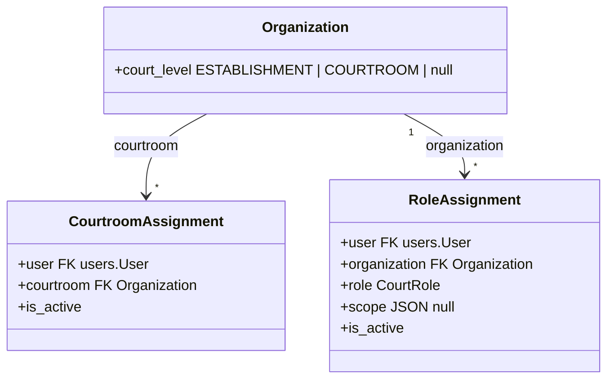

# 0026 — Court Roles and Role Assignments (`apps.organizations`)

## Status

Proposed

Depends on PR #179 (`feat/scrutiny`) only for #9.1: `apps.scrutiny` and its
`SCRUTINY_ESTABLISHMENT_ID` stop-gap are not on `main` yet. Everything else —
#1–#8, #10 steps 1–3, #9.2 — builds on `main` without it. #9.1 is done after
PR #179 merges.

## References

- PRDs: `court-roles.md` (`RLE-00`–`RLE-09`, §2, §3), `account-creation-handover.md` (`REG-23a`, `REG-23b`, `REG-30`, `REG-31`, `REG-35`–`REG-38`, §6.1), `scrutiny-registration-handover.md` (§2, §4, `SCR-06`, `SCR-09`–`SCR-12`, `SCR-16`), `process-handover.md` (§2, §6.2), `pending-tasks-handover.md` (attribute 10), `efiling-handover.md` (§3, the ID card rule)
- Specs: [`0002`](0002-audit-fields-base-model.md), [`0004`](0004-simple-audit-history.md), [`0005`](0005-registration-and-login.md), [`0006`](0006-active-flag-model.md), [`0008`](0008-organization.md), [`0010`](0010-simple-requests-flow.md), [`0011`](0011-case-workflows.md) #7.3, #7.5, [`0024`](0024-scrutiny.md) §2.2, §2.5

> **Scope note.** This module owns **who holds which court role, at which
> court**. It stores establishment and courtroom levels on `Organization`,
> the courtrooms each staff account is mapped to, and role assignments, and it
> answers role and reader questions through selectors. It does not decide what
> a role allows — each owning module does — and it does not place cases or
> registrations at a court.

## Context

Court-side permissions belong to **roles**, not to staff titles or user types
(`court-roles.md` §1). The PRDs fix how roles are held:

* Courts have two levels: a **court establishment** contains one or more **courtrooms** (`RLE-00`).
* An account may hold any combination of roles (`RLE-02`). Roles are held **per courtroom** (`RLE-02a`), except **Account approver**, **Scrutiny officer** and **Case registerer**, which are held **per court establishment** (`RLE-02c`).
* Roles are assigned in the backend, with no self-service, and changes apply at once (`RLE-03`, `REG-31`, `REG-38`). They are enforced server-side (`RLE-04`). Any holder may act (`RLE-05`).
* **Reading is not a role**: every staff account in a courtroom sees its cases; a case with no courtroom yet is seen by holders of the establishment's roles (`RLE-06`).
* The four process roles are held for a **scope** of process types and channels (`RLE-09`).
* Every staff account carries a list of courtrooms, each with its own roles, plus any establishment roles (`REG-35`).

What exists today does not express any of this:

| Today | Problem |
| --- | --- |
| `apps.scrutiny` reads Django groups `SCRUTINY_OFFICER` / `CASE_REGISTERER` | A group is held across the whole deployment, so it cannot say at which court. PR #179 pins scrutiny to one court with `SCRUTINY_ESTABLISHMENT_ID` as a stop-gap. |
| `apps.dristi_requests.services.candidate_approvers` reads the group `BAR_ID_APPROVER` | The same problem for the Account approver role (`REG-23a`). |
| `OrganizationType` lists court types only | Nothing tells an establishment from a courtroom; `apps.scrutiny.ports.courtrooms` falls back to "an organization with no children is its own courtroom". |
| Spec 0008 lists "user membership/roles inside organizations" as out of scope | Specs 0011 #7.3 and 0024 §2.2 already call `apps.organizations.selectors.role_holders` and `holds_role`, which do not exist. |

The PRDs say each state deployment has one establishment in this version
(`RLE-00`, `REG-23b`, scrutiny §4). Environments already host several courts,
so this module is built for many establishments from the start. Which
establishment a filed case or a registration belongs to stays with product
(#Open questions).

## Goals

* Mark organizations as court **establishments** or **courtrooms**, and validate the hierarchy between them.
* Own one list of court roles, each with the level it is held at.
* Store the courtrooms each staff account is mapped to (`REG-35`) and the roles held at each establishment or courtroom, with history.
* Carry a scope (process types × channels) on the process roles (`RLE-09`).
* Answer every role and reader question through selectors that other modules call — `holds_role`, `roles_held`, `role_holders`, `establishments_of`, `courtrooms_of`, `staff_of_courtroom`, `courtrooms`, `is_court_reader`.
* Let administrators manage assignments in Django admin only (`REG-38`), and tell other modules when assignments change.
* Give the frontend the caller's courts and roles in one call, for the courtroom choice (`REG-36`) and for deciding first actions (`RLE-07`).
* Move scrutiny and registration approval off Django groups, and remove the scrutiny stop-gap.

## Non-goals

* What each role allows. Each owning module checks its own actions (0024 §2.2 for scrutiny).
* Placing a filed case or a registration at an establishment (open questions P-2, P-3).
* Separating `Case.establishment` from `Case.court`, and court-scoped case reads in `apps.cases`. These are separate work; this spec provides the selectors they use (#9).
* The per-request "current courtroom" context and switching (`REG-36`, `REG-37`). Courtroom roles (orders, process, A-Diary) need it; the establishment roles do not. This spec returns the courtroom list the choice is made from.
* Employee account creation through HRMS (`REG-30`, `REG-32`–`REG-34`).
* Write APIs. Assignments are a backend operation (`RLE-03`, `REG-38`).

---

## Proposed changes

### 1. App layout

```text
apps/organizations/
├── models.py         # Organization (+ court_level), CourtroomAssignment, RoleAssignment
├── enums.py          # CourtLevel, CourtRole, ROLE_LEVEL, PROCESS_ROLES
├── selectors.py      # every read other modules make (#5)
├── services.py       # assign / revoke, used by admin and the migration command (#6)
├── signals.py        # court_roles_changed (#6.3)
├── checks.py         # system checks on the court hierarchy (#8)
├── admin.py          # + assignment admin and inlines (#7)
├── views.py          # + GET /court-roles/me/ (#7.2)
├── management/commands/migrate_court_role_groups.py   # (#10)
└── tests/
```

Dependencies are one-way. `apps.organizations` imports `apps.users` (the
`User` model) and nothing else of the court modules. `apps.scrutiny`,
`apps.dristi_requests`, `apps.cases` and the 0011 engine import
`apps.organizations.selectors`; nothing here imports them.

### 2. Court levels

`Organization` gains a nullable `court_level`:

| Value | Meaning |
| --- | --- |
| `ESTABLISHMENT` | A court establishment: where scrutiny, registration and account approval happen (`RLE-02c`). |
| `COURTROOM` | A courtroom of one establishment (`RLE-00`). |
| null | Any other organization (High Court, district court as an administrative unit, …). It holds no court roles. |

`court_level` is a separate field, not new `OrganizationType` values. The
type says what kind of court it is (a magistrate court); the level says what
part it plays in the hierarchy. An establishment is usually a magistrate court
too, and the tests already use `MAGISTRATE_COURT` for both.

Validation, in `Organization.clean()`:

* A `COURTROOM` has a parent, and the parent is an `ESTABLISHMENT`.
* An `ESTABLISHMENT` has no `ESTABLISHMENT` or `COURTROOM` above it.
* `court_level` cannot change while the organization has active assignments.

An establishment should have at least one active courtroom (`RLE-00`). This
is a system check (#8), not a model constraint: an establishment is created
before its courtrooms. There is no fallback. An establishment with no
courtroom has no courtroom to choose (0024 `SCR-16`), and the system check
says so.

`selectors.courtrooms(establishment_id)` replaces
`apps.scrutiny.ports.courtrooms`: the establishment's active children with
`court_level = COURTROOM`, by name.

### 3. Roles

`apps.organizations.enums.CourtRole` is the one list of court roles
(`court-roles.md` §2). Every module imports it. `apps.scrutiny.enums.CourtRole`
becomes a re-export.

| Value | Level | Process role (`RLE-09`) |
| --- | --- | --- |
| `ACCOUNT_APPROVER` | `ESTABLISHMENT` | |
| `SCRUTINY_OFFICER` | `ESTABLISHMENT` | |
| `CASE_REGISTERER` | `ESTABLISHMENT` | |
| `ORDER_DRAFTER` | `COURTROOM` | |
| `ORDER_DATA_FILLER` | `COURTROOM` | |
| `NEXT_HEARING_SETTER` | `COURTROOM` | |
| `ORDER_SIGNER` | `COURTROOM` | |
| `HEARING_CONTROLLER` | `COURTROOM` | |
| `APPLICATION_ONBOARDER` | `COURTROOM` | |
| `ENVELOPE_RECEIVER` | `COURTROOM` | yes |
| `PROCESS_SIGNER` | `COURTROOM` | yes |
| `PROCESS_DISPATCHER` | `COURTROOM` | yes |
| `PROCESS_REPORTER` | `COURTROOM` | yes |
| `EVIDENCE_MARKER` | `COURTROOM` | |
| `A_DIARY_EDITOR` | `COURTROOM` | |
| `A_DIARY_SIGNER` | `COURTROOM` | |

`ROLE_LEVEL` maps each role to its level; `PROCESS_ROLES` lists the four that
take a scope.

Rules that hold everywhere:

* No code checks a staff title (`RLE-08`). The per-state tables in `court-roles.md` §3 are seed data, never logic.
* `User.role` stays the citizen user type (spec 0005). Court roles never use it.
* Django groups and `is_staff` grant no court role. `is_staff` keeps its Django meaning: admin access.

### 4. Data model



Both models inherit `BaseModel` (0002) and `BaseActivatableModel` (0006), and
keep history with `simple_history` (0004). Assignments are deactivated, never
deleted, so the history shows who held what, and when.

#### 4.1 `CourtroomAssignment` — the courtroom list (`REG-35`)

| Field | Type | Notes |
| --- | --- | --- |
| `user` | `ForeignKey(User, PROTECT, related_name="courtroom_assignments")` | |
| `courtroom` | `ForeignKey(Organization, PROTECT, related_name="staff_assignments")` | `court_level = COURTROOM` |

* One active row per `(user, courtroom)`: `UniqueConstraint(fields=["user", "courtroom"], condition=Q(is_active=True))`.
* It makes the user staff of the courtroom: they read its cases (`RLE-06`) and may choose it after login (`REG-36`). It grants no action.

It is its own model because the PRD separates the two: a person may be on a
courtroom's list with no role there, and reading follows the list, not roles.

#### 4.2 `RoleAssignment`

| Field | Type | Notes |
| --- | --- | --- |
| `user` | `ForeignKey(User, PROTECT, related_name="role_assignments")` | |
| `organization` | `ForeignKey(Organization, PROTECT, related_name="role_assignments")` | an establishment or a courtroom, by the role's level |
| `role` | `CharField(choices=CourtRole.choices)` | |
| `scope` | `JSONField(null=True, blank=True)` | process roles only (#4.3) |

* One active row per `(user, organization, role)`: a partial unique constraint as above.
* Index `(organization, role, is_active)` for `role_holders`, and `(user, is_active)` for `roles_held`.

Validation, in `clean()` and in the services (#6):

* The organization's `court_level` equals `ROLE_LEVEL[role]` (`RLE-02a`, `RLE-02c`).
* A courtroom role needs an active `CourtroomAssignment` for the same user and courtroom (`REG-35`: roles are carried per listed courtroom).
* `scope` is set only on a process role, and is valid by #4.3.
* The organization is active.

#### 4.3 Scope (`RLE-09`)

```json
{"process_types": ["SUMMONS", "WARRANT"], "channels": ["RPAD", "POLICE"]}
```

* `scope = null` covers every process type on every channel (`RLE-09`: a role written without a scope covers everything).
* A missing key covers everything on that axis. An empty list is invalid.
* Values are uppercase codes. Until the process module defines its registry, they are checked for shape only; once it exists, against its codes.
* One assignment holds one scope, and the unique key `(user, organization, role)` allows one active assignment per role. A scope that is not a single product of types × channels (summons on every channel, warrants on RPAD only) cannot be held this way yet; open question O-3 decides whether process roles allow several assignments.

### 5. Selectors (`apps.organizations.selectors`)

Every selector counts only active assignments of active users at active
organizations, and runs a bounded number of queries.

| Selector | Returns | Used by |
| --- | --- | --- |
| `holds_role(user, role, organization_id, *, process_type=None, channel=None)` | `bool` | action checks everywhere (0024 §2.2) |
| `roles_held(user, organization_id)` | `frozenset[CourtRole]` | `allowed_actions`, the SCR-11 combination (both roles **at the same establishment**) |
| `role_holders(organization_id, role, *, process_type=None, channel=None)` | `QuerySet[User]` | 0011 `court_role` users rule (#7.3), approval routing |
| `establishments_of(user, role=None)` | establishments where the user holds an establishment role (or `role`) | default list scope (#9.1) |
| `courtrooms_of(user)` | courtrooms on the user's list (`REG-35`) | the courtroom choice (`REG-36`) |
| `staff_of_courtroom(courtroom_id)` | `QuerySet[User]` on the courtroom's list | 0011 `COURTROOM` visibility (#7.5) |
| `courtrooms(establishment_id)` | the establishment's active courtrooms | the Scrutiny officer's choice (`SCR-16`) |
| `establishment_of(organization_id)` | the establishment itself, or a courtroom's parent | callers holding a courtroom id |
| `is_court_reader(user, establishment_id, courtroom_id=None)` | `bool` | court-side read access (#5.1) |

`process_type` and `channel` filter process roles by scope; on any other role
they are ignored.

#### 5.1 Reading (`RLE-06`)

`is_court_reader(user, establishment_id, courtroom_id)`:

* with no courtroom yet: true if the user holds **any** establishment-level role at `establishment_id`;
* with a courtroom: true if the user is on that courtroom's list (`staff_of_courtroom`).

Whether establishment role holders keep reading a case after it gets a
courtroom is open question P-5; the selector takes no position.

`is_court_reader` is the general rule for reading a case. A module may keep a
read of its own records that follows its own rule. Scrutiny does (#9.1): its
endpoints are read through the round's establishment, so its officers keep
seeing the cases they forwarded (0024 §8.4, the *Closed* tab), which have a
courtroom and so would fail `is_court_reader`.

A caller that is not a reader is told the case does not exist (404), as 0021
§9.6 and 0024 §8.4 already do.

### 6. Services and change notification

#### 6.1 Services (`apps.organizations.services`)

| Service | Does |
| --- | --- |
| `assign_courtroom(user, courtroom, *, actor)` | creates or reactivates a `CourtroomAssignment` |
| `remove_courtroom(user, courtroom, *, actor)` | deactivates it **and** the user's role assignments at that courtroom |
| `assign_role(user, organization, role, *, scope=None, actor)` | validates (#4.2) and creates or reactivates a `RoleAssignment` |
| `revoke_role(user, organization, role, *, actor)` | deactivates it |

Each runs in one transaction and records `actor` as `updated_by` (0002) and in
history (0004). Admin and the migration command (#10) call these; neither
writes the models directly.

#### 6.2 No snapshot

A role is checked when an action is taken (0024 §2.2: nothing is
snapshotted). Assigning or revoking applies to the next request (`RLE-03`).

#### 6.3 `court_roles_changed`

After commit, the services send `court_roles_changed(organization_id, role)`
(role `None` for a courtroom-list change). 0011 subscribes and calls
`refresh_users(court_id=organization_id)`, so open tasks follow the change
(0011 #7.3). Until 0011 exists, nothing listens.

### 7. Admin and API

#### 7.1 Admin (`REG-38`)

* `RoleAssignment` and `CourtroomAssignment` admins: list by user, organization, role, active; filter by role, level and active; search by user mobile number and name, and by organization code and name.
* Inlines on the `User` admin (the person's courtrooms and roles) and the `Organization` admin (who is staff and who holds which role there).
* The admin form calls the services, so the same validation applies. Deleting is disabled; deactivate instead.
* History through `SimpleHistoryAdmin`.
* Only users with the Django permissions `organizations.add_roleassignment` / `change_roleassignment` (and the `courtroomassignment` equivalents) manage assignments.

#### 7.2 `GET /api/v1/court-roles/me/`

The caller's courts and roles. The frontend uses it for the courtroom choice
after login (`REG-36`) and for deciding first actions (`RLE-07`). It never
replaces the server-side checks.

```json
{
  "establishments": [
    {
      "id": "8f4968a4-…",
      "name": "NI Act Court, Ahmedabad",
      "roles": ["SCRUTINY_OFFICER"],
      "courtrooms": [
        {"id": "2e9ff6d0-…", "name": "Courtroom 1", "roles": ["ORDER_DRAFTER"]}
      ]
    }
  ],
  "meta": {}
}
```

* An establishment is listed when the caller holds a role there or is on the list of one of its courtrooms.
* `courtrooms` lists only courtrooms on the caller's list. Process roles carry their `scope`.
* Any authenticated user may call it; an account with no court roles gets an empty list.
* Schema inferred by `ApiAutoSchema` (0000 §10.2), tag `organizations`. No new error codes: the only refusal is `401`.

### 8. System checks (`apps.organizations.checks`)

Tagged `database`, so they run with `check --database default` and are
skipped before migration:

| Id | Level | When |
| --- | --- | --- |
| `organizations.W001` | Warning | an active establishment has no active courtroom (`RLE-00`) |
| `organizations.E001` | Error | an active courtroom's parent is not an active establishment |
| `organizations.W002` | Warning | an active role assignment sits on an organization whose level no longer matches the role (data edited outside the services) |

### 9. Consumers and migration path

#### 9.1 `apps.scrutiny` (replaces the stop-gap; after PR #179)

As built in PR #179, every role call goes through `apps/scrutiny/ports.py`,
and the lists are scoped to one establishment. The stop-gap is
`ports.configured_establishment()`: `roles_held` returns nothing anywhere else.

**Ports**

| Port | Today (PR #179) | Becomes |
| --- | --- | --- |
| `roles_held(user, establishment_id)` | the user's groups, only at `SCRUTINY_ESTABLISHMENT_ID` | `selectors.roles_held(user, establishment_id)` |
| `courtrooms(establishment_id)` | active children, or the establishment itself when it has none | `selectors.courtrooms(establishment_id)`; the fallback goes |
| `configured_establishment()` | reads `SCRUTINY_ESTABLISHMENT_ID` | removed, with the setting, `apps/scrutiny/system_checks.py` (`scrutiny.W001`, `E001`, `E002`), and its env and README entries |
| `establishment_id(case)` | `case.court_id` | unchanged here. It changes when `apps.cases` separates `Case.establishment` from `Case.court` (#9.3), and becomes `case.establishment_id`. |
| `set_court(case, courtroom_id)` | overwrites `case.court_id` with the courtroom | unchanged here. After #9.3 it sets `case.court` only. |

Until #9.3, a case's establishment for scrutiny is the round's
`ScrutinyRound.establishment_id`, copied from `case.court_id` when the first
round opens and carried to every later round. Every role check already uses
it, never `case.court_id` after Forward.

**Lists**

Today `permissions.require_court_reader(user, establishment_id)` returns one
establishment (the parameter, or the configured one), and
`selectors.scrutiny_list` / `registration_list` take one required
`establishment_id`. They change to sets:

* `require_court_reader(user, role, establishment_id=None)` returns the establishments the list covers. Without the parameter, that is `establishments_of(user, role)` for the list's role (`SCRUTINY_OFFICER` for the scrutiny list, `CASE_REGISTERER` for registration). With it, just that one, refused with `E09008` where the caller holds no role there. With no establishment at all, `E09008`, as today.
* `scrutiny_list(user, *, establishment_ids, …)` and `registration_list(user, *, establishment_ids, …)` filter `establishment_id__in`, and keep it required, so no caller can list every court by leaving it out.
* Whether several establishments are shown together or one at a time is open question P-4. The set covers both: one at a time is the parameter.

**Reading stays scrutiny's own**

`permissions.court_case(case_id, user)` keeps its rule: the caller holds a
court role at the **latest round's** establishment. It does not switch to
`is_court_reader` (#5.1), because a forwarded or registered case has a
courtroom, and its Scrutiny officers would lose the cases on their *Closed*
tab. Only the roles behind it change, from groups to assignments.

The filer-side reads (`ports.filing_side_case`, which calls
`apps.cases.services.filing.get_viewable_case`) change with #9.3, not here.

#### 9.2 `apps.dristi_requests` (Account approver, `REG-23a`)

An approval step can name a court role instead of a group:

* `ApprovalStep` gains `court_role` (`CourtRole`, blank).
* With `court_role` set, `candidate_approvers` returns `role_holders(establishment_id, court_role)` minus the requester, for the establishment the request belongs to.
* The registration request types move from `BAR_ID_APPROVER` to `court_role = ACCOUNT_APPROVER`.

Which establishment a registration belongs to is open question P-3. Until it
is answered, registration steps keep their group, and this part waits.

#### 9.3 `apps.cases`

Separate work (see the issue on court-scoped access) uses this module to:

* validate a filed case's establishment with `court_level = ESTABLISHMENT`, and its courtroom with `courtrooms(establishment_id)`;
* replace the global `cases.view_case` read in `get_viewable_case` with `is_court_reader`.

#### 9.4 0011 workflows

* `{"type": "court_role", "level": …}` resolves through `role_holders`. At `ESTABLISHMENT` it is the case's establishment; at `COURTROOM`, its courtroom (0011 #7.3).
* `COURTROOM` visibility resolves through `staff_of_courtroom`, or through `is_court_reader` before a courtroom is chosen (0011 #7.5).
* `court_roles_changed` triggers `refresh_users` (#6.3).

### 10. Migration

1. **Schema:** `court_level`, `CourtroomAssignment`, `RoleAssignment` and their historical tables.
2. **Levels:** set in admin, or through the seeding command (0025), per environment. There is no data migration: which organizations are establishments differs by environment.
3. **Groups to assignments:** `manage.py migrate_court_role_groups [--establishment <id>] [--groups …] [--dry-run]` turns group members into assignments at one establishment. It is idempotent and prints what it creates. It needs an establishment because a group does not say which court it was given for:
   * **`SCRUTINY_OFFICER`, `CASE_REGISTERER`:** `--establishment` defaults to `SCRUTINY_ESTABLISHMENT_ID` when it is set. On a deployment running PR #179, that is exactly where these groups already count, so the migration changes nobody's access.
   * **`BAR_ID_APPROVER` → `ACCOUNT_APPROVER`:** always needs an explicit `--establishment`. The setting never applied to registration approval, and these approvers act across the deployment today.
   * With no establishment given and the setting unset, the command refuses.
   * An environment with several courts runs it once per court, with `--groups` and the right people, or assigns in admin.
4. **Switch consumers:** #9.1 once PR #179 has merged, then #9.2 once P-3 is answered. The command in step 3 runs before #9.1 deploys, so no one loses a role in between.
5. **Drop the groups** in a data migration, once nothing reads them.

### 11. Testing

* **Levels:** a courtroom under a non-establishment is refused; an establishment under a courtroom is refused; changing the level of an organization with assignments is refused; the system checks flag an establishment without courtrooms and a courtroom with a wrong parent.
* **Assignments:**
  - A role on the wrong level is refused.
  - A courtroom role without the courtroom on the list is refused.
  - A scope on a non-process role is refused, and so is an empty scope list.
  - A second active `(user, organization, role)` is refused; one that is deactivated and then assigned again is reactivated.
  - Removing a courtroom deactivates the roles held there.
  - History records every change.
* **Selectors, with two establishments, two courtrooms each and at least three users:**
  - `roles_held` at A never includes a role held at B.
  - `roles_held` is the same for a courtroom of A as for A only where the roles are courtroom roles.
  - `role_holders` respects scope: no scope covers all; a scope covers only its types and channels.
  - `is_court_reader`, before and after a courtroom is set.
  - Inactive users, assignments and organizations are ignored.
  - A fixed number of queries per selector.
* **SCR-11 across courts:** Scrutiny officer at A and Case registerer at B is not "both" at A.
* **API:** `/court-roles/me/` for a user with establishment roles only, courtroom roles only, both, and none; `401` when anonymous.
* **Signal:** `court_roles_changed` is sent once after commit, not on rollback.
* **Migration command:**
  - A dry run changes nothing; a second run creates nothing new.
  - The scrutiny groups default to `SCRUTINY_ESTABLISHMENT_ID`; `BAR_ID_APPROVER` without `--establishment` is refused; with neither, the command refuses.
* **Scrutiny, in its own suite (#9.1).** The PR #179 tests do not carry over as they are. They give roles through groups (`factories.make_user`) and set `SCRUTINY_ESTABLISHMENT_ID` in the `establishment` fixture.
  - `make_user` and the fixtures assign roles with `assign_role` at the establishment.
  - The setting tests in `tests/test_establishment.py` go with the setting: `configured_establishment`, the "no roles without a valid establishment" cases, and the system checks.
  - The cross-court tests stay, rewritten on assignments: 404 on the other court's case, no actions on it, not listed, `?establishment=` refused, and Register at Scrutiny not offered.
  - New: an officer with roles at two establishments sees both in the default list. A Scrutiny officer at A who is a Case registerer only at B is not "both" at A (`SCR-11`). An officer still reads a forwarded case on the *Closed* tab.

## Design decisions

| Decision | Alternatives rejected |
| --- | --- |
| Assignments are rows `(user, organization, role)` | Django groups per court (`SCRUTINY_OFFICER@EST-01`): the name carries data, so there's no FK or validation. Object permissions (django-guardian): built for per-object access, not roles at a level of a hierarchy. `User.role`: it is the citizen user type (0005). |
| `court_level` is a separate field | New `OrganizationType` values: type and level are independent, and an establishment is also a magistrate court. |
| The courtroom list is its own model | A "staff" pseudo-role: reading is not a role (`RLE-06`), and the PRD keeps the list separate from roles (`REG-35`). |
| One role list, owned here | A role list per module: roles combine across modules (`SCR-11`, one person holding several courtroom roles), so they need one owner. |
| Checked at action time, with no snapshot | Caching roles in the session: a revoked role would keep working until logout (`RLE-03`: changes apply at once). |
| No write API | Admin-only management is what the PRD asks for (`REG-38`); HRMS account creation is out of scope. |
| Built for several establishments | One establishment per deployment (`RLE-00`): environments already host several courts. Where cases go stays a product decision. |

## Open questions

Product (from the court-roles issue):

| # | Question | Refs |
| --- | --- | --- |
| P-1 | Environments host several establishments. Is that one state with several establishments, or several states? Per-state configuration (registration types, number series, `clerkApproval`, oath) depends on it. | `RLE-00` |
| P-2 | How is a filed case placed at an establishment: chosen by the filer, derived from jurisdiction, or routed by the court? | `SCR-16`, `JUR-*` |
| P-3 | Which establishment approves an advocate's or clerk's registration, when the advocate practises at several? | `REG-23a`, `REG-23b` |
| P-4 | Someone holding a role at several establishments: do lists show all of them together, or one chosen establishment at a time? | `RLE-02c`, `REG-36` |
| P-5 | After a case gets a courtroom, do the establishment's role holders keep reading it, or only the courtroom's staff? | `RLE-06` |

This spec:

| # | Question |
| --- | --- |
| O-1 | Should an employee account be marked as such (a flag or user type) so citizens can never be assigned court roles? Today nothing marks an employee (0005 `is_staff` means admin access). |
| O-2 | Should Account approver assignments also be possible at a level above the establishment (a state-wide approver), given P-3? |
| O-3 | Process roles with several scopes: allow several active assignments of the same process role per user and courtroom (unique key without `role` for process roles), or require one combined scope? The first is simpler to manage; the second keeps one row per role. |
| O-4 | `migrate_court_role_groups` defaults the scrutiny groups to `SCRUTINY_ESTABLISHMENT_ID` (#10). Should it also refuse `BAR_ID_APPROVER` outright when the environment has more than one establishment, until P-3 says which court approves? |

## Out of scope

* What each role allows (the owning modules), and the UI.
* Current-courtroom request context and switching (`REG-36`, `REG-37`). Only the list it is chosen from is here.
* Placing cases and registrations at an establishment (P-2, P-3), and `Case.establishment` / `Case.court` (#9.3).
* Case-number series per court (`case-numbers.md`).
* HRMS integration and employee account creation (`REG-30`–`REG-34`).

## Affected files

- `src/apps/organizations/models.py`, `enums.py`, `selectors.py`, `services.py`, `signals.py`, `checks.py`, `apps.py`, `admin.py`, `views.py`, `serializers.py`, `urls.py`
- `src/apps/organizations/migrations/` (schema)
- `src/apps/organizations/management/commands/migrate_court_role_groups.py`
- `src/apps/organizations/tests/`
- Scrutiny, after PR #179 (#9.1):
  - `src/apps/scrutiny/ports.py`, `enums.py`, `permissions.py`, `selectors.py`, `views.py`
  - `src/apps/scrutiny/system_checks.py` (removed) and `apps.py`
  - `src/apps/scrutiny/tests/conftest.py`, `factories.py`, `test_establishment.py`, `test_selectors.py`
- `src/apps/dristi_requests/models.py`, `services.py` (#9.2)
- `src/config/settings/base.py`, `.env.example`, `.env.prod.example`, `README.md` (removing `SCRUTINY_ESTABLISHMENT_ID`)
- `spec/0008-organization.md` (out-of-scope note points here)

## Related specs

- [`0008`](0008-organization.md) — the organization hierarchy this extends.
- [`0011`](0011-case-workflows.md) — task users and visibility resolve through these selectors.
- [`0024`](0024-scrutiny.md) — scrutiny and registration roles (§2.2) and the courtroom choice (§2.5).
- [`0010`](0010-simple-requests-flow.md) — approval steps that move to court roles (#9.2).
- [`0004`](0004-simple-audit-history.md), [`0006`](0006-active-flag-model.md), [`0002`](0002-audit-fields-base-model.md) — history, active flag, audit fields.
- [`0005`](0005-registration-and-login.md) — `User.role` is the citizen type and is not a court role.
