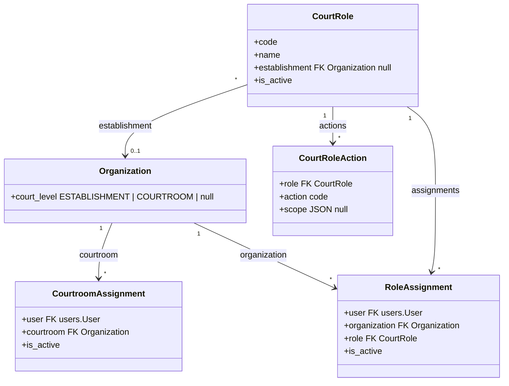

# 0026 — Court Actions, Roles and Assignments (`apps.organizations`)

## Status

Proposed

Depends on PR #179 (`feat/scrutiny`) only for #10.1: `apps.scrutiny` and its
`SCRUTINY_ESTABLISHMENT_ID` stop-gap are not on `main` yet. Everything else —
#1–#9, #11 steps 1–3, #10.2 — builds on `main` without it. #10.1 is done after
PR #179 merges.

## References

- PRDs: `court-roles.md` (`RLE-00`–`RLE-09`, §2, §3), `account-creation-handover.md` (`REG-23a`, `REG-23b`, `REG-30`, `REG-31`, `REG-35`–`REG-38`, §6.1), `scrutiny-registration-handover.md` (§2, §4, `SCR-06`, `SCR-09`–`SCR-12`, `SCR-16`), `process-handover.md` (§2, §6.2), `pending-tasks-handover.md` (attribute 10), `efiling-handover.md` (§3, the ID card rule)
- Specs: [`0002`](0002-audit-fields-base-model.md), [`0004`](0004-simple-audit-history.md), [`0005`](0005-registration-and-login.md), [`0006`](0006-active-flag-model.md), [`0008`](0008-organization.md), [`0010`](0010-simple-requests-flow.md), [`0011`](0011-case-workflows.md) #7.3, #7.5, [`0024`](0024-scrutiny.md) §2.2, §2.5, [`0025`](0025-data-seeding-command.md)
- Libraries considered: [`django-rules`](https://github.com/dfunckt/django-rules), [`drf-access-policy`](https://rsinger86.github.io/drf-access-policy/) — neither adopted (see Design decisions)

> **Scope note.** This module owns **who may do what, at which court**. It
> stores establishment and courtroom levels on `Organization`, the registry of
> fine-grained court **actions** that modules declare, court-configurable
> **roles** that bundle them, the courtrooms each staff account is mapped to,
> and the assignments that give a user a role at a court. It answers every
> access question through selectors and one check helper (#7). Each owning
> module declares its own actions and checks them; this module does not
> place cases or registrations at a court.

## Terminology

The PRD and this spec use "role" for different things:

| This spec              | PRD (`court-roles.md`)                            | Example                                          | Defined in                                                          |
| ---------------------- | --------------------------------------------------- | ------------------------------------------------ | ------------------------------------------------------------------- |
| **Action**       | one thing a PRD role allows (§2, "What it allows") | `scrutiny.forward`, `orders.sign`            | code: declared by the owning module (#3)                            |
| **Role**         | staff title (§3)                                   | Magistrate, Typist, Bench clerk / Reader, Ahlmad | data: `CourtRole` rows, built by administrators from actions (#4) |
| **Action group** | role (§2)                                          | Scrutiny officer, Order drafter                  | a display label on each action, for admin and seed authors only     |

The guiding rules:

* **Code checks actions, never roles.** What a Magistrate or a Typist may do differs from court to court (`court-roles.md` §3), so roles are data and change without a deploy (`RLE-03`, `RLE-08`).
* **Actions are fine-grained**: one per thing a person does (forward, send back, sign). An administrator can build a role from any combination, including part of a PRD role (send back without forward).
* **Actions are declared in code**, never created by administrators: an action means nothing until code checks it.

**Why "action", not "permission".** The PRD defines a role as "a set of
actions" (`RLE-01`) and lists what each allows as actions (§2). Scrutiny
already returns `allowed_actions` (`forward`, `send_back`), and 0011 tasks
carry action labels, so one word runs from PRD to API. "Permission" is taken
three times over in this codebase: Django's `auth.Permission` / `has_perm`
(which pass every superuser), DRF's `permission_classes`, and
`apps/scrutiny/permissions.py` (read access). Court actions are none of
these.

## Context

What a person may do on the court side does not follow their staff title or
user type (`court-roles.md` §1). The PRDs fix how it is held:

* Courts have two levels: a **court establishment** contains one or more **courtrooms** (`RLE-00`).
* A PRD role is a set of actions (`RLE-01`). An account may hold any combination (`RLE-02`), per courtroom (`RLE-02a`), except **Account approver**, **Scrutiny officer** and **Case registerer**, which are held per court establishment (`RLE-02c`).
* Assignments are made in the backend, with no self-service, and changes apply at once (`RLE-03`, `REG-31`, `REG-38`). They are enforced server-side (`RLE-04`). Any holder may act (`RLE-05`).
* **Reading is not an action**: every staff account in a courtroom sees its cases; a case with no courtroom yet is seen by those allowed any of the establishment's actions (`RLE-06`).
* The process actions are held for a **scope** of process types and channels (`RLE-09`).
* Which staff title holds which PRD roles differs by state and by court (§3). No code may read a title (`RLE-08`).
* Every staff account carries a list of courtrooms, each with its own actions, plus any establishment actions (`REG-35`).

What exists today does not express any of this:

| Today                                                                                     | Problem                                                                                                                                                            |
| ----------------------------------------------------------------------------------------- | ------------------------------------------------------------------------------------------------------------------------------------------------------------------ |
| `apps.scrutiny` reads Django groups `SCRUTINY_OFFICER` / `CASE_REGISTERER`          | A group is held across the whole deployment, so it cannot say at which court. PR #179 pins scrutiny to one court with `SCRUTINY_ESTABLISHMENT_ID` as a stop-gap. |
| `apps.dristi_requests.services.candidate_approvers` reads the group `BAR_ID_APPROVER` | The same problem for Account approver (`REG-23a`).                                                                                                               |
| `OrganizationType` lists court types only                                               | Nothing tells an establishment from a courtroom; `apps.scrutiny.ports.courtrooms` falls back to "an organization with no children is its own courtroom".         |
| Each module checks its own way (`require_role` in scrutiny, group lookups in requests)  | No common way to check, and a role check bakes one court's staffing into code.                                                                                     |
| Spec 0008 lists "user membership/roles inside organizations" as out of scope              | Specs 0011 #7.3 and 0024 §2.2 already call selectors here that do not exist.                                                                                      |

The PRDs say each state deployment has one establishment in this version
(`RLE-00`, `REG-23b`, scrutiny §4). Environments already host several courts,
so this module is built for many establishments from the start. Which
establishment a filed case or a registration belongs to stays with product
(#Open questions).

## Goals

* Mark organizations as court **establishments** or **courtrooms**, and validate the hierarchy between them.
* Give every module one way to **declare** fine-grained court actions, each with the level it applies at, and one registry of them.
* Let administrators define **roles** (staff titles) as bundles of actions, per deployment or per establishment, and change them without a deploy.
* Store the courtrooms each staff account is mapped to (`REG-35`) and the roles each user holds at each establishment or courtroom, with history.
* Carry a scope (process types × channels) on the process actions (`RLE-09`).
* One check helper across the system; no code outside this module reads a role.
* Answer every access question through selectors — `can`, `actions_of`, `action_holders`, `establishments_of`, `courtrooms_of`, `staff_of_courtroom`, `courtrooms`, `establishment_of`, `is_court_reader`.
* Manage roles and assignments in Django admin only (`REG-38`), and tell other modules when access changes.
* Give the frontend the caller's courts and actions in one call, for the courtroom choice (`REG-36`) and for deciding first actions (`RLE-07`).
* Move scrutiny and registration approval off Django groups, and remove the scrutiny stop-gap.

## Non-goals

* The final action list of modules not built yet (orders, hearings, process, A-Diary). Each declares its own in its spec; #3.3 lists the expected ones.
* Placing a filed case or a registration at an establishment (open questions P-2, P-3).
* Separating `Case.establishment` from `Case.court`, and court-scoped case reads in `apps.cases` (#10.3).
* The per-request "current courtroom" context and switching (`REG-36`, `REG-37`). This spec returns the courtroom list the choice is made from.
* Employee account creation through HRMS (`REG-30`, `REG-32`–`REG-34`).
* Write APIs. Roles and assignments are a backend operation (`RLE-03`, `REG-38`).
* Citizen-side access (filer, advocate, POA holder). It keeps its own rules (0021).

---

## Proposed changes

### 1. App layout

```text
apps/organizations/
├── models.py              # Organization (+ court_level), CourtRole, CourtRoleAction,
│                          #   CourtroomAssignment, RoleAssignment
├── enums.py               # CourtLevel
├── court_actions.py       # the registry: define(), get(), all() (#3)
├── selectors.py           # every read other modules make (#6)
├── access.py              # the check helper: require() (#7)
├── services.py            # assign / revoke / edit roles; used by admin, seeding, migration (#8)
├── migration_ops.py       # data-migration helpers for adding, splitting, removing actions (#3.4)
├── signals.py             # court_access_changed (#8.3)
├── checks.py              # system checks on the hierarchy, roles and registry (#9.3)
├── admin.py               # + role and assignment admin, inlines (#9.1)
├── views.py               # + GET /court-roles/me/ (#9.2)
└── tests/
```

Each owning module adds `<app>/court_actions.py` declaring its
actions (#3.1): `apps/scrutiny/court_actions.py`,
`apps/dristi_requests/court_actions.py`, and later orders, hearings,
process, documents, A-Diary.

Dependencies are one-way. Owning modules import `apps.organizations`
(`court_actions`, `access`, `selectors`). `apps.organizations` imports no
court module; it discovers their `court_actions.py` at startup with
`django.utils.module_loading.autodiscover_modules("court_actions")` in
`OrganizationsConfig.ready()`, as Django admin discovers `admin.py`.

### 2. Court levels

`Organization` gains a nullable `court_level`:

| Value             | Meaning                                                                                                      |
| ----------------- | ------------------------------------------------------------------------------------------------------------ |
| `ESTABLISHMENT` | A court establishment: where scrutiny, registration and account approval happen (`RLE-02c`).               |
| `COURTROOM`     | A courtroom of one establishment (`RLE-00`).                                                               |
| null              | Any other organization (High Court, district court as an administrative unit, …). It holds no court access. |

`court_level` is a separate field, not new `OrganizationType` values. The
type says what kind of court it is (a magistrate court); the level says what
part it plays in the hierarchy.

Validation, in `Organization.clean()`:

* A `COURTROOM` has a parent, and the parent is an `ESTABLISHMENT`.
* An `ESTABLISHMENT` has no `ESTABLISHMENT` or `COURTROOM` above it.
* `court_level` cannot change while the organization has active assignments.

An establishment should have at least one active courtroom (`RLE-00`). This
is a system check (#9.3), not a model constraint: an establishment is created
before its courtrooms. There is no fallback; an establishment with no
courtroom has no courtroom to choose (0024 `SCR-16`).

`selectors.courtrooms(establishment_id)` replaces
`apps.scrutiny.ports.courtrooms`: the establishment's active children with
`court_level = COURTROOM`, by name.

### 3. Actions

An action is one thing a person does on the court side — forward a case,
sign an order — declared in code by the module that owns it. It is the only
thing code checks.

#### 3.1 Declaring — `<app>/court_actions.py`

```python
# apps/scrutiny/court_actions.py
from apps.organizations.court_actions import define
from apps.organizations.enums import CourtLevel

EST = CourtLevel.ESTABLISHMENT

FLAG = define("scrutiny.flag", EST, "Mark fields and documents as errors", group="Scrutiny officer")
SEND_BACK = define("scrutiny.send_back", EST, "Send a case back for correction", group="Scrutiny officer")
FORWARD = define("scrutiny.forward", EST, "Forward a case for registration", group="Scrutiny officer")
# …
```

`define(code, level, label, *, group, scoped=False)` registers a
`CourtAction(code, level, label, group, scoped)` and returns it.

* `code` is `<app>.<action>`, lowercase. It is stored in the database, so it is never renamed or reused for another action. Adding, splitting and removing follow #3.4.
* `level` is `ESTABLISHMENT` or `COURTROOM`: where the action is taken (`RLE-02a`, `RLE-02c`).
* `scoped=True` marks a process action that is held for a scope (#5.5, `RLE-09`).
* `group` is the PRD role the action comes from. It is a **display label only**: admin groups the action list by it, and seed authors use it to expand the PRD's §3 tables. No code checks a group.
* Defining the same code twice raises `ImproperlyConfigured` at startup.

Code refers to an action by the returned constant (`scrutiny_actions.FORWARD`),
never by a string literal, so a typo fails at import.

#### 3.2 Rules that hold everywhere

* No code checks a role, a role's code or a role's name (`RLE-08`). A static test enforces it (#12).
* `User.role` stays the citizen user type (spec 0005).
* Django groups, `is_staff` and `is_superuser` allow no court action. `is_staff` keeps its Django meaning: admin access.
* The database stores action codes as plain strings (no `choices`), validated against the registry, so adding an action needs no migration.

#### 3.3 Catalogue

The PRD's §2 roles, split into actions. Scrutiny and account approval are
declared by this spec's consumers (#10.1, #10.2). The rest are the expected
actions; each module's own spec settles them.

| Action                             | Level             | Scoped | Group (PRD role)      | Owner                    |
| ---------------------------------- | ----------------- | ------ | --------------------- | ------------------------ |
| `requests.approve_registration`  | `ESTABLISHMENT` |        | Account approver      | `apps.dristi_requests` |
| `requests.reject_registration`   | `ESTABLISHMENT` |        | Account approver      | `apps.dristi_requests` |
| `scrutiny.start`                 | `ESTABLISHMENT` |        | Scrutiny officer      | `apps.scrutiny`        |
| `scrutiny.flag`                  | `ESTABLISHMENT` |        | Scrutiny officer      | `apps.scrutiny`        |
| `scrutiny.send_back`             | `ESTABLISHMENT` |        | Scrutiny officer      | `apps.scrutiny`        |
| `scrutiny.choose_courtroom`      | `ESTABLISHMENT` |        | Scrutiny officer      | `apps.scrutiny`        |
| `scrutiny.forward`               | `ESTABLISHMENT` |        | Scrutiny officer      | `apps.scrutiny`        |
| `scrutiny.edit_title`            | `ESTABLISHMENT` |        | Scrutiny officer      | `apps.scrutiny`        |
| `registration.start`             | `ESTABLISHMENT` |        | Case registerer       | `apps.scrutiny`        |
| `registration.register`          | `ESTABLISHMENT` |        | Case registerer       | `apps.scrutiny`        |
| `registration.send_back`         | `ESTABLISHMENT` |        | Case registerer       | `apps.scrutiny`        |
| `registration.edit_title`        | `ESTABLISHMENT` |        | Case registerer       | `apps.scrutiny`        |
| `orders.edit_text`               | `COURTROOM`     |        | Order drafter         | orders                   |
| `orders.send_for_signing`        | `COURTROOM`     |        | Order drafter         | orders                   |
| `orders.move_to_draft`           | `COURTROOM`     |        | Order drafter         | orders                   |
| `orders.discard_draft`           | `COURTROOM`     |        | Order drafter         | orders                   |
| `orders.fill_data`               | `COURTROOM`     |        | Order data filler     | orders                   |
| `orders.mark_data_complete`      | `COURTROOM`     |        | Order data filler     | orders                   |
| `orders.reopen_data`             | `COURTROOM`     |        | Order data filler     | orders                   |
| `orders.sign`                    | `COURTROOM`     |        | Order signer          | orders                   |
| `hearings.set_next`              | `COURTROOM`     |        | Next hearing setter   | hearings                 |
| `hearings.start`                 | `COURTROOM`     |        | Hearing controller    | hearings                 |
| `hearings.end`                   | `COURTROOM`     |        | Hearing controller    | hearings                 |
| `hearings.pass_over`             | `COURTROOM`     |        | Hearing controller    | hearings                 |
| `applications.take_on_file`      | `COURTROOM`     |        | Application onboarder | applications             |
| `applications.set_decision_date` | `COURTROOM`     |        | Application onboarder | applications             |
| `process.receive_envelope`       | `COURTROOM`     | yes    | Envelope receiver     | process                  |
| `process.sign`                   | `COURTROOM`     | yes    | Process signer        | process                  |
| `process.send`                   | `COURTROOM`     | yes    | Process dispatcher    | process                  |
| `process.recall`                 | `COURTROOM`     | yes    | Process dispatcher    | process                  |
| `process.record_outcome`         | `COURTROOM`     | yes    | Process reporter      | process                  |
| `documents.mark_evidence`        | `COURTROOM`     |        | Evidence marker       | documents                |
| `a_diary.edit_entry`             | `COURTROOM`     |        | A-Diary editor        | A-Diary                  |
| `a_diary.sign`                   | `COURTROOM`     |        | A-Diary signer        | A-Diary                  |

#### 3.4 Adding, splitting and removing actions

Actions will keep being added as modules are built and the PRD changes.
Declaring one is a line in the owning module's `court_actions.py` and needs no
schema migration (#3.2). But access is denied by default: **a new action is
allowed to nobody** until a role holds it. Each change therefore says, in the
same pull request, who gets it on release day.

| Change                                                                                                                             | What the pull request ships                                                                                                                                                                       |
| ---------------------------------------------------------------------------------------------------------------------------------- | ------------------------------------------------------------------------------------------------------------------------------------------------------------------------------------------------- |
| **New action, existing duty** — existing holders should have it (`orders.use_shortcuts` for whoever already edits orders) | `define(...)` and a data migration calling `add_action_to_roles_with(apps, "orders.use_shortcuts", like="orders.edit_text")`                                                                  |
| **New action, new duty** — nobody does it yet                                                                               | `define(...)` only. Administrators add it to roles, and the seed files are updated. The pull request says so.                                                                                   |
| **Split** — one action becomes two (as the PRD's v10 split Process dispatcher from Process reporter)                        | `define(...)` for the new action, the owning module's checks moved to it, and a data migration calling `add_action_to_roles_with(apps, new, like=old)`, so no one loses access                |
| **Remove**                                                                                                                   | the `define(...)` and its checks deleted, and a data migration calling `remove_action_from_roles(apps, code)`. Until it runs, `W004` flags the leftover rows and the selectors ignore them. |
| **Rename**                                                                                                                   | Not allowed: codes are stored in roles and history. Define the new code, migrate as for a split, then remove the old one.                                                                         |

**Helpers** (`apps/organizations/migration_ops.py`), for `RunPython` in the
owning module's migrations:

```python
# apps/orders/migrations/0012_use_shortcuts_action.py
from apps.organizations.migration_ops import add_action_to_roles_with

def forwards(apps, schema_editor):
    add_action_to_roles_with(apps, "orders.use_shortcuts", like="orders.edit_text")

class Migration(migrations.Migration):
    dependencies = [("orders", "0011_…"), ("organizations", "<migration creating CourtRoleAction>")]
    operations = [migrations.RunPython(forwards, migrations.RunPython.noop)]
```

* `add_action_to_roles_with(apps, code, *, like)` adds `code` to every role, active or not, that holds `like`, copying each `like` row's scope. It is idempotent: a role that already holds `code` with that scope is left alone.
* `remove_action_from_roles(apps, code)` deletes every `CourtRoleAction` row for `code`.
* Both use the historical models from `apps`, never the services or the registry, so the migration still runs after the code changes again. They take codes as strings for the same reason.
* Both write a `simple_history` row for each change themselves, with the reason `"migration <app>.<name>"`, since historical models fire no history signals.
* Neither sends `court_access_changed`. The people who can do anything do not change: a copy goes to those who already hold `like`, and a new action has no open tasks yet. A removal's tasks are the owning module's to close in the same migration.

**Seed files** (0025) are updated in the same pull request, so a new
environment gets what an existing one gets from the migration.

### 4. Roles

A **role** is a named bundle of actions an administrator builds: the
PRD's staff titles (`court-roles.md` §3). It is data, so each court decides
what its Magistrate, Typist or Ahlmad does, and a change applies at once
(`RLE-03`).

* A role may hold any actions, of either level (#5.4), including part of a PRD role.
* An exception for one person is a role too: an establishment-scoped role (#5.1) such as "Typist + order data filler, Courtroom 2". There are no direct action grants.
* The PRD's per-state tables are loaded as seed data through the seeding command (0025, not built yet; until then, entered in admin), with each PRD role expanded to its actions by the catalogue's group column:

```toml
[[court_role]]
code = "BENCH_CLERK"
name = "Bench clerk / Reader"
actions = [
  { action = "orders.edit_text" },
  { action = "orders.send_for_signing" },
  # … the rest of Order drafter, Order data filler, Next hearing setter, …
  { action = "process.sign", scope = { process_types = ["SUMMONS", "NOTICE", "PROCLAMATION", "ATTACHMENT"] } },
  { action = "process.send", scope = { channels = ["RPAD", "POLICE", "COURIER", "EMAIL", "SMS"] } },
  { action = "process.recall", scope = { channels = ["RPAD", "POLICE", "COURIER", "EMAIL", "SMS"] } },
]
```

### 5. Data model



All models inherit `BaseModel` (0002); `CourtRole`, `CourtroomAssignment` and
`RoleAssignment` also inherit `BaseActivatableModel` (0006). All four keep
history with `simple_history` (0004), so the history shows who could do what,
and when — including a role whose actions changed. Roles and assignments
are deactivated, never deleted.

#### 5.1 `CourtRole`

| Field             | Type                                                         | Notes                                                                                                                                                        |
| ----------------- | ------------------------------------------------------------ | ------------------------------------------------------------------------------------------------------------------------------------------------------------ |
| `code`          | `CharField(64)`                                            | uppercase snake_case; the natural key for seeding (0025)                                                                                                     |
| `name`          | `CharField(255)`                                           | shown in admin and `/court-roles/me/`; display only                                                                                                        |
| `establishment` | `ForeignKey(Organization, PROTECT, null=True, blank=True)` | null: usable anywhere in the deployment. Set: usable only at that establishment and its courtrooms — a court whose titles differ, or a one-person exception |

* Two partial unique constraints among active rows: `code` where `establishment` is null, and `(code, establishment)` where it is set. (Not `nulls_distinct=False`: PostgreSQL 15+ only, and the test settings use SQLite.)
* `establishment`, when set, has `court_level = ESTABLISHMENT`.

#### 5.2 `CourtRoleAction`

| Field      | Type                                                       | Notes                      |
| ---------- | ---------------------------------------------------------- | -------------------------- |
| `role`   | `ForeignKey(CourtRole, CASCADE, related_name="actions")` |                            |
| `action` | `CharField(100)`                                         | a registered code (#3.1)   |
| `scope`  | `JSONField(null=True, blank=True)`                       | scoped actions only (#5.5) |

* `action` is validated against the registry in `clean()` and the services.
* A role may list the same scoped action more than once, with different scopes; the scopes add up. This is how a title holds "summons on every channel, warrants on RPAD only".
* An unscoped action appears at most once per role, with no scope.
* Edited as an inline of `CourtRole` in admin, or by seeding; each change is recorded in history and sends `court_access_changed` (#8.3).

#### 5.3 `CourtroomAssignment` — the courtroom list (`REG-35`)

| Field         | Type                                                                    | Notes                       |
| ------------- | ----------------------------------------------------------------------- | --------------------------- |
| `user`      | `ForeignKey(User, PROTECT, related_name="courtroom_assignments")`     |                             |
| `courtroom` | `ForeignKey(Organization, PROTECT, related_name="staff_assignments")` | `court_level = COURTROOM` |

* One active row per `(user, courtroom)`: `UniqueConstraint(fields=["user", "courtroom"], condition=Q(is_active=True))`.
* It makes the user staff of the courtroom: they read its cases (`RLE-06`) and may choose it after login (`REG-36`). It grants no action.

It is its own model because the PRD separates the two: a person may be on a
courtroom's list with no action there, and reading follows the list.

#### 5.4 `RoleAssignment`

| Field            | Type                                                                   | Notes                           |
| ---------------- | ---------------------------------------------------------------------- | ------------------------------- |
| `user`         | `ForeignKey(User, PROTECT, related_name="role_assignments")`         |                                 |
| `organization` | `ForeignKey(Organization, PROTECT, related_name="role_assignments")` | an establishment or a courtroom |
| `role`         | `ForeignKey(CourtRole, PROTECT, related_name="assignments")`         |                                 |

* One active row per `(user, organization, role)`: a partial unique constraint.
* Indexes `(organization, is_active)`, `(user, is_active)` and `(role, is_active)`.

Validation, in `clean()` and in the services (#8):

* The organization is active and has a `court_level`.
* At a `COURTROOM`, the user has an active `CourtroomAssignment` there (`REG-35`: actions are carried per listed courtroom).
* The role is active, and its `establishment` is null or is this organization's establishment.
* At an `ESTABLISHMENT`, the role holds only establishment actions: an establishment has no courtroom to apply courtroom actions to.

**One role, two levels.** A title often mixes levels: the Magistrate registers
cases (establishment) and signs orders (courtroom). An assignment at a
**courtroom** applies:

* its courtroom actions at that courtroom;
* its establishment actions at the courtroom's **establishment**.

So a Magistrate assigned at Courtroom 1 may `orders.sign` at Courtroom 1 and
`registration.register` at its establishment. A Scrutiny officer, who belongs
to no courtroom, is assigned at the establishment itself. This is computed by
the selectors (#6) and never stored.

#### 5.5 Scope (`RLE-09`)

```json
{"process_types": ["SUMMONS", "WARRANT"], "channels": ["RPAD", "POLICE"]}
```

* `scope = null` covers every process type on every channel (`RLE-09`: a role written without a scope covers everything).
* A missing key covers everything on that axis. An empty list is invalid.
* Values are uppercase codes. Until the process module defines its registry, they are checked for shape only; once it exists, against its codes.
* A user's effective scope for an action at a courtroom is the **union** of every `CourtRoleAction` row for it, across all the roles they hold there.

### 6. Selectors (`apps.organizations.selectors`)

Every selector counts only active assignments of active users at active
organizations, through active roles, and only registered action codes. It
runs a bounded number of queries and never special-cases superusers.

A **grant** is the internal unit the selectors compute: `(action, organization_id, scope)`, after expanding roles and applying the level rule
(#5.4).

| Selector                                                                        | Returns                                                                           | Used by                                           |
| ------------------------------------------------------------------------------- | --------------------------------------------------------------------------------- | ------------------------------------------------- |
| `can(user, action, organization_id, *, process_type=None, channel=None)`      | `bool`                                                                          | `access.require` (#7) and any check             |
| `actions_of(user, organization_id)`                                           | `frozenset[str]`: the codes the user is allowed there                           | `allowed_actions` in responses (`RLE-07`)     |
| `action_holders(organization_id, action, *, process_type=None, channel=None)` | `QuerySet[User]`                                                                | 0011 task users (#10.4), approval routing (#10.2) |
| `grants_of(user)`                                                             | `list[Grant]`                                                                   | `/court-roles/me/` (#9.2)                       |
| `establishments_of(user, action=None)`                                        | establishments where the user is allowed any establishment action (or `action`) | default list scope (#10.1)                        |
| `courtrooms_of(user)`                                                         | courtrooms on the user's list (`REG-35`)                                        | the courtroom choice (`REG-36`)                 |
| `staff_of_courtroom(courtroom_id)`                                            | `QuerySet[User]` on the courtroom's list                                        | 0011 `COURTROOM` visibility (#10.4)             |
| `courtrooms(establishment_id)`                                                | the establishment's active courtrooms                                             | the Scrutiny officer's choice (`SCR-16`)        |
| `establishment_of(organization_id)`                                           | the establishment itself, or a courtroom's parent                                 | callers holding a courtroom id                    |
| `is_court_reader(user, establishment_id, courtroom_id=None)`                  | `bool`                                                                          | court-side read access (#6.1)                     |

* `action` arguments take the declared constant (a `CourtAction`); an unregistered one raises `ImproperlyConfigured`.
* `process_type` and `channel` filter scoped actions; on any other action they are ignored.
* `action_holders` selects candidates in the database — assignments of roles holding the action, at the organization or, for an establishment action, at any of its courtrooms — and filters scope in Python, since a court has few holders.
* `can` and `actions_of` memoise the user's grants on the request's user object, so several checks in one request cost one set of queries. Nothing outlives the request (#8.2).

#### 6.1 Reading (`RLE-06`)

`is_court_reader(user, establishment_id, courtroom_id)`:

* with no courtroom yet: true if the user is allowed **any** establishment action at `establishment_id` (the level rule included);
* with a courtroom: true if the user is on that courtroom's list (`staff_of_courtroom`).

Whether those allowed establishment actions keep reading a case after it gets a
courtroom is open question P-5; the selector takes no position.

`is_court_reader` is the general rule for reading a case. A module may keep a
read of its own records that follows its own rule. Scrutiny does (#10.1): its
officers keep seeing the cases they forwarded (0024 §8.4, the *Closed* tab).

A caller that is not a reader is told the case does not exist (404), as 0021
§9.6 and 0024 §8.4 already do.

### 7. Checking (`apps.organizations.access`)

Checks are made in **services**, where business logic lives (AGENTS.md), so
API calls, Dramatiq tasks and the 0011 engine are checked the same way. A view
may call the same helper early, before loading heavy data. No DRF permission
class is added.

```python
access.require(user, action, organization_id, *, error, process_type=None, channel=None)
```

raises `BusinessError(error)` unless `selectors.can(...)` is true.
`error` is the owning module's code (for scrutiny `E09008`). Read access is
not checked this way: it stays a 404 (#6.1).

```python
# apps/scrutiny/services/rounds.py
from .. import court_actions as actions

access.require(actor, actions.FORWARD, round_.establishment_id, error=errors.ROLE_REQUIRED)
```

**Combinations are action checks.** `SCR-11` — a Scrutiny officer who can
also register is not offered Forward, and registers at scrutiny instead — is:

```python
held = selectors.actions_of(user, round_.establishment_id)
decide = "register" if actions.REGISTER.code in held else "forward"
```

Both actions are checked **at the same establishment**, so a Scrutiny
officer at A who registers only at B is offered Forward at A.

**Business state stays in the service.** "The round is open", "the order is
unsigned" are checked by the module alongside the action, not encoded in
it.

### 8. Services and change notification

#### 8.1 Services (`apps.organizations.services`)

| Service                                             | Does                                                                                                                                     |
| --------------------------------------------------- | ---------------------------------------------------------------------------------------------------------------------------------------- |
| `assign_courtroom(user, courtroom, *, actor)`     | creates or reactivates a `CourtroomAssignment`                                                                                         |
| `remove_courtroom(user, courtroom, *, actor)`     | deactivates it **and** the user's role assignments at that courtroom                                                               |
| `assign_role(user, organization, role, *, actor)` | validates (#5.4) and creates or reactivates a `RoleAssignment`                                                                         |
| `revoke_role(user, organization, role, *, actor)` | deactivates it                                                                                                                           |
| `set_role_actions(role, entries, *, actor)`       | validates (#5.2) and replaces a role's actions; refuses a change that would put courtroom actions in a role assigned at an establishment |

Each runs in one transaction and records `actor` as `updated_by` (0002) and in
history (0004). Admin and seeding call these;
none writes the models directly.

#### 8.2 No snapshot

Access is checked when an action is taken (0024 §2.2). Assigning, revoking or
editing a role applies to the next request (`RLE-03`), for every holder of
that role.

#### 8.3 `court_access_changed`

After commit, the services send `court_access_changed(organization_ids, actions)`. A role edit sends it for every organization where the role is
assigned, with the actions added or removed. A courtroom-list change sends
`actions=None`. 0011 subscribes and calls `refresh_users(court_id=…)` for
each organization (0011 #7.3). Until 0011 exists, nothing listens.

### 9. Admin, API and system checks

#### 9.1 Admin (`REG-38`)

* **`CourtRole`** admin: code, name, establishment, active. The action inline lists the registry **grouped by `group`** (the PRD role), with a "select whole group" convenience, and a scope editor on scoped actions. Saving goes through `set_role_actions`. The form says how many users and organizations a change applies to.
* **`RoleAssignment`** and **`CourtroomAssignment`** admins: list by user, organization, role, active; filter by role, level and active; search by user mobile number and name, and by organization code and name.
* Inlines on the `User` admin (the person's courtrooms and roles, and a read-only list of effective actions per court) and the `Organization` admin (who is staff, and who holds which role there).
* The admin forms call the services, so the same validation applies. Deleting is disabled; deactivate instead. History through `SimpleHistoryAdmin`.
* Only users with the Django permissions `organizations.add_/change_courtrole`, `…roleassignment` and `…courtroomassignment` manage them. Editing roles and assigning them can go to different administrators.

#### 9.2 `GET /api/v1/court-roles/me/`

The caller's courts and what they may do there. The frontend uses it for the
courtroom choice after login (`REG-36`) and for deciding first actions
(`RLE-07`). It never replaces the server-side checks.

```json
{
  "establishments": [
    {
      "id": "8f4968a4-…",
      "name": "NI Act Court, Ahmedabad",
      "actions": ["scrutiny.flag", "scrutiny.forward", "registration.register"],
      "courtrooms": [
        {
          "id": "2e9ff6d0-…",
          "name": "Courtroom 1",
          "roles": [{"code": "MAGISTRATE", "name": "Magistrate"}],
          "actions": [
            "orders.sign",
            {"action": "process.sign", "scope": {"process_types": ["WARRANT"]}}
          ]
        }
      ]
    }
  ],
  "meta": {}
}
```

* `actions` are effective: an establishment action held through a courtroom role is listed on the establishment; scoped actions carry their merged scope.
* `roles` are for display only. The frontend decides on `actions`, or better on the per-object `allowed_actions` each module returns; it never branches on a role code (`RLE-08`).
* An establishment is listed when the caller is allowed an action there or is on the list of one of its courtrooms; `courtrooms` lists only courtrooms on the caller's list.
* Any authenticated user may call it; an account with no court access gets an empty list.
* Schema inferred by `ApiAutoSchema` (0000 §10.2), tag `organizations`. No new error codes: the only refusal is `401`.

#### 9.3 System checks (`apps.organizations.checks`)

`E003` runs always; the rest are tagged `database`, so they run with
`check --database default` and are skipped before migration:

| Id                     | Level   | When                                                                                                                        |
| ---------------------- | ------- | --------------------------------------------------------------------------------------------------------------------------- |
| `organizations.W001` | Warning | an active establishment has no active courtroom (`RLE-00`)                                                                |
| `organizations.E001` | Error   | an active courtroom's parent is not an active establishment                                                                 |
| `organizations.W002` | Warning | an active assignment breaks #5.4 (data edited outside the services)                                                         |
| `organizations.W003` | Warning | an active role has no actions                                                                                               |
| `organizations.W004` | Warning | a `CourtRoleAction` names a code no module declares (an action was removed without a data migration); selectors ignore it |
| `organizations.E003` | Error   | two modules declare the same code, or a code is not `<app>.<action>` lowercase                                            |

### 10. Consumers and migration path

#### 10.1 `apps.scrutiny` (replaces the stop-gap; after PR #179)

As built in PR #179, every role call goes through `apps/scrutiny/ports.py`
and `permissions.py`, and the lists are scoped to one establishment through
`ports.configured_establishment()`.

| Today (PR #179)                                                                                          | Becomes                                                                                                                               |
| -------------------------------------------------------------------------------------------------------- | ------------------------------------------------------------------------------------------------------------------------------------- |
| `apps.scrutiny.enums.CourtRole`                                                                        | removed; `apps/scrutiny/court_actions.py` declares the `scrutiny.*` and `registration.*` actions (#3.3)                         |
| `ports.roles_held(user, establishment_id)` — the user's groups, only at `SCRUTINY_ESTABLISHMENT_ID` | `selectors.actions_of(user, establishment_id)`                                                                                      |
| `require_role(actor, round_, CourtRole.X)` in `services/rounds.py`, `services/flags.py`            | `access.require(actor, actions.<ACTION>, round_.establishment_id, error=errors.ROLE_REQUIRED)`, one action per check                |
| `selectors.allowed_actions(round_, roles)` — stage × roles, with SCR-11 inline                       | stage × `actions_of`: each is offered when the caller is allowed it at the round's establishment; SCR-11 as in #7                  |
| `ports.courtrooms(establishment_id)` — falls back to the establishment itself                         | `selectors.courtrooms(establishment_id)`; the fallback goes                                                                         |
| `ports.configured_establishment()`                                                                     | removed, with the setting, `apps/scrutiny/system_checks.py` (`scrutiny.W001`, `E001`, `E002`), and its env and README entries |
| `ports.establishment_id(case)`, `ports.set_court(case, courtroom_id)`                                | unchanged here; they change with #10.3                                                                                                |

Until #10.3, a case's establishment for scrutiny is the round's
`ScrutinyRound.establishment_id`, copied from `case.court_id` when the first
round opens.

**Lists**

* `require_court_reader(user, action, establishment_id=None)` returns the establishments the list covers. Without the parameter, that is `establishments_of(user, action)` — `scrutiny.start` for the scrutiny list, `registration.start` for registration. With it, just that one, refused with `E09008` where the caller is not allowed the action there. With none at all, `E09008`, as today.
* `scrutiny_list(user, *, establishment_ids, …)` and `registration_list(user, *, establishment_ids, …)` filter `establishment_id__in`, and keep it required.
* Whether several establishments are shown together or one at a time is open question P-4.

**Reading stays scrutiny's own**

`permissions.court_case(case_id, user)` keeps its rule: the caller is allowed any
`scrutiny.*` or `registration.*` action at the **latest round's**
establishment. It does not switch to `is_court_reader` (#6.1), so officers
keep forwarded cases on their *Closed* tab.

#### 10.2 `apps.dristi_requests` (Account approver, `REG-23a`)

* `apps/dristi_requests/court_actions.py` declares `requests.approve_registration` and `requests.reject_registration`.
* `ApprovalStep` gains `court_action` (an action code, blank).
* With it set, `candidate_approvers` returns `action_holders(establishment_id, court_action)` minus the requester; the approve and reject services `require` their action.
* The registration request types move from `BAR_ID_APPROVER` to `court_action = "requests.approve_registration"`.

Which establishment a registration belongs to is open question P-3. Until it
is answered, registration steps keep their group, and this part waits.

#### 10.3 `apps.cases`

Separate work (court-scoped access) uses this module to:

* validate a filed case's establishment with `court_level = ESTABLISHMENT`, and its courtroom with `courtrooms(establishment_id)`;
* replace the global `cases.view_case` read in `get_viewable_case` with `is_court_reader`.

#### 10.4 0011 workflows

* `{"type": "court_role", "level": …}` becomes `{"type": "court_action", "action": "<code>"}` and resolves through `action_holders`, at the case's establishment or courtroom by the action's level (0011 #7.3).
* `COURTROOM` visibility resolves through `staff_of_courtroom`, or `is_court_reader` before a courtroom is chosen (0011 #7.5).
* `court_access_changed` triggers `refresh_users` (#8.3).

### 11. Migration

Nothing here is in production yet, so there is no access to carry over: no
user is in the `SCRUTINY_OFFICER`, `CASE_REGISTERER` or `BAR_ID_APPROVER`
groups outside hand-made test users on dev and QA. There is no group
migration command.

1. **Schema:** `court_level`, `CourtRole`, `CourtRoleAction`, `CourtroomAssignment`, `RoleAssignment` and their historical tables.
2. **Levels and roles:** set levels in admin or through seeding (0025), per environment. Seed `CourtRole` rows from the PRD's §3 table for the state (a `organizations.CourtRole` seeder, natural key `code` + `establishment`). There is no data migration: establishments and titles differ by environment.
3. **Test users:** on dev and QA, assign roles to the test accounts in admin (or seed them), in place of their group memberships.
4. **Switch scrutiny** (#10.1) once PR #179 has merged.
5. **Switch registration approval** (#10.2) once P-3 is answered: a data migration in `apps.dristi_requests` moves the approval steps seeded by `dristi_requests/0002_seed_lawyer_bar_update` and `users/0004_seed_registration_request_types` from the `BAR_ID_APPROVER` group to `court_action = "requests.approve_registration"`.
6. **Stop reading the groups.** Nothing creates them in a migration; any left on an environment are deleted in admin.

### 12. Testing

* **Levels:** a courtroom under a non-establishment is refused; an establishment under a courtroom is refused; changing the level of an organization with assignments is refused; system checks flag an establishment without courtrooms and a courtroom with a wrong parent.
* **Registry:** a duplicate code fails at startup; a badly formed code fails `E003`; an unregistered code in a role is refused by the services, flagged by `W004` and ignored by the selectors.
* **Migration helpers (#3.4):** `add_action_to_roles_with` adds the code to every role holding `like`, active or not, with each row's scope, and nothing else; a second run adds nothing; history rows are written. `remove_action_from_roles` removes every row for the code and clears `W004`. Both run against historical models with the code no longer registered.
* **Roles:** a scope on an unscoped action is refused, and so is an empty scope list; an unscoped action twice in one role is refused; a role scoped to establishment A cannot be assigned at B; adding a courtroom action to a role assigned at an establishment is refused; editing a role's actions changes every holder's access on the next call and is recorded in history.
* **Assignments:**
  - A courtroom assignment without the courtroom on the list is refused.
  - A role with courtroom actions assigned at an establishment is refused.
  - A second active `(user, organization, role)` is refused; a deactivated one assigned again is reactivated.
  - Removing a courtroom deactivates the role assignments there.
* **Selectors, with two establishments, two courtrooms each and at least three users:**
  - A Magistrate role at Courtroom A1 gives `orders.sign` at A1, `registration.register` at A, and nothing at A2 or B.
  - A role holding only `scrutiny.send_back` (part of a PRD role) gives send back and not forward.
  - `actions_of` at A never includes an action allowed only at B.
  - Two roles: actions union; scopes union.
  - `action_holders` respects scope and the level rule.
  - `is_court_reader`, before and after a courtroom is set.
  - Inactive users, assignments, roles and organizations are ignored; a superuser with no assignment is allowed nothing.
  - A fixed number of queries per selector; repeated checks in one request reuse the memoised grants.
* **Check helper:** `require` passes, refuses with the given error code, and passes `process_type` / `channel` to scope.
* **No role checks (static test, like `addon/cdac_sms_gateway/tests/test_isolation.py`):** outside `apps/organizations`, no module imports `CourtRole`, `CourtRoleAction` or `RoleAssignment`; action codes appear as string literals only in `court_actions.py` files and migrations.
* **SCR-11 across courts:** `scrutiny.forward` at A and `registration.register` only at B is offered Forward at A, not Register.
* **API:** `/court-roles/me/` for a user with establishment actions only, a courtroom role only, a mixed-level role, and none; `401` when anonymous.
* **Signal:** `court_access_changed` is sent once after commit, not on rollback, and once per assigned organization on a role edit.
* **Scrutiny, in its own suite (#10.1).** `factories.make_user` and the fixtures assign roles (built from the needed actions) with `assign_role` at the establishment instead of groups. The setting tests in `tests/test_establishment.py` go with the setting. The cross-court tests stay, rewritten on assignments. New: an officer with actions at two establishments sees both in the default list; an officer still reads a forwarded case on the *Closed* tab; an officer with `scrutiny.flag` but not `scrutiny.forward` is not offered Forward.

## Design decisions

| Decision                                                                                     | Alternatives rejected                                                                                                                                                                                                                                                                                             |
| -------------------------------------------------------------------------------------------- | ----------------------------------------------------------------------------------------------------------------------------------------------------------------------------------------------------------------------------------------------------------------------------------------------------------------- |
| Code checks **actions**; users get them only through **roles** (data) at a court | Checking roles or staff titles in code: forbidden by `RLE-08`, and what a title does differs by court.                                                                                                                                                                                                          |
| Called **actions**, not permissions                                                    | "Permission": clashes with Django's `auth.Permission` and `has_perm` (superusers pass every check), DRF `permission_classes` and `apps/scrutiny/permissions.py`, and drifts from the PRD's "a role is a set of actions" (`RLE-01`) and the `allowed_actions` the API already returns.                 |
| **Fine-grained** actions, one per thing a person does                                  | The PRD's 16 roles as actions, or as fixed sets admins pick from: shorter list, but an administrator could never give part of a PRD role (send back without forward), and every PRD split (v10's dispatcher / reporter) touches call sites. The `group` label keeps the PRD's vocabulary for admin and seeding. |
| Actions declared in code by the owning module; a registry, no `choices`                    | Actions as admin-created rows: an action does nothing until code checks it. One central enum: `apps.organizations` would list every module's actions, and each new action would need a migration for `choices`.                                                                                               |
| Roles are data, per deployment or per establishment                                          | Roles in code or settings: the point is that each court decides, without a deploy (`court-roles.md` §3).                                                                                                                                                                                                       |
| No direct action grants; a one-person exception is an establishment-scoped role              | Direct grants: a second way to hold an action, more to show in admin and reason about.                                                                                                                                                                                                                            |
| One assignment at a courtroom applies establishment actions at its establishment             | Single-level roles ("Magistrate (establishment)", "Magistrate (courtroom)"): doubles every title and every assignment.                                                                                                                                                                                            |
| Checks in services, with one helper                                                          | A DRF permission class: views only, while Dramatiq tasks and 0011 need the same checks; AGENTS.md keeps logic in services.                                                                                                                                                                                        |
| **No access library**                                                                  | **django-rules**: its value is predicates and `&`/`                                                                                                                                                                                                                                                       |
| Assignments are rows `(user, organization, role)`                                          | Django groups per court (`SCRUTINY_OFFICER@EST-01`): the name carries data, so there is no FK or validation. `User.role`: the citizen user type (0005).                                                                                                                                                       |
| `court_level` is a separate field                                                          | New `OrganizationType` values: type and level are independent.                                                                                                                                                                                                                                                  |
| The courtroom list is its own model                                                          | A "staff" pseudo-action: reading is not an action (`RLE-06`), and the PRD keeps the list separate (`REG-35`).                                                                                                                                                                                                 |
| Checked at action time; memoised per request only                                            | Caching in the session: a revoked role or edited role would keep working until logout (`RLE-03`).                                                                                                                                                                                                               |
| No write API                                                                                 | Admin-only management is what the PRD asks for (`REG-38`).                                                                                                                                                                                                                                                      |
| Built for several establishments                                                             | One establishment per deployment (`RLE-00`): environments already host several courts.                                                                                                                                                                                                                          |

## Open questions

Product (from the court-roles issue):

| #   | Question                                                                                                                                                                                                                             | Refs                     |
| --- | ------------------------------------------------------------------------------------------------------------------------------------------------------------------------------------------------------------------------------------ | ------------------------ |
| P-1 | Environments host several establishments. Is that one state with several establishments, or several states? Per-state configuration (registration types, number series, `clerkApproval`, oath, the seeded roles) depends on it.    | `RLE-00`               |
| P-2 | How is a filed case placed at an establishment: chosen by the filer, derived from jurisdiction, or routed by the court?                                                                                                              | `SCR-16`, `JUR-*`    |
| P-3 | Which establishment approves an advocate's or clerk's registration, when the advocate practises at several?                                                                                                                          | `REG-23a`, `REG-23b` |
| P-4 | Someone allowed actions at several establishments: do lists show all of them together, or one chosen establishment at a time?                                                                                                        | `RLE-02c`, `REG-36`  |
| P-5 | After a case gets a courtroom, do those allowed the establishment's actions keep reading it, or only the courtroom's staff?                                                                                                          | `RLE-06`               |
| P-6 | Fine-grained actions let a court give part of a PRD role (send back without forward). Is that allowed, or should a role always hold whole PRD roles? The model allows both; this decides whether the admin warns on a partial group. | `RLE-01`, `RLE-02`   |

This spec:

| #   | Question                                                                                                                                                                                  |
| --- | ----------------------------------------------------------------------------------------------------------------------------------------------------------------------------------------- |
| O-1 | Should an employee account be marked as such (a flag or user type) so citizens can never be assigned court roles? Today nothing marks an employee (0005 `is_staff` means admin access). |
| O-2 | Should Account approver actions be assignable at a level above the establishment (a state-wide approver), given P-3?                                                                      |
| O-3 | Should a role edit that removes an action from many users at once need a second administrator's confirmation, or is history plus the admin warning (#9.1) enough?                         |
| O-4 | Should `/court-roles/me/` drop `roles` entirely, so the frontend cannot branch on them, or keep them for display?                                                                     |

## Out of scope

* The final action lists of modules not built yet (#3.3), and the UI.
* Current-courtroom request context and switching (`REG-36`, `REG-37`).
* Placing cases and registrations at an establishment (P-2, P-3), and `Case.establishment` / `Case.court` (#10.3).
* Citizen-side access rules (0021).
* Case-number series per court (`case-numbers.md`).
* HRMS integration and employee account creation (`REG-30`–`REG-34`).

## Affected files

- `src/apps/organizations/models.py`, `enums.py`, `court_actions.py`, `selectors.py`, `access.py`, `services.py`, `migration_ops.py`, `signals.py`, `checks.py`, `apps.py`, `admin.py`, `views.py`, `serializers.py`, `urls.py`
- `src/apps/organizations/migrations/` (schema)
- `src/apps/organizations/tests/` (including the static no-role-check test)
- The 0025 seeder registry — an `organizations.CourtRole` seeder, once 0025 is built (until then, roles are entered in admin)
- Scrutiny, after PR #179 (#10.1):
  - `src/apps/scrutiny/court_actions.py` (new), `ports.py`, `enums.py`, `permissions.py`, `selectors.py`, `services/rounds.py`, `services/flags.py`, `views.py`
  - `src/apps/scrutiny/system_checks.py` (removed) and `apps.py`
  - `src/apps/scrutiny/tests/conftest.py`, `factories.py`, `test_establishment.py`, `test_selectors.py`
- `src/apps/dristi_requests/court_actions.py` (new), `models.py`, `services.py`, and a data migration for the approval steps (#10.2, #11 step 5)
- `src/config/settings/base.py`, `.env.example`, `.env.prod.example`, `README.md` (removing `SCRUTINY_ESTABLISHMENT_ID`)
- `spec/0008-organization.md` (out-of-scope note points here)

## Related specs

- [`0008`](0008-organization.md) — the organization hierarchy this extends.
- [`0011`](0011-case-workflows.md) — task users and visibility resolve through these selectors.
- [`0024`](0024-scrutiny.md) — scrutiny and registration actions (§2.2) and the courtroom choice (§2.5).
- [`0010`](0010-simple-requests-flow.md) — approval steps that move to court actions (#10.2).
- [`0025`](0025-data-seeding-command.md) — seeding court levels and roles.
- [`0004`](0004-simple-audit-history.md), [`0006`](0006-active-flag-model.md), [`0002`](0002-audit-fields-base-model.md) — history, active flag, audit fields.
- [`0005`](0005-registration-and-login.md) — `User.role` is the citizen type and is not a court role.
