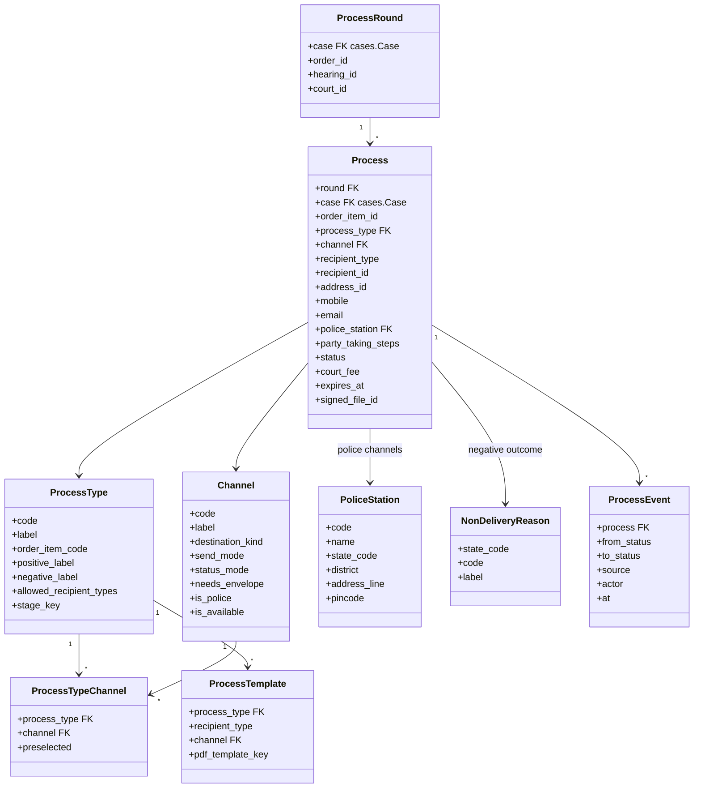
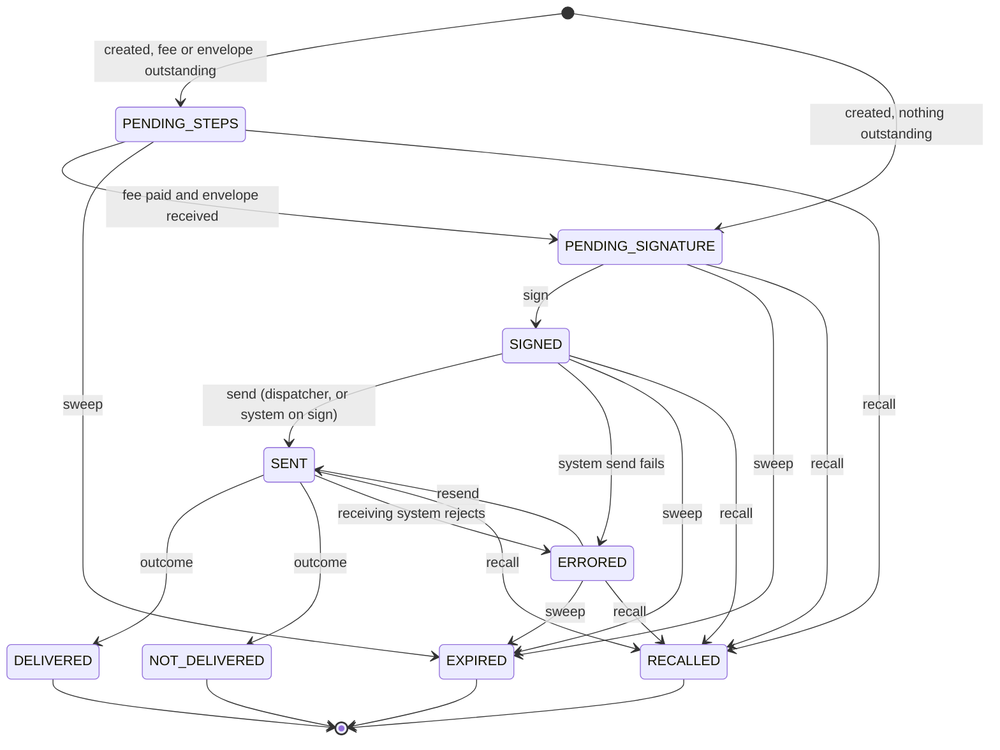

# 0028 — Summons, Warrants and Other Processes (`apps.processes`)

## Status

Proposed

## References

- PRDs: `process.md` v14.3 (§3.1, §3.2, `PRC-`, `AUT-`, `TPL-01`, `TPL-02`, §6.2, §6.3, `FEE-`, `STP-`, `SGN-`, `DSP-`, §10.1, `EXP-`, `PIA-01`, §13, §15, `Q-15`, `Q-16`), `court-roles.md` (`RLE-02a`, `RLE-04`, `RLE-06`, `RLE-09`, §2), `order-template-catalogue.md` (#9, #10, #12, #20, #21, #25), `pending-task-drafts.md` (§4–§8), `pending-tasks.md`, `case-lifecycle.md` (§4), `efiling.md` (§19.2), `view-case.md` (§7, `SVC-`), `signing-methods.md` (`SGM-`), `payment-logic.md`

> **Scope note.** A summons and a warrant are two **process types** of one
> process workflow. The PRD specifies a single workflow for notice, summons,
> warrant, proclamation, attachment and custom process, differing only by
> configuration: which channels a type may use, who signs it, its court fee and
> its labels (`process.md` §4). This module therefore owns every process type;
> summons and warrant are written out wherever they differ. An order starts a
> process and nothing more (`PRC-01`): drafting and signing the order belong to
> the orders module, the hearing date to hearings, money to
> [`0017`](0017-orders-management.md), and the wire contract of each external
> channel to its own addon.

## Context

From cognizance onwards the court brings people before it by **process**: a
summons to the accused or a witness, a warrant against an accused who does not
appear, a notice, a proclamation, an attachment, or a custom process. Each is
ordered by an order item of the Process category (`order-template-catalogue.md`
#9, #10, #12, #20, #21, #25), and each must be paid for, signed, sent and
tracked until it is served, fails or lapses.

The unit of work is the **process**: one process type, to one recipient, on one
channel, at one destination (`PRC-02`, `process.md` §3). What it starts with
never changes, except its hearing's date (`process.md` §3.1).

```text
Order (Process-category item)
└── Round ─ everything one order issues
    └── Process ─ one per recipient, per channel, per address
```

An order that summons two accused, the second at two addresses, by SMS and
RPAD, is one round of six processes. Each carries its own status, is signed
separately and closes on its own outcome (`DSP-04`, `SGN-03`).

Every process follows the same spine (`process.md` §4):

```text
order triggered ──> fee and envelope steps ──> sign ──> send ──> update status ──> outcome
                    (party directed to         (Process   (Process     (Process reporter,
                     take steps; Envelope       signer)    dispatcher,  or the receiving
                     receiver)                             or system)   system)
                  recall (Process dispatcher) may end it before an outcome;
                  expiry ends it only if it has not been sent
```

What varies by process type:

| | Summons | Warrant | Notice | Proclamation | Attachment | Custom process |
| --- | --- | --- | --- | --- | --- | --- |
| Ordered by | *Issue of summons* | *Issue of warrants* | *Issue of notice* | *Issue of proclamation* | *Issue of attachment* | *Issue of miscellaneous process* |
| Addressed to | the recipient | the police, who execute it on the recipient | the recipient | published, not addressed | the police | as ordered |
| Default channels (§6.3, `AUT-08`) | SMS, Email, RPAD | Police (NSTEP) or Police (iCOPS), whichever the deployment runs | SMS, Email, RPAD | By hand | Police (NSTEP) or Police (iCOPS) | none |
| Allowed channels (§6.3) | SMS, Email, RPAD, e-Post, all three police | the three police channels, By hand | SMS, Email, RPAD, e-Post | By hand | the three police channels | all |
| Positive / negative outcome label | Delivered / Not delivered | Executed / Not executed | Delivered / Not delivered | Executed / Not executed | Executed / Not executed | Delivered / Not delivered |
| Secondary stage while live | Summons | Warrant | Notice | Proclamation | Attachment | none |
| Recipient restriction (default) | any party the order names | any | any | the accused | the accused | any |

What varies by channel (§6.2):

| Channel | Goes to | Send | Update status | Envelope |
| --- | --- | --- | --- | --- |
| SMS | mobile number | System — messaging | System | — |
| Email | email address | System — email | System | — |
| RPAD | postal address | Manual | Manual | yes |
| e-Post | postal address | Manual | Manual | — |
| Police (RPAD) | the police station's postal address | Manual | Manual | yes |
| Police (NSTEP) | the police station, through NSTEP | System — via CIS, end-of-day batch | System — polls CIS | — |
| Police (iCOPS) | the police station, through iCOPS (Kerala) | System — direct | System — iCOPS calls back | — |
| By hand | postal address, taken in person | Manual | Manual | — |

The court screens make the work concrete.

**Process lists** — court side, by status (`SGN-02`).

| Element | What it shows |
| --- | --- |
| Tabs | *Pending steps*, *Pending signature*, *Signed*, *Sent*, *Errored*, *Closed*, each with a count, filtered to the process types and channels the viewer's roles cover |
| Row | case number and title · process type · recipient · channel · destination · hearing date · status and status date · the viewer's move (*Record receipt*, *Sign*, *Send* / *Mark as sent*, *Record outcome*) |
| Bulk | select several to sign (`SGN-03`) or recall (`PIA-01`) |

**Process register** — the case's *Notice/Process Status* section (`view-case.md` §7).

| Element | What it shows |
| --- | --- |
| Per person | name and role on the case — *Accused 2*, *PW-1* (`SVC-01`–`SVC-03`) |
| Per round, newest first | process type, linked hearing and its date, triggering order and its date, date the fee was paid (`SVC-04`–`SVC-09`) |
| Per process in the round | channel, destination, status, status date, remarks (`SVC-10`–`SVC-14`) |

The PRD fixes the rules:

* The process workflow is separate from the order's. The order supplies the inputs and starts it; the process then runs on its own (`PRC-01`).
* One process per recipient, per channel, per address. A company and each person in charge are separate recipients (`PRC-02`).
* The destination comes from the recipient's own record, or on a police channel from the entered police station. An Order data filler may add a new destination on the order screen; it is saved to the recipient's record for later rounds. A channel is blocked only where the recipient has no destination of its kind and none is added (`PRC-05`).
* The process's hearing is the one set in the same order, or else the case's existing next hearing. A change to the hearing's date changes nothing on the process except an unsigned process's expiry; screens look up the latest date from the case (`PRC-06`).
* The document's template is set by process type, recipient and channel; one template serves every channel unless a channel has its own (`TPL-01`, `TPL-02`).
* The system fills in and preselects whatever it can and never guesses (`AUT-01`–`AUT-09`).
* The court fee is flat per process type, drawn from one pool per case; only the balance is collected, from the party directed to take steps, and nothing is refunded (`FEE-01`, `FEE-04`–`FEE-08`).
* An RPAD or Police (RPAD) process needs its own envelope, received by an Envelope receiver, before it can be signed (`STP-01`–`STP-03`).
* Every process is signed separately by a person holding Process signer for its type and channel; signing does not send it (`SGN-01`, `SGN-03`, `SGN-04`).
* Send and update status are separate steps, each System or Manual per channel (`DSP-01`).
* Each manual step is a court-side pending task for the holders of its role; doing a step closes its task and opens the next in one transaction (`SGN-02`).
* A terminal outcome carries a comment and an optional file; a negative one also a reason from a state master (`DSP-08`, `DSP-09`).
* A process is Errored only when the system tries to send it and the send fails; it may be resent as the same process (`DSP-11`). Non-delivery never creates a new process; a fresh process needs a fresh order (`DSP-07`).
* A process that has not been sent expires at 00:00 IST on its hearing date; before signing the expiry follows the hearing, after signing it is fixed. A sent process never expires: it stays open until its outcome is recorded or it is recalled (`EXP-01`, `EXP-01a`, `EXP-02`).
* A Process dispatcher may recall any process with no outcome yet, sent or not (`PIA-01`).
* Every role is held per process type and channel, and enforced server-side (`RLE-09`, `RLE-04`).

### What this module does and does not decide

`apps.processes` knows **which processes an order started, where each goes,
what it costs, who signed and sent it, and what became of it**. It does not
decide what the court ordered — the order does. It does not decide the hearing
date — hearings does, and this module reads it. It does not move money —
[`0017`](0017-orders-management.md) does. It does not speak any external
system's protocol — each system channel's backend does, behind a contract owned
here. It does not move the case's stage — it dispatches events to
[`0011`](0011-case-workflows.md).

## Goals

* Start one process per recipient, channel and address from a triggered Process-category order item, idempotently, grouped into one round per order.
* Hold process types, channels, the type × channel matrix, the police-station master and the non-delivery reason master as data, seeded and editable.
* Work out the round's court fee against the case's pool, and raise a demand only for the balance.
* Gate signing on fee and envelope, gate every step on the role held for the process's type and channel, and open and close each step's pending task.
* Sign each process separately through [`0015`](0015-cdac-esign.md), and render its document through [`0016`](0016-pdf-services.md).
* Send through the channel's backend where the send is System, record it where it is Manual, and the same for status updates.
* Record every status change with its time, actor and source, and the outcome with its comment, reason and file.
* Expire unsent processes, recall and resend processes as the PRD sets out.
* Save a destination added on the order screen to the recipient's record.
* Start and end the case's secondary stages through [`0011`](0011-case-workflows.md) events.
* Serve the court's process lists, the case's process register and the citizen-side steps.
* Expose REST APIs following [`0000`](0000-api-coding-spec.md), with registered error codes.

## Non-goals

* The order screen's process pop-up and drafting the order (orders module); this module supplies its defaults (#5.4).
* The wire protocol of NSTEP, CIS, iCOPS, e-Post or any gateway — each is an addon (#9.3).
* The e-Post channel fee and its fee service (`FEE-02`, `FEE-03`): not at launch. Only its seam is kept (#6.4).
* Collecting payments, fee masters for filing, and refunds (`FEE-07`, [`0017`](0017-orders-management.md)).
* Upfront process payments at filing (`efiling.md` §19.2) — collected by the filing flow into the pool this module draws from.
* PDF template content per process type (`Q-16`).
* Custom templates a court creates itself (`process.md` §6.1).
* Court fee amounts per state: moving to a separate fee document, not yet written (`FEE-01`).
* Working out a police station from the PIN code, and excluding addresses where delivery is known to fail (`process.md` §15).
* Gujarat's police return portal (`process.md` §6.2) — not in this version.
* DSC and batch e-sign (`SGM-02`, `SGM-04`): no spec provides them yet.
* Notification copy (the master Notifications table).

---

## Proposed changes

### 1. App layout and boundaries

Location: `apps.processes` (registered as `"apps.processes"` in `INSTALLED_APPS`).

```text
apps/processes/
├── __init__.py
├── apps.py                 # name = "apps.processes"; registers order item handlers
├── models.py               # ProcessType, Channel, ProcessTypeChannel, PoliceStation,
│                           # NonDeliveryReason, ProcessRound, Process, ProcessEvent,
│                           # ProcessCaseLock, ProcessTemplate
├── enums.py                # TextChoices: statuses, modes, destination kinds, sources
├── errors.py               # E12xxx (#11.7)
├── exceptions.py           # in-process exceptions for channel backends (#9.1)
├── signals.py              # process_status_changed
├── order_items.py          # OrderItemHandler for the six Process-category items (#5)
├── channels/
│   ├── base.py             # ChannelBackend contract (#9.1)
│   ├── registry.py         # settings-driven lookup (#9.2)
│   ├── messaging.py        # SMS and Email backends over apps.messaging (#9.4)
│   └── mock.py             # local/test backend for police channels
├── services/
│   ├── issue.py            # rounds and processes from an order item (#5)
│   ├── fees.py             # pool, balance, demand (#6)
│   ├── steps.py            # envelope receipt (#7.1)
│   ├── signing.py          # document, e-sign, record signature (#7.2)
│   ├── dispatch.py         # send, resend, outcome, recall (#8)
│   ├── expiry.py           # expiry dates, sweeper (#8.6)
│   └── step_tasks.py       # pending tasks per step (#10.1)
├── selectors.py            # lists, register, contracts for other modules
├── permissions.py          # scoped court roles (#2)
├── receivers.py            # payments, hearings (#6.3, #8.6)
├── tasks.py                # Dramatiq actors (#12.5)
├── serializers.py · views.py · urls.py · admin.py
├── migrations/
└── tests/
```

Dependency rules:

```text
apps.processes ── imports ──> apps.cases.selectors                     (parties, addresses, contacts)
apps.processes ── imports ──> apps.hearings.selectors / signals        (hearing date)
apps.processes ── imports ──> apps.orders.handlers                     (the handler contract)
apps.processes ── imports ──> apps.workflows.services                  (tasks, events, 0011)
apps.processes ── imports ──> apps.payments.services / selectors       (0017)
apps.processes ── imports ──> apps.esign, apps.pdf, apps.files, apps.messaging services
apps.processes ── imports ──> apps.organizations.selectors             (scoped roles)
addon.<channel> ── imports ──> apps.processes.channels.base
apps.processes ── never imports ──> addon.*
apps.cases, apps.hearings, apps.orders, apps.workflows, apps.payments ── never import ──> apps.processes
```

Rules:

* `Process.case → cases.Case` and `ProcessRound.case → cases.Case`, both `on_delete=PROTECT`, are the only foreign keys into another domain app. Orders, order items, hearings, participants, addresses, demands and files are plain `UUIDField` / `CharField` ids.
* Orders reaches this module only through the `OrderItemHandler` it registers (#5). Payments reaches it only through `notify_payment_completed`, hearings only through `hearing_rescheduled`.
* External channels are addons resolved from settings (#9.2), as in [`0013`](0013-addon-cdac-sms-gateway.md) and [`0022`](0022-addon-egras-payment-gateway.md).
* Views validate input, call a service, and serialize the result. Status, fees, timestamps and tasks are written only by `services/`.
* An isolation test asserts the import rules.

#### 1.1 Contracts consumed

| Module | Function | Used for |
| --- | --- | --- |
| `apps.cases` | `selectors.process_recipients(case_id)` | every possible recipient: accused (and for a company, each person in charge), witnesses with their side and whether examined, complainants; each with name, role label and type (`PRC-02`, `AUT-05`, `AUT-06`, `SVC-01`) |
| | `selectors.recipient_destinations(case_id, recipient)` | the recipient's mobile numbers, email addresses and postal addresses (address ids), with any police station held against each address (`PRC-05`, `AUT-04`, `AUT-07`) |
| | `services.add_recipient_destination(case_id, recipient, kind, value, actor)` | saves a destination added on the order screen to the recipient's record and returns its id (`PRC-05`) |
| | `selectors.accused_joined(case_id)` | whether the accused has joined (`AUT-05`, `AUT-06`) |
| | `selectors.get_case_summaries(case_ids)` | list rows: number, title, courtroom |
| | `selectors.case_contacts(case_id, side=None)` | notification recipients (#12.2) |
| | `selectors.state_code(case_id)` | the state's fee, channels and masters (#3.1) |
| `apps.hearings` | `selectors.get_hearing(hearing_id)`, `selectors.next_hearing(case_id)` | the process's hearing: the order's, or the case's existing next hearing; its current date for expiry and screens (`PRC-06`, `EXP-01`) |
| | signal `hearing_rescheduled` | moving an unsigned process's expiry (`EXP-01a`) |
| `apps.orders` | `handlers.OrderItemHandler`, `registry.register` | starting processes (#5) |
| `apps.workflows` | `TaskService.open`, `complete`, `expire` | step tasks (#10.1) |
| | `CaseWorkflowService.dispatch` | secondary stages (#10.3) |
| `apps.payments` | `DemandService.raise_demand`, `cancel_item`; `selectors.paid_total`; `notify_payment_completed` | the fee (#6) |
| `apps.esign` | initiation service; transaction selector; `register_entity_authorizer` | signing (#7.2) |
| `apps.pdf` | in-process render of the process templates (#7.2) | the document (`TPL-01`, `TPL-02`) |
| `apps.files` | `upload_file`, `get_file` | documents, signed copies, outcome files |
| `apps.messaging` | `enqueue_sms`, `enqueue_email`, `MessageLog` | SMS and Email channels (#9.4), notifications (#12.2) |
| `apps.organizations` | `selectors.process_role_holders(court_id, role, process_type, channel)`, `holds_process_role(user, role, court_id, process_type, channel)` | scoped roles (#2) |
| `apps.core` | configuration store ([`0018`](0018-configuration-store.md)) | court fees, limits (#12.3) |

None of the `apps.cases` functions above, nor the two scoped-role selectors,
exist yet; they are the first work this spec needs from those modules.
[`0011`](0011-case-workflows.md) #7.2 lists only *Pay process fee* and *Hand in
envelope* as process tasks and says court-side process work is not a task. The
PRD has since made each manual court-side step a task (`SGN-02`); 0011 needs
that line updated, and a role-with-scope users rule (#10.1).

### 2. Court roles

The four process roles of [`court-roles.md`](court-roles.md) §2 are each held
**per courtroom** (`RLE-02a`) and for a **scope**: some or all process types, on
some or all channels (`RLE-09`). A role held with no scope covers every type on
every channel. A person can act on a process only where its type and channel
fall within their scope.

| Role | Actions | PRD |
| --- | --- | --- |
| `ENVELOPE_RECEIVER` | record receipt of an RPAD or Police (RPAD) envelope | `STP-02` |
| `PROCESS_SIGNER` | sign a process; with `PROCESS_DISPATCHER`, sign and send in one action | `SGN-01`, `DSP-02` |
| `PROCESS_DISPATCHER` | mark sent, or click Send on a system channel; resend an Errored process; recall | `DSP-03`, `DSP-11`, `PIA-01` |
| `PROCESS_REPORTER` | record the outcome on a channel whose status update is Manual | `DSP-03`, `DSP-08` |

Where a channel's status update is System, the system is the reporter and no
person records it (`RLE-09`).

Roles are read through `holds_process_role(user, role, court_id, process_type,
channel)`, checked when the action is taken, server-side (`RLE-04`). Who holds
what differs by state — in Kerala the Magistrate holds Process signer for
warrants and the Bench clerk / Reader for every other type — but no code reads a
staff title (`RLE-08`, `court-roles.md` §3). How a scope is stored on the
courtroom membership is open (question 1).

Reading is not a role: any staff of the courtroom sees its processes
(`RLE-06`). Parties of the case see its process register (#11.3).
76
7### 3. Data model



All models inherit `apps.core.models.BaseModel` (UUID pk, `created_at`,
`updated_at`, `created_by`, `updated_by`) with explicit `Meta.ordering`. The
master models also inherit `BaseActivatableModel` and `BaseAuditableModel`;
`Process` inherits `BaseAuditableModel`. Every bounded enum is a `TextChoices`
in `apps/processes/enums.py`.

#### 3.1 Masters

All seeded by the `seed` command ([`0025`](0025-data-seeding-command.md)) from
the deployment's data files, registered as `SeedSpec`s, and edited in admin.
Retired with `is_active = False`, never deleted.

**`ProcessType`** — `process.md` §2.

| Field | Type | Notes |
| --- | --- | --- |
| `code` | `CharField(32, unique=True)` | `NOTICE`, `SUMMONS`, `WARRANT`, `PROCLAMATION`, `ATTACHMENT`, `CUSTOM` |
| `label` | `CharField(64)` | "Summons" |
| `order_item_code` | `CharField(50, unique=True)` | the catalogue item that triggers it, e.g. `ISSUE_OF_SUMMONS` |
| `positive_label` / `negative_label` | `CharField(32)` | *Delivered* / *Not delivered*; *Executed* / *Not executed* for warrant, proclamation and attachment (§10.1) |
| `allowed_recipient_types` | `ArrayField(CharField(32))` | backend configuration, not editable from the UI (`process.md` §2); default `ACCUSED` for proclamation and attachment, every type otherwise |
| `stage_key` | `CharField(64, blank=True)` | the [`0011`](0011-case-workflows.md) secondary stage, e.g. `summons`; empty for custom process |

**`ProcessTemplate`** — which [`0016`](0016-pdf-services.md) template renders a
process (`TPL-01`, `TPL-02`).

| Field | Type | Notes |
| --- | --- | --- |
| `process_type` | `FK(ProcessType, on_delete=PROTECT)` | |
| `recipient_type` | `CharField(32, choices=RecipientType)` | |
| `channel` | `FK(Channel, null=True, on_delete=PROTECT)` | `NULL` is the template for every channel |
| `pdf_template_key` | `CharField(100)` | a `PDFTemplate` key, e.g. `process-summons-accused` |

`UniqueConstraint(process_type, recipient_type, channel)`, `nulls_distinct=False`.
One row with `channel = NULL` is created per type and recipient; a row for a
channel is added only where that channel has its own (`TPL-02`). Their content
is `Q-16`.

**`Channel`** — `process.md` §6.2, §13.1.

| Field | Type | Notes |
| --- | --- | --- |
| `code` | `CharField(32, unique=True)` | `SMS`, `EMAIL`, `RPAD`, `EPOST`, `POLICE_RPAD`, `POLICE_NSTEP`, `POLICE_ICOPS`, `BY_HAND` |
| `label` | `CharField(64)` | "Police (RPAD)" |
| `destination_kind` | `CharField(16, choices=DestinationKind)` | `MOBILE`, `EMAIL`, `POSTAL`, `POLICE_STATION` |
| `send_mode` | `CharField(8, choices=StepMode)` | `SYSTEM`, `MANUAL` (`DSP-01`) |
| `status_mode` | `CharField(8, choices=StepMode)` | `SYSTEM`, `MANUAL`, set independently of `send_mode` |
| `needs_envelope` | `BooleanField` | RPAD and Police (RPAD) (`STP-01`) |
| `is_police` | `BooleanField` | the three police channels: a police station is entered (`PRC-03`) |
| `is_available` | `BooleanField` | offered in this deployment (`PRC-04`, §13.1) |

A new delivery mechanism is a new row (`process.md` §6.2). A system step needs a
backend registered for the channel (#9.2); a system check fails otherwise.

**`ProcessTypeChannel`** — the matrix of §6.3: `process_type`, `channel`,
`preselected` — the cells marked *Default* there (`AUT-08`). A deployment runs
Police (NSTEP) or Police (iCOPS), not both, so only one of the two is offered and
preselected. `UniqueConstraint(process_type, channel)`. A
deployment may narrow it by removing rows (`process.md` §6.3).

**`PoliceStation`** — the master a police station is chosen from (`PRC-08`).
`code` (unique), `name`, `state_code`, `district`, `address_line`, `pincode`.
It covers **every** state, since a police channel can send to a station
anywhere (`PRC-08`). At launch it does not work out a station from an address
(`AUT-04`); `pincode` is kept so a later PIN-code lookup can (`process.md`
§15). The data is yet to be received (`Q-15`).

**`NonDeliveryReason`** — the state-configurable reason list for a negative
outcome (`DSP-09`): `state_code`, `code`, `label`, `sequence`.
`UniqueConstraint(state_code, code)`.

#### 3.2 `ProcessRound`

All the processes one order triggers (`process.md` §3, `SVC-04`).

| Field | Type | Notes |
| --- | --- | --- |
| `case` | `FK("cases.Case", on_delete=PROTECT, related_name="process_rounds")` | |
| `order_id` | `UUIDField(unique=True)` | the triggering order (`SVC-08`) |
| `hearing_id` | `UUIDField(null=True)` | the hearing set in the same order, or else the case's existing next hearing at trigger (`PRC-06`, `SVC-07`) |
| `court_id` | `UUIDField(db_index=True)` | the case's courtroom; roles are read here |
| `fee_paid_at` | `DateTimeField(null=True)` | when the round's last fee was paid (`SVC-09`) |

#### 3.3 `Process`

| Field | Type | Notes |
| --- | --- | --- |
| `round` | `FK(ProcessRound, on_delete=PROTECT, related_name="processes")` | |
| `case` | `FK("cases.Case", on_delete=PROTECT, related_name="processes")` | denormalised for case-scoped queries |
| `order_item_id` | `UUIDField` | the order item that started it |
| `process_type` | `FK(ProcessType, on_delete=PROTECT)` | |
| `channel` | `FK(Channel, on_delete=PROTECT)` | |
| `recipient_type` | `CharField(32, choices=RecipientType)` | `ACCUSED`, `ACCUSED_PERSON_IN_CHARGE`, `WITNESS`, `COMPLAINANT` (`SVC-01`, `PRC-02`) |
| `recipient_id` | `UUIDField` | the participant or witness |
| `recipient_name` | `CharField(255)` | snapshot for lists and the document |
| `destination_kind` | `CharField(16)` | copied from the channel at creation |
| `address_id` | `UUIDField(null=True)` | an `address.Address` id — addresses are immutable ([`0020`](0020-person-case-filing-schema.md) §7); `POSTAL` channels |
| `mobile` / `email` | `CharField(16, blank=True)` / `EmailField(blank=True)` | `MOBILE` / `EMAIL` channels |
| `destination_added` | `BooleanField(default=False)` | the destination was added on the order screen rather than taken from the record (`PRC-05`) |
| `police_station` | `FK(PoliceStation, null=True, on_delete=PROTECT)` | police channels (`PRC-03`) |
| `party_taking_steps` | `CharField(16, choices=Side)` | `COMPLAINANT`, `ACCUSED` (`PRC-07`) |
| `hearing_id` | `UUIDField(null=True)` | the round's hearing, kept on the row for expiry; never changed after start (`process.md` §3.1) |
| `template` | `FK(ProcessTemplate, on_delete=PROTECT)` | resolved at creation (`TPL-01`, `TPL-02`) |
| `status` | `CharField(24, choices=ProcessStatus)` | #4 |
| `status_at` | `DateTimeField` | `DSP-04` |
| `remark` | `TextField(blank=True)` | the outcome comment, or the last error (`DSP-04`, `DSP-08`) |
| `reason` | `FK(NonDeliveryReason, null=True, on_delete=PROTECT)` | negative outcomes (`DSP-09`) |
| `outcome_file_id` | `CharField(64, blank=True)` | optional supporting file (`DSP-08`) |
| `court_fee` | `DecimalField(18, 2)` | this process's court fee (`FEE-01`) |
| `fee_from_pool` | `DecimalField(18, 2)` | the part covered by the pool (`FEE-04`) |
| `demand_item_id` | `UUIDField(null=True)` | the [`0017`](0017-orders-management.md) item for the balance |
| `fee_paid` | `BooleanField(default=False)` | the court fee is fully covered (`FEE-08`) |
| `envelope_received_by` / `_at` | `FK(User, null=True)` / `DateTimeField(null=True)` | `STP-02` |
| `signing_file_id` | `CharField(64, blank=True)` | the rendered document being signed (#7.2) |
| `signed_file_id` | `CharField(64, blank=True)` | the signed document |
| `signed_by` / `signed_at` / `signing_method` | | `SGN-03` |
| `sent_by` / `sent_at` | | the dispatcher, or empty for a system send started on signing |
| `provider_reference` | `CharField(128, blank=True)` | the receiving system's id for a system channel |
| `attempt` | `PositiveSmallIntegerField(default=1)` | incremented by a resend (`DSP-11`) |
| `expires_at` | `DateTimeField(null=True)` | `EXP-01`; applies only until the process is sent (`EXP-02`) |
| `expiry_fixed` | `BooleanField(default=False)` | set on signing (`EXP-01a`) |
| `recalled_by` / `recalled_at` | | `PIA-01` |

Constraints:

| Name | Constraint | Why |
| --- | --- | --- |
| `processes_one_per_destination` | `UniqueConstraint(order_item_id, recipient_id, channel, address_id, mobile, email, police_station)`, `nulls_distinct=False` | one process per recipient, channel and destination; a redelivered trigger creates nothing new (`PRC-02`) |
| `processes_destination_shape` | `CheckConstraint`: the field matching `destination_kind` is set and the others empty | `PRC-05` |
| `processes_police_needs_station` | `CheckConstraint`: `destination_kind != POLICE_STATION OR police_station IS NOT NULL` | `PRC-03` |
| `processes_signed_has_file` | `CheckConstraint`: `status NOT IN (SIGNED, SENT, DELIVERED, NOT_DELIVERED, ERRORED) OR signed_file_id != ''` | `SGN-04` |
| `processes_negative_has_reason` | `CheckConstraint`: `status != NOT_DELIVERED OR reason IS NOT NULL` | `DSP-09` |

Process type, recipient, channel, destination, police station, hearing, party
directed to take steps, order and round are set at start and never change
(`process.md` §3.1). What it gathers over its life — status and its history,
steps, signature, outcome details — is the rest of the row and its events
(§3.2).

Indexes: `(round)`, `(case, status)`, `(status, expires_at)` for the sweeper,
`(channel, status)` for polling, `(round__court_id, status, process_type, channel)`
for the lists.

`Meta.ordering = ("created_at",)`.

#### 3.4 `ProcessEvent`

Append-only record of every status change, with its own timestamp, so each
stage — Signed, Sent, the outcome — is recorded separately even when one action
passes through several (`SGN-04`, `DSP-10`).

| Field | Type | Notes |
| --- | --- | --- |
| `process` | `FK(Process, on_delete=PROTECT, related_name="events")` | |
| `from_status` / `to_status` | `CharField(24)` | |
| `source` | `CharField(16, choices=EventSource)` | `USER`, `SYSTEM`, `CALLBACK`, `POLL`, `SWEEP` |
| `actor` | `FK(User, null=True, on_delete=PROTECT)` | `NULL` for the system |
| `at` | `DateTimeField` | |
| `data` | `JSONField(default=dict)` | non-sensitive detail: reason code, provider reference, error code |

`save()` refuses an existing row; admin is read only.

#### 3.5 `ProcessCaseLock`

One row per case with processes: `case_id` (`UUIDField(unique=True)`). It is
only ever locked with `select_for_update()`, so fan-out and fee allocation for
one case run one at a time (#12.4).

### 4. Process lifecycle



| Status | Terminal | Meaning (§10.1) |
| --- | --- | --- |
| `PENDING_STEPS` | no | the party directed to take steps still has to pay the balance, hand in the envelope, or both, in any order |
| `PENDING_SIGNATURE` | no | steps done or none needed; waiting for a Process signer |
| `SIGNED` | no | signed, not yet sent (`SGN-04`) |
| `SENT` | no | dispatched |
| `DELIVERED` | yes | reached its destination; *Executed* for warrant, proclamation and attachment |
| `NOT_DELIVERED` | yes | an attempt at the destination failed; *Not executed* for those three |
| `ERRORED` | no | the system tried to send it and the send failed — a technical issue, the receiving system rejected it, an invalid number. System-send channels only; may be resent (`DSP-11`) |
| `EXPIRED` | yes | the expiry passed before it was sent (`EXP-02`) |
| `RECALLED` | yes | recalled before an outcome (`PIA-01`) |

| Action | From → To | Who | Where |
| --- | --- | --- | --- |
| create | — → `PENDING_STEPS` or `PENDING_SIGNATURE` | system, on the order item's trigger | #5 |
| fee paid / envelope received | `PENDING_STEPS` → `PENDING_SIGNATURE` when both that apply are done | system / Envelope receiver | #6.3, #7.1 |
| sign | `PENDING_SIGNATURE` → `SIGNED` | Process signer | #7.2 |
| send | `SIGNED` → `SENT` | Process dispatcher; the system on a sign-and-send | #8.1 |
| resend | `ERRORED` → `SENT` | Process dispatcher | #8.3 |
| record outcome | `SENT` → `DELIVERED`, `NOT_DELIVERED` | Process reporter; the system on a system status channel | #8.2 |
| error | `SIGNED` or `SENT` → `ERRORED` | the system, on a System send channel only | #8.1, #8.2 |
| recall | any non-terminal → `RECALLED` | Process dispatcher | #8.4 |
| expire | `PENDING_STEPS`, `PENDING_SIGNATURE`, `SIGNED`, `ERRORED` → `EXPIRED` | the system, at `expires_at` | #8.6 |

Rules:

* Every transition runs in `transaction.atomic()` under `select_for_update()` on the process, writes one `ProcessEvent`, sets `status_at`, and closes the step's task and opens the next in the same transaction (`SGN-02`). Anything not in the table is `409 E12001` with `allowed_actions`.
* A transition through several statuses in one action — sign and send, or a proclamation recorded Sent and Executed together — writes one event per status, at the same time (`SGN-04`, `DSP-10`).
* Status moves only through this vocabulary (`DSP-05`). No status spans several processes (`DSP-04`).
* Terminal statuses accept nothing. A process that never reached `SENT` is never dispatched (`EXP-03`, `PIA-01`).
* A `SENT` process never expires. It stays open until its outcome is recorded or it is recalled (`EXP-02`, `DSP-06`).
* This lifecycle is not a [`0011`](0011-case-workflows.md) workflow: a case has many processes, and this state machine is small and fixed.

### 5. Starting processes from an order

#### 5.1 The handler

`apps.processes` registers an `OrderItemHandler` for the six Process-category
item codes from its `AppConfig.ready()`, as the orders module provides. Orders
calls it when the order is triggered — after the hearing step, so the hearing
date is confirmed (`order-template-catalogue.md`, workflow trigger order) — and
never imports this module.

The item's values, per recipient (`order-template-catalogue.md` #9, #10, #12,
#20, #21, #25):

```json
{
  "recipients": [
    {
      "recipient_type": "ACCUSED",
      "recipient_id": "9c42…",
      "party_taking_steps": "COMPLAINANT",
      "channels": ["SMS", "RPAD"],
      "addresses": ["a1…", "a2…"],
      "new_destinations": [ { "kind": "MOBILE", "value": "9876543210" } ],
      "police_station": null
    }
  ],
  "notice_type": null,
  "process_type_detail": null
}
```

`new_destinations` are destinations an Order data filler added on the order
screen — a mobile number, an email address or a postal address (`PRC-05`).

`notice_type` belongs to *Issue of notice*, `process_type_detail` to *Issue of
miscellaneous process*; both are printed on the document.

#### 5.2 Validation

`validate(…, complete=True)` refuses, each with a `field` under `values`:

* a recipient the process type may not name (`allowed_recipient_types`) — `E12002`;
* no channel, or a channel not available in the deployment or not allowed for the type (`PRC-03`, `PRC-04`, §6.3) — `E12003`;
* a channel for which the recipient has no destination of its kind on the record and none is added (`PRC-05`) — `E12004`;
* an added destination of the wrong shape — an invalid mobile number, email or address — `E12017`;
* a police channel without a police station, or with one not in the master (`PRC-03`, `PRC-08`) — `E12005`;
* no party directed to take steps where the system cannot work it out (`AUT-03`) — `E12006`.

#### 5.3 Execute — the fan-out

`services.issue.start_from_order_item(order_id, order_item_id, hearing_id, values, run_id)`,
idempotent on `run_id` and on `processes_one_per_destination`:

1. Lock the case's round row: get or create the `ProcessRound` for `order_id`. Its hearing is `hearing_id` when the order sets a new hearing date, else `next_hearing(case)` at that moment (`PRC-06`).
2. Save each of `new_destinations` to the recipient's record through `apps.cases.services.add_recipient_destination`, so later rounds offer it (`PRC-05`).
3. For each recipient, each channel, and each destination of that channel's kind the order chose or added — each address for `POSTAL`, the mobile or email for `MOBILE` / `EMAIL`, the one police station for `POLICE_STATION` — create a process (`PRC-02`, `PRC-05`). Postal channels take one process per address; a recipient with no destination of a channel's kind gets none on it.
4. Resolve the template: the row for the type, recipient type and channel, else the type and recipient type's all-channel row (`TPL-02`). Set `expires_at` (#8.6) and the court fee (#6.2).
5. Draw the round's fee from the pool and raise a demand for the balance (#6).
6. Open each process's tasks (#10.1); set `PENDING_STEPS` or `PENDING_SIGNATURE`.
7. Dispatch `<TYPE>_TRIGGERED` for the type's secondary stage (#10.3).
8. On commit: send *steps due* to the party directed to take steps where any step is due (#12.2).

The result payload lists the process ids created, for the orders module's run
record.

#### 5.4 Defaults on the order screen

`defaults(ctx)` fills what it can and never guesses (`AUT-01`):

| Value | Default | PRD |
| --- | --- | --- |
| Recipient, accused not yet joined | the accused, where there is exactly one; none where there are several | `AUT-05` |
| Recipient, accused joined | the one witness not yet examined, where there is exactly one; otherwise none | `AUT-06` |
| Addresses | every address on each selected recipient's record; excluding addresses where delivery is known to fail is a later enhancement (`process.md` §15) | `AUT-07` |
| Channels | the channels marked Default for the type in §6.3 that the deployment offers; where both Police (NSTEP) and Police (iCOPS) are marked, the one the deployment runs | `AUT-08`, §6.3 |
| Party directed to take steps | for the accused, the complainant; for the complainant, the accused; for a witness tagged to one side, that side; otherwise none | `AUT-02`, `AUT-03` |
| Police station | the one already held against the address — at e-filing or in an earlier round; otherwise blank. At launch nothing is worked out from the address | `AUT-04` |

Several recipients may be chosen at once; each still resolves to its own
processes (`AUT-09`).

The police station held at e-filing is free text on the address
([`0020`](0020-person-case-filing-schema.md) §7). It is preselected only when it
matches one station of the master by name within the address's state;
otherwise the field is blank. A station chosen in an earlier round for the same
address is preselected first (question 2).

### 6. Fees

#### 6.1 The pool

Court fee paid on a case — at filing or in earlier rounds — is one pool
(`FEE-04`):

```text
pool = paid_total(case, charge_types=[PROCESS_COURT_FEE])          # 0017 #6.5
       − Σ fee_from_pool of every earlier process of the case
```

The pool does not care which process, channel or address the money was
collected for (`FEE-04`). Upfront payments at filing (`efiling.md` §19.2) are
`PROCESS_COURT_FEE` items and count in it, so a prepaid process raises no task
(`efiling.md` §19.2.4).

#### 6.2 The round's fee

On trigger (`FEE-05`), under `select_for_update()` on the case's row in this
module's lock table (#12.4):

1. Each process's `court_fee` is the flat fee for its type in the case's state, from config `processes.<STATE_CODE>.court_fee.<TYPE>` (`FEE-01`). A fee may be zero. The amounts per state are moving to a separate fee document, not yet written; until then they are configuration (#12.3).
2. The pool is drawn on in process creation order: each process takes `min(court_fee, pool left)` as `fee_from_pool`.
3. A process fully covered is `fee_paid`.
4. Every other process becomes one `PROCESS_COURT_FEE` item of one demand on the case, `reference_type = ORDER`, `reference_id = order_id`, item `reference_type = SUMMONS` / `WARRANT` / …, `reference_id = process.id`, `user_id` empty — the side pays, not one person ([`0017`](0017-orders-management.md) #3, #6.1). One process, one item, so each process moves on its own when its item is paid.
5. Where anything is due, open *Pay process fee* for the side of the party directed to take steps (`FEE-06`). Where nothing is due, no demand and no task.

Whatever the pool holds beyond the round's fee stays for later rounds; nothing
is refunded (`FEE-07`).

#### 6.3 Payment

On `notify_payment_completed` ([`0017`](0017-orders-management.md) #14), the
receiver marks each process whose `demand_item_id` is now `PAID` as `fee_paid`,
and moves it to `PENDING_SIGNATURE` if its envelope is received or not needed
(`FEE-08`). The pay task closes when the demand is `PAID`; `fee_paid_at` is set
on the round. A process never moves on a `PENDING` payment.

#### 6.4 Channel fee

The e-Post channel fee (`FEE-02`, `FEE-03`) is not at launch. When it comes,
`ChannelBackend.channel_fee(process)` returns the amount from the fee service,
billed as an `EPOST_FEE` item apart from the court fee; whether as one payment
or two is the PRD's `Q-13`, removed until then. Nothing in this version calls
it.

### 7. Steps and signing

#### 7.1 The envelope

Every RPAD and Police (RPAD) process needs its own envelope, handed in at the
counter by the party directed to take steps (`process.md` §8):

* On creation, open *Hand in envelope* for the party's side and *Receive envelope* for the `ENVELOPE_RECEIVER` holders of the type and channel (`STP-01`, `SGN-02`).
* `POST /processes/{id}/envelope/` records receipt: `envelope_received_by`, `_at`; both tasks close (`STP-02`). The party cannot close it.
* The process moves to `PENDING_SIGNATURE` once its fee is also paid (`STP-03`). Other processes of the round never wait on it.

#### 7.2 Signing

```json
POST /api/v1/processes/{id}/sign/
{ "method": "AADHAAR_ESIGN", "send": false }
```

Process signer for the type and channel, `PENDING_SIGNATURE`:

1. `method` is enabled for the state (`signing-methods.md` `SGM-05`; `400 E12010`).
2. Render the document with the process's `template` — set by process type, recipient and channel, falling back to the type and recipient's all-channel template (`TPL-01`, `TPL-02`) — with the case, the recipient, the destination, and the hearing's date and purpose as they stand at render. Store it with `apps.files`; set `signing_file_id`.
3. Start e-sign through the `apps.esign` initiation service with `entity_type` the process type (`SUMMONS`, `WARRANT`, `NOTICE`, or `OTHER` for the rest until 0015's enum gains them), `entity_id = process.id`. Return the form fields unchanged ([`0015`](0015-cdac-esign.md) #6.1).

`POST /processes/{id}/sign/confirm/ {"transaction_id"}` records the signature,
idempotently: the transaction is `SUCCESS`, by this user, on the current
`signing_file_id` (`409 E12011` otherwise). Then `SIGNED`, `signed_file_id`,
`signed_by`, `signed_at`, `expiry_fixed = true`; the sign task closes and the
send task opens (`SGN-04`, `SGN-02`).

**Sign and send.** `send: true` is accepted only where the channel's send is
System and the signer also holds `PROCESS_DISPATCHER` for the process
(`DSP-02`); otherwise `403 E12012`. On confirm the process passes through
`SIGNED` to `SENT` (#8.1), both recorded, and no send task is opened.

Each process is signed on its own, with its own signature, timestamp and event,
even where its content matches another's (`SGN-03`). The module registers an
authorizer with `apps.esign` for its entity types, so a direct e-sign of a
process is refused unless the user holds Process signer for it and it is
`PENDING_SIGNATURE`.

**Several at once.** The screen may select several processes and sign them in
one action (`SGN-03`). With Aadhaar e-sign each document needs its own
authentication (`SGM-03`); one action for many needs a DSC (`SGM-02`) or batch
e-sign (`SGM-04`), neither specified yet. `record_signature` takes the signed
file and method and nothing specific to e-sign, so either can call it per
process when it lands (question 3).

#### 7.3 The hearing date after issue

A process keeps the hearing it started with (`process.md` §3.1). When that
hearing's date moves, nothing on the process changes except an unsigned
process's expiry (`PRC-06`, `EXP-01a`, #8.6); a signed document is never
re-rendered. A screen that needs the latest date looks it up from the case
(`next_hearing(case_id)`), and may show it in place of the date at issue: list
rows and the process detail return both `hearing.date_at_issue` and
`hearing.current_date` (#11.2).

### 8. Dispatch and status

#### 8.1 Send

```json
POST /api/v1/processes/{id}/send/
```

Process dispatcher for the type and channel, `SIGNED` (`DSP-03`):

* **Manual send** — the dispatcher marks it sent once the document has left in that form: `SENT`, `sent_by`, `sent_at`.
* **System send** — the dispatcher clicks Send: `send` calls the channel's backend (#9) on commit, through `tasks.send_process`. On acceptance the process is `SENT` with the backend's `provider_reference`. If the send fails — a technical issue on either side, the receiving system rejecting it, an invalid number — it is `ERRORED` with the error in `remark`; a transient failure is first retried by the actor (`DSP-11`).
* A Manual send never ends in `ERRORED`: a failure at the destination is recorded as `NOT_DELIVERED` (`DSP-11`).
* The send task closes. Where the channel's status update is Manual, *Record outcome* opens for the `PROCESS_REPORTER` holders (`SGN-02`).

**Proclamation by hand.** A proclamation is signed, sent and executed — three
stages (`DSP-10`). A dispatcher who also holds `PROCESS_REPORTER` may send
`{"outcome": "DELIVERED"}` with the send on a `BY_HAND` proclamation; it is
recorded `SENT` and *Executed* at the same time. Publication in a newspaper is
recorded the same way and not tracked separately.

#### 8.2 Recording the outcome

```json
POST /api/v1/processes/{id}/outcome/
{ "status": "NOT_DELIVERED", "reason": "ADDRESSEE_NOT_FOUND", "comment": "House locked for a month.", "file_id": "…" }
```

Process reporter for the type and channel, `SENT`, on a channel whose status
update is Manual (`409 E12013` on a System one):

* `status` is `DELIVERED` or `NOT_DELIVERED` (`DSP-08`). `NOT_DELIVERED` requires a `reason` from the state's `NonDeliveryReason` list (`400 E12014`, `DSP-09`). `comment` is free text; `file_id` an optional `apps.files` upload.
* The outcome task closes; *outcome recorded* goes to the case (#12.2).

On a System status channel the backend reports instead — by poll or callback
(#9) — through the same service, with `source = POLL` or `CALLBACK`, carrying
the same comment, reason and file (`DSP-08`). A receiving system that reports
after acceptance that it could not take the process at all — an invalid
number, refused input — sets `ERRORED`, on System send channels only. It is
distinct from `NOT_DELIVERED`, where an attempt was made at the destination
(§10.1, `DSP-11`).

For SMS and Email, what moves a process from `SENT` to `DELIVERED` is decided
at implementation (`process.md` §6.2): this version maps the messaging log's
`SENT` to the process staying `SENT`, and only a backend that can prove receipt
reports `DELIVERED` (question 4).

#### 8.3 Resend

`POST /processes/{id}/resend/`, Process dispatcher, `ERRORED` only: the same
process goes back to `SENT` through the backend again, `attempt += 1`
(`DSP-11`). No new process and no new order. Non-delivery never resends:
`NOT_DELIVERED` is terminal, and a fresh process needs a fresh order, which
starts a new round (`DSP-07`).

#### 8.4 Recall

```json
POST /api/v1/processes/recall/
{ "process_ids": ["…", "…"], "comment": "Accused enlarged on bail." }
```

Process dispatcher, holding the role for each process's type and channel
(`PIA-01`):

* Each process must have no outcome — any non-terminal status. Others are returned under `skipped` with their status.
* Each becomes `RECALLED`, `recalled_by`, `recalled_at`; every task open on it expires.
* Before sending, it is in effect a cancellation and is never dispatched. An unpaid `demand_item_id` is cancelled ([`0017`](0017-orders-management.md) #6.1).
* After sending: on a System send channel the backend's `recall` tells the receiving system; on a Manual one the dispatcher recalls it once the recall has been communicated.
* *recalled* goes to the case (#12.2).

A screen may suggest every such process of the recipient in the round; the
choice is the dispatcher's (`PIA-01`).

#### 8.5 Status labels

Lists, the register and the API return both `status` and `status_label`: the
type's `positive_label` and `negative_label` stand for `DELIVERED` and
`NOT_DELIVERED` (§10.1). The stored status is the same.

#### 8.6 Expiry

* **The date.** `expires_at` is 00:00 IST on the hearing date — the end of the day before the hearing (`EXP-01`). A process with no hearing has none and never expires (question 5).
* **The hearing moves.** On `hearing_rescheduled`, every process of that hearing not yet `expiry_fixed` takes the new date; a signed one keeps its date and nothing else is done to it (`EXP-01a`, `PRC-06`).
* **Only an unsent process expires.** `expire_processes` runs every five minutes ([`0026`](0026-dramatiq-crontab.md) §4): each process in `PENDING_STEPS`, `PENDING_SIGNATURE`, `SIGNED` or `ERRORED` past `expires_at` is re-read under lock, its open tasks close, and it becomes `EXPIRED` (`EXP-02`). It is never dispatched (`EXP-03`).
* **A sent process does not expire.** It stays `SENT` until its outcome is recorded or it is recalled, whatever the date (`EXP-02`, `DSP-06`).

### 9. Channel backends

#### 9.1 Contract (`apps.processes.channels.base`)

The only surface an addon imports, in the pattern of
[`0017`](0017-orders-management.md) #9.1. Nothing in it names a system.

```python
@dataclass(frozen=True)
class ProcessDocument:
    process_id: UUID
    process_type: str
    recipient_name: str
    destination: Mapping[str, str]    # mobile, email, or postal / police-station address
    police_station_code: str
    signed_file_id: str
    hearing_date: date | None
    case_number: str
    attempt: int


class Outcome(StrEnum):
    SENT = "SENT"                       # accepted, outcome not yet known
    DELIVERED = "DELIVERED"
    NOT_DELIVERED = "NOT_DELIVERED"
    ERRORED = "ERRORED"


@dataclass(frozen=True)
class ChannelReport:
    process_id: UUID
    provider_reference: str
    outcome: Outcome
    reason_code: str                    # a NonDeliveryReason code, for NOT_DELIVERED
    comment: str
    file_bytes: bytes | None            # a report or scan, stored by this module
    reported_at: datetime


class ChannelBackend(ABC):
    channel_code: ClassVar[str]

    @abstractmethod
    def send(self, document: ProcessDocument) -> ChannelReport: ...      # idempotent on (process_id, attempt)

    def fetch_status(self, *, provider_reference: str) -> ChannelReport | None: return None
    def parse_callback(self, payload: Mapping[str, str]) -> ChannelReport: raise NotImplementedError
    def recall(self, *, provider_reference: str) -> None: ...
```

Rules every backend honours:

* Dataclasses in, dataclasses out. A backend never touches the ORM and never changes a process; only `services.dispatch` does.
* `send` is idempotent on `(process_id, attempt)`. A batching backend — NSTEP sends through CIS at the end of the day (§6.2) — returns `SENT` at once and sends later.
* Anything the backend does not understand is `SENT`, never a terminal outcome.
* `parse_callback` verifies the caller before returning; an unverified payload raises `ChannelCallbackUntrusted`.
* No secrets or personal data in `comment`; it is shown to court staff.

Exceptions: `ChannelPermanentError` (→ `ERRORED`), `ChannelTransientError`
(retried), `ChannelCallbackUntrusted`, `ChannelNotConfigured`.

#### 9.2 Registry

`PROCESS_CHANNEL_BACKENDS` maps a channel code to a dotted path, resolved
lazily and cached, exactly like `MESSAGING_BACKENDS`. A system check
(`processes.E001`) fails when an available channel with a System send or
status step has no backend, and in production when a mock backend is
registered.

#### 9.3 Backends and where they live

| Channel | Backend | Status update |
| --- | --- | --- |
| SMS, Email | `apps.processes.channels.messaging` (#9.4) | the messaging log (#8.2) |
| Police (NSTEP) | `addon.nstep_cis_police` — separate spec; via CIS, end-of-day batch | `poll_process_statuses` calls `fetch_status` |
| Police (iCOPS) | `addon.icops_police` — separate spec; direct | iCOPS calls `POST /processes/channels/POLICE_ICOPS/_callback` |
| RPAD, e-Post, Police (RPAD), By hand | none — Manual both ways | a Process reporter |

`process.md` and `cis-integration.md` define no wire contract for NSTEP, CIS or
iCOPS yet; until their addons exist, those channels run on
`apps.processes.channels.mock` outside production.

**Callback endpoint.** `POST /api/v1/processes/channels/{channel}/_callback`
lives here, because addons contribute no URLs. `AllowAny`, `@csrf_exempt`,
authentication classes emptied, throttled per IP and body-size limited; trust
comes only from `parse_callback`. An unknown channel is `404 E00105`. A report
for a process already terminal is ignored and logged. The response is `200`
with the standard envelope.

**Polling.** `poll_process_statuses` runs every fifteen minutes
([`0026`](0026-dramatiq-crontab.md) §4): `SENT` processes on channels whose
backend implements `fetch_status`, oldest first, at most
`processes.poll_batch_size` per run.

#### 9.4 SMS and Email

The SMS and Email backends send the signed document's link through
`apps.messaging` ([`0009`](0009-messaging.md)) with message keys
`PROCESS_<TYPE>_SMS` and `PROCESS_<TYPE>_EMAIL`, `correlation_id = process.id`.
A `MessageLog` in `FAILED` with a permanent error is reported as `ERRORED`; the
messaging module's own retries come first. SMS templates need DLT template ids
([`0013`](0013-addon-cdac-sms-gateway.md)).

### 10. Cross-module effects

#### 10.1 Pending tasks

Opened and closed through [`0011`](0011-case-workflows.md) `TaskService`, with
`reference = ("PROCESS", process.id)`, in the transaction that does the step
(`SGN-02`). Court-side tasks use a role rule with a scope —
`{"type": "court_role", "role": "PROCESS_SIGNER", "level": "COURTROOM", "scope": {"process_type": "WARRANT", "channel": "POLICE_NSTEP"}}` —
resolved through `process_role_holders`; 0011's users rules need this `scope`
key (#1.1).

| `task_key` | Side | Users | Opened | Completed | Expired | PRD |
| --- | --- | --- | --- | --- | --- | --- |
| `pay_process_fee` | citizen, `PAY` | the side of the party directed to take steps | a balance is due on the round | the demand is `PAID` | every process it covers is recalled or expired | `FEE-06` |
| `hand_in_envelope` | citizen, `FILE_SUBMIT` | that side | an RPAD or Police (RPAD) process is created | receipt recorded | recall, expiry | `STP-01` |
| `receive_envelope` | court | `ENVELOPE_RECEIVER` for the type and channel | with `hand_in_envelope` | receipt recorded | recall, expiry | `STP-02`, drafts §4 |
| `sign_process` | court | `PROCESS_SIGNER` | the process reaches `PENDING_SIGNATURE` | signed | recall, expiry | `SGN-02`, drafts §5 |
| `send_process` | court | `PROCESS_DISPATCHER` | signed, unless sent in the same action | sent | recall, expiry | `DSP-03`, drafts §6 |
| `record_process_outcome` | court | `PROCESS_REPORTER` | sent, on a Manual status channel | outcome recorded | recall, expiry | `DSP-03`, drafts §7 |

Names follow `pending-task-drafts.md` §4–§7, e.g.
`Sign {processType} — {recipientName}`. Court tasks have no due date and
visibility `COURTROOM`. Where the system does a step, no task is created
(`SGN-02`).

#### 10.2 Signals

`apps.processes.signals.process_status_changed`, sent on commit with
`process_id`, `case_id`, `from_status`, `to_status`. Receivers read the process
back through selectors.

#### 10.3 Secondary stages

While a process of a type is live, the case carries that type's secondary stage
(`process.md` §2, `case-lifecycle.md` §4):

* On creating a round's processes of a type: `dispatch(case, "<TYPE>_TRIGGERED")` — `SUMMONS_TRIGGERED`, `WARRANT_TRIGGERED`, `NOTICE_TRIGGERED`, `PROCLAMATION_TRIGGERED`, `ATTACHMENT_TRIGGERED` ([`0011`](0011-case-workflows.md) #10.4).
* On any process of the case reaching a terminal status: if no process of that type on the case is still non-terminal, `dispatch(case, "ALL_<TYPE>S_TERMINAL")` — `ALL_SUMMONS_TERMINAL`, `ALL_WARRANTS_TERMINAL`, and so on.
* Custom process has no stage and dispatches nothing.

This module never writes a stage (0011 #3.2).

### 11. APIs

Mounted under `/api/v1/` per [`0000`](0000-api-coding-spec.md) #7, owned by
`apps/processes/urls.py` — including `/cases/{case_id}/processes/`, so
`apps.cases` stays unaware of processes — with the `processes` tag (inferred
from the app), the `meta` envelope and the standard error shape.

#### 11.1 Court side

| Method | Path | Purpose | Who |
| --- | --- | --- | --- |
| GET | `/processes/` | the lists (#11.2) | court staff of the courtroom |
| GET | `/processes/counts/` | counts per status, and the viewer's moves | court staff |
| GET | `/processes/{id}/` | one process, its events and tasks | court staff; parties of the case |
| POST | `/processes/{id}/envelope/` | #7.1 | Envelope receiver |
| POST | `/processes/{id}/sign/` · `/sign/confirm/` | #7.2 | Process signer |
| POST | `/processes/{id}/send/` | #8.1 | Process dispatcher |
| POST | `/processes/{id}/outcome/` | #8.2 | Process reporter |
| POST | `/processes/{id}/resend/` | #8.3 | Process dispatcher |
| POST | `/processes/recall/` | #8.4 | Process dispatcher |

#### 11.2 `GET /api/v1/processes/`

| Query param | Notes |
| --- | --- |
| `court` | UUID; required |
| `status` | repeatable `ProcessStatus` |
| `process_type` | repeatable code |
| `channel` | repeatable code |
| `my_move` | `true`: only processes whose next step the caller's roles cover (`SGN-02`) |
| `case`, `round`, `hearing` | UUIDs |
| `search` | case number, title or recipient name |
| `ordering` | default `status_at`; also `expires_at`, `created_at` |
| `page`, `page_size` | project pagination, max 100 |

```json
{
  "count": 2,
  "results": [
    {
      "id": "…",
      "case": { "id": "…", "display_number": "ST/241/2026", "title": "Sunil Varghese v. Anand Traders" },
      "round": { "id": "…", "order_id": "…" },
      "hearing": { "id": "…", "date_at_issue": "2026-11-20", "current_date": "2026-11-27" },
      "process_type": { "code": "WARRANT", "label": "Warrant" },
      "recipient": { "type": "ACCUSED", "id": "…", "name": "Anand Kumar", "role_label": "Accused 1" },
      "channel": { "code": "POLICE_NSTEP", "label": "Police (NSTEP)", "send_mode": "SYSTEM", "status_mode": "SYSTEM" },
      "destination": { "kind": "POLICE_STATION", "police_station": { "code": "KL_ERN_CENTRAL", "name": "Ernakulam Central" } },
      "status": "SIGNED",
      "status_label": "Signed",
      "status_at": "2026-11-04T11:02:00+05:30",
      "expires_at": "2026-11-20T00:00:00+05:30",
      "fee": { "court_fee": "2.00", "paid": true },
      "allowed_actions": ["send", "recall"]
    }
  ],
  "meta": { "...": "standard envelope" }
}
```

`allowed_actions` combines the status, the channel's modes and the caller's
scoped roles, so the screen offers only what the caller may do (`RLE-07`). Case
columns come from one batched `get_case_summaries` call.

#### 11.3 Case register and parties

| Method | Path | Purpose | Who |
| --- | --- | --- | --- |
| GET | `/cases/{case_id}/processes/` | the process register (`view-case.md` §7) | court staff; parties of the case |

Grouped by person (`SVC-02`, `SVC-03`), then by round, newest first (`SVC-06`),
each round with its type, hearing, order and fee date (`SVC-05`, `SVC-07`–`SVC-09`),
and each process with channel, destination, status label, status date and
remark (`SVC-10`–`SVC-14`). Empty when no process has issued (`SVC-16`).

Parties also reach their steps through the [`0011`](0011-case-workflows.md)
task list: the pay task links to the [`0017`](0017-orders-management.md)
demand; the envelope task to the process.

#### 11.4 Masters and public

| Method | Path | Purpose | Who |
| --- | --- | --- | --- |
| GET | `/process-types/` | active types with their channels for this deployment | any registered user |
| GET | `/police-stations/?state=&search=` | the master (`PRC-08`) | any registered user |
| GET | `/non-delivery-reasons/?state=` | the reason list (`DSP-09`) | court staff |
| POST | `/processes/channels/{channel}/_callback` | system status reports (#9.3) | public; trust from the backend |

#### 11.5 Permissions

Baseline from [`0000`](0000-api-coding-spec.md) #6: `IsAuthenticated`,
`IsAuthenticatedAndRegistered`. On top, in `permissions.py`:

* **Court staff** — an active courtroom membership for the round's `court_id`. They read every process of the courtroom (`RLE-06`). Each action needs its role for the process's type and channel (#2), checked server-side (`RLE-04`, `RLE-09`); without it, `403 E12015`.
* **Parties** — users with an active relationship on the case ([`0003`](0003-case-relationships.md)). Read the case's register and their own processes' detail; act only through payments and their tasks.
* **Everyone else**, and staff of another courtroom — `404 E00105`, never `403`.
* The callback endpoint declares `AllowAny` explicitly.

#### 11.6 Serializer responsibilities

Serializers check shape only: UUIDs, enum values, duplicate-free id lists,
comment length. Roles, transitions, reasons and destinations are checked in the
services under the process lock. `status`, `status_at`, every fee field, every
`*_file_id`, every `*_by` / `*_at`, `attempt`, `expires_at`, `provider_reference`
and `template` are read only.

#### 11.7 Error codes

Codes are defined in `apps/processes/errors.py` with `apps.api.errors.define()`
under domain prefix `12`, allocated in `apps.api.errors.DOMAINS` and in
[`0000`](0000-api-coding-spec.md) #9.2 before the first code is defined. `10`
and `11` are taken by the hearings and court orders specs.

| Code | Name | Status | Raised when |
| --- | --- | --- | --- |
| `E12001` | `INVALID_PROCESS_ACTION` | 409 | the action is not allowed in the process's status; carries `allowed_actions` |
| `E12002` | `RECIPIENT_NOT_ALLOWED` | 400 | the process type may not name this recipient (`process.md` §2); `field = values.recipients[i]` |
| `E12003` | `CHANNEL_NOT_ALLOWED` | 400 | no channel, or one unavailable or not allowed for the type (`PRC-03`, `PRC-04`, §6.3) |
| `E12004` | `NO_DESTINATION` | 400 | the recipient's record holds no destination of the channel's kind (`PRC-05`) |
| `E12005` | `POLICE_STATION_REQUIRED` | 400 | a police channel without a station from the master (`PRC-03`, `PRC-08`) |
| `E12006` | `PARTY_TAKING_STEPS_REQUIRED` | 400 | it cannot be worked out and none was chosen (`AUT-03`) |
| `E12007` | `FEE_NOT_PAID` | 409 | signing before the fee is paid (`FEE-08`) |
| `E12008` | `ENVELOPE_NOT_RECEIVED` | 409 | signing an RPAD or Police (RPAD) process before its envelope (`STP-03`) |
| `E12009` | `NO_ENVELOPE_FOR_CHANNEL` | 409 | recording an envelope on a channel that takes none |
| `E12010` | `SIGNING_METHOD_NOT_ENABLED` | 400 | `SGM-05`; `field = method` |
| `E12011` | `SIGNATURE_NOT_VALID_FOR_PROCESS` | 409 | confirming a transaction that is not a success, not this process's current file, or not the caller's |
| `E12012` | `SIGN_AND_SEND_NOT_ALLOWED` | 403 | `send: true` without Process dispatcher, or on a Manual send channel (`DSP-02`) |
| `E12013` | `OUTCOME_RECORDED_BY_SYSTEM` | 409 | a person recording the outcome on a System status channel (`DSP-03`) |
| `E12014` | `REASON_REQUIRED` | 400 | a negative outcome without a reason from the state's list (`DSP-09`); `field = reason` |
| `E12015` | `PROCESS_ROLE_REQUIRED` | 403 | the caller lacks the role for this process's type and channel (`RLE-09`) |
| `E12016` | `BULK_TOO_LARGE` | 400 | more processes than `processes.bulk_max` in one recall |
| `E12017` | `DESTINATION_INVALID` | 400 | a destination added on the order screen is not a valid mobile number, email or postal address (`PRC-05`); `field = values.recipients[i].new_destinations[j]` |

Rules:

* Released codes never change meaning and are never reused.
* `E12002`–`E12006` and `E12017` are raised in-process to the orders module, which surfaces them on its own endpoints with `field` under the item's `values`.
* Every endpoint declares its codes with `error_responses(...)` ([`0000`](0000-api-coding-spec.md) #10.1).
* A process the caller may not see is `404 E00105`, never a processes code.

### 12. Cross-cutting

#### 12.1 Logging

Through `structlog.get_logger(__name__)` with `UPPER_SNAKE` events and ids only
([`0027`](0027-structured-logging.md) §12): `PROCESS_CREATED`,
`PROCESS_STATUS_CHANGED` (`process_id`, `from_status`, `to_status`, `source`),
`PROCESS_SEND_FAILED` (`process_id`, `channel`, `error_code`),
`PROCESS_CALLBACK_REJECTED`, `PROCESSES_EXPIRED` (`count`),
`PROCESS_STATUSES_POLLED` (`count`). Never a recipient's name, number, email or
address.

#### 12.2 Notifications

Through `apps.messaging` on commit. Copy is owned by the master Notifications
table (`pending-task-drafts.md` §8); this module supplies triggers and context.

| Message key | Trigger | Recipients | Context |
| --- | --- | --- | --- |
| `PROCESS_STEPS_DUE` | a fee balance or an envelope is due | the side of the party directed to take steps | process type, recipient, case number, link |
| `PROCESS_OUTCOME_RECORDED` | `DELIVERED` or `NOT_DELIVERED` | everyone on the case | process type, recipient, case number, status label |
| `PROCESS_RECALLED` | `RECALLED` | everyone on the case | process type, recipient, case number |

`ERRORED` and `EXPIRED` send nothing. Whether *steps due* goes once per process
or once per round is open in the PRD; this version sends it once per round and
side (question 6). A messaging failure never fails the process change.

#### 12.3 Configuration

Configuration store ([`0018`](0018-configuration-store.md)), coerced at the
read boundary:

| `config_set` | `config_key` | Default | Notes |
| --- | --- | --- | --- |
| `processes.<STATE_CODE>` | `court_fee.<TYPE>` | — | the flat court fee per type (`FEE-01`); the amounts move to a separate fee document, not yet written; a fee may be zero |
| `processes` | `poll_batch_size` | `200` | #9.3 |
| `processes` | `expiry_batch_size` | `500` | #8.6 |
| `processes` | `bulk_max` | `200` | #8.4 |

Settings, in `config/settings/base.py`:

| Setting | Source | Notes |
| --- | --- | --- |
| `PROCESS_CHANNEL_BACKENDS` | code | channel code → dotted path (#9.2) |

Which channels a deployment offers, their modes and the type × channel matrix
are master data (#3.1), seeded per deployment, not settings.

#### 12.4 Concurrency

* Every transition locks the process row and re-reads its status (#4).
* Fan-out and fee allocation for a case lock one row per case in `ProcessCaseLock` (`case_id` unique), so two orders triggered together draw on the pool in turn and never twice.
* A callback, a poll and a person recording the same outcome race on the process lock; the second sees a terminal status and does nothing.
* `processes_one_per_destination` is the backstop for a redelivered trigger.
* SQLite (`config.settings.test`) ignores `select_for_update()`; concurrency tests assert the constraints and the re-read checks.

#### 12.5 Background processing

Dramatiq actors in `apps/processes/tasks.py`, taking ids only, enqueued with
`transaction.on_commit`, idempotent:

| Actor | Schedule | Notes |
| --- | --- | --- |
| `send_process(process_id, attempt)` | — | system send (#8.1); no-op unless the process is still awaiting that attempt |
| `expire_processes()` | `@cron("*/5 * * * *")`, `max_retries=0` | #8.6; sweeps by state, bounded by `expiry_batch_size` |
| `poll_process_statuses()` | `@cron("*/15 * * * *")`, `max_retries=0` | #9.3 |

The two scheduled actors follow [`0026`](0026-dramatiq-crontab.md) §4.1 and are
added to its schedule inventory (§7) when implemented.

#### 12.6 Audit

* `Process` carries `BaseAuditableModel` history; `ProcessEvent` rows are never deleted.
* Processes and rounds are never deleted; recall and expiry are statuses.

#### 12.7 Admin

* `ProcessType`, `ProcessTemplate`, `Channel`, `ProcessTypeChannel`, `PoliceStation`, `NonDeliveryReason`: editable, `AuditUserAdminMixin`, `SimpleHistoryAdmin`.
* `ProcessRound`, `Process`, `ProcessEvent`: read only. Admin never signs, sends, records or recalls a process.

#### 12.8 Caching

The six master tables are added to `CACHALOT_ONLY_CACHABLE_TABLES`
([`0012`](0012-redis-caching.md)). Rounds, processes and events are not cached.

### 13. Testing

* **Fan-out:** one process per recipient, channel and address; a company and its persons in charge as separate recipients; several addresses on RPAD give several processes; a recipient with no mobile gets no SMS process; a redelivered trigger creates nothing; one round per order.
* **Validation:** each of `E12002`–`E12006`, including a proclamation to a witness and a notice on a police channel.
* **Destinations:** an added mobile, email or address creates its process and is saved to the recipient's record, offered in the next round; a channel with no destination on the record is accepted when one is added and refused otherwise; an invalid added destination refused (`E12017`).
* **Templates:** a channel's own template is used where one exists, else the type and recipient's all-channel template.
* **Defaults:** each `AUT-` rule — one accused preselected, several none; after joining, the one unexamined witness; every address; the channels marked Default per type, with only the police channel the deployment runs; party taking steps per recipient; a police station from an earlier round, from e-filing by exact name, otherwise blank.
* **Fees:** prepaid filing fees cover a round with no task; a partial pool covers processes in creation order; the balance becomes one item per process; a zero fee needs no payment; the remainder stays in the pool; payment moves only the paid processes; `PENDING` never counts.
* **Steps:** RPAD waits for its own envelope and fee in either order; SMS in the same round does not wait; only an Envelope receiver records receipt.
* **Signing:** refused before fee and envelope; only a Process signer for that type and channel signs — a summons signer cannot sign a warrant; each process gets its own signature and event; sign-and-send only with both roles on a System send channel, recording `SIGNED` and `SENT` at the same time.
* **Send and status:** manual send by a dispatcher; system send through a stub backend, a failed send to `ERRORED`, transient retried; a Manual send channel never reaches `ERRORED`; outcome by a reporter only on Manual status channels; negative outcome needs a reason; callback trusted only through the backend; poll applies reports; a report on a terminal process ignored; labels *Executed* / *Not executed* for warrants.
* **Proclamation:** By hand only; sent and executed in one action by someone with both roles.
* **Resend and recall:** only `ERRORED` resends, as the same process; recall before send never dispatches and cancels an unpaid item; recall after a system send calls the backend; outcomes refuse recall; tasks expire.
* **Expiry:** 00:00 IST on the hearing date; moves with the hearing before signing, fixed after; the sweep expires `PENDING_STEPS`, `PENDING_SIGNATURE`, `SIGNED` and `ERRORED` processes and closes their tasks; a `SENT` process past its date is left alone; never dispatched after expiry.
* **Hearing:** the order's new hearing, else the case's next hearing at trigger; a later move changes nothing on the process but an unsigned expiry; lists return the date at issue and the current date.
* **Tasks:** each step opens its task for the scoped role holders and closes it in the same transaction; no task for a system step.
* **Stages:** `SUMMONS_TRIGGERED` on the first summons of a round; `ALL_SUMMONS_TERMINAL` only when the last live summons of the case closes; custom process dispatches nothing.
* **Permissions:** every action with its scoped role and `403 E12015` without it, including a role held for another type, another channel or another courtroom; parties read the register only; outsiders `404 E00105`.
* **Isolation:** `apps.processes` imports no addon; `apps.cases`, `apps.hearings`, `apps.orders`, `apps.workflows` and `apps.payments` do not import `apps.processes`.
* **Scheduling:** both cron actors registered with their expressions in the schedule test ([`0026`](0026-dramatiq-crontab.md) §8.2).
* **API:** success paths, `meta` envelope, pagination, filters, read-only fields; every code in #11.7 asserted by `code` and `field`, never message ([`0000`](0000-api-coding-spec.md) #13).

Quality checks before committing:

```bash
cd src && DJANGO_SETTINGS_MODULE=config.settings.test pytest
cd src && ruff check . && ruff format .
cd src && python manage.py check
```

---

## Design decisions

| # | Decision | Options | Direction |
| --- | --- | --- | --- |
| 1 | Scope | one app per process type / one app for every type | One app; types differ only by data (`process.md` §4) |
| 2 | The unit | process per recipient with channel rows / process per recipient, channel and address | Per recipient, channel and address — status, signing and tasks at one level (`process.md` §3) |
| 3 | Coupling to orders | orders calls processes / processes registers a handler | Handler; orders never imports processes (`PRC-01`) |
| 4 | Types, channels, matrix | enums in code / master data | Master data seeded per deployment; a new channel is a row (§6.2) |
| 5 | Fees | one demand per round / one item per process | One item per process, so each moves on its own (`FEE-08`, 0017 #3) |
| 6 | Pool | stored balance / computed | Computed from paid fees less what earlier processes drew; nothing to drift |
| 7 | External channels | in the app / addons behind a contract | Addons, resolved from settings, like 0013 and 0022 |
| 8 | Stage timestamps | status history table only / explicit events | `ProcessEvent` per status, so Signed and Sent are separate even in one click (`SGN-04`) |
| 9 | Process lifecycle | [`0011`](0011-case-workflows.md) workflow / service table | Service table — many processes per case |
| 10 | Roles | court roles / court roles with scope | Scoped by process type and channel (`RLE-09`) |
| 11 | Hearing date after issue | follow the hearing / fixed at issue, looked up live | Fixed on the process; screens read the latest from the case (`PRC-06`) |
| 13 | Templates | one per type and recipient / per channel too | Per type, recipient and channel, with an all-channel fallback (`TPL-01`, `TPL-02`) |
| 12 | Expiry | per-process timer / sweeper | Sweeper by state every five minutes ([`0026`](0026-dramatiq-crontab.md)) |

---

## Open questions

1. How is a role's scope — process types and channels — stored on the courtroom membership, and who maintains it (`RLE-09`)?
2. Should a police station typed at e-filing as free text be migrated to the master, so `AUT-04` can preselect it reliably?
3. Which signing module will sign several processes in one action — DSC or batch e-sign (`SGN-03`, `SGM-02`, `SGM-04`)?
4. What moves an SMS or Email process from Sent to Delivered (`process.md` §6.2)?
5. Can a process be ordered when the case has no next hearing, and if so, when does it expire?
6. Does *steps due* go once per process or once per round (`pending-task-drafts.md` §8)?
7. Does a process recalled before signing give its court fee back to the pool?
8. Where will the court fee per process type and state live, once the separate fee document is written (`FEE-01`)?
9. When will the police-station master data be received (`Q-15`)?
10. What is the PDF template for each process type (`Q-16`)?
11. A sent process never expires (`EXP-02`). Should a sent process with no outcome long after its hearing be shown to the court, so it is not forgotten?

---

## Out of scope

* The order screen and its process pop-up.
* NSTEP, CIS, iCOPS and e-Post wire contracts; their addons.
* The e-Post channel fee and fee service.
* Refunds.
* The content of the templates (`Q-16`), and court-made templates.
* Court fee amounts per state (the separate fee document).
* Police station from the PIN code, and excluding addresses where delivery fails (`process.md` §15).
* Gujarat's police return portal.
* DSC and batch signing.
* Notification copy.
