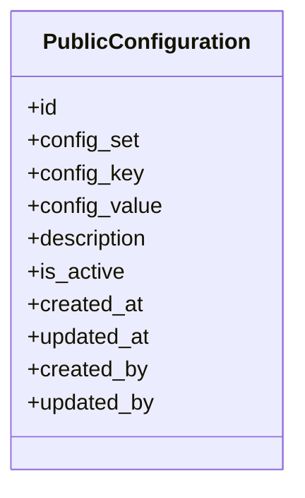

# 0031 — Public Configuration Store (part of `apps.core`)

## Status

Proposed

## Context

[`0018`](0018-configuration-store.md) introduced a non-sensitive runtime
configuration store for values consumed in-process by the backend. That store
is deliberately **not** exposed over HTTP.

The frontend now needs a small set of runtime-editable values too: page sizes,
enabled UI features, payment-link lifetimes, and similar operational values.
Those values are intentionally visible to clients. They must never include
secrets, passwords, tokens, private keys, or credentials.

Rather than adding a visibility flag to `Configuration` and risking a filter
mistake exposing a backend row, this spec introduces a **separate model and
table**:

* `apps.core.models.Configuration` — backend-only, no public API (spec 0018).
* `apps.core.models.PublicConfiguration` — public by definition, read-only
  public API.

Separate tables keep the public read path from ever touching the backend
table. There is no `is_public` flag and no mixed table.

> **Public-by-default warning.** Every row in `PublicConfiguration` is public.
> It is returned by an unauthenticated, internet-facing API. Do not store
> secrets, passwords, tokens, API keys, private keys, credentials, connection
> strings, or internal-only operational notes in this table. If a value must
> not be visible to an arbitrary internet client, it belongs in
> `Configuration`, not here.

## Goals

* Provide a separate `core_publicconfiguration` table for non-sensitive values
  that the frontend may fetch over the internet.
* Guarantee that the public API only reads this table.
* Make `config_key` globally unique so a single-key detail endpoint is
  unambiguous.
* Expose two read-only endpoints:
  * `GET /api/v1/public-configuration/set/{config_set}/` — paginated list of a
    set.
  * `GET /api/v1/public-configuration/{config_key}/` — fetch one entry.
* Return only active rows.
* Allow values to be edited through Django admin without a deployment.
* Seed example public values through the existing `seed` command (spec 0025).
* Reuse the normalization, validation style, and caching approach of spec 0018.

## Non-goals

* Storing secrets or any sensitive value.
* A write API. Public configuration is edited in Django admin only.
* Per-organization or per-tenant overrides.
* Per-environment public configuration beyond what the database already holds.
* Typed schemas per key; values remain opaque strings with coercion helpers.
* Replacing `Configuration` or adding a public flag to it.
* Exposing audit fields, timestamps, descriptions, or admin metadata to clients.
* Change approval workflows.

---

## Proposed changes

### 1. Data model

Location: `apps.core.models`, alongside `Configuration`.

The migration is the next available migration in core (currently
`0007_publicconfiguration.py`, after `0006_businessrule_historicalbusinessrule`),
and the table is `core_publicconfiguration`.



`PublicConfiguration` MUST inherit `apps.core.models.BaseModel` (UUID primary
key, timestamps, audit users, explicit ordering) and
`apps.core.models.BaseActivatableModel` (`is_active` plus `active()`), exactly
as `Configuration` does.

Do **not** use multi-table inheritance from `Configuration`. Both models are
independent concrete tables sharing the same conventions and helper functions.
There must be no database join between them.

### 1.1 Fields

| Field | Type | Description |
| --- | --- | --- |
| `id` | UUID | Primary key, from `BaseModel` |
| `config_set` | `CharField(max_length=100)` | Grouping used by the set-listing endpoint; required |
| `config_key` | `CharField(max_length=255, unique=True)` | Public key; required, globally unique |
| `config_value` | `TextField(blank=True)` | Opaque value; required, MAY be empty string |
| `description` | `TextField(null=True, blank=True)` | Admin-only note on what the entry controls |
| `is_active` | `BooleanField` | From `BaseActivatableModel`; default `True` |
| `created_at` / `updated_at` | datetime | From `BaseModel` |
| `created_by` / `updated_by` | FK user, nullable | From `BaseModel` |

`description` is not returned by the public API. Operators may use it for
internal notes, but it MUST still be written as if it could be reviewed by
anyone, because the row itself is public.

### 1.2 Constraints and normalization

* `config_key` MUST have a `unique=True` database constraint. This is what
  makes `GET /public-configuration/{config_key}/` unambiguous even though keys
  are also grouped by `config_set`.
* `config_set` and `config_key` MUST be normalized on save: trimmed and
  lowercased. Uniqueness is therefore case-insensitive, so `UI` and `ui`
  cannot create two entries.
* Both fields MUST match the same machine-friendly pattern used by
  `Configuration`:

  ```text
  ^[a-z0-9_]+(\.[a-z0-9_]+)*$
  ```

  Dotted grouping remains possible (`gateway.cdac.timeout`).
* Reuse `apps.core.models.normalize_config_name` and `CONFIG_NAME_PATTERN`;
  do not duplicate the regex or normalization logic.
* `Meta.ordering` MUST be `("config_set", "config_key")` for deterministic
  pagination.
* An index on `config_set` MUST exist to support the set-listing endpoint.
* Uniqueness is enforced on the full row regardless of `is_active`.
  Deactivating an entry does not free its key; an operator reactivates it.

### 1.3 A key belongs to exactly one store

A `(config_set, config_key)` pair MUST NOT exist in both `Configuration` and
`PublicConfiguration`.

* If the value is needed by the frontend, it belongs only in
  `PublicConfiguration`.
* If it is backend-only, it belongs only in `Configuration`.
* The backend may read a public value through the public service interface.
  It must not copy the same key into the private table.

This cannot be enforced by a single-table constraint. It is a review and
seeding rule in this iteration; a system check or cross-table validation MAY be
added later if duplication becomes a problem.

### 1.4 Secrets are forbidden

Because every row is internet-visible, the model MUST reject obvious
secret-like names at validation time. This is defence in depth, not a proof
that a value is safe.

Reject a normalized `config_set` or `config_key` when:

* it is exactly one of `secret`, `secrets`, `password`, `passwd`, `token`,
  `api_key`, `apikey`, `private_key`, `credential`, `credentials`; or
* it ends with one of those names as a dotted or underscored segment, for
  example `gateway.password`, `auth.token`, `esign.private_key`.

Names such as `token_expiry_minutes` remain allowed because they describe a
duration, not a secret value.

The value itself is still reviewed by a human. A public key named
`gateway.endpoint` may legitimately hold a public URL; the same field must not
hold a URL with embedded credentials. If a gateway has both public and private
parts, keep the endpoint, timeout, and sender ID here and keep the username,
password, and key in environment variables.

---

## 2. Service interface

Location: `apps.core.services`, following the `ConfigurationService`
convention.

Consumers that read public values in-process MUST use the service, not query
`PublicConfiguration.objects` directly. The public API layer may use a
queryset for pagination and serialization.

```text
get_public(config_set, config_key, default=_UNSET)      -> str
get_public_set(config_set)                              -> dict[str, str]
get_public_int(config_set, config_key, default=_UNSET)  -> int
get_public_bool(config_set, config_key, default=_UNSET) -> bool
get_public_json(config_set, config_key, default=_UNSET) -> Any
```

Rules:

* Only `is_active=True` rows are visible.
* Missing/inactive with no default raises `ConfigurationNotFound`.
* An explicit default (including `None`) is returned instead of raising.
* `get_public_set()` returns `{config_key: config_value}` for active rows and
  `{}` for an unknown set.
* Lookup arguments are normalized like stored values.
* Coercion helpers behave exactly like the spec 0018 helpers:
  `get_public_int`, `get_public_bool`, and `get_public_json` raise
  `ConfigurationValueError` for malformed values instead of falling back to the
  default.
* `get_public_bool` accepts `true/false`, `1/0`, `yes/no`, `on/off`
  case-insensitively.

The API detail view normalizes `config_key` before lookup, so
`GET /public-configuration/MAX_RECORDS_PER_PDF/` resolves to the stored
lowercase key.

---

## 3. Public API

All paths are mounted under `/api/v1/` per spec 0000. DRF's trailing slash is
canonical; requests without it redirect.

| Method | Path | Purpose |
| --- | --- | --- |
| `GET` | `/api/v1/public-configuration/set/{config_set}/` | Paginated active entries in one set |
| `GET` | `/api/v1/public-configuration/{config_key}/` | One active entry by globally unique key |

There is **no** global `GET /api/v1/public-configuration/` list and no write
method. Only the two routes above are exposed.

### 3.1 Permissions and read-only behavior

* `permission_classes = [AllowAny]` — these endpoints are internet-facing.
* No authentication classes are required.
* Only `GET` is routed. `POST`, `PUT`, `PATCH`, and `DELETE` return `405`.
* The view MUST read only `PublicConfiguration`, never `Configuration`.
* The queryset MUST filter `is_active=True` before pagination/serialization.
* The view MUST NOT accept ordering or filtering parameters that could cause
  backend-only rows to be selected. The only path parameter is the set or key.

### 3.2 Set listing

```text
GET /api/v1/public-configuration/set/pdf/
```

Returns a standard DRF page-number paginated response, using the project
default page size (20):

```json
{
  "count": 2,
  "next": null,
  "previous": null,
  "results": [
    {
      "config_set": "pdf",
      "config_key": "default_template",
      "config_value": "court_notice"
    },
    {
      "config_set": "pdf",
      "config_key": "max_records_per_pdf",
      "config_value": "100"
    }
  ],
  "meta": {
    "timestamp": "...",
    "app_version": "...",
    "spec_version": "1.0"
  }
}
```

* Results are ordered by `config_key`.
* `config_set` is normalized before filtering (`PDF` resolves to `pdf`).
* An unknown or inactive set returns `200` with `count: 0` and an empty
  `results` list. An unknown set is not an error.
* Only active rows are included.

### 3.3 Detail by key

```text
GET /api/v1/public-configuration/default_template/
```

```json
{
  "config_set": "pdf",
  "config_key": "default_template",
  "config_value": "court_notice",
  "meta": {
    "timestamp": "...",
    "app_version": "...",
    "spec_version": "1.0"
  }
}
```

* The key is normalized before lookup.
* A missing or inactive key returns `404` with the project-standard error
  envelope. The common not-found code (`E00105`) is used; no new business error
  code is required.
* A key is never returned from `Configuration`, even when both tables contain
  a similarly named row.

### 3.4 Serializer

A read-only `PublicConfigurationSerializer` exposes exactly:

```text
config_set
config_key
config_value
```

`id`, `description`, `is_active`, `created_at`, `updated_at`, `created_by`,
and `updated_by` MUST NOT be serialized. The frontend needs the value, not the
admin metadata.

### 3.5 Routing and schema

Register a router prefix `public-configuration` in `apps.core.urls`, mounted
under `/api/v1/` in `config/urls.py`, and include:

* `lookup_field = "config_key"`;
* `lookup_value_regex = r"[^/]+"` so dotted keys are usable in the URL;
* a custom action `by_set` reached at `set/{config_set}/`;
* `list_actions = {"by_set"}` so drf-spectacular documents the action as a
  paginated list;
* `APIRetrieveMixin + APIBaseViewSet` (or an equivalent read-only viewset) so
  no global list route is generated.

The view is owned by `apps.core`, so the schema tags it under the core app. No
per-operation `tags=` or manual pagination schema is needed (spec 0000 section
10.2).

---

## 4. Caching

`PublicConfiguration` is read-heavy and low-churn, like `Configuration`.

* Add `core_publicconfiguration` to `CACHALOT_ONLY_CACHABLE_TABLES` in
  `config/settings/base.py`.
* Do not add `core` to `CACHALOT_ONLY_CACHABLE_APPS`; that would also cache
  `AdditionalAttribute` and history tables.
* Do not add a second, hand-rolled cache. Cachalot invalidation on write is the
  only invalidation mechanism.
* Consumers MUST read values at the point of use, not at import time.
* Because the endpoint is internet-visible, do not add a long browser/CDN
  cache unless staleness is acceptable. Server-side cachalot caching is enough
  for this iteration.

---

## 5. Admin

Location: `apps.core.admin`.

Register `PublicConfiguration` with the existing `AuditUserAdminMixin`, the
same way `Configuration` is registered.

* `list_display`: `config_set`, `config_key`, `config_value`, `is_active`,
  `updated_at`.
* `list_filter`: `config_set`, `is_active`.
* `search_fields`: `config_key`, `description`.
* `readonly_fields`: `id`, `created_at`, `updated_at`.
* `created_by` / `updated_by` remain read-only and are populated by
  `AuditUserAdminMixin`.
* Add help text on the model/admin: **"Everything in this table is public and
  visible to internet clients."**
* Admin is the only editing surface in this iteration.

---

## 6. Seeding

Public configuration is reference data and MUST be seedable through the
existing `seed` command (spec 0025).

### 6.1 Registry

Add a `SeedSpec` in `apps/core/seeding/specs.py`:

```python
register(
    SeedSpec(
        model_label="core.PublicConfiguration",
        key=("config_set", "config_key"),
        fields=("config_set", "config_key", "config_value", "description", "is_active"),
        order=30,
    )
)
```

`config_value` is coerced to text by the seed engine, like
`core.Configuration`. Model `full_clean()` runs during seeding, so
normalization, format validation, and the secret-name rejection apply to seed
rows too.

### 6.2 Example seed file

Add `data/seed/example/public_configurations.toml`:

```toml
[seed]
model = "core.PublicConfiguration"

[[rows]]
config_set = "ui"
config_key = "items_per_page"
config_value = 20
description = "Default page size used by list screens."

[[rows]]
config_set = "payment"
config_key = "payment_expiry_minutes"
config_value = 30
description = "How long a payment link stays valid."

[[rows]]
config_set = "pdf"
config_key = "default_template"
config_value = "court_notice"
description = "Template used when a caller does not specify one."
```

Seeding remains insert-only and idempotent: re-running the file creates no
duplicates and does not overwrite existing rows. Changing a seeded public value
after the first load is an admin task, per spec 0025.

### 6.3 Sample data is not production policy

The example file is documentation and test data. A jurisdiction MAY ship its
own `public_configurations.toml` in its data repository. No public
configuration rows are created by a data migration in `core`.

---

## 7. Testing

Location: `src/apps/core/tests/test_public_configuration.py` (model, services,
API, admin, caching), plus a seeding case in
`src/apps/core/tests/test_seed.py`.

Required coverage:

### Model and validation

* `config_key` is globally unique.
* `config_set` and `config_key` are trimmed and lowercased.
* Invalid names are rejected; dotted names are accepted.
* Empty `config_value` is allowed.
* A key that appears in `Configuration` may also exist in
  `PublicConfiguration` only if the duplicate-across-stores rule is not
  enforced at the database level; the tests MUST document the intended rule.
* Secret-like keys (`gateway.password`, `auth.token`, `esign.private_key`,
  exactly `api_key`) are rejected.
* A non-secret key containing a secret word as a prefix
  (`token_expiry_minutes`) is accepted.

### Services

* `get_public()` success, missing key raising, missing key with default,
  explicit `None` default, inactive key treated as missing.
* `get_public_set()` populated, mixed active/inactive, unknown set.
* `get_public_int` / `get_public_bool` / `get_public_json` success and
  `ConfigurationValueError` on bad input, including no fallback to the default.
* Lookup normalization.

### API

* Set listing is public, paginated, and carries the `meta` envelope.
* Set listing includes only active rows from that set.
* Unknown set returns `200` with an empty page.
* Detail returns one active row by key and normalizes the key.
* Unknown/inactive key returns `404` with the standard error body.
* A key present only in `Configuration` is **not** returned by either public
  route.
* `POST`, `PUT`, `PATCH`, and `DELETE` on both routes return `405`.
* Response bodies do not contain `id`, `description`, `is_active`, or audit
  fields.
* The OpenAPI schema contains both paths, the core tag, and no global list
  path or id-based detail path.

### Admin and caching

* Admin stamps `created_by` / `updated_by`.
* `core_publicconfiguration` is in `CACHALOT_ONLY_CACHABLE_TABLES`; other core
  tables remain uncached.
* Updating and deactivating a row is visible on the next read.
* Admin form rejects secret-like keys.

### Seeding

* A public configuration row is created from TOML.
* Re-running is a no-op (idempotent).
* `config_value` native TOML types are coerced to text.
* A secret-like key in a seed file is skipped/reported rather than stored.

---

## 8. Relationship to spec 0018

| | `Configuration` (0018) | `PublicConfiguration` (0031) |
| --- | --- | --- |
| Audience | Backend process only | Internet / frontend |
| API | None | Two read-only `GET` endpoints |
| Table | `core_configuration` | `core_publicconfiguration` |
| Key uniqueness | `(config_set, config_key)` | `config_key` globally unique, plus `config_set` grouping |
| Public flag | None | None: every row is public |
| Secrets | Forbidden | Forbidden, and secret-like keys are rejected |
| Edit surface | Django admin | Django admin |
| Cache | Cachalot | Cachalot |
| Seed registry | `core.Configuration` | `core.PublicConfiguration` |

`Configuration` MUST NOT gain an `is_public` field as part of this spec. The
two stores stay separate.

---

## 9. Out of scope

* Write APIs for public configuration.
* Global list of all public configuration without a set.
* Per-organization or per-environment overrides.
* Exposing `description`, audit fields, or timestamps.
* Typed configuration (`config_type`) or per-key schemas.
* History/diff views beyond `created_at` / `updated_at` / audit users.
* CDN invalidation or push notifications to clients.
* A startup system check that required public keys exist.
* Secret storage or secret management of any kind.
* Import/export beyond the `seed` command and Django fixtures.

---

## 10. Open questions

1. **Duplicate keys across stores.** Cross-table duplication cannot be enforced
   by a normal Django constraint. Is a system check or a model-level
   cross-table validation needed now, or is review sufficient?
2. **Description exposure.** This spec keeps `description` admin-only. If the
   frontend needs human-readable labels per key, add explicit `label` and
   `help_text` fields later rather than exposing operator notes.
3. **Global key uniqueness.** The detail route uses only `config_key`, so keys
   are globally unique. If the same key must exist in multiple sets later, the
   detail route must become `set/{config_set}/{config_key}/`.
4. **Throttling.** Public reads are cheap and cached. Should a per-IP throttle
   be added when traffic warrants it?
