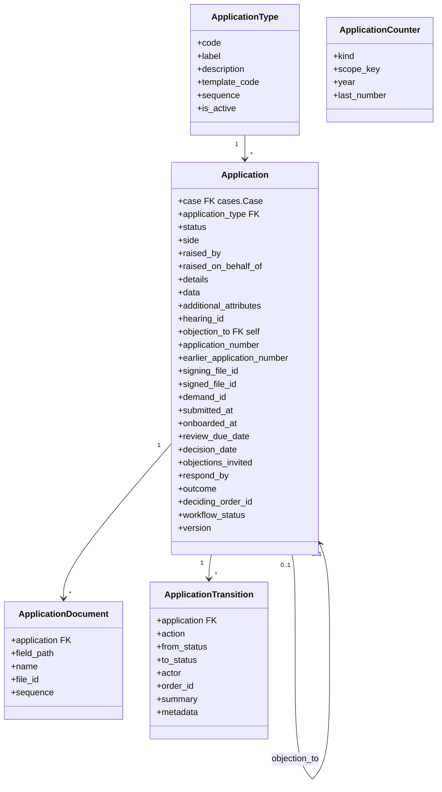
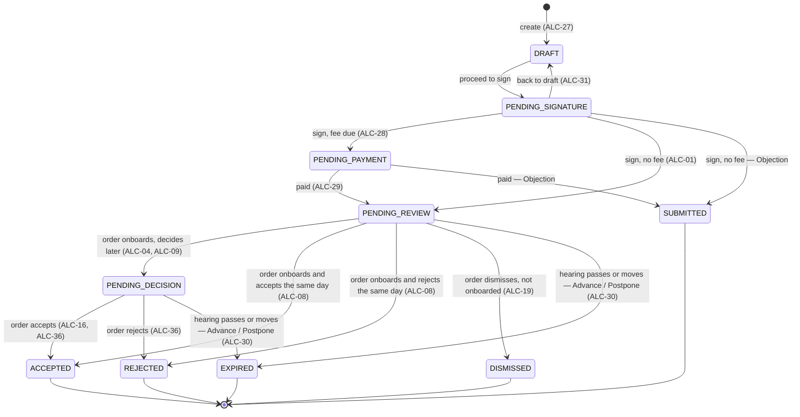
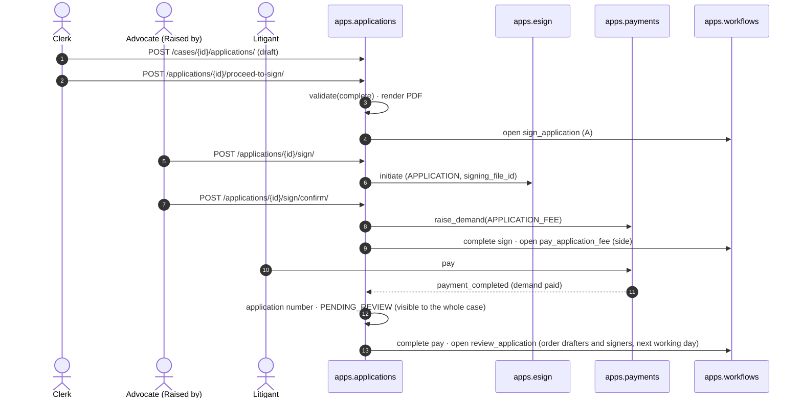
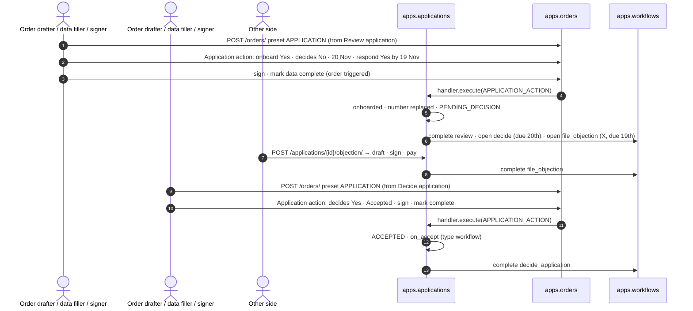

# 0033 — Court Applications (`apps.applications`)

## Status

Proposed

## References

- PRDs (latest, `prds` branch, 2026-11-20): `application-lifecycle.md` v41 (`ALC-01`–`ALC-39`, "Questions on the order item linked to the application", "Application types", "Fields by application type", "Application attributes", "Number formats by state", `Q-5`, `Q-13`, `Q-15`, `Q-16`), `order-template-catalogue.md` (22) (#27 *Application action*, combination rule 4), `order-generation.md` v8.9 (`ORD-01`, `ORD-06`, `ORD-10a`, `ITM-04`, `VAR-02`, `VAR-03`, `VAR-05`, `CMP-02`, `CMP-04`, `APL-01`, `APL-02`), `court-roles.md` v10.11 (`RLE-`; *Order drafter*, *Order data filler*, *Order signer*; *Application onboarder* withdrawn in v10.8), `view-case.md` v1.77 (§9 `APP-05`–`APP-08`, `APP-21`, `APP-22`), `pending-tasks.md` (§2, §3), `signing-methods.md` v3.12 (`SGM-01`–`SGM-05`, `SGM-10`–`SGM-13`), `document-submission.md` v8 (`DSB-02`, `DSB-22`, `DSB-23`), `efiling.md` (§3 `ROLE-`, §5 address, §6 `LIT-`, §8 `ACC-`, §13 `WIT-`, `JUR-11`, `JUR-12`), `case-numbers.md`, `cognizance-cheat-sheet.md` (§6), `case-lifecycle.md` (§4 row 1), `office-management.md` (`OFC-03`, `OFC-06`), `join-a-case.md` (`JOIN-35`)
- Specs on `main`: [`0000`](0000-api-coding-spec.md), [`0001`](0001-additional-attributes.md), [`0011`](0011-case-workflows.md), [`0014`](0014-file-storage-service.md), [`0015`](0015-cdac-esign.md), [`0017`](0017-orders-management.md), [`0018`](0018-configuration-store.md), [`0020`](0020-person-case-filing-schema.md), [`0021`](0021-case-filing-api.md), [`0023`](0023-hearings.md), [`0025`](0025-court-order.md) (court orders; `0025-data-seeding-command.md` shares the number), [`0026`](0026-dramatiq-crontab.md), [`0027`](0027-structured-logging.md), [`0029`](0029-court-roles.md), [`0034`](0034-public-configuration-store.md). [`0023`](0023-hearings.md), [`0025`](0025-court-order.md), [`0028`](0028-warrant-and-summons.md) and [`0029`](0029-court-roles.md) are merged as proposals; their apps are not built.

> **Scope note.** This module owns the **application**: one kind of filing,
> many types, raised by a party on a case. It owns the draft, the type's
> fields and documents, who may draft, sign and pay, the application number,
> the decision date, objections, expiry, the record of every order passed on
> it, and what runs when an application is accepted. **Every court act on an
> application is an order** (`ALC-22`): onboarding, deferring review, setting
> or moving the decision date, dismissing, accepting and rejecting are all
> answers to the one order item linked to the application, *Application
> action* (catalogue #27, `ALC-32`), executed through a handler this module
> registers with [`0025`](0025-court-order.md). It has no court endpoint that
> changes an application. It opens tasks only through
> [`0011`](0011-case-workflows.md) `TaskService`, collects money only through
> [`0017`](0017-orders-management.md), signs only through
> [`0015`](0015-cdac-esign.md), and reads hearings only through
> [`0023`](0023-hearings.md).

## Context

An **application** is how a party puts a matter before the court outside
the complaint itself: bail, a postponement, a change of PoA holder, a witness
to add, documents to produce. The original intent is that parties put
matters before the court with little effort, that advocates can delegate the
drafting to clerks and juniors, and that applications let a case move
forward without a hearing.

Every application, whatever its type, moves through the same five steps, in
the same order (`application-lifecycle.md` v41, "The workflow"):

```text
1 Filing ───────────> 2 Review ─────────────────────────────> 3 Objections ──> 4 Decision ──> 5 After the decision
draft · sign · pay     by order: onboard (decide today, or      (only if the      accept or      type's workflow
(filer side)           set a date), defer review, or dismiss    order asks)       reject, by     on acceptance
                                                                                  order
```

| Step | What happens | Who acts | Status when the step ends |
| --- | --- | --- | --- |
| 1. Filing | Choose the type, fill in the form, sign, pay | Advocate/PiP; a clerk or junior may draft; anyone on the filer's side may pay | Pending Review (Objection: Submitted) |
| 2. Review | Onboard (decide today or set a date), defer review, or dismiss — each by order | Order drafter drafts; Order data filler answers the item; Order signer signs | Pending Decision once onboarded; Pending Review if deferred; Dismissed; or Accepted / Rejected when decided the same day |
| 3. Objections | The other side may file **one** objection by the order's respond-by date | The other side | Pending Decision (unchanged) |
| 4. Decision | An order accepting or rejecting it is signed and its data completed | Order drafter, Order data filler, Order signer | Accepted or Rejected |
| 5. After the decision | On acceptance, the type's workflow runs | System, or the court where it needs a choice | Accepted or Rejected (unchanged) |

An application leaves the flow early in two ways only: it is **dismissed** at
review, before it is onboarded (`ALC-19`, `ALC-36`), or an Advance / Prepone or
Postpone application **expires** when its hearing passes or is moved before
it is decided (`ALC-30`). An application not yet submitted never expires; it
can instead be deleted (`ALC-39`).

The PRD fixes the rules this module enforces:

* Filing ends only when the application is **signed and**, where the type carries a fee, **paid**; a type with no fee skips Pending Payment (`ALC-01`).
* Only the types whose *Available when* rule is met are offered (`ALC-26`). An **Objection** may be started from a *File objection* task or chosen as a type, against an undecided application of the other side (`ALC-37`).
* A draft saves everything and reopens with everything (`ALC-27`). It is edited only in Draft; one in Pending Signature is moved back to Draft to be edited (`ALC-31`). Before submission it can be deleted (`ALC-39`).
* Only the person selected in **Raised by** signs; never a clerk or junior. Who raises and signs a PoA Change is not yet decided (`ALC-28`, `Q-16`).
* Anyone on the same side of the case may pay (`ALC-29`).
* Every application has **one application number from submission**; in some states a new number replaces it once onboarded, the earlier one kept and searchable (`ALC-02`).
* A submitted application is **visible to everyone on the case** and to court staff; the other side is **not notified** until an order asks it to respond (`ALC-17`, `ALC-12`).
* A *Review application* task opens for the courtroom's Order drafters and Order signers, due the next working day (`ALC-03`).
* **Every court act is an order**, through the *Application action* item; nothing moves until the order is signed **and** its order data is complete (`ALC-22`, `ALC-32`, `ALC-33`).
* Once onboarded, an application ends only as **Accepted** or **Rejected**; dismissal happens only before onboarding (`ALC-36`, `ALC-19`). A CIS outcome is order data in states that record one (`Q-15`).
* An objection is due by the order's **respond-by** date, the day before the decision date by default; a missed deadline changes nothing by itself; one objection per application (`ALC-11`–`ALC-13`, `ALC-24`).
* A *Decide application* task closes only when an order deciding the application takes effect (`ALC-21`).
* Acceptance triggers the **type's** workflow, with no separate choice; rejection triggers nothing (`ALC-16`).

### What this module does and does not decide

`apps.applications` knows **what was applied for, by whom, on whose behalf,
where it stands, and when the court will deal with it**. It does not write
orders, move hearings, change parties or add documents to the case file
itself: each of those belongs to the module that owns the thing, and this
module calls it. It does not decide whether an application should succeed —
the court does, in an order.

## Goals

* One application model for every type; types differ in their own fields, availability, template and on-acceptance workflow, declared in code and switched on in data.
* Offer each filer exactly the types available to them on the case (`ALC-26`, `ALC-37`), with the PRD's preselection of *Raised by* and *Litigant*.
* Save drafts partially, resume them and delete them before submission (`ALC-27`, `ALC-39`); validate completeness only when the draft is sent for signature.
* Enforce who drafts, who signs, who pays and who sees, server-side, at every status (`ALC-17`, `ALC-28`, `ALC-29`, `ALC-31`).
* Render the application to its print template and sign it through [`0015`](0015-cdac-esign.md); collect its fee through [`0017`](0017-orders-management.md); skip payment when no fee is due (`ALC-01`).
* Allot the application number at submission, and where the state says so a replacement number at onboarding, keeping both, concurrency-safe (`ALC-02`).
* Take every court act — onboarding, deferral, the decision date, objections, dismissal, acceptance, rejection — from the *Application action* item of a triggered order, through one registered handler (`ALC-22`, `ALC-32`, `ALC-33`, `ALC-38`), and run the type's workflow on acceptance (`ALC-16`).
* Keep every order passed on an application, the deciding one marked (`ALC-33`, "Orders" attribute).
* Expire hearing-linked types when their hearing passes or is moved (`ALC-30`).
* Open and close every application pending task in the same transaction as the step that causes it.
* Serve the case's applications tab, the *Needs attention* list and the court's Applications screen (`APP-05`–`APP-08`, `APP-21`, `APP-22`, `ALC-23`).
* Expose REST APIs following [`0000`](0000-api-coding-spec.md), with registered error codes under domain `13`.

## Non-goals

* The order screen, order text and order signing ([`0025`](0025-court-order.md)). This module answers what the *Application action* item does; the order module owns asking it.
* Moving hearings ([`0023`](0023-hearings.md)); the accepted Advance / Postpone moves its hearing through the order that accepts it.
* The bail bond itself — its form, signing and status. This module hands the accepted bail application's data to it. Setting bail terms on acceptance is a PRD enhancement.
* Court fee amounts for each application type; this module reads them from configuration.
* DSC, mobile OTP and batch signing (`SGM-01`, `SGM-02`, `SGM-04`, `SGM-13`): no spec provides them yet. Signing is recorded so they can plug in.
* Certified Copy, Warrant Recall and Advocate Replacement: not types in the PRD.
* Applications raised on behalf of more than one litigant, or more than one objection per application — PRD enhancements.
* Notification copy and the case-update events catalogue (the PRD's master tables).
* Withdrawing an application after submission (not in the PRD; question 7).

---

## Proposed changes

### 1. App layout and boundaries

```text
apps/applications/
├── apps.py                 # name = "apps.applications"; ready() registers handlers, authorizer, receivers
├── models.py               # ApplicationType, Application, ApplicationDocument, ApplicationTransition, ApplicationCounter
├── enums.py                # TextChoices (#4)
├── errors.py               # E13xxx (#15.6)
├── types/
│   ├── base.py             # ApplicationTypeSpec, FieldProblem (#3.2)
│   ├── registry.py         # code -> spec; system check for seeded rows without a spec
│   ├── bail.py · edit_litigant.py · hearing_reschedule.py · poa_change.py
│   ├── production_of_documents.py · addition_of_witness.py · warrant_by_hand.py
│   └── simple.py           # types with no fields of their own
├── services/
│   ├── drafting.py         # create, edit, documents, proceed to sign, back to draft, delete (#6)
│   ├── signing.py          # initiate, record_signature (#6.7)
│   ├── submission.py       # fee, demand, submit (#6.8, #6.9)
│   ├── numbering.py        # application number, replacement number (#7)
│   ├── objections.py       # open, create, window (#9)
│   ├── actions.py          # the Application action item: onboard, defer, set or move the date, dismiss, accept, reject (#8)
│   ├── workflows.py        # the type's workflow on acceptance (#12)
│   ├── expiry.py           # hearing-linked expiry (#13)
│   ├── rendering.py        # print template data, apps.pdf (#6.5)
│   └── richtext.py         # Application details sanitiser (#3.3)
├── handlers.py             # the APPLICATION_ACTION OrderItemHandler for 0025 (#8.1)
├── receivers.py            # payment_completed, hearing signals, order_triggered
├── access.py               # who may see and do what (#2)
├── selectors.py            # lists, detail, needs attention, pending on a case (#14)
├── ports.py                # stand-ins for contracts not built yet (#1.2)
├── signals.py              # application_status_changed
├── tasks.py                # Dramatiq actors (#16.6)
├── serializers.py · views.py · urls.py · admin.py
└── tests/
```

Dependency rules:

```text
apps.applications ── imports ──> apps.cases.selectors / services             (#1.1)
apps.applications ── imports ──> apps.workflows.services                     (TaskService, CaseWorkflowService.dispatch)
apps.applications ── imports ──> apps.payments.services / signals            (DemandService, payment_completed)
apps.applications ── imports ──> apps.esign services / permissions           (initiation, register_entity_authorizer)
apps.applications ── imports ──> apps.pdf, apps.files services
apps.applications ── imports ──> apps.hearings.selectors / signals
apps.applications ── imports ──> apps.orders.handlers / selectors / signals
apps.applications ── imports ──> apps.organizations.selectors                (courtroom readers and role holders, 0029)
apps.cases, apps.workflows, apps.payments, apps.esign, apps.hearings, apps.orders
        ── never import ──> apps.applications
```

Rules:

* `Application.case → cases.Case` is the only foreign key into another domain app (`on_delete=PROTECT`). Participants, hearings, orders, demands, files and e-sign transactions are plain `UUIDField` ids, read back through their owners' selectors.
* Orders reach this module only through the handler it registers (#8.1); hearings and payments only through the signals it subscribes to. None of them import it.
* Views validate shape, call a service and serialize the result. Status, numbers, dates, tasks and demands are written only by `services/`.
* Every status change goes through one function, `services._transition(application, action, actor, **fields)`, which checks the transition table (#5.2), writes the `ApplicationTransition` row and sends `application_status_changed` on commit.
* An isolation test asserts the import rules.

#### 1.1 Contracts consumed

| Module | Function | Used for |
| --- | --- | --- |
| `apps.cases` | `selectors.get_case_summaries(case_ids)` | list rows and the court screen header |
| | `selectors.case_access(case_id, user)` → `{side, roles, participant_ids, represents, office_of}` | who the caller is on the case (#2.1) |
| | `selectors.advocate_access(case_id)` → advocates with vakalatnama access and parties in person, with the litigants each represents | *Raised by* and *Litigant* options (#3.3) |
| | `selectors.participants(case_id, role=None)` with current details and addresses | Edit Litigant Details prefill, Warrant by Hand accused, PoA Change litigants |
| | `selectors.courtroom(case_id)`, `selectors.state_code(case_id)`, `selectors.filing_number(case_id)` | routing, configuration, numbering |
| | `selectors.delay_applicable(case_id)`, `selectors.delay_reason(case_id)` | the filing's delay condonation application (#12.3) |
| | `services.participants.apply_litigant_edit(case_id, participant_id, changes, *, source)` | Edit Litigant Details on acceptance |
| | `services.participants.add_witnesses(case_id, called_by, witnesses, *, source)` | Addition of Witness on acceptance |
| | `services.poa.appoint(case_id, holder_user_id, participant_ids, documents, *, source)` | PoA Change on acceptance |
| | `services.documents.add_from_application(case_id, documents, *, source)` | Production of Documents on acceptance (`DSB-22`: source *Application*) |
| `apps.workflows` | `TaskService.open`, `complete_for`, `expire_for`, `reschedule` | every task of #16.1 |
| | `CaseWorkflowService.dispatch(case, "DCA_DECIDED")` | ends the Delay Condonation secondary stage ([`0011`](0011-case-workflows.md) #10.4) |
| `apps.payments` | `DemandService.raise_demand`, `cancel_demand`; signal `payment_completed` | the application fee (#6.8) |
| `apps.esign` | initiation service, transaction selector, `register_entity_authorizer("APPLICATION", …)` | signing (#6.7) |
| `apps.pdf` | in-process render of the type's template | the document to sign (#6.5) |
| `apps.files` | `documents.document_error`, `store_documents`, `get_file` | uploads (#6.4) and rendered PDFs |
| `apps.hearings` | `selectors.next_hearing`, `get_hearing`, `has_scheduled_hearing`, `business_date`; signals `hearing_rescheduled`, `hearing_ended`, `hearing_cancelled` | availability, suggested date, expiry |
| `apps.core` | `services.calendar.next_working_day(court_id, day)` | the *Review application* due date (`ALC-03`, #6.9) |
| `apps.orders` | `handlers.registry.register`, `selectors.live_items_targeting(application_ids)`, `selectors.get_order(order_id)` | the *Application action* item (#8.1), the pending order and expiry guard (#13, #14.4), the orders list (#14.3) |
| `apps.organizations` | `selectors.action_holders`, `selectors.is_court_reader` | task users and court reading ([`0029`](0029-court-roles.md)); court acts are checked by the order module |
| `apps.core` | configuration store ([`0018`](0018-configuration-store.md)) | fees, number formats, controls (#16.5) |
| `apps.messaging` | `enqueue_sms`, in-app | notifications (#16.2) |

None of the `apps.cases` services above exist yet, nor `case_access`,
`advocate_access` and `participants` in this shape. A **working day** is not
a sitting day: no spec yet keeps a working-day calendar for court staff
(0023 #4 keeps sitting days, which a presiding officer's leave removes while
staff still work), so `next_working_day` is new (#6.9). `apps.orders` needs
`live_items_targeting` and `get_order`, and its catalogue must replace items
#5, #6, #13 and #26 with #27 *Application action* (catalogue (22)). These
are the first work this spec needs from those modules.

#### 1.2 Stand-ins (`ports.py`)

As `apps.scrutiny.ports` does, every call to a contract that does not exist
yet goes through `ports.py`, so each stand-in is replaced there and only
there:

* **Office access** (`office-management-handover.md`) is not modelled. Until it is, a clerk or junior advocate is associated with every advocate representing the side they act on, through their own `Representation` on the case.
* **Court roles** ([`0029`](0029-court-roles.md)) — Django groups named after the PRD role (`Order drafter`, `Order data filler`, `Order signer`), held at the case's courtroom only, as scrutiny does today; used for task users only, since court acts are orders.
* **Tasks** ([`0011`](0011-case-workflows.md)) — until the engine lands, the court lists are built from application statuses (`PENDING_REVIEW`, `PENDING_DECISION`) and the citizen *Needs attention* well from #14.2; no task rows are written.
* **Hearings** — without `apps.hearings`, Advance / Prepone and Postpone are not offered (their *Available when* rule cannot be met).
* **Working days** — until a working-day calendar exists, the next working day skips Sundays and the state's configured public holidays only (`applications.non_working_weekdays`, #16.5).
* **Orders** — without `apps.orders`, court acts can be recorded only through the admin action *Record order on application*, which takes the order number and the *Application action* answers and runs the same service (`actions.apply`).

### 2. Who may do what

#### 2.1 Filing side

The application's **side** is the side of the litigant it is raised on behalf
of (`COMPLAINANT` or `ACCUSED`). Everything on the filer side is decided
against that side.

| Term | Who | Source |
| --- | --- | --- |
| **Drafter** | an advocate with vakalatnama access on the side, a party in person on the side, or a clerk or junior advocate with office access to such an advocate on this case. Who drafts a **PoA Change** is open (`Q-16`, question 18) | `ALC-27`, `ALC-28`; `OFC-03`, `OFC-06`; e-filing `ROLE-01`–`ROLE-05` |
| **Drafting circle** of an application | its creator; the user in *Raised by*; every advocate the creator works for on this case; every clerk or junior with office access to the *Raised by* advocate on this case | `ALC-27` "visible to the person who created it and to their associated advocates, clerks and junior advocates" |
| **Signer** | exactly the user in *Raised by*; for PoA Change, not yet decided (`Q-16`) | `ALC-28` |
| **Payer** | anyone with an active relationship on the side: advocate, party in person, clerk, junior, litigant, PoA holder | `ALC-29` |
| **Case reader** | anyone with an active relationship on the case, either side | `ALC-17` |
| **Other side** | anyone with an active relationship on the opposing side | `ALC-24` |

Rules:

* A litigant who is not a party in person, and a PoA holder, never draft or sign; they pay and read (`ALC-28`, "Users and actions"). A PoA Change is the exception still to be decided (`Q-16`).
* A clerk or junior advocate can draft, edit, send for signature and move back to draft, but never sign, by any method (`ALC-28`; e-filing `ROLE-08`). Enforced in `services.signing`, not by hiding the button.
* Membership is evaluated when the action is taken. Someone removed from the case loses every action and read at once.

#### 2.2 Court side

**Every court act on an application is an order** (`ALC-22`, PRD v41). There
is no court action of this module's own and no court endpoint that changes an
application: onboarding, deferring review, setting or moving the decision
date, inviting a response, dismissing, accepting and rejecting are all
answers to the *Application action* item on an order (#8). Who may do each
part is the order module's, through its own actions
([`0029`](0029-court-roles.md) #3.3):

| Role (`court-roles.md` v10.11) | On an application | Checked by |
| --- | --- | --- |
| **Order drafter** | opens the order from the application's task, chooses what the court does with it (`ALC-22`) | `orders.edit_text`, `orders.send_for_signing` |
| **Order data filler** | answers the *Application action* item's questions (`ALC-38`) | `orders.fill_data`, `orders.mark_data_complete` |
| **Order signer** | signs it; the act takes effect once it is also complete (`ALC-33`) | `orders.sign` |

The PRD's **Application onboarder** role is withdrawn (`court-roles.md`
v10.8): each title that held it now holds Order drafter. The two actions this
spec once declared, `applications.take_on_file` and
`applications.set_decision_date`, are dropped and are not to be registered;
nothing checks them.

**Reading is not a role** (`RLE-06`). Any staff account on the case's
courtroom list reads every **submitted** application of the case through
`organizations.selectors.is_court_reader`. Court staff never see drafts, or
applications in Pending Signature or Pending Payment. Staff of another
courtroom → `404 E00105`.

#### 2.3 Visibility by status

A submitted application is **visible to everyone on the case, on both sides,
and to court staff**, from submission, and is part of the case history
(`ALC-17`, v38). There is no onboarding gate. The other side is **not
notified** of it until an order asks it to respond (`ALC-12`); visibility and
notification are separate.

| Status | Drafting circle | Rest of the filer's side | Other side | Courtroom staff |
| --- | --- | --- | --- | --- |
| Draft, Pending Signature | read, act | — | — | — |
| Pending Payment | read, act | read, pay | — | — |
| Pending Review, Pending Decision, Accepted, Rejected, Dismissed, Expired, Submitted | read | read | read | read |

"—" means the application does not exist for that caller: a list leaves it
out and a direct read is `404 E00105`. What a submitted application shows is
the same for everyone who can see it (`APP-07`, `ALC-23`), with one
exception: an earlier, replaced application number is shown to everyone and
remains searchable (`ALC-02`).

Before submission nothing about the application reaches the other side,
including its fee demand: `APPLICATION` demands are hidden from the other
side until the application is submitted (#6.8).

#### 2.4 Boundary: what decides, what enforces

| Concern | Decided by | Enforced by | Never |
| --- | --- | --- | --- |
| Which types a filer may raise | the type's *Available when* rule against the caller and the case (#3.1) | `types/registry` + `services.drafting.create` | the client hiding a type |
| Who may raise Edit Litigant Details, and whose details | the control in configuration (#3.5) | `types/edit_litigant.py` | the type's own code hard-coding a side |
| Who signs | *Raised by* | `services.signing` | any advocate on the case; a clerk |
| Who pays, who sees the fee | the application's side (`ALC-29`, `ALC-17`) | payer and visibility policies registered with `apps.payments` (#6.8) | the demand's `user_id` |
| The fee | configuration per state and type; `0` skips payment (`ALC-01`) | `services.submission` snapshots it into the demand | the client |
| Onboarding, deferral, decision date, response, dismissal, acceptance, rejection | the court, by an order's *Application action* item, once signed and complete (`ALC-22`, `ALC-33`) | `handlers.py`, called by [`0025`](0025-court-order.md) | an application endpoint; a staff title (`RLE-08`) |
| What happens on acceptance | the application type (`ALC-16`) — always, with no separate choice | `ApplicationTypeSpec.on_accept` | the order item; a question on the order |
| Expiry | the hearing passing or being moved (`ALC-30`) | receivers and the midnight sweep (#13) | any type other than Advance / Prepone and Postpone |

### 3. Application types

#### 3.1 Catalogue

Each type is a code-defined `ApplicationTypeSpec` (#3.2) plus a seeded
`ApplicationType` row (#4.1) that switches it on for the deployment.

| Code | Label | Available when (`ALC-26`) | Template | On acceptance (`ALC-16`) | Expires (`ALC-30`) |
| --- | --- | --- | --- | --- | --- |
| `BAIL` | Bail | the litigant is an accused | `application-bail-bond` | a bail bond draft is created from the application (#12.2) | — |
| `EDIT_LITIGANT_DETAILS` | Edit Litigant Details | the control allows the caller to raise it and lists at least one litigant they may edit (#3.5) | `application-profile-edit` | the litigant's details on the case are updated | — |
| `CASE_SETTLEMENT` | Case Settlement | always | `application-case-settlement` | — | — |
| `CASE_TRANSFER` | Case Transfer | always | `application-case-transfer` | — | — |
| `CASE_WITHDRAWAL` | Case Withdrawal | always | `application-case-withdrawal` | — | — |
| `DELAY_CONDONATION` | Delay Condonation | the litigant is a complainant | `application-delay-condonation` | `DCA_DECIDED` is dispatched — on rejection too (#12.3) | — |
| `GENERIC` | Generic | always | `application-generic` | — | — |
| `ADVANCE_HEARING` | Advance / Prepone | a hearing is scheduled in the case | `application-reschedule-hearing` | the hearing moves through the accepting order (#12.2) | yes |
| `POSTPONE_HEARING` | Postpone | a hearing is scheduled in the case | `application-reschedule-request` | the hearing moves through the accepting order (#12.2) | yes |
| `POA_CHANGE` | PoA Change | always; who raises and signs it is open (`Q-16`) | `application-poa-change` | the PoA holder's rights transfer to the person named | — |
| `PRODUCTION_OF_DOCUMENTS` | Production of Documents | always | `application-production-of-documents` | the attached documents are added to the case file | — |
| `ADDITION_OF_WITNESS` | Addition of Witness | always | `application-witness-deposition` | the witnesses are added to the case | — |
| `WARRANT_BY_HAND` | Warrant by Hand | always | none (#6.5) | nothing runs; the decision screen directs the court to issue a warrant by hand (#14.4) | — |
| `ABSENT_APPLICATION` | Absent Application | always | none | — | — |
| `REOPEN_EVIDENCE` | Reopen Evidence | always | none | — | — |
| `OBJECTION` | Objection | against an application of the other side that is `PENDING_REVIEW` or `PENDING_DECISION` and has no objection yet; started from a *File objection* task or chosen as a type (`ALC-37`, #9) | none yet | none: ends at `SUBMITTED` | — |

`application-for-checkout-request` (checkout of the hearing date) is one of
the three reschedule templates the PRD names; which request uses it is not
said (question 9). Until then Advance uses `application-reschedule-hearing`
and Postpone `application-reschedule-request`.

Common to every type:

* The case must be on the court's file — registered, with a courtroom — before an application can be created (`409 E13003`). Before registration nobody could review it (`ALC-03`).
* Each application is raised on behalf of exactly **one** litigant; several is a PRD enhancement.
* "Always" still requires a drafter (#2.1).
* An inactive `ApplicationType` row is never offered; applications already raised under it continue.

#### 3.2 The type contract

```python
@dataclass(frozen=True)
class FilerContext:
    case_id: UUID
    user_id: UUID
    side: str | None    # the caller's side as a drafter, None if not one
    access: CaseAccess   # apps.cases.selectors.case_access(...) (#1.1)


@dataclass(frozen=True)
class FieldProblem:
    field: str          # path under data, e.g. "data.sureties[1].phone"
    code: str           # a registered E13xxx or common code
    message: str


class ApplicationTypeSpec(ABC):
    code: ClassVar[str]
    expires_with_hearing: ClassVar[bool] = False
    needs_hearing: ClassVar[bool] = False          # hearing_id is set at creation
    data_schema: ClassVar[dict]                    # JSON Schema of `data`, shape only

    def unavailable_reason(self, ctx: FilerContext) -> str | None: ...       # ALC-26
    def form_context(self, ctx: FilerContext) -> dict: ...                   # system fields, prefills
    def validate(self, app: Application, *, complete: bool) -> list[FieldProblem]: ...
    def document_refs(self, data: dict) -> list[tuple[str, UUID]]: ...       # (path, document_id)
    def render_context(self, app: Application) -> dict: ...                  # template data
    def on_accept(self, app: Application, *, order_id: UUID, values: dict) -> dict: ...  # ALC-16
    def on_reject(self, app: Application, *, order_id: UUID) -> None: ...
```

Rules:

* `data_schema` is checked on every save, with `additionalProperties: false`: an unknown key is `400 E13009` on that key. A type with no fields of its own has `{"type": "object", "maxProperties": 0}`.
* `validate(complete=False)` runs on every save and reports only what is wrong with what was entered. `validate(complete=True)` runs at *Proceed to sign* (#6.5) and adds every mandatory field and cross-field rule. Drafts are therefore always saveable (`ALC-27`).
* `on_accept` must be idempotent: it is retried (#12.1).
* `registry.register(spec)` refuses a second spec for a code. A system check (`applications.E001`) fails when an active `ApplicationType` row has no spec.

#### 3.3 Fields every application carries

From "Every application" in the PRD. Stored as columns, not in `data`.

| Field | Column | Rules |
| --- | --- | --- |
| **Raised by** | `raised_by` (User) | One of `advocate_access(case)` on the application's side: an advocate with vakalatnama access, or a party in person. For PoA Change, the caller (the incoming PoA holder). May be empty in a draft; required to proceed (`E13008`). Not one of the options → `400 E13005`. |
| **Litigant** | `raised_on_behalf_of` (participant id) | One of the litigants represented by *Raised by* (a party in person: themselves). Not one of them → `400 E13006`. Changing *Raised by* to someone who does not represent the chosen litigant clears it. Fixes the application's `side`. |
| **Application details** | `details` | Rich text: bold, italic, underline, bulleted and numbered lists, alignment. Sanitised on save (#3.3.1). Mandatory to proceed: empty after sanitising → `400 E13007`. The only free-text box: no type has a reason box of its own. Printed as the body of the application. |
| **Supporting documents** | `ApplicationDocument` rows with a blank `field_path` | Optional; any number; each needs a name the filer gives (`DSB-02`). |

**Preselection** (returned by the form endpoint, #6.2, never applied
silently by the server):

| Caller | *Raised by* default | *Litigant* default |
| --- | --- | --- |
| Advocate with vakalatnama access on the side; party in person | themselves | the only litigant they represent, else empty |
| Clerk, or junior advocate without vakalatnama access, working for exactly one advocate on the side | that advocate | as above, for that advocate |
| Clerk or junior working for more than one | empty | empty |
| Incoming PoA holder (PoA Change) | themselves, fixed | not used (the type has its own multi-select) |

##### 3.3.1 Rich text

`services.richtext.sanitise(html)` uses `nh3` with the allow-list `p`, `br`,
`strong`, `em`, `u`, `ol`, `ul`, `li`, and the `style` attribute on `p` and
`li` restricted by an attribute filter to `text-align: left|center|right|justify`.
Everything else is stripped, never trusted from the client. At most
config `applications.details_max_bytes` after sanitising (`400 E00006`,
`field = details`). The same allow-list is what the templates render.

#### 3.4 Type data

`data` keys by type. Every `*_document_id` must be an `ApplicationDocument`
of this application attached to the matching `field_path`
(`400 E13011` otherwise). Addresses use the e-filing address composite
through `apps.address` ([`0020`](0020-person-case-filing-schema.md) §7),
whose own errors (domain `05`) pass through on the nested path.

**Bail** — the surety fields follow Form No. 37.

| Key | Type | Complete when | PRD |
| --- | --- | --- | --- |
| `bail_type` | `CASH` \| `SURETY` | required | Type of bail |
| `bail_amount` | decimal string, rupees, `> 0` | required for both | Bail amount |
| `number_of_sureties` | integer `1`–`10` | required for `SURETY`; must equal `len(sureties)` | Number of sureties (the form caps the sets of surety details at ten) |
| `sureties[]` | `{name, parent_name, phone, email?, address, id_proof_document_ids[], solvency_document_ids[]}` | `SURETY`: every key but `email`; each proof at least one file | Surety details, ID proof and proof of solvency, each one or more files (v37) — once per surety |

With `CASH`, `number_of_sureties` and `sureties` must be absent (`400 E13009`).

**Edit Litigant Details** — one application edits one litigant.

| Key | Type | Complete when |
| --- | --- | --- |
| `participant_id` | uuid | required; one of the litigants the control lets the caller edit (#3.5, `400 E13024`) |
| `litigant_type` | `INDIVIDUAL` \| `INSTITUTION` | required; prefilled with the current type, editable (`LIT-2` / `ACC-1`) |
| `details` | object | the e-filing litigant fields for the participant's role and `litigant_type`, with the same keys, field types and validators as the [`0021`](0021-case-filing-api.md) §4.1–§4.2 participant endpoints |

| Role × type | Fields (`details` keys follow 0021; PRD ids) |
| --- | --- |
| Complainant · individual | phone (`LIT-3`), full name (`LIT-4`), age (`LIT-5`), gender? (`LIT-5a`), differently abled? (`LIT-5b`), email? (`LIT-6`), permanent address (`LIT-7`), same address? (`LIT-8`), current address when not (`LIT-9`) |
| Complainant · institution | type of institution (`LIT-17`), name (`LIT-18`), CIN or PAN? stored upper-case, no format check (`LIT-18a`), phone? (`LIT-19`), email? (`LIT-20`), address (`LIT-21`), representative phone, name, age, gender?, differently abled?, email?, designation, address (`LIT-22`–`LIT-26`) |
| Accused · individual | full name, special characters allowed (`ACC-2`), age? integer ≥ 1 (`ACC-3`), designation? (`ACC-15`), mobile (`ACC-6`), email (`ACC-7`), addresses[] (`ACC-8…12`), each with a police station (`ACC-13`) |
| Accused · institution | type of institution (`ACC-4`), name (`ACC-5`), mobile, email, addresses[] each with a police station |

* The form endpoint prefills `details` with the participant's current values. Changing `litigant_type` starts the other table empty.
* A complainant's phone must not match any other complainant, accused, advocate or PoA holder on the case (`LIT-3`): `400 E13025`, `field = data.details.phone_number`.
* An accused institution's persons responsible are not edited here; each is an individual accused (PRD, `ACC-14…23`).
* The diff against the current values is computed at *Proceed to sign* and stored in `data.changes`, so the template and the court see what changes. An application that changes nothing is incomplete (`E13008`, `field = data.details`).

**Case Transfer** — `requested_court` (text, required). *Current court* is
system-filled at render from the case's courtroom.

**Generic** — `title` (text, required, ≤ 255): the application's heading.

**Advance / Prepone, Postpone** — `needs_hearing`: at creation the server sets
`hearing_id` to `apps.hearings.selectors.next_hearing(case)` (a `SCHEDULED`
hearing); the client never chooses it. *Initial hearing date* and *Purpose of
hearing* are read from the hearing at render.

| Key | Type | Complete when |
| --- | --- | --- |
| `reason_code` | one of config `applications.reschedule_reasons` | required (question 10) |
| `proposed_date` | date | required; not before the business date; Advance: before the hearing date; Postpone: after it `[DERIVED]` |

**PoA Change** — raised and signed by the incoming PoA holder.

| Key | Type | Complete when |
| --- | --- | --- |
| `participant_ids[]` | litigants of the case appointing the applicant | at least one; each a complainant or accused of the case |
| `authorizations[]` | `{participant_id, document_id}` | exactly one per selected litigant |

Whether a litigant already has a PoA holder is read from the case record at
render, not entered.

**Production of Documents** — `documents[]`: `{document_type, document_id}`,
at least one; PDF or JPEG within the size limit (#6.4).

**Addition of Witness** — `witnesses[]`, at least one, each with the e-filing
witness fields (§13): `name` (`WIT-1`), `age?` (`WIT-2`), `what_will_prove?`
(`WIT-3`), `designation` (`WIT-4`), `mobile?` (`WIT-5`), `email?` (`WIT-6`),
`addresses[]` at least one (`WIT-7`). Name or designation is required.

**Warrant by Hand** — `accused_participant_id` (an accused of the case) and
`delivery_address` (prefilled by the form endpoint from the chosen accused's
address on file, the filer picking which where there are several; editable).

**Objection** — *Application objected to*: the other side's application, held
in the `objection_to` column, not in `data` (#4.2). Already set when started
from a *File objection* task; otherwise chosen from the other side's
applications that are `PENDING_REVIEW` or `PENDING_DECISION` and have no
objection (`ALC-37`). The reason goes in *Application details*.

**Case Settlement, Case Withdrawal, Delay Condonation, Absent Application,
Reopen Evidence** — no fields of their own; the reason goes in
*Application details*.

#### 3.5 Edit Litigant Details control

"A control on the workflow decides who can raise it and whose details they
can edit." It is configuration, `applications` / `edit_litigant_details`
(JSON), read per state:

```json
{
  "raised_by_sides": ["COMPLAINANT", "ACCUSED"],
  "editable": "OWN_LITIGANTS"
}
```

| `editable` | The caller may edit |
| --- | --- |
| `OWN_LITIGANTS` | only the litigants represented by *Raised by* |
| `OWN_SIDE` | any litigant on the application's side |
| `ANY` | any complainant or accused of the case |

The seeded default above is a placeholder (question 3). The type's
*Available when* is met only when the caller's side is in `raised_by_sides`
and the resulting list is not empty.

### 4. Data model



All models inherit `apps.core.models.BaseModel`. `ApplicationType` and
`Application` also inherit `BaseAuditableModel`; `Application` also inherits
`BaseExtendableModel` (#4.2.2). Every bounded enum is a `TextChoices` in
`apps/applications/enums.py`.

**What is a column and what is not.** A value is a column only when it is
filtered, constrained, indexed or shown in lists. Everything that records
*who did something and when* — every order passed on it, when it was signed and
by which method, when and why it expired, what the type's workflow produced — is a row
of the append-only `ApplicationTransition` log (#4.4), not a column that
repeats it. Anything computable from another column is computed: the
*Template* from the type, the fee from the demand.

#### 4.1 `ApplicationType` — `BaseActivatableModel`

| Field | Type | Notes |
| --- | --- | --- |
| `code` | `CharField(32, unique=True)` | a registered spec code (#3.1), validated against the registry, no `choices`, so a new type needs no migration |
| `label` | `CharField(128)` | e.g. "Advance / Prepone" |
| `description` | `CharField(255)` | the one-line UI description |
| `template_code` | `CharField(64, blank=True)` | `apps.pdf` template; blank uses `application-default` (#6.5) |
| `sequence` | `PositiveSmallIntegerField` | order in the type picker |

Seeded by data migration from #3.1. Editable in admin: label, description,
template, sequence, active.

#### 4.2 `Application` — `BaseModel`, `BaseExtendableModel`, `BaseAuditableModel`

| Field | Type | Notes |
| --- | --- | --- |
| `case` | `FK("cases.Case", on_delete=PROTECT, related_name="applications")` | |
| `application_type` | `FK(ApplicationType, on_delete=PROTECT)` | |
| `status` | `CharField(24, choices=ApplicationStatus)` | #5 |
| `side` | `CharField(16, choices=Side)` | `COMPLAINANT`, `ACCUSED`; the litigant's side, set when the litigant is chosen; for an Objection, the side opposite its target's |
| `created_by` | from `BaseModel` | the drafter; *Date Created* is `created_at` |
| `raised_by` | `FK(User, null=True, on_delete=PROTECT)` | *Application Raised By* — the signer (`ALC-28`) |
| `raised_on_behalf_of` | `UUIDField(null=True)` | a `CaseParticipant` id; *Application Raised On Behalf Of* |
| `details` | `TextField(blank=True)` | sanitised HTML (#3.3.1) |
| `data` | `JSONField(default=dict)` | the type's fields, validated by the type's spec (#3.4, #4.2.2) |
| `additional_attributes` | from `BaseExtendableModel` | deployment-declared scalar attributes (#4.2.2) |
| `hearing_id` | `UUIDField(null=True, db_index=True)` | Advance / Postpone only; a column, not a `data` key, because hearing signals look applications up by it (#13) |
| `objection_to` | `OneToOneField("self", null=True, on_delete=PROTECT, related_name="objection")` | *Objection To*; the reverse is *Objection (Linked Application)* — at most one (`ALC-24`) |
| `application_number` | `CharField(64, null=True)` | *Application Number*: the number in use, allotted at submission and, where the state replaces it, replaced at onboarding (`ALC-02`, #7) |
| `earlier_application_number` | `CharField(64, null=True)` | the number given at submission, kept once it is replaced; shown and searchable (`ALC-02`) |
| `signing_file_id` | `CharField(64, blank=True)` | the rendered PDF sent for signature (#6.5); cleared by back to draft |
| `signed_file_id` | `CharField(64, blank=True)` | the signed PDF; the document the case file shows |
| `demand_id` | `UUIDField(null=True)` | the `APPLICATION` demand, when a fee is due; the fee is the demand's amount |
| `submitted_at` | `DateTimeField(null=True)` | *Date Submitted* |
| `onboarded_at` | `DateTimeField(null=True)` | *Date Onboarded*: when the onboarding order took effect (`ALC-04`) |
| `review_due_date` | `DateField(null=True)` | while `PENDING_REVIEW`: when the *Review application* task is due — the next working day at submission (`ALC-03`), or the date a deferral set (`ALC-34`). Lists filter and order by it |
| `decision_date` | `DateField(null=True)` | *Decision Date*: the order's date to bring it back once onboarded (`ALC-09`), or the date of the order that decided it on the day it onboarded it (`ALC-08`); moved by `ALC-15`. Empty until onboarded and for a dismissed application |
| `objections_invited` | `BooleanField(null=True)` | *Objections Invited*: whether the order setting the date asked the other side to respond (`ALC-11`); `null` until asked |
| `respond_by` | `DateField(null=True)` | the order's *Respond by* date, the objection deadline (`ALC-13`); by default the day before `decision_date`, but the order may set another. Stored, because it is order data, not derived |
| `outcome` | `CharField(16, choices=Outcome, blank=True)` | *Outcome*: `ACCEPTED`, `REJECTED` or `DISMISSED`, as the item recorded it (`ALC-38` row 3); empty until decided. Mirrors the terminal status for lists |
| `deciding_order_id` | `UUIDField(null=True)` | the order that accepted, rejected or dismissed it — the **deciding order** among *Orders* (#4.4) |
| `workflow_status` | `CharField(16, choices=WorkflowStatus, default=NOT_APPLICABLE)` | `NOT_APPLICABLE`, `PENDING`, `DONE`, `FAILED` — the type's on-acceptance workflow (#12.1); a column so the retry actor and admin can find failures |
| `version` | `PositiveIntegerField(default=0)` | +1 on every write; the concurrency token (#16.8) |

Computed, not stored:

| Property | From |
| --- | --- |
| *Date Created* | `created_at` (`BaseModel`); the drafter is `created_by` |
| *Template* | `application_type.template_code`; v41 lists it under *Signed Application* |
| *Form Data* | `details`, `data`, and the documents (v41 "Form Data"): kept as data for as long as the application exists; the PDF does not replace it |
| *Signed Application* | `signed_file_id` |
| *Orders* | the transitions carrying an `order_id`, oldest first, each with its `summary`; the one equal to `deciding_order_id` is the deciding order (`ALC-33`) |
| *Linked Applications* | `objection_to` for an Objection; the reverse `objection` for any other type (at most one, `ALC-24`) |
| objection deadline | end of `respond_by` (00:00 IST the day after), when `objections_invited` |
| CIS outcome | order data on the deciding order (`ALC-36`, `Q-15`); never stored on the application |
| fee | the demand's `total_amount`; `0` when there is no demand |
| signed at, signing method, e-sign transaction | the `SIGN` transition (#4.4) |
| onboarded by; deferred; decided at; expired at and why | the `ONBOARD`, `DEFER_REVIEW`, `DISMISS` / `ACCEPT` / `REJECT` and `EXPIRE` transitions |
| what the type's workflow created, its last error | the latest `WORKFLOW_DONE` / `WORKFLOW_FAILED` transition |

Selectors read these with one prefetch of the application's transitions;
lists never need them.

Constraints:

* `UniqueConstraint(case, application_number, condition=Q(application_number__isnull=False))`; `UniqueConstraint(case, earlier_application_number, condition=Q(earlier_application_number__isnull=False))`. Where numbering is per court (#7) the counter also makes them unique across cases (`ALC-02`: unique).
* `CheckConstraint`: `status IN (DRAFT, PENDING_SIGNATURE, PENDING_PAYMENT) OR (submitted_at IS NOT NULL AND application_number IS NOT NULL)` — every application has a number from submission (`ALC-02`).
* `CheckConstraint`: `earlier_application_number IS NULL OR onboarded_at IS NOT NULL` — a number is replaced only at onboarding (`ALC-02`).
* `CheckConstraint`: `status != DISMISSED OR onboarded_at IS NULL` — dismissal comes only before onboarding (`ALC-19`, `ALC-36`).
* `CheckConstraint`: `status != PENDING_DECISION OR (onboarded_at IS NOT NULL AND decision_date IS NOT NULL)`.
* `CheckConstraint`: `outcome = ''` unless `status IN (ACCEPTED, REJECTED, DISMISSED)`, and then `outcome` equals the status.
* `CheckConstraint`: `respond_by IS NULL OR objections_invited`.
* `CheckConstraint`: `status IN (DRAFT, PENDING_SIGNATURE) OR signed_file_id != ''` — nothing moves past signature unsigned (`ALC-01`).

Validated in `clean()` (the database cannot see the type's code):

* `objection_to` is set exactly when the type is `OBJECTION`; `SUBMITTED` is reached only by an Objection; an Objection's `side` is opposite its target's.
* `hearing_id` is set exactly when the type `needs_hearing`.

Indexes: `(case, status)`, `(status, review_due_date)`, `(status, decision_date)`, `(application_type, status)`, `(hearing_id, status)`, `(earlier_application_number)`.

##### 4.2.1 Why one model, not one per type

Sixteen types share every column above and the whole lifecycle; they differ
only in a handful of fields, most of them nested lists (sureties, witnesses,
addresses, authorizations). A table per type would repeat the lifecycle
columns sixteen times or need a join on every read. One model with a
type-validated `data` keeps one lifecycle, one list query and one set of
constraints, and a new type is a spec class and a seeded row, not a
migration.

##### 4.2.2 `data` and `additional_attributes`

The project has two JSON extension patterns, and the application needs both
for different things:

| | `data` | `additional_attributes` (`BaseExtendableModel`, [`0001`](0001-additional-attributes.md)) |
| --- | --- | --- |
| Holds | the type's own fields from the PRD (#3.4) | extra attributes a deployment declares without a release, e.g. a reference number a state's CIS returns for the application |
| Declared by | the type's spec in code: a JSON Schema plus validators (#3.2) | `AdditionalAttribute` rows for the `Application` content type, in admin or a data migration |
| Varies by | application type | deployment; the same for every type |
| Shape | nested objects and lists | scalars only, typed and coerced |
| Written by | the filer, through the API, draft only | in-process services and admin; read-only over the API |
| Unknown key | `400 E13009` | refused by `BaseExtendableModel` (`400`, common code) |

`additional_attributes` cannot carry the type fields: it is declared per
model, not per type, and holds no nested values, so sureties and witnesses
do not fit. `data` plays the role `additional_details` plays on
`CaseParticipant` (role-varying details, [`0020`](0020-person-case-filing-schema.md)
§4.3), but is validated by the type's schema instead of being free-form,
because it is printed on the signed application and drives the type's
workflow. No `AdditionalAttribute` rows are seeded; with none, any key is
refused and the column stays `{}`.

#### 4.3 `ApplicationDocument`

| Field | Type | Notes |
| --- | --- | --- |
| `application` | `FK(Application, on_delete=CASCADE, related_name="documents")` | |
| `field_path` | `CharField(128, blank=True)` | blank: a **supporting document** ("Every application", #3.3); set: the type field the file is attached to, e.g. `sureties[0].solvency_document_ids` |
| `name` | `CharField(255)` | supporting: required, the name the filer gives (`DSB-02`); attached to a field: the field's label, set by the server (`DSB-23`: "a fixed attachment by its field name (Proof of solvency)") |
| `file_id` | `CharField(64)` | `apps.files` id |
| `sequence` | `PositiveSmallIntegerField` | display order |

A separate `kind` column (`SUPPORTING` / `FIELD`) would only restate whether
`field_path` is blank, and would need a check constraint to keep the two in
agreement, so there is none; the API returns `is_supporting` computed from
`field_path`. Production of Documents' document type is not a column either:
it is already in `data.documents[].document_type`, next to the document id.

Documents can be added and removed only while the application is a draft.
After submission they are immutable and are the case file's *Application*
documents (`DSB-11`, `DSB-22`).

#### 4.4 `ApplicationTransition`

Append-only log of every status change, every order that acts on the
application whether or not it changes status, and every attempt at the
type's workflow. The rows with an `order_id` are the application's *Orders*
attribute (`ALC-33`).

| Field | Type | Notes |
| --- | --- | --- |
| `application` | `FK(Application, on_delete=CASCADE, related_name="transitions")` | |
| `action` | `CharField(32, choices=Action)` | #5.2 |
| `from_status` / `to_status` | `CharField(24)` | equal when the status does not change |
| `actor` | `FK(User, null=True, on_delete=PROTECT)` | the filer for filing steps; the **order signer** for an order; `NULL` for the system |
| `order_id` | `UUIDField(null=True)` | the order that did it; `UniqueConstraint(application, order_id)`, so one order acts on an application once (`ALC-32`) |
| `summary` | `CharField(255, blank=True)` | for an order: what it did, in a line — "Onboarded as CMP/2/2026; to be decided on 20 Nov; response by 19 Nov" |
| `metadata` | `JSONField(default=dict)` | per action, below |

| `action` | `metadata` |
| --- | --- |
| `SIGN` | `{"method": "AADHAAR_ESIGN", "esign_transaction_id": "…"}` |
| `ONBOARD` | `{"number_replaced": {"from": "KL-000123-2026-AP3", "to": "CMP/2/2026"}, "decision_date": "2026-11-20", "objections_invited": true, "respond_by": "2026-11-19"}` |
| `DEFER_REVIEW` | `{"from_date": "2026-11-13", "to_date": "2026-11-18"}` |
| `MOVE_DECISION_DATE` | `{"from_date": "2026-11-20", "to_date": "2026-11-27", "objections_invited": true, "respond_by": "2026-11-26"}` |
| `ACCEPT` / `REJECT` / `DISMISS` | `{"cis_outcome": "PARTLY_ALLOWED"}` where the state records one (`ALC-36`), else `{}` |
| `EXPIRE` | `{"reason": "HEARING_PASSED" \| "HEARING_MOVED" \| "HEARING_CANCELLED", "hearing_id": "…"}` |
| `DELETE` | `{}` — the row survives the application only as an audit record (#6.5b) |
| `WORKFLOW_DONE` / `WORKFLOW_FAILED` (no status change) | `{"result": {"witness_ids": ["…"]}}` / `{"error_code": "…", "attempt": 2}` |

`save()` refuses an existing row; admin is read-only.

#### 4.5 `ApplicationCounter`

| Field | Type | Notes |
| --- | --- | --- |
| `kind` | `CharField(16)` | `SUBMISSION`, `REPLACEMENT` |
| `scope_key` | `CharField(64)` | the case id, or the courtroom id, per the state's scope (#7) |
| `year` | `PositiveIntegerField` | `0` where the series does not restart yearly |
| `last_number` | `PositiveIntegerField(default=0)` | |

`UniqueConstraint(kind, scope_key, year)`. Locked with `select_for_update()`
by `services.numbering` inside the transaction that saves the number.

### 5. Lifecycle

#### 5.1 States



Deferring review (`ALC-34`) and moving the decision date (`ALC-15`) do not
change status. Deleting a draft (`ALC-39`) removes it; it is not a status.
This is the PRD's v41 diagram
(`application-reference/application-lifecycle-states.svg`).

`ACCEPTED`, `REJECTED`, `DISMISSED`, `SUBMITTED` and `EXPIRED` are terminal.
Nothing leaves them, and nothing about the application but `workflow_status`
(and its `WORKFLOW_*` transitions) changes after.

#### 5.2 Every status change

Every court row is an order's *Application action* item taking effect when
the order is signed **and** its order data is complete (`ALC-33`); its
`actor` is the order signer. The answers that select each row are
`ALC-38`'s, numbered as in #8.2.

| From | Action (`Action`) | Actor | To | Where | PRD |
| --- | --- | --- | --- | --- | --- |
| — | `CREATE` | drafter | `DRAFT` | #6.3 | `ALC-26`, `ALC-27` |
| `DRAFT` | `EDIT` (no status change) | drafting circle | `DRAFT` | #6.3 | `ALC-27` |
| `DRAFT` | `PROCEED_TO_SIGN` | drafting circle | `PENDING_SIGNATURE` | #6.5 | "Every status change" |
| `DRAFT`, `PENDING_SIGNATURE`, `PENDING_PAYMENT` | `DELETE` | drafting circle | *(deleted; its tasks close, its unpaid demand is cancelled)* | #6.5b | `ALC-39` |
| `PENDING_SIGNATURE` | `BACK_TO_DRAFT` | drafting circle | `DRAFT` | #6.6 | `ALC-31` |
| `PENDING_SIGNATURE` | `SIGN` | *Raised by* only | `PENDING_PAYMENT`; or, with no fee, submitted (`PENDING_REVIEW`, Objection `SUBMITTED`) | #6.7 | `ALC-28`, `ALC-01` |
| `PENDING_PAYMENT` | `PAY` (from `payment_completed`) | anyone on the side | `PENDING_REVIEW`; Objection `SUBMITTED` | #6.8, #6.9 | `ALC-01`, `ALC-02`, `ALC-29` |
| `PENDING_REVIEW` | `ONBOARD` — 1 Yes, 2 No | order | `PENDING_DECISION` | #8.3 | `ALC-04`, `ALC-09` |
| `PENDING_REVIEW` | `ONBOARD` then `ACCEPT` / `REJECT` — 1 Yes, 2 Yes | order | `ACCEPTED` / `REJECTED` (two rows, onboarding first) | #8.3 | `ALC-08`, `ALC-33`, `ALC-36` |
| `PENDING_REVIEW` | `DEFER_REVIEW` (no status change) — 1 No, 2 No | order | `PENDING_REVIEW` | #8.3 | `ALC-34` |
| `PENDING_REVIEW` | `DISMISS` — 1 No, 2 Yes, Dismissed | order | `DISMISSED` | #8.3 | `ALC-19` |
| `PENDING_DECISION` | `MOVE_DECISION_DATE` (no status change) — 2 No | order | `PENDING_DECISION` | #8.3 | `ALC-15` |
| `PENDING_DECISION` | `ACCEPT` — 2 Yes, Accepted | order | `ACCEPTED` | #8.3 | `ALC-16`, `ALC-36` |
| `PENDING_DECISION` | `REJECT` — 2 Yes, Rejected | order | `REJECTED` | #8.3 | `ALC-16`, `ALC-36` |
| `PENDING_REVIEW`, `PENDING_DECISION` — Advance / Postpone only | `EXPIRE` | system | `EXPIRED` | #13 | `ALC-30` |
| `ACCEPTED` | `WORKFLOW_DONE`, `WORKFLOW_FAILED` (no status change) | system | `ACCEPTED` | #12.1 | `ALC-16` |

The *File objection* task is not a status of this application — it belongs
to the other side (#9).

#### 5.3 Rules

* Every transition runs in `transaction.atomic()`, under `select_for_update()` on the application, re-reads the status, and checks the table above. Anything else is `409 E13001` with `allowed_actions` in the error.
* Filer writes carry `If-Match: <version>`; a mismatch is `412 E13026`, so a clerk and an advocate editing the same draft cannot both succeed. Court acts are serialised by the order module's own locking and by the application lock in the handler (#8.4).
* Each transition opens, completes or expires its tasks in the same transaction (#16.1), writes one `ApplicationTransition`, bumps `version`, and on commit sends `application_status_changed(application_id, case_id, from_status, to_status)` and its notifications.
* Order of checks on every filer action: can the caller see it (`404 E00105`) → is the action allowed in this status (`409 E13001`) → may this caller take it (`403`) → the payload (`400`).
* Status labels are the PRD's ten statuses by their own names; `view-case.md` no longer keeps a list of its own (`APP-06`, v1.40).

### 6. Step 1 — Filing

#### 6.1 Offering types

`GET /api/v1/cases/{case_id}/application-types/` returns, for the caller, the
active types whose *Available when* rule is met (`ALC-26`), in `sequence`
order. A caller who cannot draft on the case gets an empty list and
`can_raise: false`, so the screen can say that their advocate raises
applications for them (#6.5c).

| Rule | Met when |
| --- | --- |
| only for the accused | the caller is a drafter on the accused side |
| only for the complainant | the caller is a drafter on the complainant side |
| a hearing is scheduled | `apps.hearings.selectors.has_scheduled_hearing(case)` |
| control (Edit Litigant Details) | #3.5 |
| PoA Change | not offered until `Q-16` decides who raises and signs it (question 18); the type row stays inactive |
| Objection | the caller is a drafter on the side opposite an application that is `PENDING_REVIEW` or `PENDING_DECISION` and has no objection (`ALC-37`); the form then lists those applications (#6.2) |

A caller is never a drafter on both sides of one case: an advocate cannot
represent both sides (0020 §6, `E07014`), so the side follows from the caller.

#### 6.2 Form context

`GET /api/v1/cases/{case_id}/application-types/{code}/form/` returns
everything the form needs that the filer does not type: the *Raised by*
options with the litigants each represents, the defaults of #3.3, and the
type's system fields — the current court (Case Transfer), the hearing's date
and purpose (Advance / Postpone), the accused and their addresses (Warrant by
Hand), the editable litigants with their current details (Edit Litigant
Details), the case's litigants and whether each already has a PoA holder (PoA
Change), and for an Objection the other side's undecided applications with no
objection yet (`ALC-37`). It refuses an unavailable type (`400 E13002`).

The type list of #6.1 returns, per type, `code`, `label`, `description`
(the one-line UI description of `ApplicationType`) and `suggested`: whether the
type is among those most often raised at the case's current stage. The
suggestion only orders the picker; it never removes a type, and is empty for a
disposed case. Which types are suggested per stage is configuration,
`applications` / `suggested_by_stage` (JSON, `{stage_key: [type codes]}`, at
most three per stage).

```json
{
  "type": { "code": "BAIL", "label": "Bail", "template_code": "application-bail-bond" },
  "raised_by_options": [
    { "user_id": "…", "name": "Adv. Bijini Rejen", "kind": "ADVOCATE",
      "litigants": [ { "participant_id": "…", "name": "Deepak Choudhary", "role": "ACCUSED" } ] }
  ],
  "defaults": { "raised_by": "…", "litigant": "…" },
  "system_fields": {},
  "meta": { "...": "standard envelope" }
}
```

#### 6.3 Create and edit

```json
POST /api/v1/cases/{case_id}/applications/
{
  "application_type": "BAIL",
  "raised_by": "6a1f…",
  "litigant": "c3d0…",
  "details": "<p>The accused has been in custody since …</p>",
  "data": { "bail_type": "SURETY", "bail_amount": "50000.00", "number_of_sureties": 1, "sureties": [] }
}
```

1. The case is on file (`409 E13003`); the caller is a drafter on the case (`403 E13004`); the type is available to them (`400 E13002`, `field = application_type`). `OBJECTION` here is `E13002`.
2. `raised_by`, `litigant` (`E13005`, `E13006`) and `data` shape (`E13009`, common codes) are checked; `details` is sanitised; `validate(complete=False)`.
3. Advance / Postpone: `hearing_id = next_hearing(case)`.
4. `status = DRAFT`; `side` from the litigant, or from the caller's side when no litigant is chosen yet.

`201` with the detail (#14.3). Everything may be left incomplete.

`PATCH /api/v1/applications/{id}/` takes the same fields except
`application_type` (fixed once created; a different type is a new draft).
Only in `DRAFT` (`409 E13001`), by the drafting circle, with `If-Match`.
A change of litigant that changes the side is refused (`400 E13006`): the
drafting circle and readers were decided on the side.

#### 6.4 Documents

```text
POST   /api/v1/applications/{id}/documents/          multipart: file, name?, field_path?
DELETE /api/v1/applications/{id}/documents/{doc_id}/
```

* Draft only, drafting circle only.
* The upload is checked with `apps.files.documents.document_error` ([`0014`](0014-file-storage-service.md) #3.1) before anything is written: PDF, JPEG or PNG within `FILE_MAX_SIZE_BYTES`; Production of Documents accepts PDF and JPEG only. A refusal is `400 E13010`, `field = file`. Stored with `store_documents`, tags `{"module": "applications", "application_id": …}`.
* Without `field_path` it is a supporting document and needs `name`. With one, the path must be a document field the type declares (`400 E13011`, `field = field_path`), and the server names it. The returned `id` is what `data` references.
* Deleting a document that `data` still references is `409 E13012`; clear the field first.
* Removed and replaced files are discarded from storage on commit.

#### 6.5 Proceed to sign

`POST /api/v1/applications/{id}/proceed-to-sign/` — drafting circle, `DRAFT`.

1. **Completeness** (`400 E13008`, one error per gap, each on its path — `raised_by`, `litigant`, `details`, `data.sureties[0].phone`): *Raised by*, *Litigant* and *Application details* present; `validate(complete=True)`; every referenced document present.
2. **Hearing** — Advance / Postpone: the hearing is still the case's next scheduled hearing and not before the business date (`409 E13016`).
3. **Objection** — its target is still `PENDING_DECISION` (`409 E13023`).
4. **Render** — `services.rendering` builds the template data (the case header the PRD lists as "the same for every type": court complex, case and filing number, case name, date, parties with their advocates, offence, application title, petitioner, party type, advocate name and bar registration number, the "Dated this" line) plus `spec.render_context(app)` and the sanitised details, renders the type's template in-process through `apps.pdf`, and stores the PDF with `apps.files`: `signing_file_id`. Types with no template use `application-default`, which prints the header, the title and the details (question 8). A render failure is `500` from `apps.pdf` and nothing changes.
5. `status = PENDING_SIGNATURE`; open *Sign application* for `raised_by` (#16.1); notify them (#16.2).

#### 6.5a Preview

`GET /api/v1/applications/{id}/preview/` — drafting circle, `DRAFT` or
`PENDING_SIGNATURE`. Returns the application rendered for reading before it
is signed: in `DRAFT`, a structured preview built from the current values
with the same template data as #6.5, and no file stored; in
`PENDING_SIGNATURE`, the stored `signing_file_id`, which is exactly what will
be signed. It refuses nothing for incompleteness: a draft previews with its
gaps.

It is laid out as the court's application template (frontend, owner
2026-10-12): the court heading, case number, cause title and date; the
parties table, one group per litigant with their advocates, then the offence;
the title (the type, or a Generic application's own title); the content —
every value of the type's fields as term and value, with names and labels
resolved (litigant names, institution and gender labels, addresses joined) —
then *Application details* as the filer formatted it; the "Dated this" line;
and the signature block.

```json
{
  "court": "Before the Special Court of Judicial Magistrate of the First Class … at Kollam",
  "case_number": "ST/6/2026",
  "matter": "In the matter of Prateek Agrawal v. Deepak Choudhary",
  "title": "Bail",
  "filed_for": "Deepak Choudhary",
  "parties": [
    [ { "term": "Complainant", "value": "Prateek Agrawal" }, { "term": "Advocate", "value": "Adv. Nisha Thomas" } ],
    [ { "term": "Accused", "value": "Deepak Choudhary" }, { "term": "Advocate", "value": "Adv. Bijini Rejen" } ],
    [ { "term": "Offence", "value": "S.138 of the Negotiable Instruments Act, 1881" } ]
  ],
  "entries": [ { "term": "Type of bail", "value": "Surety" }, { "term": "Bail amount", "value": "Rs. 50,000" } ],
  "details": "<p>…</p>",
  "signatory": { "signature": "Advocate Signature", "line": "Advocate for the accused" },
  "dated": "2026-11-12",
  "file_id": null,
  "meta": { "...": "standard envelope" }
}
```

The court heading and offence come from the case's state and case type, not
the client. `GET /applications/{id}/preview/?format=pdf` returns the same
render as a PDF, for the *Download* the filer is offered before signing; in
`PENDING_SIGNATURE` it is the stored `signing_file_id`, so what is downloaded
to sign on paper is byte-for-byte what will be filed (#6.7).

The same structure is returned to court staff as `document` in the court view
(#14.4), from the signed file's render data, so the bench reads the paper
without opening the PDF.

#### 6.5b Delete before submission

`DELETE /api/v1/applications/{id}/` — by anyone in the drafting circle, in
`DRAFT`, `PENDING_SIGNATURE` or `PENDING_PAYMENT` (`ALC-39`); `409 E13001`
once submitted. In one transaction: the application and its documents are
removed; *Sign application* and *Pay application fee* close with it; an
unpaid demand is cancelled ([`0017`](0017-orders-management.md) #6.1), and a
payment in flight on it refuses the delete (`409 E13030`) until it settles,
so money is never taken for a deleted application. A `DELETE` transition is
kept as an audit row; nothing else remains. Once submitted, an application
cannot be deleted; whether one can be withdrawn is question 7.

**Save draft, Sign later, Pay later.** The form's chain ends wherever the
filer stops, and each stop is a status the register already shows: *Save
draft* leaves `DRAFT` (`ALC-27`); *Sign later*, or a clerk's hand-off to the
advocate, leaves `PENDING_SIGNATURE` after *Proceed to sign*; *Pay later*
leaves `PENDING_PAYMENT` after signing. A clerk's chain ends at the hand-off,
and the response to *Proceed to sign* carries `waiting_on` (the *Raised by*
user) so the confirmation can say whom it waits for. Nothing here needs an
endpoint of its own.

#### 6.5c Raising from a case, or from the rail

The filer reaches the form from a case, or from *Raise application* on the
rail, which first asks which case. The rail entry lists the caller's cases
through the existing case list ([`0021`](0021-case-filing-api.md)), filtered
to cases on the court's file where the caller is a drafter, so that every
case offered can take an application (`E13003`, `E13004`). A caller who can
only pay — a litigant or PoA holder — is told their advocate raises
applications; `GET /cases/{case_id}/application-types/` returns an empty
list with `can_raise: false` for them (#6.1).

#### 6.6 Back to draft

`POST /api/v1/applications/{id}/back-to-draft/` — `PENDING_SIGNATURE` only,
by anyone in the drafting circle (`ALC-31`). Clears `signing_file_id`,
expires *Sign application*. An e-sign started on the old file can no longer
be recorded (#6.7). The draft keeps everything (`ALC-27`).

#### 6.7 Sign

```json
POST /api/v1/applications/{id}/sign/
{ "method": "AADHAAR_ESIGN" }
```

`PENDING_SIGNATURE`, caller is `raised_by` (`403 E13013` for anyone else,
including a clerk or junior, and any other advocate on the case, `ALC-28`):

1. `method` is enabled for the state, config `signing.methods` (`SGM-05`); otherwise `400 E13014`, `field = method`. The signer may use any enabled method (PRD, `Q-10` closed).
2. Advance / Postpone: the hearing check of #6.5 again (`E13016`); Objection: target still `PENDING_DECISION` (`E13023`).
3. Start e-sign through the `apps.esign` initiation service in-process with `entity_type = APPLICATION`, `entity_id = application.id`, `file_id = signing_file_id` and the template's signature placement; return its `esign_url`, `form_fields` and `transaction_id` unchanged ([`0015`](0015-cdac-esign.md) #6.1).

The module registers an `APPLICATION` authorizer with `apps.esign`, so a
direct call to `/esign/_esign` for an application is refused unless the
caller is its `raised_by` and it is `PENDING_SIGNATURE`.

```json
POST /api/v1/applications/{id}/sign/confirm/
{ "transaction_id": "0f9d…" }
```

`services.signing.record_signature(application, signed_file_id, method, actor,
transaction_id=None)`, idempotent:

* The transaction is `SUCCESS`, for this application, by this user, on the current `signing_file_id`; a transaction from before a move back to draft, or still pending, is `409 E13015`.
* Already recorded for this transaction → the application unchanged, `200`.
* Set `signed_file_id`; write the `SIGN` transition with the method and transaction (#4.4); complete *Sign application*; then payment (#6.8).

`record_signature` takes a signed file and a method and nothing specific to
e-sign, so mobile OTP, DSC and batch signing (`SGM-01`, `SGM-02`, `SGM-04`,
`APP-10`) call it when they land.

The current screens also offer **upload a signed copy**: the signer downloads
the rendered PDF, signs it on paper and uploads the scan, as e-filing allows
for the complaint (e-filing `SIG-10`). `signing-methods.md` does not list it
as a method. Where a state enables it (`UPLOAD_SIGNED_COPY` in
`signing.methods`), `POST /applications/{id}/sign/upload/` (multipart `file`)
checks the upload as #6.4, stores it, and calls `record_signature` with that
method; the caller must still be `raised_by` (`E13013`). Otherwise
`400 E13014` (question 21).

The screens now present signing as e-filing does (owner, 2026-10-12): *Sign
digitally*, then **Aadhaar OTP** or **DSC**, with a physically signed copy as
the way out beneath it. The methods the screen shows are the state's enabled
methods, returned on the detail as `signing_methods` (from `signing.methods`,
`SGM-05`), so no method is offered that the server would refuse. DSC is
accepted through `record_signature` once a DSC module exists; until then
`DSC` is not enabled anywhere.

#### 6.8 Payment

In the signing transaction:

1. `fee = config applications.<STATE_CODE> / fee.<TYPE_CODE>` (decimal, default `0`). The demand is the snapshot: a later change to the configuration never changes it ([`0017`](0017-orders-management.md) #2.2).
2. **Fee due** — `DemandService.raise_demand(case=…, reference_type=APPLICATION, reference_id=application.id, items=[{charge_type: APPLICATION_FEE, reference_type: APPLICATION, reference_id: application.id, description: "<type label> — application fee", quantity: 1, unit_amount: fee}], user_id=raised_by)`; store `demand_id`; `status = PENDING_PAYMENT`; open *Pay application fee* for the side (#16.1).
3. **No fee** — no demand is raised ([`0017`](0017-orders-management.md): "where nothing is due, the raising module raises no demand and skips its payment step") and the application is submitted at once (#6.9), as `ALC-01` now says.

Payment happens in `apps.payments`, alone or several applications in one
batch (`APP-11`, 0017 #5). On `payment_completed` with `demand_paid = true`
for a demand this module raised (matched by the stored `demand_id`, never by
reference), the receiver submits the application (#6.9). It is idempotent: a
second delivery finds the application already past `PENDING_PAYMENT` and does
nothing. `PENDING` payments never count.

**Who may pay and who may see the demand** (`ALC-29`, `ALC-17`). 0017 lets
anyone on the case see and pay any demand on it (0017 #13;
`payments.access.visible_demands`). For an application that is wrong in two
ways before submission: the other side could pay it, and it could **see** a
"Bail — application fee" demand for an application that, being unsubmitted,
is invisible to it and may yet be deleted (`ALC-27`, `ALC-39`). So 0017 gains
two per-reference-type policies, the same shape as the e-sign authorizer,
registered from this module's `AppConfig.ready()`:

| Hook | Consulted by | `APPLICATION` policy |
| --- | --- | --- |
| `register_payer_policy("APPLICATION", fn(user, demand) -> bool)` | payment creation, single and batch | the user is on the application's side |
| `register_visibility_policy("APPLICATION", fn(user, demand) -> bool)` | `visible_demands`, and every demand, item and payment read | the user may see the application (#2.3): the drafting circle and its side while unsubmitted; everyone on the case once submitted |

A demand whose policy refuses a user is not found for them (`404 E00105`),
as 0017 already treats demands of other cases. Both hooks are amendments to
0017 and are listed in "Needs from other modules". Until they land, the
filer side's demand is visible to, and payable by, the whole case — wider
than the PRD, never narrower; the application itself stays hidden.

#### 6.9 Submission

`services.submission.submit(application)`, in the transaction that saw the
payment (or the signature, when no fee):

1. `submitted_at = now()`; allot the **application number** (#7).
2. Objection: `status = SUBMITTED`; complete the target's *File objection* task, if one is open (#9). Nothing else: an objection is never reviewed, onboarded or decided on its own.
3. Every other type: `status = PENDING_REVIEW`; `review_due_date` = the **next working day** after today at the case's court; open *Review application* for the courtroom's Order drafters and Order signers, due then (`ALC-03`, #16.1).
4. Advance / Postpone whose hearing has already passed or moved: submitted, then expired at once in the same transaction (#13).
5. On commit: notifications to the filer's side (#16.2), event `application-submitted` (#16.3). The other side is **not** notified (`ALC-17`).

From here the application is visible to everyone on the case and to court
staff, and is part of the case history (`ALC-17`).

**Working day, not sitting day** (`ALC-03`). The due date is the next day
court **staff work**, not the next day the court **sits**. They differ: when
the presiding officer is on leave, or the court does not sit for any other
reason, staff still work and the review is still due. So the date comes from
`apps.core.services.calendar.next_working_day(court_id, day)`: the next day
that is not a non-working weekday (`applications.non_working_weekdays`,
default `SUN`) and not a court holiday (a 0023 `CourtCalendarEntry` of type
`HOLIDAY`). `PRESIDING_OFFICER_LEAVE`, `NON_SITTING` and `REDUCED_SITTING`
entries do **not** move it. The calendar lives in `apps.core` because tasks,
processes and orders need working days too; 0023's sitting days stay what
they are, for listing hearings. Everywhere this spec says "next working day"
it means this function.

### 7. Numbering

**One application number, from submission** (`ALC-02`, v38). In some states a
new number **replaces** it once the application is onboarded: from then on
the new number is the one shown and the one an order cites, but the earlier
one is never discarded and the application can still be found by it.

| Moment | Column | Shown | Searchable |
| --- | --- | --- | --- |
| Submission | `application_number` | to everyone who can see the application | yes |
| Onboarding, where the state replaces it | `application_number` takes the new number; the old one moves to `earlier_application_number` | the new number; the earlier one beside it | both |

Settings are per state, in configuration `applications.<STATE_CODE>`. The
PRD marks every value provisional (`Q-5`), and the counter scope is open
(`Q-13`), so all of it is data:

| Key | Kerala | Gujarat | Punjab & Haryana |
| --- | --- | --- | --- |
| `submission_number_format` | `{filing_number}-AP{n}` | `APP/{n}/{year}` `[SUGGESTED]` | `CRM/{n}/{year}` |
| `submission_number_scope` | `CASE` (no yearly reset) | `COURT`, yearly | `COURT` |
| `replace_on_onboarding` | `true` | `false` | unknown (`Q-5`) |
| `replacement_number_format` | `CMP/{n}/{year}` | — | `CRM-{n}-{year}` |
| `replacement_number_scope` | `CASE`, yearly | — | `COURT` |
| `numbers_from_cis` | `false` | `false` | unknown (`Q-5`) |

Placeholders: `{n}`, `{year}` (the business date's year), `{filing_number}`,
`{case_number}`. `COURT` scope keys the counter by the case's courtroom.

* The counter row is locked, so concurrent submissions or onboardings in one scope get consecutive numbers; a rolled-back transaction gives its number back.
* A number some application in the scope already holds (one set by hand) is skipped. A number taken by a write outside numbering at the same moment refuses the step with `409 E13027`; it can be retried.
* A state with no submission format cannot submit: `503 E13028`, and the system check `applications.W001` warns at startup.
* **From CIS.** Where `numbers_from_cis` is true, DRISTI does not generate the number: it records the one CIS returns (`case-numbers.md` v3.10, `cis-integration.md`). Until CIS supplies it, the application shows no number and the order item reads it as pending. How it arrives is the CIS integration's, not this module's.
* A **dismissal** order names the application by its number in use — the submission number, since a dismissed application is never onboarded. v38 removed the rule that the first number is never cited (`ALC-02`).

### 8. Steps 2–4 — every court act is an order

PRD v41 (`ALC-22`, `ALC-32`, `ALC-33`, `ALC-38`) puts every court act on an
application into **one order item linked to the application**, *Application
action* (catalogue #27). It replaces the earlier Accept application (#5),
Reject application (#6), Acceptance of bail (#13) and Dismiss application
(#26), which are withdrawn and not reused (catalogue (22)). Onboarding,
deferring review, setting and moving the decision date, inviting a response,
dismissing, accepting and rejecting are all answers to its questions. This
module has **no court endpoint that changes an application**; it registers
one order item handler with [`0025`](0025-court-order.md) and acts when the
order is triggered.

#### 8.1 The handler

`handlers.ApplicationActionHandler`, item code `APPLICATION_ACTION`,
registered from `AppConfig.ready()` with the [`0025`](0025-court-order.md)
#1.2 registry. The item is contextual, `target_type = APPLICATION`, at most
one per application per order (catalogue combination rule 4).

| Hook | Does |
| --- | --- |
| `unavailable_reason` (`ITM-03`) | `APPLICATION_NOT_OPEN` when the application is not `PENDING_REVIEW` or `PENDING_DECISION` |
| `validate_target` (`ITM-04`) | the target is a submitted application of the order's case |
| `defaults` (`VAR-02`) | `[Application Number]` and `[Application Type]` (catalogue #27), and the question defaults of #8.2 |
| `validate(complete=…)` | the questions of #8.2 — each mandatory when asked (`VAR-05`, `CMP-02`) — and the rules of #8.3 |
| `summary` | the line recorded on the application (#4.4), e.g. "Onboarded; to be decided on 20 Nov; response by 19 Nov" |
| `execute` | applies the answers (#8.3) once the order is triggered (#8.4) |

Problems are in-process codes returned to the order module, which reports
them on its own endpoints under its own codes ([`0025`](0025-court-order.md)
#15.6); this module defines no `E11xxx` code.

**Where the order comes from.** The *Review application* and *Decide
application* tasks open the order screen with the item already added
(`ALC-32`, `ORD-06`, `ORD-10a`): the client calls `POST /api/v1/orders/`
with `preset = {"kind": "APPLICATION", "application_id": …}`
([`0025`](0025-court-order.md) #5.2, which must replace its `ACCEPT` /
`REJECT` / `DISMISS` / `ACCEPT_BAIL` actions with this one). Like any item it
can be removed, or added to any other order — a hearing's, for instance. An
order without it does nothing to the application, and its task stays open
(`ALC-18`, `ALC-32`).

#### 8.2 The questions (`ALC-38`)

| # | Question | Answer | Asked when | Default |
| --- | --- | --- | --- | --- |
| 1 | `onboard` — Onboard the application? | Yes / No | until onboarded; then fixed at Yes | Yes |
| 2 | `decides` — Does this order decide the application? | Yes / No | always | No (`ALC-25`) |
| 3 | `outcome` — Outcome | 1 Yes: `ACCEPTED` or `REJECTED`; 1 No: `DISMISSED` only | 2 is Yes | — |
| 4 | `cis_outcome` — CIS outcome | a value from the state's master list | 2 is Yes, in states that record one (`ALC-36`) | — |
| 5 | `bring_back_on` — Date to bring it back | a date | 2 is No | the case's next hearing date if after today (`ALC-10`), else none |
| 6 | `respond` — Does the other party need to respond? | Yes / No | 1 Yes, 2 No, and `bring_back_on` after today (`ALC-11`) | Yes (`ALC-25`) |
| 7 | `respond_by` — Respond by | a date | 6 is Yes | the day before `bring_back_on` (`ALC-13`) |

Validation (`validate(complete=True)`; problem codes in-process):

* `bring_back_on` not before the order's business date (`DATE_IN_PAST`). It may be today: deciding a case on the same day is `ALC-08`, and a decision moved to today is allowed (`ALC-15`). It is **not** limited to sitting days; the order module and [`0023`](0023-hearings.md) warn about a non-sitting day on their own terms.
* `respond_by` not before the business date and not after `bring_back_on` (`RESPOND_BY_INVALID`).
* `outcome` consistent with question 1 (`OUTCOME_NOT_ALLOWED`): `DISMISSED` only when not onboarding; `ACCEPTED` / `REJECTED` only when onboarding or already onboarded (`ALC-36`).
* `cis_outcome` from the state's list (`CIS_OUTCOME_INVALID`); asked only where `applications.<STATE_CODE>.cis_outcomes` is set (#16.5, `Q-15`).
* Advance / Postpone accepted: the same order must move the application's hearing — its next hearing, or a *Rescheduling of hearing date* item on that hearing (`HEARING_MOVE_REQUIRED`). `ALC-16`: "accepting an Advance / Prepone or Postpone asks for the new hearing date in the order". [`0025`](0025-court-order.md) #9.2 confirms the move with `reason_code = PARTY_APPLICATION` and `sought_by` = the application's side.

**There is no "run the workflow?" question.** Accepting triggers the type's
workflow, always (`ALC-16`, v38). The decision's words — Allowed, Partly
allowed, Disallowed, Disallowed with cost — are not statuses: where a state
records them they are the **CIS outcome** (row 4), order data for CIS only,
kept on the order and never mapped to Accepted or Rejected (`ALC-36`,
`Q-15`).

#### 8.3 What each answer does

Applied in order when the item executes; an order that both onboards and
decides **onboards first**, so it ends Accepted or Rejected, never Dismissed
(`ALC-33`).

| 1 Onboard | 2 Decides | Result | Status | Tasks |
| --- | --- | --- | --- | --- |
| No | No | **Defer review** (`ALC-34`): `review_due_date = bring_back_on` | `PENDING_REVIEW` | *Review application* re-dated |
| No | Yes (`DISMISSED`) | **Dismiss** (`ALC-19`) | `DISMISSED` | *Review application* completed |
| Yes | No | **Onboard on a date** (`ALC-04`, `ALC-09`): `onboarded_at`, number replaced where the state does so (#7), `decision_date = bring_back_on`, `objections_invited = respond`, `respond_by` | `PENDING_DECISION` | *Review application* completed; *Decide application* due `decision_date`; *File objection* when `respond` (#9) |
| Yes | Yes | **Onboard and decide today** (`ALC-08`): onboarding as above, `decision_date` = the order's date, then the outcome | `ACCEPTED` / `REJECTED` | *Review application* completed; no *Decide application* |
| (already) | No | **Move the decision date** (`ALC-15`): `decision_date = bring_back_on`; `objections_invited`, `respond_by` from rows 6–7 when asked | `PENDING_DECISION` | *Decide application* re-dated; *File objection* re-dated, opened or left as #9 says |
| (already) | Yes | **Decide** (`ALC-36`) | `ACCEPTED` / `REJECTED` | *Decide application* completed |

On every result: `outcome` and `deciding_order_id` for a decision; one
`ApplicationTransition` per change with `order_id` and `summary` (two for
onboard-and-decide); an open *File objection* closes when the application is
decided or dismissed (`ALC-12`); on acceptance the type's workflow runs (#12).
Moving a decision that was set for today is allowed (`ALC-15`) and covers
what the frontend calls *List for a date*.

A deferral may be repeated; the court is shown that it has been deferred
before (`ALC-34`) — the detail returns `review_deferred` and the deferral
count from the `DEFER_REVIEW` transitions.

#### 8.4 When it takes effect

The application changes only when the order is **triggered**: signed **and**
its order data complete ([`0025`](0025-court-order.md) `CMP-04`, `ALC-33`).
Until then the application, its status and its tasks are untouched; a draft
order that is discarded leaves no trace on it, and its *Review* or *Decide*
task stays open (`ALC-21`).

`execute(ctx, values, run_id)`:

* Locks the application. Idempotent on `run_id`, and on `(application, order_id)`: an order already applied returns its first result (`ALC-32`, one order acts once).
* If the application is no longer in a status the answers can act on — another order decided or dismissed it first, or it expired — the run is `FAILED` with `error_code = APPLICATION_NOT_IN_STATUS`, logged at error, and the application is unchanged. The order itself stands; its text is the record. The order screen limits this by listing the application's other live orders (#14.4 `pending_order`).
* Two live orders on one application are allowed (a hearing's order and one from the task); whichever triggers first acts, the second meets the rule above.

#### 8.5 Pending applications on the order screen

`APL-01`: the order data lists the applications still pending on the
matter. The order module never imports this one, so the client reads
`GET /api/v1/cases/{case_id}/applications/?pending=true` — `PENDING_REVIEW`
and `PENDING_DECISION`, each with what the item would ask (`onboarded`,
`decision_date`, `objections_invited`) — and adds the item through the order
API (`APL-02`).

### 9. Objections

**Invited by order.** Only when an order onboards the application or moves
its decision date, sets a date **after today**, and answers Yes to
*Does the other party need to respond?* (`ALC-11`). A date set for today
invites no objection.

* *File objection* opens for the other side — the whole opposing side, not a named person (`ALC-24`) — due `respond_by`, `reference = ("APPLICATION", target.id)`, once the order takes effect.
* This is the **first notification** the other side gets about the application (`ALC-12`, `ALC-17`): it is told plainly that it must object and by when (#16.2). It could already see the application.
* No: no task and no notification.

**Filing an objection** (`ALC-37`). An Objection is an application of type
`OBJECTION` against **one** application of the other side that is
`PENDING_REVIEW` or `PENDING_DECISION` and has no objection yet. It may be
started from the *File objection* task, or chosen as a type with the
application it answers selected; the PRD leaves how it is offered to the UI.

```json
POST /api/v1/applications/{id}/objection/
```

`{id}` is the target. The caller must be a drafter on the side opposite the
target's (`409 E13020`), and the target must be `PENDING_REVIEW` or
`PENDING_DECISION` (`409 E13023`). It creates an `OBJECTION` draft with
`objection_to = target` — or, when one exists and the caller is in its
drafting circle, returns it (`200`). One objection per application, in this
version (`ALC-24`): an objection drafted outside the caller's circle is
`409 E13022`. Creating it through `POST /cases/{case_id}/applications/` with
`application_type = OBJECTION` and `objection_to` is the same call. It then
goes through step 1 — drafted, signed and paid for — and ends at `SUBMITTED`
(#6.9).

**The respond-by date** (`ALC-13`). It is the order's, by default the day
before the decision date. If no objection is filed by then, the system does
nothing on its own: the decision stays on its date. The *File objection*
task expires at the end of `respond_by` (`WINDOW_CLOSED`, #16.6); the court
sees that none was received (`ALC-23`) and may decide on the date or move it
(`ALC-15`). An objection already started may still be signed and paid while
its target is undecided; the detail shows `filed_after_deadline: true` when
it was submitted after `respond_by` (question 4).

**Moving the date** (`ALC-15`). An open *File objection* task is re-dated to
the new `respond_by`, including when the decision is moved **earlier** than
the old deadline. If the task had already closed and the new `respond_by` is
in the future, a new task is opened (a closed task does not reopen,
`pending-tasks.md` §3) and the other side is told the new date.

**When the target is decided, dismissed or expires** before the objection is
submitted, the *File objection* task closes (`NO_LONGER_RELEVANT`, `ALC-12`);
the objection can no longer be sent for signature, signed or paid
(`409 E13023`) and its unpaid demand is cancelled. It can still be deleted
(`ALC-39`).

### 10. Suggesting a date (`ALC-10`)

Wherever an order sets a date on an application — deferring review,
onboarding on a date, moving the decision — `bring_back_on` is pre-filled with
the case's next hearing date (`apps.hearings.selectors.next_hearing`) when
there is one after today; otherwise nothing is pre-filled and the date is set
by hand. The court view returns it as `suggested_date` (#14.4) so the screen
can show where it came from. Later, when application work runs in dedicated
slots, the suggestion becomes the next slot; the field stays the same.

### 11. The decision screen

The court decides from one screen: the application, its documents, when it
was filed, the objection or where it stands, and the previous order on it
(`ALC-14`, `ALC-23`, #14.4). It comes at once (onboard and decide today) or on
the decision date.

### 12. Step 6 — After the decision

#### 12.1 Running the type's workflow

On `ACCEPTED` the type's workflow runs, **always** — there is no question on
the order about it (`ALC-16`, v38). The handler sets `workflow_status =
PENDING` when the type has an on-acceptance workflow (`NOT_APPLICABLE`
otherwise), records the decision, and in the same order run calls
`spec.on_accept(app, order_id, values)`:

* Success → `workflow_status = DONE`; a `WORKFLOW_DONE` transition records what it created.
* Failure → the decision stands (it is the court's, signed), `workflow_status = FAILED`; a `WORKFLOW_FAILED` transition records the error code and attempt; logged `APPLICATION_WORKFLOW_FAILED` (`E13029`, logged only); the actor `run_type_workflow(application_id)` retries up to `applications.workflow_max_retries` with backoff; an admin action retries after that.

Rejecting runs `on_reject` only where the type needs it (Delay Condonation)
and never the acceptance workflow (`ALC-16`).

#### 12.2 By type

| Type | `on_accept` |
| --- | --- |
| Bail | `signals.bail_bond_requested(application_id, case_id, order_id)` is sent; the bail bond module (`bail-bond.md`) creates the bail bond draft from the application's bail type, amount and sureties and opens its own task. There is no separate *Acceptance of bail* item: accepting a Bail application is the *Application action* item like any other (catalogue (22)). Setting **terms of bail** on acceptance is a PRD enhancement, not in this version. Until the bail bond module exists, `workflow_status` stays `PENDING` (question 12) |
| Edit Litigant Details | `apps.cases.services.participants.apply_litigant_edit(case, participant_id, data.changes, source=application)` — including a change between individual and institution |
| Advance / Prepone, Postpone | nothing of its own: a **Next hearing setter** sets the new date on the accepting order, which moves the hearing (#8.2, [`0023`](0023-hearings.md) #8.1); the handler checks that the hearing's date changed and records it |
| PoA Change | `apps.cases.services.poa.appoint(case, holder, participant_ids, authorization documents, source=application)`; the named holder's rights replace the outgoing holder's for those litigants. Who the holder is — the person raising it or someone named in it — waits on `Q-16` |
| Production of Documents | `apps.cases.services.documents.add_from_application(case, documents, source=application)` — each document joins the case file with source *Application* and its type (`DSB-22`) |
| Addition of Witness | `apps.cases.services.participants.add_witnesses(case, called_by=raised_on_behalf_of, witnesses, source=application)` |
| Delay Condonation | `CaseWorkflowService.dispatch(case, "DCA_DECIDED")` — on acceptance and on rejection, ending the Delay Condonation secondary stage ([`0011`](0011-case-workflows.md) #10.4) |
| Warrant by Hand | nothing runs; the court screen carries `decision_hint`: issue a warrant with the channel *By hand* (#14.4) |
| every other type | — |

#### 12.3 The filing's delay condonation application `[PROPOSED]`

A complaint filed late carries its delay condonation prayer inside the
filing (`JUR-11`, `JUR-12`, fee paid with it), and at cognizance the court
accepts it with the *Application action* item, in the order that
takes cognizance (`cognizance-cheat-sheet.md` §6; [`0025`](0025-court-order.md)
#5.2 preset `COGNIZANCE`). That needs an application to accept. The PRDs do
not say where it comes from (question 2). Proposed:

* On `CASE_REGISTERED` with `delay_applicable`, this module creates a `DELAY_CONDONATION` application from the filing: `raised_by` the filing's first signatory, the first complainant as litigant, `details` from `JUR-12`, `signed_file_id` the signed complaint, `submitted_at` the case's `filed_at`, fee none (it was paid with the filing).
* It is created **submitted** (`PENDING_REVIEW`, application number allotted) but with no *Review* or *Decide* task: the *Take cognizance* task carries it, and the cognizance order's *Application action* item onboards and decides it in one (`ALC-08`). This keeps "every court act is an order" (`ALC-22`): nothing about it is onboarded by the system.
* Accepting or rejecting it dispatches `DCA_DECIDED` like any Delay Condonation application.

### 13. Expiry

Only a **submitted** Advance / Prepone or Postpone application —
`PENDING_REVIEW` or `PENDING_DECISION` — not yet accepted or rejected, when
its hearing **passes or is moved** (`ALC-30`, v38):

| Trigger | Source | Reason |
| --- | --- | --- |
| the hearing ends or is abandoned | `apps.hearings.signals.hearing_ended` | `HEARING_PASSED` |
| the hearing is moved to another date | `hearing_rescheduled` | `HEARING_MOVED` |
| the hearing is cancelled | `hearing_cancelled` | `HEARING_CANCELLED` |
| the hearing's date is before the business date | `expire_hearing_linked_applications`, daily at 00:05 IST (#16.6) | `HEARING_PASSED`; catches anything a missed signal left |

The applications looked at are those with `hearing_id` = that hearing in
`PENDING_REVIEW` or `PENDING_DECISION`. For each, under the application lock:

1. **Guard.** If the hearing moved **because an order accepted this very application** — the order carrying its *Application action* item with `ACCEPTED` also moved the hearing (#8.2) — it is not expired: that order is deciding it. More generally, an application targeted by an *Application action* item on a live order of the case (drafted, sent for signing or signed, not yet triggered or discarded) is left alone; `apps.orders.selectors.live_items_targeting(ids)` answers this, and the nightly sweep looks again once no live order targets it.
2. `status = EXPIRED`; the `EXPIRE` transition records the reason; *Review application*, *Decide application* and *File objection* close (`NO_LONGER_RELEVANT`, `ALC-30`); notify the filer's side (#16.2).

Rules:

* An **abandoned** hearing (not reached, swept at midnight) counts as passed; rescheduling it afterwards does not bring the application back (question 20).
* An application not yet submitted never expires. Once its hearing has passed or moved it cannot be sent for signature or signed (`409 E13016`); it can still be deleted (`ALC-39`). A `PENDING_PAYMENT` one keeps its demand until it is deleted or paid; if paid, it is submitted and expired in one transaction (#6.9).
* No other type expires, at any status (`ALC-30`).

### 14. Read models

#### 14.1 The case's applications (filer side and court)

`GET /api/v1/cases/{case_id}/applications/?type=&status=&filed_by=&search=&pending=&page=`
(`APP-06`, `APP-07`, `APP-08`, `APP-21`, `APP-22`), paginated, newest created first by default (`APP-08`), scoped to what the caller may see (#2.3).

| Column | Source |
| --- | --- |
| `type` | code and label |
| `application_number`, `earlier_application_number` | the number in use and any replaced one (`ALC-02`); `null` before submission |
| `status`, `status_label` | #5.3 |
| `filed_by` | `raised_by` name; `side` |
| `litigant` | name |
| `created_at`, `submitted_at` | *Date Created*, *Date Submitted* |
| `review_due_date` / `decision_date` | while pending review / once onboarded |
| `has_objection` | for any submitted application |
| `deciding_order` | `{id, number}` once decided (`APP-07`) |
| `respond_by`, `decision_date` | for an application the caller's side may object to |
| `filed_by_id` | the user in `raised_by`, else `created_by`; what the `filed_by` filter takes |
| `drafted_by` | `created_by`'s name, when it is not the user in *Raised by* (a clerk's draft) |
| `waiting_on` | in `PENDING_SIGNATURE`, for a reader in the drafting circle who is not the signer: the *Raised by* user's name, so the row says "Waiting for Adv. … to sign" |
| `outcome` | `ACCEPTED`, `REJECTED` or `DISMISSED` once decided (#4.2) |
| `actions` | what the caller can do now: `continue`, `sign`, `pay`, `back_to_draft`, `discard`, `file_objection` |

`search` matches the number in use and any earlier one (`ALC-02`). `filed_by` is a user id; the filter's
options come from `GET /api/v1/cases/{case_id}/applications/filers/`, the
people who have raised a visible application on the case, each with their
name and side, so the filter offers no one with nothing to show. Ordering:
`-created_at`; `?ordering=submitted_at` too. Case summaries come from one
batched `get_case_summaries` call.

#### 14.2 Needs attention

`GET /api/v1/cases/{case_id}/applications/needs-attention/` (`APP-05`,
`APP-05`) — what still needs a step from the caller, grouped by step so
several waiting on the same step collapse into one entry with one action:

```json
{
  "groups": [
    { "step": "CONTINUE_DRAFT", "action_label": "Continue draft", "application_ids": ["…"] },
    { "step": "ADD_SIGNATURE", "action_label": "Add signature", "application_ids": ["…", "…"] },
    { "step": "COMPLETE_PAYMENT", "action_label": "Complete payment", "application_ids": ["…"], "demand_ids": ["…"] }
  ],
  "meta": { "...": "standard envelope" }
}
```

* `CONTINUE_DRAFT` — drafts in the caller's drafting circle.
* `ADD_SIGNATURE` — `PENDING_SIGNATURE` where the caller is `raised_by`. Signing them together needs DSC or batch signing (`APP-10`); with Aadhaar e-sign they are signed one at a time.
* `COMPLETE_PAYMENT` — `PENDING_PAYMENT` on the caller's side; `demand_ids` lets the client pay them in one batch (`APP-11`, 0017 #6.2).
* `FILE_OBJECTION` — applications with an open *File objection* for the caller's side, each with `type`, `application_number`, `respond_by` and `decision_date`, so the task can say "due by the end of the 19th; the court decides on the 20th, with or without an objection". Shown only to a drafter on that side.

`view-case.md` v1.39 left grouping and bulk signing and payment to the UI
(`APP-09`–`APP-11` moved to `dropped-ideas.md`); the frontend still groups,
so the endpoint keeps serving it. Groups are formed per step **and per
filer**: two applications
awaiting signature by different advocates are two entries. Each group carries
`filed_by` and, for `COMPLETE_PAYMENT`, `amount` per application and `total`,
from the demands, so a bulk payment lists each line and one total (`APP-11`).
`bulk_signing_available` says whether the caller can sign the group in one
action (a DSC or batch signing enabled for them, `APP-10`); when false, the
client opens the applications one by one.

#### 14.3 Detail

`GET /api/v1/applications/{id}/` — for anyone who can see it:

```json
{
  "id": "…",
  "case": { "id": "…", "case_number": "ST/6/2026", "title": "Prateek Agrawal v. Deepak Choudhary" },
  "type": { "code": "POSTPONE_HEARING", "label": "Postpone", "template_code": "application-reschedule-request" },
  "status": "PENDING_DECISION",
  "status_label": "Pending decision",
  "side": "ACCUSED",
  "application_number": "CMP/2/2026",
  "earlier_application_number": "KL-000123-2026-AP3",
  "raised_by": { "id": "…", "name": "Adv. Bijini Rejen" },
  "litigant": { "participant_id": "…", "name": "Deepak Choudhary" },
  "details": "<p>…</p>",
  "data": { "reason_code": "ADVOCATE_UNWELL", "proposed_date": "2026-12-04" },
  "hearing": { "id": "…", "hearing_date": "2026-11-21", "purpose_label": "Appearance" },
  "documents": [ { "id": "…", "is_supporting": true, "field_path": "", "name": "Medical certificate", "file_id": "…" } ],
  "signed_file_id": "…",
  "signed_at": "…",
  "fee": "50.00",
  "additional_attributes": {},
  "created_at": "…", "submitted_at": "…", "onboarded_at": "…",
  "decision_date": "2026-11-20",
  "objections_invited": true, "respond_by": "2026-11-19",
  "outcome": null,
  "objection": null,
  "objection_to": null,
  "deciding_order": null,
  "workflow_summary": null,
  "history": [
    { "at": "2026-11-03T10:12:00+05:30", "action": "CREATE", "actor": { "name": "Clerk to Adv. Bijini Rejen" }, "text": "Draft started" },
    { "at": "2026-11-04T16:40:00+05:30", "action": "SIGN", "actor": { "name": "Adv. Bijini Rejen" }, "text": "Signed by Adv. Bijini Rejen" },
    { "at": "2026-11-12T11:02:00+05:30", "action": "ONBOARD", "actor": { "name": "…" }, "text": "Onboarded as CMP/2/2026; to be decided on 20 Nov 2026, objections invited" }
  ],
  "workflow_status": "NOT_APPLICABLE",
  "allowed_actions": [],
  "version": 6,
  "meta": { "...": "standard envelope" }
}
```

Everything here is the same for everyone who can see the application
(`APP-07`, `ALC-23`), filer side, other side or court.

* `objection` and `objection_to` are *Linked Applications* (`{id, type, label, status, submitted_at}`), `label` being the application number.
* `deciding_order` is `{id, number, title, signed_at}` from `apps.orders.selectors.get_order`, the order that accepted, rejected or dismissed it; `null` until then.
* `orders` is the *Orders* attribute (`ALC-33`): every order passed on the application, oldest first — onboarding, deferral, moving the date, decision — with the deciding one marked `deciding: true`, each `{id, number, title, signed_at, summary}`, where `summary` says what it did to the application ("Listed for 29 Oct; response by 28 Oct"). Read from the transitions carrying an `order_id` (#4.4). The court opens them beside the application's paper.
* `workflow_summary` is a sentence for what the type's workflow did on acceptance ("Hearing rescheduled to 4 Dec 2026", "Witness added"), from the latest `WORKFLOW_DONE` transition (#4.4); `null` otherwise.
* `history` is the transition log (#4.4) as a readable timeline: filing steps are shown to the drafting circle; from submission on, the same timeline to everyone (`ALC-17`, `APP-07`).
* `documents` lists every document with `name`, `file_id` and `is_supporting`, plus the signed application itself first, named after its type (`DSB-23`). A field attachment is named by its field ("Proof of solvency", "Surety ID proof", "Authorization document of {litigant}", or the document type a filer gave under Production of Documents); a name that occurs more than once is numbered in order ("Proof of solvency 1", "Proof of solvency 2"), as the Documents tab titles them.
* `step` — the caller's next step on it, or `null`: `continue` (drafting circle, `DRAFT`), `sign` (the *Raised by* user, `PENDING_SIGNATURE`), `pay` (anyone on the side, `PENDING_PAYMENT`). In `PENDING_SIGNATURE` the signer is also offered *Edit* (back to draft, #6.6), so what is signed can still change before it is signed.
* `objection_invite` — on the other side's application, while the caller's side may object and has not started its objection: `{due_on, decision_date, can_file}`. `can_file` is false for a litigant or PoA holder, who are told the side may object while their advocate files it (`ALC-24`).

#### 14.4 Court view

The same endpoint, for courtroom staff, adds what `ALC-14` and `ALC-23`
require on opening an application:

* `filed_on` (`submitted_at`), `previous_order` (the latest of `orders`) and `objection_status` — `NOT_CALLED_FOR`, `DUE` (by `respond_by`), `NONE_RECEIVED` (after it), `FILED`; once onboarded the objection is always shown, the objection itself if filed (`ALC-23`). Since v39 these are shown to **anyone** who opens the application, not only court staff, so they are in #14.3 for every reader;
* `objection` — the objection application itself, with its details and documents, when one has been submitted; never a draft;
* `suggested_date` (#10) while `PENDING_REVIEW` or `PENDING_DECISION`;
* `order_actions` — what an *Application action* item could do now, to pre-fill the order the task opens: `onboard`, `defer`, `dismiss` while `PENDING_REVIEW`; `decide`, `move_date` while `PENDING_DECISION` (#8.3). Whether the caller may draft, fill or sign that order is the order module's (`orders.edit_text`, `orders.fill_data`, `orders.sign`) and is returned as `can_draft_order` (`RLE-07`);
* `decision_hint` for Warrant by Hand (#12.2);
* `case` with `case_number`, cause title and courtroom, and `next_hearing` (`{date, purpose_label}` from `apps.hearings.selectors.next_hearing`), which the onboarding date picker pre-fills from (`ALC-10`);
* `task` — the open court task on it, `{kind: "REVIEW" | "DECIDE", due_date, overdue}`;
* `document` — the structured render of #6.5a, for reading beside the PDF;
* `pending_order` — `{id, status, answers}` of a live order carrying an *Application action* item on this application (drafted, sent for signing or signed but not triggered), from `apps.orders.selectors.live_items_targeting`, so the screen shows "Order awaiting signature" and offers to open it rather than starting a second one.

`GET /api/v1/applications/?court={courtroom_id}&status=&type=&decision_date_before=&page=`
lists submitted applications across the courtroom's cases for staff; work
lists themselves are the [`0011`](0011-case-workflows.md) task lists of
#16.1.

#### 14.5 Court queues

The court works applications from one **Applications** screen, cut by where
each application stands and worked like a cause list, today first (frontend,
owner 2026-10-07; *Onboard applications* and *Decide on applications* now
redirect to it). Every view is derived from tasks, statuses and live orders,
never stored:

| `view` | Holds | Order |
| --- | --- | --- |
| `onboard` | open `review_application` tasks due today or earlier | due date, then filed |
| `decide` | open `decide_application` tasks due today or earlier, with no live order deciding them | due date |
| `signing` | applications with a live order carrying an *Application action* item (`pending_order`, #14.4), drafted or awaiting signature. Signed in Sign orders, not here | order drafted |
| `upcoming` | either task due after today | due date |
| `all` | `onboard`, `decide`, `signing` and `upcoming`, each row carrying its `band` | band, then due date |
| `closed` | `ACCEPTED`, `REJECTED`, `DISMISSED` or `EXPIRED` within config `applications.closed_view_days` (default 30) of the order or expiry | newest first |
| `archive` | the same, older | newest first |

An application with a live order is in `signing` and in no other working view,
so the bench does not start a second order on it. The older type-cut queues —
*Rescheduling request* (Advance / Postpone), *Delay condonation* and *Other
applications* — are the same records filtered by type, and use the same
endpoint with `queue`:

```text
GET /api/v1/applications/court-queue/?court=&view=all|onboard|decide|signing|upcoming|closed|archive
    &queue=rescheduling|delay_condonation|other
    &type=&side=&stage=&search=&ordering=due_date|submitted_at|-submitted_at|next_hearing|-delay_days&page=
```

| Column | All queues | Extra by queue |
| --- | --- | --- |
| `application_id`, `type`, `application_number`, `earlier_application_number` | ✓ | |
| `case`: `id`, `case_number`, cause title, `stage` (key, label), advocates per side | ✓ | |
| `side`, `filed_by`, `submitted_at` | ✓ | |
| `band` (under `all`), `task`: `kind`, `due_date`, `overdue`, `due_today`, `deferred` (a review back after deferral, #8.3) | open views | |
| `status_line`: `objection_status` (#14.4), `review_due_date` / `decision_date`, `respond_by` | open views | |
| `pending_order` (#14.4) | `signing` | |
| `outcome` (#4.2), `deciding_order` `{id, number, signed_at}` | `closed`, `archive` | |
| `hearing`: `date`, `purpose_label`; `proposed_date` | | rescheduling |
| `delay_days` (`JUR-11`), `delay_reason` | | delay condonation |

* `search` matches the type label, cause title, case number and either identifier.
* `side` filters on the application's side; `stage` on the case's current stage ([`0011`](0011-case-workflows.md) #3.1).
* Default ordering: as the view table above; for a type-cut `queue` without a `view`, `-submitted_at`.
* `GET /api/v1/applications/court-queue/counts/?court=` returns the count per view and per type-cut queue. Only `onboard` and `decide` are work owed today, so the rail badges those two; the rest are for the view pills. It reads the same tasks as [`0011`](0011-case-workflows.md) `/tasks/counts/`.
* The response carries `today` (the courtroom's business date, [`0023`](0023-hearings.md) #4), which the screen titles itself with and computes *due today* against.
* `type` facets: the response carries `facets.type` and `facets.stage` (value, label, count) over the unfiltered queue, so filters offer only what is on it.

### 15. APIs

Mounted under `/api/v1/`, owned by `apps/applications/urls.py` (including the
`/cases/{case_id}/…` routes), tag `applications`, `meta` envelope, standard
error shape ([`0000`](0000-api-coding-spec.md)).

#### 15.1 Filer side

| Method | Path | Purpose |
| --- | --- | --- |
| GET | `/cases/{case_id}/application-types/` | #6.1 |
| GET | `/cases/{case_id}/application-types/{code}/form/` | #6.2 |
| GET / POST | `/cases/{case_id}/applications/` | #14.1 / #6.3 |
| GET | `/cases/{case_id}/applications/needs-attention/` | #14.2 |
| GET / PATCH | `/applications/{id}/` | #14.3 / #6.3 |
| POST | `/applications/{id}/documents/` | #6.4 |
| DELETE | `/applications/{id}/documents/{doc_id}/` | #6.4 |
| POST | `/applications/{id}/proceed-to-sign/` | #6.5 |
| POST | `/applications/{id}/back-to-draft/` | #6.6 |
| POST | `/applications/{id}/sign/` | #6.7 |
| POST | `/applications/{id}/sign/confirm/` | #6.7 |
| POST | `/applications/{id}/sign/upload/` | #6.7, where enabled |
| POST | `/applications/{id}/objection/` | #9 |
| GET | `/applications/{id}/preview/` | #6.5a |
| DELETE | `/applications/{id}/` | #6.5b (`ALC-39`) |
| GET | `/cases/{case_id}/applications/filers/` | #14.1 |
| GET | `/applications/{id}/preview/?format=pdf` | #6.5a |

Payment is made through the [`0017`](0017-orders-management.md) endpoints,
using `demand_id`.

#### 15.2 Court side

| Method | Path | Purpose |
| --- | --- | --- |
| GET | `/applications/?court=` | #14.4 |
| GET | `/applications/court-queue/` | #14.5 |
| GET | `/applications/court-queue/counts/` | #14.5 |
| GET | `/applications/{id}/` | #14.4 |

Every court act is an order (`ALC-22`): onboarding, deferral, the decision
date, dismissal, acceptance and rejection have **no endpoint here**. They are
the *Application action* item on an order, through the
[`0025`](0025-court-order.md) order endpoints (#8). The earlier
`/onboard/`, `/defer-review/` and `/decision-date/` endpoints are withdrawn.

#### 15.3 Sequences





#### 15.4 Permissions

* Baseline: `IsAuthenticatedAndRegistered` ([`0000`](0000-api-coding-spec.md) #6). There is no anonymous endpoint.
* Filer-side reads and actions per #2.1 and #2.3, evaluated against active relationships on the case at the time of the request.
* Court-side reads by `is_court_reader` on the case's courtroom. Court acts are orders, checked by the order module (#2.2).
* Anything the caller may not see — an unsubmitted application outside its circle, another case's, another courtroom's — is `404 E00105`, never `403`, so its existence is not revealed.

#### 15.5 Serializer responsibilities

Serializers check shape only: UUIDs, enum values, dates, `data` against the
type's `data_schema`, lengths. Sides, circles, signers, statuses, dates
against the calendar, availability and completeness are checked in the
services under the application lock. Read only: `status`, `side`,
`created_by`, every identifier, every `*_at` and `*_by`, `signing_file_id`,
`signed_file_id`, `fee`, `demand_id`, `review_due_date`, `decision_date`,
`objections_invited`, `respond_by`, `outcome`, `deciding_order`, `history`,
`workflow_summary`, `document`, `pending_order`,
`workflow_status`, `hearing_id`, `additional_attributes`, `is_supporting`,
`orders`, `step`, `objection_invite`, `signing_methods`,
`drafted_by`, `waiting_on`, `review_deferred`, `version`. Computed fields (#4.2) are read from the prefetched transitions.

#### 15.6 Error codes

Codes are defined in `apps/applications/errors.py` with
`apps.api.errors.define()` under domain prefix **`13`**, allocated in
`apps.api.errors.DOMAINS` (`"13": "applications"`) and in the table of
[`0000`](0000-api-coding-spec.md) #9.2 before the first code is defined.
On `main`, `DOMAINS` has `10` (hearings) and `11` (core, languages, spec
0030). The proposed specs claim more: 0025 court orders writes `E11xxx`,
which clashes with core and needs a new domain, and 0028 processes claims
`12`. `13` is free in both code and specs; this spec allocates it. It
defines no `E11xxx` or `E12xxx` code of its own and refers to none.

| Code | Name | Status | Raised when |
| --- | --- | --- | --- |
| `E13001` | `ACTION_NOT_ALLOWED` | 409 | the action is not allowed in the application's status; carries `allowed_actions` |
| `E13002` | `TYPE_NOT_AVAILABLE` | 400 | the type's *Available when* rule is not met, or the type is inactive (`ALC-26`, `ALC-37`); `field = application_type` |
| `E13003` | `CASE_NOT_ON_FILE` | 409 | the case is not registered or has no courtroom |
| `E13004` | `CANNOT_DRAFT` | 403 | the caller is not a drafter on the case, or not in the application's drafting circle for this action (`ALC-28`, `ALC-31`) |
| `E13005` | `RAISED_BY_INVALID` | 400 | *Raised by* is not an advocate with vakalatnama access or a party in person on the side; for PoA Change, not the caller; `field = raised_by` |
| `E13006` | `LITIGANT_INVALID` | 400 | the litigant is not represented by *Raised by*, or changing it would change the side; `field = litigant` |
| `E13007` | `DETAILS_REQUIRED` | 400 | *Application details* empty after sanitising; `field = details` |
| `E13008` | `APPLICATION_INCOMPLETE` | 400 | *Proceed to sign*: one error per gap, each on its path (`raised_by`, `data.sureties[0].phone` …) |
| `E13009` | `FIELD_NOT_FOR_TYPE` | 400 | a `data` key the type does not define, or one that does not apply to the values chosen (sureties with cash bail); `field = data.<key>` |
| `E13010` | `DOCUMENT_NOT_ACCEPTED` | 400 | the upload's format or size is refused; `field = file` |
| `E13011` | `DOCUMENT_NOT_ON_APPLICATION` | 400 | `data` references a document that is not attached to that path on this application, or an upload names a `field_path` the type does not declare |
| `E13012` | `DOCUMENT_IN_USE` | 409 | deleting a document `data` still references |
| `E13013` | `NOT_THE_SIGNER` | 403 | signing by anyone but *Raised by* — another advocate, a clerk or junior (`ALC-28`) |
| `E13014` | `SIGNING_METHOD_NOT_ENABLED` | 400 | `SGM-05`; `field = method` |
| `E13015` | `SIGNATURE_NOT_VALID` | 409 | confirming a transaction that is not a success, not on the current `signing_file_id`, or not the caller's |
| `E13016` | `HEARING_NOT_UPCOMING` | 409 | Advance / Postpone: its hearing has passed, or is no longer the case's next hearing |
| `E13017` | `COURT_ACTION_REQUIRED` | 403 | not raised: court acts are orders, checked by the order module (`ALC-22`, v41). Kept so the number is not reused |
| `E13018` | `DECISION_DATE_INVALID` | 400 | not raised: dates are order data, validated by the handler (#8.2, in-process `DATE_IN_PAST`, `RESPOND_BY_INVALID`). Kept so the number is not reused |
| `E13019` | `DECISION_NOT_ON_DATE` | 409 | not raised: a decision set for today may be moved like any other (`ALC-15`, #8.3). Kept so the number is not reused |
| `E13020` | `OBJECTION_NOT_ALLOWED` | 409 | an objection by someone not on the side opposite the target (`ALC-37`). An objection no longer needs an invitation |
| `E13021` | `OBJECTION_WINDOW_CLOSED` | 409 | not raised: an objection may be filed while its target is undecided, whatever the respond-by date (`ALC-13`, `ALC-37`). Kept so the number is not reused |
| `E13022` | `OBJECTION_TAKEN` | 409 | an objection already exists, drafted outside the caller's circle (`ALC-24`) |
| `E13023` | `TARGET_NOT_PENDING` | 409 | starting, sending for signature, signing or paying an objection whose target is not `PENDING_REVIEW` or `PENDING_DECISION` (`ALC-37`) |
| `E13024` | `LITIGANT_NOT_EDITABLE` | 400 | Edit Litigant Details for a litigant the control does not allow (#3.5); `field = data.participant_id` |
| `E13025` | `PHONE_IN_USE` | 400 | the complainant's phone matches another participant on the case (`LIT-3`); `field = data.details.phone_number` |
| `E13026` | `APPLICATION_STALE` | 412 | `If-Match` does not match `version` |
| `E13027` | `NUMBER_TAKEN` | 409 | the number the series gave was taken by a write outside numbering at the same moment; retry |
| `E13028` | `NUMBERING_NOT_CONFIGURED` | 503 | no number format for the state (#7) |
| `E13029` | `TYPE_WORKFLOW_FAILED` | 500 | logged, never returned: the type's on-acceptance workflow failed (#12.1) |
| `E13030` | `PAYMENT_IN_FLIGHT` | 409 | deleting an application whose fee has a payment `INITIATED` or `PENDING` (#6.5b); retry once it settles |

Rules:

* Released codes never change meaning and are never reused ([`0000`](0000-api-coding-spec.md) #9.2).
* Every endpoint declares its business codes with `error_responses(...)`, with the field where it helps, e.g. `errors.DETAILS_REQUIRED.example(field="details")` ([`0000`](0000-api-coding-spec.md) #10.1).
* *Application action* handler problems (`APPLICATION_NOT_OPEN`, `OUTCOME_NOT_ALLOWED`, `CIS_OUTCOME_INVALID`, `DATE_IN_PAST`, `RESPOND_BY_INVALID`, `HEARING_MOVE_REQUIRED`, `APPLICATION_NOT_IN_STATUS`) are in-process codes returned to the order module, which reports them under its own codes. None is an `E13` code.
* `apps.payments`, `apps.esign`, `apps.address` and `apps.pdf` errors pass through unchanged on their own endpoints and nested paths.

### 16. Cross-cutting

#### 16.1 Pending tasks

Through [`0011`](0011-case-workflows.md) `TaskService`, in the transaction
that does the step, with `reference = ("APPLICATION", application.id)`.

| `task_key` | Side · category | Users | Visibility | Opened | Due | Completed | Expired | PRD |
| --- | --- | --- | --- | --- | --- | --- | --- | --- |
| `sign_application` | citizen · `SIGN` | `raised_by` | `USERS_ONLY` | *Proceed to sign* | same day | signed | back to draft; deleted (`ALC-39`) | "Every status change" |
| `pay_application_fee` | citizen · `PAY` | the side: every advocate, party in person, clerk, litigant and PoA holder | `SAME_SIDE` | signed with a fee due | same day | the demand is paid | deleted (`ALC-39`); the demand is cancelled (#9, #13) | `ALC-29` |
| `review_application` | court | **Order drafter** and **Order signer** holders at the courtroom (`orders.edit_text`, `orders.sign`) | `COURTROOM` | submitted | `review_due_date`: the next **working** day (#6.9) | an order onboards or dismisses it | expired (#13) | `ALC-03`, `ALC-19` |
| `decide_application` | court | Order drafter and Order signer holders at the courtroom | `COURTROOM` | an order onboards it without deciding it | `decision_date` | an order decides it | expired (#13) | `ALC-21` |
| `file_objection` | citizen · `FILE_SUBMIT` | the opposing side's drafters | `SAME_SIDE` | an order asks the other side to respond | `respond_by` | the objection is submitted | `respond_by` passes (`WINDOW_CLOSED`); the target is decided, dismissed or expires (`NO_LONGER_RELEVANT`) | `ALC-12`, `ALC-13` |

A deferral re-dates `review_application` (`TaskService.reschedule`); moving
the decision date re-dates `decide_application` and an open `file_objection`
(#8.3, #9). The *Application onboarder* role no longer exists
(`court-roles.md` v10.8); both court tasks go to the roles that draft and
sign the order (`ALC-03`, `ALC-21`).

Names *(proposed, the master table owns them)*: `Sign application —
{type}`, `Pay ₹{amount} — {type} application`, `Review {type} application —
{case_title}`, `Decide {type} application {application_number}`, `File
objection to {type} application {application_number} by {respond_by}`.
Same-day due dates follow the original spec; overdue is derived, never a
status (pending tasks §3).

#### 16.2 Notifications

Through `apps.messaging` on commit; copy is owned by the master Notifications
table (the PRD closed its questions on them in v38; the master table owns the list). This module supplies triggers and context. A messaging
failure never fails the step.

| Message key | Trigger | Recipients | Source |
| --- | --- | --- | --- |
| `APPLICATION_PENDING_SIGNATURE` | *Proceed to sign* | `raised_by` | original spec |
| `APPLICATION_SUBMITTED` | submitted | the filer's side only; **never** the other side (`ALC-17`) | original spec, `ALC-17` |
| `APPLICATION_RESPONSE_REQUESTED` | an order asks the other side to respond; the respond-by date moved | the other side, with the respond-by date — the first it hears of the application (`ALC-12`) | `ALC-12` "told plainly … and by when" |
| `APPLICATION_DECIDED` | accepted or rejected | everyone on the case, with the application number | original spec |
| `APPLICATION_DISMISSED` | dismissed | the filer's side | *(proposed)* |
| `APPLICATION_EXPIRED` | expired | the filer's side | *(proposed)* |
| `APPLICATION_DECISION_DATE_MOVED` | date moved | the filer's side; and the other side when a response was asked | *(proposed)* |
| `APPLICATION_OBJECTION_FILED` | objection submitted | the applicant's side | *(proposed)* |

Court users are not messaged: their task lists and counts are the
notification.

#### 16.3 Events

For the case-update timeline (Events master table), raised through
`application_status_changed` receivers:

| Event | Trigger | Attributes |
| --- | --- | --- |
| `application-submitted` | submitted | type, raised by, side (prosecution / defence), date, application number |
| `application-accepted` | accepted | type, date, order id, application number |
| `application-rejected` | rejected | type, date, order id, application number |
| `application-onboarded`, `application-deferred`, `application-dismissed`, `application-expired`, `application-objection-filed` | *(proposed; the Events master table owns the list)* | type, date, the application number and order |

Every application has its number from submission (`ALC-02`), so every event
carries it, and every event is on the case history for everyone
(`ALC-17`).

#### 16.4 Signals

`apps.applications.signals`, sent on commit with ids only:

| Signal | When | Typical receiver |
| --- | --- | --- |
| `application_status_changed` | every status change | events, notifications, view-case counts |
| `bail_bond_requested` | Acceptance of bail with a bail bond requested | the bail bond module (#12.2) |

Receivers read the application back through `apps.applications.selectors`.

#### 16.5 Configuration

Configuration store ([`0018`](0018-configuration-store.md)), coerced at the
read boundary:

| `config_set` | `config_key` | Default | Notes |
| --- | --- | --- | --- |
| `applications.<STATE_CODE>` | `fee.<TYPE_CODE>` | `0` | amounts not yet known; `0` skips Pending Payment (`ALC-01`) |
| `applications.<STATE_CODE>` | `submission_number_format`, `submission_number_scope`, `replace_on_onboarding`, `replacement_number_format`, `replacement_number_scope`, `numbers_from_cis` | as #7 (provisional) | #7, `Q-5`, `Q-13` |
| `applications.<STATE_CODE>` | `cis_outcomes` | unset (Kerala); Punjab & Haryana: Allowed, Partly allowed, Disallowed, Disallowed with cost, pending `Q-15` | JSON list of `{code, label}`; unset means the CIS outcome question is not asked (#8.2, `ALC-36`) |
| `applications.<STATE_CODE>` | `non_working_weekdays` | `SUN` | the working-day calendar of #6.9, until `apps.core.services.calendar` lands |
| `applications` | `edit_litigant_details` | #3.5 | JSON |
| `applications` | `suggested_by_stage` | `{}` | JSON, `{stage_key: [type codes]}`; orders the type picker only (#6.2) |
| `applications` | `reschedule_reasons` | the frontend's working list: party or witness cannot attend, counsel engaged in another court, illness, settlement being negotiated, other | JSON list of `{code, label}`; a placeholder until question 10 is answered |
| `applications` | `details_max_bytes` | `65536` | #3.3.1 |
| `applications` | `closed_view_days` | `30` | #14.5: how long a decided application stays under Closed before the archive |
| `applications` | `workflow_max_retries` | `3` | #12.1 |
| `applications` | `expiry_batch_size` | `500` | #16.6 |
| `signing` | `methods` | `AADHAAR_ESIGN` | shared with orders (`SGM-05`) |

Application types are data (`ApplicationType`, #4.1), not configuration. No
new settings or environment variables; nothing here is a secret. `nh3` is
added to `requirements/base.txt` (shared with [`0025`](0025-court-order.md)).

#### 16.6 Background processing

Dramatiq actors in `apps/applications/tasks.py`, ids only, enqueued with
`transaction.on_commit`, idempotent:

| Actor | Schedule | Notes |
| --- | --- | --- |
| `run_type_workflow(application_id)` | — | #12.1; no-op unless `workflow_status = FAILED` or `PENDING`; each attempt writes a `WORKFLOW_DONE` or `WORKFLOW_FAILED` transition |
| `expire_hearing_linked_applications()` | `@cron("35 18 * * *")` — 00:05 IST, `max_retries=0` | #13; bounded by `expiry_batch_size`; re-checks the live-order guard |
| `close_objection_windows()` | `@cron("35 18 * * *")` — 00:05 IST, `max_retries=0` | expires *File objection* tasks whose `respond_by` has passed (#9) |

Both scheduled actors follow [`0026`](0026-dramatiq-crontab.md) §4.1 and are
added to its schedule inventory and to `apps/core/tests/test_schedules.py`.

#### 16.7 Logging

`structlog.get_logger(__name__)`, `UPPER_SNAKE` events with ids only
([`0027`](0027-structured-logging.md)): `APPLICATION_CREATED`,
`APPLICATION_STATUS_CHANGED` (`application_id`, `from_status`, `to_status`,
`action`, `order_id`), `APPLICATION_NUMBER_ALLOTTED`, `APPLICATION_NUMBER_REPLACED`, `APPLICATION_DECISION_DATE_MOVED`,
`APPLICATION_REVIEW_DEFERRED`, `APPLICATION_EXPIRED` (`count` for the sweep), `APPLICATION_WORKFLOW_FAILED`
(`application_id`, `error_code`), `APPLICATION_ORDER_RUN_REFUSED`. Never the
details text, names, phone numbers, addresses or surety data.

#### 16.8 Concurrency

* Every write locks the application row and re-reads its status (#5.3).
* `If-Match: <version>` on `PATCH`, `DELETE`, *Proceed to sign* and *Back to draft*; `412 E13026` on mismatch. Court acts are orders and use the order module's versions.
* Numbering locks the counter row (#4.5); two onboardings in one scope get consecutive numbers.
* A payment callback and a second delivery of `payment_completed` race on the application lock; the second sees `PENDING_REVIEW` and does nothing.
* Two orders acting on the same application race on the application lock in the handler; the second finds the status changed and its run fails with `APPLICATION_NOT_IN_STATUS` (#8.4).
* Expiry and a decision race on the lock; the guard of #13 keeps a live order's decision, and a hearing moved by the order accepting the application, from expiring it.
* Deleting an application and a payment on its demand race on the application lock; a payment in flight refuses the delete (`E13030`, #6.5b).
* `UniqueConstraint` on `objection_to` is the backstop for two drafters starting an objection at once: the loser gets the existing one, or `409 E13022`.
* SQLite (`config.settings.test`) ignores `select_for_update()`; concurrency tests assert the constraints and the re-read checks.

#### 16.9 Audit, admin, caching

* `Application` and `ApplicationType` carry `BaseAuditableModel` history; `ApplicationTransition` is append-only. Applications and their documents are never deleted after submission.
* Admin: `ApplicationType` editable (`AuditUserAdminMixin`, `SimpleHistoryAdmin`); `Application`, `ApplicationDocument`, `ApplicationTransition` read-only, with the actions *Retry type workflow* and, until orders land, *Record order on application* (#1.2).
* `applications_applicationtype` is added to `CACHALOT_ONLY_CACHABLE_TABLES` ([`0012`](0012-redis-caching.md)). Applications are not cached.

### 17. Testing

Tests live in `apps/applications/tests/`, one module per area. They assert
error `code` and `field`, never message text ([`0000`](0000-api-coding-spec.md)
#13). Fixtures: a registered §138 case with a courtroom; complainant
represented by advocate A1 (with clerk C1 and junior J1 in A1's office);
accused represented by advocate B1; a party-in-person accused P1 on a second
case; a litigant L1 and PoA holder H1 on the complainant side; courtroom staff
S-ord (Order drafter, Order data filler and Order signer), S-read (no role),
S-other (another courtroom); a scheduled hearing on day D+9. Court acts are
exercised by triggering a stub order carrying an *Application action* item
through the handler, until `apps.orders` exists.

#### 17.1 Filing — creating and editing (`test_drafting.py`)

| # | Case | Expected |
| --- | --- | --- |
| T-01 | A1 creates a Generic draft with only `application_type` | `201`, `DRAFT`, `side = COMPLAINANT`, `created_by = A1`, `version = 0` |
| T-02 | C1 creates a draft; `raised_by` left empty | `201`; form endpoint defaults `raised_by = A1` (C1 works for one advocate) |
| T-03 | A clerk working for two advocates on the side asks the form | `defaults.raised_by = null` |
| T-04 | L1 (litigant, not PiP) creates any application | `403 E13004` |
| T-05 | H1 (PoA holder) creates a Generic application; a PoA Change | `403 E13004`; PoA Change not offered while `Q-16` is open (`400 E13002`) |
| T-06 | Complainant side creates Bail | `400 E13002`, `field = application_type` |
| T-07 | Accused side creates Delay Condonation | `400 E13002` |
| T-08 | Advance with no scheduled hearing | `400 E13002`; with one, `hearing_id` = the next hearing, client-sent `hearing_id` ignored |
| T-09 | B1 creates an `OBJECTION` against A1's `PENDING_REVIEW` application through the generic endpoint; against a decided one; A1 against its own side's | `201` with `objection_to` (`ALC-37`); `409 E13023`; `409 E13020` |
| T-10 | Case not yet registered | `409 E13003` |
| T-11 | `raised_by` = B1 (other side) | `400 E13005`, `field = raised_by` |
| T-12 | `litigant` not represented by `raised_by` | `400 E13006`, `field = litigant` |
| T-13 | `data` with an unknown key | `400 E13009`, `field = data.<key>` |
| T-14 | Draft saved half-filled, reloaded | every value returned unchanged (`ALC-27`) |
| T-15 | `details` with `<script>`, `onclick`, `style="color:red"` and `style="text-align:center"` | stored without script, handler and colour; alignment kept |
| T-16 | PATCH by J1 (circle) / by B1 (other side) / by L1 (side, not circle) on a draft | `200` / `404 E00105` / `404 E00105` |
| T-17 | PATCH with a stale `If-Match` | `412 E13026` |
| T-18 | PATCH in `PENDING_SIGNATURE` | `409 E13001` with `allowed_actions` |
| T-19 | PATCH changing the litigant to one on the other side | `400 E13006` |
| T-20 | Types offered to A1 / B1 / P1 | exactly the PRD's *Available when* sets; Objection offered to B1 only while A1's side has an undecided application with no objection; PoA Change and inactive types never listed |

#### 17.2 Filing — documents and completeness (`test_documents.py`, `test_types.py`)

| # | Case | Expected |
| --- | --- | --- |
| T-21 | Upload a `.exe` renamed `.pdf` | `400 E13010`, `field = file`; nothing stored |
| T-22 | Supporting document without `name` | `400 E00002`, `field = name` |
| T-23 | `data` references a document of another application, or a supporting document; upload with a `field_path` the type does not declare | `400 E13011` |
| T-24 | Delete a referenced document | `409 E13012` |
| T-25 | Upload or delete after submission | `409 E13001` |
| T-26 | Proceed to sign with no `raised_by`, empty details, no litigant | `400 E13008` × 3 on `raised_by`, `details`, `litigant` |
| T-27 | Bail `SURETY`, `number_of_sureties = 2`, one surety | `E13008` on `data.sureties` |
| T-28 | Bail surety without phone; without email | phone → `E13008` on `data.sureties[0].phone`; email missing is fine |
| T-29 | Bail `CASH` with sureties | `400 E13009`, `field = data.sureties` |
| T-30 | Addition of Witness with neither name nor designation; with no address | `E13008` on each |
| T-31 | PoA Change with two litigants and one authorization | `E13008` on `data.authorizations` |
| T-32 | Production of Documents with a PNG | `400 E13010` (PDF or JPEG only) |
| T-33 | Edit Litigant Details for a litigant the control forbids | `400 E13024` |
| T-34 | Edit Litigant Details, complainant phone equal to the accused's | `400 E13025`, `field = data.details.phone_number` |
| T-35 | Edit Litigant Details changing nothing | `E13008` on `data.details`; changing individual → institution produces `data.changes` |
| T-36 | Postpone with `proposed_date` before the hearing; Advance with one after | `E13008` on `data.proposed_date` |
| T-37 | Every type with a complete payload | `PENDING_SIGNATURE`; template = the type's, or `application-default` for Warrant by Hand, Absent, Reopen, Objection |
| T-38 | Each type with no fields of its own given any `data` key | `400 E13009` |

#### 17.3 Filing — signature, payment, submission (`test_signing.py`, `test_submission.py`)

| # | Case | Expected |
| --- | --- | --- |
| T-39 | Proceed to sign by C1 | `PENDING_SIGNATURE`; `sign_application` opened for A1 only; A1 notified |
| T-40 | C1 / J1 / another complainant advocate try to sign | `403 E13013` each (`ALC-28`) |
| T-41 | PoA Change signed by the incoming holder | allowed; by the litigant's advocate `403 E13013` |
| T-42 | Sign with a method not in `signing.methods` | `400 E13014`, `field = method` |
| T-43 | Back to draft by C1 | `DRAFT`; `signing_file_id` cleared; sign task expired; all data kept (`ALC-31`) |
| T-44 | Confirm an e-sign begun before back to draft | `409 E13015` |
| T-45 | Confirm a pending, failed or another user's transaction | `409 E13015` |
| T-46 | Confirm twice with the same transaction | second `200`, nothing changes, one transition row |
| T-47 | Direct `/esign/_esign` for an application by C1 | refused by the registered authorizer |
| T-48 | Sign with fee ₹50 configured | `PENDING_PAYMENT`; one `APPLICATION_FEE` demand of `50.00`, shown as `fee`; `SIGN` transition carries method and transaction; `pay_application_fee` for the whole side |
| T-49 | Sign with no fee configured | straight to `PENDING_REVIEW`; no demand; no pay task (`ALC-01`) |
| T-50 | L1 pays; `payment_completed` delivered twice | `PENDING_REVIEW` once; application number allotted once; pay task completed |
| T-51 | A payment `PENDING` at the gateway | application stays `PENDING_PAYMENT` |
| T-52 | Fee configuration changed after signing | the existing demand is unchanged (snapshot) |
| T-53 | Three applications paid in one batch | all three submitted, each with its own application number |
| T-54 | Submission on a Friday; the presiding officer on leave on Saturday (`PRESIDING_OFFICER_LEAVE`), Sunday off, Monday a `HOLIDAY` | *Review application* for the courtroom's Order drafters and Order signers, due **Saturday** (a working day though not a sitting day); with Saturday a `HOLIDAY` instead, due Tuesday; filer side notified, other side not; event `application-submitted` |
| T-55 | After submission: S-read reads it; B1 (other side) reads it | `200`; `200` — no onboarding gate (`ALC-17`) |
| T-56 | Drafts and pending-payment applications read by S-read and by B1 | `404 E00105` |

#### 17.4 Numbering (`test_numbering.py`)

| # | Case | Expected |
| --- | --- | --- |
| T-57 | Kerala: third application submitted on a case | application number `{filing_number}-AP3` from submission |
| T-58 | Kerala: onboarding order, first of the year on the case; new year | number replaced by `CMP/1/2026`; `KL-…-AP3` kept as `earlier_application_number` and still found by search; next year restarts at 1 |
| T-59 | P&H: two cases in one courtroom | `CRM/{n}/{year}` continues across cases (`COURT` scope); no replacement while `replace_on_onboarding` is unknown |
| T-60 | Two submissions, and two onboarding orders, in one scope at once | consecutive numbers, no duplicate |
| T-61 | A hand-set number already in the scope | skipped |
| T-62 | State with no submission format | submission `503 E13028`; check `applications.W001` warns |
| T-63 | Gujarat (`replace_on_onboarding = false`) onboarded | keeps its submission number; `earlier_application_number` stays `null` |
| T-64 | Dismissal order on an application | `[Application Number]` is the number in use (v38: no number is barred from orders) |

#### 17.5 The *Application action* item: review, onboarding, deferral (`test_actions.py`)

| # | Case | Expected |
| --- | --- | --- |
| T-65 | Order from *Review application*: onboard Yes, decides No, 20 Nov, respond Yes; triggered | `PENDING_DECISION`; number replaced (Kerala); `decision_date`, `objections_invited`, `respond_by = 19 Nov`; review completed; *Decide application* due 20 Nov; *File objection* due 19 Nov; other side notified for the first time |
| T-66 | Same order signed but order data not complete | application unchanged, *Review application* still open (`ALC-33`); completes → applied |
| T-67 | Item defaults on a fresh order | onboard Yes, decides No, respond Yes, `respond_by` = day before `bring_back_on`, `bring_back_on` = next hearing date (`ALC-10`, `ALC-25`) |
| T-68 | Onboard on a date with respond No | no objection task, no notification to the other side; B1 can still read the application (`ALC-12`, `ALC-17`) |
| T-69 | `bring_back_on` in the past; `respond_by` after `bring_back_on`; `respond` asked with a date of today | `DATE_IN_PAST`; `RESPOND_BY_INVALID`; question 6 not asked, no objection (`ALC-11`) |
| T-70 | Onboard Yes, decides Yes, Accepted, in one order | two transitions, `ONBOARD` then `ACCEPT`; `ACCEPTED`; never `DISMISSED` (`ALC-33`); no *Decide application* task |
| T-71 | Onboard No, decides Yes: outcome `ACCEPTED`; onboarded application: outcome `DISMISSED` | `OUTCOME_NOT_ALLOWED` both (`ALC-36`) |
| T-72 | Onboard No, decides No (defer review) twice | `PENDING_REVIEW`; `review_due_date` and the task re-dated each time; two `DEFER_REVIEW` transitions; `review_deferred = true`, count 2 (`ALC-34`) |
| T-73 | Same order triggered twice (redelivered run) | applied once (`UniqueConstraint(application, order_id)`) |
| T-74 | Suggested date | the next hearing's date when after today; `null` with no hearing (`ALC-10`) |
| T-75 | An order without the *Application action* item opened from the task (`ALC-18`); then the item added to a hearing's order | first: application and task untouched; second: applied when that order triggers |

#### 17.6 Objections (`test_objections.py`)

| # | Case | Expected |
| --- | --- | --- |
| T-76 | B1 starts the objection | `OBJECTION` draft, `side = ACCUSED`, `objection_to` set |
| T-77 | B1 calls again; B1's clerk calls | same draft returned, `200` |
| T-78 | Another accused-side advocate outside B1's circle calls | `409 E13022` (`ALC-24`) |
| T-79 | A1 (applicant's side) starts an objection to its own side's application | `409 E13020` |
| T-80 | B1 objects to an application where no response was asked | allowed (`ALC-37`): an objection needs no invitation |
| T-81 | B1 objects after `respond_by` while the target is still `PENDING_DECISION` | allowed; `filed_after_deadline = true` once submitted |
| T-82 | Objection signed and paid | `SUBMITTED`; never gets *Review application*; *File objection* completed; target shows `objection_status = FILED` and the objection itself |
| T-83 | Decision moved earlier than an open objection's `respond_by` | *File objection* re-dated with it (`ALC-15`) |
| T-84 | Midnight sweep after `respond_by` with nothing filed | *File objection* expired `WINDOW_CLOSED`; application unchanged; `objection_status = NONE_RECEIVED` (`ALC-13`) |
| T-85 | Target accepted (or dismissed) while the objection is in Pending Signature | objection sign → `409 E13023`; its demand cancelled; *File objection* closed `NO_LONGER_RELEVANT`; the objection can still be deleted |
| T-86 | Two drafters create an objection at the same instant | one row; the other gets it or `E13022` |
| T-87 | Draft objection never visible to the court or the applicant's side; submitted objection visible to both sides | `404 E00105`; `200` |

#### 17.7 Decision and type workflows (`test_decisions.py`, `test_handlers.py`)

| # | Case | Expected |
| --- | --- | --- |
| T-88 | *Application action* on a `DRAFT`, `ACCEPTED` or `EXPIRED` application | unavailable, `APPLICATION_NOT_OPEN` |
| T-89 | Two *Application action* items for one application in one order | refused by catalogue combination rule 4 |
| T-90 | Item defaults | `[Application Number]`, `[Application Type]` from the application (catalogue #27) |
| T-91 | Dismissal order triggered | `DISMISSED`; `outcome = DISMISSED`; `deciding_order_id`; review task completed; never onboarded; Kerala CIS outcome not asked, P&H asked |
| T-92 | Deciding order signed but data not complete; then completed | still `PENDING_DECISION` and *Decide* open; then `ACCEPTED`, *Decide* completed (`ALC-21`, `ALC-33`) |
| T-93 | Draft deciding order discarded | application and *Decide* untouched |
| T-94 | Accept Generic | `ACCEPTED`, `workflow_status = NOT_APPLICABLE` |
| T-95 | Accept a Bail application | `ACCEPTED`; `bail_bond_requested` sent; no separate bail-acceptance item exists (catalogue (22)) |
| T-96 | Accept Edit Litigant Details | participant updated through `apply_litigant_edit`; `workflow_status = DONE` |
| T-97 | Accept Addition of Witness / PoA Change / Production of Documents | witnesses added, PoA appointed, documents added with source *Application* |
| T-98 | Accept or reject Delay Condonation | `DCA_DECIDED` dispatched in both cases |
| T-99 | Accept Postpone, order not moving the hearing | `HEARING_MOVE_REQUIRED` at *Mark complete*; with the move, the hearing confirmed with `PARTY_APPLICATION` and the applicant's side |
| T-100 | Type workflow raises | `ACCEPTED` kept; `workflow_status = FAILED` with a `WORKFLOW_FAILED` transition; retried by `run_type_workflow`; succeeds on retry → `DONE` with a `WORKFLOW_DONE` transition |
| T-101 | Order run redelivered with the same `run_id` | no second transition, no second workflow call |
| T-102 | Reject | `REJECTED`; `on_accept` never called (`ALC-16`) |
| T-103 | Dismissal order triggered after another order onboarded the application | run `FAILED` `APPLICATION_NOT_IN_STATUS`; application unchanged; logged |
| T-104 | Move the decision date by order (decides No) | `decision_date`, `respond_by`, *Decide* and *File objection* re-dated; status unchanged; transition with both dates |
| T-105 | Move after the objection window closed to a later date, respond Yes | a new *File objection* opened; other side notified |
| T-106 | Move a decision set for today to a later date, with respond Yes / No | *Decide application* re-dated; *File objection* opened only with Yes; status unchanged (`ALC-15`) |
| T-107 | Pending list for the order screen | only `PENDING_REVIEW` and `PENDING_DECISION`, each with what the item would ask |

#### 17.8 Expiry (`test_expiry.py`)

| # | Case | Expected |
| --- | --- | --- |
| T-108 | `hearing_ended` with a Postpone in `PENDING_REVIEW` and an Advance in `PENDING_DECISION` | both `EXPIRED`, `EXPIRE` transition reason `HEARING_PASSED`; review, decide and objection tasks expired |
| T-109 | Hearing moved (`hearing_rescheduled`) by a court-side reason | `EXPIRED`, reason `HEARING_MOVED` (`ALC-30`); open tasks closed |
| T-110 | `hearing_cancelled` | `EXPIRED`, transition reason `HEARING_CANCELLED` |
| T-111 | Hearing ends while a draft order accepting the Postpone is live; hearing moved by the order accepting it | not expired; expired by the sweep once that order is discarded; the move made by the accepting order never expires it |
| T-112 | Draft / Pending Signature / Pending Payment Postpone when the hearing passes | status unchanged; proceed and sign `409 E13016`; still deletable (`ALC-39`) |
| T-113 | Paid after the hearing passed (late callback) | submitted and expired in one transaction |
| T-114 | Any other type when its case's hearing passes | never expires (`ALC-30`) |
| T-115 | Missed signal | the 00:05 IST sweep expires it; batch bounded by `expiry_batch_size` |

#### 17.9 Read models, permissions, isolation, API (`test_api.py`, `test_selectors.py`, `test_isolation.py`)

| # | Case | Expected |
| --- | --- | --- |
| T-116 | Case list for A1, L1, B1, S-read | each sees exactly the rows of #2.3: B1 and S-read see every submitted application of either side, no unsubmitted one; counts match |
| T-117 | Filters `type`, `status`, `filed_by`, `search` by the number in use or the earlier one; pagination | correct rows; standard paginated shape with `meta` |
| T-118 | Needs attention for A1 with two drafts, two awaiting A1's signature, one unpaid | three groups; `ADD_SIGNATURE` holds two ids; `COMPLETE_PAYMENT` carries per-line amounts and a total; two applications awaiting signatures by different advocates are two groups |
| T-119 | Detail for B1 (other side), A1 and S-ord on an onboarded application with no objection | the same `filed_on`, `previous_order`, `objection_status` for all (`ALC-23`, v39); court view adds `suggested_date`, `order_actions`, `can_draft_order` |
| T-120 | Warrant by Hand court view | `decision_hint` present |
| T-121 | Someone removed from the case mid-draft | loses read and every action at once |
| T-122 | Query count for a page of 50 applications | constant (batched summaries) |
| T-123 | Isolation | `apps.cases`, `apps.workflows`, `apps.payments`, `apps.esign`, `apps.hearings`, `apps.orders` do not import `apps.applications` |
| T-124 | Every endpoint | `meta` envelope; every code of #15.6 asserted by `code` and `field`; read-only fields ignored on write; Swagger lists the codes |
| T-125 | Transition log | one append-only row per status change, order, deferral, date move and workflow attempt; `save()` on an existing row refused; *Orders* built from it with the deciding one marked, in a fixed number of queries |
| T-126 | Scheduling | both cron actors registered with `35 18 * * *` in the schedule inventory test ([`0026`](0026-dramatiq-crontab.md) §8.2) |
| T-127 | System checks | `applications.E001` for an active type with no spec; `applications.W001` for a state with no number format |
| T-128 | `additional_attributes` | with no `AdditionalAttribute` rows, any key refused; with a declared `cis_reference` (character), stored and coerced; ignored when sent in a PATCH by a filer |
| T-129 | Preview of a half-filled draft; of an application in Pending Signature | draft: structured render with gaps, no file stored; pending signature: the stored `signing_file_id` |
| T-130 | Delete a draft / a Pending Signature application / a Pending Payment one / one with a payment in flight / a submitted one | `204`, tasks closed / `204` / `204`, demand cancelled / `409 E13030` / `409 E13001` (`ALC-39`) |
| T-131 | Court queues | `onboard` and `decide` follow open tasks; `rescheduling`, `delay_condonation` and `other` split by type; search, side, stage and ordering; facets over the unfiltered queue; counts match the rail |
| T-132 | Court view with a draft *Application action* order on the application | `pending_order` with its answers; the application in `signing` view only |
| T-133 | Type list for a case at appearance; for a disposed case | `suggested` per `applications.suggested_by_stage`; none for the disposed case; every available type still listed |
| T-134 | Court views on a fixed business date | review due today in `onboard`, due tomorrow in `upcoming`; an application with a draft accepting order only in `signing`; a decision 31 days old in `archive`; counts per view; rail counts only `onboard` and `decide` |
| T-135 | CIS outcome | Kerala (`cis_outcomes` unset): not asked; P&H: required when the order decides, from the list (`CIS_OUTCOME_INVALID` otherwise), stored on the order only, status follows Accepted / Rejected alone (`ALC-36`) |
| T-136 | Accept a type with a workflow | the workflow always runs; there is no `run_workflow` answer to send (`ALC-16`) |
| T-137 | Payments, before submission and after | `APPLICATION` demand invisible to B1 and not payable by B1 while unsubmitted (visibility and payer policies); visible to B1 once submitted, still not payable by B1 |
| T-138 | Detail `orders` after an onboarding, a date move by order and a deciding order | three entries, oldest first, each with its summary |
| T-139 | Clerk's draft in Pending Signature, read by the clerk and by the advocate | clerk's row: `waiting_on` = the advocate, `drafted_by` = the clerk, no `sign` action; advocate's row: `sign` action, no `waiting_on` |
| T-140 | Preview of a Bail draft; `?format=pdf` in Pending Signature | parties grouped per litigant with advocates and the offence; entries with resolved labels; details; signatory line; the PDF equals `signing_file_id` |
| T-141 | Two sureties' proofs of solvency and a supporting document named "Proof of solvency" | named "Proof of solvency 1", "2", "3" in order; `number_of_sureties = 11` refused |
| T-142 | Type list for a litigant (not PiP) and a PoA holder | empty, `can_raise = false` |
| T-143 | Detail `step` per reader across the filing statuses; `objection_invite` for a litigant on the other side | as #14.3; `can_file = false` for the litigant |
| T-144 | Detail `signing_methods` with `signing.methods = AADHAAR_ESIGN` | only `AADHAAR_ESIGN`; `UPLOAD_SIGNED_COPY` and `DSC` absent and refused |

#### 17.10 End-to-end scenarios (`test_lifecycle.py`)

| # | Scenario |
| --- | --- |
| E-01 | Clerk drafts a Postpone → advocate signs → litigant pays → an order onboards it on a date asking for a response → accused files an objection → an order accepts it and moves the hearing → `ACCEPTED`, hearing moved, every task closed, every notification and event sent. |
| E-02 | Bail filed by the accused → one order onboards and accepts it the same day → `ACCEPTED`, `bail_bond_requested`. |
| E-03 | Generic filed → visible to the other side at once but not notified → review deferred once by order → dismissed by order → `DISMISSED`, never onboarded, number never replaced. |
| E-04 | Advance filed → onboarded on a date → its hearing moved by the court → `EXPIRED` (`HEARING_MOVED`), tasks closed, objection task gone. |
| E-05 | Edit Litigant Details → back to draft from Pending Signature → edited → re-signed → paid → onboarded → accepted → litigant updated. |
| E-06 | Objection never filed → date moved once by order → decision on the new date → `REJECTED`; P&H records a CIS outcome on the order. |
| E-07 | Draft deleted in Pending Payment → tasks closed, demand cancelled, nothing visible to anyone. |

Quality checks before committing:

```bash
cd src && DJANGO_SETTINGS_MODULE=config.settings.test pytest
cd src && ruff check . && ruff format .
cd src && python manage.py check
```

### 18. Requirement traceability

Against `application-lifecycle.md` v41. `ALC-05`, `ALC-06`, `ALC-20` and
`ALC-35` are withdrawn in the PRD.

| PRD | Section | Tests |
| --- | --- | --- |
| `ALC-01` signed and, with a fee, paid; no fee skips payment | #6.7–#6.9 | T-48–T-50 |
| `ALC-02` one number from submission; replaced and kept per state | #7 | T-57–T-64 |
| `ALC-03` *Review application* for drafters and signers, next working day | #6.9, #16.1 | T-54 |
| `ALC-04` onboarding by order | #8.3 | T-65, T-66 |
| `ALC-07`, `ALC-08`, `ALC-09` today or on a date | #8.3 | T-65, T-70 |
| `ALC-10` suggested date | #10 | T-67, T-74 |
| `ALC-11`, `ALC-12` respond only after today; first notification | #8.2, #9 | T-65, T-68, T-69 |
| `ALC-13` respond-by date; silence changes nothing | #9 | T-81, T-84 |
| `ALC-14`, `ALC-23` one screen; key metadata to everyone | #14.3, #14.4 | T-119, T-132 |
| `ALC-15` moving the date, also earlier and from today | #8.3, #9 | T-83, T-104–T-106 |
| `ALC-16` workflow always on acceptance | #12 | T-94–T-102, T-136 |
| `ALC-17` visible to everyone from submission | #2.3 | T-55, T-116, T-137 |
| `ALC-18` an order without the item | #8.1 | T-75 |
| `ALC-19` dismissal before onboarding | #8.3 | T-71, T-91, T-103 |
| `ALC-21` *Decide application* closes on the deciding order | #8.4 | T-92, T-93 |
| `ALC-22` every court act is an order | #2.2, #8 | T-65–T-75 |
| `ALC-24` the other side; one objection | #9 | T-78, T-86 |
| `ALC-25` defaults | #8.2 | T-67 |
| `ALC-26` types offered | #6.1 | T-06–T-09, T-20, T-133, T-142 |
| `ALC-27` resumable drafts, visible to the drafting circle | #6.3, #2.3 | T-14, T-16 |
| `ALC-28` only *Raised by* signs; PoA Change open | #6.7 | T-40, T-41, T-139, T-144 |
| `ALC-29` anyone on the side pays | #6.8 | T-50, T-137 |
| `ALC-30` expiry when the hearing passes or moves | #13 | T-108–T-115 |
| `ALC-31` back to draft | #6.6 | T-43 |
| `ALC-32` the *Application action* item | #8.1 | T-75, T-88–T-90 |
| `ALC-33` applied once signed and complete; *Orders* | #8.4, #4.4 | T-66, T-73, T-125, T-138 |
| `ALC-34` defer review | #8.3 | T-72 |
| `ALC-36` Accepted / Rejected once onboarded; CIS outcome | #8.2, #8.3 | T-71, T-135 |
| `ALC-37` objection against an undecided application | #9 | T-09, T-79–T-81 |
| `ALC-38` the item's questions | #8.2 | T-67, T-69–T-71 |
| `ALC-39` delete before submission | #6.5b | T-130, E-07 |

---

## Design decisions

| # | Decision | Options | Direction |
| --- | --- | --- | --- |
| 1 | Where applications live | inside `apps.cases` / the generic request flow of [`0010`](0010-simple-requests-flow.md) / own app | Own app: its own lifecycle, numbering, tasks and order handler; one-way dependencies |
| 2 | Lifecycle engine | a [`0011`](0011-case-workflows.md) workflow / a service transition table | Service table — a case has many applications, and the lifecycle is small and fixed, as hearings and processes decided |
| 3 | Types | one model per type / one model with typed `data` | One model; each type a code spec with a JSON Schema and validators, switched on by a data row (#4.2.1) |
| 4 | Draft validation | full on every save / shape on save, completeness at *Proceed to sign* | Two phases, so drafts always save (`ALC-27`) |
| 5 | Court acts | application endpoints / order items | One order item, *Application action*, through one handler; no court endpoint changes an application (`ALC-22`, `ALC-32`) |
| 6 | Type workflow failure | roll back the decision / keep the decision, retry the workflow | Keep: the signed order is the decision; `workflow_status` tracks the rest |
| 7 | Numbering scope | per case / per court, fixed in code | Per-state configuration, both scopes, with replacement on onboarding where the state says (`ALC-02`, `Q-5`, `Q-13`) |
| 8 | Who-and-when columns | columns / the transition log | The transition log; columns only for what is filtered, constrained or listed (#4) |
| 9 | Extension columns | `BaseExtendableModel` for type fields / typed `data` plus `BaseExtendableModel` for deployment extras | Both, each for its own job (#4.2.2) |
| 10 | Supporting vs attached document | a `kind` column / blank `field_path` | Blank `field_path` (#4.3) |
| 11 | Expiry vs a decision in a live order | expire anyway / guard on live orders | Guard: never pre-empt a court's decision awaiting signature, nor the move made by the order accepting it |
| 12 | Who pays, who sees the fee | anyone on the case (0017 today) / policies by reference type | Payer and visibility policies added to 0017 (#6.8) |
| 13 | Objection | a field of the application / an application of its own | An application of type Objection, linked one-to-one (PRD) |
| 14 | Due date of *Review application* | next sitting day / next working day | Next working day (`ALC-03`); a working-day calendar in `apps.core` (#6.9) |
| 15 | CIS outcome | application column / order data | Order data only, per state; never mapped to the status (`ALC-36`) |

---

## Where this spec goes beyond or differs from PRD v41

Everything else follows `application-lifecycle.md` v41. Each row below is a
choice this spec makes where the PRD is silent or open; each is tied to an
open question.

| # | Topic | PRD v41 | This spec | Question |
| --- | --- | --- | --- | --- |
| D-1 | Working-day calendar | "next working day" | non-working weekdays and `HOLIDAY` entries; leave and non-sitting days still working days (#6.9) | 1 |
| D-2 | An abandoned hearing | passes or moves expires it | abandonment counts as passing; a later reschedule does not revive the application (#13) | 20 |
| D-3 | Delay condonation at cognizance | silent | a system-created, submitted application the cognizance order onboards and decides (#12.3, `[PROPOSED]`) | 2 |
| D-4 | Upload a signed copy | not a signing option | allowed only where a state enables it (#6.7) | 21 |
| D-5 | Fee demand before submission | silent | hidden from the other side; payable only by the application's side (#6.8) | — |
| D-6 | Late objection | missed deadline changes nothing | one started may still be submitted while the target is undecided, flagged as late (#9) | 4 |
| D-7 | Advance / Postpone accepted | asks for the new hearing date in the order | the same order must move that hearing (`HEARING_MOVE_REQUIRED`, #8.2) | 5 |
| D-8 | PoA Change | who raises and signs is open (`Q-16`) | not offered until decided (#6.1) | 18 |

---

## Open questions

Numbered as before; answered ones are kept, struck through, so references
from the PR stay valid.

1. ~~**(`Q-5`)** Which number is called what?~~ Answered by v38: one application number from submission, replaced and kept where a state does so (`ALC-02`). Still open in the PRD: Punjab & Haryana's settings and whether numbers come from CIS; Gujarat's format is suggested only (#7). **New:** what is a *working day* for `ALC-03` — confirm that a presiding officer's leave and other non-sitting days count as working days, and which holidays do not (#6.9, PR review).
2. Where does the delay condonation application that cognizance accepts come from (#12.3)? Is the system-created, submitted application proposed there right?
3. What is the Edit Litigant Details control's real default — which sides may raise it, and whose details may they edit (#3.5)?
4. May an objection started before `respond_by` still be submitted after it, while the target is undecided (#9)? `ALC-37` allows filing any time before the decision.
5. Must an order accepting an Advance / Postpone application also move the hearing (#8.2)? `ALC-16` says the order asks for the new hearing date.
6. ~~Which status labels do parties see?~~ Answered: `view-case.md` v1.40 defers to the lifecycle's ten statuses.
7. Can a submitted application be withdrawn? Deleting before submission is `ALC-39`.
8. Warrant by Hand, Absent Application, Reopen Evidence and Objection have no template. Is a default template that prints the header and the details acceptable for signing (#6.5)?
9. Which request uses `application-for-checkout-request` (checkout of the hearing date)?
10. What are the options of *Reason for rescheduling* (Advance / Postpone)? The frontend seeds a working list (#16.5).
11. ~~A dismissal and an onboarding in flight together~~ — now two orders with *Application action* items on one application; the first to trigger acts, the second fails `APPLICATION_NOT_IN_STATUS` (#8.4). Should the order screen refuse a second live item instead?
12. What is the bail bond module's contract (`bail-bond.md`) — what does accepting a Bail application hand it (#12.2)?
13. ~~Which number does *application-submitted* carry?~~ Answered by v38: the application number, which exists from submission.
14. Which types carry a fee, and how much, per state?
15. ~~Confirm tasks and notifications~~ — closed in the PRD (v38); the master tables own them.
16. **(`Q-13`)** Is each number's counter per case or per court?
17. Can applications be raised on a disposed case (post-judgement, post-disposal)?
18. **(`Q-16`, blocking in the PRD)** Who raises and signs a PoA Change, and who can remove or replace a PoA holder?
19. Does a Case Withdrawal application count as accepted when the order carries *Withdrawal of case* on it, without an *Application action* item?
20. Does an abandoned hearing (not reached, later rescheduled under 0023) expire its Advance / Postpone application, as this spec assumes (#13)?
21. The application screens offer *upload a signed copy* beside Aadhaar e-sign; `signing-methods.md` v3.12 does not list it. Is it an option for applications, in which states?
22. The frontend once collected up to five available dates and a "parties agreed" flag for Advance / Postpone; PRD v41 has one *Proposed hearing date*. Confirm the PRD.
23. ~~Bail fields~~ — resolved: the frontend follows the PRD.
24. **(`Q-15`)** CIS outcome: does Gujarat record one; what is Punjab & Haryana's list; is a dismissal at review recorded as Disposed, and for which states?
25. ~~Defer review~~ — adopted by the PRD (`ALC-34`, v37).
26. ~~Onboarding as an order~~ — adopted by the PRD (`ALC-04`, `ALC-22`, v37–v41).
