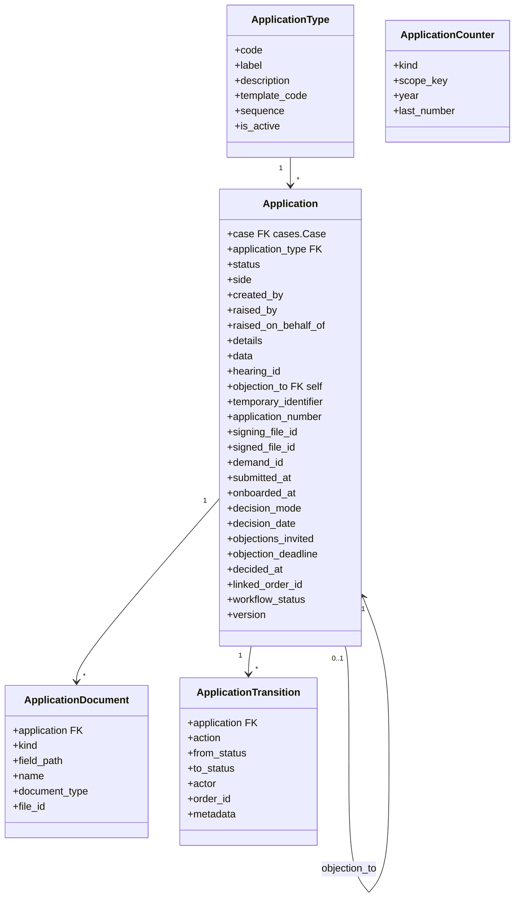
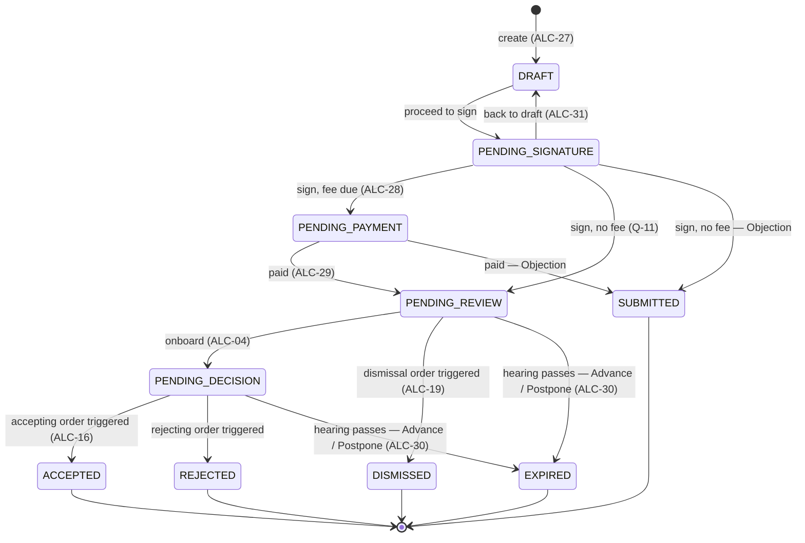
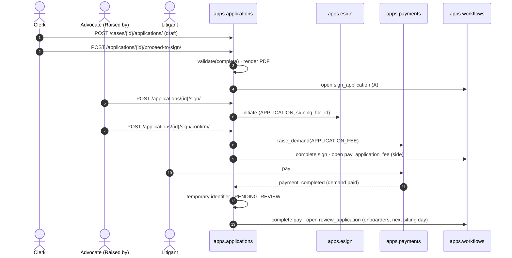
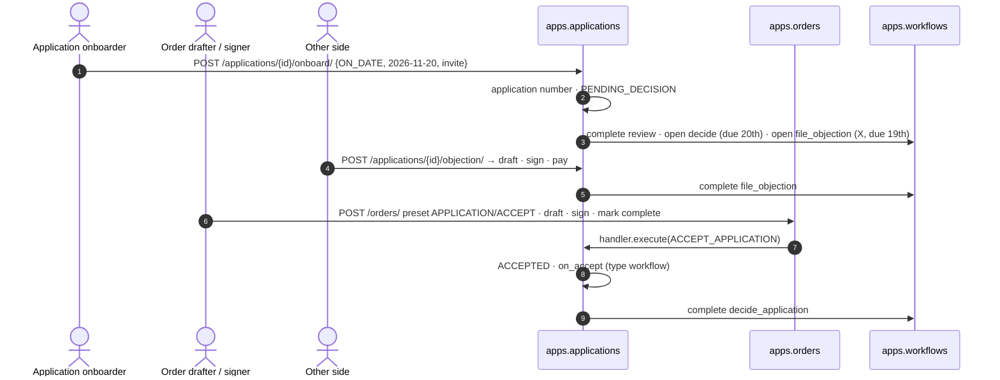

# 0033 — Court Applications (`apps.applications`)

## Status

Proposed

## References

- PRDs: `application-lifecycle.md` v36 (`ALC-01`–`ALC-31`, "Application types", "Fields by application type", "Number formats by state", `Q-5`, `Q-8`, `Q-11`–`Q-14`), `court-roles.md` (`RLE-`, §2 *Application onboarder*, *Order drafter*, *Order signer*), `order-template-catalogue.md` (#5 Accept application, #6 Reject application, #13 Acceptance of bail, #26 Dismiss application, combination rule 4), `order-generation.md` (`ORD-06`, `ORD-10a`, `ITM-04`, `VAR-02`, `VAR-03`, `APL-01`, `APL-02`), `view-case-handover.md` (§9 `APP-01`–`APP-20`, `ACT-02`), `pending-tasks-handover.md` (§2, §3), `signing-methods.md` (`SGM-01`–`SGM-05`), `document-submission.md` (`DSB-02`, `DSB-22`, `DSB-23`), `efiling-handover.md` (§3 `ROLE-`, §5 address, §6 `LIT-`, §8 `ACC-`, §13 `WIT-`, `JUR-11`, `JUR-12`), `cognizance-cheat-sheet.md` (§6), `case-lifecycle-handover.md` (§4 row 1), `office-management-handover.md` (`OFC-03`, `OFC-06`), `join-a-case-handover.md` (`JOIN-35`)

> **Scope note.** This module owns the **application**: one kind of filing,
> many types, raised by a party on a case. It owns the draft, the type's
> fields and documents, who may draft, sign and pay, the temporary
> identifier and the application number, onboarding, the decision date,
> objections, expiry, and what runs when an application is accepted. It
> decides nothing by itself that the PRD gives to an order: dismissal,
> acceptance and rejection are order items of [`0025`](0025-court-order.md),
> executed through a handler this module registers. It opens tasks only
> through [`0011`](0011-case-workflows.md) `TaskService`, collects money only
> through [`0017`](0017-orders-management.md), signs only through
> [`0015`](0015-cdac-esign.md), and reads hearings only through
> [`0023`](0023-hearings.md).

## Context

An **application** is how a party puts a matter before the court outside
the complaint itself: bail, a postponement, a change of PoA holder, a witness
to add, documents to produce. The original intent is that parties put
matters before the court with little effort, that advocates can delegate the
drafting to clerks and juniors, and that applications let a case move
forward without a hearing.

Every application, whatever its type, moves through the same six steps, in
the same order (`application-lifecycle.md` "The workflow"):

```text
1 Filing ──────────> 2 Review ──────────> 3 Onboarding ──────────> 4 Objections ──> 5 Decision ──> 6 After the decision
draft · sign · pay    onboard or dismiss    number · visible to       (only if invited    accept or      type's workflow
(filer side)          (court)               other side · now or       on a date)          reject, by     on acceptance
                                            on a date                                     order
```

| Step | What happens | Who acts | Status when the step ends |
| --- | --- | --- | --- |
| 1. Filing | Choose the type, fill in the form, sign, pay | Advocate/PiP; a clerk or junior may draft; anyone on the filer's side may pay | Pending Review (Objection: Submitted) |
| 2. Review | Onboard or dismiss | Application onboarder onboards; a dismissal is an order (Order drafter drafts, Order signer signs) | Pending Decision, or Dismissed |
| 3. Onboarding | Number allotted, other side can see it, court chooses *now* or *on a date* | Application onboarder | Pending Decision |
| 4. Objections | The other side may file **one** objection by midnight before the decision date | The other side | Pending Decision (unchanged) |
| 5. Decision | An order accepting or rejecting it is signed | Order drafter drafts; Order signer signs | Accepted or Rejected |
| 6. After the decision | On acceptance, the type's workflow runs | System, or the court where it needs a choice | Accepted or Rejected (unchanged) |

An application leaves the flow early in two ways only: it is **dismissed** at
review (an order, before onboarding, with no application number), or an
Advance / Prepone or Postpone application **expires** when its hearing passes
before it is decided (`ALC-30`). An application that is never submitted
does not expire (`ALC-27`).

The PRD fixes the rules this module enforces:

* Filing ends only when the application is **signed and paid**; only then does the court see it (`ALC-01`).
* Only the types whose *Available when* rule is met are offered; **Objection** is never offered — it is raised only from a *File objection* task (`ALC-26`).
* A draft saves everything and reopens with everything (`ALC-27`). It is edited only in Draft; one in Pending Signature is moved back to Draft to be edited, by anyone who could have edited the draft (`ALC-31`).
* Only the person selected in **Raised by** signs — for PoA Change, the incoming PoA holder; never a clerk or junior (`ALC-28`).
* Anyone on the same side of the case may pay (`ALC-29`).
* On submission the application gets a **temporary identifier**, never cited in an order; the court-facing **application number** is allotted only on onboarding (`ALC-02`, `ALC-04`).
* A *Review application* task opens for the courtroom's Application onboarders, due the next working day (`ALC-03`).
* Onboarding is a **system action**, not an order: no signature, effective at once (`ALC-04`). Dismissing, accepting and rejecting are **orders** (`ALC-08`, `ALC-19`, `ALC-22`).
* The other side cannot see the application until it is onboarded; court staff always can (`ALC-17`, `ALC-23`).
* Objections, when invited, are due by **midnight the day before** the decision date; silence has no consequence; at most **one** objection per application, for the whole opposing side (`ALC-11`–`ALC-13`, `ALC-24`).
* A *Decide application* task closes only when an accept or reject order is signed, so an abandoned draft order cannot lose an application (`ALC-21`).
* Acceptance triggers the **type's** workflow; rejection triggers nothing (`ALC-16`).

### What this module does and does not decide

`apps.applications` knows **what was applied for, by whom, on whose behalf,
where it stands, and when the court will deal with it**. It does not write
orders, move hearings, change parties or add documents to the case file
itself: each of those belongs to the module that owns the thing, and this
module calls it. It does not decide whether an application should succeed —
the court does, in an order.

## Goals

* One application model for every type; types differ in their own fields, availability, template and on-acceptance workflow, declared in code and switched on in data.
* Offer each filer exactly the types available to them on the case (`ALC-26`), with the PRD's preselection of *Raised by* and *Litigant*.
* Save drafts partially and resume them (`ALC-27`); validate completeness only when the draft is sent for signature.
* Enforce who drafts, who signs, who pays and who sees, server-side, at every status (`ALC-17`, `ALC-28`, `ALC-29`, `ALC-31`).
* Render the application to its print template and sign it through [`0015`](0015-cdac-esign.md); collect its fee through [`0017`](0017-orders-management.md); skip payment when no fee is due.
* Allot the temporary identifier at submission and the application number at onboarding, per state format, concurrency-safe.
* Onboard *now* or *on a date*, suggest the date, invite objections, move the date (`ALC-04`–`ALC-15`).
* Take dismissal, acceptance and rejection from triggered orders through registered order item handlers, and run the type's workflow on acceptance (`ALC-16`, `ALC-19`).
* Expire hearing-linked types when their hearing passes (`ALC-30`).
* Open and close every application pending task in the same transaction as the step that causes it.
* Serve the case's applications tab, the *Needs attention* well and the court's application screen (`APP-01`–`APP-20`, `ALC-23`).
* Expose REST APIs following [`0000`](0000-api-coding-spec.md), with registered error codes under domain `13`.

## Non-goals

* The order screen, order text and order signing ([`0025`](0025-court-order.md)).
* Moving hearings ([`0023`](0023-hearings.md)); the accepted Advance / Postpone moves its hearing through the order that accepts it.
* The bail bond itself — its form, signing and status ("Generate bail bond", "Bond status", `ACT-02`). This module hands the accepted bail application's data to it.
* Court fee amounts for each application type (`Q-11`); this module reads them from configuration.
* DSC, mobile OTP and batch signing (`SGM-01`, `SGM-02`, `SGM-04`): no spec provides them yet. Signing is recorded so they can plug in.
* Certified Copy (removed from the PRD in v27), Warrant Recall (named in the original spec, absent from the PRD) and Advocate Replacement (a system action, not an application).
* Notification copy and the case-update events catalogue (the PRD's master tables).
* Deleting or withdrawing an application (not in the PRD; question 7).

---

## Proposed changes

### 1. App layout and boundaries

```text
apps/applications/
├── apps.py                 # name = "apps.applications"; ready() registers handlers, authorizer, receivers
├── models.py               # ApplicationType, Application, ApplicationDocument, ApplicationTransition, ApplicationCounter
├── enums.py                # TextChoices (#4)
├── errors.py               # E13xxx (#15.6)
├── court_actions.py        # applications.take_on_file, applications.set_decision_date (#2.2)
├── types/
│   ├── base.py             # ApplicationTypeSpec, FieldProblem (#3.2)
│   ├── registry.py         # code -> spec; system check for seeded rows without a spec
│   ├── bail.py · edit_litigant.py · hearing_reschedule.py · poa_change.py
│   ├── production_of_documents.py · addition_of_witness.py · warrant_by_hand.py
│   └── simple.py           # types with no fields of their own
├── services/
│   ├── drafting.py         # create, edit, documents, proceed to sign, back to draft (#6)
│   ├── signing.py          # initiate, record_signature (#6.7)
│   ├── submission.py       # fee, demand, submit (#6.8, #6.9)
│   ├── numbering.py        # temporary identifier, application number (#7)
│   ├── onboarding.py       # onboard, move decision date (#9, #11.3)
│   ├── objections.py       # open, create, window (#10)
│   ├── decisions.py        # dismiss, accept, reject, type workflows (#8.2, #11, #12)
│   ├── expiry.py           # hearing-linked expiry (#13)
│   ├── rendering.py        # print template data, apps.pdf (#6.5)
│   └── richtext.py         # Application details sanitiser (#3.3)
├── handlers.py             # OrderItemHandler implementations for 0025 (#11.1)
├── receivers.py            # payment_completed, hearing signals, order_triggered
├── access.py               # who may see and do what (#2)
├── selectors.py            # lists, detail, needs attention, pending on a case (#14)
├── ports.py                # stand-ins for contracts not built yet (#1.2)
├── signals.py              # application_status_changed
├── tasks.py                # Dramatiq actors (#16.6)
├── serializers.py · views.py · urls.py · admin.py
└── tests/
```

Dependency rules:

```text
apps.applications ── imports ──> apps.cases.selectors / services             (#1.1)
apps.applications ── imports ──> apps.workflows.services                     (TaskService, CaseWorkflowService.dispatch)
apps.applications ── imports ──> apps.payments.services / signals            (DemandService, payment_completed)
apps.applications ── imports ──> apps.esign services / permissions           (initiation, register_entity_authorizer)
apps.applications ── imports ──> apps.pdf, apps.files services
apps.applications ── imports ──> apps.hearings.selectors / signals
apps.applications ── imports ──> apps.orders.handlers / selectors / signals
apps.applications ── imports ──> apps.organizations.selectors / access       (court actions, 0029)
apps.cases, apps.workflows, apps.payments, apps.esign, apps.hearings, apps.orders
        ── never import ──> apps.applications
```

Rules:

* `Application.case → cases.Case` is the only foreign key into another domain app (`on_delete=PROTECT`). Participants, hearings, orders, demands, files and e-sign transactions are plain `UUIDField` ids, read back through their owners' selectors.
* Orders reach this module only through the handlers it registers (#11.1); hearings and payments only through the signals it subscribes to. None of them import it.
* Views validate shape, call a service and serialize the result. Status, numbers, dates, tasks and demands are written only by `services/`.
* Every status change goes through one function, `services._transition(application, action, actor, **fields)`, which checks the transition table (#5.2), writes the `ApplicationTransition` row and sends `application_status_changed` on commit.
* An isolation test asserts the import rules.

#### 1.1 Contracts consumed

| Module | Function | Used for |
| --- | --- | --- |
| `apps.cases` | `selectors.get_case_summaries(case_ids)` | list rows and the court screen header |
| | `selectors.case_access(case_id, user)` → `{side, roles, participant_ids, represents, office_of}` | who the caller is on the case (#2.1) |
| | `selectors.advocate_access(case_id)` → advocates with vakalatnama access and parties in person, with the litigants each represents | *Raised by* and *Litigant* options (#3.3) |
| | `selectors.participants(case_id, role=None)` with current details and addresses | Edit Litigant Details prefill, Warrant by Hand accused, PoA Change litigants |
| | `selectors.courtroom(case_id)`, `selectors.state_code(case_id)`, `selectors.filing_number(case_id)` | routing, configuration, numbering |
| | `selectors.delay_applicable(case_id)`, `selectors.delay_reason(case_id)` | the filing's delay condonation application (#12.3) |
| | `services.participants.apply_litigant_edit(case_id, participant_id, changes, *, source)` | Edit Litigant Details on acceptance |
| | `services.participants.add_witnesses(case_id, called_by, witnesses, *, source)` | Addition of Witness on acceptance |
| | `services.poa.appoint(case_id, holder_user_id, participant_ids, documents, *, source)` | PoA Change on acceptance |
| | `services.documents.add_from_application(case_id, documents, *, source)` | Production of Documents on acceptance (`DSB-22`: source *Application*) |
| `apps.workflows` | `TaskService.open`, `complete_for`, `expire_for`, `reschedule` | every task of #16.1 |
| | `CaseWorkflowService.dispatch(case, "DCA_DECIDED")` | ends the Delay Condonation secondary stage ([`0011`](0011-case-workflows.md) #10.4) |
| `apps.payments` | `DemandService.raise_demand`, `cancel_demand`; signal `payment_completed` | the application fee (#6.8) |
| `apps.esign` | initiation service, transaction selector, `register_entity_authorizer("APPLICATION", …)` | signing (#6.7) |
| `apps.pdf` | in-process render of the type's template | the document to sign (#6.5) |
| `apps.files` | `documents.document_error`, `store_documents`, `get_file` | uploads (#6.4) and rendered PDFs |
| `apps.hearings` | `selectors.next_hearing`, `get_hearing`, `has_scheduled_hearing`, `is_sitting_day`, `next_sitting_day`, `business_date`; signals `hearing_rescheduled`, `hearing_ended`, `hearing_cancelled` | availability, suggested date, due dates, expiry |
| `apps.orders` | `handlers.registry.register`, `selectors.live_items_targeting(application_ids)`, signal `order_triggered` | decisions (#11), expiry guard (#13) |
| `apps.organizations` | `access.require`, `selectors.action_holders`, `selectors.is_court_reader` | court actions and task users ([`0029`](0029-court-roles.md)) |
| `apps.core` | configuration store ([`0018`](0018-configuration-store.md)) | fees, number formats, controls (#16.5) |
| `apps.messaging` | `enqueue_sms`, in-app | notifications (#16.2) |

None of the `apps.cases` services above exist yet, nor `case_access`,
`advocate_access` and `participants` in this shape. `apps.hearings`
publishes sitting days (0023 #4) but not `is_sitting_day` / `next_sitting_day`
as selectors; both are needed. `apps.orders` needs `live_items_targeting`
(#13). These are the first work this spec needs from those modules.

#### 1.2 Stand-ins (`ports.py`)

As `apps.scrutiny.ports` does, every call to a contract that does not exist
yet goes through `ports.py`, so each stand-in is replaced there and only
there:

* **Office access** (`office-management-handover.md`) is not modelled. Until it is, a clerk or junior advocate is associated with every advocate representing the side they act on, through their own `Representation` on the case.
* **Court actions** ([`0029`](0029-court-roles.md)) — Django groups named after the PRD role (`Application onboarder`, `Order drafter`, `Order signer`), held at the case's courtroom only, as scrutiny does today.
* **Tasks** ([`0011`](0011-case-workflows.md)) — until the engine lands, the court lists are built from application statuses (`PENDING_REVIEW`, `PENDING_DECISION`) and the citizen *Needs attention* well from #14.2; no task rows are written.
* **Hearings** — without `apps.hearings`, Advance / Prepone and Postpone are not offered (their *Available when* rule cannot be met) and the next working day skips only Sundays.
* **Orders** — without `apps.orders`, decisions can be recorded only through the admin action *Record decision from paper order*, which takes the order number and runs the same service (`decisions.record`).

### 2. Who may do what

#### 2.1 Filing side

The application's **side** is the side of the litigant it is raised on behalf
of (`COMPLAINANT` or `ACCUSED`). Everything on the filer side is decided
against that side.

| Term | Who | Source |
| --- | --- | --- |
| **Drafter** | an advocate with vakalatnama access on the side, a party in person on the side, or a clerk or junior advocate with office access to such an advocate on this case. For **PoA Change** only, a PoA holder with access to the case | `ALC-28`, 1.3; `OFC-03`, `OFC-06`; e-filing `ROLE-01`–`ROLE-05` |
| **Drafting circle** of an application | its creator; the user in *Raised by*; every advocate the creator works for on this case; every clerk or junior with office access to the *Raised by* advocate on this case | 1.3 "visible to the person who created it and to their associated advocates, clerks and junior advocates" |
| **Signer** | exactly the user in *Raised by* (for PoA Change, the incoming PoA holder) | `ALC-28` |
| **Payer** | anyone with an active relationship on the side: advocate, party in person, clerk, junior, litigant, PoA holder | `ALC-29` |
| **Side reader** | anyone with an active relationship on the side | Users and actions |
| **Other side** | anyone with an active relationship on the opposing side | `ALC-24` |

Rules:

* A litigant who is not a party in person, and a PoA holder (except for PoA Change), never draft or sign; they pay and read (`ALC-28`, step 1 "Who can file").
* A clerk or junior advocate can draft, edit, send for signature and move back to draft, but never sign, by any method (`ALC-28`; e-filing `ROLE-08`). Enforced in `services.signing`, not by hiding the button.
* Membership is evaluated when the action is taken. Someone removed from the case loses every action and read at once.

#### 2.2 Court side

Two court actions, declared in `court_actions.py` ([`0029`](0029-court-roles.md) #3.3), both at `COURTROOM` level, group *Application onboarder*:

| Action | Allows | PRD |
| --- | --- | --- |
| `applications.take_on_file` | onboard an application (#9) | `ALC-04` |
| `applications.set_decision_date` | choose *on a date* at onboarding, and move the decision date (#9, #11.3) | `ALC-09`, `ALC-15` |

Dismissing, accepting and rejecting are **orders** (`ALC-22`). This module
declares no action for them: drafting, filling and signing are the order
module's actions (`orders.edit_text`, `orders.fill_data`, `orders.sign`),
checked there. The decision on the application takes effect when the order
is triggered (#11).

**Reading is not an action** (`RLE-06`). Any staff account on the case's
courtroom list reads every **submitted** application of the case — before
onboarding too (`ALC-17` is for the other party, not the court) — through
`organizations.selectors.is_court_reader`. Court staff never see drafts, or
applications in Pending Signature or Pending Payment.

Missing action → `403 E13017`. Staff of another courtroom → `404 E00105`.

#### 2.3 Visibility by status

| Status | Drafting circle | Rest of the filer's side | Other side | Courtroom staff |
| --- | --- | --- | --- | --- |
| Draft, Pending Signature | read, act | — | — | — |
| Pending Payment | read, act | read, pay | — | — |
| Pending Review | read | read | — | read, onboard, dismiss by order |
| Pending Decision, Accepted, Rejected, Expired (after onboarding) | read | read | **read** (`ALC-17`) | read, decide by order |
| Dismissed; Expired before onboarding | read | read | — | read |
| Submitted (Objection) | read | read | read — the objection's target is already onboarded | read |

"—" means the application does not exist for that caller: a list leaves it
out and a direct read is `404 E00105`. The test for "onboarded" is
`onboarded_at IS NOT NULL`, so an application that expired before onboarding
stays invisible to the other side.

#### 2.4 Boundary: what decides, what enforces

| Concern | Decided by | Enforced by | Never |
| --- | --- | --- | --- |
| Which types a filer may raise | the type's *Available when* rule against the caller and the case (#3.1) | `types/registry` + `services.drafting.create` | the client hiding a type |
| Who may raise Edit Litigant Details, and whose details | the control in configuration (#3.5) | `types/edit_litigant.py` | the type's own code hard-coding a side |
| Who signs | *Raised by* | `services.signing` | any advocate on the case; a clerk |
| Who pays | the application's side (`ALC-29`) | a payer policy registered with `apps.payments` (#6.8) | the demand's `user_id` |
| The fee | configuration per state and type (`Q-11`) | `services.submission` snapshots it into the demand | the client |
| Onboarding, decision date | holders of the two court actions | `access.require` in `services.onboarding` | a staff title (`RLE-08`) |
| Dismissal, acceptance, rejection | the court, by a triggered order | `handlers.py`, called by [`0025`](0025-court-order.md) | an application endpoint |
| What happens on acceptance | the application type (`ALC-16`) | `ApplicationTypeSpec.on_accept` | the accept order item |
| Expiry | the hearing passing (`ALC-30`) | receivers and the midnight sweep (#13) | any type other than Advance / Prepone and Postpone |

### 3. Application types

#### 3.1 Catalogue

Each type is a code-defined `ApplicationTypeSpec` (#3.2) plus a seeded
`ApplicationType` row (#4.1) that switches it on for the deployment.

| Code | Label | Available when (`ALC-26`) | Template | On acceptance (`ALC-16`) | Expires (`ALC-30`) |
| --- | --- | --- | --- | --- | --- |
| `BAIL` | Bail | the litigant is an accused | `application-bail-bond` | the court may request a bail bond; a bail bond draft is created from the application (#12.2) | — |
| `EDIT_LITIGANT_DETAILS` | Edit Litigant Details | the control allows the caller to raise it and lists at least one litigant they may edit (#3.5) | `application-profile-edit` | the litigant's details on the case are updated | — |
| `CASE_SETTLEMENT` | Case Settlement | always | `application-case-settlement` | — | — |
| `CASE_TRANSFER` | Case Transfer | always | `application-case-transfer` | — | — |
| `CASE_WITHDRAWAL` | Case Withdrawal | always | `application-case-withdrawal` | — | — |
| `DELAY_CONDONATION` | Delay Condonation | the litigant is a complainant | `application-delay-condonation` | `DCA_DECIDED` is dispatched — on rejection too (#12.3) | — |
| `GENERIC` | Generic | always | `application-generic` | — | — |
| `ADVANCE_HEARING` | Advance / Prepone | a hearing is scheduled in the case | `application-reschedule-hearing` | the hearing moves through the accepting order (#12.2) | yes |
| `POSTPONE_HEARING` | Postpone | a hearing is scheduled in the case | `application-reschedule-request` | the hearing moves through the accepting order (#12.2) | yes |
| `POA_CHANGE` | PoA Change | always; drafted and signed by the incoming PoA holder | `application-poa-change` | the PoA holder's rights transfer to the person named | — |
| `PRODUCTION_OF_DOCUMENTS` | Production of Documents | always | `application-production-of-documents` | the attached documents are added to the case file | — |
| `ADDITION_OF_WITNESS` | Addition of Witness | always | `application-witness-deposition` | the witnesses are added to the case | — |
| `WARRANT_BY_HAND` | Warrant by Hand | always | none (#6.5) | nothing runs; the decision screen directs the court to issue a warrant by hand (#14.4) | — |
| `ABSENT_APPLICATION` | Absent Application | always | none | — | — |
| `REOPEN_EVIDENCE` | Reopen Evidence | always | none | — | — |
| `OBJECTION` | Objection | **never offered**; only from an open *File objection* task (#10) | none yet | none: ends at `SUBMITTED` | — |

`application-for-checkout-request` (checkout of the hearing date) is one of
the three reschedule templates the PRD names; which request uses it is not
said (question 9). Until then Advance uses `application-reschedule-hearing`
and Postpone `application-reschedule-request`.

Common to every type:

* The case must be on the court's file — registered, with a courtroom — before an application can be created (`409 E13003`). Before registration nobody could review it (`ALC-03`).
* "Always" still requires a drafter (#2.1).
* An inactive `ApplicationType` row is never offered; applications already raised under it continue.

#### 3.2 The type contract

```python
@dataclass(frozen=True)
class FieldProblem:
    field: str          # path under data, e.g. "data.sureties[1].phone"
    code: str           # a registered E13xxx or common code
    message: str


class ApplicationTypeSpec(ABC):
    code: ClassVar[str]
    expires_with_hearing: ClassVar[bool] = False
    needs_hearing: ClassVar[bool] = False          # hearing_id is set at creation
    data_schema: ClassVar[dict]                    # JSON Schema of `data`, shape only

    def unavailable_reason(self, ctx: FilerContext) -> str | None: ...       # ALC-26
    def form_context(self, ctx: FilerContext) -> dict: ...                   # system fields, prefills
    def validate(self, app: Application, *, complete: bool) -> list[FieldProblem]: ...
    def document_refs(self, data: dict) -> list[tuple[str, UUID]]: ...       # (path, document_id)
    def render_context(self, app: Application) -> dict: ...                  # template data
    def on_accept(self, app: Application, *, order_id: UUID, values: dict) -> dict: ...  # ALC-16
    def on_reject(self, app: Application, *, order_id: UUID) -> None: ...
```

Rules:

* `data_schema` is checked on every save, with `additionalProperties: false`: an unknown key is `400 E13009` on that key. A type with no fields of its own has `{"type": "object", "maxProperties": 0}`.
* `validate(complete=False)` runs on every save and reports only what is wrong with what was entered. `validate(complete=True)` runs at *Proceed to sign* (#6.5) and adds every mandatory field and cross-field rule. Drafts are therefore always saveable (`ALC-27`).
* `on_accept` must be idempotent: it is retried (#12.1).
* `registry.register(spec)` refuses a second spec for a code. A system check (`applications.E001`) fails when an active `ApplicationType` row has no spec.

#### 3.3 Fields every application carries

From "Every application" in the PRD. Stored as columns, not in `data`.

| Field | Column | Rules |
| --- | --- | --- |
| **Raised by** | `raised_by` (User) | One of `advocate_access(case)` on the application's side: an advocate with vakalatnama access, or a party in person. For PoA Change, the caller (the incoming PoA holder). May be empty in a draft; required to proceed (`E13008`). Not one of the options → `400 E13005`. |
| **Litigant** | `raised_on_behalf_of` (participant id) | One of the litigants represented by *Raised by* (a party in person: themselves). Not one of them → `400 E13006`. Changing *Raised by* to someone who does not represent the chosen litigant clears it. Fixes the application's `side`. |
| **Application details** | `details` | Rich text: bold, italic, underline, bulleted and numbered lists, alignment. Sanitised on save (#3.3.1). Mandatory to proceed: empty after sanitising → `400 E13007`. The only free-text box: no type has a reason box of its own. Printed as the body of the application. |
| **Supporting documents** | `ApplicationDocument` rows, `kind = SUPPORTING` | Optional; any number; each needs a name the filer gives (`DSB-02`). |

**Preselection** (returned by the form endpoint, #6.2, never applied
silently by the server):

| Caller | *Raised by* default | *Litigant* default |
| --- | --- | --- |
| Advocate with vakalatnama access on the side; party in person | themselves | the only litigant they represent, else empty |
| Clerk, or junior advocate without vakalatnama access, working for exactly one advocate on the side | that advocate | as above, for that advocate |
| Clerk or junior working for more than one | empty | empty |
| Incoming PoA holder (PoA Change) | themselves, fixed | not used (the type has its own multi-select) |

##### 3.3.1 Rich text

`services.richtext.sanitise(html)` uses `nh3` with the allow-list `p`, `br`,
`strong`, `em`, `u`, `ol`, `ul`, `li`, and the `style` attribute on `p` and
`li` restricted by an attribute filter to `text-align: left|center|right|justify`.
Everything else is stripped, never trusted from the client. At most
config `applications.details_max_bytes` after sanitising (`400 E00006`,
`field = details`). The same allow-list is what the templates render.

#### 3.4 Type data

`data` keys by type. Every `*_document_id` must be an `ApplicationDocument`
of this application with `kind = FIELD` and the matching `field_path`
(`400 E13011` otherwise). Addresses use the e-filing address composite
through `apps.address` ([`0020`](0020-person-case-filing-schema.md) §7),
whose own errors (domain `05`) pass through on the nested path.

**Bail** — the surety fields follow Form No. 37.

| Key | Type | Complete when | PRD |
| --- | --- | --- | --- |
| `bail_type` | `CASH` \| `SURETY` | required | Type of bail |
| `bail_amount` | decimal string, rupees, `> 0` | required for both | Bail amount |
| `number_of_sureties` | integer `≥ 1` | required for `SURETY`; must equal `len(sureties)` | Number of sureties |
| `sureties[]` | `{name, parent_name, phone, email?, address, id_proof_document_id, solvency_document_id}` | `SURETY`: every key but `email` | Surety details, ID proof, proof of solvency — once per surety |

With `CASH`, `number_of_sureties` and `sureties` must be absent (`400 E13009`).

**Edit Litigant Details** — one application edits one litigant.

| Key | Type | Complete when |
| --- | --- | --- |
| `participant_id` | uuid | required; one of the litigants the control lets the caller edit (#3.5, `400 E13024`) |
| `litigant_type` | `INDIVIDUAL` \| `INSTITUTION` | required; prefilled with the current type, editable (`LIT-2` / `ACC-1`) |
| `details` | object | the e-filing litigant fields for the participant's role and `litigant_type`, with the same keys, field types and validators as the [`0021`](0021-case-filing-api.md) §4.1–§4.2 participant endpoints |

| Role × type | Fields (`details` keys follow 0021; PRD ids) |
| --- | --- |
| Complainant · individual | phone (`LIT-3`), full name (`LIT-4`), age (`LIT-5`), gender? (`LIT-5a`), differently abled? (`LIT-5b`), email? (`LIT-6`), permanent address (`LIT-7`), same address? (`LIT-8`), current address when not (`LIT-9`) |
| Complainant · institution | type of institution (`LIT-17`), name (`LIT-18`), CIN or PAN? stored upper-case, no format check (`LIT-18a`), phone? (`LIT-19`), email? (`LIT-20`), address (`LIT-21`), representative phone, name, age, gender?, differently abled?, email?, designation, address (`LIT-22`–`LIT-26`) |
| Accused · individual | full name, special characters allowed (`ACC-2`), age? integer ≥ 1 (`ACC-3`), designation? (`ACC-15`), mobile (`ACC-6`), email (`ACC-7`), addresses[] (`ACC-8…12`), each with a police station (`ACC-13`) |
| Accused · institution | type of institution (`ACC-4`), name (`ACC-5`), mobile, email, addresses[] each with a police station |

* The form endpoint prefills `details` with the participant's current values. Changing `litigant_type` starts the other table empty.
* A complainant's phone must not match any other complainant, accused, advocate or PoA holder on the case (`LIT-3`): `400 E13025`, `field = data.details.phone_number`.
* An accused institution's persons responsible are not edited here; each is an individual accused (PRD, `ACC-14…23`).
* The diff against the current values is computed at *Proceed to sign* and stored in `data.changes`, so the template and the court see what changes. An application that changes nothing is incomplete (`E13008`, `field = data.details`).

**Case Transfer** — `requested_court` (text, required). *Current court* is
system-filled at render from the case's courtroom.

**Generic** — `title` (text, required, ≤ 255): the application's heading.

**Advance / Prepone, Postpone** — `needs_hearing`: at creation the server sets
`hearing_id` to `apps.hearings.selectors.next_hearing(case)` (a `SCHEDULED`
hearing); the client never chooses it. *Initial hearing date* and *Purpose of
hearing* are read from the hearing at render.

| Key | Type | Complete when |
| --- | --- | --- |
| `reason_code` | one of config `applications.reschedule_reasons` | required (question 10) |
| `proposed_date` | date | required; not before the business date; Advance: before the hearing date; Postpone: after it `[DERIVED]` |

**PoA Change** — raised and signed by the incoming PoA holder.

| Key | Type | Complete when |
| --- | --- | --- |
| `participant_ids[]` | litigants of the case appointing the applicant | at least one; each a complainant or accused of the case |
| `authorizations[]` | `{participant_id, document_id}` | exactly one per selected litigant |

Whether a litigant already has a PoA holder is read from the case record at
render, not entered.

**Production of Documents** — `documents[]`: `{document_type, document_id}`,
at least one; PDF or JPEG within the size limit (#6.4).

**Addition of Witness** — `witnesses[]`, at least one, each with the e-filing
witness fields (§13): `name` (`WIT-1`), `age?` (`WIT-2`), `what_will_prove?`
(`WIT-3`), `designation` (`WIT-4`), `mobile?` (`WIT-5`), `email?` (`WIT-6`),
`addresses[]` at least one (`WIT-7`). Name or designation is required.

**Warrant by Hand** — `accused_participant_id` (an accused of the case) and
`delivery_address` (prefilled by the form endpoint from the chosen accused's
address on file, the filer picking which where there are several; editable).

**Case Settlement, Case Withdrawal, Delay Condonation, Absent Application,
Reopen Evidence, Objection** — no fields of their own; the reason goes in
*Application details*.

#### 3.5 Edit Litigant Details control

"A control on the workflow decides who can raise it and whose details they
can edit." It is configuration, `applications` / `edit_litigant_details`
(JSON), read per state:

```json
{
  "raised_by_sides": ["COMPLAINANT", "ACCUSED"],
  "editable": "OWN_LITIGANTS"
}
```

| `editable` | The caller may edit |
| --- | --- |
| `OWN_LITIGANTS` | only the litigants represented by *Raised by* |
| `OWN_SIDE` | any litigant on the application's side |
| `ANY` | any complainant or accused of the case |

The seeded default above is a placeholder (question 3). The type's
*Available when* is met only when the caller's side is in `raised_by_sides`
and the resulting list is not empty.

### 4. Data model



All models inherit `apps.core.models.BaseModel`. `ApplicationType` and
`Application` also inherit `BaseAuditableModel`. Every bounded enum is a
`TextChoices` in `apps/applications/enums.py`.

#### 4.1 `ApplicationType` — `BaseActivatableModel`

| Field | Type | Notes |
| --- | --- | --- |
| `code` | `CharField(32, unique=True)` | a registered spec code (#3.1), validated against the registry, no `choices`, so a new type needs no migration |
| `label` | `CharField(128)` | e.g. "Advance / Prepone" |
| `description` | `CharField(255)` | the one-line UI description |
| `template_code` | `CharField(64, blank=True)` | `apps.pdf` template; blank uses `application-default` (#6.5) |
| `sequence` | `PositiveSmallIntegerField` | order in the type picker |

Seeded by data migration from #3.1. Editable in admin: label, description,
template, sequence, active.

#### 4.2 `Application`

| Field | Type | Notes |
| --- | --- | --- |
| `case` | `FK("cases.Case", on_delete=PROTECT, related_name="applications")` | |
| `application_type` | `FK(ApplicationType, on_delete=PROTECT)` | |
| `status` | `CharField(24, choices=ApplicationStatus)` | #5 |
| `side` | `CharField(16, choices=Side)` | `COMPLAINANT`, `ACCUSED`; the litigant's side, set when the litigant is chosen; for an Objection, the side opposite its target's |
| `created_by` | from `BaseModel` | the drafter; *Date Created* is `created_at` |
| `raised_by` | `FK(User, null=True, on_delete=PROTECT)` | *Application Raised By* — the signer (`ALC-28`) |
| `raised_on_behalf_of` | `UUIDField(null=True)` | a `CaseParticipant` id; *Application Raised On Behalf Of* |
| `details` | `TextField(blank=True)` | sanitised HTML (#3.3.1) |
| `data` | `JSONField(default=dict)` | the type's fields (#3.4) |
| `hearing_id` | `UUIDField(null=True, db_index=True)` | Advance / Postpone only |
| `objection_to` | `OneToOneField("self", null=True, on_delete=PROTECT, related_name="objection")` | *Objection To*; the reverse is *Objection (Linked Application)* — at most one (`ALC-24`) |
| `temporary_identifier` | `CharField(64, null=True)` | allotted at submission (`ALC-02`, #7) |
| `application_number` | `CharField(64, null=True)` | allotted at onboarding (`ALC-04`, #7) |
| `signing_file_id` | `CharField(64, blank=True)` | the rendered PDF sent for signature (#6.5) |
| `signed_file_id` | `CharField(64, blank=True)` | the signed PDF |
| `signing_method` | `CharField(24, blank=True)` | `AADHAAR_ESIGN`, … (`SGM-`) |
| `signed_at` | `DateTimeField(null=True)` | |
| `esign_transaction_id` | `UUIDField(null=True)` | the transaction recorded |
| `fee_amount` | `DecimalField(18, 2, null=True)` | snapshot at signing; `0` when no fee |
| `demand_id` | `UUIDField(null=True)` | the `APPLICATION` demand, when a fee is due |
| `submitted_at` | `DateTimeField(null=True)` | *Date Submitted* |
| `onboarded_at` / `onboarded_by` | `DateTimeField(null=True)` / `FK(User, null=True)` | *Date Onboarded* |
| `decision_mode` | `CharField(8, choices=DecisionMode, blank=True)` | `NOW`, `ON_DATE`; set at onboarding |
| `decision_date` | `DateField(null=True)` | *Decision Date*: the onboarding date for `NOW`, the chosen date for `ON_DATE`; moved by `ALC-15` |
| `objections_invited` | `BooleanField(null=True)` | *Objections Invited*; `null` until onboarded |
| `objection_deadline` | `DateTimeField(null=True)` | 00:00 IST on `decision_date` — the end of the day before (`ALC-13`) |
| `decided_at` | `DateTimeField(null=True)` | when the deciding or dismissing order was triggered |
| `linked_order_id` | `UUIDField(null=True)` | *Linked Order* — the order that dismissed, accepted or rejected it |
| `expired_at` / `expiry_reason` | `DateTimeField(null=True)` / `CharField(32, blank=True)` | `HEARING_PASSED`, `HEARING_CANCELLED` |
| `workflow_status` | `CharField(16, choices=WorkflowStatus, default=NOT_APPLICABLE)` | `NOT_APPLICABLE`, `PENDING`, `DONE`, `FAILED` — the type's on-acceptance workflow (#12.1) |
| `workflow_result` | `JSONField(default=dict, blank=True)` | ids it created (witness ids, bail bond draft id) and the last error code |
| `version` | `PositiveIntegerField(default=0)` | +1 on every write; the concurrency token (#16.8) |

*Template* is the type's `template_code`. *Application Raised By* is the user
in `raised_by` once signed.

Constraints:

* `UniqueConstraint(case, application_number, condition=Q(application_number__isnull=False))`; `UniqueConstraint(case, temporary_identifier, condition=…)`. Where numbering is per court (#7) the counter also makes them unique across cases.
* `CheckConstraint`: `application_number IS NULL OR onboarded_at IS NOT NULL` — no number without onboarding (`ALC-04`).
* `CheckConstraint`: `status IN (DRAFT, PENDING_SIGNATURE, PENDING_PAYMENT) OR (submitted_at IS NOT NULL AND temporary_identifier IS NOT NULL)` — every status from submission on has both (`ALC-02`).
* `CheckConstraint`: `status != DISMISSED OR application_number IS NULL` — dismissal comes before onboarding (`ALC-19`).
* `CheckConstraint`: `status != PENDING_DECISION OR (onboarded_at IS NOT NULL AND decision_date IS NOT NULL)`.
* `CheckConstraint`: `signed_file_id = '' OR signed_at IS NOT NULL`.

Validated in `clean()` (the database cannot see the type's code):

* `objection_to` is set exactly when the type is `OBJECTION`; `SUBMITTED` is reached only by an Objection; an Objection's `side` is opposite its target's.
* `hearing_id` is set exactly when the type `needs_hearing`.

Indexes: `(case, status)`, `(status, decision_date)`, `(application_type, status)`, `(hearing_id, status)`.

#### 4.3 `ApplicationDocument`

| Field | Type | Notes |
| --- | --- | --- |
| `application` | `FK(Application, on_delete=CASCADE, related_name="documents")` | |
| `kind` | `CharField(16, choices=DocumentKind)` | `SUPPORTING` (named by the filer) or `FIELD` (a fixed attachment of a type field) |
| `field_path` | `CharField(128, blank=True)` | `FIELD` only, e.g. `sureties[0].solvency_document_id` |
| `name` | `CharField(255)` | `SUPPORTING`: required, the filer's name; `FIELD`: the field's label (`DSB-23`: "a fixed attachment by its field name (Proof of solvency)") |
| `document_type` | `CharField(64, blank=True)` | Production of Documents' document type |
| `file_id` | `CharField(64)` | `apps.files` id |
| `sequence` | `PositiveSmallIntegerField` | display order |

Documents can be added and removed only while the application is a draft.
After submission they are immutable and are the case file's *Application*
documents (`DSB-11`, `DSB-22`).

#### 4.4 `ApplicationTransition`

Append-only log of every status change and every court action that does not
change status (moving the decision date).

| Field | Type | Notes |
| --- | --- | --- |
| `application` | `FK(Application, on_delete=CASCADE, related_name="transitions")` | |
| `action` | `CharField(32, choices=Action)` | #5.2 |
| `from_status` / `to_status` | `CharField(24)` | equal for `MOVE_DECISION_DATE` |
| `actor` | `FK(User, null=True, on_delete=PROTECT)` | `NULL` for the system |
| `order_id` | `UUIDField(null=True)` | for order-driven changes |
| `metadata` | `JSONField(default=dict)` | e.g. `{"from_date": "2026-11-20", "to_date": "2026-11-27"}` |

`save()` refuses an existing row; admin is read-only. This answers the PRD's
"Who onboarded / who dismissed / who decided" — each is one row here.

#### 4.5 `ApplicationCounter`

| Field | Type | Notes |
| --- | --- | --- |
| `kind` | `CharField(16)` | `TEMPORARY`, `APPLICATION` |
| `scope_key` | `CharField(64)` | the case id, or the courtroom id, per the state's scope (#7) |
| `year` | `PositiveIntegerField` | `0` where the series does not restart yearly |
| `last_number` | `PositiveIntegerField(default=0)` | |

`UniqueConstraint(kind, scope_key, year)`. Locked with `select_for_update()`
by `services.numbering` inside the transaction that saves the number.

### 5. Lifecycle

#### 5.1 States



Moving the decision date (`ALC-15`) does not change status. This diagram
replaces the PRD's, which it marks out of date: there is no date before
onboarding and no expiry before submission.

`ACCEPTED`, `REJECTED`, `DISMISSED`, `SUBMITTED` and `EXPIRED` are terminal.
Nothing leaves them, and nothing about the application but `workflow_status`
and `workflow_result` changes after.

#### 5.2 Every status change

| From | Action (`Action`) | Actor | To | Where | PRD |
| --- | --- | --- | --- | --- | --- |
| — | `CREATE` | drafter | `DRAFT` | #6.3 | `ALC-26`, `ALC-27` |
| `DRAFT` | `EDIT` (no status change) | drafting circle | `DRAFT` | #6.3 | `ALC-27` |
| `DRAFT` | `PROCEED_TO_SIGN` | drafting circle | `PENDING_SIGNATURE` | #6.5 | 1.4 |
| `PENDING_SIGNATURE` | `BACK_TO_DRAFT` | drafting circle | `DRAFT` | #6.6 | `ALC-31` |
| `PENDING_SIGNATURE` | `SIGN` | *Raised by* only | `PENDING_PAYMENT`, or straight to submission when no fee | #6.7 | `ALC-28`, `Q-11` |
| `PENDING_PAYMENT` | `PAY` (from `payment_completed`) | anyone on the side | `PENDING_REVIEW`; Objection `SUBMITTED` | #6.8, #6.9 | `ALC-01`, `ALC-02`, `ALC-29` |
| `PENDING_REVIEW` | `ONBOARD` | `applications.take_on_file` (+ `set_decision_date` for *on a date*) | `PENDING_DECISION` | #9 | `ALC-04`, `ALC-07`–`ALC-09` |
| `PENDING_REVIEW` | `DISMISS` (handler) | dismissal order triggered | `DISMISSED` | #8.2 | `ALC-19` |
| `PENDING_DECISION` | `MOVE_DECISION_DATE` (no status change) | `applications.set_decision_date` | `PENDING_DECISION` | #11.3 | `ALC-15` |
| `PENDING_DECISION` | `ACCEPT` (handler) | accepting order triggered | `ACCEPTED` | #11.1 | `ALC-08`, `ALC-09`, `ALC-16` |
| `PENDING_DECISION` | `REJECT` (handler) | rejecting order triggered | `REJECTED` | #11.1 | `ALC-16` |
| `PENDING_REVIEW`, `PENDING_DECISION` — Advance / Postpone only | `EXPIRE` | system | `EXPIRED` | #13 | `ALC-30`, `Q-8` |

The *File objection* task is not a status of this application — it belongs
to the other side (#10).

#### 5.3 Rules

* Every transition runs in `transaction.atomic()`, under `select_for_update()` on the application, re-reads the status, and checks the table above. Anything else is `409 E13001` with `allowed_actions` in the error.
* Writes from clients carry `If-Match: <version>`; a mismatch is `412 E13026`, so a clerk and an advocate editing the same draft, or two onboarders, cannot both succeed.
* Each transition opens, completes or expires its tasks in the same transaction (#16.1), writes one `ApplicationTransition`, bumps `version`, and on commit sends `application_status_changed(application_id, case_id, from_status, to_status)` and its notifications.
* Order of checks on every action: can the caller see it (`404 E00105`) → is the action allowed in this status (`409 E13001`) → may this caller take it (`403`) → the payload (`400`).
* Status labels shown to parties follow `view-case-handover.md` §9.3 for the filing statuses; the PRD's later statuses are shown by their own names (question 6).

### 6. Step 1 — Filing

#### 6.1 Offering types

`GET /api/v1/cases/{case_id}/application-types/` returns, for the caller, the
active types whose *Available when* rule is met (`ALC-26`), in `sequence`
order. A caller who cannot draft on the case gets an empty list.

| Rule | Met when |
| --- | --- |
| only for the accused | the caller is a drafter on the accused side |
| only for the complainant | the caller is a drafter on the complainant side |
| a hearing is scheduled | `apps.hearings.selectors.has_scheduled_hearing(case)` |
| control (Edit Litigant Details) | #3.5 |
| PoA Change | the caller holds the PoA holder role on the case, or is a drafter |
| Objection | never here |

A caller is never a drafter on both sides of one case: an advocate cannot
represent both sides (0020 §6, `E07014`), so the side follows from the caller.

#### 6.2 Form context

`GET /api/v1/cases/{case_id}/application-types/{code}/form/` returns
everything the form needs that the filer does not type: the *Raised by*
options with the litigants each represents, the defaults of #3.3, and the
type's system fields — the current court (Case Transfer), the hearing's date
and purpose (Advance / Postpone), the accused and their addresses (Warrant by
Hand), the editable litigants with their current details (Edit Litigant
Details), the case's litigants and whether each already has a PoA holder (PoA
Change). It refuses an unavailable type (`400 E13002`).

```json
{
  "type": { "code": "BAIL", "label": "Bail", "template_code": "application-bail-bond" },
  "raised_by_options": [
    { "user_id": "…", "name": "Adv. Bijini Rejen", "kind": "ADVOCATE",
      "litigants": [ { "participant_id": "…", "name": "Deepak Choudhary", "role": "ACCUSED" } ] }
  ],
  "defaults": { "raised_by": "…", "litigant": "…" },
  "system_fields": {},
  "meta": { "...": "standard envelope" }
}
```

#### 6.3 Create and edit

```json
POST /api/v1/cases/{case_id}/applications/
{
  "application_type": "BAIL",
  "raised_by": "6a1f…",
  "litigant": "c3d0…",
  "details": "<p>The accused has been in custody since …</p>",
  "data": { "bail_type": "SURETY", "bail_amount": "50000.00", "number_of_sureties": 1, "sureties": [] }
}
```

1. The case is on file (`409 E13003`); the caller is a drafter on the case (`403 E13004`); the type is available to them (`400 E13002`, `field = application_type`). `OBJECTION` here is `E13002`.
2. `raised_by`, `litigant` (`E13005`, `E13006`) and `data` shape (`E13009`, common codes) are checked; `details` is sanitised; `validate(complete=False)`.
3. Advance / Postpone: `hearing_id = next_hearing(case)`.
4. `status = DRAFT`; `side` from the litigant, or from the caller's side when no litigant is chosen yet.

`201` with the detail (#14.3). Everything may be left incomplete.

`PATCH /api/v1/applications/{id}/` takes the same fields except
`application_type` (fixed once created; a different type is a new draft).
Only in `DRAFT` (`409 E13001`), by the drafting circle, with `If-Match`.
A change of litigant that changes the side is refused (`400 E13006`): the
drafting circle and readers were decided on the side.

#### 6.4 Documents

```text
POST   /api/v1/applications/{id}/documents/          multipart: file, kind, name?, field_path?, document_type?
DELETE /api/v1/applications/{id}/documents/{doc_id}/
```

* Draft only, drafting circle only.
* The upload is checked with `apps.files.documents.document_error` ([`0014`](0014-file-storage-service.md) #3.1) before anything is written: PDF, JPEG or PNG within `FILE_MAX_SIZE_BYTES`; Production of Documents accepts PDF and JPEG only. A refusal is `400 E13010`, `field = file`. Stored with `store_documents`, tags `{"module": "applications", "application_id": …}`.
* `SUPPORTING` needs `name`; `FIELD` needs a `field_path` the type declares. The returned `id` is what `data` references.
* Deleting a document that `data` still references is `409 E13012`; clear the field first.
* Removed and replaced files are discarded from storage on commit.

#### 6.5 Proceed to sign

`POST /api/v1/applications/{id}/proceed-to-sign/` — drafting circle, `DRAFT`.

1. **Completeness** (`400 E13008`, one error per gap, each on its path — `raised_by`, `litigant`, `details`, `data.sureties[0].phone`): *Raised by*, *Litigant* and *Application details* present; `validate(complete=True)`; every referenced document present.
2. **Hearing** — Advance / Postpone: the hearing is still the case's next scheduled hearing and not before the business date (`409 E13016`).
3. **Objection** — its target is still `PENDING_DECISION` (`409 E13023`).
4. **Render** — `services.rendering` builds the template data (the case header the PRD lists as "the same for every type": court complex, case and filing number, case name, date, parties with their advocates, offence, application title, petitioner, party type, advocate name and bar registration number, the "Dated this" line) plus `spec.render_context(app)` and the sanitised details, renders the type's template in-process through `apps.pdf`, and stores the PDF with `apps.files`: `signing_file_id`. Types with no template use `application-default`, which prints the header, the title and the details (question 8). A render failure is `500` from `apps.pdf` and nothing changes.
5. `status = PENDING_SIGNATURE`; open *Sign application* for `raised_by` (#16.1); notify them (#16.2).

#### 6.6 Back to draft

`POST /api/v1/applications/{id}/back-to-draft/` — `PENDING_SIGNATURE` only,
by anyone in the drafting circle (`ALC-31`). Clears `signing_file_id`,
expires *Sign application*. An e-sign started on the old file can no longer
be recorded (#6.7). The draft keeps everything (`ALC-27`).

#### 6.7 Sign

```json
POST /api/v1/applications/{id}/sign/
{ "method": "AADHAAR_ESIGN" }
```

`PENDING_SIGNATURE`, caller is `raised_by` (`403 E13013` for anyone else,
including a clerk or junior, and any other advocate on the case, `ALC-28`):

1. `method` is enabled for the state, config `signing.methods` (`SGM-05`); otherwise `400 E13014`, `field = method`. The signer may use any enabled method (PRD, `Q-10` closed).
2. Advance / Postpone: the hearing check of #6.5 again (`E13016`); Objection: target still `PENDING_DECISION` (`E13023`).
3. Start e-sign through the `apps.esign` initiation service in-process with `entity_type = APPLICATION`, `entity_id = application.id`, `file_id = signing_file_id` and the template's signature placement; return its `esign_url`, `form_fields` and `transaction_id` unchanged ([`0015`](0015-cdac-esign.md) #6.1).

The module registers an `APPLICATION` authorizer with `apps.esign`, so a
direct call to `/esign/_esign` for an application is refused unless the
caller is its `raised_by` and it is `PENDING_SIGNATURE`.

```json
POST /api/v1/applications/{id}/sign/confirm/
{ "transaction_id": "0f9d…" }
```

`services.signing.record_signature(application, signed_file_id, method, actor,
transaction_id=None)`, idempotent:

* The transaction is `SUCCESS`, for this application, by this user, on the current `signing_file_id`; a transaction from before a move back to draft, or still pending, is `409 E13015`.
* Already recorded for this transaction → the application unchanged, `200`.
* Set `signed_file_id`, `signed_at`, `signing_method`, `esign_transaction_id`; complete *Sign application*; then payment (#6.8).

`record_signature` takes a signed file and a method and nothing specific to
e-sign, so mobile OTP, DSC and batch signing (`SGM-01`, `SGM-02`, `SGM-04`,
`APP-10`) call it when they land.

#### 6.8 Payment

In the signing transaction:

1. `fee = config applications.<STATE_CODE> / fee.<TYPE_CODE>` (decimal, default `0`), snapshotted in `fee_amount`.
2. **Fee due** — `DemandService.raise_demand(case=…, reference_type=APPLICATION, reference_id=application.id, items=[{charge_type: APPLICATION_FEE, reference_type: APPLICATION, reference_id: application.id, description: "<type label> — application fee", quantity: 1, unit_amount: fee}], user_id=raised_by)`; store `demand_id`; `status = PENDING_PAYMENT`; open *Pay application fee* for the side (#16.1).
3. **No fee** — no demand is raised ([`0017`](0017-orders-management.md): "where nothing is due, the raising module raises no demand and skips its payment step") and the application is submitted at once (#6.9). This is the direction pending `Q-11`.

Payment happens in `apps.payments`, alone or several applications in one
batch (`APP-11`, 0017 #5). On `payment_completed` with `demand_paid = true`
for a demand this module raised (matched by the stored `demand_id`, never by
reference), the receiver submits the application (#6.9). It is idempotent: a
second delivery finds the application already past `PENDING_PAYMENT` and does
nothing. `PENDING` payments never count.

**Who may pay** (`ALC-29`). 0017 lets anyone on the case pay any demand (0017
#13, its question 2). This module needs the payer limited to the
application's side, so 0017 gains a payer policy hook, the same shape as the
e-sign authorizer: `apps.payments.access.register_payer_policy("APPLICATION",
fn(user, demand) -> bool)`, consulted before a payment is created. Until that
amendment lands, the opposing side could pay — wider than the PRD, never
narrower.

#### 6.9 Submission

`services.submission.submit(application)`, in the transaction that saw the
payment (or the signature, when no fee):

1. `submitted_at = now()`; allot the **temporary identifier** (#7).
2. Objection: `status = SUBMITTED`; complete the target's *File objection* task (#10). Nothing else: an objection is never reviewed, onboarded or decided on its own.
3. Every other type: `status = PENDING_REVIEW`; open *Review application* for holders of `applications.take_on_file` at the case's courtroom, due the courtroom's next sitting day after today (`ALC-03`, #16.1).
4. Advance / Postpone whose hearing has already passed: submitted, then expired at once in the same transaction (#13).
5. On commit: notifications (#16.2), event `application-submitted` (#16.3).

The court can now see it; the other side cannot until it is onboarded
(`ALC-17`).

### 7. Numbering

Two numbers, two moments (`ALC-02`, `ALC-04`):

| Number | Allotted | Shown | Cited in orders and documents |
| --- | --- | --- | --- |
| Temporary identifier | at submission | to the filer side and the court | **never** |
| Application number | at onboarding | to everyone who can see the application | yes — the only number an order uses |

Formats and counter scopes are per state, in configuration
`applications.<STATE_CODE>` (`Q-13` keeps the scope open, so it is data):

| Key | Kerala `[CURRENT]` | Punjab & Haryana |
| --- | --- | --- |
| `temporary_identifier_format` | `{filing_number}-AP{n}` | `CRM/{n}/{year}` |
| `temporary_identifier_scope` | `CASE` (no yearly reset) | `COURT` |
| `application_number_format` | `CMP/{n}/{year}` | `CRM-{n}-{year}` |
| `application_number_scope` | `CASE`, yearly | `COURT` |

Placeholders: `{n}`, `{year}` (the business date's year), `{filing_number}`,
`{case_number}`. `COURT` scope keys the counter by the case's courtroom.

* The counter row is locked, so concurrent submissions or onboardings in one scope get consecutive numbers; a rolled-back transaction gives its number back.
* A number some application in the scope already holds (one set by hand) is skipped. A number taken by a write outside numbering at the same moment refuses the onboarding with `409 E13027`; it can be retried.
* A state with no format configured cannot submit or onboard: `503 E13028`, and the system check `applications.W001` warns at startup.
* Gujarat's formats are not known (PRD "Number formats by state").
* The temporary identifier is not offered to the order module: the handlers give orders the application number, or, for a dismissal, the type, party and filing date (#8.2). A test asserts that no order variable can receive it.

### 8. Step 2 — Review

#### 8.1 The *Review application* task

Raised at submission for holders of `applications.take_on_file` at the
case's courtroom; visible to the courtroom (`ALC-03`). It offers two choices
for as long as it is open, and the status stays `PENDING_REVIEW`:

* **Onboard** — #9, the usual path.
* **Dismiss** — opens the order screen with the dismissal added in advance: the client calls `POST /api/v1/orders/` with `preset = {"kind": "APPLICATION", "action": "DISMISS", "application_id": …}` ([`0025`](0025-court-order.md) #5.2).

There is no setting a date at this step (PRD v30).

#### 8.2 Dismissal

Dismissal is order item *Dismiss application* (#26), effective when the
order is triggered (`ALC-19`, `ALC-22`). The applications handler for
`DISMISS_APPLICATION` (#11.1):

* is available only while the application is `PENDING_REVIEW` (`APPLICATION_ONBOARDED` otherwise);
* fills `[Application Type]`, `[Party Type]`, `[Party Name]` and `[Filing Date]` from the application — the type label, the side, the litigant's name and `submitted_at` — and **no number**: there is none (`VAR-02`; catalogue #26);
* on `execute`: `status = DISMISSED`, `decided_at`, `linked_order_id`; complete *Review application*. The application keeps no application number.

### 9. Step 3 — Onboarding

```json
POST /api/v1/applications/{id}/onboard/
If-Match: 4
{ "mode": "ON_DATE", "decision_date": "2026-11-20", "invite_objections": true }
```

`PENDING_REVIEW`; `applications.take_on_file` at the case's courtroom
(`403 E13017`). In one transaction, with no order and no signature
(`ALC-04`):

1. Allot the **application number** (#7); `onboarded_at`, `onboarded_by`.
2. `status = PENDING_DECISION`; complete *Review application*.
3. The application becomes visible to the other side (`ALC-17`), whatever is chosen below; notify them (#16.2).
4. The answer to "now or on a date" (`ALC-07`):

| `mode` | Needs | Sets | Opens |
| --- | --- | --- | --- |
| `NOW` (3a, `ALC-08`) | — | `decision_date` = business date; `objections_invited = false` (nobody may object, `ALC-11`) | *Decide application*, due today. The response carries `order_preset` for the client to open the order screen with the application in context |
| `ON_DATE` (3b, `ALC-09`) | also `applications.set_decision_date` (`403 E13017`); `decision_date` after the business date and a sitting day of the courtroom (`400 E13018`, `field = decision_date`) | `decision_date`; `objections_invited` = `invite_objections`, **default `true`** (`ALC-11`, `ALC-25`); `objection_deadline` when invited | *Decide application*, due on `decision_date`; *File objection* when invited (#10) |

`invite_objections` with `NOW` is ignored. Every type is onboarded the same
way until types carry their own configuration (`ALC-25`); the default is a
placeholder, not a restriction.

**3c — open the order screen for something else** (`ALC-18`) is not an API
action. The client opens the order screen without a preset; the application,
its status and its *Review application* task are untouched.

```json
{
  "id": "…",
  "status": "PENDING_DECISION",
  "application_number": "CMP/2/2026",
  "decision_mode": "NOW",
  "decision_date": "2026-11-12",
  "objections_invited": false,
  "order_preset": { "kind": "APPLICATION", "action": "ACCEPT", "application_id": "…", "onboarding": true },
  "version": 5,
  "meta": { "...": "standard envelope" }
}
```

`order_preset.onboarding = true` makes the order module preselect the state's
`APPLICATION_ONBOARDING` order type ([`0025`](0025-court-order.md) #5.2,
`OTY-03`). For a Bail application the preset action is `ACCEPT_BAIL`. The
client may switch the preset action to `REJECT`.

**Suggesting a date** (`ALC-10`). The court detail (#14.4) carries
`suggested_decision_date`: the date of `next_hearing(case)` when it is after
the business date, else `null` and the date is set by hand. Later, when
application work runs in dedicated slots, the suggestion becomes the next
slot; the field stays the same.

### 10. Step 4 — Objections

Only after `ON_DATE` with objections invited (`ALC-11`, `ALC-12`). Choosing
`NOW` gives nobody the chance to object.

**The invitation.** At onboarding:

* `objection_deadline` = 00:00 IST on `decision_date`, i.e. the end of the day before: a decision on the 21st puts the deadline at the end of the 20th (`ALC-13`).
* *File objection* opens for the other side — the whole opposing side, not a named person (`ALC-24`) — due `decision_date − 1 day`, `reference = ("APPLICATION", target.id)`; the other side is told plainly that it must object and by when (#16.2).
* Unchecked: no task and no message; the other side still sees the application (`ALC-12`, `ALC-17`).

**Filing the objection.**

```json
POST /api/v1/applications/{id}/objection/
```

`{id}` is the target. The caller must be a drafter on the side opposite the
target's; objections must have been invited (`409 E13020`) and the deadline
not passed (`409 E13021`). It creates an `OBJECTION` draft with
`objection_to = target`, `side` = the objecting side — or, when one exists
and the caller is in its drafting circle, returns it (`200`). One objection
per application, in any status (`ALC-24`): an objection drafted by someone
outside the caller's circle is `409 E13022`. The objection then goes through
step 1 like any application — drafted, signed and paid for (PRD v17) — and
ends at `SUBMITTED` (#6.9).

**After the deadline.** Silence has no consequence: nothing is recorded or
delayed (`ALC-13`). The midnight sweep expires an open *File objection* task
with `WINDOW_CLOSED` (#16.6). An objection already started may still be
signed and paid while its target is `PENDING_DECISION`; the court screen
shows `filed_after_deadline: true` when it was submitted after the deadline
(question 4).

**When the target is decided or expires** before the objection is submitted:
the *File objection* task expires (`NO_LONGER_RELEVANT`); the objection stays
where it is (an unsubmitted application never expires) but can no longer be
sent for signature, signed or paid (`409 E13023`); its unpaid demand is
cancelled.

### 11. Step 5 — Decision

The court decides from one screen: the application, its documents, when it
was filed, whether an objection was filed and the objection itself (`ALC-14`,
`ALC-23`, #14.4). It comes at once (3a) or on the decision date (3b).

#### 11.1 Order item handlers

Registered from `AppConfig.ready()` with the [`0025`](0025-court-order.md)
#1.2 registry. Every item is contextual with `target_type = APPLICATION`.

| Item | `unavailable_reason` (`ITM-03`) | `validate_target` (`ITM-04`) | `defaults` (`VAR-02`) | `execute` |
| --- | --- | --- | --- | --- |
| `ACCEPT_APPLICATION` (#5) | not `PENDING_DECISION` → `APPLICATION_NOT_ONBOARDED` / `APPLICATION_DECIDED`; a Bail application → `USE_ACCEPTANCE_OF_BAIL` | the target is an application of the order's case | `[Application Number]`, `[Application Type]` | `ACCEPTED`, then the type's workflow (#12) |
| `REJECT_APPLICATION` (#6) | as above, without the Bail rule | same | same | `REJECTED`; `on_reject` |
| `ACCEPTANCE_OF_BAIL` (#13) | the target is not a Bail application; not `PENDING_DECISION` | same | `[Application Number]` | `ACCEPTED`; bail bond if the terms ask for one (#12.2) |
| `DISMISS_APPLICATION` (#26) | not `PENDING_REVIEW` → `APPLICATION_ONBOARDED` / `APPLICATION_DECIDED` | same | `[Application Type]`, `[Party Type]`, `[Party Name]`, `[Filing Date]` | `DISMISSED` (#8.2) |

* `validate(complete=True)` for an accept of Advance / Postpone requires the order to move the application's hearing — its next hearing, or a *Rescheduling of hearing date* item on that hearing — so the hearing is moved by the same order; the problem is `HEARING_MOVE_REQUIRED` on `target_id` (question 5). [`0025`](0025-court-order.md) #9.2 then confirms the move with `reason_code = PARTY_APPLICATION` and `sought_by` = the application's side.
* The handler problems are in-process codes; the order module surfaces them on its own endpoints (`E11010`).
* Combination rule 4 of the catalogue (one decision per application per order) is the order module's `ONE_PER_TARGET` rule.
* `execute(ctx, values, run_id)` is idempotent on `run_id`: it locks the application; if the application already carries this `linked_order_id`, it returns the first result. If the application is no longer in the status the item needs — it was onboarded after a dismissal order was drafted, or decided by another order — the run is `FAILED` with `error_code = APPLICATION_NOT_IN_STATUS`, logged at error, and the application is unchanged (question 11). The order itself stands; its text is the record.
* On success: status, `decided_at`, `linked_order_id`; complete *Decide application* (or *Review application* for a dismissal); expire an open *File objection*; one `ApplicationTransition` with `order_id`. On commit, notifications and events (#16.2, #16.3).

*Decide application* closes in the handler, in the order's trigger run, which
is when the order is both signed and complete ([`0025`](0025-court-order.md)
`CMP-04`) — "closing only once an accept/reject order is signed" (`ALC-21`).
An abandoned draft order leaves it open.

#### 11.2 Pending applications on the order screen

`APL-01`: the order data lists the applications still pending on the matter.
The order module never imports this one, so the client reads
`GET /api/v1/cases/{case_id}/applications/?pending=true` — `PENDING_REVIEW`
and `PENDING_DECISION`, each with its `allowed_order_actions` (`DISMISS`, or
`ACCEPT`/`ACCEPT_BAIL` and `REJECT`) — and adds the item through the order
API (`APL-02`).

#### 11.3 Moving the decision date

```json
POST /api/v1/applications/{id}/decision-date/
If-Match: 6
{ "decision_date": "2026-11-27" }
```

`PENDING_DECISION`, `decision_mode = ON_DATE` (`409 E13019`; the PRD moves
only a date set under 3b); `applications.set_decision_date` (`403 E13017`);
the date passes the rules of #9 and differs from the current one
(`400 E13018`). In one transaction (`ALC-15`):

1. `decision_date` replaced; `objection_deadline` recomputed.
2. *Decide application* `reschedule`d to the new date — the same task.
3. *File objection*, when invited: an open task is rescheduled to the new deadline; if it had already expired at the old deadline and the new deadline is in the future, a new task is opened (a closed task does not reopen, pending tasks §3), and the other side is told the new deadline.
4. Status unchanged; one `MOVE_DECISION_DATE` transition with both dates.

### 12. Step 6 — After the decision

#### 12.1 Running the type's workflow

On `ACCEPTED` the handler sets `workflow_status = PENDING` when the type has
an on-acceptance workflow (`NOT_APPLICABLE` otherwise), records the decision,
and in the same order run calls `spec.on_accept(app, order_id, values)`:

* Success → `workflow_status = DONE`, `workflow_result` with what it created.
* Failure → the decision stands (it is the court's, signed), `workflow_status = FAILED`, `workflow_result.error_code`, logged `APPLICATION_WORKFLOW_FAILED` (`E13029`, logged only); the actor `run_type_workflow(application_id)` retries up to `applications.workflow_max_retries` with backoff; an admin action retries after that.

Rejecting runs `on_reject` only where the type needs it (Delay Condonation)
and never the acceptance workflow (`ALC-16`).

#### 12.2 By type

| Type | `on_accept` |
| --- | --- |
| Bail | Acceptance of bail carries the court's terms of bail and whether to request a bail bond. When requested, `signals.bail_bond_requested(application_id, case_id, order_id, terms)` is sent; the bail bond module creates the bail bond draft from the application's bail type, amount and sureties and opens its own task. Until that module exists, the request is stored in `workflow_result` and `workflow_status` stays `PENDING` (question 12) |
| Edit Litigant Details | `apps.cases.services.participants.apply_litigant_edit(case, participant_id, data.changes, source=application)` — including a change between individual and institution |
| Advance / Prepone, Postpone | nothing of its own: the accepting order moved the hearing (#11.1); the handler checks that the hearing's date changed and records it |
| PoA Change | `apps.cases.services.poa.appoint(case, raised_by, participant_ids, authorization documents, source=application)`; the incoming holder's rights replace the outgoing holder's for those litigants |
| Production of Documents | `apps.cases.services.documents.add_from_application(case, documents, source=application)` — each document joins the case file with source *Application* and its type (`DSB-22`) |
| Addition of Witness | `apps.cases.services.participants.add_witnesses(case, called_by=raised_on_behalf_of, witnesses, source=application)` |
| Delay Condonation | `CaseWorkflowService.dispatch(case, "DCA_DECIDED")` — on acceptance and on rejection, ending the Delay Condonation secondary stage ([`0011`](0011-case-workflows.md) #10.4) |
| Warrant by Hand | nothing runs; the court screen carries `decision_hint`: issue a warrant with the channel *By hand* (#14.4) |
| every other type | — |

#### 12.3 The filing's delay condonation application `[PROPOSED]`

A complaint filed late carries its delay condonation prayer inside the
filing (`JUR-11`, `JUR-12`, fee paid with it), and at cognizance the court
accepts it with the generic *Accept application* item, in the order that
takes cognizance (`cognizance-cheat-sheet.md` §6; [`0025`](0025-court-order.md)
#5.2 preset `COGNIZANCE`). That needs an application to accept. The PRDs do
not say where it comes from (question 2). Proposed:

* On `CASE_REGISTERED` with `delay_applicable`, this module creates a `DELAY_CONDONATION` application from the filing: `raised_by` the filing's first signatory, the first complainant as litigant, `details` from `JUR-12`, `signed_file_id` the signed complaint, `submitted_at` the case's `filed_at`, fee none (it was paid with the filing).
* It is onboarded in the same step by the system — application number allotted, `decision_mode = NOW`, `decision_date` the registration date, `objections_invited = false` — with no *Review* or *Decide* task: the *Take cognizance* task carries it.
* Accepting or rejecting it dispatches `DCA_DECIDED` like any Delay Condonation application.

### 13. Expiry

Only Advance / Prepone and Postpone, and only once submitted
(`ALC-30`; step 1: "An application that is never submitted … does not
expire"):

| Trigger | Source | Applications looked at |
| --- | --- | --- |
| the hearing ends or is abandoned | `apps.hearings.signals.hearing_ended` | `hearing_id` = that hearing, status `PENDING_REVIEW` or `PENDING_DECISION` |
| the hearing is cancelled | `hearing_cancelled` | same; `expiry_reason = HEARING_CANCELLED` |
| the hearing's date is before the business date | `expire_hearing_linked_applications`, daily at 00:05 IST (#16.6) | same; catches anything a missed signal left |

For each, under the application lock:

1. **Guard.** If the application is the target of an accept or reject item on a live order of the case — drafted, sent for signing or signed, not yet triggered or discarded — it is left alone: a court that decided it in the hearing's own order must not see the decision fail because the hearing ended before the order was signed. `apps.orders.selectors.live_items_targeting(ids)` answers this. The nightly sweep looks again, and expires it once no live order targets it.
2. `status = EXPIRED`, `expired_at`, `expiry_reason`; expire *Review application*, *Decide application* and *File objection* with `NO_LONGER_RELEVANT` (`Q-8c` direction); notify (#16.2, `Q-14`).

Rules:

* A **moved** hearing does not expire the application: hearings keep their id when moved ([`0023`](0023-hearings.md) #8.2), and the application follows its hearing to the new date. `hearing_rescheduled` is subscribed to only to log the move; the direction is pending `Q-8b`.
* An **abandoned** hearing (not reached, swept at midnight) counts as passed and expires the application, even though 0023 lets it be rescheduled later (question 20).
* Unsubmitted Advance / Postpone applications are never expired. Once their hearing has passed they cannot move forward (`409 E13016` at *Proceed to sign* and *Sign*); a `PENDING_PAYMENT` one has its unpaid demand cancelled and its *Pay application fee* task expired, and stays where it is.
* No other type expires, at any status (`ALC-30`).

### 14. Read models

#### 14.1 The case's applications (filer side and court)

`GET /api/v1/cases/{case_id}/applications/?type=&status=&filed_by=&search=&pending=&page=`
(`APP-01`–`APP-07`), paginated, scoped to what the caller may see (#2.3).

| Column | Source |
| --- | --- |
| `type` | code and label |
| `identifier` | `application_number`, else `temporary_identifier`, else `null` (`APP-18`) |
| `status`, `status_label` | #5.3 |
| `filed_by` | `raised_by` name; `side` (`APP-16`, `APP-17`) |
| `litigant` | name |
| `created_at`, `submitted_at` | `APP-14`, `APP-15` |
| `decision_date` | when onboarded |
| `has_objection` | for an onboarded application |
| `linked_order_id` | `APP-19` |
| `actions` | what the caller can do now: `continue`, `sign`, `pay`, `back_to_draft`, `file_objection` |

`search` matches either identifier. `filed_by` is a user id. Ordering:
`-created_at`; `?ordering=submitted_at` too. Case summaries come from one
batched `get_case_summaries` call.

#### 14.2 Needs attention

`GET /api/v1/cases/{case_id}/applications/needs-attention/` (`APP-05`,
`APP-09`) — what still needs a step from the caller, grouped by step so
several waiting on the same step collapse into one entry with one action:

```json
{
  "groups": [
    { "step": "CONTINUE_DRAFT", "action_label": "Continue draft", "application_ids": ["…"] },
    { "step": "ADD_SIGNATURE", "action_label": "Add signature", "application_ids": ["…", "…"] },
    { "step": "COMPLETE_PAYMENT", "action_label": "Complete payment", "application_ids": ["…"], "demand_ids": ["…"] }
  ],
  "meta": { "...": "standard envelope" }
}
```

* `CONTINUE_DRAFT` — drafts in the caller's drafting circle.
* `ADD_SIGNATURE` — `PENDING_SIGNATURE` where the caller is `raised_by`. Signing them together needs DSC or batch signing (`APP-10`); with Aadhaar e-sign they are signed one at a time.
* `COMPLETE_PAYMENT` — `PENDING_PAYMENT` on the caller's side; `demand_ids` lets the client pay them in one batch (`APP-11`, 0017 #6.2).
* `FILE_OBJECTION` — applications with an open *File objection* for the caller's side.

#### 14.3 Detail

`GET /api/v1/applications/{id}/` — for anyone who can see it:

```json
{
  "id": "…",
  "case": { "id": "…", "case_number": "ST/6/2026", "title": "Prateek Agrawal v. Deepak Choudhary" },
  "type": { "code": "POSTPONE_HEARING", "label": "Postpone", "template_code": "application-reschedule-request" },
  "status": "PENDING_DECISION",
  "status_label": "Pending decision",
  "side": "ACCUSED",
  "temporary_identifier": "KL-000123-2026-AP3",
  "application_number": "CMP/2/2026",
  "raised_by": { "id": "…", "name": "Adv. Bijini Rejen" },
  "litigant": { "participant_id": "…", "name": "Deepak Choudhary" },
  "details": "<p>…</p>",
  "data": { "reason_code": "ADVOCATE_UNWELL", "proposed_date": "2026-12-04" },
  "hearing": { "id": "…", "hearing_date": "2026-11-21", "purpose_label": "Appearance" },
  "documents": [ { "id": "…", "kind": "SUPPORTING", "name": "Medical certificate", "file_id": "…" } ],
  "signed_file_id": "…",
  "created_at": "…", "submitted_at": "…", "onboarded_at": "…",
  "decision_mode": "ON_DATE", "decision_date": "2026-11-20",
  "objections_invited": true, "objection_deadline": "2026-11-20T00:00:00+05:30",
  "objection": null,
  "objection_to": null,
  "linked_order_id": null,
  "workflow_status": "NOT_APPLICABLE",
  "allowed_actions": [],
  "version": 6,
  "meta": { "...": "standard envelope" }
}
```

The temporary identifier is returned to the filer side and the court only;
the other side never sees it.

#### 14.4 Court view

The same endpoint, for courtroom staff, adds what `ALC-14` and `ALC-23`
require on opening an application:

* `filed_on` (`submitted_at`) and `objection_status` — `NOT_INVITED`, `AWAITING` (before the deadline), `NONE_FILED` (after it), `FILED`;
* `objection` — the objection application itself, with its details and documents, when one has been submitted; never a draft;
* `suggested_decision_date` (#9) while `PENDING_REVIEW`;
* `allowed_actions` — from the status and the caller's actions: `onboard_now`, `onboard_on_date`, `dismiss` (order), `move_decision_date`, `accept`, `reject` (order) (`RLE-07`);
* `decision_hint` for Warrant by Hand (#12.2).

`GET /api/v1/applications/?court={courtroom_id}&status=&type=&decision_date_before=&page=`
lists submitted applications across the courtroom's cases for staff; work
lists themselves are the [`0011`](0011-case-workflows.md) task lists of
#16.1.

### 15. APIs

Mounted under `/api/v1/`, owned by `apps/applications/urls.py` (including the
`/cases/{case_id}/…` routes), tag `applications`, `meta` envelope, standard
error shape ([`0000`](0000-api-coding-spec.md)).

#### 15.1 Filer side

| Method | Path | Purpose |
| --- | --- | --- |
| GET | `/cases/{case_id}/application-types/` | #6.1 |
| GET | `/cases/{case_id}/application-types/{code}/form/` | #6.2 |
| GET / POST | `/cases/{case_id}/applications/` | #14.1 / #6.3 |
| GET | `/cases/{case_id}/applications/needs-attention/` | #14.2 |
| GET / PATCH | `/applications/{id}/` | #14.3 / #6.3 |
| POST | `/applications/{id}/documents/` | #6.4 |
| DELETE | `/applications/{id}/documents/{doc_id}/` | #6.4 |
| POST | `/applications/{id}/proceed-to-sign/` | #6.5 |
| POST | `/applications/{id}/back-to-draft/` | #6.6 |
| POST | `/applications/{id}/sign/` | #6.7 |
| POST | `/applications/{id}/sign/confirm/` | #6.7 |
| POST | `/applications/{id}/objection/` | #10 |

Payment is made through the [`0017`](0017-orders-management.md) endpoints,
using `demand_id`.

#### 15.2 Court side

| Method | Path | Purpose |
| --- | --- | --- |
| GET | `/applications/?court=` | #14.4 |
| GET | `/applications/{id}/` | #14.4 |
| POST | `/applications/{id}/onboard/` | #9 |
| POST | `/applications/{id}/decision-date/` | #11.3 |

Dismissal, acceptance and rejection have no endpoint here: they are order
items (#11.1).

#### 15.3 Sequences





#### 15.4 Permissions

* Baseline: `IsAuthenticatedAndRegistered` ([`0000`](0000-api-coding-spec.md) #6). There is no anonymous endpoint.
* Filer-side reads and actions per #2.1 and #2.3, evaluated against active relationships on the case at the time of the request.
* Court-side reads by `is_court_reader` on the case's courtroom; actions by `access.require` with the two court actions (#2.2).
* Anything the caller may not see — a draft of another circle, an application of the other side before onboarding, another courtroom's — is `404 E00105`, never `403`, so its existence is not revealed.

#### 15.5 Serializer responsibilities

Serializers check shape only: UUIDs, enum values, dates, `data` against the
type's `data_schema`, lengths. Sides, circles, signers, statuses, dates
against the calendar, availability and completeness are checked in the
services under the application lock. Read only: `status`, `side`,
`created_by`, every identifier, every `*_at` and `*_by`, `signing_file_id`,
`signed_file_id`, `fee_amount`, `demand_id`, `decision_mode`,
`decision_date`, `objections_invited`, `objection_deadline`,
`linked_order_id`, `workflow_status`, `workflow_result`, `hearing_id`,
`version`.

#### 15.6 Error codes

Codes are defined in `apps/applications/errors.py` with
`apps.api.errors.define()` under domain prefix **`13`**, allocated in
`apps.api.errors.DOMAINS` (`"13": "applications"`) and in the table of
[`0000`](0000-api-coding-spec.md) #9.2 before the first code is defined.
`10`, `11` and `12` are taken by the hearings, court orders and processes
specs.

| Code | Name | Status | Raised when |
| --- | --- | --- | --- |
| `E13001` | `ACTION_NOT_ALLOWED` | 409 | the action is not allowed in the application's status; carries `allowed_actions` |
| `E13002` | `TYPE_NOT_AVAILABLE` | 400 | the type's *Available when* rule is not met, the type is inactive, or it is `OBJECTION` (`ALC-26`); `field = application_type` |
| `E13003` | `CASE_NOT_ON_FILE` | 409 | the case is not registered or has no courtroom |
| `E13004` | `CANNOT_DRAFT` | 403 | the caller is not a drafter on the case, or not in the application's drafting circle for this action (`ALC-28`, `ALC-31`) |
| `E13005` | `RAISED_BY_INVALID` | 400 | *Raised by* is not an advocate with vakalatnama access or a party in person on the side; for PoA Change, not the caller; `field = raised_by` |
| `E13006` | `LITIGANT_INVALID` | 400 | the litigant is not represented by *Raised by*, or changing it would change the side; `field = litigant` |
| `E13007` | `DETAILS_REQUIRED` | 400 | *Application details* empty after sanitising; `field = details` |
| `E13008` | `APPLICATION_INCOMPLETE` | 400 | *Proceed to sign*: one error per gap, each on its path (`raised_by`, `data.sureties[0].phone` …) |
| `E13009` | `FIELD_NOT_FOR_TYPE` | 400 | a `data` key the type does not define, or one that does not apply to the values chosen (sureties with cash bail); `field = data.<key>` |
| `E13010` | `DOCUMENT_NOT_ACCEPTED` | 400 | the upload's format or size is refused; `field = file` |
| `E13011` | `DOCUMENT_NOT_ON_APPLICATION` | 400 | `data` references a document that is not a `FIELD` document of this application for that path |
| `E13012` | `DOCUMENT_IN_USE` | 409 | deleting a document `data` still references |
| `E13013` | `NOT_THE_SIGNER` | 403 | signing by anyone but *Raised by* — another advocate, a clerk or junior (`ALC-28`) |
| `E13014` | `SIGNING_METHOD_NOT_ENABLED` | 400 | `SGM-05`; `field = method` |
| `E13015` | `SIGNATURE_NOT_VALID` | 409 | confirming a transaction that is not a success, not on the current `signing_file_id`, or not the caller's |
| `E13016` | `HEARING_NOT_UPCOMING` | 409 | Advance / Postpone: its hearing has passed, or is no longer the case's next hearing |
| `E13017` | `COURT_ACTION_REQUIRED` | 403 | the caller is not allowed `applications.take_on_file` / `applications.set_decision_date` at the courtroom |
| `E13018` | `DECISION_DATE_INVALID` | 400 | *On a date* without a date, or with one not after the business date, not a sitting day, or unchanged; `field = decision_date` |
| `E13019` | `DECISION_NOT_ON_DATE` | 409 | moving the decision date of an application dealt with *now* |
| `E13020` | `OBJECTION_NOT_INVITED` | 409 | an objection where none was invited, or by someone not on the opposing side |
| `E13021` | `OBJECTION_WINDOW_CLOSED` | 409 | starting an objection after the deadline (`ALC-13`) |
| `E13022` | `OBJECTION_TAKEN` | 409 | an objection already exists, drafted outside the caller's circle (`ALC-24`) |
| `E13023` | `TARGET_NOT_PENDING` | 409 | sending for signature, signing or paying an objection whose target is no longer `PENDING_DECISION` |
| `E13024` | `LITIGANT_NOT_EDITABLE` | 400 | Edit Litigant Details for a litigant the control does not allow (#3.5); `field = data.participant_id` |
| `E13025` | `PHONE_IN_USE` | 400 | the complainant's phone matches another participant on the case (`LIT-3`); `field = data.details.phone_number` |
| `E13026` | `APPLICATION_STALE` | 412 | `If-Match` does not match `version` |
| `E13027` | `NUMBER_TAKEN` | 409 | the number the series gave was taken by a write outside numbering at the same moment; retry |
| `E13028` | `NUMBERING_NOT_CONFIGURED` | 503 | no number format for the state (#7) |
| `E13029` | `TYPE_WORKFLOW_FAILED` | 500 | logged, never returned: the type's on-acceptance workflow failed (#12.1) |

Rules:

* Released codes never change meaning and are never reused ([`0000`](0000-api-coding-spec.md) #9.2).
* Every endpoint declares its business codes with `error_responses(...)`, with the field where it helps, e.g. `errors.DETAILS_REQUIRED.example(field="details")` ([`0000`](0000-api-coding-spec.md) #10.1).
* Order item handler problems (`APPLICATION_NOT_ONBOARDED`, `APPLICATION_ONBOARDED`, `APPLICATION_DECIDED`, `USE_ACCEPTANCE_OF_BAIL`, `HEARING_MOVE_REQUIRED`) are in-process codes returned to the order module, which reports them under its own codes.
* `apps.payments`, `apps.esign`, `apps.address` and `apps.pdf` errors pass through unchanged on their own endpoints and nested paths.

### 16. Cross-cutting

#### 16.1 Pending tasks

Through [`0011`](0011-case-workflows.md) `TaskService`, in the transaction
that does the step, with `reference = ("APPLICATION", application.id)`.

| `task_key` | Side · category | Users | Visibility | Opened | Due | Completed | Expired | PRD |
| --- | --- | --- | --- | --- | --- | --- | --- | --- |
| `sign_application` | citizen · `SIGN` | `raised_by` | `USERS_ONLY` | *Proceed to sign* | same day | signed | back to draft | 1.4, 1.5 |
| `pay_application_fee` | citizen · `PAY` | the side: every advocate, party in person, clerk, litigant and PoA holder | `SAME_SIDE` | signed with a fee due | same day | the demand is paid | the demand is cancelled (#10, #13) | `ALC-29` |
| `review_application` | court | `applications.take_on_file` holders at the courtroom | `COURTROOM` | submitted | next sitting day | onboarded; dismissal triggered | expired (#13) | `ALC-03`, `ALC-19` |
| `decide_application` | court | Order drafter and Order signer holders at the courtroom (`orders.edit_text`, `orders.sign`) | `COURTROOM` | onboarded | today (`NOW`) or `decision_date` | accept or reject triggered | expired (#13) | `ALC-21` |
| `file_objection` | citizen · `FILE_SUBMIT` | the opposing side's drafters | `SAME_SIDE` | onboarded *on a date* with objections invited | `decision_date − 1` | the objection is submitted | the deadline passes (`WINDOW_CLOSED`); the target is decided or expires (`NO_LONGER_RELEVANT`) | `ALC-12`, `ALC-13` |

Names *(proposed, the master table owns them)*: `Sign application —
{type}`, `Pay ₹{amount} — {type} application`, `Review {type} application —
{case_title}`, `Decide {type} application {application_number}`, `File
objection to {type} application {application_number} by {deadline}`.
Same-day due dates follow the original spec; overdue is derived, never a
status (pending tasks §3).

#### 16.2 Notifications

Through `apps.messaging` on commit; copy is owned by the master Notifications
table (`Q-12`). This module supplies triggers and context. A messaging
failure never fails the step.

| Message key | Trigger | Recipients | Source |
| --- | --- | --- | --- |
| `APPLICATION_PENDING_SIGNATURE` | *Proceed to sign* | `raised_by` | original spec |
| `APPLICATION_SUBMITTED` | submitted | the filer's side | original spec |
| `APPLICATION_ONBOARDED` | onboarded | the other side, with the application number | PRD `Q-12` (moved from submission to onboarding) |
| `APPLICATION_OBJECTION_INVITED` | objections invited; deadline moved | the other side, with the deadline | `ALC-12` "told plainly … and by when" |
| `APPLICATION_DECIDED` | accepted or rejected | everyone on the case, with the application number | original spec |
| `APPLICATION_DISMISSED` | dismissed | the filer's side | *(proposed, `Q-14`)* |
| `APPLICATION_EXPIRED` | expired | the filer's side | *(proposed, `Q-14`)* |
| `APPLICATION_DECISION_DATE_MOVED` | date moved | both sides | *(proposed, `Q-14`)* |
| `APPLICATION_OBJECTION_FILED` | objection submitted | the applicant's side | *(proposed, `Q-14`)* |

Court users are not messaged: their task lists and counts are the
notification.

#### 16.3 Events

For the case-update timeline (Events master table), raised through
`application_status_changed` receivers:

| Event | Trigger | Attributes |
| --- | --- | --- |
| `application-submitted` | submitted | type, raised by, side (prosecution / defence), date, temporary identifier |
| `application-accepted` | accepted | type, date, order id, application number |
| `application-rejected` | rejected | type, date, order id, application number |
| `application-onboarded`, `application-dismissed`, `application-expired`, `application-objection-filed` | *(proposed, `Q-14`)* | type, date, the relevant number or order |

The original spec's *application-submitted* names the application number;
it has none at submission, so the temporary identifier is used for the
filer-side timeline only (question 13).

#### 16.4 Signals

`apps.applications.signals`, sent on commit with ids only:

| Signal | When | Typical receiver |
| --- | --- | --- |
| `application_status_changed` | every status change | events, notifications, view-case counts |
| `bail_bond_requested` | Acceptance of bail with a bail bond requested | the bail bond module (#12.2) |

Receivers read the application back through `apps.applications.selectors`.

#### 16.5 Configuration

Configuration store ([`0018`](0018-configuration-store.md)), coerced at the
read boundary:

| `config_set` | `config_key` | Default | Notes |
| --- | --- | --- | --- |
| `applications.<STATE_CODE>` | `fee.<TYPE_CODE>` | `0` | `Q-11`; amounts not yet known |
| `applications.<STATE_CODE>` | `temporary_identifier_format`, `temporary_identifier_scope`, `application_number_format`, `application_number_scope` | Kerala as #7; none elsewhere | #7, `Q-13` |
| `applications` | `edit_litigant_details` | #3.5 | JSON |
| `applications` | `reschedule_reasons` | `[]` | JSON list of `{code, label}`; question 10 |
| `applications` | `details_max_bytes` | `65536` | #3.3.1 |
| `applications` | `workflow_max_retries` | `3` | #12.1 |
| `applications` | `expiry_batch_size` | `500` | #16.6 |
| `signing` | `methods` | `AADHAAR_ESIGN` | shared with orders (`SGM-05`) |

Application types are data (`ApplicationType`, #4.1), not configuration. No
new settings or environment variables; nothing here is a secret. `nh3` is
added to `requirements/base.txt` (shared with [`0025`](0025-court-order.md)).

#### 16.6 Background processing

Dramatiq actors in `apps/applications/tasks.py`, ids only, enqueued with
`transaction.on_commit`, idempotent:

| Actor | Schedule | Notes |
| --- | --- | --- |
| `run_type_workflow(application_id)` | — | #12.1; no-op unless `workflow_status = FAILED` or `PENDING` |
| `expire_hearing_linked_applications()` | `@cron("35 18 * * *")` — 00:05 IST, `max_retries=0` | #13; bounded by `expiry_batch_size`; re-checks the live-order guard |
| `close_objection_windows()` | `@cron("35 18 * * *")` — 00:05 IST, `max_retries=0` | expires *File objection* tasks whose deadline has passed (#10) |

Both scheduled actors follow [`0026`](0026-dramatiq-crontab.md) §4.1 and are
added to its schedule inventory and to `apps/core/tests/test_schedules.py`.

#### 16.7 Logging

`structlog.get_logger(__name__)`, `UPPER_SNAKE` events with ids only
([`0027`](0027-structured-logging.md)): `APPLICATION_CREATED`,
`APPLICATION_STATUS_CHANGED` (`application_id`, `from_status`, `to_status`,
`action`), `APPLICATION_NUMBER_ALLOTTED`, `APPLICATION_DECISION_DATE_MOVED`,
`APPLICATION_EXPIRED` (`count` for the sweep), `APPLICATION_WORKFLOW_FAILED`
(`application_id`, `error_code`), `APPLICATION_ORDER_RUN_REFUSED`. Never the
details text, names, phone numbers, addresses or surety data.

#### 16.8 Concurrency

* Every write locks the application row and re-reads its status (#5.3).
* `If-Match: <version>` on `PATCH`, *Proceed to sign*, *Back to draft*, *Onboard* and *Decision date*; `412 E13026` on mismatch.
* Numbering locks the counter row (#4.5); two onboardings in one scope get consecutive numbers.
* A payment callback and a second delivery of `payment_completed` race on the application lock; the second sees `PENDING_REVIEW` and does nothing.
* An order handler and an onboarding race on the application lock; whichever comes second sees the new status — an onboarding finds `DISMISSED` (`409 E13001`), a dismissal run finds `PENDING_DECISION` and fails (#11.1).
* Expiry and a decision race on the lock; the guard of #13 keeps a live order's decision from being pre-empted.
* `UniqueConstraint` on `objection_to` is the backstop for two drafters starting an objection at once: the loser gets the existing one, or `409 E13022`.
* SQLite (`config.settings.test`) ignores `select_for_update()`; concurrency tests assert the constraints and the re-read checks.

#### 16.9 Audit, admin, caching

* `Application` and `ApplicationType` carry `BaseAuditableModel` history; `ApplicationTransition` is append-only. Applications and their documents are never deleted after submission.
* Admin: `ApplicationType` editable (`AuditUserAdminMixin`, `SimpleHistoryAdmin`); `Application`, `ApplicationDocument`, `ApplicationTransition` read-only, with the actions *Retry type workflow* and, until orders land, *Record decision from paper order* (#1.2).
* `applications_applicationtype` is added to `CACHALOT_ONLY_CACHABLE_TABLES` ([`0012`](0012-redis-caching.md)). Applications are not cached.

### 17. Testing

Tests live in `apps/applications/tests/`, one module per area. They assert
error `code` and `field`, never message text ([`0000`](0000-api-coding-spec.md)
#13). Fixtures: a registered §138 case with a courtroom; complainant
represented by advocate A1 (with clerk C1 and junior J1 in A1's office);
accused represented by advocate B1; a party-in-person accused P1 on a second
case; a litigant L1 and PoA holder H1 on the complainant side; courtroom staff
S-onb (Application onboarder), S-ord (Order drafter + signer), S-read (no
action), S-other (another courtroom); a scheduled hearing on day D+9.

#### 17.1 Filing — creating and editing (`test_drafting.py`)

| # | Case | Expected |
| --- | --- | --- |
| T-01 | A1 creates a Generic draft with only `application_type` | `201`, `DRAFT`, `side = COMPLAINANT`, `created_by = A1`, `version = 0` |
| T-02 | C1 creates a draft; `raised_by` left empty | `201`; form endpoint defaults `raised_by = A1` (C1 works for one advocate) |
| T-03 | A clerk working for two advocates on the side asks the form | `defaults.raised_by = null` |
| T-04 | L1 (litigant, not PiP) creates any application | `403 E13004` |
| T-05 | H1 (PoA holder) creates a Generic application | `403 E13004`; PoA Change is allowed |
| T-06 | Complainant side creates Bail | `400 E13002`, `field = application_type` |
| T-07 | Accused side creates Delay Condonation | `400 E13002` |
| T-08 | Advance with no scheduled hearing | `400 E13002`; with one, `hearing_id` = the next hearing, client-sent `hearing_id` ignored |
| T-09 | Anyone creates `OBJECTION` through the generic endpoint | `400 E13002` |
| T-10 | Case not yet registered | `409 E13003` |
| T-11 | `raised_by` = B1 (other side) | `400 E13005`, `field = raised_by` |
| T-12 | `litigant` not represented by `raised_by` | `400 E13006`, `field = litigant` |
| T-13 | `data` with an unknown key | `400 E13009`, `field = data.<key>` |
| T-14 | Draft saved half-filled, reloaded | every value returned unchanged (`ALC-27`) |
| T-15 | `details` with `<script>`, `onclick`, `style="color:red"` and `style="text-align:center"` | stored without script, handler and colour; alignment kept |
| T-16 | PATCH by J1 (circle) / by B1 (other side) / by L1 (side, not circle) | `200` / `404 E00105` / `404 E00105` |
| T-17 | PATCH with a stale `If-Match` | `412 E13026` |
| T-18 | PATCH in `PENDING_SIGNATURE` | `409 E13001` with `allowed_actions` |
| T-19 | PATCH changing the litigant to one on the other side | `400 E13006` |
| T-20 | Types offered to A1 / B1 / P1 | exactly the PRD's *Available when* sets; Objection never listed; inactive type never listed |

#### 17.2 Filing — documents and completeness (`test_documents.py`, `test_types.py`)

| # | Case | Expected |
| --- | --- | --- |
| T-21 | Upload a `.exe` renamed `.pdf` | `400 E13010`, `field = file`; nothing stored |
| T-22 | Supporting document without `name` | `400 E00002`, `field = name` |
| T-23 | `data` references a document of another application | `400 E13011` |
| T-24 | Delete a referenced document | `409 E13012` |
| T-25 | Upload or delete after submission | `409 E13001` |
| T-26 | Proceed to sign with no `raised_by`, empty details, no litigant | `400 E13008` × 3 on `raised_by`, `details`, `litigant` |
| T-27 | Bail `SURETY`, `number_of_sureties = 2`, one surety | `E13008` on `data.sureties` |
| T-28 | Bail surety without phone; without email | phone → `E13008` on `data.sureties[0].phone`; email missing is fine |
| T-29 | Bail `CASH` with sureties | `400 E13009`, `field = data.sureties` |
| T-30 | Addition of Witness with neither name nor designation; with no address | `E13008` on each |
| T-31 | PoA Change with two litigants and one authorization | `E13008` on `data.authorizations` |
| T-32 | Production of Documents with a PNG | `400 E13010` (PDF or JPEG only) |
| T-33 | Edit Litigant Details for a litigant the control forbids | `400 E13024` |
| T-34 | Edit Litigant Details, complainant phone equal to the accused's | `400 E13025`, `field = data.details.phone_number` |
| T-35 | Edit Litigant Details changing nothing | `E13008` on `data.details`; changing individual → institution produces `data.changes` |
| T-36 | Postpone with `proposed_date` before the hearing; Advance with one after | `E13008` on `data.proposed_date` |
| T-37 | Every type with a complete payload | `PENDING_SIGNATURE`; template = the type's, or `application-default` for Warrant by Hand, Absent, Reopen, Objection |
| T-38 | Each type with no fields of its own given any `data` key | `400 E13009` |

#### 17.3 Filing — signature, payment, submission (`test_signing.py`, `test_submission.py`)

| # | Case | Expected |
| --- | --- | --- |
| T-39 | Proceed to sign by C1 | `PENDING_SIGNATURE`; `sign_application` opened for A1 only; A1 notified |
| T-40 | C1 / J1 / another complainant advocate try to sign | `403 E13013` each (`ALC-28`) |
| T-41 | PoA Change signed by the incoming holder | allowed; by the litigant's advocate `403 E13013` |
| T-42 | Sign with a method not in `signing.methods` | `400 E13014`, `field = method` |
| T-43 | Back to draft by C1 | `DRAFT`; `signing_file_id` cleared; sign task expired; all data kept (`ALC-31`) |
| T-44 | Confirm an e-sign begun before back to draft | `409 E13015` |
| T-45 | Confirm a pending, failed or another user's transaction | `409 E13015` |
| T-46 | Confirm twice with the same transaction | second `200`, nothing changes, one transition row |
| T-47 | Direct `/esign/_esign` for an application by C1 | refused by the registered authorizer |
| T-48 | Sign with fee ₹50 configured | `PENDING_PAYMENT`; one `APPLICATION_FEE` demand, `fee_amount = 50.00`; `pay_application_fee` for the whole side |
| T-49 | Sign with no fee configured | straight to `PENDING_REVIEW`; no demand; no pay task (`Q-11` direction) |
| T-50 | L1 pays; `payment_completed` delivered twice | `PENDING_REVIEW` once; temporary identifier allotted once; pay task completed |
| T-51 | A payment `PENDING` at the gateway | application stays `PENDING_PAYMENT` |
| T-52 | Fee configuration changed after signing | the existing demand is unchanged (snapshot) |
| T-53 | Three applications paid in one batch | all three submitted, each with its own identifier |
| T-54 | Submission | `submitted_at`; *Review application* for onboarders at the courtroom, due the next sitting day (Saturday submission with Sunday off → Monday); filer side notified; event `application-submitted` |
| T-55 | After submission: S-read reads it; B1 reads it | `200`; `404 E00105` (`ALC-17`) |
| T-56 | Drafts and pending-payment applications read by S-read | `404 E00105` |

#### 17.4 Numbering (`test_numbering.py`)

| # | Case | Expected |
| --- | --- | --- |
| T-57 | Kerala: third application submitted on a case | temporary identifier `{filing_number}-AP3` |
| T-58 | Kerala: onboarding, first of the year on the case; new year | `CMP/1/2026`; next year restarts at 1 |
| T-59 | P&H: two cases in one courtroom | `CRM/{n}/{year}` and `CRM-{n}-{year}` continue across cases (`COURT` scope) |
| T-60 | Two onboardings in one scope at once | consecutive numbers, no duplicate |
| T-61 | A hand-set number already in the scope | skipped |
| T-62 | State with no format | submission and onboarding `503 E13028`; check `applications.W001` warns |
| T-63 | Dismissed application | never gets an application number (DB constraint) |
| T-64 | Order item defaults for every handler | the temporary identifier appears in no default, variable or rendered value |

#### 17.5 Review and onboarding (`test_onboarding.py`)

| # | Case | Expected |
| --- | --- | --- |
| T-65 | S-onb onboards `NOW` | number allotted; `PENDING_DECISION`; `decision_date` = today; `objections_invited = false`; review completed; *Decide application* due today for Order drafter/signer holders; `order_preset` with `onboarding: true` |
| T-66 | Onboard a Bail application `NOW` | `order_preset.action = ACCEPT_BAIL` |
| T-67 | S-onb onboards `ON_DATE` without `invite_objections` | invited by default (`ALC-25`); deadline 00:00 IST on the decision date; *File objection* for the accused side due the day before; other side notified |
| T-68 | `ON_DATE` with `invite_objections: false` | no objection task; B1 can still read the application (`ALC-12`, `ALC-17`) |
| T-69 | `ON_DATE` with today, a past date, a Sunday, or no date | `400 E13018`, `field = decision_date` |
| T-70 | Holder of `take_on_file` only, choosing `ON_DATE` | `403 E13017`; `NOW` allowed |
| T-71 | S-read / S-ord onboards | `403 E13017`; S-other `404 E00105` |
| T-72 | Onboard twice; onboard a dismissed application | `409 E13001` |
| T-73 | Stale `If-Match` on onboard | `412 E13026` |
| T-74 | Suggested date | the next hearing's date when after today; `null` with no hearing (`ALC-10`) |
| T-75 | Onboarding | B1 now sees it; temporary identifier still hidden from B1 |

#### 17.6 Objections (`test_objections.py`)

| # | Case | Expected |
| --- | --- | --- |
| T-76 | B1 starts the objection | `OBJECTION` draft, `side = ACCUSED`, `objection_to` set |
| T-77 | B1 calls again; B1's clerk calls | same draft returned, `200` |
| T-78 | Another accused-side advocate outside B1's circle calls | `409 E13022` (`ALC-24`) |
| T-79 | A1 (applicant's side) starts an objection | `409 E13020` |
| T-80 | Objection where none invited | `409 E13020` |
| T-81 | Start after the deadline | `409 E13021` |
| T-82 | Objection signed and paid | `SUBMITTED`; never gets *Review application*; *File objection* completed; target shows `objection_status = FILED` and the objection itself |
| T-83 | Objection submitted after the deadline but before the decision | accepted; `filed_after_deadline = true` |
| T-84 | Midnight sweep after the deadline with nothing filed | *File objection* expired `WINDOW_CLOSED`; application unchanged; `objection_status = NONE_FILED` (`ALC-13`) |
| T-85 | Target accepted while the objection is in Pending Signature | objection sign → `409 E13023`; its demand cancelled; task expired |
| T-86 | Two drafters create an objection at the same instant | one row; the other gets it or `E13022` |
| T-87 | Draft objection never visible to the court or the applicant's side | `404 E00105` |

#### 17.7 Decision and type workflows (`test_decisions.py`, `test_handlers.py`)

| # | Case | Expected |
| --- | --- | --- |
| T-88 | Accept / Reject items on a `PENDING_REVIEW` application | unavailable, `APPLICATION_NOT_ONBOARDED` |
| T-89 | Dismiss item on a `PENDING_DECISION` application | unavailable, `APPLICATION_ONBOARDED` |
| T-90 | Dismiss item defaults | type, party type, party name, filing date; no number |
| T-91 | Dismissal order triggered | `DISMISSED`; `linked_order_id`; review task completed; no number |
| T-92 | Accept order signed but data not complete; then completed | still `PENDING_DECISION` and *Decide* open; then `ACCEPTED`, *Decide* completed (`ALC-21`) |
| T-93 | Draft accept order discarded | application and *Decide* untouched |
| T-94 | Accept Generic | `ACCEPTED`, `workflow_status = NOT_APPLICABLE` |
| T-95 | Generic accept on a Bail application | unavailable, `USE_ACCEPTANCE_OF_BAIL`; Acceptance of bail with bail bond requested sends `bail_bond_requested` |
| T-96 | Accept Edit Litigant Details | participant updated through `apply_litigant_edit`; `workflow_status = DONE` |
| T-97 | Accept Addition of Witness / PoA Change / Production of Documents | witnesses added, PoA appointed, documents added with source *Application* |
| T-98 | Accept or reject Delay Condonation | `DCA_DECIDED` dispatched in both cases |
| T-99 | Accept Postpone, order not moving the hearing | `HEARING_MOVE_REQUIRED` at *Mark complete*; with the move, the hearing confirmed with `PARTY_APPLICATION` and the applicant's side |
| T-100 | Type workflow raises | `ACCEPTED` kept; `workflow_status = FAILED`; retried by `run_type_workflow`; succeeds on retry → `DONE` |
| T-101 | Order run redelivered with the same `run_id` | no second transition, no second workflow call |
| T-102 | Reject | `REJECTED`; `on_accept` never called (`ALC-16`) |
| T-103 | Dismissal order triggered after the application was onboarded | run `FAILED` `APPLICATION_NOT_IN_STATUS`; application unchanged; logged |
| T-104 | Move decision date `ON_DATE` | date, deadline, *Decide* and *File objection* re-dated; status unchanged; transition row with both dates |
| T-105 | Move after the objection window closed to a later date | a new *File objection* opened; other side notified |
| T-106 | Move date of a `NOW` application | `409 E13019` |
| T-107 | Pending list for the order screen | only `PENDING_REVIEW` and `PENDING_DECISION`, with the right `allowed_order_actions` |

#### 17.8 Expiry (`test_expiry.py`)

| # | Case | Expected |
| --- | --- | --- |
| T-108 | `hearing_ended` with a Postpone in `PENDING_REVIEW` and an Advance in `PENDING_DECISION` | both `EXPIRED`, `HEARING_PASSED`; review, decide and objection tasks expired |
| T-109 | Hearing moved (`hearing_rescheduled`) | application unchanged |
| T-110 | `hearing_cancelled` | `EXPIRED`, `HEARING_CANCELLED` |
| T-111 | Hearing ends while a draft order accepting the Postpone is live | not expired; expired by the sweep once that order is discarded; accepted if the order triggers |
| T-112 | Draft / Pending Signature / Pending Payment Postpone when the hearing passes | status unchanged; proceed and sign `409 E13016`; unpaid demand cancelled, pay task expired |
| T-113 | Paid after the hearing passed (late callback) | submitted and expired in one transaction |
| T-114 | Any other type when its case's hearing passes | never expires (`ALC-30`) |
| T-115 | Missed signal | the 00:05 IST sweep expires it; batch bounded by `expiry_batch_size` |

#### 17.9 Read models, permissions, isolation, API (`test_api.py`, `test_selectors.py`, `test_isolation.py`)

| # | Case | Expected |
| --- | --- | --- |
| T-116 | Case list for A1, L1, B1, S-read | each sees exactly the rows of #2.3; counts match |
| T-117 | Filters `type`, `status`, `filed_by`, `search` by either identifier; pagination | correct rows; standard paginated shape with `meta` |
| T-118 | Needs attention for A1 with two drafts, two awaiting A1's signature, one unpaid | three groups; `ADD_SIGNATURE` holds two ids |
| T-119 | Court view | `filed_on`, `objection_status`, the objection itself, `suggested_decision_date`, `allowed_actions` by the caller's actions (S-onb vs S-ord) |
| T-120 | Warrant by Hand court view | `decision_hint` present |
| T-121 | Someone removed from the case mid-draft | loses read and every action at once |
| T-122 | Query count for a page of 50 applications | constant (batched summaries) |
| T-123 | Isolation | `apps.cases`, `apps.workflows`, `apps.payments`, `apps.esign`, `apps.hearings`, `apps.orders` do not import `apps.applications` |
| T-124 | Every endpoint | `meta` envelope; every code of #15.6 asserted by `code` and `field`; read-only fields ignored on write; Swagger lists the codes |
| T-125 | Transition log | one append-only row per status change and date move; `save()` on an existing row refused |
| T-126 | Scheduling | both cron actors registered with `35 18 * * *` in the schedule inventory test ([`0026`](0026-dramatiq-crontab.md) §8.2) |
| T-127 | System checks | `applications.E001` for an active type with no spec; `applications.W001` for a state with no number format |

#### 17.10 End-to-end scenarios (`test_lifecycle.py`)

| # | Scenario |
| --- | --- |
| E-01 | Clerk drafts a Postpone → advocate signs → litigant pays → onboarder onboards on a date with objections → accused files an objection → order accepts it and moves the hearing → `ACCEPTED`, hearing moved, every task closed, every notification and event sent. |
| E-02 | Bail filed by the accused → onboarded *now* → Acceptance of bail with bail bond → `ACCEPTED`, `bail_bond_requested`. |
| E-03 | Generic filed → dismissed at review → `DISMISSED`, no number, other side never saw it. |
| E-04 | Advance filed → onboarded on a date → hearing passes undecided → `EXPIRED`, tasks closed, objection task gone. |
| E-05 | Edit Litigant Details → back to draft from Pending Signature → edited → re-signed → paid → onboarded → accepted → litigant updated. |
| E-06 | Objection never filed → date moved once → decision on the new date → `REJECTED`. |

Quality checks before committing:

```bash
cd src && DJANGO_SETTINGS_MODULE=config.settings.test pytest
cd src && ruff check . && ruff format .
cd src && python manage.py check
```

### 18. Requirement traceability

| PRD | Section | Tests |
| --- | --- | --- |
| `ALC-01` signed and paid before filing | #6.7–#6.9 | T-48–T-50 |
| `ALC-02` temporary identifier, never in orders | #6.9, #7 | T-57, T-64 |
| `ALC-03` *Review application*, next working day | #6.9, #16.1 | T-54 |
| `ALC-04` onboarding is a system action | #9 | T-65, T-72 |
| `ALC-07`, `ALC-08`, `ALC-09` now or on a date | #9 | T-65–T-70 |
| `ALC-10` suggested date | #9 | T-74 |
| `ALC-11`, `ALC-12` invite objections, default checked | #9, #10 | T-67, T-68 |
| `ALC-13` deadline midnight before; silence is nothing | #10 | T-81, T-84 |
| `ALC-14`, `ALC-23` one decision screen, objection shown | #14.4 | T-119 |
| `ALC-15` moving the decision date | #11.3 | T-104–T-106 |
| `ALC-16` type workflow on acceptance only | #12 | T-94–T-102 |
| `ALC-17` invisible to the other side until onboarded | #2.3 | T-55, T-75 |
| `ALC-18` order screen for something else | #9 | — (client only) |
| `ALC-19` dismissal by order | #8.2, #11.1 | T-89–T-91, T-103 |
| `ALC-21` *Decide application* closes on the signed order | #11.1 | T-92, T-93 |
| `ALC-22` system actions vs orders, by role | #2.2 | T-70, T-71 |
| `ALC-24` the other side; one objection | #10 | T-78, T-86 |
| `ALC-25` placeholder default | #9 | T-67 |
| `ALC-26` types offered | #6.1 | T-06–T-09, T-20 |
| `ALC-27` resumable drafts | #6.3 | T-14 |
| `ALC-28` only *Raised by* signs | #6.7 | T-40, T-41 |
| `ALC-29` anyone on the side pays | #6.8 | T-50 |
| `ALC-30` expiry of Advance / Postpone | #13 | T-108–T-115 |
| `ALC-31` back to draft | #6.6 | T-43 |

---

## Design decisions

| # | Decision | Options | Direction |
| --- | --- | --- | --- |
| 1 | Where applications live | inside `apps.cases` / the generic request flow of [`0010`](0010-simple-requests-flow.md) / own app | Own app: its own lifecycle, numbering, tasks and order handlers; one-way dependencies |
| 2 | Lifecycle engine | a [`0011`](0011-case-workflows.md) workflow / a service transition table | Service table — a case has many applications, and the lifecycle is small and fixed, as hearings and processes decided |
| 3 | Types | one model per type / one model with typed `data` | One model; each type a code spec with a JSON Schema and validators, switched on by a data row |
| 4 | Draft validation | full on every save / shape on save, completeness at *Proceed to sign* | Two phases, so drafts always save (`ALC-27`) |
| 5 | Dismiss, accept, reject | application endpoints / order items through handlers | Order items; the decision takes effect when the order is triggered (`ALC-22`) |
| 6 | Type workflow failure | roll back the decision / keep the decision, retry the workflow | Keep: the signed order is the decision; `workflow_status` tracks the rest |
| 7 | No-fee types (`Q-11`) | always pass through Pending Payment / skip it | Skip, as 0017 prescribes for nothing due |
| 8 | Numbering scope (`Q-13`) | per case / per court, fixed in code | Per-state configuration, both scopes supported |
| 9 | Expiry statuses (`Q-8a`) | every status / submitted only | Submitted only (PRD step 1: an unsubmitted application never expires) |
| 10 | Moved hearing (`Q-8b`) | expires / follows the hearing | Follows the hearing — its id is stable |
| 11 | Expiry vs a decision in the hearing's own order | expire anyway / guard on live orders | Guard: never pre-empt a court's decision awaiting signature |
| 12 | Who pays | anyone on the case (0017 today) / the side (`ALC-29`) | The side, through a payer policy hook added to 0017 |
| 13 | Objection | a field of the application / an application of its own | An application of type Objection, linked one-to-one (PRD) |
| 14 | Late objections | refuse / accept and flag | The window governs starting one; a started one may finish and is flagged |
| 15 | Court reading | everyone / courtroom staff, submitted only | Courtroom staff, from submission, never drafts |

---

## Open questions

1. **(`Q-5`, blocking in the PRD)** `case-numbers.md` names the at-onboarding number the "CMP number" and the order PRD once used the opposite pairing. This spec follows `application-lifecycle.md`: temporary identifier at filing, application number at onboarding. Confirm, and update `case-numbers.md`.
2. Where does the delay condonation application that cognizance accepts come from (#12.3)? Is the system-created, system-onboarded application proposed there right, and does it need an application number?
3. What is the Edit Litigant Details control's real default — which sides may raise it, and whose details may they edit (#3.5)? The original catalog had it complainant-only.
4. May an objection started before the deadline still be submitted after it (#10)? May an objection be filed once the deadline has passed if the court has not yet decided?
5. Must an order accepting an Advance / Postpone application also move the hearing (#11.1), or may it accept and leave the date to a later order (the cut `APL-10`)?
6. `view-case-handover.md` §9.3 has six filing statuses (`completed` among them); the lifecycle has ten. Which labels do parties see for Pending Review, Pending Decision, Dismissed and Submitted?
7. Can a draft, or an application awaiting signature or payment, be deleted or withdrawn? The original spec's tasks close on "application deleted"; the current PRD is silent.
8. Warrant by Hand, Absent Application, Reopen Evidence and Objection have no template. Is a default template that prints the header and the details acceptable for signing (#6.5)?
9. Which request uses `application-for-checkout-request` (checkout of the hearing date)?
10. What are the options of *Reason for rescheduling* (Advance / Postpone)?
11. A dismissal order and an onboarding of the same application can both be in flight (#11.1, #16.8). Should onboarding be refused while a dismissal order is drafted, or the dismissal item be removed from the draft when the application is onboarded?
12. What is the bail bond module's contract — who creates the bail bond draft, and what does "request a bail bond" carry from the order (#12.2)?
13. The original *application-submitted* event carries the application number, which does not exist at submission. Should the event carry the temporary identifier, or move to onboarding?
14. **(`Q-11`)** Which types carry a fee, and how much, per state?
15. **(`Q-12`, `Q-14`)** Confirm the tasks and notifications of #16.1 and #16.2, and which further moments notify or raise an event.
16. **(`Q-13`)** Is each number's counter per case or per court? Gujarat's formats are not known.
17. Can applications be raised on a disposed case (post-judgement, post-disposal)?
18. How does an incoming PoA holder who is not yet on the case reach it to raise PoA Change? `JOIN-35` gives a PoA holder immediate access in V1; the proper route is itself an application.
19. Does a Case Withdrawal application count as accepted when the order carries *Withdrawal of case* (#11) on it, without a separate *Accept application* item?
20. **(`Q-8`)** Does an abandoned hearing (not reached, later rescheduled under 0023) expire its Advance / Postpone application, as this spec assumes (#13)?
